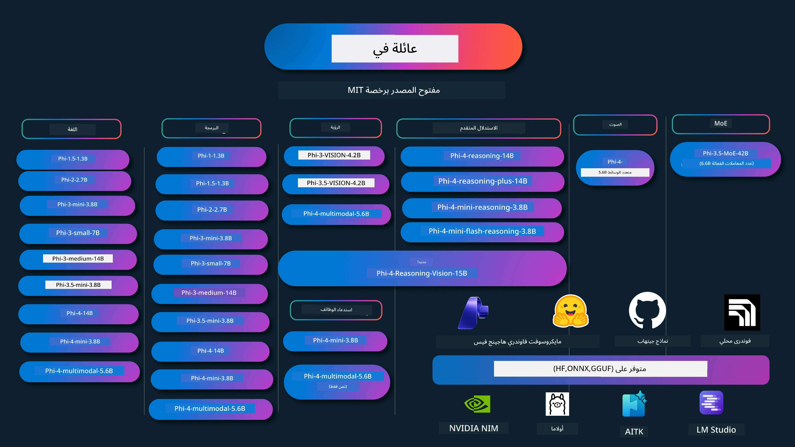

# كتاب وصفات Phi: أمثلة عملية مع نماذج Phi من Microsoft

[](https://codespaces.new/microsoft/phicookbook)
[](https://vscode.dev/redirect?url=vscode://ms-vscode-remote.remote-containers/cloneInVolume?url=https://github.com/microsoft/phicookbook)

[](https://GitHub.com/microsoft/phicookbook/graphs/contributors/?WT.mc_id=aiml-137032-kinfeylo)
[](https://GitHub.com/microsoft/phicookbook/issues/?WT.mc_id=aiml-137032-kinfeylo)
[](https://GitHub.com/microsoft/phicookbook/pulls/?WT.mc_id=aiml-137032-kinfeylo)
[](http://makeapullrequest.com?WT.mc_id=aiml-137032-kinfeylo)

[](https://GitHub.com/microsoft/phicookbook/watchers/?WT.mc_id=aiml-137032-kinfeylo)
[](https://GitHub.com/microsoft/phicookbook/network/?WT.mc_id=aiml-137032-kinfeylo)
[](https://GitHub.com/microsoft/phicookbook/stargazers/?WT.mc_id=aiml-137032-kinfeylo)

[](https://discord.com/invite/ByRwuEEgH4)

Phi هي سلسلة من نماذج الذكاء الاصطناعي مفتوحة المصدر التي طورتها Microsoft.

Phi هو حاليًا أقوى نموذج لغة صغير (SLM) وأكثرها فعالية من حيث التكلفة، مع نتائج ممتازة في اللغات المتعددة، والتفكير، وتوليد النصوص/الدردشة، والبرمجة، والصور، والصوت، وسيناريوهات أخرى.

يمكنك نشر Phi في السحابة أو على أجهزة الحافة، ويمكنك بسهولة بناء تطبيقات ذكاء اصطناعي توليدية بقدرة حوسبية محدودة.

اتبع هذه الخطوات للبدء باستخدام هذه الموارد:
1. **تفرع المستودع**: انقر على [](https://GitHub.com/microsoft/phicookbook/network/?WT.mc_id=aiml-137032-kinfeylo)
2. **استنساخ المستودع**: `git clone https://github.com/microsoft/PhiCookBook.git`
3. [**انضم إلى مجتمع Microsoft AI على Discord والتق بخبراء ومطورين زملاء**](https://discord.com/invite/ByRwuEEgH4?WT.mc_id=aiml-137032-kinfeylo)



### 🌐 دعم متعدد اللغات

#### مدعوم عبر GitHub Action (آلي ومحدث دائمًا)

<!-- CO-OP TRANSLATOR LANGUAGES TABLE START -->
[العربية](./README.md) | [البنغالية](../bn/README.md) | [البلغارية](../bg/README.md) | [البورمية (ميانمار)](../my/README.md) | [الصينية (المبسطة)](../zh-CN/README.md) | [الصينية (التقليدية، هونغ كونغ)](../zh-HK/README.md) | [الصينية (التقليدية، ماكاو)](../zh-MO/README.md) | [الصينية (التقليدية، تايوان)](../zh-TW/README.md) | [الكرواتية](../hr/README.md) | [التشيكية](../cs/README.md) | [الدانماركية](../da/README.md) | [الهولندية](../nl/README.md) | [الإستونية](../et/README.md) | [الفنلندية](../fi/README.md) | [الفرنسية](../fr/README.md) | [الألمانية](../de/README.md) | [اليونانية](../el/README.md) | [العبرية](../he/README.md) | [الهندية](../hi/README.md) | [الهنغارية](../hu/README.md) | [الإندونيسية](../id/README.md) | [الإيطالية](../it/README.md) | [اليابانية](../ja/README.md) | [الكانادية](../kn/README.md) | [الخميرية](../km/README.md) | [الكورية](../ko/README.md) | [الليتوانية](../lt/README.md) | [الماليزية](../ms/README.md) | [المالايالامية](../ml/README.md) | [المانيبوري (ميتاي مايوك)](../mni/README.md) | [الماراثية](../mr/README.md) | [النيبالية](../ne/README.md) | [البيجدين النيجيري](../pcm/README.md) | [النرويجية](../no/README.md) | [الفارسية (التركية)](../fa/README.md) | [البولندية](../pl/README.md) | [البرتغالية (البرازيل)](../pt-BR/README.md) | [البرتغالية (البرتغال)](../pt-PT/README.md) | [البنجابية (غورموخي)](../pa/README.md) | [الرومانية](../ro/README.md) | [الروسية](../ru/README.md) | [الصربية (السيريلية)](../sr/README.md) | [السلوفاكية](../sk/README.md) | [السلوفينية](../sl/README.md) | [الإسبانية](../es/README.md) | [السواحلية](../sw/README.md) | [السويدية](../sv/README.md) | [التاغالوغ (الفلبينية)](../tl/README.md) | [التاميلية](../ta/README.md) | [التيلغو](../te/README.md) | [التايلاندية](../th/README.md) | [التركية](../tr/README.md) | [الأوكرانية](../uk/README.md) | [الأردية](../ur/README.md) | [الفيتنامية](../vi/README.md)

> **تفضل الاستنساخ محليًا؟**
>
> هذا المستودع يتضمن أكثر من 50 ترجمة لغة مما يزيد بشكل كبير من حجم التنزيل. لاستنساخ بدون الترجمات، استخدم السحب الانتقائي:
>
> **Bash / macOS / Linux:**
> ```bash
> git clone --filter=blob:none --sparse https://github.com/microsoft/PhiCookBook.git
> cd PhiCookBook
> git sparse-checkout set --no-cone '/*' '!translations' '!translated_images'
> ```
>
> **CMD (ويندوز):**
> ```cmd
> git clone --filter=blob:none --sparse https://github.com/microsoft/PhiCookBook.git
> cd PhiCookBook
> git sparse-checkout set --no-cone "/*" "!translations" "!translated_images"
> ```
>
> هذا يمنحك كل ما تحتاجه لإكمال الدورة مع تنزيل أسرع بكثير.
<!-- CO-OP TRANSLATOR LANGUAGES TABLE END -->

## جدول المحتويات

- المقدمة
  - [مرحبًا بك في عائلة Phi](./md/01.Introduction/01/01.PhiFamily.md)
  - [إعداد بيئتك](./md/01.Introduction/01/01.EnvironmentSetup.md)
  - [فهم التقنيات الأساسية](./md/01.Introduction/01/01.Understandingtech.md)
  - [السلامة في الذكاء الاصطناعي لنماذج Phi](./md/01.Introduction/01/01.AISafety.md)
  - [دعم أجهزة Phi](./md/01.Introduction/01/01.Hardwaresupport.md)
  - [نماذج Phi وتوافرها عبر المنصات](./md/01.Introduction/01/01.Edgeandcloud.md)
  - [استخدام guidance-ai و Phi](./md/01.Introduction/01/01.Guidance.md)
  - [نماذج سوق GitHub](https://github.com/marketplace/models)
  - [كاتالوج نماذج Azure AI](https://ai.azure.com)

- استنتاج Phi في بيئات مختلفة
    -  [Hugging face](./md/01.Introduction/02/01.HF.md)
    -  [نماذج GitHub](./md/01.Introduction/02/02.GitHubModel.md)
    -  [كاتالوج نُموذج Microsoft Foundry](./md/01.Introduction/02/03.AzureAIFoundry.md)
    -  [Ollama](./md/01.Introduction/02/04.Ollama.md)
    -  [أدوات الذكاء الاصطناعي لـ VSCode (AITK)](./md/01.Introduction/02/05.AITK.md)
    -  [NVIDIA NIM](./md/01.Introduction/02/06.NVIDIA.md)
    -  [Foundry Local](./md/01.Introduction/02/07.FoundryLocal.md)

- استنتاج عائلة Phi
    - [استنتاج Phi في iOS](./md/01.Introduction/03/iOS_Inference.md)
    - [استنتاج Phi في Android](./md/01.Introduction/03/Android_Inference.md)
    - [استنتاج Phi في Jetson](./md/01.Introduction/03/Jetson_Inference.md)
    - [استنتاج Phi في AI PC](./md/01.Introduction/03/AIPC_Inference.md)
    - [استنتاج Phi باستخدام إطار عمل Apple MLX](./md/01.Introduction/03/MLX_Inference.md)
    - [استنتاج Phi في الخادم المحلي](./md/01.Introduction/03/Local_Server_Inference.md)
    - [استنتاج Phi في الخادم البعيد باستخدام أدوات الذكاء الاصطناعي](./md/01.Introduction/03/Remote_Interence.md)
    - [استنتاج Phi باستخدام Rust](./md/01.Introduction/03/Rust_Inference.md)
    - [استنتاج Phi--Vision محليًا](./md/01.Introduction/03/Vision_Inference.md)
    - [استنتاج Phi مع Kaito AKS، حاويات Azure (دعم رسمي)](./md/01.Introduction/03/Kaito_Inference.md)
-  [تحجيم عائلة Phi](./md/01.Introduction/04/QuantifyingPhi.md)
    - [تحجيم Phi-3.5 / 4 باستخدام llama.cpp](./md/01.Introduction/04/UsingLlamacppQuantifyingPhi.md)
    - [تحجيم Phi-3.5 / 4 باستخدام امتدادات الذكاء الاصطناعي التوليدي لـ onnxruntime](./md/01.Introduction/04/UsingORTGenAIQuantifyingPhi.md)
    - [تحجيم Phi-3.5 / 4 باستخدام Intel OpenVINO](./md/01.Introduction/04/UsingIntelOpenVINOQuantifyingPhi.md)
    - [تحجيم Phi-3.5 / 4 باستخدام إطار عمل Apple MLX](./md/01.Introduction/04/UsingAppleMLXQuantifyingPhi.md)

-  تقييم Phi
    - [Response AI](./md/01.Introduction/05/ResponsibleAI.md)
    - [Microsoft Foundry للتقييم](./md/01.Introduction/05/AIFoundry.md)
    - [استخدام Promptflow للتقييم](./md/01.Introduction/05/Promptflow.md)
 
- RAG مع Azure AI Search
    - [كيفية استخدام Phi-4-mini و Phi-4-multimodal (RAG) مع Azure AI Search](https://github.com/microsoft/PhiCookBook/blob/main/code/06.E2E/E2E_Phi-4-RAG-Azure-AI-Search.ipynb)
    - [RAG الهجين المحلي بدون سحابة مع SQLite FTS5 و phi-4-mini](https://github.com/microsoft/PhiCookBook/blob/main/code/06.E2E/E2E_Phi-4-mini_Local_Hybrid_RAG_SQLite_FTS5.ipynb)

- أمثلة لتطوير تطبيقات Phi
  - تطبيقات النص والدردشة
    - عينات Phi-4
      - [📓] [الدردشة مع نموذج Phi-4-mini ONNX](./md/02.Application/01.TextAndChat/Phi4/ChatWithPhi4ONNX/README.md)
      - [الدردشة مع نموذج Phi-4 المحلي ONNX .NET](../../md/04.HOL/dotnet/src/LabsPhi4-Chat-01OnnxRuntime)
      - [تطبيق وحدة التحكم للدردشة .NET مع Phi-4 ONNX باستخدام النواة الدلالية](../../md/04.HOL/dotnet/src/LabsPhi4-Chat-02SK)
    - عينات Phi-3 / 3.5
      - [شات بوت محلي في المتصفح باستخدام Phi3، ONNX Runtime Web و WebGPU](https://github.com/microsoft/onnxruntime-inference-examples/tree/main/js/chat)
      - [دردشة OpenVino](./md/02.Application/01.TextAndChat/Phi3/E2E_OpenVino_Chat.md)
      - [نموذج متعدد - Phi-3-mini التفاعلي وOpenAI Whisper](./md/02.Application/01.TextAndChat/Phi3/E2E_Phi-3-mini_with_whisper.md)
      - [MLFlow - بناء غلاف واستخدام Phi-3 مع MLFlow](./md//02.Application/01.TextAndChat/Phi3/E2E_Phi-3-MLflow.md)
      - [تحسين النموذج - كيفية تحسين نموذج Phi-3-min لـ ONNX Runtime Web باستخدام Olive](https://github.com/microsoft/Olive/tree/main/examples/phi3)
      - [تطبيق WinUI3 مع Phi-3 mini-4k-instruct-onnx](https://github.com/microsoft/Phi3-Chat-WinUI3-Sample/)
      - [مثال تطبيق ملاحظات AI متعدد النماذج لـ WinUI3](https://github.com/microsoft/ai-powered-notes-winui3-sample)
      - [تخصيص وتكامل نماذج Phi-3 المخصصة باستخدام Prompt flow](./md/02.Application/01.TextAndChat/Phi3/E2E_Phi-3-FineTuning_PromptFlow_Integration.md)
      - [تخصيص وتكامل نماذج Phi-3 المخصصة باستخدام Prompt flow في Microsoft Foundry](./md/02.Application/01.TextAndChat/Phi3/E2E_Phi-3-FineTuning_PromptFlow_Integration_AIFoundry.md)
      - [تقييم نموذج Phi-3 / Phi-3.5 المُخصص في Microsoft Foundry مع التركيز على مبادئ AI المسؤولة من Microsoft](./md/02.Application/01.TextAndChat/Phi3/E2E_Phi-3-Evaluation_AIFoundry.md)
      - [📓] [عينة توقع اللغة Phi-3.5-mini-instruct (الصينية/الإنجليزية)](./md/02.Application/01.TextAndChat/Phi3/phi3-instruct-demo.ipynb)
      - [شات بوت RAG Phi-3.5-Instruct WebGPU](./md/02.Application/01.TextAndChat/Phi3/WebGPUWithPhi35Readme.md)
      - [استخدام GPU ويندوز لإنشاء حل Prompt flow مع Phi-3.5-Instruct ONNX](./md/02.Application/01.TextAndChat/Phi3/UsingPromptFlowWithONNX.md)
      - [استخدام Microsoft Phi-3.5 tflite لإنشاء تطبيق أندرويد](./md/02.Application/01.TextAndChat/Phi3/UsingPhi35TFLiteCreateAndroidApp.md)
      - [مثال Q&A .NET باستخدام نموذج ONNX Phi-3 المحلي عبر Microsoft.ML.OnnxRuntime](../../md/04.HOL/dotnet/src/LabsPhi301)
      - [تطبيق دردشة وحدة التحكم .NET مع النواة الدلالية وPhi-3](../../md/04.HOL/dotnet/src/LabsPhi302)

  - عينات SDK استدلال Azure AI القائمة على الكود
    - عينات Phi-4
      - [📓] [توليد رمز المشروع باستخدام Phi-4-multimodal](./md/02.Application/02.Code/Phi4/GenProjectCode/README.md)
    - عينات Phi-3 / 3.5
      - [بناء وكيل دردشة GitHub Copilot الخاص بك في Visual Studio Code مع عائلة Microsoft Phi-3](./md/02.Application/02.Code/Phi3/VSCodeExt/README.md)
      - [إنشاء وكيل دردشة Copilot خاص بك في Visual Studio Code مع Phi-3.5 بواسطة نماذج GitHub](/md/02.Application/02.Code/Phi3/CreateVSCodeChatAgentWithGitHubModels.md)

  - أمثلة التفكير المتقدم
    - عينات Phi-4
      - [📓] [عينات Phi-4-mini-reasoning أو Phi-4-reasoning](./md/02.Application/03.AdvancedReasoning/Phi4/AdvancedResoningPhi4mini/README.md)
      - [📓] [ضبط دقيق لـ Phi-4-mini-reasoning باستخدام Microsoft Olive](./md/02.Application/03.AdvancedReasoning/Phi4/AdvancedResoningPhi4mini/olive_ft_phi_4_reasoning_with_medicaldata.ipynb)
      - [📓] [ضبط دقيق لـ Phi-4-mini-reasoning باستخدام Apple MLX](./md/02.Application/03.AdvancedReasoning/Phi4/AdvancedResoningPhi4mini/mlx_ft_phi_4_reasoning_with_medicaldata.ipynb)
      - [📓] [Phi-4-mini-reasoning مع نماذج GitHub](./md/02.Application/02.Code/Phi4r/github_models_inference.ipynb)
      - [📓] [Phi-4-mini-reasoning مع نماذج Microsoft Foundry](./md/02.Application/02.Code/Phi4r/azure_models_inference.ipynb)
  - العروض التوضيحية
      - [عروض Phi-4-mini المستضافة على Hugging Face Spaces](https://huggingface.co/spaces/microsoft/phi-4-mini?WT.mc_id=aiml-137032-kinfeylo)
      - [عروض Phi-4-multimodal المستضافة على Hugging Face Spaces](https://huggingface.co/spaces/microsoft/phi-4-multimodal?WT.mc_id=aiml-137032-kinfeylo)
  - عينات الرؤية
    - عينات Phi-4 
      - [📓] [استخدام Phi-4-multimodal لقراءة الصور وتوليد الشيفرة](./md/02.Application/04.Vision/Phi4/CreateFrontend/README.md) 
    - عينات Phi-3 / 3.5
      -  [📓][Phi-3-vision-نص الصورة إلى نص](./md/02.Application/04.Vision/Phi3/E2E_Phi-3-vision-image-text-to-text-online-endpoint.ipynb)
      - [Phi-3-vision-ONNX](https://onnxruntime.ai/docs/genai/tutorials/phi3-v.html)
      - [📓][Phi-3-vision تضمين CLIP](./md/02.Application/04.Vision/Phi3/E2E_Phi-3-vision-image-text-to-text-online-endpoint.ipynb)
      - [عرض توضيحي: Phi-3 Recycling](https://github.com/jennifermarsman/PhiRecycling/)
      - [Phi-3-vision - مساعد اللغة البصرية - مع Phi3-Vision و OpenVINO](https://docs.openvino.ai/nightly/notebooks/phi-3-vision-with-output.html)
      - [Phi-3 Vision Nvidia NIM](./md/02.Application/04.Vision/Phi3/E2E_Nvidia_NIM_Vision.md)
      - [Phi-3 Vision OpenVino](./md/02.Application/04.Vision/Phi3/E2E_OpenVino_Phi3Vision.md)
      - [📓][Phi-3.5 Vision عينة متعددة الإطارات أو متعددة الصور](./md/02.Application/04.Vision/Phi3/phi3-vision-demo.ipynb)
      - [Phi-3 Vision نموذج ONNX محلي باستخدام Microsoft.ML.OnnxRuntime .NET](../../md/04.HOL/dotnet/src/LabsPhi303)
      - [قائمة نموذج Phi-3 Vision المحلي ONNX باستخدام Microsoft.ML.OnnxRuntime .NET](../../md/04.HOL/dotnet/src/LabsPhi304)

  - عينات المنطق والرؤية
    - Phi-4-Reasoning-Vision-15B 
      - [📓] [استخدام Phi-4-Reasoning-Vision-15B للكشف عن عبور المشاة الخاطئ](./md/02.Application/10.ReasoningVision/Phi_4_reasoning_vision_15b_Jaywalking.ipynb)
      - [📓] [استخدام Phi-4-Reasoning-Vision-15B في الرياضيات](./md/02.Application/10.ReasoningVision/Phi_4_reasoning_vision_15b_Math.ipynb)
      - [📓] [استخدام Phi-4-Reasoning-Vision-15B للكشف عن واجهة المستخدم](./md/02.Application/10.ReasoningVision/Phi_4_reasoning_vision_15b_ui.ipynb)

  - عينات الرياضيات
    -  عينات Phi-4-Mini-Flash-Reasoning-Instruct  [عرض توضيحي للرياضيات مع Phi-4-Mini-Flash-Reasoning-Instruct](./md/02.Application/09.Math/MathDemo.ipynb)

  - عينات الصوت
    - عينات Phi-4 
      - [📓] [استخراج نصوص الصوت باستخدام Phi-4-multimodal](./md/02.Application/05.Audio/Phi4/Transciption/README.md)
      - [📓] [عينة صوتية لـ Phi-4-multimodal](./md/02.Application/05.Audio/Phi4/Siri/demo.ipynb)
      - [📓] [عينة ترجمة صوتية لـ Phi-4-multimodal](./md/02.Application/05.Audio/Phi4/Translate/demo.ipynb)
      - [تطبيق .NET console باستخدام Phi-4-multimodal لتحليل ملف صوتي وتوليد نص](../../md/04.HOL/dotnet/src/LabsPhi4-MultiModal-02Audio)

  - عينات MOE
    - عينات Phi-3 / 3.5
      - [📓] [نماذج مزيج الخبراء Phi-3.5 (MoEs) عينة وسائل التواصل الاجتماعي](./md/02.Application/06.MoE/Phi3/phi3_moe_demo.ipynb)
      - [📓] [بناء خط أنابيب توليد معزز بالإسترجاع (RAG) مع NVIDIA NIM Phi-3 MOE، Azure AI Search، و LlamaIndex](./md/02.Application/06.MoE/Phi3/azure-ai-search-nvidia-rag.ipynb)
      - 
  - عينات استدعاء الدوال
    - عينات Phi-4 🆕
      -  [📓] [استخدام استدعاء الدوال مع Phi-4-mini](./md/02.Application/07.FunctionCalling/Phi4/FunctionCallingBasic/README.md)
      -  [📓] [استخدام استدعاء الدوال لإنشاء وكلاء متعددين مع Phi-4-mini](./md/02.Application/07.FunctionCalling/Phi4/Multiagents/Phi_4_mini_multiagent.ipynb)
      -  [📓] [استخدام استدعاء الدوال مع Ollama](./md/02.Application/07.FunctionCalling/Phi4/Ollama/ollama_functioncalling.ipynb)
      -  [📓] [استخدام استدعاء الدوال مع ONNX](./md/02.Application/07.FunctionCalling/Phi4/ONNX/onnx_parallel_functioncalling.ipynb)
  - عينات الخلط متعدد الأنماط
    - عينات Phi-4 🆕
      -  [📓] [استخدام Phi-4-multimodal كصحفي تقني](./md/02.Application/08.Multimodel/Phi4/TechJournalist/phi_4_mm_audio_text_publish_news.ipynb)
      - [تطبيق .NET console يستخدم Phi-4-multimodal لتحليل الصور](../../md/04.HOL/dotnet/src/LabsPhi4-MultiModal-01Images)

- ضبط عينات Phi
  - [سيناريوهات الضبط الدقيق](./md/03.FineTuning/FineTuning_Scenarios.md)
  - [الضبط الدقيق مقابل RAG](./md/03.FineTuning/FineTuning_vs_RAG.md)
  - [السماح لـ Phi-3 بأن يصبح خبيرًا صناعيًا عن طريق الضبط الدقيق](./md/03.FineTuning/LetPhi3gotoIndustriy.md)
  - [الضبط الدقيق لـ Phi-3 باستخدام AI Toolkit لـ VS Code](./md/03.FineTuning/Finetuning_VSCodeaitoolkit.md)
  - [الضبط الدقيق لـ Phi-3 باستخدام خدمة Azure Machine Learning](./md/03.FineTuning/Introduce_AzureML.md)
  - [الضبط الدقيق لـ Phi-3 باستخدام Lora](./md/03.FineTuning/FineTuning_Lora.md)
  - [الضبط الدقيق لـ Phi-3 باستخدام QLora](./md/03.FineTuning/FineTuning_Qlora.md)
  - [الضبط الدقيق لـ Phi-3 باستخدام Microsoft Foundry](./md/03.FineTuning/FineTuning_AIFoundry.md)
  - [الضبط الدقيق لـ Phi-3 باستخدام Azure ML CLI/SDK](./md/03.FineTuning/FineTuning_MLSDK.md)
  - [الضبط الدقيق باستخدام Microsoft Olive](./md/03.FineTuning/FineTuning_MicrosoftOlive.md)
  - [الضبط الدقيق باستخدام Microsoft Olive مختبر عملي](./md/03.FineTuning/olive-lab/readme.md)
  - [الضبط الدقيق لـ Phi-3-vision باستخدام Weights and Bias](./md/03.FineTuning/FineTuning_Phi-3-visionWandB.md)
  - [الضبط الدقيق لـ Phi-3 باستخدام إطار عمل Apple MLX](./md/03.FineTuning/FineTuning_MLX.md)
  - [الضبط الدقيق لـ Phi-3-vision (الدعم الرسمي)](./md/03.FineTuning/FineTuning_Vision.md)
  - [الضبط الدقيق لـ Phi-3 مع Kaito AKS ، حاويات Azure (الدعم الرسمي)](./md/03.FineTuning/FineTuning_Kaito.md)
  - [الضبط الدقيق لـ Phi-3 و 3.5 Vision](https://github.com/2U1/Phi3-Vision-Finetune)

- مختبر عملي
  - [استكشاف النماذج المتقدمة: LLMs، SLMs، التطوير المحلي والمزيد](https://github.com/microsoft/aitour-exploring-cutting-edge-models)
  - [فتح إمكانات معالجة اللغة الطبيعية: الضبط الدقيق مع Microsoft Olive](https://github.com/azure/Ignite_FineTuning_workshop)

- الأوراق والأبحاث الأكاديمية والمنشورات
  - [الكتب الدراسية هي كل ما تحتاجه II: تقرير فني phi-1.5](https://arxiv.org/abs/2309.05463)
  - [تقرير فني لـ Phi-3: نموذج لغة عالي القدرة محليًا على هاتفك](https://arxiv.org/abs/2404.14219)
  - [تقرير فني لـ Phi-4](https://arxiv.org/abs/2412.08905)
  - [تقرير فني لـ Phi-4-Mini: نماذج لغوية متعددة الأنماط مضغوطة لكنها قوية عبر مزيج من LoRAs](https://arxiv.org/abs/2503.01743)
  - [تحسين نماذج اللغة الصغيرة لاستدعاء الدوال داخل السيارة](https://arxiv.org/abs/2501.02342)
  - [(WhyPHI) الضبط الدقيق لـ PHI-3 للإجابة على أسئلة الاختيار من متعدد: المنهجية، النتائج، والتحديات](https://arxiv.org/abs/2501.01588)
  - [تقرير فني لـ Phi-4-reasoning](https://www.microsoft.com/en-us/research/wp-content/uploads/2025/04/phi_4_reasoning.pdf)
  - [تقرير فني لـ Phi-4-mini-reasoning](https://huggingface.co/microsoft/Phi-4-mini-reasoning/blob/main/Phi-4-Mini-Reasoning.pdf)

## استخدام نماذج Phi

### Phi على Microsoft Foundry

يمكنك تعلم كيفية استخدام Microsoft Phi وكيفية بناء حلول شاملة على أجهزتك المختلفة. لتجربة Phi بنفسك، ابدأ بالتفاعل مع النماذج وتخصيص Phi لسيناريوهاتك باستخدام [كتالوج نماذج Microsoft Foundry Azure AI](https://aka.ms/phi3-azure-ai) يمكنك التعرف أكثر على البداية مع [Microsoft Foundry](/md/02.QuickStart/AzureAIFoundry_QuickStart.md)

**ميدان اختبار**
لكل نموذج ميدان اختبار مخصص لاختبار النموذج [Azure AI Playground](https://aka.ms/try-phi3).

### Phi على نماذج GitHub

يمكنك تعلم كيفية استخدام Microsoft Phi وكيفية بناء حلول شاملة على أجهزتك المختلفة. لتجربة Phi بنفسك، ابدأ بالتفاعل مع النموذج وتخصيص Phi لسيناريوهاتك باستخدام [كتالوج نماذج GitHub](https://github.com/marketplace/models?WT.mc_id=aiml-137032-kinfeylo) يمكنك التعرف أكثر على البداية مع [كتالوج نماذج GitHub](/md/02.QuickStart/GitHubModel_QuickStart.md)

**ميدان اختبار**
لكل نموذج [ميدان اختبار مخصص لاختبار النموذج](/md/02.QuickStart/GitHubModel_QuickStart.md).

### Phi على Hugging Face

يمكنك أيضًا العثور على النموذج على [Hugging Face](https://huggingface.co/microsoft)

**ميدان اختبار**
 [ميدان Hugging Chat](https://huggingface.co/chat/models/microsoft/Phi-3-mini-4k-instruct)

 ## 🎒 دورات أخرى

ينتج فريقنا دورات أخرى! اطلع على:

<!-- CO-OP TRANSLATOR OTHER COURSES START -->
### LangChain
[](https://aka.ms/langchain4j-for-beginners)
[](https://aka.ms/langchainjs-for-beginners?WT.mc_id=m365-94501-dwahlin)
[](https://github.com/microsoft/langchain-for-beginners?WT.mc_id=m365-94501-dwahlin)
---

### Azure / Edge / MCP / الوكلاء
[](https://github.com/microsoft/AZD-for-beginners?WT.mc_id=academic-105485-koreyst)
[](https://github.com/microsoft/edgeai-for-beginners?WT.mc_id=academic-105485-koreyst)
[](https://github.com/microsoft/mcp-for-beginners?WT.mc_id=academic-105485-koreyst)
[](https://github.com/microsoft/ai-agents-for-beginners?WT.mc_id=academic-105485-koreyst)

---
 
### سلسلة الذكاء الاصطناعي التوليدي
[](https://github.com/microsoft/generative-ai-for-beginners?WT.mc_id=academic-105485-koreyst)
[-9333EA?style=for-the-badge&labelColor=E5E7EB&color=9333EA)](https://github.com/microsoft/Generative-AI-for-beginners-dotnet?WT.mc_id=academic-105485-koreyst)
[-C084FC?style=for-the-badge&labelColor=E5E7EB&color=C084FC)](https://github.com/microsoft/generative-ai-for-beginners-java?WT.mc_id=academic-105485-koreyst)
[-E879F9?style=for-the-badge&labelColor=E5E7EB&color=E879F9)](https://github.com/microsoft/generative-ai-with-javascript?WT.mc_id=academic-105485-koreyst)

---
 
### التعليم الأساسي
[](https://aka.ms/ml-beginners?WT.mc_id=academic-105485-koreyst)
[](https://aka.ms/datascience-beginners?WT.mc_id=academic-105485-koreyst)
[](https://aka.ms/ai-beginners?WT.mc_id=academic-105485-koreyst)
[](https://github.com/microsoft/Security-101?WT.mc_id=academic-96948-sayoung)
[](https://aka.ms/webdev-beginners?WT.mc_id=academic-105485-koreyst)
[](https://aka.ms/iot-beginners?WT.mc_id=academic-105485-koreyst)
[](https://github.com/microsoft/xr-development-for-beginners?WT.mc_id=academic-105485-koreyst)

---
 
### سلسلة Copilot
[](https://aka.ms/GitHubCopilotAI?WT.mc_id=academic-105485-koreyst)
[](https://github.com/microsoft/mastering-github-copilot-for-dotnet-csharp-developers?WT.mc_id=academic-105485-koreyst)
[](https://github.com/microsoft/CopilotAdventures?WT.mc_id=academic-105485-koreyst)
<!-- CO-OP TRANSLATOR OTHER COURSES END -->

## الذكاء الاصطناعي المسؤول 

تلتزم Microsoft بمساعدة عملائنا على استخدام منتجات الذكاء الاصطناعي لدينا بمسؤولية، ومشاركة معارفنا، وبناء شراكات قائمة على الثقة من خلال أدوات مثل ملاحظات الشفافية وتقييمات الأثر. يمكن العثور على العديد من هذه الموارد في [https://aka.ms/RAI](https://aka.ms/RAI).
يستند نهج Microsoft نحو الذكاء الاصطناعي المسؤول إلى مبادئنا للذكاء الاصطناعي: العدالة، الموثوقية والسلامة، الخصوصية والأمان، الشمولية، الشفافية، والمساءلة.

يمكن أن تتصرف نماذج اللغة والصورة والكلام واسعة النطاق - مثل تلك المستخدمة في هذه العينة - بطرق قد تكون غير عادلة، غير موثوقة، أو مسيئة، مما قد يسبب أضرارًا. يرجى مراجعة [ملاحظة شفافية خدمة Azure OpenAI](https://learn.microsoft.com/legal/cognitive-services/openai/transparency-note?tabs=text) لتكون على علم بالمخاطر والقيود.

النهج الموصى به لتخفيف هذه المخاطر هو تضمين نظام أمان في البنية التحتية الخاصة بك يمكنه اكتشاف السلوك الضار ومنعه. يوفر [Azure AI Content Safety](https://learn.microsoft.com/azure/ai-services/content-safety/overview) طبقة حماية مستقلة قادرة على اكتشاف المحتوى الضار الذي يُنتجه المستخدمون أو الذكاء الاصطناعي في التطبيقات والخدمات. يتضمن Azure AI Content Safety واجهات برمجة التطبيقات للنصوص والصور التي تتيح لك اكتشاف المواد الضارة. داخل Microsoft Foundry، يتيح لك خدمة Content Safety عرض واستكشاف وتجربة أكواد العينة لاكتشاف المحتوى الضار عبر أنماط مختلفة. ترشدك [وثائق البدء السريع](https://learn.microsoft.com/azure/ai-services/content-safety/quickstart-text?tabs=visual-studio%2Clinux&pivots=programming-language-rest) التالية خلال كيفية إجراء الطلبات إلى الخدمة.

جانب آخر يجب أخذه في الاعتبار هو أداء التطبيق الشامل. مع التطبيقات متعددة الأنماط والنماذج، نعتبر الأداء بأنه يعني أن النظام يعمل كما تتوقع أنت ومستخدموك، بما في ذلك عدم توليد مخرجات ضارة. من المهم تقييم أداء تطبيقك الشامل باستخدام [مقيمي الأداء والجودة والمخاطر والأمان](https://learn.microsoft.com/azure/ai-studio/concepts/evaluation-metrics-built-in). لديك أيضًا القدرة على الإنشاء والتقييم باستخدام [المقيمين المخصصين](https://learn.microsoft.com/azure/ai-studio/how-to/develop/evaluate-sdk#custom-evaluators).

يمكنك تقييم تطبيق الذكاء الاصطناعي الخاص بك في بيئة التطوير باستخدام [مجموعة أدوات تقييم Azure AI](https://microsoft.github.io/promptflow/index.html). بالنظر إلى مجموعة بيانات اختبار أو هدف، يتم قياس توليدات تطبيق الذكاء الاصطناعي التوليدي الخاص بك كميًا باستخدام المقيمين المدمجين أو المقيمين المخصصين من اختيارك. للبدء باستخدام مجموعة أدوات تقييم Azure AI لتقييم نظامك، يمكنك اتباع [دليل البدء السريع](https://learn.microsoft.com/azure/ai-studio/how-to/develop/flow-evaluate-sdk). بمجرد تنفيذ تشغيل التقييم، يمكنك [عرض النتائج في Microsoft Foundry](https://learn.microsoft.com/azure/ai-studio/how-to/evaluate-flow-results).

## العلامات التجارية

قد يحتوي هذا المشروع على علامات تجارية أو شعارات لمشاريع أو منتجات أو خدمات. يجب أن يكون الاستخدام المصرح به لعلامات Microsoft التجارية أو شعاراتها وفقًا وملتزمًا بـ [إرشادات العلامة التجارية وحقوق Microsoft](https://www.microsoft.com/legal/intellectualproperty/trademarks/usage/general).
يجب ألا يتسبب استخدام علامات Microsoft التجارية أو شعاراتها في نسخ معدلة من هذا المشروع في حدوث ارتباك أو توحي برعاية Microsoft. ينطبق استخدام علامات تجارية أو شعارات جهات خارجية على سياسات تلك الجهات الخارجية.

## الحصول على المساعدة

إذا واجهت صعوبة أو كان لديك أي أسئلة حول بناء تطبيقات الذكاء الاصطناعي، انضم إلى:

[](https://aka.ms/foundry/discord)

إذا كان لديك ملاحظات حول المنتج أو أخطاء أثناء البناء، قم بزيارة:

[](https://aka.ms/foundry/forum)

---

<!-- CO-OP TRANSLATOR DISCLAIMER START -->
**تنويه**:
تمت ترجمة هذا المستند باستخدام خدمة الترجمة بالذكاء الاصطناعي [Co-op Translator](https://github.com/Azure/co-op-translator). بينما نسعى للدقة، يرجى العلم أن الترجمات الآلية قد تحتوي على أخطاء أو عدم دقة. يجب اعتبار المستند الأصلي بلغته الأصلية المصدر الرسمي والمعتمد. للمعلومات الهامة، يُنصح بالاستعانة بترجمة بشرية محترفة. نحن غير مسؤولين عن أي سوء فهم أو تفسير ناتج عن استخدام هذه الترجمة.
<!-- CO-OP TRANSLATOR DISCLAIMER END -->