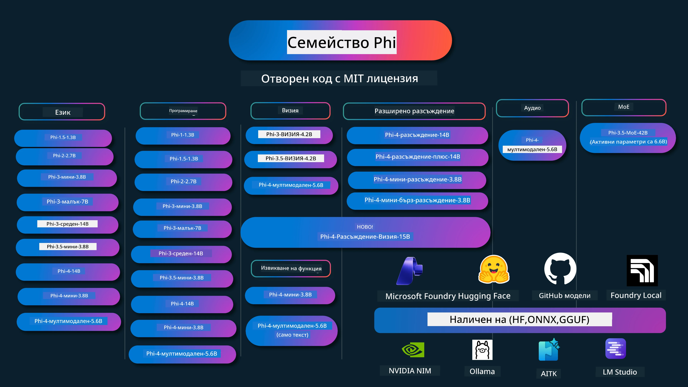

# Ръководство Phi: Практически примери с моделите Phi на Microsoft

[](https://codespaces.new/microsoft/phicookbook)
[](https://vscode.dev/redirect?url=vscode://ms-vscode-remote.remote-containers/cloneInVolume?url=https://github.com/microsoft/phicookbook)

[](https://GitHub.com/microsoft/phicookbook/graphs/contributors/?WT.mc_id=aiml-137032-kinfeylo)
[](https://GitHub.com/microsoft/phicookbook/issues/?WT.mc_id=aiml-137032-kinfeylo)
[](https://GitHub.com/microsoft/phicookbook/pulls/?WT.mc_id=aiml-137032-kinfeylo)
[](http://makeapullrequest.com?WT.mc_id=aiml-137032-kinfeylo)

[](https://GitHub.com/microsoft/phicookbook/watchers/?WT.mc_id=aiml-137032-kinfeylo)
[](https://GitHub.com/microsoft/phicookbook/network/?WT.mc_id=aiml-137032-kinfeylo)
[](https://GitHub.com/microsoft/phicookbook/stargazers/?WT.mc_id=aiml-137032-kinfeylo)

[](https://discord.com/invite/ByRwuEEgH4)

Phi е серия от отворени AI модели, разработени от Microsoft.

Phi в момента е най-мощният и икономичен малък езиков модел (SLM), с много добри резултати в многоезикови, логически, текстови/чат генериране, програмиране, изображения, аудио и други сценарии.

Можете да разположите Phi в облак или на крайни устройства и лесно да изградите генеративни AI приложения с ограничена изчислителна мощ.

Следвайте тези стъпки, за да започнете да използвате този ресурс:
1. **Форкирайте хранилището**: Натиснете [](https://GitHub.com/microsoft/phicookbook/network/?WT.mc_id=aiml-137032-kinfeylo)
2. **Клонирайте хранилището**: `git clone https://github.com/microsoft/PhiCookBook.git`
3. [**Присъединете се към Microsoft AI Discord общността и срещнете експерти и други разработчици**](https://discord.com/invite/ByRwuEEgH4?WT.mc_id=aiml-137032-kinfeylo)



### 🌐 Поддръжка на много езици

#### Поддържано чрез GitHub действие (Автоматично и винаги актуално)

<!-- CO-OP TRANSLATOR LANGUAGES TABLE START -->
[Арабски](../ar/README.md) | [Бенгалски](../bn/README.md) | [Български](./README.md) | [Бирмански (Мианмар)](../my/README.md) | [Китайски (опростен)](../zh-CN/README.md) | [Китайски (традиционен, Хонг Конг)](../zh-HK/README.md) | [Китайски (традиционен, Макао)](../zh-MO/README.md) | [Китайски (традиционен, Тайван)](../zh-TW/README.md) | [Хърватски](../hr/README.md) | [Чешки](../cs/README.md) | [Датски](../da/README.md) | [Холандски](../nl/README.md) | [Естонски](../et/README.md) | [Финландски](../fi/README.md) | [Френски](../fr/README.md) | [Немски](../de/README.md) | [Гръцки](../el/README.md) | [Иврит](../he/README.md) | [Хинди](../hi/README.md) | [Унгарски](../hu/README.md) | [Индонезийски](../id/README.md) | [Италиански](../it/README.md) | [Японски](../ja/README.md) | [Каннада](../kn/README.md) | [Кмерски](../km/README.md) | [Корейски](../ko/README.md) | [Литовски](../lt/README.md) | [Малайски](../ms/README.md) | [Малаялам](../ml/README.md) | [Манипури (Меитей Маек)](../mni/README.md) | [Маратхи](../mr/README.md) | [Непалски](../ne/README.md) | [Нигерийски пиджин](../pcm/README.md) | [Норвежки](../no/README.md) | [Персийски (Фарси)](../fa/README.md) | [Полски](../pl/README.md) | [Португалски (Бразилия)](../pt-BR/README.md) | [Португалски (Португалия)](../pt-PT/README.md) | [Пунджаби (Гурмуки)](../pa/README.md) | [Румънски](../ro/README.md) | [Руски](../ru/README.md) | [Сръбски (кирилица)](../sr/README.md) | [Словашки](../sk/README.md) | [Словенски](../sl/README.md) | [Испански](../es/README.md) | [Суахили](../sw/README.md) | [Шведски](../sv/README.md) | [Тагалог (Филипински)](../tl/README.md) | [Тамилски](../ta/README.md) | [Телугу](../te/README.md) | [Тайски](../th/README.md) | [Турски](../tr/README.md) | [Украински](../uk/README.md) | [Урду](../ur/README.md) | [Виетнамски](../vi/README.md)

> **Предпочитате локално клониране?**
>
> Това хранилище включва над 50 езикови превода, което значително увеличава размера на изтегляне. За клониране без преводи, използвайте sparse checkout:
>
> **Bash / macOS / Linux:**
> ```bash
> git clone --filter=blob:none --sparse https://github.com/microsoft/PhiCookBook.git
> cd PhiCookBook
> git sparse-checkout set --no-cone '/*' '!translations' '!translated_images'
> ```
>
> **CMD (Windows):**
> ```cmd
> git clone --filter=blob:none --sparse https://github.com/microsoft/PhiCookBook.git
> cd PhiCookBook
> git sparse-checkout set --no-cone "/*" "!translations" "!translated_images"
> ```
>
> Това ви дава всичко необходимо за завършване на курса с много по-бързо изтегляне.
<!-- CO-OP TRANSLATOR LANGUAGES TABLE END -->

## Съдържание

- Въведение
  - [Добре дошли във Фамилията Phi](./md/01.Introduction/01/01.PhiFamily.md)
  - [Настройване на вашата среда](./md/01.Introduction/01/01.EnvironmentSetup.md)
  - [Разбиране на ключовите технологии](./md/01.Introduction/01/01.Understandingtech.md)
  - [Безопасност на AI за моделите Phi](./md/01.Introduction/01/01.AISafety.md)
  - [Поддръжка на хардуер Phi](./md/01.Introduction/01/01.Hardwaresupport.md)
  - [Модели Phi и тяхната наличност в различни платформи](./md/01.Introduction/01/01.Edgeandcloud.md)
  - [Използване на Guidance-ai и Phi](./md/01.Introduction/01/01.Guidance.md)
  - [Модели от GitHub Marketplace](https://github.com/marketplace/models)
  - [Каталог на AI модели в Azure](https://ai.azure.com)

- Иницииране на Phi в различна среда
    -  [Hugging face](./md/01.Introduction/02/01.HF.md)
    -  [GitHub модели](./md/01.Introduction/02/02.GitHubModel.md)
    -  [Каталог на модели Microsoft Foundry](./md/01.Introduction/02/03.AzureAIFoundry.md)
    -  [Ollama](./md/01.Introduction/02/04.Ollama.md)
    -  [AI Toolkit VSCode (AITK)](./md/01.Introduction/02/05.AITK.md)
    -  [NVIDIA NIM](./md/01.Introduction/02/06.NVIDIA.md)
    -  [Foundry Local](./md/01.Introduction/02/07.FoundryLocal.md)

- Семейство модели Phi
    - [Иницииране на Phi в iOS](./md/01.Introduction/03/iOS_Inference.md)
    - [Иницииране на Phi в Android](./md/01.Introduction/03/Android_Inference.md)
    - [Иницииране на Phi в Jetson](./md/01.Introduction/03/Jetson_Inference.md)
    - [Иницииране на Phi в AI PC](./md/01.Introduction/03/AIPC_Inference.md)
    - [Иницииране на Phi с Apple MLX Framework](./md/01.Introduction/03/MLX_Inference.md)
    - [Иницииране на Phi в локален сървър](./md/01.Introduction/03/Local_Server_Inference.md)
    - [Иницииране на Phi в отдалечен сървър, използвайки AI Toolkit](./md/01.Introduction/03/Remote_Interence.md)
    - [Иницииране на Phi с Rust](./md/01.Introduction/03/Rust_Inference.md)
    - [Иницииране на Phi--Vision локално](./md/01.Introduction/03/Vision_Inference.md)
    - [Иницииране на Phi с Kaito AKS, Azure Containers (официална поддръжка)](./md/01.Introduction/03/Kaito_Inference.md)
-  [Квантуване на семейство Phi](./md/01.Introduction/04/QuantifyingPhi.md)
    - [Квантуване на Phi-3.5 / 4 с llama.cpp](./md/01.Introduction/04/UsingLlamacppQuantifyingPhi.md)
    - [Квантуване на Phi-3.5 / 4 с разширения за генеративен AI за onnxruntime](./md/01.Introduction/04/UsingORTGenAIQuantifyingPhi.md)
    - [Квантуване на Phi-3.5 / 4 с Intel OpenVINO](./md/01.Introduction/04/UsingIntelOpenVINOQuantifyingPhi.md)
    - [Квантуване на Phi-3.5 / 4 с Apple MLX Framework](./md/01.Introduction/04/UsingAppleMLXQuantifyingPhi.md)

-  Оценка на Phi
    - [Response AI](./md/01.Introduction/05/ResponsibleAI.md)
    - [Microsoft Foundry за оценка](./md/01.Introduction/05/AIFoundry.md)
    - [Използване на Promptflow за оценка](./md/01.Introduction/05/Promptflow.md)
 
- RAG с Azure AI Search
    - [Как да използваме Phi-4-mini и Phi-4-multimodal (RAG) с Azure AI Search](https://github.com/microsoft/PhiCookBook/blob/main/code/06.E2E/E2E_Phi-4-RAG-Azure-AI-Search.ipynb)
    - [Нулево-облачно локално хибридно RAG с SQLite FTS5 и phi-4-mini](https://github.com/microsoft/PhiCookBook/blob/main/code/06.E2E/E2E_Phi-4-mini_Local_Hybrid_RAG_SQLite_FTS5.ipynb)

- Примери за разработка на приложението Phi
  - Приложения за текст и чат
    - Примери Phi-4 
      - [📓] [Чат с Phi-4-mini ONNX модел](./md/02.Application/01.TextAndChat/Phi4/ChatWithPhi4ONNX/README.md)
      - [Чат с Phi-4 локален ONNX модел .NET](../../md/04.HOL/dotnet/src/LabsPhi4-Chat-01OnnxRuntime)
      - [Чат .NET конзолно приложение с Phi-4 ONNX, използвайки Semantic Kernel](../../md/04.HOL/dotnet/src/LabsPhi4-Chat-02SK)
    - Примери Phi-3 / 3.5
      - [Локален чатбот в браузър с Phi3, ONNX Runtime Web и WebGPU](https://github.com/microsoft/onnxruntime-inference-examples/tree/main/js/chat)
      - [OpenVino чат](./md/02.Application/01.TextAndChat/Phi3/E2E_OpenVino_Chat.md)
      - [Мулти модел - Интерактивен Phi-3-mini и OpenAI Whisper](./md/02.Application/01.TextAndChat/Phi3/E2E_Phi-3-mini_with_whisper.md)
      - [MLFlow - Създаване на обвивка и използване на Phi-3 с MLFlow](./md//02.Application/01.TextAndChat/Phi3/E2E_Phi-3-MLflow.md)
      - [Оптимизация на модел - Как да оптимизираме модела Phi-3-min за ONNX Runtime Web с Olive](https://github.com/microsoft/Olive/tree/main/examples/phi3)
      - [WinUI3 приложение с Phi-3 mini-4k-instruct-onnx](https://github.com/microsoft/Phi3-Chat-WinUI3-Sample/)
      -[WinUI3 мулти модел AI бележник пример](https://github.com/microsoft/ai-powered-notes-winui3-sample)
      - [Фина настройка и интеграция на персонализирани модели Phi-3 с Prompt flow](./md/02.Application/01.TextAndChat/Phi3/E2E_Phi-3-FineTuning_PromptFlow_Integration.md)
      - [Фина настройка и интеграция на персонализирани модели Phi-3 с Prompt flow в Microsoft Foundry](./md/02.Application/01.TextAndChat/Phi3/E2E_Phi-3-FineTuning_PromptFlow_Integration_AIFoundry.md)
      - [Оценка на модела Phi-3 / Phi-3.5 с фина настройка в Microsoft Foundry, съсредоточена върху отговорните AI принципи на Microsoft](./md/02.Application/01.TextAndChat/Phi3/E2E_Phi-3-Evaluation_AIFoundry.md)
      - [📓] [Пример за езикова прогноза Phi-3.5-mini-instruct (Китайски/Английски)](./md/02.Application/01.TextAndChat/Phi3/phi3-instruct-demo.ipynb)
      - [Phi-3.5-Instruct WebGPU RAG чатбот](./md/02.Application/01.TextAndChat/Phi3/WebGPUWithPhi35Readme.md)
      - [Използване на Windows GPU за създаване на Prompt flow решение с Phi-3.5-Instruct ONNX](./md/02.Application/01.TextAndChat/Phi3/UsingPromptFlowWithONNX.md)
      - [Използване на Microsoft Phi-3.5 tflite за създаване на Android приложение](./md/02.Application/01.TextAndChat/Phi3/UsingPhi35TFLiteCreateAndroidApp.md)
      - [Пример Q&A .NET, използващ локален ONNX Phi-3 модел чрез Microsoft.ML.OnnxRuntime](../../md/04.HOL/dotnet/src/LabsPhi301)
      - [Конзолно чат .NET приложение с Semantic Kernel и Phi-3](../../md/04.HOL/dotnet/src/LabsPhi302)

  - Примери с код за Azure AI Inference SDK
    - Примери Phi-4 
      - [📓] [Генериране на проектен код с Phi-4-multimodal](./md/02.Application/02.Code/Phi4/GenProjectCode/README.md)
    - Примери Phi-3 / 3.5
      - [Изградете своя собствен чат GitHub Copilot за Visual Studio Code с Microsoft Phi-3 фамилия](./md/02.Application/02.Code/Phi3/VSCodeExt/README.md)
      - [Създайте свой собствен чат агент GitHub Copilot за Visual Studio Code с Phi-3.5 от GitHub модели](/md/02.Application/02.Code/Phi3/CreateVSCodeChatAgentWithGitHubModels.md)

  - Примери за усъвършенствано разсъждение
    - Примери Phi-4 
      - [📓] [Примери Phi-4-mini-reasoning или Phi-4-reasoning](./md/02.Application/03.AdvancedReasoning/Phi4/AdvancedResoningPhi4mini/README.md)
      - [📓] [Фино настройване на Phi-4-mini-reasoning с Microsoft Olive](./md/02.Application/03.AdvancedReasoning/Phi4/AdvancedResoningPhi4mini/olive_ft_phi_4_reasoning_with_medicaldata.ipynb)
      - [📓] [Фино настройване на Phi-4-mini-reasoning с Apple MLX](./md/02.Application/03.AdvancedReasoning/Phi4/AdvancedResoningPhi4mini/mlx_ft_phi_4_reasoning_with_medicaldata.ipynb)
      - [📓] [Phi-4-mini-reasoning с модели GitHub](./md/02.Application/02.Code/Phi4r/github_models_inference.ipynb)
      - [📓] [Phi-4-mini-reasoning с модели Microsoft Foundry](./md/02.Application/02.Code/Phi4r/azure_models_inference.ipynb)
  - Демонстрации
      - [Phi-4-mini демота, хоствани на Hugging Face Spaces](https://huggingface.co/spaces/microsoft/phi-4-mini?WT.mc_id=aiml-137032-kinfeylo)
      - [Phi-4-мултимодални демота, хоствани на Hugginge Face Spaces](https://huggingface.co/spaces/microsoft/phi-4-multimodal?WT.mc_id=aiml-137032-kinfeylo)
  - Примери за визуална обработка
    - Phi-4 Примери 
      - [📓] [Използване на Phi-4-мултимодален за четене на изображения и генериране на код](./md/02.Application/04.Vision/Phi4/CreateFrontend/README.md) 
    - Phi-3 / 3.5 Примери
      -  [📓][Phi-3-vision-Image текст към текст](./md/02.Application/04.Vision/Phi3/E2E_Phi-3-vision-image-text-to-text-online-endpoint.ipynb)
      - [Phi-3-vision-ONNX](https://onnxruntime.ai/docs/genai/tutorials/phi3-v.html)
      - [📓][Phi-3-vision CLIP вграждане](./md/02.Application/04.Vision/Phi3/E2E_Phi-3-vision-image-text-to-text-online-endpoint.ipynb)
      - [ДЕМО: Phi-3 рециклиране](https://github.com/jennifermarsman/PhiRecycling/)
      - [Phi-3-vision - Визуален езиков асистент - с Phi3-Vision и OpenVINO](https://docs.openvino.ai/nightly/notebooks/phi-3-vision-with-output.html)
      - [Phi-3 Vision Nvidia NIM](./md/02.Application/04.Vision/Phi3/E2E_Nvidia_NIM_Vision.md)
      - [Phi-3 Vision OpenVino](./md/02.Application/04.Vision/Phi3/E2E_OpenVino_Phi3Vision.md)
      - [📓][Phi-3.5 Vision мултифрейм или мулти-изображение пример](./md/02.Application/04.Vision/Phi3/phi3-vision-demo.ipynb)
      - [Phi-3 Vision Local ONNX модел, използващ Microsoft.ML.OnnxRuntime .NET](../../md/04.HOL/dotnet/src/LabsPhi303)
      - [Меню базиран Phi-3 Vision Local ONNX модел, използващ Microsoft.ML.OnnxRuntime .NET](../../md/04.HOL/dotnet/src/LabsPhi304)

  - Примери за Reasoning-Vision
    - Phi-4-Reasoning-Vision-15B 
      - [📓] [Използване на Phi-4-Reasoning-Vision-15B за откриване на пресичане на улицата на неправилно място](./md/02.Application/10.ReasoningVision/Phi_4_reasoning_vision_15b_Jaywalking.ipynb)
      - [📓] [Използване на Phi-4-Reasoning-Vision-15B за математика](./md/02.Application/10.ReasoningVision/Phi_4_reasoning_vision_15b_Math.ipynb)
      - [📓] [Използване на Phi-4-Reasoning-Vision-15B за откриване на UI](./md/02.Application/10.ReasoningVision/Phi_4_reasoning_vision_15b_ui.ipynb)

  - Математически примери
    -  Phi-4-Mini-Flash-Reasoning-Instruct Примери  [Математическо демо с Phi-4-Mini-Flash-Reasoning-Instruct](./md/02.Application/09.Math/MathDemo.ipynb)

  - Аудио примери
    - Phi-4 Примери 
      - [📓] [Извличане на аудио транскрипции с помощта на Phi-4-мултимодален](./md/02.Application/05.Audio/Phi4/Transciption/README.md)
      - [📓] [Phi-4-мултимодален аудио пример](./md/02.Application/05.Audio/Phi4/Siri/demo.ipynb)
      - [📓] [Phi-4-мултимодален пример за превод на реч](./md/02.Application/05.Audio/Phi4/Translate/demo.ipynb)
      - [.NET конзолно приложение, използващо Phi-4-мултимодален аудио за анализ на аудио файл и генериране на транскрипция](../../md/04.HOL/dotnet/src/LabsPhi4-MultiModal-02Audio)

  - MOE Примери
    - Phi-3 / 3.5 Примери
      - [📓] [Phi-3.5 Смес от експерти (MoEs) пример със социални медии](./md/02.Application/06.MoE/Phi3/phi3_moe_demo.ipynb)
      - [📓] [Създаване на Retrieval-Augmented Generation (RAG) pipeline с NVIDIA NIM Phi-3 MOE, Azure AI Search и LlamaIndex](./md/02.Application/06.MoE/Phi3/azure-ai-search-nvidia-rag.ipynb)
      - 
  - Примери за извикване на функции
    - Phi-4 Примери 🆕
      -  [📓] [Използване на извикване на функции с Phi-4-mini](./md/02.Application/07.FunctionCalling/Phi4/FunctionCallingBasic/README.md)
      -  [📓] [Използване на извикване на функции за създаване на мултиагенти с Phi-4-mini](./md/02.Application/07.FunctionCalling/Phi4/Multiagents/Phi_4_mini_multiagent.ipynb)
      -  [📓] [Използване на извикване на функции с Ollama](./md/02.Application/07.FunctionCalling/Phi4/Ollama/ollama_functioncalling.ipynb)
      -  [📓] [Използване на извикване на функции с ONNX](./md/02.Application/07.FunctionCalling/Phi4/ONNX/onnx_parallel_functioncalling.ipynb)
  - Примери за мултимодално смесване
    - Phi-4 Примери 🆕
      -  [📓] [Използване на Phi-4-мултимодален като технологичен журналист](./md/02.Application/08.Multimodel/Phi4/TechJournalist/phi_4_mm_audio_text_publish_news.ipynb)
      - [.NET конзолно приложение, използващо Phi-4-мултимодален за анализ на изображения](../../md/04.HOL/dotnet/src/LabsPhi4-MultiModal-01Images)

- Фино настройване на Phi примери
  - [Сценарии за фино настройване](./md/03.FineTuning/FineTuning_Scenarios.md)
  - [Фино настройване срещу RAG](./md/03.FineTuning/FineTuning_vs_RAG.md)
  - [Фино настройване: Нека Phi-3 стане индустриален експерт](./md/03.FineTuning/LetPhi3gotoIndustriy.md)
  - [Фино настройване на Phi-3 с AI Toolkit за VS Code](./md/03.FineTuning/Finetuning_VSCodeaitoolkit.md)
  - [Фино настройване на Phi-3 с Azure Machine Learning Service](./md/03.FineTuning/Introduce_AzureML.md)
  - [Фино настройване на Phi-3 с Lora](./md/03.FineTuning/FineTuning_Lora.md)
  - [Фино настройване на Phi-3 с QLora](./md/03.FineTuning/FineTuning_Qlora.md)
  - [Фино настройване на Phi-3 с Microsoft Foundry](./md/03.FineTuning/FineTuning_AIFoundry.md)
  - [Фино настройване на Phi-3 с Azure ML CLI/SDK](./md/03.FineTuning/FineTuning_MLSDK.md)
  - [Фино настройване с Microsoft Olive](./md/03.FineTuning/FineTuning_MicrosoftOlive.md)
  - [Фино настройване с Microsoft Olive Lab на практика](./md/03.FineTuning/olive-lab/readme.md)
  - [Фино настройване на Phi-3-vision с Weights and Bias](./md/03.FineTuning/FineTuning_Phi-3-visionWandB.md)
  - [Фино настройване на Phi-3 с Apple MLX Framework](./md/03.FineTuning/FineTuning_MLX.md)
  - [Фино настройване на Phi-3-vision (официална поддръжка)](./md/03.FineTuning/FineTuning_Vision.md)
  - [Фино настройване на Phi-3 с Kaito AKS, Azure Containers (официална поддръжка)](./md/03.FineTuning/FineTuning_Kaito.md)
  - [Фино настройване на Phi-3 и 3.5 Vision](https://github.com/2U1/Phi3-Vision-Finetune)

- Лаборатория на практика
  - [Изследване на най-съвременните модели: LLM, SLM, локална разработка и още](https://github.com/microsoft/aitour-exploring-cutting-edge-models)
  - [Отключване на потенциала на NLP: Фино настройване с Microsoft Olive](https://github.com/azure/Ignite_FineTuning_workshop)

- Академични изследователски статии и публикации
  - [Учебници са всичко, от което се нуждаете II: технически доклад phi-1.5](https://arxiv.org/abs/2309.05463)
  - [Phi-3 технически доклад: Много способностен езиков модел локално на вашия телефон](https://arxiv.org/abs/2404.14219)
  - [Phi-4 технически доклад](https://arxiv.org/abs/2412.08905)
  - [Phi-4-Mini технически доклад: Компактни, но мощни мултимодални езикови модели чрез смес от LoRAs](https://arxiv.org/abs/2503.01743)
  - [Оптимизиране на малки езикови модели за извикване на функции в превозни средства](https://arxiv.org/abs/2501.02342)
  - [(WhyPHI) Фино настройване на PHI-3 за отговаряне на въпроси с множествен избор: Методология, резултати и предизвикателства](https://arxiv.org/abs/2501.01588)
  - [Phi-4-reasoning технически доклад](https://www.microsoft.com/en-us/research/wp-content/uploads/2025/04/phi_4_reasoning.pdf)
  - [Phi-4-mini-reasoning технически доклад](https://huggingface.co/microsoft/Phi-4-mini-reasoning/blob/main/Phi-4-Mini-Reasoning.pdf)

## Използване на Phi модели

### Phi на Microsoft Foundry

Можете да научите как да използвате Microsoft Phi и как да изграждате решения от край до край в различните ви хардуерни устройства. За да изпитате Phi сами, започнете с играене с моделите и персонализиране на Phi за вашите сценарии, използвайки [Microsoft Foundry Azure AI Model Catalog](https://aka.ms/phi3-azure-ai) Можете да научите повече в Започване с [Microsoft Foundry](/md/02.QuickStart/AzureAIFoundry_QuickStart.md)

**Пясъчник**
Всеки модел има отделен пясъчник за тестване на модела [Azure AI Playground](https://aka.ms/try-phi3).

### Phi на GitHub модели

Можете да научите как да използвате Microsoft Phi и как да изграждате решения от край до край в различните ви хардуерни устройства. За да изпитате Phi сами, започнете с играене с модела и персонализиране на Phi за вашите сценарии, използвайки [GitHub Model Catalog](https://github.com/marketplace/models?WT.mc_id=aiml-137032-kinfeylo) Можете да научите повече в Започване с [GitHub Model Catalog](/md/02.QuickStart/GitHubModel_QuickStart.md)

**Пясъчник**
Всеки модел има отделен [пясъчник за тестване на модела](/md/02.QuickStart/GitHubModel_QuickStart.md).

### Phi на Hugging Face

Можете също да намерите модела на [Hugging Face](https://huggingface.co/microsoft)

**Пясъчник**
 [Hugging Chat пясъчник](https://huggingface.co/chat/models/microsoft/Phi-3-mini-4k-instruct)

 ## 🎒 Други курсове

Нашият екип произвежда други курсове! Вижте:

<!-- CO-OP TRANSLATOR OTHER COURSES START -->
### LangChain
[](https://aka.ms/langchain4j-for-beginners)
[](https://aka.ms/langchainjs-for-beginners?WT.mc_id=m365-94501-dwahlin)
[](https://github.com/microsoft/langchain-for-beginners?WT.mc_id=m365-94501-dwahlin)
---

### Azure / Edge / MCP / Агенти
[](https://github.com/microsoft/AZD-for-beginners?WT.mc_id=academic-105485-koreyst)
[](https://github.com/microsoft/edgeai-for-beginners?WT.mc_id=academic-105485-koreyst)
[](https://github.com/microsoft/mcp-for-beginners?WT.mc_id=academic-105485-koreyst)
[](https://github.com/microsoft/ai-agents-for-beginners?WT.mc_id=academic-105485-koreyst)

---
 
### Серия за генеративен AI
[](https://github.com/microsoft/generative-ai-for-beginners?WT.mc_id=academic-105485-koreyst)
[-9333EA?style=for-the-badge&labelColor=E5E7EB&color=9333EA)](https://github.com/microsoft/Generative-AI-for-beginners-dotnet?WT.mc_id=academic-105485-koreyst)
[-C084FC?style=for-the-badge&labelColor=E5E7EB&color=C084FC)](https://github.com/microsoft/generative-ai-for-beginners-java?WT.mc_id=academic-105485-koreyst)
[-E879F9?style=for-the-badge&labelColor=E5E7EB&color=E879F9)](https://github.com/microsoft/generative-ai-with-javascript?WT.mc_id=academic-105485-koreyst)

---
 
### Основно обучение
[](https://aka.ms/ml-beginners?WT.mc_id=academic-105485-koreyst)
[](https://aka.ms/datascience-beginners?WT.mc_id=academic-105485-koreyst)
[](https://aka.ms/ai-beginners?WT.mc_id=academic-105485-koreyst)
[](https://github.com/microsoft/Security-101?WT.mc_id=academic-96948-sayoung)
[](https://aka.ms/webdev-beginners?WT.mc_id=academic-105485-koreyst)
[](https://aka.ms/iot-beginners?WT.mc_id=academic-105485-koreyst)
[](https://github.com/microsoft/xr-development-for-beginners?WT.mc_id=academic-105485-koreyst)

---
 
### Серия Copilot
[](https://aka.ms/GitHubCopilotAI?WT.mc_id=academic-105485-koreyst)
[](https://github.com/microsoft/mastering-github-copilot-for-dotnet-csharp-developers?WT.mc_id=academic-105485-koreyst)
[](https://github.com/microsoft/CopilotAdventures?WT.mc_id=academic-105485-koreyst)
<!-- CO-OP TRANSLATOR OTHER COURSES END -->

## Отговорен AI

Microsoft се ангажира да помага на клиентите си да използват нашите AI продукти отговорно, споделяйки нашите знания и изграждайки партньорства, основани на доверие, чрез инструменти като Бележки за прозрачност и Оценки на въздействието. Много от тези ресурси могат да бъдат намерени на [https://aka.ms/RAI](https://aka.ms/RAI).
Подходът на Microsoft към отговорния AI е основан на нашите AI принципи за справедливост, надеждност и безопасност, поверителност и сигурност, приобщаване, прозрачност и отчетност.

Големи модели за естествен език, изображения и реч - като тези, използвани в този пример - могат потенциално да се държат по начини, които са несправедливи, ненадеждни или обидни, което може да причини вреди. Моля, запознайте се с [Бележката за прозрачност на Azure OpenAI услуга](https://learn.microsoft.com/legal/cognitive-services/openai/transparency-note?tabs=text), за да бъдете информирани за рисковете и ограниченията.

Препоръчителният подход за смекчаване на тези рискове е да се включи система за безопасност във вашата архитектура, която може да засича и предотвратява вредно поведение. [Azure AI Content Safety](https://learn.microsoft.com/azure/ai-services/content-safety/overview) предоставя независим слой защита, способен да открива вредно съдържание, генерирано от потребители и AI, в приложения и услуги. Azure AI Content Safety включва API за текст и изображения, които ви позволяват да откривате материал, който е вреден. В Microsoft Foundry услугата Content Safety ви позволява да разглеждате, изследвате и изпробвате примерен код за откриване на вредно съдържание в различни модалности. Следната [бърза стартова документация](https://learn.microsoft.com/azure/ai-services/content-safety/quickstart-text?tabs=visual-studio%2Clinux&pivots=programming-language-rest) ви насочва как да правите заявки към услугата.

Друг аспект, който трябва да се има предвид, е цялостната производителност на приложението. При мултимодални и мулти-моделни приложения смятаме, че производителността означава, че системата работи както вие и вашите потребители очаквате, включително не генериране на вредни резултати. Важно е да оцените производителността на цялостното си приложение с помощта на [оценителите за производителност, качество, риск и безопасност](https://learn.microsoft.com/azure/ai-studio/concepts/evaluation-metrics-built-in). Също така имате възможност да създавате и оценявате с [персонализирани оценители](https://learn.microsoft.com/azure/ai-studio/how-to/develop/evaluate-sdk#custom-evaluators).

Можете да оцените AI приложението си в средата за разработка, използвайки [Azure AI Evaluation SDK](https://microsoft.github.io/promptflow/index.html). С даден тестов набор от данни или цел, генерациите на вашето генеративно AI приложение се измерват количествено с вградени оценители или персонализирани оценители по ваш избор. За да започнете с azure ai evaluation sdk и да оцените системата си, можете да следвате [бързото ръководство](https://learn.microsoft.com/azure/ai-studio/how-to/develop/flow-evaluate-sdk). След като изпълните оценка, можете да [визуализирате резултатите в Microsoft Foundry](https://learn.microsoft.com/azure/ai-studio/how-to/evaluate-flow-results).

## Търговски марки

Този проект може да съдържа търговски марки или лога на проекти, продукти или услуги. Употребата на търговски марки или лога на Microsoft е разрешена и трябва да следва [Руководството за търговски марки и брандове на Microsoft](https://www.microsoft.com/legal/intellectualproperty/trademarks/usage/general).
Използването на търговски марки или лога на Microsoft в модифицирани версии на този проект не трябва да създава объркване или да предполага спонсорство от Microsoft. Всяко използване на търговски марки или лога на трети страни е предмет на политиките на тези трети страни.

## Получаване на помощ

Ако имате затруднения или въпроси относно създаването на AI приложения, присъединете се към:

[](https://aka.ms/foundry/discord)

Ако имате обратна връзка за продукта или грешки по време на разработка, посетете:

[](https://aka.ms/foundry/forum)

---

<!-- CO-OP TRANSLATOR DISCLAIMER START -->
**Отказ от отговорност**:
Този документ е преведен с помощта на AI преводачески услуга [Co-op Translator](https://github.com/Azure/co-op-translator). Въпреки че се стремим към точност, моля имайте предвид, че автоматизираните преводи могат да съдържат грешки или неточности. Оригиналният документ на неговия роден език трябва да се счита за авторитетен източник. За критична информация се препоръчва професионален човешки превод. Ние не носим отговорност за каквито и да е недоразумения или неправилни тълкувания, произтичащи от използването на този превод.
<!-- CO-OP TRANSLATOR DISCLAIMER END -->