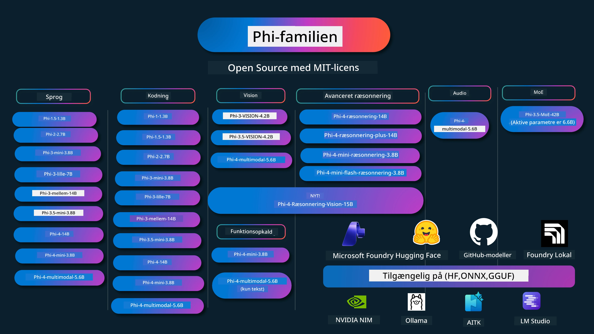

# Phi Cookbook: Praktiske eksempler med Microsofts Phi-modeller

[](https://codespaces.new/microsoft/phicookbook)
[](https://vscode.dev/redirect?url=vscode://ms-vscode-remote.remote-containers/cloneInVolume?url=https://github.com/microsoft/phicookbook)

[](https://GitHub.com/microsoft/phicookbook/graphs/contributors/?WT.mc_id=aiml-137032-kinfeylo)
[](https://GitHub.com/microsoft/phicookbook/issues/?WT.mc_id=aiml-137032-kinfeylo)
[](https://GitHub.com/microsoft/phicookbook/pulls/?WT.mc_id=aiml-137032-kinfeylo)
[](http://makeapullrequest.com?WT.mc_id=aiml-137032-kinfeylo)

[](https://GitHub.com/microsoft/phicookbook/watchers/?WT.mc_id=aiml-137032-kinfeylo)
[](https://GitHub.com/microsoft/phicookbook/network/?WT.mc_id=aiml-137032-kinfeylo)
[](https://GitHub.com/microsoft/phicookbook/stargazers/?WT.mc_id=aiml-137032-kinfeylo)

[](https://discord.com/invite/ByRwuEEgH4)

Phi er en serie af open source AI-modeller udviklet af Microsoft.

Phi er i øjeblikket den mest kraftfulde og omkostningseffektive små sprogemodel (SLM) med meget gode benchmarks inden for flersprog, ræsonnering, tekst/chat-generering, kodning, billeder, lyd og andre scenarier.

Du kan implementere Phi i skyen eller på edge-enheder, og du kan nemt bygge generative AI-applikationer med begrænset computerkraft.

Følg disse trin for at komme i gang med at bruge disse ressourcer:
1. **Fork Repository**: Klik [](https://GitHub.com/microsoft/phicookbook/network/?WT.mc_id=aiml-137032-kinfeylo)
2. **Klon Repository**: `git clone https://github.com/microsoft/PhiCookBook.git`
3. [**Deltag i Microsoft AI Discord Community og mød eksperter og medudviklere**](https://discord.com/invite/ByRwuEEgH4?WT.mc_id=aiml-137032-kinfeylo)



### 🌐 Flersproget support

#### Oversættelser vedligeholdes med [Co-op Translator](https://github.com/Azure/co-op-translator)

<!-- CO-OP TRANSLATOR LANGUAGES TABLE START -->
[Arabisk](../ar/README.md) | [Bengali](../bn/README.md) | [Bulgarisk](../bg/README.md) | [Burmese (Myanmar)](../my/README.md) | [Kinesisk (forenklet)](../zh-CN/README.md) | [Kinesisk (traditionelt, Hong Kong)](../zh-HK/README.md) | [Kinesisk (traditionelt, Macau)](../zh-MO/README.md) | [Kinesisk (traditionelt, Taiwan)](../zh-TW/README.md) | [Kroatisk](../hr/README.md) | [Tjekkisk](../cs/README.md) | [Dansk](./README.md) | [Hollandsk](../nl/README.md) | [Estisk](../et/README.md) | [Finsk](../fi/README.md) | [Fransk](../fr/README.md) | [Tysk](../de/README.md) | [Græsk](../el/README.md) | [Hebraisk](../he/README.md) | [Hindi](../hi/README.md) | [Ungarsk](../hu/README.md) | [Indonesisk](../id/README.md) | [Italiensk](../it/README.md) | [Japansk](../ja/README.md) | [Kannada](../kn/README.md) | [Khmer](../km/README.md) | [Koreansk](../ko/README.md) | [Litauisk](../lt/README.md) | [Malayisk](../ms/README.md) | [Malayalam](../ml/README.md) | [Manipuri (Meitei Mayek)](../mni/README.md) | [Marathi](../mr/README.md) | [Nepalesisk](../ne/README.md) | [Nigeriansk pidgin](../pcm/README.md) | [Norsk](../no/README.md) | [Persisk (Farsi)](../fa/README.md) | [Polsk](../pl/README.md) | [Portugisisk (Brasilien)](../pt-BR/README.md) | [Portugisisk (Portugal)](../pt-PT/README.md) | [Punjabi (Gurmukhi)](../pa/README.md) | [Rumænsk](../ro/README.md) | [Russisk](../ru/README.md) | [Serbisk (kyrillisk)](../sr/README.md) | [Slovakisk](../sk/README.md) | [Slovensk](../sl/README.md) | [Spansk](../es/README.md) | [Swahili](../sw/README.md) | [Svensk](../sv/README.md) | [Tagalog (Filippinsk)](../tl/README.md) | [Tamilsk](../ta/README.md) | [Telugu](../te/README.md) | [Thailandsk](../th/README.md) | [Tyrkisk](../tr/README.md) | [Ukrainsk](../uk/README.md) | [Urdu](../ur/README.md) | [Vietnamesisk](../vi/README.md)

> **Foretrækker du at klone lokalt?**
>
> Dette repository indeholder 50+ sprogoversættelser, hvilket væsentligt øger download-størrelsen. For at klone uden oversættelser, brug sparse checkout:
>
> **Bash / macOS / Linux:**
> ```bash
> git clone --filter=blob:none --sparse https://github.com/microsoft/PhiCookBook.git
> cd PhiCookBook
> git sparse-checkout set --no-cone '/*' '!translations' '!translated_images'
> ```
>
> **CMD (Windows):**
> ```cmd
> git clone --filter=blob:none --sparse https://github.com/microsoft/PhiCookBook.git
> cd PhiCookBook
> git sparse-checkout set --no-cone "/*" "!translations" "!translated_images"
> ```
>
> Dette giver dig alt hvad du behøver for at gennemføre kurset med en meget hurtigere download.
<!-- CO-OP TRANSLATOR LANGUAGES TABLE END -->

## Indholdsfortegnelse

- Introduktion
  - [Velkommen til Phi-familien](./md/01.Introduction/01/01.PhiFamily.md)
  - [Opsætning af dit miljø](./md/01.Introduction/01/01.EnvironmentSetup.md)
  - [Forståelse af nøgle-teknologier](./md/01.Introduction/01/01.Understandingtech.md)
  - [AI-sikkerhed for Phi-modeller](./md/01.Introduction/01/01.AISafety.md)
  - [Phi hardware support](./md/01.Introduction/01/01.Hardwaresupport.md)
  - [Phi modeller & tilgængelighed på tværs af platforme](./md/01.Introduction/01/01.Edgeandcloud.md)
  - [Brug af Guidance-ai og Phi](./md/01.Introduction/01/01.Guidance.md)
  - [GitHub Marketplace modeller](https://github.com/marketplace/models)
  - [Azure AI Model Catalog](https://ai.azure.com)

- Inference Phi i forskellige miljøer
    -  [Hugging face](./md/01.Introduction/02/01.HF.md)
    -  [GitHub modeller](./md/01.Introduction/02/02.GitHubModel.md)
    -  [Microsoft Foundry Model Catalog](./md/01.Introduction/02/03.AzureAIFoundry.md)
    -  [Ollama](./md/01.Introduction/02/04.Ollama.md)
    -  [AI Toolkit VSCode (AITK)](./md/01.Introduction/02/05.AITK.md)
    -  [NVIDIA NIM](./md/01.Introduction/02/06.NVIDIA.md)
    -  [Foundry Local](./md/01.Introduction/02/07.FoundryLocal.md)

- Inference Phi familie
    - [Inference Phi på iOS](./md/01.Introduction/03/iOS_Inference.md)
    - [Inference Phi på Android](./md/01.Introduction/03/Android_Inference.md)
    - [Inference Phi på Jetson](./md/01.Introduction/03/Jetson_Inference.md)
    - [Inference Phi på AI PC](./md/01.Introduction/03/AIPC_Inference.md)
    - [Inference Phi med Apple MLX Framework](./md/01.Introduction/03/MLX_Inference.md)
    - [Inference Phi på lokal server](./md/01.Introduction/03/Local_Server_Inference.md)
    - [Inference Phi på fjernserver vha. AI Toolkit](./md/01.Introduction/03/Remote_Interence.md)
    - [Inference Phi med Rust](./md/01.Introduction/03/Rust_Inference.md)
    - [Inference Phi–Vision lokalt](./md/01.Introduction/03/Vision_Inference.md)
    - [Inference Phi med Kaito AKS, Azure Containers (officiel support)](./md/01.Introduction/03/Kaito_Inference.md)
-  [Kvantisering af Phi familie](./md/01.Introduction/04/QuantifyingPhi.md)
    - [Kvantisering af Phi-3.5 / 4 med llama.cpp](./md/01.Introduction/04/UsingLlamacppQuantifyingPhi.md)
    - [Kvantisering af Phi-3.5 / 4 med generative AI-udvidelser til onnxruntime](./md/01.Introduction/04/UsingORTGenAIQuantifyingPhi.md)
    - [Kvantisering af Phi-3.5 / 4 med Intel OpenVINO](./md/01.Introduction/04/UsingIntelOpenVINOQuantifyingPhi.md)
    - [Kvantisering af Phi-3.5 / 4 med Apple MLX Framework](./md/01.Introduction/04/UsingAppleMLXQuantifyingPhi.md)

-  Evaluering af Phi
    - [Response AI](./md/01.Introduction/05/ResponsibleAI.md)
    - [Microsoft Foundry til evaluering](./md/01.Introduction/05/AIFoundry.md)
    - [Brug af Promptflow til evaluering](./md/01.Introduction/05/Promptflow.md)
 
- RAG med Azure AI Search
    - [Hvordan man bruger Phi-4-mini og Phi-4-multimodal (RAG) med Azure AI Search](https://github.com/microsoft/PhiCookBook/blob/main/code/06.E2E/E2E_Phi-4-RAG-Azure-AI-Search.ipynb)
    - [Zero-Cloud lokal hybrid RAG med SQLite FTS5 og phi-4-mini](https://github.com/microsoft/PhiCookBook/blob/main/code/06.E2E/E2E_Phi-4-mini_Local_Hybrid_RAG_SQLite_FTS5.ipynb)

- Phi applikationsudviklings-prøver
  - Tekst- & chat-applikationer
    - Phi-4 prøver 
      - [📓] [Chat med Phi-4-mini ONNX Model](./md/02.Application/01.TextAndChat/Phi4/ChatWithPhi4ONNX/README.md)
      - [Chat med Phi-4 lokal ONNX Model .NET](../../md/04.HOL/dotnet/src/LabsPhi4-Chat-01OnnxRuntime)
      - [Chat .NET konsolapp med Phi-4 ONNX ved hjælp af Sementic Kernel](../../md/04.HOL/dotnet/src/LabsPhi4-Chat-02SK)
    - Phi-3 / 3.5 prøver
      - [Lokal chatbot i browseren ved hjælp af Phi3, ONNX Runtime Web og WebGPU](https://github.com/microsoft/onnxruntime-inference-examples/tree/main/js/chat)
      - [OpenVino Chat](./md/02.Application/01.TextAndChat/Phi3/E2E_OpenVino_Chat.md)
      - [Multi model - Interaktiv Phi-3-mini og OpenAI Whisper](./md/02.Application/01.TextAndChat/Phi3/E2E_Phi-3-mini_with_whisper.md)
      - [MLFlow - Bygning af en wrapper og brug af Phi-3 med MLFlow](./md//02.Application/01.TextAndChat/Phi3/E2E_Phi-3-MLflow.md)
      - [Modeloptimering - hvordan man optimerer Phi-3-min model til ONNX Runtime Web med Olive](https://github.com/microsoft/Olive/tree/main/examples/phi3)
      - [WinUI3 app med Phi-3 mini-4k-instruct-onnx](https://github.com/microsoft/Phi3-Chat-WinUI3-Sample/)
      -[WinUI3 Multi Model AI-drevet Notes App prøve](https://github.com/microsoft/ai-powered-notes-winui3-sample)
      - [Fintuning og integration af brugerdefinerede Phi-3 modeller med Prompt flow](./md/02.Application/01.TextAndChat/Phi3/E2E_Phi-3-FineTuning_PromptFlow_Integration.md)
      - [Fintuning og integration af brugerdefinerede Phi-3 modeller med Prompt flow i Microsoft Foundry](./md/02.Application/01.TextAndChat/Phi3/E2E_Phi-3-FineTuning_PromptFlow_Integration_AIFoundry.md)
      - [Evaluering af den finjusterede Phi-3 / Phi-3.5 Model i Microsoft Foundry med fokus på Microsofts ansvarlige AI-principper](./md/02.Application/01.TextAndChat/Phi3/E2E_Phi-3-Evaluation_AIFoundry.md)
      - [📓] [Phi-3.5-mini-instruct sprogforudsigelsesprøve (kinesisk/engelsk)](./md/02.Application/01.TextAndChat/Phi3/phi3-instruct-demo.ipynb)
      - [Phi-3.5-Instruct WebGPU RAG Chatbot](./md/02.Application/01.TextAndChat/Phi3/WebGPUWithPhi35Readme.md)
      - [Brug af Windows GPU til at skabe Prompt flow løsning med Phi-3.5-Instruct ONNX](./md/02.Application/01.TextAndChat/Phi3/UsingPromptFlowWithONNX.md)
      - [Brug af Microsoft Phi-3.5 tflite til at skabe Android app](./md/02.Application/01.TextAndChat/Phi3/UsingPhi35TFLiteCreateAndroidApp.md)
      - [Q&A .NET eksempel ved brug af lokal ONNX Phi-3 model med Microsoft.ML.OnnxRuntime](../../md/04.HOL/dotnet/src/LabsPhi301)
      - [Konsolchats .NET-app med Semantic Kernel og Phi-3](../../md/04.HOL/dotnet/src/LabsPhi302)

  - Azure AI Inference SDK kode-baserede prøver 
    - Phi-4 prøver 
      - [📓] [Generer projektkode ved hjælp af Phi-4-multimodal](./md/02.Application/02.Code/Phi4/GenProjectCode/README.md)
    - Phi-3 / 3.5 prøver
      - [Byg din egen Visual Studio Code GitHub Copilot Chat med Microsoft Phi-3 familien](./md/02.Application/02.Code/Phi3/VSCodeExt/README.md)
      - [Skab din egen Visual Studio Code Chat Copilot Agent med Phi-3.5 fra GitHub modeller](/md/02.Application/02.Code/Phi3/CreateVSCodeChatAgentWithGitHubModels.md)

  - Avancerede ræsonnering prøver
    - Phi-4 Eksempler 
      - [📓] [Phi-4-mini-grundlæggende eller Phi-4-grundlæggende Eksempler](./md/02.Application/03.AdvancedReasoning/Phi4/AdvancedResoningPhi4mini/README.md)
      - [📓] [Finjustering af Phi-4-mini-grundlæggende med Microsoft Olive](./md/02.Application/03.AdvancedReasoning/Phi4/AdvancedResoningPhi4mini/olive_ft_phi_4_reasoning_with_medicaldata.ipynb)
      - [📓] [Finjustering af Phi-4-mini-grundlæggende med Apple MLX](./md/02.Application/03.AdvancedReasoning/Phi4/AdvancedResoningPhi4mini/mlx_ft_phi_4_reasoning_with_medicaldata.ipynb)
      - [📓] [Phi-4-mini-grundlæggende med GitHub Modeller](./md/02.Application/02.Code/Phi4r/github_models_inference.ipynb)
      - [📓] [Phi-4-mini-grundlæggende med Microsoft Foundry Modeller](./md/02.Application/02.Code/Phi4r/azure_models_inference.ipynb)
  - Demos
      - [Phi-4-mini demos hostet på Hugging Face Spaces](https://huggingface.co/spaces/microsoft/phi-4-mini?WT.mc_id=aiml-137032-kinfeylo)
      - [Phi-4-multimodale demos hostet på Hugging Face Spaces](https://huggingface.co/spaces/microsoft/phi-4-multimodal?WT.mc_id=aiml-137032-kinfeylo)
  - Vision Eksempler
    - Phi-4 Eksempler 
      - [📓] [Brug Phi-4-multimodal til at læse billeder og generere kode](./md/02.Application/04.Vision/Phi4/CreateFrontend/README.md) 
    - Phi-3 / 3.5 Eksempler
      -  [📓][Phi-3-vision-Image tekst til tekst](./md/02.Application/04.Vision/Phi3/E2E_Phi-3-vision-image-text-to-text-online-endpoint.ipynb)
      - [Phi-3-vision-ONNX](https://onnxruntime.ai/docs/genai/tutorials/phi3-v.html)
      - [📓][Phi-3-vision CLIP Embedding](./md/02.Application/04.Vision/Phi3/E2E_Phi-3-vision-image-text-to-text-online-endpoint.ipynb)
      - [DEMO: Phi-3 Genbrug](https://github.com/jennifermarsman/PhiRecycling/)
      - [Phi-3-vision - Visuel sprogassistent - med Phi3-Vision og OpenVINO](https://docs.openvino.ai/nightly/notebooks/phi-3-vision-with-output.html)
      - [Phi-3 Vision Nvidia NIM](./md/02.Application/04.Vision/Phi3/E2E_Nvidia_NIM_Vision.md)
      - [Phi-3 Vision OpenVino](./md/02.Application/04.Vision/Phi3/E2E_OpenVino_Phi3Vision.md)
      - [📓][Phi-3.5 Vision multi-frame eller multi-billed eksempel](./md/02.Application/04.Vision/Phi3/phi3-vision-demo.ipynb)
      - [Phi-3 Vision Lokal ONNX Model ved brug af Microsoft.ML.OnnxRuntime .NET](../../md/04.HOL/dotnet/src/LabsPhi303)
      - [Menu-baseret Phi-3 Vision Lokal ONNX Model ved brug af Microsoft.ML.OnnxRuntime .NET](../../md/04.HOL/dotnet/src/LabsPhi304)

  - Grundlæggende-Vision Eksempler
    - Phi-4-Reasoning-Vision-15B 
      - [📓] [Brug af Phi-4-Reasoning-Vision-15B til at opdage ulovlig fodgængeradfærd](./md/02.Application/10.ReasoningVision/Phi_4_reasoning_vision_15b_Jaywalking.ipynb)
      - [📓] [Brug af Phi-4-Reasoning-Vision-15B til matematik](./md/02.Application/10.ReasoningVision/Phi_4_reasoning_vision_15b_Math.ipynb)
      - [📓] [Brug af Phi-4-Reasoning-Vision-15B til at opdage UI](./md/02.Application/10.ReasoningVision/Phi_4_reasoning_vision_15b_ui.ipynb)

  - Matematik Eksempler
    -  Phi-4-Mini-Flash-Reasoning-Instruct Eksempler  [Matematik Demo med Phi-4-Mini-Flash-Reasoning-Instruct](./md/02.Application/09.Math/MathDemo.ipynb)

  - Lyd Eksempler
    - Phi-4 Eksempler 
      - [📓] [Udtrækning af lydtransskriberinger ved brug af Phi-4-multimodal](./md/02.Application/05.Audio/Phi4/Transciption/README.md)
      - [📓] [Phi-4-multimodal Lyd Eksempel](./md/02.Application/05.Audio/Phi4/Siri/demo.ipynb)
      - [📓] [Phi-4-multimodal Taleoversættelse Eksempel](./md/02.Application/05.Audio/Phi4/Translate/demo.ipynb)
      - [.NET konsolapplikation ved brug af Phi-4-multimodal Audio til at analysere en lydfil og generere transskription](../../md/04.HOL/dotnet/src/LabsPhi4-MultiModal-02Audio)

  - MOE Eksempler
    - Phi-3 / 3.5 Eksempler
      - [📓] [Phi-3.5 Mixture of Experts Modeller (MoEs) Sociale Medier Eksempel](./md/02.Application/06.MoE/Phi3/phi3_moe_demo.ipynb)
      - [📓] [Opbygning af en Retrieval-Augmented Generation (RAG) Pipeline med NVIDIA NIM Phi-3 MOE, Azure AI Search og LlamaIndex](./md/02.Application/06.MoE/Phi3/azure-ai-search-nvidia-rag.ipynb)
      - 
  - Funktion Kald Eksempler
    - Phi-4 Eksempler 🆕
      -  [📓] [Brug af Funktion Kald med Phi-4-mini](./md/02.Application/07.FunctionCalling/Phi4/FunctionCallingBasic/README.md)
      -  [📓] [Brug af Funktion Kald til at skabe multi-agenter med Phi-4-mini](./md/02.Application/07.FunctionCalling/Phi4/Multiagents/Phi_4_mini_multiagent.ipynb)
      -  [📓] [Brug af Funktion Kald med Ollama](./md/02.Application/07.FunctionCalling/Phi4/Ollama/ollama_functioncalling.ipynb)
      -  [📓] [Brug af Funktion Kald med ONNX](./md/02.Application/07.FunctionCalling/Phi4/ONNX/onnx_parallel_functioncalling.ipynb)
  - Multimodal Blanding Eksempler
    - Phi-4 Eksempler 🆕
      -  [📓] [Brug af Phi-4-multimodal som Teknologijournalist](./md/02.Application/08.Multimodel/Phi4/TechJournalist/phi_4_mm_audio_text_publish_news.ipynb)
      - [.NET konsolapplikation ved brug af Phi-4-multimodal til at analysere billeder](../../md/04.HOL/dotnet/src/LabsPhi4-MultiModal-01Images)

- Finjustering af Phi Eksempler
  - [Finjusteringsscenarier](./md/03.FineTuning/FineTuning_Scenarios.md)
  - [Finjustering vs RAG](./md/03.FineTuning/FineTuning_vs_RAG.md)
  - [Finjustering Lad Phi-3 blive en brancheekspert](./md/03.FineTuning/LetPhi3gotoIndustriy.md)
  - [Finjustering af Phi-3 med AI Toolkit for VS Code](./md/03.FineTuning/Finetuning_VSCodeaitoolkit.md)
  - [Finjustering af Phi-3 med Azure Machine Learning Service](./md/03.FineTuning/Introduce_AzureML.md)
  - [Finjustering af Phi-3 med Lora](./md/03.FineTuning/FineTuning_Lora.md)
  - [Finjustering af Phi-3 med QLora](./md/03.FineTuning/FineTuning_Qlora.md)
  - [Finjustering af Phi-3 med Microsoft Foundry](./md/03.FineTuning/FineTuning_AIFoundry.md)
  - [Finjustering af Phi-3 med Azure ML CLI/SDK](./md/03.FineTuning/FineTuning_MLSDK.md)
  - [Finjustering med Microsoft Olive](./md/03.FineTuning/FineTuning_MicrosoftOlive.md)
  - [Finjustering med Microsoft Olive Hands-On Lab](./md/03.FineTuning/olive-lab/readme.md)
  - [Finjustering af Phi-3-vision med Weights and Bias](./md/03.FineTuning/FineTuning_Phi-3-visionWandB.md)
  - [Finjustering af Phi-3 med Apple MLX Framework](./md/03.FineTuning/FineTuning_MLX.md)
  - [Finjustering af Phi-3-vision (officiel support)](./md/03.FineTuning/FineTuning_Vision.md)
  - [Finjustering af Phi-3 med Kaito AKS, Azure Containers (officiel support)](./md/03.FineTuning/FineTuning_Kaito.md)
  - [Finjustering af Phi-3 og 3.5 Vision](https://github.com/2U1/Phi3-Vision-Finetune)

- Praktiske Øvelser
  - [Udforskning af banebrydende modeller: LLM'er, SLM'er, lokal udvikling og mere](https://github.com/microsoft/aitour-exploring-cutting-edge-models)
  - [Frigørelse af NLP potentiale: Finjustering med Microsoft Olive](https://github.com/azure/Ignite_FineTuning_workshop)

- Akademiske Forskningspapirer og Publikationer
  - [Lærebøger er alt, hvad du behøver II: phi-1.5 teknisk rapport](https://arxiv.org/abs/2309.05463)
  - [Phi-3 Teknisk Rapport: En yderst kapabel sprogmodel lokalt på din telefon](https://arxiv.org/abs/2404.14219)
  - [Phi-4 Teknisk Rapport](https://arxiv.org/abs/2412.08905)
  - [Phi-4-Mini Teknisk Rapport: Kompakte men kraftfulde multimodale sprogmodeller via Mixture-of-LoRAs](https://arxiv.org/abs/2503.01743)
  - [Optimering af små sprogmodeller til funktion-kald i bilen](https://arxiv.org/abs/2501.02342)
  - [(WhyPHI) Finjustering af PHI-3 til multiple-choice spørgsmålssvar: Metodologi, resultater og udfordringer](https://arxiv.org/abs/2501.01588)
  - [Phi-4-grundlæggende Teknisk Rapport](https://www.microsoft.com/en-us/research/wp-content/uploads/2025/04/phi_4_reasoning.pdf)
  - [Phi-4-mini-grundlæggende Teknisk Rapport](https://huggingface.co/microsoft/Phi-4-mini-reasoning/blob/main/Phi-4-Mini-Reasoning.pdf)

## Brug af Phi Modeller

### Phi på Microsoft Foundry

Du kan lære, hvordan du bruger Microsoft Phi og hvordan du bygger E2E-løsninger i dine forskellige hardwareenheder. For at opleve Phi selv, start med at lege med modellerne og tilpasse Phi til dine scenarier ved hjælp af [Microsoft Foundry Azure AI Model Catalog](https://aka.ms/phi3-azure-ai) du kan lære mere i Kom godt i gang med [Microsoft Foundry](/md/02.QuickStart/AzureAIFoundry_QuickStart.md)

**Læringsmiljø**
Hver model har et dedikeret læringsmiljø til at teste modellen [Azure AI Playground](https://aka.ms/try-phi3).

### Phi på GitHub Modeller

Du kan lære, hvordan du bruger Microsoft Phi og hvordan du bygger E2E-løsninger i dine forskellige hardwareenheder. For at opleve Phi selv, start med at lege med modellen og tilpasse Phi til dine scenarier ved hjælp af [GitHub Model Catalog](https://github.com/marketplace/models?WT.mc_id=aiml-137032-kinfeylo) du kan lære mere i Kom godt i gang med [GitHub Model Catalog](/md/02.QuickStart/GitHubModel_QuickStart.md)

**Læringsmiljø**
Hver model har et dedikeret [læringsmiljø til at teste modellen](/md/02.QuickStart/GitHubModel_QuickStart.md).

### Phi på Hugging Face

Du kan også finde modellen på [Hugging Face](https://huggingface.co/microsoft)

**Læringsmiljø**
 [Hugging Chat læringsmiljø](https://huggingface.co/chat/models/microsoft/Phi-3-mini-4k-instruct)

 ## 🎒 Andre Kurser

Vores team producerer andre kurser! Tjek dem ud:

<!-- CO-OP TRANSLATOR OTHER COURSES START -->
### LangChain
[](https://aka.ms/langchain4j-for-beginners)
[](https://aka.ms/langchainjs-for-beginners?WT.mc_id=m365-94501-dwahlin)
[](https://github.com/microsoft/langchain-for-beginners?WT.mc_id=m365-94501-dwahlin)
---

### Azure / Edge / MCP / Agenter
[](https://github.com/microsoft/AZD-for-beginners?WT.mc_id=academic-105485-koreyst)
[](https://github.com/microsoft/edgeai-for-beginners?WT.mc_id=academic-105485-koreyst)
[](https://github.com/microsoft/mcp-for-beginners?WT.mc_id=academic-105485-koreyst)
[](https://github.com/microsoft/ai-agents-for-beginners?WT.mc_id=academic-105485-koreyst)

---
 
### Generativ AI Serie
[](https://github.com/microsoft/generative-ai-for-beginners?WT.mc_id=academic-105485-koreyst)
[-9333EA?style=for-the-badge&labelColor=E5E7EB&color=9333EA)](https://github.com/microsoft/Generative-AI-for-beginners-dotnet?WT.mc_id=academic-105485-koreyst)
[-C084FC?style=for-the-badge&labelColor=E5E7EB&color=C084FC)](https://github.com/microsoft/generative-ai-for-beginners-java?WT.mc_id=academic-105485-koreyst)
[-E879F9?style=for-the-badge&labelColor=E5E7EB&color=E879F9)](https://github.com/microsoft/generative-ai-with-javascript?WT.mc_id=academic-105485-koreyst)

---
 
### Kerne Læring
[](https://aka.ms/ml-beginners?WT.mc_id=academic-105485-koreyst)
[](https://aka.ms/datascience-beginners?WT.mc_id=academic-105485-koreyst)
[](https://aka.ms/ai-beginners?WT.mc_id=academic-105485-koreyst)
[](https://github.com/microsoft/Security-101?WT.mc_id=academic-96948-sayoung)
[](https://aka.ms/webdev-beginners?WT.mc_id=academic-105485-koreyst)
[](https://aka.ms/iot-beginners?WT.mc_id=academic-105485-koreyst)
[](https://github.com/microsoft/xr-development-for-beginners?WT.mc_id=academic-105485-koreyst)

---
 
### Copilot Serie
[](https://aka.ms/GitHubCopilotAI?WT.mc_id=academic-105485-koreyst)
[](https://github.com/microsoft/mastering-github-copilot-for-dotnet-csharp-developers?WT.mc_id=academic-105485-koreyst)
[](https://github.com/microsoft/CopilotAdventures?WT.mc_id=academic-105485-koreyst)
<!-- CO-OP TRANSLATOR OTHER COURSES END -->

## Ansvarlig AI 

Microsoft er forpligtet til at hjælpe vores kunder med at bruge vores AI-produkter ansvarligt, dele vores erfaringer og bygge tillidsbaserede partnerskaber gennem værktøjer som Transparency Notes og Impact Assessments. Mange af disse ressourcer kan findes på [https://aka.ms/RAI](https://aka.ms/RAI).
Microsofts tilgang til ansvarlig AI er forankret i vores AI-principper om retfærdighed, pålidelighed og sikkerhed, privatliv og sikkerhed, inklusivitet, gennemsigtighed og ansvarlighed.

Store sprog-, billede- og talmodeller - som dem der anvendes i dette eksempel - kan potentielt opføre sig på måder, der er uretfærdige, upålidelige eller krænkende, hvilket igen kan forårsage skader. Konsulter venligst [Azure OpenAI service Transparency note](https://learn.microsoft.com/legal/cognitive-services/openai/transparency-note?tabs=text) for at blive informeret om risici og begrænsninger.

Den anbefalede tilgang til at mindske disse risici er at inkludere et sikkerhedssystem i din arkitektur, som kan opdage og forhindre skadelig adfærd. [Azure AI Content Safety](https://learn.microsoft.com/azure/ai-services/content-safety/overview) tilbyder et uafhængigt lag af beskyttelse, der kan opdage skadeligt bruger- og AI-genereret indhold i applikationer og tjenester. Azure AI Content Safety indeholder tekst- og billed-API'er, der giver dig mulighed for at opdage skadeligt materiale. Inden for Microsoft Foundry giver Content Safety-tjenesten dig mulighed for at se, udforske og prøve eksempel-kode til at opdage skadeligt indhold på tværs af forskellige modaliteter. Følgende [quickstart-dokumentation](https://learn.microsoft.com/azure/ai-services/content-safety/quickstart-text?tabs=visual-studio%2Clinux&pivots=programming-language-rest) guider dig gennem, hvordan du sender anmodninger til tjenesten.

En anden ting at tage i betragtning er den samlede applikationsydelse. Med multimodale og multimodel-applikationer betragter vi ydelse som, at systemet fungerer som du og dine brugere forventer, herunder uden at generere skadelige resultater. Det er vigtigt at vurdere ydelsen af din samlede applikation ved hjælp af [Performance and Quality and Risk and Safety evaluators](https://learn.microsoft.com/azure/ai-studio/concepts/evaluation-metrics-built-in). Du har også mulighed for at oprette og evaluere med [tilpassede evaluators](https://learn.microsoft.com/azure/ai-studio/how-to/develop/evaluate-sdk#custom-evaluators).

Du kan evaluere din AI-applikation i dit udviklingsmiljø ved hjælp af [Azure AI Evaluation SDK](https://microsoft.github.io/promptflow/index.html). Med enten et testdatasæt eller et mål måles dine generative AI-applikationsgenereringer kvantitativt med indbyggede evaluators eller tilpassede evaluators efter eget valg. For at komme i gang med azure ai evaluation sdk til at evaluere dit system kan du følge [quickstart-guiden](https://learn.microsoft.com/azure/ai-studio/how-to/develop/flow-evaluate-sdk). Når du har kørt en evaluering, kan du [visualisere resultaterne i Microsoft Foundry](https://learn.microsoft.com/azure/ai-studio/how-to/evaluate-flow-results). 

## Varemærker

Dette projekt kan indeholde varemærker eller logoer for projekter, produkter eller tjenester. Autoriseret brug af Microsofts varemærker eller logoer er underlagt og skal følge [Microsofts retningslinjer for varemærker og branding](https://www.microsoft.com/legal/intellectualproperty/trademarks/usage/general).
Brug af Microsofts varemærker eller logoer i ændrede versioner af dette projekt må ikke forårsage forvirring eller antyde Microsoft-sponsorat. Enhver brug af tredjeparts varemærker eller logoer er underlagt tredjepartens politikker.

## Få hjælp

Hvis du sidder fast eller har spørgsmål om at bygge AI-apps, så deltag i:

[](https://aka.ms/foundry/discord)

Hvis du har produktfeedback eller støder på fejl under udvikling, besøg:

[](https://aka.ms/foundry/forum)

---

<!-- CO-OP TRANSLATOR DISCLAIMER START -->
**Ansvarsfraskrivelse**:
Dette dokument er blevet oversat ved hjælp af AI-oversættelsestjenesten [Co-op Translator](https://github.com/Azure/co-op-translator). Selvom vi bestræber os på nøjagtighed, skal du være opmærksom på, at automatiserede oversættelser kan indeholde fejl eller unøjagtigheder. Det originale dokument på dets oprindelige sprog bør betragtes som den autoritative kilde. For kritisk information anbefales professionel menneskelig oversættelse. Vi påtager os intet ansvar for misforståelser eller fejltolkninger, der opstår som følge af brugen af denne oversættelse.
<!-- CO-OP TRANSLATOR DISCLAIMER END -->