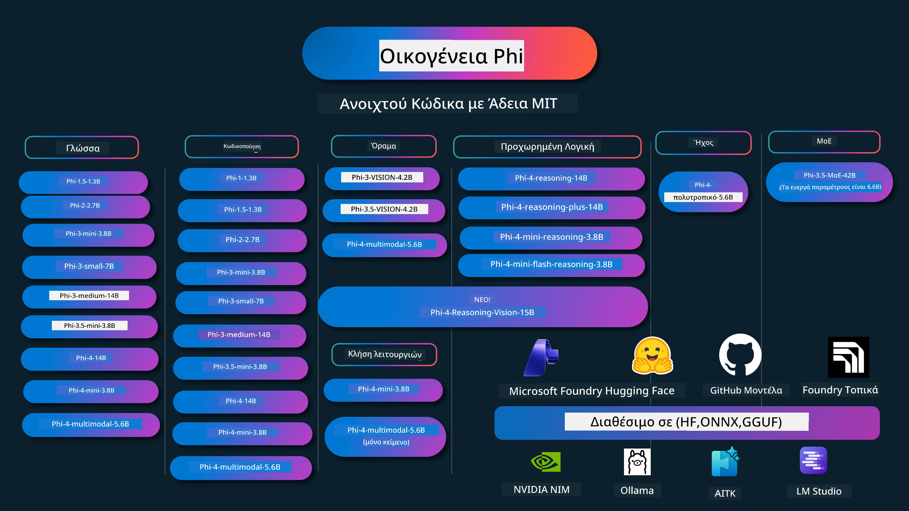

# Phi Cookbook: Παραδείγματα Με Πρακτική Εφαρμογή με τα Μοντέλα Phi της Microsoft

[](https://codespaces.new/microsoft/phicookbook)
[](https://vscode.dev/redirect?url=vscode://ms-vscode-remote.remote-containers/cloneInVolume?url=https://github.com/microsoft/phicookbook)

[](https://GitHub.com/microsoft/phicookbook/graphs/contributors/?WT.mc_id=aiml-137032-kinfeylo)
[](https://GitHub.com/microsoft/phicookbook/issues/?WT.mc_id=aiml-137032-kinfeylo)
[](https://GitHub.com/microsoft/phicookbook/pulls/?WT.mc_id=aiml-137032-kinfeylo)
[](http://makeapullrequest.com?WT.mc_id=aiml-137032-kinfeylo)

[](https://GitHub.com/microsoft/phicookbook/watchers/?WT.mc_id=aiml-137032-kinfeylo)
[](https://GitHub.com/microsoft/phicookbook/network/?WT.mc_id=aiml-137032-kinfeylo)
[](https://GitHub.com/microsoft/phicookbook/stargazers/?WT.mc_id=aiml-137032-kinfeylo)

[](https://discord.com/invite/ByRwuEEgH4)

Το Phi είναι μια σειρά μοντέλων ανοιχτού κώδικα τεχνητής νοημοσύνης που ανέπτυξε η Microsoft.

Το Phi είναι αυτή τη στιγμή το ισχυρότερο και πιο αποδοτικό από πλευράς κόστους μικρό γλωσσικό μοντέλο (SLM), με πολύ καλά benchmarks σε πολυγλωσσικότητα, λογική, παραγωγή κειμένου/συνομιλίας, κωδικοποίηση, εικόνες, ήχο και άλλα σενάρια.

Μπορείτε να αναπτύξετε το Phi στο νέφος ή σε συσκευές άκρου, και μπορείτε εύκολα να δημιουργήσετε εφαρμογές γεννητικής τεχνητής νοημοσύνης με περιορισμένη υπολογιστική ισχύ.

Ακολουθήστε αυτά τα βήματα για να ξεκινήσετε να χρησιμοποιείτε αυτούς τους πόρους:
1. **Κάντε Fork το Αποθετήριο**: Κάντε κλικ στο [](https://GitHub.com/microsoft/phicookbook/network/?WT.mc_id=aiml-137032-kinfeylo)
2. **Κλωνοποιήστε το Αποθετήριο**: `git clone https://github.com/microsoft/PhiCookBook.git`
3. [**Γίνετε μέλος της κοινότητας Microsoft AI Discord και συναντήστε ειδικούς και άλλους προγραμματιστές**](https://discord.com/invite/ByRwuEEgH4?WT.mc_id=aiml-137032-kinfeylo)



### 🌐 Υποστήριξη Πολλών Γλωσσών

#### Μεταφράσεις υποστηριζόμενες από [Co-op Translator](https://github.com/Azure/co-op-translator)

<!-- CO-OP TRANSLATOR LANGUAGES TABLE START -->
[Αραβικά](../ar/README.md) | [Μπενγκάλι](../bn/README.md) | [Βουλγαρικά](../bg/README.md) | [Βιρμανικά (Μιανμάρ)](../my/README.md) | [Κινέζικα (Απλοποιημένα)](../zh-CN/README.md) | [Κινέζικα (Παραδοσιακά, Χονγκ Κονγκ)](../zh-HK/README.md) | [Κινέζικα (Παραδοσιακά, Μακάο)](../zh-MO/README.md) | [Κινέζικα (Παραδοσιακά, Ταϊβάν)](../zh-TW/README.md) | [Κροατικά](../hr/README.md) | [Τσέχικα](../cs/README.md) | [Δανέζικα](../da/README.md) | [Ολλανδικά](../nl/README.md) | [Εσθονικά](../et/README.md) | [Φινλανδικά](../fi/README.md) | [Γαλλικά](../fr/README.md) | [Γερμανικά](../de/README.md) | [Ελληνικά](./README.md) | [Εβραϊκά](../he/README.md) | [Χίντι](../hi/README.md) | [Ουγγρικά](../hu/README.md) | [Ινδονησιακά](../id/README.md) | [Ιταλικά](../it/README.md) | [Ιαπωνικά](../ja/README.md) | [Καννάδα](../kn/README.md) | [Χμερ](../km/README.md) | [Κορεάτικα](../ko/README.md) | [Λιθουανικά](../lt/README.md) | [Μαλάι](../ms/README.md) | [Μαλαγιαλάμ](../ml/README.md) | [Μαράθι](../mr/README.md) | [Νεπαλικά](../ne/README.md) | [Νιγηριανή Πίγκιν](../pcm/README.md) | [Νορβηγικά](../no/README.md) | [Περσικά (Φαρσί)](../fa/README.md) | [Πολωνικά](../pl/README.md) | [Πορτογαλικά (Βραζιλία)](../pt-BR/README.md) | [Πορτογαλικά (Πορτογαλία)](../pt-PT/README.md) | [Πουντζάμπι (Γκουρμούκι)](../pa/README.md) | [Ρουμανικά](../ro/README.md) | [Ρωσικά](../ru/README.md) | [Σερβικά (Κυριλλικά)](../sr/README.md) | [Σλοβακικά](../sk/README.md) | [Σλοβενικά](../sl/README.md) | [Ισπανικά](../es/README.md) | [Σουαχίλι](../sw/README.md) | [Σουηδικά](../sv/README.md) | [Ταγκάλογκ (Φιλιππινέζικα)](../tl/README.md) | [Ταμίλ](../ta/README.md) | [Τελούγκου](../te/README.md) | [Ταϊλανδικά](../th/README.md) | [Τούρκικα](../tr/README.md) | [Ουκρανικά](../uk/README.md) | [Ουρντού](../ur/README.md) | [Βιετναμέζικα](../vi/README.md)

> **Προτιμάτε να Κλωνοποιήσετε Τοπικά;**
>
> Αυτό το αποθετήριο περιλαμβάνει πάνω από 50 μεταφράσεις γλωσσών που αυξάνουν σημαντικά το μέγεθος λήψης. Για κλωνοποίηση χωρίς μεταφράσεις, χρησιμοποιήστε sparse checkout:
>
> **Bash / macOS / Linux:**
> ```bash
> git clone --filter=blob:none --sparse https://github.com/microsoft/PhiCookBook.git
> cd PhiCookBook
> git sparse-checkout set --no-cone '/*' '!translations' '!translated_images'
> ```
>
> **CMD (Windows):**
> ```cmd
> git clone --filter=blob:none --sparse https://github.com/microsoft/PhiCookBook.git
> cd PhiCookBook
> git sparse-checkout set --no-cone "/*" "!translations" "!translated_images"
> ```
>
> Αυτό σας παρέχει ό,τι χρειάζεστε για να ολοκληρώσετε το μάθημα με πολύ πιο γρήγορη λήψη.
<!-- CO-OP TRANSLATOR LANGUAGES TABLE END -->

## Περιεχόμενα

- Εισαγωγή
  - [Καλωσορίσατε στην οικογένεια Phi](./md/01.Introduction/01/01.PhiFamily.md)
  - [Ρύθμιση του περιβάλλοντος σας](./md/01.Introduction/01/01.EnvironmentSetup.md)
  - [Κατανόηση Βασικών Τεχνολογιών](./md/01.Introduction/01/01.Understandingtech.md)
  - [Ασφάλεια Τεχνητής Νοημοσύνης για τα Μοντέλα Phi](./md/01.Introduction/01/01.AISafety.md)
  - [Υποστήριξη Υλικού Phi](./md/01.Introduction/01/01.Hardwaresupport.md)
  - [Μοντέλα Phi & Διαθεσιμότητα σε πλατφόρμες](./md/01.Introduction/01/01.Edgeandcloud.md)
  - [Χρήση Guidance-ai και Phi](./md/01.Introduction/01/01.Guidance.md)
  - [Μοντέλα στην Αγορά του GitHub](https://github.com/marketplace/models)
  - [Κατάλογος Μοντέλων Azure AI](https://ai.azure.com)

- Εκτέλεση Phi σε διαφορετικό περιβάλλον
    -  [Hugging face](./md/01.Introduction/02/01.HF.md)
    -  [Μοντέλα στο GitHub](./md/01.Introduction/02/02.GitHubModel.md)
    -  [Κατάλογος Μοντέλων Microsoft Foundry](./md/01.Introduction/02/03.AzureAIFoundry.md)
    -  [Ollama](./md/01.Introduction/02/04.Ollama.md)
    -  [AI Toolkit VSCode (AITK)](./md/01.Introduction/02/05.AITK.md)
    -  [NVIDIA NIM](./md/01.Introduction/02/06.NVIDIA.md)
    -  [Foundry Local](./md/01.Introduction/02/07.FoundryLocal.md)

- Εκτέλεση οικογένειας Phi
    - [Εκτέλεση Phi σε iOS](./md/01.Introduction/03/iOS_Inference.md)
    - [Εκτέλεση Phi σε Android](./md/01.Introduction/03/Android_Inference.md)
    - [Εκτέλεση Phi σε Jetson](./md/01.Introduction/03/Jetson_Inference.md)
    - [Εκτέλεση Phi σε AI PC](./md/01.Introduction/03/AIPC_Inference.md)
    - [Εκτέλεση Phi με το Apple MLX Framework](./md/01.Introduction/03/MLX_Inference.md)
    - [Εκτέλεση Phi σε Τοπικό Διακομιστή](./md/01.Introduction/03/Local_Server_Inference.md)
    - [Εκτέλεση Phi σε Απομακρυσμένο Διακομιστή με χρήση AI Toolkit](./md/01.Introduction/03/Remote_Interence.md)
    - [Εκτέλεση Phi με Rust](./md/01.Introduction/03/Rust_Inference.md)
    - [Εκτέλεση Phi--Vision τοπικά](./md/01.Introduction/03/Vision_Inference.md)
    - [Εκτέλεση Phi με Kaito AKS, Azure Containers (επίσημη υποστήριξη)](./md/01.Introduction/03/Kaito_Inference.md)
-  [Quantifying οικογένειας Phi](./md/01.Introduction/04/QuantifyingPhi.md)
    - [Ποσοτικοποίηση Phi-3.5 / 4 χρησιμοποιώντας llama.cpp](./md/01.Introduction/04/UsingLlamacppQuantifyingPhi.md)
    - [Ποσοτικοποίηση Phi-3.5 / 4 χρησιμοποιώντας Generative AI επεκτάσεις για onnxruntime](./md/01.Introduction/04/UsingORTGenAIQuantifyingPhi.md)
    - [Ποσοτικοποίηση Phi-3.5 / 4  χρησιμοποιώντας Intel OpenVINO](./md/01.Introduction/04/UsingIntelOpenVINOQuantifyingPhi.md)
    - [Ποσοτικοποίηση Phi-3.5 / 4  χρησιμοποιώντας Apple MLX Framework](./md/01.Introduction/04/UsingAppleMLXQuantifyingPhi.md)

-  Αξιολόγηση Phi
    - [AI Απόκριση](./md/01.Introduction/05/ResponsibleAI.md)
    - [Microsoft Foundry για Αξιολόγηση](./md/01.Introduction/05/AIFoundry.md)
    - [Χρήση Promptflow για Αξιολόγηση](./md/01.Introduction/05/Promptflow.md)
 
- RAG με Azure AI Search
    - [Πώς να χρησιμοποιήσετε τα Phi-4-mini και Phi-4-multimodal (RAG) με Azure AI Search](https://github.com/microsoft/PhiCookBook/blob/main/code/06.E2E/E2E_Phi-4-RAG-Azure-AI-Search.ipynb)
    - [Zero-Cloud Τοπικό Υβριδικό RAG με SQLite FTS5 και phi-4-mini](https://github.com/microsoft/PhiCookBook/blob/main/code/06.E2E/E2E_Phi-4-mini_Local_Hybrid_RAG_SQLite_FTS5.ipynb)

- Παραδείγματα ανάπτυξης εφαρμογών Phi
  - Εφαρμογές κειμένου & συνομιλίας
    - Παραδείγματα Phi-4
      - [📓] [Συνομιλία με μοντέλο Phi-4-mini ONNX](./md/02.Application/01.TextAndChat/Phi4/ChatWithPhi4ONNX/README.md)
      - [Συνομιλία με τοπικό μοντέλο Phi-4 ONNX .NET](../../md/04.HOL/dotnet/src/LabsPhi4-Chat-01OnnxRuntime)
      - [Εφαρμογή .NET κονσόλας συνομιλίας με Phi-4 ONNX χρησιμοποιώντας Semantic Kernel](../../md/04.HOL/dotnet/src/LabsPhi4-Chat-02SK)
    - Παραδείγματα Phi-3 / 3.5
      - [Τοπικό Chatbot στο πρόγραμμα περιήγησης χρησιμοποιώντας Phi3, ONNX Runtime Web και WebGPU](https://github.com/microsoft/onnxruntime-inference-examples/tree/main/js/chat)
      - [OpenVino Chat](./md/02.Application/01.TextAndChat/Phi3/E2E_OpenVino_Chat.md)
      - [Πολλαπλό Μοντέλο - Διαδραστικό Phi-3-mini και OpenAI Whisper](./md/02.Application/01.TextAndChat/Phi3/E2E_Phi-3-mini_with_whisper.md)
      - [MLFlow - Δημιουργία wrapper και χρήση Phi-3 με MLFlow](./md//02.Application/01.TextAndChat/Phi3/E2E_Phi-3-MLflow.md)
      - [Βελτιστοποίηση Μοντέλου - Πώς να βελτιστοποιήσετε το μοντέλο Phi-3-min για ONNX Runtime Web με Olive](https://github.com/microsoft/Olive/tree/main/examples/phi3)
      - [Εφαρμογή WinUI3 με Phi-3 mini-4k-instruct-onnx](https://github.com/microsoft/Phi3-Chat-WinUI3-Sample/)
      -[Δείγμα εφαρμογής WinUI3 πολλαπλών μοντέλων με AI](https://github.com/microsoft/ai-powered-notes-winui3-sample)
      - [Fine-tune και Ενσωμάτωση προσαρμοσμένων μοντέλων Phi-3 με Prompt flow](./md/02.Application/01.TextAndChat/Phi3/E2E_Phi-3-FineTuning_PromptFlow_Integration.md)
      - [Fine-tune και Ενσωμάτωση προσαρμοσμένων μοντέλων Phi-3 με Prompt flow στο Microsoft Foundry](./md/02.Application/01.TextAndChat/Phi3/E2E_Phi-3-FineTuning_PromptFlow_Integration_AIFoundry.md)
      - [Αξιολόγηση του Fine-tuned μοντέλου Phi-3 / Phi-3.5 στο Microsoft Foundry με έμφαση στις υπεύθυνες αρχές AI της Microsoft](./md/02.Application/01.TextAndChat/Phi3/E2E_Phi-3-Evaluation_AIFoundry.md)
      - [📓] [Δείγμα προγνωστικού γλώσσας Phi-3.5-mini-instruct (Κινέζικα/Αγγλικά)](./md/02.Application/01.TextAndChat/Phi3/phi3-instruct-demo.ipynb)
      - [Phi-3.5-Instruct WebGPU RAG Chatbot](./md/02.Application/01.TextAndChat/Phi3/WebGPUWithPhi35Readme.md)
      - [Χρήση GPU των Windows για δημιουργία λύσης Prompt flow με Phi-3.5-Instruct ONNX](./md/02.Application/01.TextAndChat/Phi3/UsingPromptFlowWithONNX.md)
      - [Χρήση Microsoft Phi-3.5 tflite για δημιουργία εφαρμογής Android](./md/02.Application/01.TextAndChat/Phi3/UsingPhi35TFLiteCreateAndroidApp.md)
      - [Παράδειγμα Q&A .NET χρησιμοποιώντας το τοπικό ONNX μοντέλο Phi-3 με Microsoft.ML.OnnxRuntime](../../md/04.HOL/dotnet/src/LabsPhi301)
      - [Εφαρμογή συνομιλίας κονσόλας .NET με Semantic Kernel και Phi-3](../../md/04.HOL/dotnet/src/LabsPhi302)

  - Παραδείγματα βασισμένα σε κώδικα του Azure AI Inference SDK
    - Παραδείγματα Phi-4
      - [📓] [Δημιουργία κώδικα έργου χρησιμοποιώντας Phi-4-multimodal](./md/02.Application/02.Code/Phi4/GenProjectCode/README.md)
    - Παραδείγματα Phi-3 / 3.5
      - [Δημιουργήστε τον δικό σας Visual Studio Code GitHub Copilot Chat με την οικογένεια Microsoft Phi-3](./md/02.Application/02.Code/Phi3/VSCodeExt/README.md)
      - [Δημιουργήστε τον δικό σας Visual Studio Code Chat Copilot Agent με Phi-3.5 από μοντέλα GitHub](/md/02.Application/02.Code/Phi3/CreateVSCodeChatAgentWithGitHubModels.md)

  - Παραδείγματα Προχωρημένης Συλλογιστικής
    - Δείγματα Phi-4 
      - [📓] [Δείγματα Phi-4-mini-λογικής ή Phi-4-λογικής](./md/02.Application/03.AdvancedReasoning/Phi4/AdvancedResoningPhi4mini/README.md)
      - [📓] [Βελτιστοποίηση Phi-4-mini-λογικής με Microsoft Olive](./md/02.Application/03.AdvancedReasoning/Phi4/AdvancedResoningPhi4mini/olive_ft_phi_4_reasoning_with_medicaldata.ipynb)
      - [📓] [Βελτιστοποίηση Phi-4-mini-λογικής με Apple MLX](./md/02.Application/03.AdvancedReasoning/Phi4/AdvancedResoningPhi4mini/mlx_ft_phi_4_reasoning_with_medicaldata.ipynb)
      - [📓] [Phi-4-mini-λογική με μοντέλα GitHub](./md/02.Application/02.Code/Phi4r/github_models_inference.ipynb)
      - [📓] [Phi-4-mini-λογική με μοντέλα Microsoft Foundry](./md/02.Application/02.Code/Phi4r/azure_models_inference.ipynb)
  - Επιδείξεις
      - [Οι επιδείξεις Phi-4-mini φιλοξενούνται στο Hugging Face Spaces](https://huggingface.co/spaces/microsoft/phi-4-mini?WT.mc_id=aiml-137032-kinfeylo)
      - [Οι επιδείξεις Phi-4-multimodal φιλοξενούνται στο Hugginge Face Spaces](https://huggingface.co/spaces/microsoft/phi-4-multimodal?WT.mc_id=aiml-137032-kinfeylo)
  - Δείγματα Όρασης
    - Δείγματα Phi-4 
      - [📓] [Χρήση Phi-4-multimodal για ανάγνωση εικόνων και δημιουργία κώδικα](./md/02.Application/04.Vision/Phi4/CreateFrontend/README.md) 
    - Δείγματα Phi-3 / 3.5
      -  [📓][Phi-3-vision-Κείμενο εικόνας σε κείμενο](./md/02.Application/04.Vision/Phi3/E2E_Phi-3-vision-image-text-to-text-online-endpoint.ipynb)
      - [Phi-3-vision-ONNX](https://onnxruntime.ai/docs/genai/tutorials/phi3-v.html)
      - [📓][Phi-3-vision Ενσωμάτωση CLIP](./md/02.Application/04.Vision/Phi3/E2E_Phi-3-vision-image-text-to-text-online-endpoint.ipynb)
      - [ΕΠΙΔΕΙΞΗ: Ανακύκλωση Phi-3](https://github.com/jennifermarsman/PhiRecycling/)
      - [Phi-3-vision - Οπτικός βοηθός γλώσσας - με Phi3-Vision και OpenVINO](https://docs.openvino.ai/nightly/notebooks/phi-3-vision-with-output.html)
      - [Phi-3 Όραση Nvidia NIM](./md/02.Application/04.Vision/Phi3/E2E_Nvidia_NIM_Vision.md)
      - [Phi-3 Όραση OpenVino](./md/02.Application/04.Vision/Phi3/E2E_OpenVino_Phi3Vision.md)
      - [📓][Phi-3.5 Όραση δειγμα πολυπλαισιο ή πολυ-εικόνας](./md/02.Application/04.Vision/Phi3/phi3-vision-demo.ipynb)
      - [Τοπικό μοντέλο Phi-3 Όρασης ONNX με το Microsoft.ML.OnnxRuntime .NET](../../md/04.HOL/dotnet/src/LabsPhi303)
      - [Μενού βασισμένο τοπικό μοντέλο Phi-3 Όρασης ONNX με το Microsoft.ML.OnnxRuntime .NET](../../md/04.HOL/dotnet/src/LabsPhi304)

  - Δείγματα Λογικής-Όρασης
    - Phi-4-Λογική-Όραση-15B 
      - [📓] [Χρήση Phi-4-Λογικής-Όρασης-15B για ανίχνευση παράνομης διάβασης πεζών](./md/02.Application/10.ReasoningVision/Phi_4_reasoning_vision_15b_Jaywalking.ipynb)
      - [📓] [Χρήση Phi-4-Λογικής-Όρασης-15B για μαθηματικά](./md/02.Application/10.ReasoningVision/Phi_4_reasoning_vision_15b_Math.ipynb)
      - [📓] [Χρήση Phi-4-Λογικής-Όρασης-15B για ανίχνευση UI](./md/02.Application/10.ReasoningVision/Phi_4_reasoning_vision_15b_ui.ipynb)

  - Δείγματα Μαθηματικών
    -  Δείγματα Phi-4-Mini-Flash-Reasoning-Instruct  [Επίδειξη Μαθηματικών με Phi-4-Mini-Flash-Reasoning-Instruct](./md/02.Application/09.Math/MathDemo.ipynb)

  - Δείγματα Ήχου
    - Δείγματα Phi-4 
      - [📓] [Εξαγωγή απομαγνητοφωνήσεων ήχου χρησιμοποιώντας Phi-4-multimodal](./md/02.Application/05.Audio/Phi4/Transciption/README.md)
      - [📓] [Δείγμα Audío Phi-4-multimodal](./md/02.Application/05.Audio/Phi4/Siri/demo.ipynb)
      - [📓] [Δείγμα Μετάφρασης Ομιλίας Phi-4-multimodal](./md/02.Application/05.Audio/Phi4/Translate/demo.ipynb)
      - [Εφαρμογή κονσόλας .NET που χρησιμοποιεί Phi-4-multimodal Audio για να αναλύσει ένα αρχείο ήχου και να δημιουργήσει απομαγνητοφώνηση](../../md/04.HOL/dotnet/src/LabsPhi4-MultiModal-02Audio)

  - Δείγματα MOE
    - Δείγματα Phi-3 / 3.5
      - [📓] [Δείγμα Μοντέλων Μείγματος Ειδικών (MoEs) Phi-3.5 για Κοινωνικά Δίκτυα](./md/02.Application/06.MoE/Phi3/phi3_moe_demo.ipynb)
      - [📓] [Κατασκευή Pipeline Ανάκτησης και Ενισχυμένης Δημιουργίας (RAG) με NVIDIA NIM Phi-3 MOE, Azure AI Search και LlamaIndex](./md/02.Application/06.MoE/Phi3/azure-ai-search-nvidia-rag.ipynb)
      - 
  - Δείγματα Κλήσεων Συνάρτησης
    - Δείγματα Phi-4 🆕
      -  [📓] [Χρήση Κλήσης Συνάρτησης με Phi-4-mini](./md/02.Application/07.FunctionCalling/Phi4/FunctionCallingBasic/README.md)
      -  [📓] [Χρήση Κλήσης Συνάρτησης για δημιουργία πολλαπλών πρακτόρων με Phi-4-mini](./md/02.Application/07.FunctionCalling/Phi4/Multiagents/Phi_4_mini_multiagent.ipynb)
      -  [📓] [Χρήση Κλήσης Συνάρτησης με Ollama](./md/02.Application/07.FunctionCalling/Phi4/Ollama/ollama_functioncalling.ipynb)
      -  [📓] [Χρήση Κλήσης Συνάρτησης με ONNX](./md/02.Application/07.FunctionCalling/Phi4/ONNX/onnx_parallel_functioncalling.ipynb)
  - Δείγματα Μικτής Πολυμορφίας
    - Δείγματα Phi-4 🆕
      -  [📓] [Χρήση Phi-4-multimodal ως Τεχνολογικός δημοσιογράφος](./md/02.Application/08.Multimodel/Phi4/TechJournalist/phi_4_mm_audio_text_publish_news.ipynb)
      - [Εφαρμογή κονσόλας .NET που χρησιμοποιεί Phi-4-multimodal για ανάλυση εικόνων](../../md/04.HOL/dotnet/src/LabsPhi4-MultiModal-01Images)

- Βελτιστοποίηση Δειγμάτων Phi
  - [Σεναρια Βελτιστοποίησης](./md/03.FineTuning/FineTuning_Scenarios.md)
  - [Βελτιστοποίηση έναντι RAG](./md/03.FineTuning/FineTuning_vs_RAG.md)
  - [Βελτιστοποίηση για το Phi-3 ώστε να γίνει ειδικός στην βιομηχανία](./md/03.FineTuning/LetPhi3gotoIndustriy.md)
  - [Βελτιστοποίηση Phi-3 με AI Toolkit για VS Code](./md/03.FineTuning/Finetuning_VSCodeaitoolkit.md)
  - [Βελτιστοποίηση Phi-3 με Azure Machine Learning Service](./md/03.FineTuning/Introduce_AzureML.md)
  - [Βελτιστοποίηση Phi-3 με Lora](./md/03.FineTuning/FineTuning_Lora.md)
  - [Βελτιστοποίηση Phi-3 με QLora](./md/03.FineTuning/FineTuning_Qlora.md)
  - [Βελτιστοποίηση Phi-3 με Microsoft Foundry](./md/03.FineTuning/FineTuning_AIFoundry.md)
  - [Βελτιστοποίηση Phi-3 με Azure ML CLI/SDK](./md/03.FineTuning/FineTuning_MLSDK.md)
  - [Βελτιστοποίηση με Microsoft Olive](./md/03.FineTuning/FineTuning_MicrosoftOlive.md)
  - [Εργαστήριο βελτιστοποίησης με Microsoft Olive](./md/03.FineTuning/olive-lab/readme.md)
  - [Βελτιστοποίηση Phi-3-vision με Weights and Bias](./md/03.FineTuning/FineTuning_Phi-3-visionWandB.md)
  - [Βελτιστοποίηση Phi-3 με Apple MLX Framework](./md/03.FineTuning/FineTuning_MLX.md)
  - [Βελτιστοποίηση Phi-3-vision (επίσημη υποστήριξη)](./md/03.FineTuning/FineTuning_Vision.md)
  - [Βελτιστοποίηση Phi-3 με Kaito AKS , Azure Containers(επίσημη υποστήριξη)](./md/03.FineTuning/FineTuning_Kaito.md)
  - [Βελτιστοποίηση Phi-3 και 3.5 Όρασης](https://github.com/2U1/Phi3-Vision-Finetune)

- Εργαστήριο εφαρμογής
  - [Εξερεύνηση πρωτοποριακών μοντέλων: LLMs, SLMs, τοπική ανάπτυξη και άλλα](https://github.com/microsoft/aitour-exploring-cutting-edge-models)
  - [Ξεκλείδωμα δυνατοτήτων NLP: Βελτιστοποίηση με Microsoft Olive](https://github.com/azure/Ignite_FineTuning_workshop)

- Ακαδημαϊκά Ερευνητικά Άρθρα και Δημοσιεύσεις
  - [Τα Αναλυτικά Βιβλία Είναι Όλα Όσα Χρειάζεστε II: τεχνική αναφορά phi-1.5](https://arxiv.org/abs/2309.05463)
  - [Τεχνική Αναφορά Phi-3: Εξαιρετικά Ικανό Μοντέλο Γλώσσας Τοπικά στη συσκευή σας](https://arxiv.org/abs/2404.14219)
  - [Τεχνική Αναφορά Phi-4](https://arxiv.org/abs/2412.08905)
  - [Τεχνική Αναφορά Phi-4-Mini: Συμπαγή αλλά Ισχυρά Πολυμορφικά Μοντέλα Γλώσσας μέσω Μείγματος LoRAs](https://arxiv.org/abs/2503.01743)
  - [Βελτιστοποίηση Μικρών Μοντέλων Γλώσσας για Εντολές Λειτουργίας σε Οχήματα](https://arxiv.org/abs/2501.02342)
  - [(ΓιατίPHI) Βελτιστοποίηση PHI-3 για Απαντήσεις Πολλαπλής Επιλογής: Μεθοδολογία, Αποτελέσματα και Προκλήσεις](https://arxiv.org/abs/2501.01588)
  - [Τεχνική Αναφορά Phi-4-λογικής](https://www.microsoft.com/en-us/research/wp-content/uploads/2025/04/phi_4_reasoning.pdf)
  - [Τεχνική Αναφορά Phi-4-mini-λογικής](https://huggingface.co/microsoft/Phi-4-mini-reasoning/blob/main/Phi-4-Mini-Reasoning.pdf)

## Χρήση Μοντέλων Phi

### Phi στο Microsoft Foundry

Μπορείτε να μάθετε πώς να χρησιμοποιείτε το Microsoft Phi και πώς να δημιουργείτε ολοκληρωμένες λύσεις στα διάφορα υλικό-συσκευές σας. Για να δοκιμάσετε το Phi μόνοι σας, ξεκινήστε παίζοντας με τα μοντέλα και προσαρμόζοντας το Phi για τα δικά σας σενάρια χρησιμοποιώντας τον [Microsoft Foundry Azure AI Model Catalog](https://aka.ms/phi3-azure-ai). Μπορείτε να μάθετε περισσότερα στο Ξεκινώντας με [Microsoft Foundry](/md/02.QuickStart/AzureAIFoundry_QuickStart.md)

**Παιχνιδότοπος**
Κάθε μοντέλο έχει τον δικό του παιδικό χώρο για δοκιμή του μοντέλου [Azure AI Playground](https://aka.ms/try-phi3).

### Phi σε Μοντέλα GitHub

Μπορείτε να μάθετε πώς να χρησιμοποιείτε το Microsoft Phi και πώς να δημιουργείτε ολοκληρωμένες λύσεις στα διάφορα υλικό-συσκευές σας. Για να δοκιμάσετε το Phi μόνοι σας, ξεκινήστε παίζοντας με το μοντέλο και προσαρμόζοντας το Phi για τα δικά σας σενάρια χρησιμοποιώντας τον [GitHub Model Catalog](https://github.com/marketplace/models?WT.mc_id=aiml-137032-kinfeylo). Μπορείτε να μάθετε περισσότερα στο Ξεκινώντας με [GitHub Model Catalog](/md/02.QuickStart/GitHubModel_QuickStart.md)

**Παιχνιδότοπος**
Κάθε μοντέλο διαθέτει [παιχνιδότοπο για δοκιμή του μοντέλου](/md/02.QuickStart/GitHubModel_QuickStart.md).

### Phi στο Hugging Face

Μπορείτε επίσης να βρείτε το μοντέλο στο [Hugging Face](https://huggingface.co/microsoft)

**Παιχνιδότοπος**
 [Hugging Chat playground](https://huggingface.co/chat/models/microsoft/Phi-3-mini-4k-instruct)

 ## 🎒 Άλλα Μαθήματα

Η ομάδα μας παράγει και άλλα μαθήματα! Ρίξτε μια ματιά:

<!-- CO-OP TRANSLATOR OTHER COURSES START -->
### LangChain
[](https://aka.ms/langchain4j-for-beginners)
[](https://aka.ms/langchainjs-for-beginners?WT.mc_id=m365-94501-dwahlin)
[](https://github.com/microsoft/langchain-for-beginners?WT.mc_id=m365-94501-dwahlin)
---

### Azure / Edge / MCP / Πράκτορες
[](https://github.com/microsoft/AZD-for-beginners?WT.mc_id=academic-105485-koreyst)
[](https://github.com/microsoft/edgeai-for-beginners?WT.mc_id=academic-105485-koreyst)
[](https://github.com/microsoft/mcp-for-beginners?WT.mc_id=academic-105485-koreyst)
[](https://github.com/microsoft/ai-agents-for-beginners?WT.mc_id=academic-105485-koreyst)

---
 
### Σειρά Generative AI
[](https://github.com/microsoft/generative-ai-for-beginners?WT.mc_id=academic-105485-koreyst)
[-9333EA?style=for-the-badge&labelColor=E5E7EB&color=9333EA)](https://github.com/microsoft/Generative-AI-for-beginners-dotnet?WT.mc_id=academic-105485-koreyst)
[-C084FC?style=for-the-badge&labelColor=E5E7EB&color=C084FC)](https://github.com/microsoft/generative-ai-for-beginners-java?WT.mc_id=academic-105485-koreyst)
[-E879F9?style=for-the-badge&labelColor=E5E7EB&color=E879F9)](https://github.com/microsoft/generative-ai-with-javascript?WT.mc_id=academic-105485-koreyst)

---
 
### Βασική Μάθηση
[](https://aka.ms/ml-beginners?WT.mc_id=academic-105485-koreyst)
[](https://aka.ms/datascience-beginners?WT.mc_id=academic-105485-koreyst)
[](https://aka.ms/ai-beginners?WT.mc_id=academic-105485-koreyst)
[](https://github.com/microsoft/Security-101?WT.mc_id=academic-96948-sayoung)
[](https://aka.ms/webdev-beginners?WT.mc_id=academic-105485-koreyst)
[](https://aka.ms/iot-beginners?WT.mc_id=academic-105485-koreyst)
[](https://github.com/microsoft/xr-development-for-beginners?WT.mc_id=academic-105485-koreyst)

---
 
### Σειρά Copilot
[](https://aka.ms/GitHubCopilotAI?WT.mc_id=academic-105485-koreyst)
[](https://github.com/microsoft/mastering-github-copilot-for-dotnet-csharp-developers?WT.mc_id=academic-105485-koreyst)
[](https://github.com/microsoft/CopilotAdventures?WT.mc_id=academic-105485-koreyst)
<!-- CO-OP TRANSLATOR OTHER COURSES END -->

## Υπεύθυνη Τεχνητή Νοημοσύνη 

Η Microsoft δεσμεύεται να βοηθά τους πελάτες μας να χρησιμοποιούν τα προϊόντα AI υπεύθυνα, μοιράζοντας τις γνώσεις μας και δημιουργώντας σχέσεις εμπιστοσύνης μέσω εργαλείων όπως οι Σημειώσεις Διαφάνειας και οι Αξιολογήσεις Επιπτώσεων. Πολλοί από αυτούς τους πόρους είναι διαθέσιμοι στο [https://aka.ms/RAI](https://aka.ms/RAI).
Η προσέγγιση της Microsoft για την υπεύθυνη AI βασίζεται στις αρχές AI για δικαιοσύνη, αξιοπιστία και ασφάλεια, ιδιωτικότητα και ασφάλεια, συμπερίληψη, διαφάνεια και λογοδοσία.

Μοντέλα φυσικής γλώσσας, εικόνας και ομιλίας μεγάλης κλίμακας - όπως αυτά που χρησιμοποιούνται σε αυτό το δείγμα - μπορεί να συμπεριφέρονται με τρόπους που είναι άδικοι, αναξιόπιστοι ή προσβλητικοί, προκαλώντας έτσι βλάβες. Παρακαλούμε συμβουλευτείτε τη [σημείωση διαφάνειας υπηρεσίας Azure OpenAI](https://learn.microsoft.com/legal/cognitive-services/openai/transparency-note?tabs=text) για να ενημερωθείτε σχετικά με τους κινδύνους και τους περιορισμούς.

Η συνιστώμενη προσέγγιση για τη μείωση αυτών των κινδύνων είναι να συμπεριλάβετε ένα σύστημα ασφαλείας στην αρχιτεκτονική σας που μπορεί να ανιχνεύσει και να αποτρέψει επιβλαβή συμπεριφορά. Το [Azure AI Content Safety](https://learn.microsoft.com/azure/ai-services/content-safety/overview) παρέχει ένα ανεξάρτητο επίπεδο προστασίας, ικανό να ανιχνεύσει επιβλαβές περιεχόμενο που παράγεται από χρήστες και AI σε εφαρμογές και υπηρεσίες. Το Azure AI Content Safety περιλαμβάνει API κειμένου και εικόνας που σας επιτρέπουν να ανιχνεύσετε υλικό που είναι επιβλαβές. Μέσα στο Microsoft Foundry, η υπηρεσία Content Safety σας επιτρέπει να βλέπετε, να εξερευνάτε και να δοκιμάζετε δείγματα κώδικα για την ανίχνευση επιβλαβούς περιεχομένου σε διάφορες μορφές. Η ακόλουθη [τεκμηρίωση εκκίνησης](https://learn.microsoft.com/azure/ai-services/content-safety/quickstart-text?tabs=visual-studio%2Clinux&pivots=programming-language-rest) σας καθοδηγεί σε αιτήματα προς την υπηρεσία.

Ένα άλλο στοιχείο που πρέπει να λάβετε υπόψη είναι η συνολική απόδοση της εφαρμογής. Με πολυτροπικές και πολυ-μοντέλες εφαρμογές, θεωρούμε την απόδοση ως το γεγονός ότι το σύστημα λειτουργεί όπως εσείς και οι χρήστες σας περιμένετε, συμπεριλαμβανομένου να μην παράγει επιβλαβή αποτελέσματα. Είναι σημαντικό να αξιολογήσετε την απόδοση της συνολικής εφαρμογής σας χρησιμοποιώντας τους [Αξιολογητές Απόδοσης, Ποιότητας, Κινδύνου και Ασφάλειας](https://learn.microsoft.com/azure/ai-studio/concepts/evaluation-metrics-built-in). Έχετε επίσης τη δυνατότητα να δημιουργήσετε και να αξιολογήσετε με [προσαρμοσμένους αξιολογητές](https://learn.microsoft.com/azure/ai-studio/how-to/develop/evaluate-sdk#custom-evaluators).

Μπορείτε να αξιολογήσετε την εφαρμογή AI στο περιβάλλον ανάπτυξής σας χρησιμοποιώντας το [Azure AI Evaluation SDK](https://microsoft.github.io/promptflow/index.html). Δίνοντας είτε ένα σύνολο δεδομένων δοκιμής είτε έναν στόχο, οι γεννήσεις της γεννητικής AI εφαρμογής σας μετρώνται ποσοτικά με ενσωματωμένους ή προσαρμοσμένους αξιολογητές της επιλογής σας. Για να ξεκινήσετε με το Azure AI Evaluation SDK για να αξιολογήσετε το σύστημά σας, μπορείτε να ακολουθήσετε τον [οδηγό γρήγορης εκκίνησης](https://learn.microsoft.com/azure/ai-studio/how-to/develop/flow-evaluate-sdk). Μόλις εκτελέσετε μια αξιολόγηση, μπορείτε να [οπτικοποιήσετε τα αποτελέσματα στο Microsoft Foundry](https://learn.microsoft.com/azure/ai-studio/how-to/evaluate-flow-results).

## Σήματα κατατεθέντα

Αυτό το έργο μπορεί να περιέχει σήματα κατατεθέντα ή λογότυπα για έργα, προϊόντα ή υπηρεσίες. Η εξουσιοδοτημένη χρήση σημάτων κατατεθέντων ή λογότυπων της Microsoft υπόκειται και πρέπει να ακολουθεί τις [Οδηγίες Σημάτων Κατατεθέντων & Μάρκας της Microsoft](https://www.microsoft.com/legal/intellectualproperty/trademarks/usage/general).
Η χρήση σημάτων κατατεθέντων ή λογότυπων της Microsoft σε τροποποιημένες εκδόσεις αυτού του έργου δεν πρέπει να προκαλεί σύγχυση ή να υπονοεί χορηγία από τη Microsoft. Οποιαδήποτε χρήση σημάτων κατατεθέντων ή λογότυπων τρίτων υπόκειται στις πολιτικές των εν λόγω τρίτων.

## Λήψη Βοήθειας

Αν κολλήσετε ή έχετε ερωτήσεις σχετικά με την κατασκευή εφαρμογών AI, συμμετάσχετε:

[](https://aka.ms/foundry/discord)

Αν έχετε σχόλια προϊόντος ή σφάλματα κατά την κατασκευή επισκεφτείτε:

[](https://aka.ms/foundry/forum)

---

<!-- CO-OP TRANSLATOR DISCLAIMER START -->
**Αποποίηση ευθυνών**:
Αυτό το έγγραφο έχει μεταφραστεί χρησιμοποιώντας την υπηρεσία μετάφρασης με τεχνητή νοημοσύνη [Co-op Translator](https://github.com/Azure/co-op-translator). Ενώ επιδιώκουμε την ακρίβεια, παρακαλούμε να έχετε υπόψη ότι οι αυτοματοποιημένες μεταφράσεις ενδέχεται να περιέχουν λάθη ή ανακρίβειες. Το πρωτότυπο έγγραφο στη μητρική του γλώσσα πρέπει να θεωρείται η αυθεντική πηγή. Για κρίσιμες πληροφορίες, συνιστάται επαγγελματική ανθρώπινη μετάφραση. Δεν φέρουμε ευθύνη για τυχόν παρεξηγήσεις ή λανθασμένες ερμηνείες που προκύπτουν από τη χρήση αυτής της μετάφρασης.
<!-- CO-OP TRANSLATOR DISCLAIMER END -->