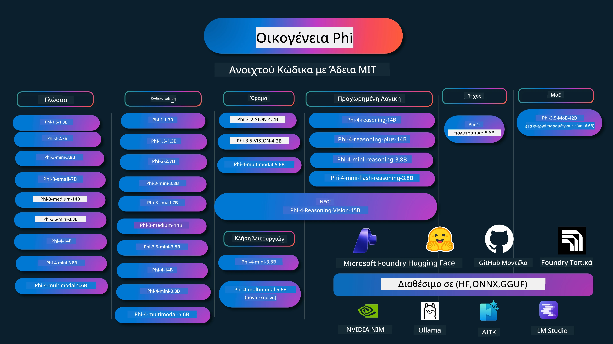

# Phi Cookbook: Παραδείγματα με Πρακτική Εφαρμογή με τα Μοντέλα Phi της Microsoft

[](https://codespaces.new/microsoft/phicookbook)
[](https://vscode.dev/redirect?url=vscode://ms-vscode-remote.remote-containers/cloneInVolume?url=https://github.com/microsoft/phicookbook)

[](https://GitHub.com/microsoft/phicookbook/graphs/contributors/?WT.mc_id=aiml-137032-kinfeylo)
[](https://GitHub.com/microsoft/phicookbook/issues/?WT.mc_id=aiml-137032-kinfeylo)
[](https://GitHub.com/microsoft/phicookbook/pulls/?WT.mc_id=aiml-137032-kinfeylo)
[](http://makeapullrequest.com?WT.mc_id=aiml-137032-kinfeylo)

[](https://GitHub.com/microsoft/phicookbook/watchers/?WT.mc_id=aiml-137032-kinfeylo)
[](https://GitHub.com/microsoft/phicookbook/network/?WT.mc_id=aiml-137032-kinfeylo)
[](https://GitHub.com/microsoft/phicookbook/stargazers/?WT.mc_id=aiml-137032-kinfeylo)

[](https://discord.com/invite/ByRwuEEgH4)

Το Phi είναι μια σειρά ανοιχτών μοντέλων τεχνητής νοημοσύνης που έχουν αναπτυχθεί από τη Microsoft.

Το Phi είναι επί του παρόντος το πιο ισχυρό και αποδοτικό μικρό γλωσσικό μοντέλο (SLM), με πολύ καλά benchmarks σε πολλαπλές γλώσσες, συλλογιστική, δημιουργία κειμένου/συνομιλίας, κώδικα, εικόνες, ήχο και άλλα σενάρια.

Μπορείτε να αναπτύξετε το Phi στο cloud ή σε συσκευές edge, και μπορείτε εύκολα να δημιουργήσετε εφαρμογές γεννητικής τεχνητής νοημοσύνης με περιορισμένη υπολογιστική ισχύ.

Ακολουθήστε αυτά τα βήματα για να ξεκινήσετε τη χρήση αυτών των πόρων:
1. **Διακλάδωση του Αποθετηρίου**: Κάντε κλικ στο [](https://GitHub.com/microsoft/phicookbook/network/?WT.mc_id=aiml-137032-kinfeylo)
2. **Κλωνοποίηση του Αποθετηρίου**: `git clone https://github.com/microsoft/PhiCookBook.git`
3. [**Συμμετοχή στην Κοινότητα Discord AI της Microsoft και γνωριμία με ειδικούς και άλλους προγραμματιστές**](https://discord.com/invite/ByRwuEEgH4?WT.mc_id=aiml-137032-kinfeylo)



### 🌐 Υποστήριξη Πολλαπλών Γλωσσών

#### Μεταφράσεις που διατηρούνται με τον [Co-op Translator](https://github.com/Azure/co-op-translator)

<!-- CO-OP TRANSLATOR LANGUAGES TABLE START -->
[Αραβικά](../ar/README.md) | [Μπενγκάλι](../bn/README.md) | [Βουλγαρικά](../bg/README.md) | [Βιρμανικά (Μιανμάρ)](../my/README.md) | [Κινέζικα (Απλουστευμένα)](../zh-CN/README.md) | [Κινέζικα (Παραδοσιακά, Χονγκ Κονγκ)](../zh-HK/README.md) | [Κινέζικα (Παραδοσιακά, Μακάο)](../zh-MO/README.md) | [Κινέζικα (Παραδοσιακά, Ταϊβάν)](../zh-TW/README.md) | [Κροατικά](../hr/README.md) | [Τσέχικα](../cs/README.md) | [Δανικά](../da/README.md) | [Ολλανδικά](../nl/README.md) | [Εσθονικά](../et/README.md) | [Φινλανδικά](../fi/README.md) | [Γαλλικά](../fr/README.md) | [Γερμανικά](../de/README.md) | [Ελληνικά](./README.md) | [Εβραϊκά](../he/README.md) | [Χίντι](../hi/README.md) | [Ουγγρικά](../hu/README.md) | [Ινδονησιακά](../id/README.md) | [Ιταλικά](../it/README.md) | [Ιαπωνικά](../ja/README.md) | [Κανάντα](../kn/README.md) | [Χμερ](../km/README.md) | [Κορεατικά](../ko/README.md) | [Λιθουανικά](../lt/README.md) | [Μαλαϊκά](../ms/README.md) | [Μαλαγιάλαμ](../ml/README.md) | [Μανιπούρι (Μέιτεϊ Μαγιεκ)](../mni/README.md) | [Μαράθι](../mr/README.md) | [Νεπάλικα](../ne/README.md) | [Νιγηριανό Πίνγκιν](../pcm/README.md) | [Νορβηγικά](../no/README.md) | [Περσικά (Φαρσί)](../fa/README.md) | [Πολωνικά](../pl/README.md) | [Πορτογαλικά (Βραζιλία)](../pt-BR/README.md) | [Πορτογαλικά (Πορτογαλία)](../pt-PT/README.md) | [Πουντζάμπι (Γκουρμούκι)](../pa/README.md) | [Ρουμανικά](../ro/README.md) | [Ρώσικα](../ru/README.md) | [Σερβικά (Κυριλλικά)](../sr/README.md) | [Σλοβακικά](../sk/README.md) | [Σλοβενικά](../sl/README.md) | [Ισπανικά](../es/README.md) | [Σουαχίλι](../sw/README.md) | [Σουηδικά](../sv/README.md) | [Ταγκάλογκ (Φιλιππινέζικα)](../tl/README.md) | [Ταμίλ](../ta/README.md) | [Τελούγκου](../te/README.md) | [Ταϊλανδικά](../th/README.md) | [Τούρκικα](../tr/README.md) | [Ουκρανικά](../uk/README.md) | [Ουρντού](../ur/README.md) | [Βιετναμικά](../vi/README.md)

> **Προτιμάτε να κλωνοποιήσετε τοπικά;**
>
> Αυτό το αποθετήριο περιλαμβάνει πάνω από 50 μεταφράσεις γλωσσών που αυξάνουν σημαντικά το μέγεθος λήψης. Για να κλωνοποιήσετε χωρίς τις μεταφράσεις, χρησιμοποιήστε sparse checkout:
>
> **Bash / macOS / Linux:**
> ```bash
> git clone --filter=blob:none --sparse https://github.com/microsoft/PhiCookBook.git
> cd PhiCookBook
> git sparse-checkout set --no-cone '/*' '!translations' '!translated_images'
> ```
>
> **CMD (Windows):**
> ```cmd
> git clone --filter=blob:none --sparse https://github.com/microsoft/PhiCookBook.git
> cd PhiCookBook
> git sparse-checkout set --no-cone "/*" "!translations" "!translated_images"
> ```
>
> Αυτό σας δίνει όλα όσα χρειάζεστε για να ολοκληρώσετε το μάθημα με πολύ πιο γρήγορη λήψη.
<!-- CO-OP TRANSLATOR LANGUAGES TABLE END -->

## Πίνακας Περιεχομένων

- Εισαγωγή
  - [Καλώς ήρθατε στην Οικογένεια Phi](./md/01.Introduction/01/01.PhiFamily.md)
  - [Ρύθμιση του περιβάλλοντος σας](./md/01.Introduction/01/01.EnvironmentSetup.md)
  - [Κατανόηση Βασικών Τεχνολογιών](./md/01.Introduction/01/01.Understandingtech.md)
  - [Ασφάλεια Τεχνητής Νοημοσύνης για Μοντέλα Phi](./md/01.Introduction/01/01.AISafety.md)
  - [Υποστήριξη Υλικού Phi](./md/01.Introduction/01/01.Hardwaresupport.md)
  - [Μοντέλα Phi & Διαθεσιμότητα σε πλατφόρμες](./md/01.Introduction/01/01.Edgeandcloud.md)
  - [Χρήση Guidance-ai και Phi](./md/01.Introduction/01/01.Guidance.md)
  - [Μοντέλα στην αγορά GitHub Marketplace](https://github.com/marketplace/models)
  - [Κατάλογος Μοντέλων Azure AI](https://ai.azure.com)

- Εκτέλεση inferencing Phi σε διαφορετικά περιβάλλοντα
    -  [Hugging face](./md/01.Introduction/02/01.HF.md)
    -  [Μοντέλα GitHub](./md/01.Introduction/02/02.GitHubModel.md)
    -  [Κατάλογος Μοντέλων Microsoft Foundry](./md/01.Introduction/02/03.AzureAIFoundry.md)
    -  [Ollama](./md/01.Introduction/02/04.Ollama.md)
    -  [AI Toolkit VSCode (AITK)](./md/01.Introduction/02/05.AITK.md)
    -  [NVIDIA NIM](./md/01.Introduction/02/06.NVIDIA.md)
    -  [Foundry Local](./md/01.Introduction/02/07.FoundryLocal.md)

- Εκτέλεση inferencing στην Οικογένεια Phi
    - [Inferencing Phi σε iOS](./md/01.Introduction/03/iOS_Inference.md)
    - [Inferencing Phi σε Android](./md/01.Introduction/03/Android_Inference.md)
    - [Inferencing Phi σε Jetson](./md/01.Introduction/03/Jetson_Inference.md)
    - [Inferencing Phi σε AI PC](./md/01.Introduction/03/AIPC_Inference.md)
    - [Inferencing Phi με το Apple MLX Framework](./md/01.Introduction/03/MLX_Inference.md)
    - [Inferencing Phi σε Τοπικό Διακομιστή](./md/01.Introduction/03/Local_Server_Inference.md)
    - [Inferencing Phi σε Απομακρυσμένο Διακομιστή χρησιμοποιώντας AI Toolkit](./md/01.Introduction/03/Remote_Interence.md)
    - [Inferencing Phi με Rust](./md/01.Introduction/03/Rust_Inference.md)
    - [Inferencing Phi–Όραση σε Τοπικό επίπεδο](./md/01.Introduction/03/Vision_Inference.md)
    - [Inferencing Phi με Kaito AKS, Azure Containers (επίσημη υποστήριξη)](./md/01.Introduction/03/Kaito_Inference.md)
-  [Ποσοτικοποίηση της Οικογένειας Phi](./md/01.Introduction/04/QuantifyingPhi.md)
    - [Ποσοτικοποίηση Phi-3.5 / 4 χρησιμοποιώντας llama.cpp](./md/01.Introduction/04/UsingLlamacppQuantifyingPhi.md)
    - [Ποσοτικοποίηση Phi-3.5 / 4 με επεκτάσεις Generative AI για onnxruntime](./md/01.Introduction/04/UsingORTGenAIQuantifyingPhi.md)
    - [Ποσοτικοποίηση Phi-3.5 / 4 χρησιμοποιώντας Intel OpenVINO](./md/01.Introduction/04/UsingIntelOpenVINOQuantifyingPhi.md)
    - [Ποσοτικοποίηση Phi-3.5 / 4 χρησιμοποιώντας Apple MLX Framework](./md/01.Introduction/04/UsingAppleMLXQuantifyingPhi.md)

-  Αξιολόγηση Phi
    - [Response AI](./md/01.Introduction/05/ResponsibleAI.md)
    - [Microsoft Foundry για Αξιολόγηση](./md/01.Introduction/05/AIFoundry.md)
    - [Χρήση Promptflow για Αξιολόγηση](./md/01.Introduction/05/Promptflow.md)
 
- RAG με Azure AI Search
    - [Πώς να χρησιμοποιήσετε Phi-4-mini και Phi-4-multimodal(RAG) με Azure AI Search](https://github.com/microsoft/PhiCookBook/blob/main/code/06.E2E/E2E_Phi-4-RAG-Azure-AI-Search.ipynb)
    - [Τοπικό υβριδικό RAG μηδενικού cloud με SQLite FTS5 και phi-4-mini](https://github.com/microsoft/PhiCookBook/blob/main/code/06.E2E/E2E_Phi-4-mini_Local_Hybrid_RAG_SQLite_FTS5.ipynb)

- Παραδείγματα ανάπτυξης εφαρμογών Phi
  - Εφαρμογές Κειμένου & Συνομιλίας
    - Δείγματα Phi-4
      - [📓] [Συνομιλία με το Μοντέλο Phi-4-mini ONNX](./md/02.Application/01.TextAndChat/Phi4/ChatWithPhi4ONNX/README.md)
      - [Συνομιλία με το τοπικό Μοντέλο Phi-4 ONNX .NET](../../md/04.HOL/dotnet/src/LabsPhi4-Chat-01OnnxRuntime)
      - [Εφαρμογή Κονσόλας .NET συνομιλίας με Phi-4 ONNX χρησιμοποιώντας Semantic Kernel](../../md/04.HOL/dotnet/src/LabsPhi4-Chat-02SK)
    - Δείγματα Phi-3 / 3.5
      - [Τοπικό Chatbot στον περιηγητή χρησιμοποιώντας Phi3, ONNX Runtime Web και WebGPU](https://github.com/microsoft/onnxruntime-inference-examples/tree/main/js/chat)
      - [Chat OpenVino](./md/02.Application/01.TextAndChat/Phi3/E2E_OpenVino_Chat.md)
      - [Πολλαπλό Μοντέλο - Διαδραστικό Phi-3-mini και OpenAI Whisper](./md/02.Application/01.TextAndChat/Phi3/E2E_Phi-3-mini_with_whisper.md)
      - [MLFlow - Δημιουργία wrapper και χρήση Phi-3 με MLFlow](./md//02.Application/01.TextAndChat/Phi3/E2E_Phi-3-MLflow.md)
      - [Βελτιστοποίηση μοντέλου - Πώς να βελτιστοποιήσετε το μοντέλο Phi-3-min για ONNX Runtime Web με Olive](https://github.com/microsoft/Olive/tree/main/examples/phi3)
      - [Εφαρμογή WinUI3 με Phi-3 mini-4k-instruct-onnx](https://github.com/microsoft/Phi3-Chat-WinUI3-Sample/)
      - [Παράδειγμα Εφαρμογής WinUI3 Multi Model AI Powered Notes](https://github.com/microsoft/ai-powered-notes-winui3-sample)
      - [Προσαρμογή και ενσωμάτωση προσαρμοσμένων μοντέλων Phi-3 με Prompt flow](./md/02.Application/01.TextAndChat/Phi3/E2E_Phi-3-FineTuning_PromptFlow_Integration.md)
      - [Προσαρμογή και ενσωμάτωση προσαρμοσμένων μοντέλων Phi-3 με Prompt flow στο Microsoft Foundry](./md/02.Application/01.TextAndChat/Phi3/E2E_Phi-3-FineTuning_PromptFlow_Integration_AIFoundry.md)
      - [Αξιολόγηση του προσαρμοσμένου μοντέλου Phi-3 / Phi-3.5 στο Microsoft Foundry με επίκεντρο τις αρχές υπεύθυνης ΤΝ της Microsoft](./md/02.Application/01.TextAndChat/Phi3/E2E_Phi-3-Evaluation_AIFoundry.md)
      - [📓] [Δείγμα πρόβλεψης γλώσσας Phi-3.5-mini-instruct (Κινέζικα/Αγγλικά)](./md/02.Application/01.TextAndChat/Phi3/phi3-instruct-demo.ipynb)
      - [Phi-3.5-Instruct WebGPU RAG Chatbot](./md/02.Application/01.TextAndChat/Phi3/WebGPUWithPhi35Readme.md)
      - [Χρήση GPU των Windows για τη δημιουργία λύσης Prompt flow με Phi-3.5-Instruct ONNX](./md/02.Application/01.TextAndChat/Phi3/UsingPromptFlowWithONNX.md)
      - [Χρήση Microsoft Phi-3.5 tflite για τη δημιουργία εφαρμογής Android](./md/02.Application/01.TextAndChat/Phi3/UsingPhi35TFLiteCreateAndroidApp.md)
      - [Παράδειγμα Q&A .NET χρησιμοποιώντας τοπικό μοντέλο ONNX Phi-3 με Microsoft.ML.OnnxRuntime](../../md/04.HOL/dotnet/src/LabsPhi301)
      - [Εφαρμογή κονσόλας συνομιλίας .NET με Semantic Kernel και Phi-3](../../md/04.HOL/dotnet/src/LabsPhi302)

  - Παραδείγματα με κώδικα βάσης Azure AI Inference SDK
    - Δείγματα Phi-4
      - [📓] [Δημιουργία κώδικα έργου χρησιμοποιώντας Phi-4-multimodal](./md/02.Application/02.Code/Phi4/GenProjectCode/README.md)
    - Δείγματα Phi-3 / 3.5
      - [Δημιουργία του δικού σας Visual Studio Code GitHub Copilot Chat με Microsoft Phi-3 Family](./md/02.Application/02.Code/Phi3/VSCodeExt/README.md)
      - [Δημιουργήστε τον δικό σας Visual Studio Code Chat Copilot Agent με Phi-3.5 μέσω GitHub Models](/md/02.Application/02.Code/Phi3/CreateVSCodeChatAgentWithGitHubModels.md)

  - Προηγμένα Παραδείγματα Συλλογιστικής
    - Δείγματα Phi-4 
      - [📓] [Δείγματα Phi-4-mini-reasoning ή Phi-4-reasoning](./md/02.Application/03.AdvancedReasoning/Phi4/AdvancedResoningPhi4mini/README.md)
      - [📓] [Ρύθμιση εκπαίδευσης Phi-4-mini-reasoning με το Microsoft Olive](./md/02.Application/03.AdvancedReasoning/Phi4/AdvancedResoningPhi4mini/olive_ft_phi_4_reasoning_with_medicaldata.ipynb)
      - [📓] [Ρύθμιση εκπαίδευσης Phi-4-mini-reasoning με το Apple MLX](./md/02.Application/03.AdvancedReasoning/Phi4/AdvancedResoningPhi4mini/mlx_ft_phi_4_reasoning_with_medicaldata.ipynb)
      - [📓] [Phi-4-mini-reasoning με Μοντέλα GitHub](./md/02.Application/02.Code/Phi4r/github_models_inference.ipynb)
      - [📓] [Phi-4-mini-reasoning με Μοντέλα Microsoft Foundry](./md/02.Application/02.Code/Phi4r/azure_models_inference.ipynb)
  - Επιδείξεις
      - [Επιδείξεις Phi-4-mini φιλοξενούμενες στο Hugging Face Spaces](https://huggingface.co/spaces/microsoft/phi-4-mini?WT.mc_id=aiml-137032-kinfeylo)
      - [Επιδείξεις Phi-4-multimodal φιλοξενούμενες στο Hugging Face Spaces](https://huggingface.co/spaces/microsoft/phi-4-multimodal?WT.mc_id=aiml-137032-kinfeylo)
  - Δείγματα Όρασης
    - Δείγματα Phi-4 
      - [📓] [Χρήση Phi-4-multimodal για ανάγνωση εικόνων και δημιουργία κώδικα](./md/02.Application/04.Vision/Phi4/CreateFrontend/README.md) 
    - Δείγματα Phi-3 / 3.5
      -  [📓][Phi-3-vision-Μετατροπή κειμένου εικόνας σε κείμενο](./md/02.Application/04.Vision/Phi3/E2E_Phi-3-vision-image-text-to-text-online-endpoint.ipynb)
      - [Phi-3-vision-ONNX](https://onnxruntime.ai/docs/genai/tutorials/phi3-v.html)
      - [📓][Phi-3-vision Ενσωμάτωση CLIP](./md/02.Application/04.Vision/Phi3/E2E_Phi-3-vision-image-text-to-text-online-endpoint.ipynb)
      - [ΕΠΙΔΕΙΞΗ: Ανακύκλωση Phi-3](https://github.com/jennifermarsman/PhiRecycling/)
      - [Phi-3-vision - Οπτικός βοηθός γλώσσας - με Phi3-Vision και OpenVINO](https://docs.openvino.ai/nightly/notebooks/phi-3-vision-with-output.html)
      - [Phi-3 Vision Nvidia NIM](./md/02.Application/04.Vision/Phi3/E2E_Nvidia_NIM_Vision.md)
      - [Phi-3 Vision OpenVino](./md/02.Application/04.Vision/Phi3/E2E_OpenVino_Phi3Vision.md)
      - [📓][Phi-3.5 Vision δείγμα πολλαπλών καρέ ή πολλαπλών εικόνων](./md/02.Application/04.Vision/Phi3/phi3-vision-demo.ipynb)
      - [Τοπικό μοντέλο Phi-3 Vision ONNX με χρήση Microsoft.ML.OnnxRuntime .NET](../../md/04.HOL/dotnet/src/LabsPhi303)
      - [Μενού βασισμένο τοπικό μοντέλο Phi-3 Vision ONNX με χρήση Microsoft.ML.OnnxRuntime .NET](../../md/04.HOL/dotnet/src/LabsPhi304)

  - Δείγματα Λογικής Όρασης
    - Phi-4-Reasoning-Vision-15B 
      - [📓] [Χρήση Phi-4-Reasoning-Vision-15B για ανίχνευση απαγορευμένης διέλευσης πεζών](./md/02.Application/10.ReasoningVision/Phi_4_reasoning_vision_15b_Jaywalking.ipynb)
      - [📓] [Χρήση Phi-4-Reasoning-Vision-15B για μαθηματικά](./md/02.Application/10.ReasoningVision/Phi_4_reasoning_vision_15b_Math.ipynb)
      - [📓] [Χρήση Phi-4-Reasoning-Vision-15B για ανίχνευση διεπιφάνειας χρήστη](./md/02.Application/10.ReasoningVision/Phi_4_reasoning_vision_15b_ui.ipynb)

  - Δείγματα Μαθηματικών
    - Δείγματα Phi-4-Mini-Flash-Reasoning-Instruct  [Επίδειξη Μαθηματικών με Phi-4-Mini-Flash-Reasoning-Instruct](./md/02.Application/09.Math/MathDemo.ipynb)

  - Δείγματα Ήχου
    - Δείγματα Phi-4 
      - [📓] [Εξαγωγή απομαγνητοφωνήσεων με χρήση Phi-4-multimodal](./md/02.Application/05.Audio/Phi4/Transciption/README.md)
      - [📓] [Δείγμα Ήχου Phi-4-multimodal](./md/02.Application/05.Audio/Phi4/Siri/demo.ipynb)
      - [📓] [Δείγμα Μετάφρασης Ομιλίας Phi-4-multimodal](./md/02.Application/05.Audio/Phi4/Translate/demo.ipynb)
      - [Εφαρμογή κονσόλας .NET που χρησιμοποιεί Phi-4-multimodal Audio για ανάλυση αρχείου ήχου και δημιουργία απομαγνητοφώνησης](../../md/04.HOL/dotnet/src/LabsPhi4-MultiModal-02Audio)

  - Δείγματα MOE
    - Δείγματα Phi-3 / 3.5
      - [📓] [Δείγμα κοινωνικών μέσων από Μείγμα Ειδικών (MoEs) Phi-3.5](./md/02.Application/06.MoE/Phi3/phi3_moe_demo.ipynb)
      - [📓] [Δημιουργία Pipeline με Ανάκτηση-Ενισχυμένη Γενετική (RAG) με NVIDIA NIM Phi-3 MOE, Azure AI Search και LlamaIndex](./md/02.Application/06.MoE/Phi3/azure-ai-search-nvidia-rag.ipynb)
      - 
  - Δείγματα Κλήσης Συναρτήσεων
    - Δείγματα Phi-4 🆕
      -  [📓] [Χρήση Κλήσης Συναρτήσεων με Phi-4-mini](./md/02.Application/07.FunctionCalling/Phi4/FunctionCallingBasic/README.md)
      -  [📓] [Χρήση Κλήσης Συναρτήσεων για δημιουργία πολλαπλών πρακτόρων με Phi-4-mini](./md/02.Application/07.FunctionCalling/Phi4/Multiagents/Phi_4_mini_multiagent.ipynb)
      -  [📓] [Χρήση Κλήσης Συναρτήσεων με Ollama](./md/02.Application/07.FunctionCalling/Phi4/Ollama/ollama_functioncalling.ipynb)
      -  [📓] [Χρήση Κλήσης Συναρτήσεων με ONNX](./md/02.Application/07.FunctionCalling/Phi4/ONNX/onnx_parallel_functioncalling.ipynb)
  - Δείγματα Πολυμορφικής Μίξης
    - Δείγματα Phi-4 🆕
      -  [📓] [Χρήση Phi-4-multimodal ως Τεχνολογικού δημοσιογράφου](./md/02.Application/08.Multimodel/Phi4/TechJournalist/phi_4_mm_audio_text_publish_news.ipynb)
      - [Εφαρμογή κονσόλας .NET που χρησιμοποιεί Phi-4-multimodal για ανάλυση εικόνων](../../md/04.HOL/dotnet/src/LabsPhi4-MultiModal-01Images)

- Ρύθμιση Εκπαίδευσης Delta Phi
  - [Σενάρια Ρύθμισης](./md/03.FineTuning/FineTuning_Scenarios.md)
  - [Ρύθμιση έναντι RAG](./md/03.FineTuning/FineTuning_vs_RAG.md)
  - [Ρύθμιση Επιτρέποντας στο Phi-3 να γίνει Ειδικός Κλάδου](./md/03.FineTuning/LetPhi3gotoIndustriy.md)
  - [Ρύθμιση Phi-3 με AI Toolkit για VS Code](./md/03.FineTuning/Finetuning_VSCodeaitoolkit.md)
  - [Ρύθμιση Phi-3 με την Υπηρεσία Μηχανικής Μάθησης Azure](./md/03.FineTuning/Introduce_AzureML.md)
  - [Ρύθμιση Phi-3 με Lora](./md/03.FineTuning/FineTuning_Lora.md)
  - [Ρύθμιση Phi-3 με QLora](./md/03.FineTuning/FineTuning_Qlora.md)
  - [Ρύθμιση Phi-3 με Microsoft Foundry](./md/03.FineTuning/FineTuning_AIFoundry.md)
  - [Ρύθμιση Phi-3 με Azure ML CLI/SDK](./md/03.FineTuning/FineTuning_MLSDK.md)
  - [Ρύθμιση με Microsoft Olive](./md/03.FineTuning/FineTuning_MicrosoftOlive.md)
  - [Ρύθμιση με Microsoft Olive Hands-On Lab](./md/03.FineTuning/olive-lab/readme.md)
  - [Ρύθμιση Phi-3-vision με Weights and Bias](./md/03.FineTuning/FineTuning_Phi-3-visionWandB.md)
  - [Ρύθμιση Phi-3 με Apple MLX Framework](./md/03.FineTuning/FineTuning_MLX.md)
  - [Ρύθμιση Phi-3-vision (επίσημη υποστήριξη)](./md/03.FineTuning/FineTuning_Vision.md)
  - [Ρύθμιση Phi-3 με Kaito AKS , Azure Containers (επίσημη υποστήριξη)](./md/03.FineTuning/FineTuning_Kaito.md)
  - [Ρύθμιση Phi-3 και 3.5 Vision](https://github.com/2U1/Phi3-Vision-Finetune)

- Εργαστήριο 
  - [Εξερεύνηση μοντέλων αιχμής: LLMs, SLMs, τοπική ανάπτυξη και άλλα](https://github.com/microsoft/aitour-exploring-cutting-edge-models)
  - [Ξεκλείδωμα δυνατοτήτων NLP: Ρύθμιση με Microsoft Olive](https://github.com/azure/Ignite_FineTuning_workshop)

- Ακαδημαϊκές Ερευνες και Δημοσιεύσεις
  - [Τα βιβλία είναι όλα όσα χρειάζεστε ΙΙ: τεχνική αναφορά phi-1.5](https://arxiv.org/abs/2309.05463)
  - [Τεχνική αναφορά Phi-3: Ένα ισχυρό μοντέλο γλώσσας τοπικά στο τηλέφωνό σας](https://arxiv.org/abs/2404.14219)
  - [Τεχνική αναφορά Phi-4](https://arxiv.org/abs/2412.08905)
  - [Τεχνική αναφορά Phi-4-Mini: Συμπαγή αλλά δυνατά πολυμορφικά μοντέλα γλώσσας μέσω μείγματος LoRAs](https://arxiv.org/abs/2503.01743)
  - [Βελτιστοποίηση μικρών μοντέλων γλώσσας για λειτουργίες κλήσεων εντός οχήματος](https://arxiv.org/abs/2501.02342)
  - [(ΓιατίPHI) Ρύθμιση PHI-3 για Απαντήσεις σε Προαιρετικές Ερωτήσεις Πολλαπλής Επιλογής: Μεθοδολογία, Αποτελέσματα και Προκλήσεις](https://arxiv.org/abs/2501.01588)
  - [Τεχνική αναφορά Phi-4-reasoning](https://www.microsoft.com/en-us/research/wp-content/uploads/2025/04/phi_4_reasoning.pdf)
  - [Τεχνική αναφορά Phi-4-mini-reasoning](https://huggingface.co/microsoft/Phi-4-mini-reasoning/blob/main/Phi-4-Mini-Reasoning.pdf)

## Χρήση Μοντέλων Phi

### Phi στο Microsoft Foundry

Μπορείτε να μάθετε πώς να χρησιμοποιείτε το Microsoft Phi και πώς να κατασκευάζετε ολοκληρωμένες λύσεις σε διάφορες συσκευές υλικού σας. Για να δοκιμάσετε το Phi μόνοι σας, ξεκινήστε παίζοντας με τα μοντέλα και προσαρμόζοντας το Phi για τα σενάρια σας χρησιμοποιώντας τον [Κατάλογο Μοντέλων Microsoft Foundry Azure AI](https://aka.ms/phi3-azure-ai). Μπορείτε να μάθετε περισσότερα στην Εισαγωγή στο [Microsoft Foundry](/md/02.QuickStart/AzureAIFoundry_QuickStart.md)

**Πεδίο Δοκιμών**
Κάθε μοντέλο έχει ένα αφιερωμένο πεδίο δοκιμών για τον έλεγχο του μοντέλου [Azure AI Playground](https://aka.ms/try-phi3).

### Phi σε Μοντέλα GitHub

Μπορείτε να μάθετε πώς να χρησιμοποιείτε το Microsoft Phi και πώς να κατασκευάζετε ολοκληρωμένες λύσεις σε διάφορες συσκευές υλικού σας. Για να δοκιμάσετε το Phi μόνοι σας, ξεκινήστε παίζοντας με το μοντέλο και προσαρμόζοντας το Phi στα σενάρια σας χρησιμοποιώντας τον [Κατάλογο Μοντέλων GitHub](https://github.com/marketplace/models?WT.mc_id=aiml-137032-kinfeylo). Μπορείτε να μάθετε περισσότερα στην Εισαγωγή στον [Κατάλογο Μοντέλων GitHub](/md/02.QuickStart/GitHubModel_QuickStart.md)

**Πεδίο Δοκιμών**
Κάθε μοντέλο έχει ένα αφιερωμένο [πεδίο δοκιμών για τον έλεγχο του μοντέλου](/md/02.QuickStart/GitHubModel_QuickStart.md).

### Phi στο Hugging Face

Μπορείτε επίσης να βρείτε το μοντέλο στο [Hugging Face](https://huggingface.co/microsoft)

**Πεδίο Δοκιμών**
 [Πεδίο δοκιμών Hugging Chat](https://huggingface.co/chat/models/microsoft/Phi-3-mini-4k-instruct)

 ## 🎒 Άλλα Μαθήματα

Η ομάδα μας παράγει και άλλα μαθήματα! Ρίξτε μια ματιά:

<!-- CO-OP TRANSLATOR OTHER COURSES START -->
### LangChain
[](https://aka.ms/langchain4j-for-beginners)
[](https://aka.ms/langchainjs-for-beginners?WT.mc_id=m365-94501-dwahlin)
[](https://github.com/microsoft/langchain-for-beginners?WT.mc_id=m365-94501-dwahlin)
---

### Azure / Edge / MCP / Agents
[](https://github.com/microsoft/AZD-for-beginners?WT.mc_id=academic-105485-koreyst)
[](https://github.com/microsoft/edgeai-for-beginners?WT.mc_id=academic-105485-koreyst)
[](https://github.com/microsoft/mcp-for-beginners?WT.mc_id=academic-105485-koreyst)
[](https://github.com/microsoft/ai-agents-for-beginners?WT.mc_id=academic-105485-koreyst)

---
 
### Σειρά Γενετικής Τεχνητής Νοημοσύνης
[](https://github.com/microsoft/generative-ai-for-beginners?WT.mc_id=academic-105485-koreyst)
[-9333EA?style=for-the-badge&labelColor=E5E7EB&color=9333EA)](https://github.com/microsoft/Generative-AI-for-beginners-dotnet?WT.mc_id=academic-105485-koreyst)
[-C084FC?style=for-the-badge&labelColor=E5E7EB&color=C084FC)](https://github.com/microsoft/generative-ai-for-beginners-java?WT.mc_id=academic-105485-koreyst)
[-E879F9?style=for-the-badge&labelColor=E5E7EB&color=E879F9)](https://github.com/microsoft/generative-ai-with-javascript?WT.mc_id=academic-105485-koreyst)

---
 
### Βασική Μάθηση
[](https://aka.ms/ml-beginners?WT.mc_id=academic-105485-koreyst)
[](https://aka.ms/datascience-beginners?WT.mc_id=academic-105485-koreyst)
[](https://aka.ms/ai-beginners?WT.mc_id=academic-105485-koreyst)
[](https://github.com/microsoft/Security-101?WT.mc_id=academic-96948-sayoung)
[](https://aka.ms/webdev-beginners?WT.mc_id=academic-105485-koreyst)
[](https://aka.ms/iot-beginners?WT.mc_id=academic-105485-koreyst)
[](https://github.com/microsoft/xr-development-for-beginners?WT.mc_id=academic-105485-koreyst)

---
 
### Σειρά Copilot
[](https://aka.ms/GitHubCopilotAI?WT.mc_id=academic-105485-koreyst)
[](https://github.com/microsoft/mastering-github-copilot-for-dotnet-csharp-developers?WT.mc_id=academic-105485-koreyst)
[](https://github.com/microsoft/CopilotAdventures?WT.mc_id=academic-105485-koreyst)
<!-- CO-OP TRANSLATOR OTHER COURSES END -->

## Υπεύθυνη Τεχνητή Νοημοσύνη 

Η Microsoft δεσμεύεται να βοηθά τους πελάτες της να χρησιμοποιούν τα προϊόντα τεχνητής νοημοσύνης υπεύθυνα, μοιράζοντας τις γνώσεις μας και δημιουργώντας συνεργασίες βασισμένες στην εμπιστοσύνη μέσω εργαλείων όπως οι Σημειώσεις Διαφάνειας και οι Αξιολογήσεις Επιπτώσεων. Πολλοί από αυτούς τους πόρους είναι διαθέσιμοι στο [https://aka.ms/RAI](https://aka.ms/RAI).
Η προσέγγιση της Microsoft για την υπεύθυνη τεχνητή νοημοσύνη βασίζεται στις αρχές της δικαιοσύνης, αξιοπιστίας και ασφάλειας, ιδιωτικότητας και ασφάλειας, συμπερίληψης, διαφάνειας και λογοδοσίας.

Μεγάλης κλίμακας μοντέλα φυσικής γλώσσας, εικόνας και ομιλίας - όπως αυτά που χρησιμοποιούνται στο συγκεκριμένο δείγμα - μπορούν πιθανόν να εμφανίσουν συμπεριφορές που είναι άδικες, αναξιόπιστες ή προσβλητικές, προκαλώντας βλάβες. Παρακαλούμε ανατρέξτε στη [Σημείωση Διαφάνειας της υπηρεσίας Azure OpenAI](https://learn.microsoft.com/legal/cognitive-services/openai/transparency-note?tabs=text) για να ενημερωθείτε για τους κινδύνους και τους περιορισμούς.

Η συνιστώμενη προσέγγιση για τη μείωση αυτών των κινδύνων είναι να περιληφθεί ένα σύστημα ασφαλείας στην αρχιτεκτονική σας που μπορεί να εντοπίσει και να αποτρέψει επιβλαβή συμπεριφορά. Το [Azure AI Content Safety](https://learn.microsoft.com/azure/ai-services/content-safety/overview) παρέχει ένα ανεξάρτητο επίπεδο προστασίας, ικανό να εντοπίσει επιβλαβές περιεχόμενο που δημιουργείται από χρήστες και τεχνητή νοημοσύνη σε εφαρμογές και υπηρεσίες. Το Azure AI Content Safety περιλαμβάνει APIs για κείμενο και εικόνες που σας επιτρέπουν να ανιχνεύετε υλικό που είναι επιβλαβές. Μέσα στο Microsoft Foundry, η υπηρεσία Content Safety σας επιτρέπει να δείτε, να εξερευνήσετε και να δοκιμάσετε δείγματα κώδικα για τον εντοπισμό επιβλαβούς περιεχομένου σε διάφορες μορφές. Η ακόλουθη [τεκμηρίωση γρήγορης εκκίνησης](https://learn.microsoft.com/azure/ai-services/content-safety/quickstart-text?tabs=visual-studio%2Clinux&pivots=programming-language-rest) σας καθοδηγεί στη διαδικασία αποστολής αιτημάτων προς την υπηρεσία.

Ένα άλλο στοιχείο που πρέπει να ληφθεί υπόψη είναι η συνολική απόδοση της εφαρμογής. Σε εφαρμογές με πολλαπλές μορφές και πολλαπλά μοντέλα, θεωρούμε την απόδοση ως το σύστημα να λειτουργεί όπως εσείς και οι χρήστες σας περιμένετε, συμπεριλαμβανομένου να μην παράγει επιβλαβή αποτελέσματα. Είναι σημαντικό να αξιολογήσετε την απόδοση της συνολικής εφαρμογής σας χρησιμοποιώντας τους [Αξιολογητές Απόδοσης, Ποιότητας και Κινδύνου και Ασφάλειας](https://learn.microsoft.com/azure/ai-studio/concepts/evaluation-metrics-built-in). Επίσης, έχετε τη δυνατότητα να δημιουργήσετε και να αξιολογήσετε με [προσαρμοσμένους αξιολογητές](https://learn.microsoft.com/azure/ai-studio/how-to/develop/evaluate-sdk#custom-evaluators).

Μπορείτε να αξιολογήσετε την εφαρμογή AI σας στο περιβάλλον ανάπτυξής σας χρησιμοποιώντας το [Azure AI Evaluation SDK](https://microsoft.github.io/promptflow/index.html). Δεδομένου ενός συνόλου δοκιμών ή ενός στόχου, οι γεννήσεις της εφαρμογής σας γεννητικής AI μετρώνται ποσοτικά με ενσωματωμένους αξιολογητές ή προσαρμοσμένους αξιολογητές της επιλογής σας. Για να ξεκινήσετε με το azure ai evaluation sdk για να αξιολογήσετε το σύστημά σας, μπορείτε να ακολουθήσετε τον [οδηγό γρήγορης εκκίνησης](https://learn.microsoft.com/azure/ai-studio/how-to/develop/flow-evaluate-sdk). Μόλις εκτελέσετε μια εκτέλεση αξιολόγησης, μπορείτε να [οπτικοποιήσετε τα αποτελέσματα στο Microsoft Foundry](https://learn.microsoft.com/azure/ai-studio/how-to/evaluate-flow-results). 

## Εμπορικά Σήματα

Αυτό το έργο μπορεί να περιέχει εμπορικά σήματα ή λογότυπα για έργα, προϊόντα ή υπηρεσίες. Η εξουσιοδοτημένη χρήση των εμπορικών σημάτων ή λογοτύπων της Microsoft υπόκειται και πρέπει να ακολουθεί τις [Οδηγίες Εμπορικών Σημάτων και Μάρκας της Microsoft](https://www.microsoft.com/legal/intellectualproperty/trademarks/usage/general).
Η χρήση των εμπορικών σημάτων ή λογοτύπων της Microsoft σε τροποποιημένες εκδόσεις αυτού του έργου δεν πρέπει να προκαλεί σύγχυση ή να συνεπάγεται χορηγία από τη Microsoft. Οποιαδήποτε χρήση εμπορικών σημάτων ή λογοτύπων τρίτων υπόκειται στις πολιτικές αυτών των τρίτων.

## Λήψη Βοήθειας

Αν κολλήσετε ή έχετε οποιεσδήποτε ερωτήσεις σχετικά με την κατασκευή εφαρμογών AI, συμμετέχετε:

[](https://aka.ms/foundry/discord)

Αν έχετε σχόλια προϊόντος ή σφάλματα κατά την κατασκευή επισκεφθείτε:

[](https://aka.ms/foundry/forum)

---

<!-- CO-OP TRANSLATOR DISCLAIMER START -->
**Αποποίηση ευθυνών**:
Αυτό το έγγραφο έχει μεταφραστεί χρησιμοποιώντας την υπηρεσία μετάφρασης με τεχνητή νοημοσύνη [Co-op Translator](https://github.com/Azure/co-op-translator). Ενώ επιδιώκουμε την ακρίβεια, παρακαλούμε να έχετε υπόψη ότι οι αυτοματοποιημένες μεταφράσεις ενδέχεται να περιέχουν λάθη ή ανακρίβειες. Το πρωτότυπο έγγραφο στη μητρική του γλώσσα πρέπει να θεωρείται η αυθεντική πηγή. Για κρίσιμες πληροφορίες, συνιστάται επαγγελματική ανθρώπινη μετάφραση. Δεν φέρουμε ευθύνη για τυχόν παρεξηγήσεις ή λανθασμένες ερμηνείες που προκύπτουν από τη χρήση αυτής της μετάφρασης.
<!-- CO-OP TRANSLATOR DISCLAIMER END -->