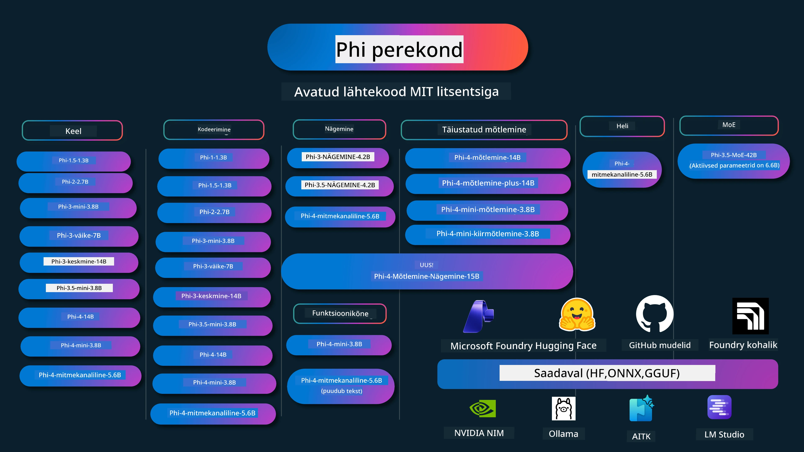

# Phi kokaraamat: Käed-küljes näited Microsofti Phi mudelitega

[](https://codespaces.new/microsoft/phicookbook)
[](https://vscode.dev/redirect?url=vscode://ms-vscode-remote.remote-containers/cloneInVolume?url=https://github.com/microsoft/phicookbook)

[](https://GitHub.com/microsoft/phicookbook/graphs/contributors/?WT.mc_id=aiml-137032-kinfeylo)
[](https://GitHub.com/microsoft/phicookbook/issues/?WT.mc_id=aiml-137032-kinfeylo)
[](https://GitHub.com/microsoft/phicookbook/pulls/?WT.mc_id=aiml-137032-kinfeylo)
[](http://makeapullrequest.com?WT.mc_id=aiml-137032-kinfeylo)

[](https://GitHub.com/microsoft/phicookbook/watchers/?WT.mc_id=aiml-137032-kinfeylo)
[](https://GitHub.com/microsoft/phicookbook/network/?WT.mc_id=aiml-137032-kinfeylo)
[](https://GitHub.com/microsoft/phicookbook/stargazers/?WT.mc_id=aiml-137032-kinfeylo)

[](https://discord.com/invite/ByRwuEEgH4)

Phi on Microsofti arendatud avatud lähtekoodiga tehisintellekti mudelite seeria.

Phi on praegu kõige võimsam ja kuluefektiivsem väike keelemudel (SLM), millel on väga head võrdlusnäitajad mitmekeelsuses, mõtlemises, teksti/vestluse genereerimises, kodeerimises, piltides, helis ja teistes stsenaariumites.

Saate Phi juurutada pilves või servaseadmetes ning hõlpsasti luua piiratud arvutusvõimsusega generatiivseid AI rakendusi.

Järgige neid samme, et alustada nende ressursside kasutamist:
1. **Forkige hoidla**: Klõpsake [](https://GitHub.com/microsoft/phicookbook/network/?WT.mc_id=aiml-137032-kinfeylo)
2. **Kloonige hoidla**: `git clone https://github.com/microsoft/PhiCookBook.git`
3. [**Liituge Microsofti AI Discord kogukonnaga ning kohtuge ekspertide ja arendajatega**](https://discord.com/invite/ByRwuEEgH4?WT.mc_id=aiml-137032-kinfeylo)



### 🌐 Mitmekeelne tugi

#### Tõlked säilitatud koos [Co-op Translator](https://github.com/Azure/co-op-translator)

<!-- CO-OP TRANSLATOR LANGUAGES TABLE START -->
[Araabia](../ar/README.md) | [Bengali](../bn/README.md) | [Bulgaaria](../bg/README.md) | [Burma (Myanmar)](../my/README.md) | [Hiina (lihtsustatud)](../zh-CN/README.md) | [Hiina (traditsiooniline, Hongkong)](../zh-HK/README.md) | [Hiina (traditsiooniline, Macau)](../zh-MO/README.md) | [Hiina (traditsiooniline, Taiwan)](../zh-TW/README.md) | [Horvaadi](../hr/README.md) | [Tšehhi](../cs/README.md) | [Taani](../da/README.md) | [Hollandi](../nl/README.md) | [Eesti](./README.md) | [Soome](../fi/README.md) | [Prantsuse](../fr/README.md) | [Saksa](../de/README.md) | [Kreeka](../el/README.md) | [Heebrea](../he/README.md) | [Hindi](../hi/README.md) | [Ungari](../hu/README.md) | [Indoneesia](../id/README.md) | [Itaalia](../it/README.md) | [Jaapani](../ja/README.md) | [Kannada](../kn/README.md) | [Khmer](../km/README.md) | [Korea](../ko/README.md) | [Leedu](../lt/README.md) | [Malai](../ms/README.md) | [Malajalami](../ml/README.md) | [Marathi](../mr/README.md) | [Nepali](../ne/README.md) | [Nigeeria pidgin](../pcm/README.md) | [Norra](../no/README.md) | [Pärsia (Farsi)](../fa/README.md) | [Poola](../pl/README.md) | [Portugali (Brasiilia)](../pt-BR/README.md) | [Portugali (Portugal)](../pt-PT/README.md) | [Pandžabi (Gurmukhi)](../pa/README.md) | [Rumeenia](../ro/README.md) | [Vene](../ru/README.md) | [Serbia (kirillitsa)](../sr/README.md) | [Slovaki](../sk/README.md) | [Sloveeni](../sl/README.md) | [Hispaania](../es/README.md) | [Suahiili](../sw/README.md) | [Rootsi](../sv/README.md) | [Tagalogi (Filipiinid)](../tl/README.md) | [Tamili](../ta/README.md) | [Telugu](../te/README.md) | [Tai](../th/README.md) | [Türgi](../tr/README.md) | [Ukraina](../uk/README.md) | [Urdu](../ur/README.md) | [Vietnam](../vi/README.md)

> **Eelistad kloonida kohalikult?**
>
> Selles hoidlas on üle 50 keele tõlked, mis suurendavad allalaadimise suurust märkimisväärselt. Kui soovid kloonida ilma tõlgeteta, kasuta harvaeksemplari:
>
> **Bash / macOS / Linux:**
> ```bash
> git clone --filter=blob:none --sparse https://github.com/microsoft/PhiCookBook.git
> cd PhiCookBook
> git sparse-checkout set --no-cone '/*' '!translations' '!translated_images'
> ```
>
> **CMD (Windows):**
> ```cmd
> git clone --filter=blob:none --sparse https://github.com/microsoft/PhiCookBook.git
> cd PhiCookBook
> git sparse-checkout set --no-cone "/*" "!translations" "!translated_images"
> ```
>
> See annab sulle kõik vajaliku kursuse lõpetamiseks palju kiirema allalaadimisega.
<!-- CO-OP TRANSLATOR LANGUAGES TABLE END -->

## Sisukord

- Sissejuhatus
  - [Tere tulemast Phi perekonda](./md/01.Introduction/01/01.PhiFamily.md)
  - [Keskkonna seadistamine](./md/01.Introduction/01/01.EnvironmentSetup.md)
  - [Põhitehnoloogiate mõistmine](./md/01.Introduction/01/01.Understandingtech.md)
  - [AI turvalisus Phi mudelite jaoks](./md/01.Introduction/01/01.AISafety.md)
  - [Phi riistvaratugi](./md/01.Introduction/01/01.Hardwaresupport.md)
  - [Phi mudelid ja saadavus platvormidel](./md/01.Introduction/01/01.Edgeandcloud.md)
  - [Guidance-ai ja Phi kasutamine](./md/01.Introduction/01/01.Guidance.md)
  - [GitHub Marketplace mudelid](https://github.com/marketplace/models)
  - [Azure AI mudelite kataloog](https://ai.azure.com)

- Phi järeldus erinevates keskkondades
    -  [Hugging face](./md/01.Introduction/02/01.HF.md)
    -  [GitHub mudelid](./md/01.Introduction/02/02.GitHubModel.md)
    -  [Microsoft Foundry mudelite kataloog](./md/01.Introduction/02/03.AzureAIFoundry.md)
    -  [Ollama](./md/01.Introduction/02/04.Ollama.md)
    -  [AI Toolkit VSCode (AITK)](./md/01.Introduction/02/05.AITK.md)
    -  [NVIDIA NIM](./md/01.Introduction/02/06.NVIDIA.md)
    -  [Foundry lokaalne](./md/01.Introduction/02/07.FoundryLocal.md)

- Phi pere järeldus
    - [Phi järeldus iOS-is](./md/01.Introduction/03/iOS_Inference.md)
    - [Phi järeldus Androidis](./md/01.Introduction/03/Android_Inference.md)
    - [Phi järeldus Jetsionis](./md/01.Introduction/03/Jetson_Inference.md)
    - [Phi järeldus AI arvutis](./md/01.Introduction/03/AIPC_Inference.md)
    - [Phi järeldus Apple MLX raamistikuga](./md/01.Introduction/03/MLX_Inference.md)
    - [Phi järeldus lokaalses serveris](./md/01.Introduction/03/Local_Server_Inference.md)
    - [Phi järeldus kaugserveris AI Toolkitiga](./md/01.Introduction/03/Remote_Interence.md)
    - [Phi järeldus Rustiga](./md/01.Introduction/03/Rust_Inference.md)
    - [Phi järeldus visuaalselt lokaalselt](./md/01.Introduction/03/Vision_Inference.md)
    - [Phi järeldus Kaito AKS, Azure konteineritega (ametlik tugi)](./md/01.Introduction/03/Kaito_Inference.md)
-  [Phi perekonna kvantifitseerimine](./md/01.Introduction/04/QuantifyingPhi.md)
    - [Phi-3.5 / 4 kvantifitseerimine kasutades llama.cpp](./md/01.Introduction/04/UsingLlamacppQuantifyingPhi.md)
    - [Phi-3.5 / 4 kvantifitseerimine kasutades Generative AI laiendusi onnxruntime'ile](./md/01.Introduction/04/UsingORTGenAIQuantifyingPhi.md)
    - [Phi-3.5 / 4 kvantifitseerimine kasutades Intel OpenVINO-d](./md/01.Introduction/04/UsingIntelOpenVINOQuantifyingPhi.md)
    - [Phi-3.5 / 4 kvantifitseerimine kasutades Apple MLX raamistikku](./md/01.Introduction/04/UsingAppleMLXQuantifyingPhi.md)

- Phi hindamine
    - [Response AI](./md/01.Introduction/05/ResponsibleAI.md)
    - [Microsoft Foundry hindamiseks](./md/01.Introduction/05/AIFoundry.md)
    - [Promptflow kasutamine hindamiseks](./md/01.Introduction/05/Promptflow.md)
 
- RAG Azure AI otsinguga
    - [Kuidas kasutada Phi-4-mini ja Phi-4-multimodal (RAG) Azure AI otsinguga](https://github.com/microsoft/PhiCookBook/blob/main/code/06.E2E/E2E_Phi-4-RAG-Azure-AI-Search.ipynb)
    - [Null-pilv lokaalne hübriid RAG SQLite FTS5 ja phi-4-mini abil](https://github.com/microsoft/PhiCookBook/blob/main/code/06.E2E/E2E_Phi-4-mini_Local_Hybrid_RAG_SQLite_FTS5.ipynb)

- Phi rakenduste arendamise näited
  - Teksti ja vestluse rakendused
    - Phi-4 näited 
      - [📓] [Vestlus Phi-4-mini ONNX mudeliga](./md/02.Application/01.TextAndChat/Phi4/ChatWithPhi4ONNX/README.md)
      - [Vestlus Phi-4 lokaalse ONNX mudeliga .NET](../../md/04.HOL/dotnet/src/LabsPhi4-Chat-01OnnxRuntime)
      - [Vestlus .NET konsoolirakendus Semantic Kernel ja Phi-4 ONNX-iga](../../md/04.HOL/dotnet/src/LabsPhi4-Chat-02SK)
    - Phi-3 / 3.5 näited
      - [Lokaalne vestlusrobot brauseris kasutades Phi3, ONNX Runtime Web ja WebGPU](https://github.com/microsoft/onnxruntime-inference-examples/tree/main/js/chat)
      - [OpenVINO vestlus](./md/02.Application/01.TextAndChat/Phi3/E2E_OpenVino_Chat.md)
      - [Mitme mudeli - Interaktiivne Phi-3-mini ja OpenAI Whisper](./md/02.Application/01.TextAndChat/Phi3/E2E_Phi-3-mini_with_whisper.md)
      - [MLFlow - kest ümber ehitamine ja Phi-3 kasutamine MLFlow'ga](./md//02.Application/01.TextAndChat/Phi3/E2E_Phi-3-MLflow.md)
      - [Mudeliparandus - Kuidas optimeerida Phi-3-min mudelit ONNX Runtime Web jaoks Olive abil](https://github.com/microsoft/Olive/tree/main/examples/phi3)
      - [WinUI3 rakendus Phi-3 mini-4k-instruct-onnx mudeliga](https://github.com/microsoft/Phi3-Chat-WinUI3-Sample/)
      -[WinUI3 mitme mudeli AI-toega märkmete rakenduse näide](https://github.com/microsoft/ai-powered-notes-winui3-sample)
      - [Kohanda ja integreeri kohandatud Phi-3 mudeleid Prompt flow abil](./md/02.Application/01.TextAndChat/Phi3/E2E_Phi-3-FineTuning_PromptFlow_Integration.md)
      - [Kohanda ja integreeri kohandatud Phi-3 mudeleid Prompt flow abil Microsoft Foundrys](./md/02.Application/01.TextAndChat/Phi3/E2E_Phi-3-FineTuning_PromptFlow_Integration_AIFoundry.md)
      - [Hinda Microsoft Foundry's kohandatud Phi-3 / Phi-3.5 mudelit, keskendudes Microsofti vastutustundliku AI põhimõtetele](./md/02.Application/01.TextAndChat/Phi3/E2E_Phi-3-Evaluation_AIFoundry.md)
      - [📓] [Phi-3.5-mini-instruct keeleprognoosi näidis (hiina/inglise)](./md/02.Application/01.TextAndChat/Phi3/phi3-instruct-demo.ipynb)
      - [Phi-3.5-Instruct WebGPU RAG vestlusrobot](./md/02.Application/01.TextAndChat/Phi3/WebGPUWithPhi35Readme.md)
      - [Kasuta Windowsi GPU-d, et luua Prompt flow lahendus Phi-3.5-Instruct ONNX-iga](./md/02.Application/01.TextAndChat/Phi3/UsingPromptFlowWithONNX.md)
      - [Kasutades Microsoft Phi-3.5 tflite-iga Androidi rakenduse loomiseks](./md/02.Application/01.TextAndChat/Phi3/UsingPhi35TFLiteCreateAndroidApp.md)
      - [Küsimused ja vastused .NET näide kasutades kohalikku ONNX Phi-3 mudelit Microsoft.ML.OnnxRuntime abil](../../md/04.HOL/dotnet/src/LabsPhi301)
      - [Konsoolivestlus .NET rakendus Semantic Kernel ja Phi-3-ga](../../md/04.HOL/dotnet/src/LabsPhi302)

  - Azure AI järeldusskeemi koodipõhised näited 
    - Phi-4 näited 
      - [📓] [Projekti koodi genereerimine Phi-4-multimodaliga](./md/02.Application/02.Code/Phi4/GenProjectCode/README.md)
    - Phi-3 / 3.5 näited
      - [Loo oma Visual Studio Code GitHub Copilot vestlus Microsoft Phi-3 perekonnaga](./md/02.Application/02.Code/Phi3/VSCodeExt/README.md)
      - [Loo oma Visual Studio Code Chat Copilot agent Phi-3.5 ja GitHub mudelitega](/md/02.Application/02.Code/Phi3/CreateVSCodeChatAgentWithGitHubModels.md)

  - Täiustatud järeldamise näited
    - Phi-4 näited 
      - [📓] [Phi-4-mini-loogik või Phi-4-loogika näited](./md/02.Application/03.AdvancedReasoning/Phi4/AdvancedResoningPhi4mini/README.md)
      - [📓] [Phi-4-mini-loogika täpsustamine Microsoft Olive abil](./md/02.Application/03.AdvancedReasoning/Phi4/AdvancedResoningPhi4mini/olive_ft_phi_4_reasoning_with_medicaldata.ipynb)
      - [📓] [Phi-4-mini-loogika täpsustamine Apple MLX-iga](./md/02.Application/03.AdvancedReasoning/Phi4/AdvancedResoningPhi4mini/mlx_ft_phi_4_reasoning_with_medicaldata.ipynb)
      - [📓] [Phi-4-mini-loogika GitHubi mudelitega](./md/02.Application/02.Code/Phi4r/github_models_inference.ipynb)
      - [📓] [Phi-4-mini-loogika Microsoft Foundry mudelitega](./md/02.Application/02.Code/Phi4r/azure_models_inference.ipynb)
  - Demod
      - [Phi-4-mini demod, mis on majutatud Hugging Face Spaces’is](https://huggingface.co/spaces/microsoft/phi-4-mini?WT.mc_id=aiml-137032-kinfeylo)
      - [Phi-4-multimodaalsed demod, mis on majutatud Hugging Face Spaces’is](https://huggingface.co/spaces/microsoft/phi-4-multimodal?WT.mc_id=aiml-137032-kinfeylo)
  - Visiooni näited
    - Phi-4 näited 
      - [📓] [Kasutage Phi-4-multimodaalset piltide lugemiseks ja koodi genereerimiseks](./md/02.Application/04.Vision/Phi4/CreateFrontend/README.md) 
    - Phi-3 / 3.5 näited
      -  [📓][Phi-3-visioon - pildilt tekst tekstiks](./md/02.Application/04.Vision/Phi3/E2E_Phi-3-vision-image-text-to-text-online-endpoint.ipynb)
      - [Phi-3-visioon-ONNX](https://onnxruntime.ai/docs/genai/tutorials/phi3-v.html)
      - [📓][Phi-3-visioon CLIP manustamine](./md/02.Application/04.Vision/Phi3/E2E_Phi-3-vision-image-text-to-text-online-endpoint.ipynb)
      - [DEMO: Phi-3 taaskasutus](https://github.com/jennifermarsman/PhiRecycling/)
      - [Phi-3-visioon - visuaalne keeleassistend - Phi3-Visiooni ja OpenVINO-ga](https://docs.openvino.ai/nightly/notebooks/phi-3-vision-with-output.html)
      - [Phi-3 Visioon Nvidia NIM](./md/02.Application/04.Vision/Phi3/E2E_Nvidia_NIM_Vision.md)
      - [Phi-3 Visioon OpenVino](./md/02.Application/04.Vision/Phi3/E2E_OpenVino_Phi3Vision.md)
      - [📓][Phi-3.5 Visioon mitme raami või mitme pildiga näide](./md/02.Application/04.Vision/Phi3/phi3-vision-demo.ipynb)
      - [Phi-3 Visioon kohalik ONNX mudel Microsoft.ML.OnnxRuntime .NET kasutades](../../md/04.HOL/dotnet/src/LabsPhi303)
      - [Menüüpõhine Phi-3 Visioon kohalik ONNX mudel Microsoft.ML.OnnxRuntime .NET kasutades](../../md/04.HOL/dotnet/src/LabsPhi304)

  - Loogika-Visiooni näited
    - Phi-4-Loogika-Visioon-15B 
      - [📓] [Kasutades Phi-4-Loogika-Visioon-15B jaywalking'u tuvastamiseks](./md/02.Application/10.ReasoningVision/Phi_4_reasoning_vision_15b_Jaywalking.ipynb)
      - [📓] [Kasutades Phi-4-Loogika-Visioon-15B matemaatikaks](./md/02.Application/10.ReasoningVision/Phi_4_reasoning_vision_15b_Math.ipynb)
      - [📓] [Kasutades Phi-4-Loogika-Visioon-15B kasutajaliidese tuvastamiseks](./md/02.Application/10.ReasoningVision/Phi_4_reasoning_vision_15b_ui.ipynb)

  - Matemaatika näited
    -  Phi-4-Mini-Flash-Loogika-Juhendamise näited  [Matemaatika demo Phi-4-Mini-Flash-Loogika-Juhendamisega](./md/02.Application/09.Math/MathDemo.ipynb)

  - Audio näited
    - Phi-4 näited 
      - [📓] [Audio transkriptsioonide väljavõtmine Phi-4-multimodaalset kasutades](./md/02.Application/05.Audio/Phi4/Transciption/README.md)
      - [📓] [Phi-4-multimodaalne audio näide](./md/02.Application/05.Audio/Phi4/Siri/demo.ipynb)
      - [📓] [Phi-4-multimodaalne kõnetõlke näide](./md/02.Application/05.Audio/Phi4/Translate/demo.ipynb)
      - [.NET konsoolirakendus, mis kasutab Phi-4-multimodaalset audiofaili analüüsimiseks ja transkriptsiooni genereerimiseks](../../md/04.HOL/dotnet/src/LabsPhi4-MultiModal-02Audio)

  - MOE näited
    - Phi-3 / 3.5 näited
      - [📓] [Phi-3.5 Ekspertide segu mudelid (MoE) sotsiaalmeedia näide](./md/02.Application/06.MoE/Phi3/phi3_moe_demo.ipynb)
      - [📓] [Taastatud genereerimise (RAG) torujuhtme loomine NVIDIA NIM Phi-3 MOE, Azure AI Otsingu ja LlamaIndeksiga](./md/02.Application/06.MoE/Phi3/azure-ai-search-nvidia-rag.ipynb)
      - 
  - Funktsioonikõnede näited
    - Phi-4 näited 🆕
      -  [📓] [Funktsioonikõnede kasutamine Phi-4-mini puhul](./md/02.Application/07.FunctionCalling/Phi4/FunctionCallingBasic/README.md)
      -  [📓] [Funktsioonikõnede kasutamine mitme agendi loomiseks Phi-4-mini abil](./md/02.Application/07.FunctionCalling/Phi4/Multiagents/Phi_4_mini_multiagent.ipynb)
      -  [📓] [Funktsioonikõnede kasutamine Ollama’ga](./md/02.Application/07.FunctionCalling/Phi4/Ollama/ollama_functioncalling.ipynb)
      -  [📓] [Funktsioonikõnede kasutamine ONNX-iga](./md/02.Application/07.FunctionCalling/Phi4/ONNX/onnx_parallel_functioncalling.ipynb)
  - Multimodaalne segamine näited
    - Phi-4 näited 🆕
      -  [📓] [Phi-4-multimodaali kasutamine tehnoloogiaajakirjanikuna](./md/02.Application/08.Multimodel/Phi4/TechJournalist/phi_4_mm_audio_text_publish_news.ipynb)
      - [.NET konsoolirakendus, mis kasutab Phi-4-multimodaali piltide analüüsimiseks](../../md/04.HOL/dotnet/src/LabsPhi4-MultiModal-01Images)

- Phi täpsustamine
  - [Täpsustamisstsenaariumid](./md/03.FineTuning/FineTuning_Scenarios.md)
  - [Täpsustamine vs RAG](./md/03.FineTuning/FineTuning_vs_RAG.md)
  - [Lase Phi-3-l saada tööstuse eksperdiks](./md/03.FineTuning/LetPhi3gotoIndustriy.md)
  - [Phi-3 täpsustamine AI tööriistakomplektiga VS Code’i jaoks](./md/03.FineTuning/Finetuning_VSCodeaitoolkit.md)
  - [Phi-3 täpsustamine Azure Machine Learning teenusega](./md/03.FineTuning/Introduce_AzureML.md)
  - [Phi-3 täpsustamine Lora abil](./md/03.FineTuning/FineTuning_Lora.md)
  - [Phi-3 täpsustamine QLora abil](./md/03.FineTuning/FineTuning_Qlora.md)
  - [Phi-3 täpsustamine Microsoft Foundry abil](./md/03.FineTuning/FineTuning_AIFoundry.md)
  - [Phi-3 täpsustamine Azure ML CLI/SDK abil](./md/03.FineTuning/FineTuning_MLSDK.md)
  - [Täpsustamine Microsoft Olive abil](./md/03.FineTuning/FineTuning_MicrosoftOlive.md)
  - [Microsoft Olive praktiline laboratoorium täpsustamisel](./md/03.FineTuning/olive-lab/readme.md)
  - [Phi-3-visiooni täpsustamine Weights and Bias abil](./md/03.FineTuning/FineTuning_Phi-3-visionWandB.md)
  - [Phi-3 täpsustamine Apple MLX raamistikuga](./md/03.FineTuning/FineTuning_MLX.md)
  - [Phi-3-visiooni täpsustamine (ametlik tugi)](./md/03.FineTuning/FineTuning_Vision.md)
  - [Phi-3 täpsustamine Kaito AKS ja Azure konteineritega (ametlik tugi)](./md/03.FineTuning/FineTuning_Kaito.md)
  - [Phi-3 ja 3.5 visiooni täpsustamine](https://github.com/2U1/Phi3-Vision-Finetune)

- Praktiline labor
  - [Tipptasemel mudelite uurimine: LLM, SLM, kohalik arendus ja palju muud](https://github.com/microsoft/aitour-exploring-cutting-edge-models)
  - [NLP potentsiaali vabastamine: täpsustamine Microsoft Olive abil](https://github.com/azure/Ignite_FineTuning_workshop)

- Akadeemilised uurimispaberid ja väljaanded
  - [Õpikud on kõik, mida vajan II: phi-1.5 tehniline aruanne](https://arxiv.org/abs/2309.05463)
  - [Phi-3 tehniline aruanne: kõrge võimekusega keelemudel kohapeal telefonis](https://arxiv.org/abs/2404.14219)
  - [Phi-4 tehniline aruanne](https://arxiv.org/abs/2412.08905)
  - [Phi-4-Mini tehniline aruanne: kompaktsed, kuid võimsad multimodaalsed keelemudelid LoRA seguga](https://arxiv.org/abs/2503.01743)
  - [Väikeste keelemudelite optimeerimine sõiduki sees funktsioonikõnedeks](https://arxiv.org/abs/2501.02342)
  - [(WhyPHI) PHI-3 täpsustamine valikvastusega küsimustele vastamiseks: metoodika, tulemused ja väljakutsed](https://arxiv.org/abs/2501.01588)
  - [Phi-4-loogika tehniline aruanne](https://www.microsoft.com/en-us/research/wp-content/uploads/2025/04/phi_4_reasoning.pdf)
  - [Phi-4-mini-loogika tehniline aruanne](https://huggingface.co/microsoft/Phi-4-mini-reasoning/blob/main/Phi-4-Mini-Reasoning.pdf)

## Phi mudelite kasutamine

### Phi Microsoft Foundryl

Saate õppida, kuidas kasutada Microsoft Phi-d ja kuidas ehitada E2E lahendusi erinevates riistvaraseadmetes. Phi kogemiseks alustage mudelitega mängimist ja kohandage Phi oma stsenaariumide jaoks kasutades [Microsoft Foundry Azure AI mudeli kataloogi](https://aka.ms/phi3-azure-ai). Lisateavet leiate teemast [Microsoft Foundry kasutamise alustamine](/md/02.QuickStart/AzureAIFoundry_QuickStart.md)

**Mänguväljak**
Iga mudeli jaoks on pühendatud mänguväljak, kus mudelit testida [Azure AI Playground](https://aka.ms/try-phi3).

### Phi GitHubi mudelitel

Saate õppida, kuidas kasutada Microsoft Phi-d ja kuidas luua E2E lahendusi erinevates riistvaraseadmetes. Phi kogemiseks alustage mudeliga mängimist ja kohandage Phi oma stsenaariumide jaoks, kasutades [GitHubi mudeli kataloogi](https://github.com/marketplace/models?WT.mc_id=aiml-137032-kinfeylo). Lisateavet leiate teemast [GitHubi mudelikataloogi kasutamise alustamine](/md/02.QuickStart/GitHubModel_QuickStart.md)

**Mänguväljak**
Iga mudelil on pühendatud [mänguväljak mudeli testimiseks](/md/02.QuickStart/GitHubModel_QuickStart.md).

### Phi Hugging Face'is

Mudelit leiate ka [Hugging Face'ist](https://huggingface.co/microsoft)

**Mänguväljak**
 [Hugging Chat mänguväljak](https://huggingface.co/chat/models/microsoft/Phi-3-mini-4k-instruct)

 ## 🎒 Muud kursused

Meie meeskond toodab ka teisi kursusi! Vaadake:

<!-- CO-OP TRANSLATOR OTHER COURSES START -->
### LangChain
[](https://aka.ms/langchain4j-for-beginners)
[](https://aka.ms/langchainjs-for-beginners?WT.mc_id=m365-94501-dwahlin)
[](https://github.com/microsoft/langchain-for-beginners?WT.mc_id=m365-94501-dwahlin)
---

### Azure / Edge / MCP / Agendid
[](https://github.com/microsoft/AZD-for-beginners?WT.mc_id=academic-105485-koreyst)
[](https://github.com/microsoft/edgeai-for-beginners?WT.mc_id=academic-105485-koreyst)
[](https://github.com/microsoft/mcp-for-beginners?WT.mc_id=academic-105485-koreyst)
[](https://github.com/microsoft/ai-agents-for-beginners?WT.mc_id=academic-105485-koreyst)

---
 
### Generatiivse tehisintellekti sari
[](https://github.com/microsoft/generative-ai-for-beginners?WT.mc_id=academic-105485-koreyst)
[-9333EA?style=for-the-badge&labelColor=E5E7EB&color=9333EA)](https://github.com/microsoft/Generative-AI-for-beginners-dotnet?WT.mc_id=academic-105485-koreyst)
[-C084FC?style=for-the-badge&labelColor=E5E7EB&color=C084FC)](https://github.com/microsoft/generative-ai-for-beginners-java?WT.mc_id=academic-105485-koreyst)
[-E879F9?style=for-the-badge&labelColor=E5E7EB&color=E879F9)](https://github.com/microsoft/generative-ai-with-javascript?WT.mc_id=academic-105485-koreyst)

---
 
### Tuumikõpe
[](https://aka.ms/ml-beginners?WT.mc_id=academic-105485-koreyst)
[](https://aka.ms/datascience-beginners?WT.mc_id=academic-105485-koreyst)
[](https://aka.ms/ai-beginners?WT.mc_id=academic-105485-koreyst)
[](https://github.com/microsoft/Security-101?WT.mc_id=academic-96948-sayoung)
[](https://aka.ms/webdev-beginners?WT.mc_id=academic-105485-koreyst)
[](https://aka.ms/iot-beginners?WT.mc_id=academic-105485-koreyst)
[](https://github.com/microsoft/xr-development-for-beginners?WT.mc_id=academic-105485-koreyst)

---
 
### Copilot sari
[](https://aka.ms/GitHubCopilotAI?WT.mc_id=academic-105485-koreyst)
[](https://github.com/microsoft/mastering-github-copilot-for-dotnet-csharp-developers?WT.mc_id=academic-105485-koreyst)
[](https://github.com/microsoft/CopilotAdventures?WT.mc_id=academic-105485-koreyst)
<!-- CO-OP TRANSLATOR OTHER COURSES END -->

## Vastutustundlik tehisintellekt 

Microsoft on pühendunud aitama meie kliente kasutada meie tehisintellekti tooteid vastutustundlikult, jagades oma kogemusi ja rajades usalduse põhiseid partnerlusi tööriistadega nagu Läbipaistvuse märkmed ja Mõju hinnangud. Paljusid nendest ressurssidest leiate aadressilt [https://aka.ms/RAI](https://aka.ms/RAI).
Microsofti lähenemine vastutustundlikule tehisintellektile tugineb meie õigluse, töökindluse ja ohutuse, privaatsuse ja turvalisuse, kaasatuse, läbipaistvuse ja vastutuse AI põhimõtetele.

Suured loodusliku keele, pildi ja kõne mudelid - nagu selles näites kasutatud - võivad potentsiaalselt käituda ebaõiglaselt, töökindlalt või solvavalt, põhjustades kahju. Palun tutvuge [Azure OpenAI teenuse läbipaistvuse märkmega](https://learn.microsoft.com/legal/cognitive-services/openai/transparency-note?tabs=text), et olla teadlik riskidest ja piirangutest.

Soovitatav lähenemisviis nende riskide maandamiseks on lisada oma arhitektuuri turvasüsteem, mis suudab tuvastada ja ennetada kahjulikku käitumist. [Azure AI Content Safety](https://learn.microsoft.com/azure/ai-services/content-safety/overview) pakub sõltumatut kaitsekihi, mis suudab rakendustes ja teenustes tuvastada kahjulikku kasutaja- ja tehisintellekti genereeritud sisu. Azure AI Content Safety sisaldab teksti ja pildiga seotud API-sid, mis võimaldavad tuvastada kahjulikku materjali. Microsoft Foundry raamistikus võimaldab Content Safety teenus teil vaadata, uurida ja proovida näidiskoodi kahjuliku sisu tuvastamiseks erinevates modaliteetides. Järgmine [kiirjuhendi dokumentatsioon](https://learn.microsoft.com/azure/ai-services/content-safety/quickstart-text?tabs=visual-studio%2Clinux&pivots=programming-language-rest) juhendab teid teenusele päringute tegemisel.

Teine kaalumist vajav aspekt on üldine rakenduse jõudlus. Mitmemodaalsete ja mitmemudelitega rakenduste puhul peame jõudluseks seda, et süsteem toimib nii nagu teie ja teie kasutajad ootavad, sealhulgas ei genereeri kahjulikke väljundeid. Oluline on hinnata kogu rakenduse jõudlust kasutades [Performance and Quality and Risk and Safety evaluators](https://learn.microsoft.com/azure/ai-studio/concepts/evaluation-metrics-built-in). Teil on ka võimalus luua ja hinnata [kohandatud hindajatega](https://learn.microsoft.com/azure/ai-studio/how-to/develop/evaluate-sdk#custom-evaluators).

Saate oma tehisintellekti rakendust hinnata arenduskeskkonnas, kasutades [Azure AI Evaluation SDK-d](https://microsoft.github.io/promptflow/index.html). Antud testandmestiku või sihtmärgi põhjal mõõdetakse teie generatiivse tehisintellekti rakenduse genereeringuid kvantitatiivselt sisseehitatud hindajate või valikuliselt kohandatud hindajatega. Azure AI Evaluation SDK-ga süsteemi hindamisega alustamiseks võite järgida [kiirjuhendi](https://learn.microsoft.com/azure/ai-studio/how-to/develop/flow-evaluate-sdk). Pärast hindamisprotsessi sooritamist saate [tulemusi Microsoft Foundrys visualiseerida](https://learn.microsoft.com/azure/ai-studio/how-to/evaluate-flow-results).

## Kaubamärgid

See projekt võib sisaldada projektide, toodete või teenuste kaubamärke või logosid. Microsofti kaubamärkide või logode lubatud kasutamine peab vastama ja järgima [Microsofti kaubamärgi- ja brändijuhiseid](https://www.microsoft.com/legal/intellectualproperty/trademarks/usage/general).
Microsofti kaubamärkide või logode kasutamine selle projekti muudetud versioonides ei tohi tekitada segadust ega viidata Microsofti sponsorlusele. Kolmandate osapoolte kaubamärkide või logode kasutamine allub nende kolmandate osapoolte poliitikale.

## Abi saamine

Kui teil tekib takistusi või küsimusi tehisintellekti rakenduste ehitamise kohta, liituge:

[](https://aka.ms/foundry/discord)

Kui teil on toodet puudutavat tagasisidet või veateateid arendamise ajal, külastage:

[](https://aka.ms/foundry/forum)

---

<!-- CO-OP TRANSLATOR DISCLAIMER START -->
**Lahtiütlus**:
See dokument on tõlgitud kasutades AI tõlketeenust [Co-op Translator](https://github.com/Azure/co-op-translator). Kuigi me püüdleme täpsuse poole, palun pange tähele, et automatiseeritud tõlgetes võib esineda vigu või ebatäpsusi. Originaaldokument selle emakeeles tuleks pidada autoriteetseks allikaks. Olulise teabe puhul soovitatakse kasutada professionaalset inimtõlget. Me ei vastuta selle tõlkega seotud eksimustest või valesti mõistmistest.
<!-- CO-OP TRANSLATOR DISCLAIMER END -->