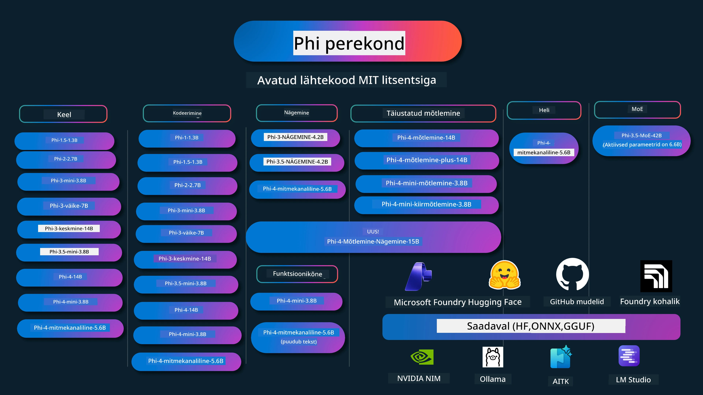

# Phi kokaraamat: Praktilised näited Microsofti Phi mudelitega

[](https://codespaces.new/microsoft/phicookbook)
[](https://vscode.dev/redirect?url=vscode://ms-vscode-remote.remote-containers/cloneInVolume?url=https://github.com/microsoft/phicookbook)

[](https://GitHub.com/microsoft/phicookbook/graphs/contributors/?WT.mc_id=aiml-137032-kinfeylo)
[](https://GitHub.com/microsoft/phicookbook/issues/?WT.mc_id=aiml-137032-kinfeylo)
[](https://GitHub.com/microsoft/phicookbook/pulls/?WT.mc_id=aiml-137032-kinfeylo)
[](http://makeapullrequest.com?WT.mc_id=aiml-137032-kinfeylo)

[](https://GitHub.com/microsoft/phicookbook/watchers/?WT.mc_id=aiml-137032-kinfeylo)
[](https://GitHub.com/microsoft/phicookbook/network/?WT.mc_id=aiml-137032-kinfeylo)
[](https://GitHub.com/microsoft/phicookbook/stargazers/?WT.mc_id=aiml-137032-kinfeylo)

[](https://discord.com/invite/ByRwuEEgH4)

Phi on Microsofti välja töötatud avatud lähtekoodiga tehisintellekti mudelite sari. 

Phi on praegu kõige võimsam ja kulutõhusam väike keelemudel (SLM), millel on väga head võrdlusandmed mitmekeelses, mõtlemise, teksti/vestluse genereerimise, kodeerimise, piltide, heli ja muudes stsenaariumides. 

Saate Phi juurutada pilves või servaseadmetes ning saate hõlpsasti ehitada generatiivseid tehisintellekti rakendusi piiratud arvutusvõimsusega.

Järgige neid samme, et alustada nende ressursside kasutamist:
1. **Forkige Hoidla**: Klõpsake [](https://GitHub.com/microsoft/phicookbook/network/?WT.mc_id=aiml-137032-kinfeylo)
2. **Kloonige Hoidla**: `git clone https://github.com/microsoft/PhiCookBook.git`
3. [**Liituge Microsoft AI Discordi kogukonnaga ja kohtuge ekspertide ning kaasaarendajatega**](https://discord.com/invite/ByRwuEEgH4?WT.mc_id=aiml-137032-kinfeylo)



### 🌐 Mitmekeelne tugi

#### Tõlked hooldatud [Co-op Translatoriga](https://github.com/Azure/co-op-translator)

<!-- CO-OP TRANSLATOR LANGUAGES TABLE START -->
[Araabia](../ar/README.md) | [Bengali](../bn/README.md) | [Bulgaaria](../bg/README.md) | [Birma (Myanmar)](../my/README.md) | [Hiina (lihtsustatud)](../zh-CN/README.md) | [Hiina (traditsiooniline, Hongkong)](../zh-HK/README.md) | [Hiina (traditsiooniline, Macau)](../zh-MO/README.md) | [Hiina (traditsiooniline, Taiwan)](../zh-TW/README.md) | [Horvaadi](../hr/README.md) | [Tšehhi](../cs/README.md) | [Taani](../da/README.md) | [Hollandi](../nl/README.md) | [Eesti](./README.md) | [Soome](../fi/README.md) | [Prantsuse](../fr/README.md) | [Saksa](../de/README.md) | [Kreeka](../el/README.md) | [Heebrea](../he/README.md) | [Hindi](../hi/README.md) | [Ungari](../hu/README.md) | [Indoneesia](../id/README.md) | [Itaalia](../it/README.md) | [Jaapani](../ja/README.md) | [Kannada](../kn/README.md) | [Khmeri](../km/README.md) | [Korea](../ko/README.md) | [Leedu](../lt/README.md) | [Malai](../ms/README.md) | [Malajalami](../ml/README.md) | [Manipuri (Meitei Mayek)](../mni/README.md) | [Marathi](../mr/README.md) | [Nepali](../ne/README.md) | [Nigeeria pidgin](../pcm/README.md) | [Norra](../no/README.md) | [Pärsia (Farsi)](../fa/README.md) | [Poola](../pl/README.md) | [Portugali (Brasiilia)](../pt-BR/README.md) | [Portugali (Portugal)](../pt-PT/README.md) | [Pandžabi (Gurmukhi)](../pa/README.md) | [Rumeenia](../ro/README.md) | [Vene](../ru/README.md) | [Serbia (tsaaritsa) ](../sr/README.md) | [Slovaki](../sk/README.md) | [Sloveeni](../sl/README.md) | [Hispaania](../es/README.md) | [Suahiili](../sw/README.md) | [Rootsi](../sv/README.md) | [Tagalogi (filipino)](../tl/README.md) | [Tamili](../ta/README.md) | [Telugu](../te/README.md) | [Tai](../th/README.md) | [Türgi](../tr/README.md) | [Ukraina](../uk/README.md) | [Urdu](../ur/README.md) | [Vietnami](../vi/README.md)

> **Eelistate kloonimist lokaalselt?**
>
> See hoidla sisaldab üle 50 keele tõlkeid, mis suurendab oluliselt allalaadimise mahtu. Tõlgeteta kloonimiseks kasutage hõredat checkout'i:
>
> **Bash / macOS / Linux:**
> ```bash
> git clone --filter=blob:none --sparse https://github.com/microsoft/PhiCookBook.git
> cd PhiCookBook
> git sparse-checkout set --no-cone '/*' '!translations' '!translated_images'
> ```
>
> **CMD (Windows):**
> ```cmd
> git clone --filter=blob:none --sparse https://github.com/microsoft/PhiCookBook.git
> cd PhiCookBook
> git sparse-checkout set --no-cone "/*" "!translations" "!translated_images"
> ```
>
> See annab teile kõik vajaliku kursuse lõpetamiseks palju kiiremalt.
<!-- CO-OP TRANSLATOR LANGUAGES TABLE END -->

## Sisukord

- Sissejuhatus
  - [Tere tulemast Phi perekonda](./md/01.Introduction/01/01.PhiFamily.md)
  - [Keskkonna seadistamine](./md/01.Introduction/01/01.EnvironmentSetup.md)
  - [Põhitehnoloogiate mõistmine](./md/01.Introduction/01/01.Understandingtech.md)
  - [Tehisintellekti ohutus Phi mudelite puhul](./md/01.Introduction/01/01.AISafety.md)
  - [Phi riistvaratugi](./md/01.Introduction/01/01.Hardwaresupport.md)
  - [Phi mudelid ja kättesaadavus platvormidel](./md/01.Introduction/01/01.Edgeandcloud.md)
  - [Juhend-ai ja Phi kasutamine](./md/01.Introduction/01/01.Guidance.md)
  - [GitHub Marketplace mudelid](https://github.com/marketplace/models)
  - [Azure AI mudelite kataloog](https://ai.azure.com)

- Phi järeldamine erinevates keskkondades
    -  [Hugging face](./md/01.Introduction/02/01.HF.md)
    -  [GitHub mudelid](./md/01.Introduction/02/02.GitHubModel.md)
    -  [Microsoft Foundry mudelikataloog](./md/01.Introduction/02/03.AzureAIFoundry.md)
    -  [Ollama](./md/01.Introduction/02/04.Ollama.md)
    -  [AI Toolkit VSCode (AITK)](./md/01.Introduction/02/05.AITK.md)
    -  [NVIDIA NIM](./md/01.Introduction/02/06.NVIDIA.md)
    -  [Foundry Local](./md/01.Introduction/02/07.FoundryLocal.md)

- Phi perekonna järeldamine
    - [Phi järeldamine iOS-is](./md/01.Introduction/03/iOS_Inference.md)
    - [Phi järeldamine Androidis](./md/01.Introduction/03/Android_Inference.md)
    - [Phi järeldamine Jetsonil](./md/01.Introduction/03/Jetson_Inference.md)
    - [Phi järeldamine AI PC-l](./md/01.Introduction/03/AIPC_Inference.md)
    - [Phi järeldamine Apple MLX raamistikuga](./md/01.Introduction/03/MLX_Inference.md)
    - [Phi järeldamine lokaalses serveris](./md/01.Introduction/03/Local_Server_Inference.md)
    - [Phi järeldamine kaugserveris AI Toolkituga](./md/01.Introduction/03/Remote_Interence.md)
    - [Phi järeldamine Rustiga](./md/01.Introduction/03/Rust_Inference.md)
    - [Phi visiidi järeldamine kohalikus](./md/01.Introduction/03/Vision_Inference.md)
    - [Phi järeldamine Kaito AKS-i ja Azure konteineritega (ametlik tugi)](./md/01.Introduction/03/Kaito_Inference.md)
-  [Phi perekonna kvantimine](./md/01.Introduction/04/QuantifyingPhi.md)
    - [Phi-3.5 / 4 kvantimine kasutades llama.cpp-d](./md/01.Introduction/04/UsingLlamacppQuantifyingPhi.md)
    - [Phi-3.5 / 4 kvantimine Generative AI laiendustega onnxruntime jaoks](./md/01.Introduction/04/UsingORTGenAIQuantifyingPhi.md)
    - [Phi-3.5 / 4 kvantimine Intel OpenVINO-ga](./md/01.Introduction/04/UsingIntelOpenVINOQuantifyingPhi.md)
    - [Phi-3.5 / 4 kvantimine Apple MLX raamistikuga](./md/01.Introduction/04/UsingAppleMLXQuantifyingPhi.md)

- Phi hindamine
    - [Response AI](./md/01.Introduction/05/ResponsibleAI.md)
    - [Microsoft Foundry hindamiseks](./md/01.Introduction/05/AIFoundry.md)
    - [Promptflow kasutamine hindamiseks](./md/01.Introduction/05/Promptflow.md)
 
- RAG Azure AI otsinguga
    - [Kuidas kasutada Phi-4-mini ja Phi-4-multimodal (RAG) Azure AI otsinguga](https://github.com/microsoft/PhiCookBook/blob/main/code/06.E2E/E2E_Phi-4-RAG-Azure-AI-Search.ipynb)
    - [Zero-pilve kohalik hübriid RAG SQLite FTS5 ja phi-4-mini-ga](https://github.com/microsoft/PhiCookBook/blob/main/code/06.E2E/E2E_Phi-4-mini_Local_Hybrid_RAG_SQLite_FTS5.ipynb)

- Phi rakenduste arendamise näidised
  - Tekst ja vestluse rakendused
    - Phi-4 näidised 
      - [📓] [Vestlus Phi-4-mini ONNX mudeliga](./md/02.Application/01.TextAndChat/Phi4/ChatWithPhi4ONNX/README.md)
      - [Vestlus lokaalse Phi-4 ONNX mudeliga .NET-is](../../md/04.HOL/dotnet/src/LabsPhi4-Chat-01OnnxRuntime)
      - [Vestlus .NET konsoolirakendusega Phi-4 ONNX kasutades Semantic Kernelit](../../md/04.HOL/dotnet/src/LabsPhi4-Chat-02SK)
    - Phi-3 / 3.5 näidised
      - [Lokaalne vestlusrobot brauseris Phi3, ONNX Runtime Webi ja WebGPU abil](https://github.com/microsoft/onnxruntime-inference-examples/tree/main/js/chat)
      - [OpenVino vestlus](./md/02.Application/01.TextAndChat/Phi3/E2E_OpenVino_Chat.md)
      - [Mitmemudeliline - Interaktiivne Phi-3-mini ja OpenAI Whisper](./md/02.Application/01.TextAndChat/Phi3/E2E_Phi-3-mini_with_whisper.md)
      - [MLFlow - Kest ehitamine ja Phi-3 kasutamine MLFlow-ga](./md//02.Application/01.TextAndChat/Phi3/E2E_Phi-3-MLflow.md)
      - [Mudeli optimeerimine - Kuidas optimeerida Phi-3-min mudelit ONNX Runtime Web jaoks Olive abil](https://github.com/microsoft/Olive/tree/main/examples/phi3)
      - [WinUI3 rakendus Phi-3 mini-4k-instruct-onnx-ga](https://github.com/microsoft/Phi3-Chat-WinUI3-Sample/)
      -[WinUI3 mitmemudeliline AI-võimendusega märkmete rakenduse näidis](https://github.com/microsoft/ai-powered-notes-winui3-sample)
      - [Kohandatud Phi-3 mudelite peenhäälestamine ja integreerimine Prompt flow abil](./md/02.Application/01.TextAndChat/Phi3/E2E_Phi-3-FineTuning_PromptFlow_Integration.md)
      - [Kohandatud Phi-3 mudelite peenhäälestamine ja integreerimine Prompt flow abil Microsoft Foundry's](./md/02.Application/01.TextAndChat/Phi3/E2E_Phi-3-FineTuning_PromptFlow_Integration_AIFoundry.md)
      - [Peenhäälestatud Phi-3 / Phi-3.5 mudeli hindamine Microsoft Foundry's Microsofti vastutustundliku AI põhimõtetele keskendudes](./md/02.Application/01.TextAndChat/Phi3/E2E_Phi-3-Evaluation_AIFoundry.md)
      - [📓] [Phi-3.5-mini-instruct keele prognoosimise näidis (hiina/inglise)](./md/02.Application/01.TextAndChat/Phi3/phi3-instruct-demo.ipynb)
      - [Phi-3.5-Instruct WebGPU RAG vestlusrobot](./md/02.Application/01.TextAndChat/Phi3/WebGPUWithPhi35Readme.md)
      - [Windowsi GPU kasutamine Prompt flow lahenduse loomiseks Phi-3.5-Instruct ONNX-ga](./md/02.Application/01.TextAndChat/Phi3/UsingPromptFlowWithONNX.md)
      - [Microsoft Phi-3.5 tflite kasutamine Androidi rakenduse loomiseks](./md/02.Application/01.TextAndChat/Phi3/UsingPhi35TFLiteCreateAndroidApp.md)
      - [Küsimustele vastamise .NET näidis kohaliku ONNX Phi-3 mudeliga kasutades Microsoft.ML.OnnxRuntime'i](../../md/04.HOL/dotnet/src/LabsPhi301)
      - [Konsoolivestlus .NET rakendusega Semantic Kerneliga ja Phi-3-ga](../../md/04.HOL/dotnet/src/LabsPhi302)

  - Azure AI järeldamise SDK koodipõhised näidised 
    - Phi-4 näidised 
      - [📓] [Projekti koodi genereerimine Phi-4-multimodal kasutades](./md/02.Application/02.Code/Phi4/GenProjectCode/README.md)
    - Phi-3 / 3.5 näidised
      - [Loo oma Visual Studio Code GitHub Copilot vestlus Microsoft Phi-3 perekonnaga](./md/02.Application/02.Code/Phi3/VSCodeExt/README.md)
      - [Loo oma Visual Studio Code vestlus Copilot agent Phi-3.5 abil GitHub mudelite põhjal](/md/02.Application/02.Code/Phi3/CreateVSCodeChatAgentWithGitHubModels.md)

  - Täiustatud mõtlemise näidised
    - Phi-4 Näidised 
      - [📓] [Phi-4-mini-järeldamine või Phi-4-järeldamise näidised](./md/02.Application/03.AdvancedReasoning/Phi4/AdvancedResoningPhi4mini/README.md)
      - [📓] [Phi-4-mini-järeldamise täpsustamine Microsoft Olive’iga](./md/02.Application/03.AdvancedReasoning/Phi4/AdvancedResoningPhi4mini/olive_ft_phi_4_reasoning_with_medicaldata.ipynb)
      - [📓] [Phi-4-mini-järeldamise täpsustamine Apple MLX’iga](./md/02.Application/03.AdvancedReasoning/Phi4/AdvancedResoningPhi4mini/mlx_ft_phi_4_reasoning_with_medicaldata.ipynb)
      - [📓] [Phi-4-mini-järeldamine GitHubi mudelitega](./md/02.Application/02.Code/Phi4r/github_models_inference.ipynb)
      - [📓] [Phi-4-mini-järeldamine Microsoft Foundry mudelitega](./md/02.Application/02.Code/Phi4r/azure_models_inference.ipynb)
  - Demo’d
      - [Phi-4-mini demo’d Hugging Face Spaces’is](https://huggingface.co/spaces/microsoft/phi-4-mini?WT.mc_id=aiml-137032-kinfeylo)
      - [Phi-4-multimodaalsed demo’d Hugging Face Spaces’is](https://huggingface.co/spaces/microsoft/phi-4-multimodal?WT.mc_id=aiml-137032-kinfeylo)
  - Näidised nägemisest
    - Phi-4 Näidised 
      - [📓] [Kasutades Phi-4-multimodaalset piltide lugemiseks ja koodi genereerimiseks](./md/02.Application/04.Vision/Phi4/CreateFrontend/README.md) 
    - Phi-3 / 3.5 Näidised
      -  [📓][Phi-3-nägemine-Pilditekst tekstiks](./md/02.Application/04.Vision/Phi3/E2E_Phi-3-vision-image-text-to-text-online-endpoint.ipynb)
      - [Phi-3-nägemine-ONNX](https://onnxruntime.ai/docs/genai/tutorials/phi3-v.html)
      - [📓][Phi-3-nägemise CLIP manused](./md/02.Application/04.Vision/Phi3/E2E_Phi-3-vision-image-text-to-text-online-endpoint.ipynb)
      - [DEMO: Phi-3 taaskasutus](https://github.com/jennifermarsman/PhiRecycling/)
      - [Phi-3-nägemine - Visuaalne keeleassistent - Phi3-Nägemise ja OpenVINO’ga](https://docs.openvino.ai/nightly/notebooks/phi-3-vision-with-output.html)
      - [Phi-3 Nägemine Nvidia NIM](./md/02.Application/04.Vision/Phi3/E2E_Nvidia_NIM_Vision.md)
      - [Phi-3 Nägemine OpenVino](./md/02.Application/04.Vision/Phi3/E2E_OpenVino_Phi3Vision.md)
      - [📓][Phi-3.5 Nägemise mitme kaadri või mitme pildi näide](./md/02.Application/04.Vision/Phi3/phi3-vision-demo.ipynb)
      - [Phi-3 Nägemise kohalik ONNX mudel, kasutades Microsoft.ML.OnnxRuntime .NET-i](../../md/04.HOL/dotnet/src/LabsPhi303)
      - [Menüüpõhine Phi-3 Nägemise kohalik ONNX mudel, kasutades Microsoft.ML.OnnxRuntime .NET-i](../../md/04.HOL/dotnet/src/LabsPhi304)

  - Järelduse ja nägemise näidised
    - Phi-4-Järeldus-Nägemine-15B 
      - [📓] [Phi-4-Järeldus-Nägemine-15B kasutamine jalgkäijate tuvastamiseks](./md/02.Application/10.ReasoningVision/Phi_4_reasoning_vision_15b_Jaywalking.ipynb)
      - [📓] [Phi-4-Järeldus-Nägemine-15B kasutamine matemaatikas](./md/02.Application/10.ReasoningVision/Phi_4_reasoning_vision_15b_Math.ipynb)
      - [📓] [Phi-4-Järeldus-Nägemine-15B kasutamine kasutajaliidese tuvastamiseks](./md/02.Application/10.ReasoningVision/Phi_4_reasoning_vision_15b_ui.ipynb)

  - Matemaatika näidised
    -  Phi-4-Mini-Flash-Järeldamise-Juhised näidised  [Matemaatika demo Phi-4-Mini-Flash-Järeldamise-Juhistega](./md/02.Application/09.Math/MathDemo.ipynb)

  - Helinäidised
    - Phi-4 Näidised 
      - [📓] [Helitekstide väljavõtmine Phi-4-multimodaalse abil](./md/02.Application/05.Audio/Phi4/Transciption/README.md)
      - [📓] [Phi-4-multimodaalne helinäidis](./md/02.Application/05.Audio/Phi4/Siri/demo.ipynb)
      - [📓] [Phi-4-multimodaalne kõne tõlkenäidis](./md/02.Application/05.Audio/Phi4/Translate/demo.ipynb)
      - [.NET-käsurida rakendus, mis kasutab Phi-4-multimodaalset heli audiofaile analüüsimiseks ja transkriptsiooni loomiseks](../../md/04.HOL/dotnet/src/LabsPhi4-MultiModal-02Audio)

  - MOE näidised
    - Phi-3 / 3.5 Näidised
      - [📓] [Phi-3.5 Ekspertide segud (MoEs) Sotsiaalmeedia näidis](./md/02.Application/06.MoE/Phi3/phi3_moe_demo.ipynb)
      - [📓] [Taastuspõhise generatsiooni (RAG) torujuhtme ehitamine NVIDIA NIM Phi-3 MOE, Azure AI otsingu ja LlamaIndeksi abil](./md/02.Application/06.MoE/Phi3/azure-ai-search-nvidia-rag.ipynb)
      - 
  - Funktsioonikõnede näidised
    - Phi-4 Näidised 🆕
      -  [📓] [Funktsioonikõnede kasutamine Phi-4-mini abil](./md/02.Application/07.FunctionCalling/Phi4/FunctionCallingBasic/README.md)
      -  [📓] [Multiagendite loomine funktsioonikõnede abil Phi-4-mini abil](./md/02.Application/07.FunctionCalling/Phi4/Multiagents/Phi_4_mini_multiagent.ipynb)
      -  [📓] [Funktsioonikõnede kasutamine Ollama abil](./md/02.Application/07.FunctionCalling/Phi4/Ollama/ollama_functioncalling.ipynb)
      -  [📓] [Funktsioonikõnede kasutamine ONNX-iga](./md/02.Application/07.FunctionCalling/Phi4/ONNX/onnx_parallel_functioncalling.ipynb)
  - Multimodaalsete segude näidised
    - Phi-4 Näidised 🆕
      -  [📓] [Phi-4-multimodaalse kasutamine tehnoloogiaajakirjanikuna](./md/02.Application/08.Multimodel/Phi4/TechJournalist/phi_4_mm_audio_text_publish_news.ipynb)
      - [.NET-käsurida rakendus, mis kasutab Phi-4-multimodaalset piltide analüüsimiseks](../../md/04.HOL/dotnet/src/LabsPhi4-MultiModal-01Images)

- Phi täpsustamine
  - [Täpsustamise stsenaariumid](./md/03.FineTuning/FineTuning_Scenarios.md)
  - [Täpsustamine vs RAG](./md/03.FineTuning/FineTuning_vs_RAG.md)
  - [Las Phi-3 saada tööstuse eksperdiks](./md/03.FineTuning/LetPhi3gotoIndustriy.md)
  - [Phi-3 täpsustamine AI Toolkit for VS Code abil](./md/03.FineTuning/Finetuning_VSCodeaitoolkit.md)
  - [Phi-3 täpsustamine Azure Machine Learning Service’iga](./md/03.FineTuning/Introduce_AzureML.md)
  - [Phi-3 täpsustamine Lora abil](./md/03.FineTuning/FineTuning_Lora.md)
  - [Phi-3 täpsustamine QLora abil](./md/03.FineTuning/FineTuning_Qlora.md)
  - [Phi-3 täpsustamine Microsoft Foundry abil](./md/03.FineTuning/FineTuning_AIFoundry.md)
  - [Phi-3 täpsustamine Azure ML CLI/SDK abil](./md/03.FineTuning/FineTuning_MLSDK.md)
  - [Täpsustamine Microsoft Olive abil](./md/03.FineTuning/FineTuning_MicrosoftOlive.md)
  - [Microsoft Olive Hands-On lao abil täpsustamine](./md/03.FineTuning/olive-lab/readme.md)
  - [Phi-3-nägemise täpsustamine Weights and Bias abil](./md/03.FineTuning/FineTuning_Phi-3-visionWandB.md)
  - [Phi-3 täpsustamine Apple MLX raamistiku abil](./md/03.FineTuning/FineTuning_MLX.md)
  - [Phi-3-nägemise täpsustamine (ametlik tugi)](./md/03.FineTuning/FineTuning_Vision.md)
  - [Phi-3 täpsustamine Kaito AKS, Azure konteineritega (ametlik tugi)](./md/03.FineTuning/FineTuning_Kaito.md)
  - [Phi-3 ja 3.5 nägemise täpsustamine](https://github.com/2U1/Phi3-Vision-Finetune)

- Praktiline töötuba
  - [Uurides uusimaid mudeleid: LLM-id, SLM-id, kohalik areng ja palju muud](https://github.com/microsoft/aitour-exploring-cutting-edge-models)
  - [NLP potentsiaali avamine: Täpsustamine Microsoft Olive’iga](https://github.com/azure/Ignite_FineTuning_workshop)

- Akadeemilised uurimused ja publikatsioonid
  - [Õpikud on kõik, mida vajad II: phi-1.5 tehniline aruanne](https://arxiv.org/abs/2309.05463)
  - [Phi-3 tehniline aruanne: Võimas keelemudel kohapeal sinu telefonis](https://arxiv.org/abs/2404.14219)
  - [Phi-4 tehniline aruanne](https://arxiv.org/abs/2412.08905)
  - [Phi-4-Mini tehniline aruanne: Kompaktne, aga võimas multimodaalne keelemudel LoRAde seguga](https://arxiv.org/abs/2503.01743)
  - [Väikeste keelemudelite optimeerimine sõidukisiseste funktsioonikõnede jaoks](https://arxiv.org/abs/2501.02342)
  - [(WhyPHI) PHI-3 täpsustamine valikvastustega küsimustele vastamiseks: meetodid, tulemused ja väljakutsed](https://arxiv.org/abs/2501.01588)
  - [Phi-4-järeldamise tehniline aruanne](https://www.microsoft.com/en-us/research/wp-content/uploads/2025/04/phi_4_reasoning.pdf)
  - [Phi-4-mini-järeldamise tehniline aruanne](https://huggingface.co/microsoft/Phi-4-mini-reasoning/blob/main/Phi-4-Mini-Reasoning.pdf)

## Phi mudelite kasutamine

### Phi Microsoft Foundry’l

Saate õppida, kuidas kasutada Microsoft Phi’d ja kuidas ehitada täielikke lahendusi erinevates riistvaraseadmetes. Phi kogemiseks alustage mudelitega mängimisest ja Phi kohandamisest oma stsenaariumide jaoks, kasutades [Microsoft Foundry Azure AI mudeli kataloogi](https://aka.ms/phi3-azure-ai). Rohkem infot saate aadressil Getting Started with [Microsoft Foundry](/md/02.QuickStart/AzureAIFoundry_QuickStart.md)

**Mänguväljak**
Igal mudelil on pühendatud mänguväljak mudeli testimiseks [Azure AI Playground](https://aka.ms/try-phi3).

### Phi GitHubi mudelitel

Saate õppida, kuidas kasutada Microsoft Phi’d ja kuidas ehitada täielikke lahendusi erinevates riistvaraseadmetes. Phi kogemiseks alustage mudeliga mängimisest ja Phi kohandamisest oma stsenaariumide jaoks, kasutades [GitHub Model Catalog](https://github.com/marketplace/models?WT.mc_id=aiml-137032-kinfeylo). Rohkem infot saate aadressil Getting Started with [GitHub Model Catalog](/md/02.QuickStart/GitHubModel_QuickStart.md)

**Mänguväljak**
Igal mudelil on pühendatud [mänguväljak mudeli testimiseks](/md/02.QuickStart/GitHubModel_QuickStart.md).

### Phi Hugging Face’is

Mudelit leiate ka [Hugging Face’ist](https://huggingface.co/microsoft)

**Mänguväljak**
 [Hugging Chat mänguväljak](https://huggingface.co/chat/models/microsoft/Phi-3-mini-4k-instruct)

 ## 🎒 Teised kursused

Meie meeskond toodab ka teisi kursuseid! Vaata:

<!-- CO-OP TRANSLATOR OTHER COURSES START -->
### LangChain
[](https://aka.ms/langchain4j-for-beginners)
[](https://aka.ms/langchainjs-for-beginners?WT.mc_id=m365-94501-dwahlin)
[](https://github.com/microsoft/langchain-for-beginners?WT.mc_id=m365-94501-dwahlin)
---

### Azure / Edge / MCP / Agendid
[](https://github.com/microsoft/AZD-for-beginners?WT.mc_id=academic-105485-koreyst)
[](https://github.com/microsoft/edgeai-for-beginners?WT.mc_id=academic-105485-koreyst)
[](https://github.com/microsoft/mcp-for-beginners?WT.mc_id=academic-105485-koreyst)
[](https://github.com/microsoft/ai-agents-for-beginners?WT.mc_id=academic-105485-koreyst)

---
 
### Generatiivse AI sari
[](https://github.com/microsoft/generative-ai-for-beginners?WT.mc_id=academic-105485-koreyst)
[-9333EA?style=for-the-badge&labelColor=E5E7EB&color=9333EA)](https://github.com/microsoft/Generative-AI-for-beginners-dotnet?WT.mc_id=academic-105485-koreyst)
[-C084FC?style=for-the-badge&labelColor=E5E7EB&color=C084FC)](https://github.com/microsoft/generative-ai-for-beginners-java?WT.mc_id=academic-105485-koreyst)
[-E879F9?style=for-the-badge&labelColor=E5E7EB&color=E879F9)](https://github.com/microsoft/generative-ai-with-javascript?WT.mc_id=academic-105485-koreyst)

---
 
### Põhjalik õppimine
[](https://aka.ms/ml-beginners?WT.mc_id=academic-105485-koreyst)
[](https://aka.ms/datascience-beginners?WT.mc_id=academic-105485-koreyst)
[](https://aka.ms/ai-beginners?WT.mc_id=academic-105485-koreyst)
[](https://github.com/microsoft/Security-101?WT.mc_id=academic-96948-sayoung)
[](https://aka.ms/webdev-beginners?WT.mc_id=academic-105485-koreyst)
[](https://aka.ms/iot-beginners?WT.mc_id=academic-105485-koreyst)
[](https://github.com/microsoft/xr-development-for-beginners?WT.mc_id=academic-105485-koreyst)

---
 
### Copilot sari
[](https://aka.ms/GitHubCopilotAI?WT.mc_id=academic-105485-koreyst)
[](https://github.com/microsoft/mastering-github-copilot-for-dotnet-csharp-developers?WT.mc_id=academic-105485-koreyst)
[](https://github.com/microsoft/CopilotAdventures?WT.mc_id=academic-105485-koreyst)
<!-- CO-OP TRANSLATOR OTHER COURSES END -->

## Vastutustundlik tehisintellekt 

Microsoft on pühendunud aitama meie klientidel kasutada meie tehisintellekti tooteid vastutustundlikult, jagades oma õppetunde ja ehitades usaldusel põhinevaid partnerlusi tööriistadega nagu Läbipaistvuse märkused ja Mõjude hinnangud. Paljusid neist ressurssidest leiate aadressilt [https://aka.ms/RAI](https://aka.ms/RAI).
Microsofti lähenemisviis vastutustundlikule tehisintellektile põhineb meie tehisintellekti põhimõtetel: õiglus, usaldusväärsus ja ohutus, privaatsus ja turvalisus, kaasatus, läbipaistvus ning vastutustundlikkus.

Suured keele-, pildi- ja kõnemudelid - nagu need, mida selles näites kasutatakse - võivad potentsiaalselt käituda ebaõiglaselt, ebakindlalt või solvavalt, põhjustades kahju. Palun tutvuge [Azure OpenAI teenuse Läbipaistvuse märkusega](https://learn.microsoft.com/legal/cognitive-services/openai/transparency-note?tabs=text), et saada teavet riskide ja piirangute kohta.

Soovitatav lähenemine nende riskide leevendamiseks on lisada oma arhitektuuri turvasüsteem, mis suudab tuvastada ja takistada kahjulikku käitumist. [Azure AI sisu turvalisus](https://learn.microsoft.com/azure/ai-services/content-safety/overview) pakub sõltumatut kaitsekihte, mis suudab rakendustes ja teenustes tuvastada kahjulikku kasutajate ja tehisintellekti genereeritud sisu. Azure AI sisu turvalisus hõlmab teksti- ja pildirakendusliideseid, mis võimaldavad tuvastada kahjulikku materjali. Microsoft Foundry raames võimaldab sisu turvalisuse teenus teil vaadata, uurida ja proovida näidiskoodi kahjuliku sisu tuvastamiseks eri modaliteetides. Järgmine [kiirstart dokumentatsioon](https://learn.microsoft.com/azure/ai-services/content-safety/quickstart-text?tabs=visual-studio%2Clinux&pivots=programming-language-rest) juhendab teid, kuidas teenusele päringuid esitada.

Teiseks aspektiks, mida arvestada, on kogu rakenduse jõudlus. Mitmemodaalsete ja mitmemudelite rakenduste puhul mõistame jõudluse all, et süsteem töötab nii, nagu teie ja teie kasutajad ootavad, sealhulgas ei genereeri kahjulikke väljundeid. On oluline hinnata kogu rakenduse jõudlust, kasutades [jõudluse ja kvaliteedi ning riski ja turvalisuse hindajaid](https://learn.microsoft.com/azure/ai-studio/concepts/evaluation-metrics-built-in). Teil on ka võimalus luua ja hinnata [kohandatud hindajatega](https://learn.microsoft.com/azure/ai-studio/how-to/develop/evaluate-sdk#custom-evaluators).

Saate hinnata oma tehisintellekti rakendust arenduskeskkonnas, kasutades [Azure AI hindamise SDK-d](https://microsoft.github.io/promptflow/index.html). Olenevalt kas testandmestikust või sihtmärgist hinnatakse teie generatiivsete tehisintellekti rakenduste tulemusi kvantitatiivselt kas sisseehitatud hindajate või teie valitud kohandatud hindajatega. Azure ai hindamise sdk kasutamisega süsteemi hindamiseks saate alustada järgides [kiirstart juhendit](https://learn.microsoft.com/azure/ai-studio/how-to/develop/flow-evaluate-sdk). Kui olete hindamisvooru teostanud, saate [näha tulemusi Microsoft Foundry’s](https://learn.microsoft.com/azure/ai-studio/how-to/evaluate-flow-results). 

## Kaubamärgid

See projekt võib sisaldada kaubamärke või logosid projektide, toodete või teenuste jaoks. Microsofti kaubamärkide või logode autoriseeritud kasutamine on allutatud ning peab järgima [Microsofti kaubamärkide ja brändijuhiseid](https://www.microsoft.com/legal/intellectualproperty/trademarks/usage/general).
Muudetud versioonides selle projekti Microsofti kaubamärkide või logode kasutamine ei tohi tekitada segadust ega viidata Microsofti sponsorlusele. Kolmandate osapoolte kaubamärkide või logode kasutamine allub vastavate kolmandate osapoolte poliitikatele.

## Abi saamine

Kui teil tekib takistusi või küsimusi tehisintellekti rakenduste loomise kohta, liituge:

[](https://aka.ms/foundry/discord)

Kui teil on toote tagasisidet või ilmnevad vead arendamise ajal, külastage:

[](https://aka.ms/foundry/forum)

---

<!-- CO-OP TRANSLATOR DISCLAIMER START -->
**Lahtiütlus**:
See dokument on tõlgitud kasutades AI tõlketeenust [Co-op Translator](https://github.com/Azure/co-op-translator). Kuigi me püüdleme täpsuse poole, palun pange tähele, et automatiseeritud tõlgetes võib esineda vigu või ebatäpsusi. Originaaldokument selle emakeeles tuleks pidada autoriteetseks allikaks. Olulise teabe puhul soovitatakse kasutada professionaalset inimtõlget. Me ei vastuta selle tõlkega seotud eksimustest või valesti mõistmistest.
<!-- CO-OP TRANSLATOR DISCLAIMER END -->