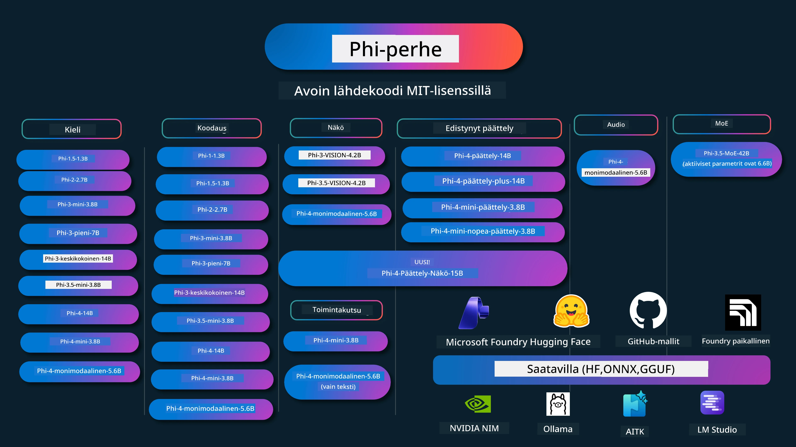

# Phi Cookbook: Käytännön esimerkkejä Microsoftin Phi-malleilla

[](https://codespaces.new/microsoft/phicookbook)
[](https://vscode.dev/redirect?url=vscode://ms-vscode-remote.remote-containers/cloneInVolume?url=https://github.com/microsoft/phicookbook)

[](https://GitHub.com/microsoft/phicookbook/graphs/contributors/?WT.mc_id=aiml-137032-kinfeylo)
[](https://GitHub.com/microsoft/phicookbook/issues/?WT.mc_id=aiml-137032-kinfeylo)
[](https://GitHub.com/microsoft/phicookbook/pulls/?WT.mc_id=aiml-137032-kinfeylo)
[](http://makeapullrequest.com?WT.mc_id=aiml-137032-kinfeylo)

[](https://GitHub.com/microsoft/phicookbook/watchers/?WT.mc_id=aiml-137032-kinfeylo)
[](https://GitHub.com/microsoft/phicookbook/network/?WT.mc_id=aiml-137032-kinfeylo)
[](https://GitHub.com/microsoft/phicookbook/stargazers/?WT.mc_id=aiml-137032-kinfeylo)

[](https://discord.com/invite/ByRwuEEgH4)

Phi on Microsoftin kehittämä avoimen lähdekoodin tekoälymallien sarja.

Phi on tällä hetkellä tehokkain ja kustannustehokkain pieni kielimalli (SLM), jolla on erittäin hyvät suorituskykyvertailut monikielisyydessä, päättelyssä, tekstin/keskustelun generoinnissa, koodauksessa, kuvissa, äänissä ja muissa käyttökohteissa.

Phi voidaan ottaa käyttöön pilveen tai reunalaitteisiin, ja sillä voi helposti rakentaa generatiivisia tekoälysovelluksia rajallisella laskentateholla.

Noudata näitä ohjeita aloittaaksesi näiden resurssien käytön:
1. **Haarauta varasto**: Klikkaa [](https://GitHub.com/microsoft/phicookbook/network/?WT.mc_id=aiml-137032-kinfeylo)
2. **Kloonaa varasto**: `git clone https://github.com/microsoft/PhiCookBook.git`
3. [**Liity Microsoft AI Discord -yhteisöön ja tapaa asiantuntijoita sekä muita kehittäjiä**](https://discord.com/invite/ByRwuEEgH4?WT.mc_id=aiml-137032-kinfeylo)



### 🌐 Monikielituki

#### Käännökset ylläpidetään [Co-op Translatorilla](https://github.com/Azure/co-op-translator)

<!-- CO-OP TRANSLATOR LANGUAGES TABLE START -->
[Arabia](../ar/README.md) | [Bengali](../bn/README.md) | [Bulgaria](../bg/README.md) | [Burma (Myanmar)](../my/README.md) | [Kiina (yksinkertaistettu)](../zh-CN/README.md) | [Kiina (perinteinen, Hong Kong)](../zh-HK/README.md) | [Kiina (perinteinen, Macao)](../zh-MO/README.md) | [Kiina (perinteinen, Taiwan)](../zh-TW/README.md) | [Kroatia](../hr/README.md) | [Tsekin kieli](../cs/README.md) | [Tanska](../da/README.md) | [Hollanti](../nl/README.md) | [Viro](../et/README.md) | [Suomi](./README.md) | [Ranska](../fr/README.md) | [Saksa](../de/README.md) | [Kreikka](../el/README.md) | [Heprea](../he/README.md) | [Hindi](../hi/README.md) | [Unkari](../hu/README.md) | [Indonesia](../id/README.md) | [Italia](../it/README.md) | [Japani](../ja/README.md) | [Kannada](../kn/README.md) | [Khmer](../km/README.md) | [Korea](../ko/README.md) | [Liettua](../lt/README.md) | [Malaiji](../ms/README.md) | [Malajalami](../ml/README.md) | [Manipuri (Meitei Mayek)](../mni/README.md) | [Marathi](../mr/README.md) | [Nepali](../ne/README.md) | [Nigerian Pidgin](../pcm/README.md) | [Norja](../no/README.md) | [Persia (Farsi)](../fa/README.md) | [Puola](../pl/README.md) | [Portugali (Brasilia)](../pt-BR/README.md) | [Portugali (Portugali)](../pt-PT/README.md) | [Punjabi (Gurmukhi)](../pa/README.md) | [Romania](../ro/README.md) | [Venäjä](../ru/README.md) | [Serbia (kyrillinen)](../sr/README.md) | [Slovakki](../sk/README.md) | [Slovenia](../sl/README.md) | [Espanja](../es/README.md) | [Suaheli](../sw/README.md) | [Ruotsi](../sv/README.md) | [Tagalog (Filipino)](../tl/README.md) | [Tamili](../ta/README.md) | [Telugu](../te/README.md) | [Thai](../th/README.md) | [Turkki](../tr/README.md) | [Ukraina](../uk/README.md) | [Urdu](../ur/README.md) | [Vietnami](../vi/README.md)

> **Haluatko mieluummin kloonata paikallisesti?**
>
> Tämä varasto sisältää yli 50 kielen käännökset, mikä lisää merkittävästi latauskoon. Kloonataksesi ilman käännöksiä, käytä sparse checkoutia:
>
> **Bash / macOS / Linux:**
> ```bash
> git clone --filter=blob:none --sparse https://github.com/microsoft/PhiCookBook.git
> cd PhiCookBook
> git sparse-checkout set --no-cone '/*' '!translations' '!translated_images'
> ```
>
> **CMD (Windows):**
> ```cmd
> git clone --filter=blob:none --sparse https://github.com/microsoft/PhiCookBook.git
> cd PhiCookBook
> git sparse-checkout set --no-cone "/*" "!translations" "!translated_images"
> ```
>
> Tämä antaa sinulle kaiken tarpeellisen kurssin läpiviemiseen huomattavasti nopeammalla latausajalla.
<!-- CO-OP TRANSLATOR LANGUAGES TABLE END -->

## Sisällysluettelo

- Johdanto
  - [Tervetuloa Phi-perheeseen](./md/01.Introduction/01/01.PhiFamily.md)
  - [Ympäristön asetukset](./md/01.Introduction/01/01.EnvironmentSetup.md)
  - [Keskeisten teknologioiden ymmärtäminen](./md/01.Introduction/01/01.Understandingtech.md)
  - [Tekoälyn turvallisuus Phi-malleissa](./md/01.Introduction/01/01.AISafety.md)
  - [Phi-laitteistotuki](./md/01.Introduction/01/01.Hardwaresupport.md)
  - [Phi-mallit ja saatavuus eri alustoilla](./md/01.Introduction/01/01.Edgeandcloud.md)
  - [Guidance-ai:n ja Phi:n käyttö](./md/01.Introduction/01/01.Guidance.md)
  - [GitHub Marketplace -mallit](https://github.com/marketplace/models)
  - [Azure AI -malliluettelo](https://ai.azure.com)

- Phi-päättely eri ympäristöissä
    -  [Hugging face](./md/01.Introduction/02/01.HF.md)
    -  [GitHub-mallit](./md/01.Introduction/02/02.GitHubModel.md)
    -  [Microsoft Foundry -malliluettelo](./md/01.Introduction/02/03.AzureAIFoundry.md)
    -  [Ollama](./md/01.Introduction/02/04.Ollama.md)
    -  [AI Toolkit VSCode (AITK)](./md/01.Introduction/02/05.AITK.md)
    -  [NVIDIA NIM](./md/01.Introduction/02/06.NVIDIA.md)
    -  [Foundry Local](./md/01.Introduction/02/07.FoundryLocal.md)

- Phi-perheen päättely
    - [Phi-päättely iOS:llä](./md/01.Introduction/03/iOS_Inference.md)
    - [Phi-päättely Androidilla](./md/01.Introduction/03/Android_Inference.md)
    - [Phi-päättely Jetsonilla](./md/01.Introduction/03/Jetson_Inference.md)
    - [Phi-päättely AI PC:llä](./md/01.Introduction/03/AIPC_Inference.md)
    - [Phi-päättely Apple MLX Frameworkilla](./md/01.Introduction/03/MLX_Inference.md)
    - [Phi-päättely paikallisella palvelimella](./md/01.Introduction/03/Local_Server_Inference.md)
    - [Phi-päättely etäpalvelimella AI Toolkitin avulla](./md/01.Introduction/03/Remote_Interence.md)
    - [Phi-päättely Rustin kanssa](./md/01.Introduction/03/Rust_Inference.md)
    - [Phi-päättely – Vision paikallisesti](./md/01.Introduction/03/Vision_Inference.md)
    - [Phi-päättely Kaito AKS:lla, Azure Containersilla (virallinen tuki)](./md/01.Introduction/03/Kaito_Inference.md)
-  [Phi-perheen kvantisointi](./md/01.Introduction/04/QuantifyingPhi.md)
    - [Phi-3.5 / 4 kvantisointi llama.cpp:llä](./md/01.Introduction/04/UsingLlamacppQuantifyingPhi.md)
    - [Phi-3.5 / 4 kvantisointi Generative AI -laajennuksilla onnxruntimeen](./md/01.Introduction/04/UsingORTGenAIQuantifyingPhi.md)
    - [Phi-3.5 / 4 kvantisointi Intel OpenVINO:lla](./md/01.Introduction/04/UsingIntelOpenVINOQuantifyingPhi.md)
    - [Phi-3.5 / 4 kvantisointi Apple MLX Frameworkilla](./md/01.Introduction/04/UsingAppleMLXQuantifyingPhi.md)

- Phi-arviointi
    - [Response AI](./md/01.Introduction/05/ResponsibleAI.md)
    - [Microsoft Foundry arviointiin](./md/01.Introduction/05/AIFoundry.md)
    - [Promptflow'n käyttäminen arvioinnissa](./md/01.Introduction/05/Promptflow.md)
 
- RAG Azure AI Searchin kanssa
    - [Kuinka käyttää Phi-4-mini ja Phi-4-multimodaalia (RAG) Azure AI Searchin kanssa](https://github.com/microsoft/PhiCookBook/blob/main/code/06.E2E/E2E_Phi-4-RAG-Azure-AI-Search.ipynb)
    - [Zero-Cloud paikallinen hybridi RAG SQLite FTS5:llä ja phi-4-minillä](https://github.com/microsoft/PhiCookBook/blob/main/code/06.E2E/E2E_Phi-4-mini_Local_Hybrid_RAG_SQLite_FTS5.ipynb)

- Phi-sovelluskehityksen esimerkit
  - Teksti- ja keskustelusovellukset
    - Phi-4 Esimerkit 
      - [📓] [Keskustele Phi-4-mini ONNX -mallin kanssa](./md/02.Application/01.TextAndChat/Phi4/ChatWithPhi4ONNX/README.md)
      - [Keskustele Phi-4 paikallisen ONNX-mallin kanssa .NET:llä](../../md/04.HOL/dotnet/src/LabsPhi4-Chat-01OnnxRuntime)
      - [Keskustelu .NET-konsolisovelluksella Phi-4 ONNX:n ja Semantic Kernelin avulla](../../md/04.HOL/dotnet/src/LabsPhi4-Chat-02SK)
    - Phi-3 / 3.5 Esimerkit
      - [Paikallinen chatbot selaimessa käyttäen Phi3:ta, ONNX Runtime Webiä ja WebGPU:ta](https://github.com/microsoft/onnxruntime-inference-examples/tree/main/js/chat)
      - [OpenVino Chat](./md/02.Application/01.TextAndChat/Phi3/E2E_OpenVino_Chat.md)
      - [Monimalli - interaktiivinen Phi-3-mini ja OpenAI Whisper](./md/02.Application/01.TextAndChat/Phi3/E2E_Phi-3-mini_with_whisper.md)
      - [MLFlow - Kirjoita kääre ja käytä Phi-3:a MLFlown kanssa](./md//02.Application/01.TextAndChat/Phi3/E2E_Phi-3-MLflow.md)
      - [Mallin optimointi - Kuinka optimoida Phi-3-minimalli ONNX Runtime Webille Olivea käyttäen](https://github.com/microsoft/Olive/tree/main/examples/phi3)
      - [WinUI3-sovellus Phi-3 mini-4k-instruct-onnx:lla](https://github.com/microsoft/Phi3-Chat-WinUI3-Sample/)
      -[WinUI3-monimalli tekoälyllä varustettu muistiinpanosovellus](https://github.com/microsoft/ai-powered-notes-winui3-sample)
      - [Hienosäätö ja mukautettujen Phi-3 mallien integrointi Prompt flown avulla](./md/02.Application/01.TextAndChat/Phi3/E2E_Phi-3-FineTuning_PromptFlow_Integration.md)
      - [Hienosäätö ja mukautettujen Phi-3 mallien integrointi Prompt flown avulla Microsoft Foundryssä](./md/02.Application/01.TextAndChat/Phi3/E2E_Phi-3-FineTuning_PromptFlow_Integration_AIFoundry.md)
      - [Hienosäädetyn Phi-3 / Phi-3.5 mallin arviointi Microsoft Foundryssä keskittyen Microsoftin vastuullisen tekoälyn periaatteisiin](./md/02.Application/01.TextAndChat/Phi3/E2E_Phi-3-Evaluation_AIFoundry.md)
      - [📓] [Phi-3.5-mini-instruct kieliennusteen esimerkki (kiina/englanti)](./md/02.Application/01.TextAndChat/Phi3/phi3-instruct-demo.ipynb)
      - [Phi-3.5-Instruct WebGPU RAG -chatbot](./md/02.Application/01.TextAndChat/Phi3/WebGPUWithPhi35Readme.md)
      - [Windows GPU:n käyttäminen Prompt flow -ratkaisun luomiseen Phi-3.5-Instruct ONNX:lla](./md/02.Application/01.TextAndChat/Phi3/UsingPromptFlowWithONNX.md)
      - [Microsoft Phi-3.5 tflite:n käyttäminen Android-sovelluksen luomiseksi](./md/02.Application/01.TextAndChat/Phi3/UsingPhi35TFLiteCreateAndroidApp.md)
      - [Kysymys-vastaus .NET-esimerkki paikallista ONNX Phi-3 mallia käyttäen Microsoft.ML.OnnxRuntime:n kanssa](../../md/04.HOL/dotnet/src/LabsPhi301)
      - [Konsolikeskustelusovellus .NET:llä Semantic Kernelin ja Phi-3:n kanssa](../../md/04.HOL/dotnet/src/LabsPhi302)

  - Azure AI Inference SDK:n koodipohjaiset esimerkit 
    - Phi-4 Esimerkit 
      - [📓] [Luo projektikoodi käyttäen Phi-4-multimodaalia](./md/02.Application/02.Code/Phi4/GenProjectCode/README.md)
    - Phi-3 / 3.5 Esimerkit
      - [Rakenna oma Visual Studio Code GitHub Copilot -keskustelu Microsoft Phi-3 perheen kanssa](./md/02.Application/02.Code/Phi3/VSCodeExt/README.md)
      - [Luo oma Visual Studio Code Chat Copilot Agent Phi-3.5:llä GitHub-mallien avulla](/md/02.Application/02.Code/Phi3/CreateVSCodeChatAgentWithGitHubModels.md)

  - Edistyneet päättelyesimerkit
    - Phi-4-näytteet 
      - [📓] [Phi-4-mini-päättely tai Phi-4-päättelynäytteet](./md/02.Application/03.AdvancedReasoning/Phi4/AdvancedResoningPhi4mini/README.md)
      - [📓] [Phi-4-mini-päättelyn hienosäätö Microsoft Olivella](./md/02.Application/03.AdvancedReasoning/Phi4/AdvancedResoningPhi4mini/olive_ft_phi_4_reasoning_with_medicaldata.ipynb)
      - [📓] [Phi-4-mini-päättelyn hienosäätö Apple MLX:llä](./md/02.Application/03.AdvancedReasoning/Phi4/AdvancedResoningPhi4mini/mlx_ft_phi_4_reasoning_with_medicaldata.ipynb)
      - [📓] [Phi-4-mini-päättely GitHub-mallien kanssa](./md/02.Application/02.Code/Phi4r/github_models_inference.ipynb)
      - [📓] [Phi-4-mini-päättely Microsoft Foundry -mallien kanssa](./md/02.Application/02.Code/Phi4r/azure_models_inference.ipynb)
  - Demot
      - [Phi-4-mini-demot Hugging Face Spacesissa](https://huggingface.co/spaces/microsoft/phi-4-mini?WT.mc_id=aiml-137032-kinfeylo)
      - [Phi-4-monimodaaliset demot Hugginge Face Spacesissa](https://huggingface.co/spaces/microsoft/phi-4-multimodal?WT.mc_id=aiml-137032-kinfeylo)
  - Visioin näytteet
    - Phi-4-näytteet 
      - [📓] [Käytä Phi-4-monimodaalista kuvien lukemiseen ja koodin generointiin](./md/02.Application/04.Vision/Phi4/CreateFrontend/README.md) 
    - Phi-3 / 3.5 -näytteet
      -  [📓][Phi-3-vision-Kuvan teksti tekstiksi](./md/02.Application/04.Vision/Phi3/E2E_Phi-3-vision-image-text-to-text-online-endpoint.ipynb)
      - [Phi-3-vision-ONNX](https://onnxruntime.ai/docs/genai/tutorials/phi3-v.html)
      - [📓][Phi-3-vision CLIP -upotus](./md/02.Application/04.Vision/Phi3/E2E_Phi-3-vision-image-text-to-text-online-endpoint.ipynb)
      - [DEMO: Phi-3 kierrätys](https://github.com/jennifermarsman/PhiRecycling/)
      - [Phi-3-vision - Visuaalinen kieliavustaja - Phi3-Visionin ja OpenVINOn kanssa](https://docs.openvino.ai/nightly/notebooks/phi-3-vision-with-output.html)
      - [Phi-3 Vision Nvidia NIM](./md/02.Application/04.Vision/Phi3/E2E_Nvidia_NIM_Vision.md)
      - [Phi-3 Vision OpenVino](./md/02.Application/04.Vision/Phi3/E2E_OpenVino_Phi3Vision.md)
      - [📓][Phi-3.5 Vision monikehys- tai monikuvinäyte](./md/02.Application/04.Vision/Phi3/phi3-vision-demo.ipynb)
      - [Phi-3 Vision paikallinen ONNX-malli Microsoft.ML.OnnxRuntime .NETin avulla](../../md/04.HOL/dotnet/src/LabsPhi303)
      - [Valikkopohjainen Phi-3 Vision paikallinen ONNX-malli Microsoft.ML.OnnxRuntime .NETin avulla](../../md/04.HOL/dotnet/src/LabsPhi304)

  - Päättely-visio-näytteet
    - Phi-4-päättely-visio-15B 
      - [📓] [Phi-4-päättely-visio-15B:n käyttö jaywalkingin tunnistamiseen](./md/02.Application/10.ReasoningVision/Phi_4_reasoning_vision_15b_Jaywalking.ipynb)
      - [📓] [Phi-4-päättely-visio-15B:n käyttö matematiikkaan](./md/02.Application/10.ReasoningVision/Phi_4_reasoning_vision_15b_Math.ipynb)
      - [📓] [Phi-4-päättely-visio-15B:n käyttö UI:n tunnistamiseen](./md/02.Application/10.ReasoningVision/Phi_4_reasoning_vision_15b_ui.ipynb)

  - Matematiikan näytteet
    -  Phi-4-mini-flash-päättelyn-ohjeistuksen näytteet  [Matematiikkademo Phi-4-mini-flash-päättelyn-ohjeistuksella](./md/02.Application/09.Math/MathDemo.ipynb)

  - Äänen näytteet
    - Phi-4-näytteet 
      - [📓] [Äänitallenteiden tekstityksen poiminta Phi-4-monimodaalisella](./md/02.Application/05.Audio/Phi4/Transciption/README.md)
      - [📓] [Phi-4-monimodaalinen ääninäyte](./md/02.Application/05.Audio/Phi4/Siri/demo.ipynb)
      - [📓] [Phi-4-monimodaalinen puheen käännösnäyte](./md/02.Application/05.Audio/Phi4/Translate/demo.ipynb)
      - [.NET-konsolisovellus Phi-4-monimodaalista äänen analysointiin ja tekstityksen generointiin](../../md/04.HOL/dotnet/src/LabsPhi4-MultiModal-02Audio)

  - MOE-näytteet
    - Phi-3 / 3.5 -näytteet
      - [📓] [Phi-3.5 Asiantuntijasekoitukset (MoEs) sosiaalisen median näyte](./md/02.Application/06.MoE/Phi3/phi3_moe_demo.ipynb)
      - [📓] [Hakuun perustuvan generoinnin (RAG) putken rakentaminen NVIDIA NIM Phi-3 MOE:n, Azure AI Searchin ja LlamaIndexin avulla](./md/02.Application/06.MoE/Phi3/azure-ai-search-nvidia-rag.ipynb)
      - 
  - Funktiokutsun näytteet
    - Phi-4-näytteet 🆕
      -  [📓] [Funktiokutsun käyttö Phi-4-minin kanssa](./md/02.Application/07.FunctionCalling/Phi4/FunctionCallingBasic/README.md)
      -  [📓] [Funktiokutsun käyttö monitoimijoiden luomisessa Phi-4-minin kanssa](./md/02.Application/07.FunctionCalling/Phi4/Multiagents/Phi_4_mini_multiagent.ipynb)
      -  [📓] [Funktiokutsun käyttö Ollaman kanssa](./md/02.Application/07.FunctionCalling/Phi4/Ollama/ollama_functioncalling.ipynb)
      -  [📓] [Funktiokutsun käyttö ONNX:n kanssa](./md/02.Application/07.FunctionCalling/Phi4/ONNX/onnx_parallel_functioncalling.ipynb)
  - Monimodaalisen sekoituksen näytteet
    - Phi-4-näytteet 🆕
      -  [📓] [Phi-4-monimodaalisen käyttö teknologiatoimittajana](./md/02.Application/08.Multimodel/Phi4/TechJournalist/phi_4_mm_audio_text_publish_news.ipynb)
      - [.NET-konsolisovellus, joka käyttää Phi-4-monimodaalista kuvien analysointiin](../../md/04.HOL/dotnet/src/LabsPhi4-MultiModal-01Images)

- Phi-mallien hienosäätö
  - [Hienosäätötilanteet](./md/03.FineTuning/FineTuning_Scenarios.md)
  - [Hienosäätö vs RAG](./md/03.FineTuning/FineTuning_vs_RAG.md)
  - [Hienosäätö Anna Phi-3:n kehittyä alan asiantuntijaksi](./md/03.FineTuning/LetPhi3gotoIndustriy.md)
  - [Hienosäätö Phi-3 AI Toolkit for VS Code:n avulla](./md/03.FineTuning/Finetuning_VSCodeaitoolkit.md)
  - [Hienosäätö Phi-3 Azure Machine Learning -palvelulla](./md/03.FineTuning/Introduce_AzureML.md)
  - [Hienosäätö Phi-3 Loralla](./md/03.FineTuning/FineTuning_Lora.md)
  - [Hienosäätö Phi-3 QLoralla](./md/03.FineTuning/FineTuning_Qlora.md)
  - [Hienosäätö Phi-3 Microsoft Foundrylla](./md/03.FineTuning/FineTuning_AIFoundry.md)
  - [Hienosäätö Phi-3 Azure ML CLI/SDK:lla](./md/03.FineTuning/FineTuning_MLSDK.md)
  - [Hienosäätö Microsoft Olivella](./md/03.FineTuning/FineTuning_MicrosoftOlive.md)
  - [Hienosäätö Microsoft Olive Käytännön laboraatio](./md/03.FineTuning/olive-lab/readme.md)
  - [Hienosäätö Phi-3-visiota Weights and Biasen kanssa](./md/03.FineTuning/FineTuning_Phi-3-visionWandB.md)
  - [Hienosäätö Phi-3 Apple MLX Frameworkilla](./md/03.FineTuning/FineTuning_MLX.md)
  - [Hienosäätö Phi-3-visiota (virallinen tuki)](./md/03.FineTuning/FineTuning_Vision.md)
  - [Hienosäätö Phi-3:lla Kaito AKS:ssa, Azure-kontit (virallinen tuki)](./md/03.FineTuning/FineTuning_Kaito.md)
  - [Hienosäätö Phi-3:a ja 3.5 Visionia](https://github.com/2U1/Phi3-Vision-Finetune)

- Käytännön laboraatio
  - [Kehittyneiden mallien tutkiminen: LLM:t, SLM:t, paikallinen kehitys ja muuta](https://github.com/microsoft/aitour-exploring-cutting-edge-models)
  - [NLP-potentiaalin vapauttaminen: Hienosäätö Microsoft Olivella](https://github.com/azure/Ignite_FineTuning_workshop)

- Akateemiset tutkimuspaperit ja julkaisut
  - [Textbooks Are All You Need II: phi-1.5 -tekninen raportti](https://arxiv.org/abs/2309.05463)
  - [Phi-3 tekninen raportti: erittäin kykenevä kielimalli paikallisesti puhelimellasi](https://arxiv.org/abs/2404.14219)
  - [Phi-4 tekninen raportti](https://arxiv.org/abs/2412.08905)
  - [Phi-4-mini tekninen raportti: Kompakti mutta tehokas monimodaalinen kielimalli Mixture-of-LoRA-sovelluksen avulla](https://arxiv.org/abs/2503.01743)
  - [Pienten kielimallien optimointi ajoneuvotoimintojen kutsua varten](https://arxiv.org/abs/2501.02342)
  - [(WhyPHI) PHI-3:n hienosäätö monivalintakysymyksiin vastaamiseksi: menetelmä, tulokset ja haasteet](https://arxiv.org/abs/2501.01588)
  - [Phi-4-päättelyn tekninen raportti](https://www.microsoft.com/en-us/research/wp-content/uploads/2025/04/phi_4_reasoning.pdf)
  - [Phi-4-mini-päättelyn tekninen raportti](https://huggingface.co/microsoft/Phi-4-mini-reasoning/blob/main/Phi-4-Mini-Reasoning.pdf)

## Phi-mallien käyttö

### Phi Microsoft Foundryssa

Voit oppia käyttämään Microsoft Phitä ja rakentamaan End-to-End-ratkaisuja erilaisiin laitteistoihisi. Kokeillaksesi Phiä itse, aloita leikkimällä malleilla ja räätälöimällä Phi skenaarioihisi käyttämällä [Microsoft Foundry Azure AI Model Catalog](https://aka.ms/phi3-azure-ai). Voit oppia lisää aloittamisesta [Microsoft Foundryn kanssa](/md/02.QuickStart/AzureAIFoundry_QuickStart.md)

**Testialue**
Jokaisella mallilla on oma testialue mallin kokeilemiseen [Azure AI Playground](https://aka.ms/try-phi3).

### Phi GitHub-malleissa

Voit oppia käyttämään Microsoft Phitä ja rakentamaan End-to-End-ratkaisuja erilaisiin laitteistoihisi. Kokeillaksesi Phiä itse, aloita leikkimällä mallilla ja räätälöimällä Phi skenaarioihisi käyttämällä [GitHub Model Catalog](https://github.com/marketplace/models?WT.mc_id=aiml-137032-kinfeylo). Voit oppia lisää aloittamisesta [GitHub Model Catalogin kanssa](/md/02.QuickStart/GitHubModel_QuickStart.md)

**Testialue**
Jokaisella mallilla on oma [testialue mallin kokeilua varten](/md/02.QuickStart/GitHubModel_QuickStart.md).

### Phi Hugging Facessa

Löydät mallin myös [Hugging Facesta](https://huggingface.co/microsoft)

**Testialue**
 [Hugging Chat -testialue](https://huggingface.co/chat/models/microsoft/Phi-3-mini-4k-instruct)

 ## 🎒 Muut kurssit

Tiimimme tuottaa myös muita kursseja! Tutustu niihin:

<!-- CO-OP TRANSLATOR OTHER COURSES START -->
### LangChain
[](https://aka.ms/langchain4j-for-beginners)
[](https://aka.ms/langchainjs-for-beginners?WT.mc_id=m365-94501-dwahlin)
[](https://github.com/microsoft/langchain-for-beginners?WT.mc_id=m365-94501-dwahlin)
---

### Azure / Edge / MCP / Agentit
[](https://github.com/microsoft/AZD-for-beginners?WT.mc_id=academic-105485-koreyst)
[](https://github.com/microsoft/edgeai-for-beginners?WT.mc_id=academic-105485-koreyst)
[](https://github.com/microsoft/mcp-for-beginners?WT.mc_id=academic-105485-koreyst)
[](https://github.com/microsoft/ai-agents-for-beginners?WT.mc_id=academic-105485-koreyst)

---
 
### Generatiivisen tekoälyn sarja
[](https://github.com/microsoft/generative-ai-for-beginners?WT.mc_id=academic-105485-koreyst)
[-9333EA?style=for-the-badge&labelColor=E5E7EB&color=9333EA)](https://github.com/microsoft/Generative-AI-for-beginners-dotnet?WT.mc_id=academic-105485-koreyst)
[-C084FC?style=for-the-badge&labelColor=E5E7EB&color=C084FC)](https://github.com/microsoft/generative-ai-for-beginners-java?WT.mc_id=academic-105485-koreyst)
[-E879F9?style=for-the-badge&labelColor=E5E7EB&color=E879F9)](https://github.com/microsoft/generative-ai-with-javascript?WT.mc_id=academic-105485-koreyst)

---
 
### Ydinoppiminen
[](https://aka.ms/ml-beginners?WT.mc_id=academic-105485-koreyst)
[](https://aka.ms/datascience-beginners?WT.mc_id=academic-105485-koreyst)
[](https://aka.ms/ai-beginners?WT.mc_id=academic-105485-koreyst)
[](https://github.com/microsoft/Security-101?WT.mc_id=academic-96948-sayoung)
[](https://aka.ms/webdev-beginners?WT.mc_id=academic-105485-koreyst)
[](https://aka.ms/iot-beginners?WT.mc_id=academic-105485-koreyst)
[](https://github.com/microsoft/xr-development-for-beginners?WT.mc_id=academic-105485-koreyst)

---
 
### Copilot-sarja
[](https://aka.ms/GitHubCopilotAI?WT.mc_id=academic-105485-koreyst)
[](https://github.com/microsoft/mastering-github-copilot-for-dotnet-csharp-developers?WT.mc_id=academic-105485-koreyst)
[](https://github.com/microsoft/CopilotAdventures?WT.mc_id=academic-105485-koreyst)
<!-- CO-OP TRANSLATOR OTHER COURSES END -->

## Vastuullinen tekoäly 

Microsoft on sitoutunut auttamaan asiakkaitamme käyttämään tekoälytuotteitamme vastuullisesti, jakamaan oppimaamme ja rakentamaan luottamukseen perustuvia kumppanuuksia työkaluilla, kuten Transparency Notes ja Impact Assessments. Monet näistä resursseista löytyvät osoitteesta [https://aka.ms/RAI](https://aka.ms/RAI).
Microsoftin lähestymistapa vastuulliseen tekoälyyn perustuu tekoälyperiaatteisiimme: oikeudenmukaisuuteen, luotettavuuteen ja turvallisuuteen, yksityisyyteen ja tietoturvaan, osallisuuteen, läpinäkyvyyteen ja tilivelvollisuuteen.

Suuriin luonnollisen kielen, kuvan ja puheen malleihin, kuten tässä näytteessä käytettyihin, voi liittyä epäoikeudenmukaista, epäluotettavaa tai loukkaavaa käyttäytymistä, mikä voi aiheuttaa haittoja. Tutustu [Azure OpenAI -palvelun läpinäkyvyysmuistiinpanoon](https://learn.microsoft.com/legal/cognitive-services/openai/transparency-note?tabs=text) saadaksesi tietoa riskeistä ja rajoituksista.

Suositeltu tapa vähentää näitä riskejä on sisällyttää arkkitehtuuriisi turvajärjestelmä, joka pystyy havaitsemaan ja estämään haitallisen toiminnan. [Azure AI Content Safety](https://learn.microsoft.com/azure/ai-services/content-safety/overview) tarjoaa riippumattoman suojakerroksen, joka pystyy havaitsemaan haitallista käyttäjien luomaa ja tekoälyn tuottamaa sisältöä sovelluksissa ja palveluissa. Azure AI Content Safety sisältää teksti- ja kuva-API:t, joiden avulla voit havaita haitallista materiaalia. Microsoft Foundryssa Content Safety -palvelun avulla voit tarkastella, tutkia ja kokeilla esimerkkikoodia haitallisen sisällön tunnistamiseen eri modalityjen välillä. Seuraava [nopean aloituksen dokumentaatio](https://learn.microsoft.com/azure/ai-services/content-safety/quickstart-text?tabs=visual-studio%2Clinux&pivots=programming-language-rest) ohjaa sinua tekemään pyyntöjä palvelulle.

Toinen huomioon otettava seikka on koko sovelluksen suorituskyky. Monimodaalisissa ja useilla malleilla varustetuissa sovelluksissa suorituskyvyllä tarkoitetaan sitä, että järjestelmä toimii odotetusti sinulle ja käyttäjillesi, mukaan lukien haitallisten tulosten välttäminen. On tärkeää arvioida koko sovelluksen suorituskyky käyttämällä [Suorituskyky-, Laatu-, Riski- ja Turvallisuusarvioijia](https://learn.microsoft.com/azure/ai-studio/concepts/evaluation-metrics-built-in). Sinulla on myös mahdollisuus luoda ja arvioida [oman mukaiset arvioijat](https://learn.microsoft.com/azure/ai-studio/how-to/develop/evaluate-sdk#custom-evaluators).

Voit arvioida tekoälysovellustasi kehitysympäristössä käyttämällä [Azure AI Evaluation SDK:ta](https://microsoft.github.io/promptflow/index.html). Kun käytössä on joko testidata tai tavoite, generatiivisen tekoälysi tuotoksia mitataan määrällisesti sisäänrakennetuilla arvioijilla tai valitsemillasi oman mukaisilla arvioijilla. Aloittaaksesi Azure AI Evaluation SDK:n käytön järjestelmäsi arviointiin voit seurata [nopean aloituksen opasta](https://learn.microsoft.com/azure/ai-studio/how-to/develop/flow-evaluate-sdk). Kun suoritat arvioinnin, voit [visualisoida tulokset Microsoft Foundryssa](https://learn.microsoft.com/azure/ai-studio/how-to/evaluate-flow-results). 

## Tavara- ja palvelumerkit

Tämä projekti saattaa sisältää tavaramerkkejä tai logoja projekteista, tuotteista tai palveluista. Microsoftin tavaramerkkien tai logojen käyttöön tarvitaan lupa ja sen on noudatettava [Microsoftin tavaramerkki- ja brändiohjeita](https://www.microsoft.com/legal/intellectualproperty/trademarks/usage/general).
Microsoftin tavaramerkkien tai logojen käyttö muutetuissa versioissa tästä projektista ei saa aiheuttaa sekaannusta tai antaa vaikutelmaa Microsoftin sponsoroinnista. Kolmansien osapuolten tavaramerkkien tai logojen käyttö on näiden kolmansien osapuolten sääntöjen alaista.

## Apua

Jos tarvitset apua tai sinulla on kysyttävää tekoälysovellusten rakentamisesta, liity seuraavaan:

[](https://aka.ms/foundry/discord)

Jos sinulla on tuotepalautetta tai kohtaat virheitä rakentaessasi, käy seuraavassa:

[](https://aka.ms/foundry/forum)

---

<!-- CO-OP TRANSLATOR DISCLAIMER START -->
**Vastuuvapauslauseke**:
Tämä asiakirja on käännetty käyttämällä tekoälypohjaista käännöspalvelua [Co-op Translator](https://github.com/Azure/co-op-translator). Vaikka pyrimme tarkkuuteen, otathan huomioon, että automaattiset käännökset saattavat sisältää virheitä tai epätarkkuuksia. Alkuperäinen asiakirja sen alkuperäiskielellä on virallinen lähde. Tärkeissä asioissa suositellaan ammattimaista ihmiskäännöstä. Emme ole vastuussa tämän käännöksen käytöstä aiheutuvista väärinymmärryksistä tai tulkinnoista.
<!-- CO-OP TRANSLATOR DISCLAIMER END -->