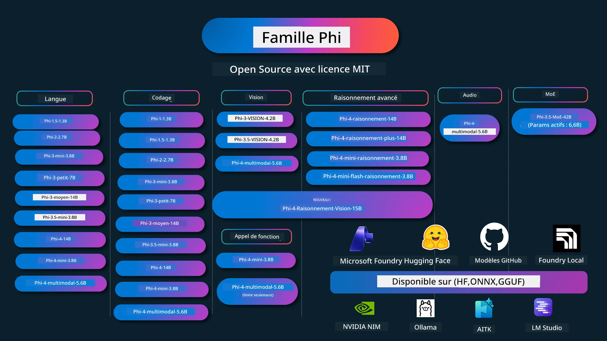

# Phi Cookbook : Exemples pratiques avec les modèles Phi de Microsoft

[](https://codespaces.new/microsoft/phicookbook)
[](https://vscode.dev/redirect?url=vscode://ms-vscode-remote.remote-containers/cloneInVolume?url=https://github.com/microsoft/phicookbook)

[](https://GitHub.com/microsoft/phicookbook/graphs/contributors/?WT.mc_id=aiml-137032-kinfeylo)
[](https://GitHub.com/microsoft/phicookbook/issues/?WT.mc_id=aiml-137032-kinfeylo)
[](https://GitHub.com/microsoft/phicookbook/pulls/?WT.mc_id=aiml-137032-kinfeylo)
[](http://makeapullrequest.com?WT.mc_id=aiml-137032-kinfeylo)

[](https://GitHub.com/microsoft/phicookbook/watchers/?WT.mc_id=aiml-137032-kinfeylo)
[](https://GitHub.com/microsoft/phicookbook/network/?WT.mc_id=aiml-137032-kinfeylo)
[](https://GitHub.com/microsoft/phicookbook/stargazers/?WT.mc_id=aiml-137032-kinfeylo)

[](https://discord.com/invite/ByRwuEEgH4)

Phi est une série de modèles d'IA open source développés par Microsoft.

Phi est actuellement le modèle de langage petit (SLM) le plus puissant et économique, avec d'excellents benchmarks en multi-langues, raisonnement, génération de texte/chat, codage, images, audio et autres scénarios.

Vous pouvez déployer Phi dans le cloud ou sur des dispositifs périphériques, et vous pouvez facilement créer des applications d'IA générative avec une puissance de calcul limitée.

Suivez ces étapes pour commencer à utiliser ces ressources :
1. **Forkez le dépôt** : Cliquez sur [](https://GitHub.com/microsoft/phicookbook/network/?WT.mc_id=aiml-137032-kinfeylo)
2. **Clonez le dépôt** : `git clone https://github.com/microsoft/PhiCookBook.git`
3. [**Rejoignez la communauté Discord Microsoft AI et rencontrez des experts et d’autres développeurs**](https://discord.com/invite/ByRwuEEgH4?WT.mc_id=aiml-137032-kinfeylo)



### 🌐 Prise en charge multi-langue

#### Pris en charge via GitHub Action (Automatisé & Toujours à jour)

<!-- CO-OP TRANSLATOR LANGUAGES TABLE START -->
[Arabe](../ar/README.md) | [Bengali](../bn/README.md) | [Bulgare](../bg/README.md) | [Birman (Myanmar)](../my/README.md) | [Chinois (Simplifié)](../zh-CN/README.md) | [Chinois (Traditionnel, Hong Kong)](../zh-HK/README.md) | [Chinois (Traditionnel, Macao)](../zh-MO/README.md) | [Chinois (Traditionnel, Taïwan)](../zh-TW/README.md) | [Croate](../hr/README.md) | [Tchèque](../cs/README.md) | [Danois](../da/README.md) | [Néerlandais](../nl/README.md) | [Estonien](../et/README.md) | [Finnois](../fi/README.md) | [Français](./README.md) | [Allemand](../de/README.md) | [Grec](../el/README.md) | [Hébreu](../he/README.md) | [Hindi](../hi/README.md) | [Hongrois](../hu/README.md) | [Indonésien](../id/README.md) | [Italien](../it/README.md) | [Japonais](../ja/README.md) | [Kannada](../kn/README.md) | [Khmer](../km/README.md) | [Coréen](../ko/README.md) | [Lituanien](../lt/README.md) | [Malais](../ms/README.md) | [Malayalam](../ml/README.md) | [Manipuri (Meitei Mayek)](../mni/README.md) | [Marathi](../mr/README.md) | [Népalais](../ne/README.md) | [Pidgin nigérian](../pcm/README.md) | [Norvégien](../no/README.md) | [Persan (Farsi)](../fa/README.md) | [Polonais](../pl/README.md) | [Portugais (Brésil)](../pt-BR/README.md) | [Portugais (Portugal)](../pt-PT/README.md) | [Pendjabi (Gurmukhi)](../pa/README.md) | [Roumain](../ro/README.md) | [Russe](../ru/README.md) | [Serbe (Cyrillique)](../sr/README.md) | [Slovaque](../sk/README.md) | [Slovène](../sl/README.md) | [Espagnol](../es/README.md) | [Swahili](../sw/README.md) | [Suédois](../sv/README.md) | [Tagalog (Philippin)](../tl/README.md) | [Tamoul](../ta/README.md) | [Telugu](../te/README.md) | [Thaï](../th/README.md) | [Turc](../tr/README.md) | [Ukrainien](../uk/README.md) | [Ourdou](../ur/README.md) | [Vietnamien](../vi/README.md)

> **Préférez cloner localement ?**
>
> Ce dépôt inclut plus de 50 traductions de langue, ce qui augmente significativement la taille du téléchargement. Pour cloner sans les traductions, utilisez le sparse checkout :
>
> **Bash / macOS / Linux :**
> ```bash
> git clone --filter=blob:none --sparse https://github.com/microsoft/PhiCookBook.git
> cd PhiCookBook
> git sparse-checkout set --no-cone '/*' '!translations' '!translated_images'
> ```
>
> **CMD (Windows) :**
> ```cmd
> git clone --filter=blob:none --sparse https://github.com/microsoft/PhiCookBook.git
> cd PhiCookBook
> git sparse-checkout set --no-cone "/*" "!translations" "!translated_images"
> ```
>
> Cela vous donne tout ce dont vous avez besoin pour compléter le cours avec un téléchargement beaucoup plus rapide.
<!-- CO-OP TRANSLATOR LANGUAGES TABLE END -->

## Table des matières

- Introduction
  - [Bienvenue dans la famille Phi](./md/01.Introduction/01/01.PhiFamily.md)
  - [Configuration de votre environnement](./md/01.Introduction/01/01.EnvironmentSetup.md)
  - [Compréhension des technologies clés](./md/01.Introduction/01/01.Understandingtech.md)
  - [Sécurité IA pour les modèles Phi](./md/01.Introduction/01/01.AISafety.md)
  - [Support matériel de Phi](./md/01.Introduction/01/01.Hardwaresupport.md)
  - [Modèles Phi & disponibilité sur les plateformes](./md/01.Introduction/01/01.Edgeandcloud.md)
  - [Utilisation de Guidance-ai et Phi](./md/01.Introduction/01/01.Guidance.md)
  - [Modèles du GitHub Marketplace](https://github.com/marketplace/models)
  - [Catalogue de modèles AI Azure](https://ai.azure.com)

- Inférence Phi dans différents environnements
    -  [Hugging face](./md/01.Introduction/02/01.HF.md)
    -  [Modèles GitHub](./md/01.Introduction/02/02.GitHubModel.md)
    -  [Catalogue de modèles Microsoft Foundry](./md/01.Introduction/02/03.AzureAIFoundry.md)
    -  [Ollama](./md/01.Introduction/02/04.Ollama.md)
    -  [AI Toolkit VSCode (AITK)](./md/01.Introduction/02/05.AITK.md)
    -  [NVIDIA NIM](./md/01.Introduction/02/06.NVIDIA.md)
    -  [Foundry Local](./md/01.Introduction/02/07.FoundryLocal.md)

- Inférence famille Phi
    - [Inférence Phi sur iOS](./md/01.Introduction/03/iOS_Inference.md)
    - [Inférence Phi sur Android](./md/01.Introduction/03/Android_Inference.md)
    - [Inférence Phi sur Jetson](./md/01.Introduction/03/Jetson_Inference.md)
    - [Inférence Phi sur AI PC](./md/01.Introduction/03/AIPC_Inference.md)
    - [Inférence Phi avec Apple MLX Framework](./md/01.Introduction/03/MLX_Inference.md)
    - [Inférence Phi sur serveur local](./md/01.Introduction/03/Local_Server_Inference.md)
    - [Inférence Phi sur serveur distant avec AI Toolkit](./md/01.Introduction/03/Remote_Interence.md)
    - [Inférence Phi avec Rust](./md/01.Introduction/03/Rust_Inference.md)
    - [Inférence Phi–Vision en local](./md/01.Introduction/03/Vision_Inference.md)
    - [Inférence Phi avec Kaito AKS, conteneurs Azure (support officiel)](./md/01.Introduction/03/Kaito_Inference.md)
-  [Quantification famille Phi](./md/01.Introduction/04/QuantifyingPhi.md)
    - [Quantification Phi-3.5 / 4 avec llama.cpp](./md/01.Introduction/04/UsingLlamacppQuantifyingPhi.md)
    - [Quantification Phi-3.5 / 4 avec extensions Generative AI pour onnxruntime](./md/01.Introduction/04/UsingORTGenAIQuantifyingPhi.md)
    - [Quantification Phi-3.5 / 4 avec Intel OpenVINO](./md/01.Introduction/04/UsingIntelOpenVINOQuantifyingPhi.md)
    - [Quantification Phi-3.5 / 4 avec Apple MLX Framework](./md/01.Introduction/04/UsingAppleMLXQuantifyingPhi.md)

-  Évaluation Phi
    - [Réponse IA](./md/01.Introduction/05/ResponsibleAI.md)
    - [Microsoft Foundry pour évaluation](./md/01.Introduction/05/AIFoundry.md)
    - [Utilisation de Promptflow pour évaluation](./md/01.Introduction/05/Promptflow.md)
 
- RAG avec Azure AI Search
    - [Comment utiliser Phi-4-mini et Phi-4-multimodal (RAG) avec Azure AI Search](https://github.com/microsoft/PhiCookBook/blob/main/code/06.E2E/E2E_Phi-4-RAG-Azure-AI-Search.ipynb)
    - [RAG hybride local zéro-cloud avec SQLite FTS5 et phi-4-mini](https://github.com/microsoft/PhiCookBook/blob/main/code/06.E2E/E2E_Phi-4-mini_Local_Hybrid_RAG_SQLite_FTS5.ipynb)

- Exemples de développement d'applications Phi
  - Applications texte & chat
    - Exemples Phi-4
      - [📓] [Chat avec modèle Phi-4-mini ONNX](./md/02.Application/01.TextAndChat/Phi4/ChatWithPhi4ONNX/README.md)
      - [Chat avec modèle Phi-4 local ONNX .NET](../../md/04.HOL/dotnet/src/LabsPhi4-Chat-01OnnxRuntime)
      - [Application console Chat .NET avec Phi-4 ONNX utilisant Semantic Kernel](../../md/04.HOL/dotnet/src/LabsPhi4-Chat-02SK)
    - Exemples Phi-3 / 3.5
      - [Chatbot local dans le navigateur utilisant Phi3, ONNX Runtime Web et WebGPU](https://github.com/microsoft/onnxruntime-inference-examples/tree/main/js/chat)
      - [Chat OpenVino](./md/02.Application/01.TextAndChat/Phi3/E2E_OpenVino_Chat.md)
      - [Multi-modèles - Phi-3-mini interactif et OpenAI Whisper](./md/02.Application/01.TextAndChat/Phi3/E2E_Phi-3-mini_with_whisper.md)
      - [MLFlow - Création d’un wrapper et utilisation de Phi-3 avec MLFlow](./md//02.Application/01.TextAndChat/Phi3/E2E_Phi-3-MLflow.md)
      - [Optimisation du modèle - Comment optimiser le modèle Phi-3-min pour ONNX Runtime Web avec Olive](https://github.com/microsoft/Olive/tree/main/examples/phi3)
      - [Application WinUI3 avec Phi-3 mini-4k-instruct-onnx](https://github.com/microsoft/Phi3-Chat-WinUI3-Sample/)
      -[Exemple d’application de prise de notes alimentée par IA multi-modèles WinUI3](https://github.com/microsoft/ai-powered-notes-winui3-sample)
      - [Affinage et intégration de modèles Phi-3 personnalisés avec Prompt flow](./md/02.Application/01.TextAndChat/Phi3/E2E_Phi-3-FineTuning_PromptFlow_Integration.md)
      - [Affinage et intégration de modèles Phi-3 personnalisés avec Prompt flow dans Microsoft Foundry](./md/02.Application/01.TextAndChat/Phi3/E2E_Phi-3-FineTuning_PromptFlow_Integration_AIFoundry.md)
      - [Évaluation du modèle Phi-3 / Phi-3.5 affiné dans Microsoft Foundry en respectant les principes d’IA responsable de Microsoft](./md/02.Application/01.TextAndChat/Phi3/E2E_Phi-3-Evaluation_AIFoundry.md)
      - [📓] [Exemple de prédiction linguistique Phi-3.5-mini-instruct (Chinois/Anglais)](./md/02.Application/01.TextAndChat/Phi3/phi3-instruct-demo.ipynb)
      - [Chatbot RAG Phi-3.5-Instruct WebGPU](./md/02.Application/01.TextAndChat/Phi3/WebGPUWithPhi35Readme.md)
      - [Utilisation du GPU Windows pour créer une solution Prompt flow avec Phi-3.5-Instruct ONNX](./md/02.Application/01.TextAndChat/Phi3/UsingPromptFlowWithONNX.md)
      - [Utilisation de Microsoft Phi-3.5 tflite pour créer une application Android](./md/02.Application/01.TextAndChat/Phi3/UsingPhi35TFLiteCreateAndroidApp.md)
      - [Exemple Q&R .NET utilisant modèle local ONNX Phi-3 avec Microsoft.ML.OnnxRuntime](../../md/04.HOL/dotnet/src/LabsPhi301)
      - [Application console chat .NET avec Semantic Kernel et Phi-3](../../md/04.HOL/dotnet/src/LabsPhi302)

  - Exemples basés sur le SDK Azure AI Inference
    - Exemples Phi-4
      - [📓] [Générer le code du projet avec Phi-4-multimodal](./md/02.Application/02.Code/Phi4/GenProjectCode/README.md)
    - Exemples Phi-3 / 3.5
      - [Construisez votre propre chat GitHub Copilot pour Visual Studio Code avec la famille Microsoft Phi-3](./md/02.Application/02.Code/Phi3/VSCodeExt/README.md)
      - [Créez votre propre agent chat Copilot Visual Studio Code avec Phi-3.5 par GitHub Models](/md/02.Application/02.Code/Phi3/CreateVSCodeChatAgentWithGitHubModels.md)

  - Exemples avancés de raisonnement
    - Exemples Phi-4
      - [📓] [Échantillons Phi-4-mini-raisonnement ou Phi-4-raisonnement](./md/02.Application/03.AdvancedReasoning/Phi4/AdvancedResoningPhi4mini/README.md)
      - [📓] [Affinage Phi-4-mini-raisonnement avec Microsoft Olive](./md/02.Application/03.AdvancedReasoning/Phi4/AdvancedResoningPhi4mini/olive_ft_phi_4_reasoning_with_medicaldata.ipynb)
      - [📓] [Affinage Phi-4-mini-raisonnement avec Apple MLX](./md/02.Application/03.AdvancedReasoning/Phi4/AdvancedResoningPhi4mini/mlx_ft_phi_4_reasoning_with_medicaldata.ipynb)
      - [📓] [Phi-4-mini-raisonnement avec les modèles GitHub](./md/02.Application/02.Code/Phi4r/github_models_inference.ipynb)
      - [📓] [Phi-4-mini-raisonnement avec les modèles Microsoft Foundry](./md/02.Application/02.Code/Phi4r/azure_models_inference.ipynb)
  - Démonstrations
      - [Démonstrations Phi-4-mini hébergées sur Hugging Face Spaces](https://huggingface.co/spaces/microsoft/phi-4-mini?WT.mc_id=aiml-137032-kinfeylo)
      - [Démonstrations Phi-4-multimodal hébergées sur Hugging Face Spaces](https://huggingface.co/spaces/microsoft/phi-4-multimodal?WT.mc_id=aiml-137032-kinfeylo)
  - Échantillons Vision
    - Échantillons Phi-4 
      - [📓] [Utiliser Phi-4-multimodal pour lire des images et générer du code](./md/02.Application/04.Vision/Phi4/CreateFrontend/README.md) 
    - Échantillons Phi-3 / 3.5
      -  [📓][Phi-3-vision-texte image à texte](./md/02.Application/04.Vision/Phi3/E2E_Phi-3-vision-image-text-to-text-online-endpoint.ipynb)
      - [Phi-3-vision-ONNX](https://onnxruntime.ai/docs/genai/tutorials/phi3-v.html)
      - [📓][Phi-3-vision CLIP Embedding](./md/02.Application/04.Vision/Phi3/E2E_Phi-3-vision-image-text-to-text-online-endpoint.ipynb)
      - [DÉMO : Phi-3 Recycling](https://github.com/jennifermarsman/PhiRecycling/)
      - [Phi-3-vision - Assistant de langage visuel - avec Phi3-Vision et OpenVINO](https://docs.openvino.ai/nightly/notebooks/phi-3-vision-with-output.html)
      - [Phi-3 Vision Nvidia NIM](./md/02.Application/04.Vision/Phi3/E2E_Nvidia_NIM_Vision.md)
      - [Phi-3 Vision OpenVino](./md/02.Application/04.Vision/Phi3/E2E_OpenVino_Phi3Vision.md)
      - [📓][Phi-3.5 Vision échantillon multi-images ou multi-cadres](./md/02.Application/04.Vision/Phi3/phi3-vision-demo.ipynb)
      - [Phi-3 Vision Modèle local ONNX utilisant Microsoft.ML.OnnxRuntime .NET](../../md/04.HOL/dotnet/src/LabsPhi303)
      - [Modèle local ONNX Phi-3 Vision basé sur un menu utilisant Microsoft.ML.OnnxRuntime .NET](../../md/04.HOL/dotnet/src/LabsPhi304)

  - Échantillons Raisonner-Vision
    - Phi-4-Raisonner-Vision-15B 
      - [📓] [Utiliser Phi-4-Raisonner-Vision-15B pour détecter le jaywalking](./md/02.Application/10.ReasoningVision/Phi_4_reasoning_vision_15b_Jaywalking.ipynb)
      - [📓] [Utiliser Phi-4-Raisonner-Vision-15B pour les mathématiques](./md/02.Application/10.ReasoningVision/Phi_4_reasoning_vision_15b_Math.ipynb)
      - [📓] [Utiliser Phi-4-Raisonner-Vision-15B pour détecter l’interface utilisateur](./md/02.Application/10.ReasoningVision/Phi_4_reasoning_vision_15b_ui.ipynb)

  - Échantillons Mathématiques
    -  Échantillons Phi-4-Mini-Flash-Raisonner-Instruct  [Démo Mathématiques avec Phi-4-Mini-Flash-Raisonner-Instruct](./md/02.Application/09.Math/MathDemo.ipynb)

  - Échantillons Audio
    - Échantillons Phi-4 
      - [📓] [Extraction de transcriptions audio utilisant Phi-4-multimodal](./md/02.Application/05.Audio/Phi4/Transciption/README.md)
      - [📓] [Exemple audio Phi-4-multimodal](./md/02.Application/05.Audio/Phi4/Siri/demo.ipynb)
      - [📓] [Exemple de traduction vocale Phi-4-multimodal](./md/02.Application/05.Audio/Phi4/Translate/demo.ipynb)
      - [Application console .NET utilisant Phi-4-multimodal Audio pour analyser un fichier audio et générer une transcription](../../md/04.HOL/dotnet/src/LabsPhi4-MultiModal-02Audio)

  - Échantillons MOE
    - Échantillons Phi-3 / 3.5
      - [📓] [Échantillon de modèles mixture of experts (MoEs) Phi-3.5 sur les réseaux sociaux](./md/02.Application/06.MoE/Phi3/phi3_moe_demo.ipynb)
      - [📓] [Construction d’un pipeline Retrieval-Augmented Generation (RAG) avec NVIDIA NIM Phi-3 MOE, Azure AI Search et LlamaIndex](./md/02.Application/06.MoE/Phi3/azure-ai-search-nvidia-rag.ipynb)
      - 
  - Échantillons Appel de Fonction
    - Échantillons Phi-4 🆕
      -  [📓] [Utiliser l’appel de fonction avec Phi-4-mini](./md/02.Application/07.FunctionCalling/Phi4/FunctionCallingBasic/README.md)
      -  [📓] [Utiliser l’appel de fonction pour créer plusieurs agents avec Phi-4-mini](./md/02.Application/07.FunctionCalling/Phi4/Multiagents/Phi_4_mini_multiagent.ipynb)
      -  [📓] [Utiliser l’appel de fonction avec Ollama](./md/02.Application/07.FunctionCalling/Phi4/Ollama/ollama_functioncalling.ipynb)
      -  [📓] [Utiliser l’appel de fonction avec ONNX](./md/02.Application/07.FunctionCalling/Phi4/ONNX/onnx_parallel_functioncalling.ipynb)
  - Échantillons de mixage multimodal
    - Échantillons Phi-4 🆕
      -  [📓] [Utiliser Phi-4-multimodal comme journaliste technologique](./md/02.Application/08.Multimodel/Phi4/TechJournalist/phi_4_mm_audio_text_publish_news.ipynb)
      - [Application console .NET utilisant Phi-4-multimodal pour analyser des images](../../md/04.HOL/dotnet/src/LabsPhi4-MultiModal-01Images)

- Affinage des échantillons Phi
  - [Scénarios d’affinage](./md/03.FineTuning/FineTuning_Scenarios.md)
  - [Affinage vs RAG](./md/03.FineTuning/FineTuning_vs_RAG.md)
  - [Affiner pour faire de Phi-3 un expert industriel](./md/03.FineTuning/LetPhi3gotoIndustriy.md)
  - [Affinage Phi-3 avec AI Toolkit pour VS Code](./md/03.FineTuning/Finetuning_VSCodeaitoolkit.md)
  - [Affinage Phi-3 avec Azure Machine Learning Service](./md/03.FineTuning/Introduce_AzureML.md)
  - [Affinage Phi-3 avec Lora](./md/03.FineTuning/FineTuning_Lora.md)
  - [Affinage Phi-3 avec QLora](./md/03.FineTuning/FineTuning_Qlora.md)
  - [Affinage Phi-3 avec Microsoft Foundry](./md/03.FineTuning/FineTuning_AIFoundry.md)
  - [Affinage Phi-3 avec Azure ML CLI/SDK](./md/03.FineTuning/FineTuning_MLSDK.md)
  - [Affinage avec Microsoft Olive](./md/03.FineTuning/FineTuning_MicrosoftOlive.md)
  - [Laboratoire pratique d’affinage avec Microsoft Olive](./md/03.FineTuning/olive-lab/readme.md)
  - [Affinage Phi-3-vision avec Weights and Bias](./md/03.FineTuning/FineTuning_Phi-3-visionWandB.md)
  - [Affinage Phi-3 avec Apple MLX Framework](./md/03.FineTuning/FineTuning_MLX.md)
  - [Affinage Phi-3-vision (support officiel)](./md/03.FineTuning/FineTuning_Vision.md)
  - [Affinage Phi-3 avec Kaito AKS, Azure Containers (support officiel)](./md/03.FineTuning/FineTuning_Kaito.md)
  - [Affinage Phi-3 et 3.5 Vision](https://github.com/2U1/Phi3-Vision-Finetune)

- Laboratoire pratique
  - [Explorer les modèles de pointe : LLMs, SLMs, développement local et plus](https://github.com/microsoft/aitour-exploring-cutting-edge-models)
  - [Libérer le potentiel NLP : Affinage avec Microsoft Olive](https://github.com/azure/Ignite_FineTuning_workshop)

- Articles et publications de recherche académique
  - [Textbooks Are All You Need II : rapport technique phi-1.5](https://arxiv.org/abs/2309.05463)
  - [Rapport technique Phi-3 : Un modèle de langage hautement performant localement sur votre téléphone](https://arxiv.org/abs/2404.14219)
  - [Rapport technique Phi-4](https://arxiv.org/abs/2412.08905)
  - [Rapport technique Phi-4-Mini : Modèles de langage multimodaux compacts mais puissants via mélange de LoRAs](https://arxiv.org/abs/2503.01743)
  - [Optimisation des petits modèles de langue pour l’appel de fonction embarqué](https://arxiv.org/abs/2501.02342)
  - [(WhyPHI) Affinage PHI-3 pour les questions à choix multiples : méthodologie, résultats et défis](https://arxiv.org/abs/2501.01588)
  - [Rapport technique Phi-4-raisonnement](https://www.microsoft.com/en-us/research/wp-content/uploads/2025/04/phi_4_reasoning.pdf)
  - [Rapport technique Phi-4-mini-raisonnement](https://huggingface.co/microsoft/Phi-4-mini-reasoning/blob/main/Phi-4-Mini-Reasoning.pdf)

## Utilisation des modèles Phi

### Phi sur Microsoft Foundry

Vous pouvez apprendre à utiliser Microsoft Phi et à construire des solutions de bout en bout sur vos différents appareils matériels. Pour tester Phi par vous-même, commencez par jouer avec les modèles et personnaliser Phi pour vos scénarios à l’aide du [catalogue des modèles Microsoft Foundry Azure AI](https://aka.ms/phi3-azure-ai) et découvrez-en plus dans Démarrer avec [Microsoft Foundry](/md/02.QuickStart/AzureAIFoundry_QuickStart.md)

**Playground**
Chaque modèle dispose d'un playground dédié pour tester le modèle [Azure AI Playground](https://aka.ms/try-phi3).

### Phi sur les modèles GitHub

Vous pouvez apprendre à utiliser Microsoft Phi et à construire des solutions de bout en bout sur vos différents appareils matériels. Pour tester Phi par vous-même, commencez par jouer avec le modèle et personnaliser Phi pour vos scénarios avec le [catalogue des modèles GitHub](https://github.com/marketplace/models?WT.mc_id=aiml-137032-kinfeylo) et en savoir plus dans Démarrer avec [catalogue des modèles GitHub](/md/02.QuickStart/GitHubModel_QuickStart.md)

**Playground**
Chaque modèle dispose d’un [playground dédié pour tester le modèle](/md/02.QuickStart/GitHubModel_QuickStart.md).

### Phi sur Hugging Face

Vous pouvez également trouver le modèle sur [Hugging Face](https://huggingface.co/microsoft)

**Playground**
 [playground Hugging Chat](https://huggingface.co/chat/models/microsoft/Phi-3-mini-4k-instruct)

 ## 🎒 Autres cours

Notre équipe produit d’autres cours ! Découvrez :

<!-- CO-OP TRANSLATOR OTHER COURSES START -->
### LangChain
[](https://aka.ms/langchain4j-for-beginners)
[](https://aka.ms/langchainjs-for-beginners?WT.mc_id=m365-94501-dwahlin)
[](https://github.com/microsoft/langchain-for-beginners?WT.mc_id=m365-94501-dwahlin)
---

### Azure / Edge / MCP / Agents
[](https://github.com/microsoft/AZD-for-beginners?WT.mc_id=academic-105485-koreyst)
[](https://github.com/microsoft/edgeai-for-beginners?WT.mc_id=academic-105485-koreyst)
[](https://github.com/microsoft/mcp-for-beginners?WT.mc_id=academic-105485-koreyst)
[](https://github.com/microsoft/ai-agents-for-beginners?WT.mc_id=academic-105485-koreyst)

---
 
### Série IA générative
[](https://github.com/microsoft/generative-ai-for-beginners?WT.mc_id=academic-105485-koreyst)
[-9333EA?style=for-the-badge&labelColor=E5E7EB&color=9333EA)](https://github.com/microsoft/Generative-AI-for-beginners-dotnet?WT.mc_id=academic-105485-koreyst)
[-C084FC?style=for-the-badge&labelColor=E5E7EB&color=C084FC)](https://github.com/microsoft/generative-ai-for-beginners-java?WT.mc_id=academic-105485-koreyst)
[-E879F9?style=for-the-badge&labelColor=E5E7EB&color=E879F9)](https://github.com/microsoft/generative-ai-with-javascript?WT.mc_id=academic-105485-koreyst)

---
 
### Apprentissage fondamental
[](https://aka.ms/ml-beginners?WT.mc_id=academic-105485-koreyst)
[](https://aka.ms/datascience-beginners?WT.mc_id=academic-105485-koreyst)
[](https://aka.ms/ai-beginners?WT.mc_id=academic-105485-koreyst)
[](https://github.com/microsoft/Security-101?WT.mc_id=academic-96948-sayoung)
[](https://aka.ms/webdev-beginners?WT.mc_id=academic-105485-koreyst)
[](https://aka.ms/iot-beginners?WT.mc_id=academic-105485-koreyst)
[](https://github.com/microsoft/xr-development-for-beginners?WT.mc_id=academic-105485-koreyst)

---
 
### Série Copilot
[](https://aka.ms/GitHubCopilotAI?WT.mc_id=academic-105485-koreyst)
[](https://github.com/microsoft/mastering-github-copilot-for-dotnet-csharp-developers?WT.mc_id=academic-105485-koreyst)
[](https://github.com/microsoft/CopilotAdventures?WT.mc_id=academic-105485-koreyst)
<!-- CO-OP TRANSLATOR OTHER COURSES END -->

## IA responsable 

Microsoft s’engage à aider ses clients à utiliser nos produits IA de manière responsable, à partager nos apprentissages et à construire des partenariats basés sur la confiance grâce à des outils tels que les Notes de Transparence et les Évaluations d’Impact. Nombre de ces ressources sont disponibles sur [https://aka.ms/RAI](https://aka.ms/RAI).
L’approche de Microsoft en matière d’IA responsable repose sur nos principes d’IA de justice, fiabilité et sécurité, confidentialité et sécurité, inclusivité, transparence et responsabilité.

Les modèles à grande échelle de langage naturel, d’image et de parole - comme ceux utilisés dans cet échantillon - peuvent potentiellement se comporter de manière injuste, non fiable ou offensante, ce qui peut causer des préjudices. Veuillez consulter la [note de transparence du service Azure OpenAI](https://learn.microsoft.com/legal/cognitive-services/openai/transparency-note?tabs=text) pour être informé des risques et limitations.

L'approche recommandée pour atténuer ces risques est d'inclure un système de sécurité dans votre architecture capable de détecter et de prévenir les comportements nuisibles. [Azure AI Content Safety](https://learn.microsoft.com/azure/ai-services/content-safety/overview) fournit une couche de protection indépendante, capable de détecter les contenus nuisibles générés par les utilisateurs et par l'IA dans les applications et services. Azure AI Content Safety inclut des API de texte et d’image qui vous permettent de détecter les contenus nuisibles. Dans Microsoft Foundry, le service Content Safety vous permet de visualiser, d'explorer et d'essayer des exemples de code pour détecter les contenus nuisibles à travers différentes modalités. La [documentation de démarrage rapide](https://learn.microsoft.com/azure/ai-services/content-safety/quickstart-text?tabs=visual-studio%2Clinux&pivots=programming-language-rest) suivante vous guide pour envoyer des requêtes au service.

Un autre aspect à prendre en compte est la performance globale de l'application. Pour les applications multimodales et multi-modèles, la performance signifie que le système fonctionne comme vous et vos utilisateurs l’attendez, y compris en n'engendrant pas de résultats nuisibles. Il est important d’évaluer la performance de votre application globale en utilisant les [évaluateurs de Performance et Qualité et de Risque et Sécurité](https://learn.microsoft.com/azure/ai-studio/concepts/evaluation-metrics-built-in). Vous avez également la possibilité de créer et d’évaluer avec des [évaluateurs personnalisés](https://learn.microsoft.com/azure/ai-studio/how-to/develop/evaluate-sdk#custom-evaluators).

Vous pouvez évaluer votre application IA dans votre environnement de développement à l’aide du [Azure AI Evaluation SDK](https://microsoft.github.io/promptflow/index.html). À partir d’un jeu de données de test ou d’un objectif, les générations de votre application d’IA générative sont mesurées quantitativement avec des évaluateurs intégrés ou des évaluateurs personnalisés de votre choix. Pour commencer avec l’Azure AI Evaluation SDK pour évaluer votre système, vous pouvez suivre le [guide de démarrage rapide](https://learn.microsoft.com/azure/ai-studio/how-to/develop/flow-evaluate-sdk). Une fois que vous avez exécuté une évaluation, vous pouvez [visualiser les résultats dans Microsoft Foundry](https://learn.microsoft.com/azure/ai-studio/how-to/evaluate-flow-results).

## Marques déposées

Ce projet peut contenir des marques ou logos de projets, produits ou services. L'utilisation autorisée des marques ou logos Microsoft est soumise aux [Lignes directrices sur les marques et la marque commerciale de Microsoft](https://www.microsoft.com/legal/intellectualproperty/trademarks/usage/general).
L’utilisation des marques ou logos Microsoft dans les versions modifiées de ce projet ne doit pas créer de confusion ni impliquer un parrainage par Microsoft. Toute utilisation de marques ou logos tiers est soumise aux politiques de ces tiers.

## Obtenir de l’aide

Si vous êtes bloqué ou avez des questions sur la création d’applications IA, rejoignez :

[](https://aka.ms/foundry/discord)

Si vous avez des commentaires sur le produit ou rencontrez des erreurs lors du développement, visitez :

[](https://aka.ms/foundry/forum)

---

<!-- CO-OP TRANSLATOR DISCLAIMER START -->
**Avertissement** :
Ce document a été traduit à l'aide du service de traduction automatique [Co-op Translator](https://github.com/Azure/co-op-translator). Bien que nous nous efforçions d'assurer l'exactitude, veuillez noter que les traductions automatisées peuvent contenir des erreurs ou des inexactitudes. Le document original dans sa langue native doit être considéré comme la source faisant autorité. Pour les informations critiques, il est recommandé de recourir à une traduction professionnelle réalisée par un humain. Nous ne saurions être tenus responsables des malentendus ou erreurs d'interprétation découlant de l'utilisation de cette traduction.
<!-- CO-OP TRANSLATOR DISCLAIMER END -->