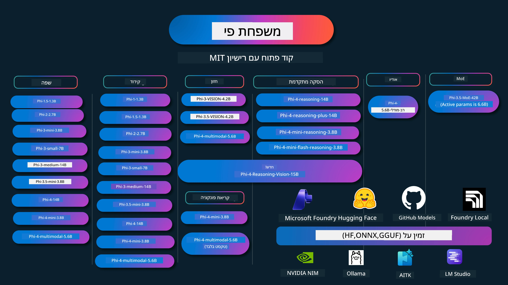

# ספר מתכונים לפאי: דוגמאות מעשיות עם דגמי פאי של מיקרוסופט

[](https://codespaces.new/microsoft/phicookbook)
[](https://vscode.dev/redirect?url=vscode://ms-vscode-remote.remote-containers/cloneInVolume?url=https://github.com/microsoft/phicookbook)

[](https://GitHub.com/microsoft/phicookbook/graphs/contributors/?WT.mc_id=aiml-137032-kinfeylo)
[](https://GitHub.com/microsoft/phicookbook/issues/?WT.mc_id=aiml-137032-kinfeylo)
[](https://GitHub.com/microsoft/phicookbook/pulls/?WT.mc_id=aiml-137032-kinfeylo)
[](http://makeapullrequest.com?WT.mc_id=aiml-137032-kinfeylo)

[](https://GitHub.com/microsoft/phicookbook/watchers/?WT.mc_id=aiml-137032-kinfeylo)
[](https://GitHub.com/microsoft/phicookbook/network/?WT.mc_id=aiml-137032-kinfeylo)
[](https://GitHub.com/microsoft/phicookbook/stargazers/?WT.mc_id=aiml-137032-kinfeylo)

[](https://discord.com/invite/ByRwuEEgH4)

פאי היא סדרת דגמי בינה מלאכותית בקוד פתוח שפיתחה מיקרוסופט. 

פאי היא כיום דגם שפה קטן (SLM) החזק והיעיל ביותר מבחינת עלות, עם מדדים טובים מאוד במולטילינגואלי, היסק, יצירת טקסט/צ'אט, קידוד, תמונות, אודיו וסצנריואים נוספים. 

ניתן לפרוס את פאי בענן או במכשירי קצה, וניתן לבנות בקלות יישומי בינה מלאכותית יצירתיים עם כוח חישובי מוגבל.

עקבו אחרי הצעדים הבאים כדי להתחיל להשתמש במשאב זה:
1. **יצירת מזלג למאגר**: לחצו על [](https://GitHub.com/microsoft/phicookbook/network/?WT.mc_id=aiml-137032-kinfeylo)
2. **שכפול המאגר**: `git clone https://github.com/microsoft/PhiCookBook.git`
3. [**הצטרפו לקהילת מיקרוסופט AI בדיסקורד ופגשו מומחים ומפתחים נוספים**](https://discord.com/invite/ByRwuEEgH4?WT.mc_id=aiml-137032-kinfeylo)



### 🌐 תמיכה בריבוי שפות

#### תרגומים מתוחזקים עם [Co-op Translator](https://github.com/Azure/co-op-translator)

<!-- טבלת שפות של מתרגם שיתופי CO-OP TRANSLATOR LANGUAGES TABLE START -->
[ערבית](../ar/README.md) | [בנגלית](../bn/README.md) | [בולגרית](../bg/README.md) | [בורמזית (מיאנמר)](../my/README.md) | [סינית (מפושט)](../zh-CN/README.md) | [סינית (מסורתית, הונג קונג)](../zh-HK/README.md) | [סינית (מסורתית, מקאו)](../zh-MO/README.md) | [סינית (מסורתית, טאיוואן)](../zh-TW/README.md) | [קרואטית](../hr/README.md) | [צ'כית](../cs/README.md) | [דנית](../da/README.md) | [הולנדית](../nl/README.md) | [אסטונית](../et/README.md) | [פינית](../fi/README.md) | [צרפתית](../fr/README.md) | [גרמנית](../de/README.md) | [יוונית](../el/README.md) | [עברית](./README.md) | [הינדי](../hi/README.md) | [הונגרית](../hu/README.md) | [אינדונזית](../id/README.md) | [איטלקית](../it/README.md) | [יפנית](../ja/README.md) | [קנאדה](../kn/README.md) | [חמרית](../km/README.md) | [קוריאנית](../ko/README.md) | [ליטאית](../lt/README.md) | [מלאית](../ms/README.md) | [מלאיאלאם](../ml/README.md) | [מניפורי (מיטאי מאייק)](../mni/README.md) | [מרטהית](../mr/README.md) | [נפאלית](../ne/README.md) | [פיג'ין ניגרית](../pcm/README.md) | [נורווגית](../no/README.md) | [פרסית (פרסית)](../fa/README.md) | [פולנית](../pl/README.md) | [פורטוגזית (ברזיל)](../pt-BR/README.md) | [פורטוגזית (פורטוגל)](../pt-PT/README.md) | [פונג'אבי (גורמוכי)](../pa/README.md) | [רומנית](../ro/README.md) | [רוסית](../ru/README.md) | [סרבית (קירילית)](../sr/README.md) | [סלובקית](../sk/README.md) | [סלובנית](../sl/README.md) | [ספרדית](../es/README.md) | [סוואהילי](../sw/README.md) | [שוודית](../sv/README.md) | [טגאלוג (פיליפינית)](../tl/README.md) | [טמילית](../ta/README.md) | [טלוגו](../te/README.md) | [תאית](../th/README.md) | [טורקית](../tr/README.md) | [אוקראינית](../uk/README.md) | [אורדו](../ur/README.md) | [ויאטנאמית](../vi/README.md)

> **מעדיפים לשכפל באופן מקומי?**
>
> מאגר זה כולל יותר מ-50 תרגומים לשפות שמגבירים משמעותית את גודל ההורדה. לשכפל ללא התרגומים, השתמשו ב-checkout סלקטיבי:
>
> **Bash / macOS / Linux:**
> ```bash
> git clone --filter=blob:none --sparse https://github.com/microsoft/PhiCookBook.git
> cd PhiCookBook
> git sparse-checkout set --no-cone '/*' '!translations' '!translated_images'
> ```
>
> **CMD (Windows):**
> ```cmd
> git clone --filter=blob:none --sparse https://github.com/microsoft/PhiCookBook.git
> cd PhiCookBook
> git sparse-checkout set --no-cone "/*" "!translations" "!translated_images"
> ```
>
> זה נותן לכם את כל מה שצריך כדי להשלים את הקורס במהירות הורדה גבוהה יותר.
<!-- טבלת שפות של מתרגם שיתופי CO-OP TRANSLATOR LANGUAGES TABLE END -->

## תוכן העניינים

- מבוא
  - [ברוכים הבאים למשפחת פאי](./md/01.Introduction/01/01.PhiFamily.md)
  - [הגדרת הסביבה שלך](./md/01.Introduction/01/01.EnvironmentSetup.md)
  - [הבנת טכנולוגיות מפתח](./md/01.Introduction/01/01.Understandingtech.md)
  - [בטיחות בינה מלאכותית לדגמי פאי](./md/01.Introduction/01/01.AISafety.md)
  - [תמיכה בחומרת פאי](./md/01.Introduction/01/01.Hardwaresupport.md)
  - [דגמי פאי וזמינות בפלטפורמות](./md/01.Introduction/01/01.Edgeandcloud.md)
  - [שימוש ב-Guidance-ai ופאי](./md/01.Introduction/01/01.Guidance.md)
  - [דגמי Marketplace של GitHub](https://github.com/marketplace/models)
  - [קטלוג דגמי Azure AI](https://ai.azure.com)

- הסקה עם פאי בסביבות שונות
    -  [Hugging face](./md/01.Introduction/02/01.HF.md)
    -  [דגמי GitHub](./md/01.Introduction/02/02.GitHubModel.md)
    -  [קטלוג דגמי Microsoft Foundry](./md/01.Introduction/02/03.AzureAIFoundry.md)
    -  [Ollama](./md/01.Introduction/02/04.Ollama.md)
    -  [AI Toolkit VSCode (AITK)](./md/01.Introduction/02/05.AITK.md)
    -  [NVIDIA NIM](./md/01.Introduction/02/06.NVIDIA.md)
    -  [Foundry Local](./md/01.Introduction/02/07.FoundryLocal.md)

- משפחת הסקה עם פאי
    - [הסקה עם פאי ב-iOS](./md/01.Introduction/03/iOS_Inference.md)
    - [הסקה עם פאי באנדרואיד](./md/01.Introduction/03/Android_Inference.md)
    - [הסקה עם פאי ב-Jetson](./md/01.Introduction/03/Jetson_Inference.md)
    - [הסקה עם פאי במחשב AI](./md/01.Introduction/03/AIPC_Inference.md)
    - [הסקה עם פאי במסגרת Apple MLX](./md/01.Introduction/03/MLX_Inference.md)
    - [הסקה עם פאי בשרת מקומי](./md/01.Introduction/03/Local_Server_Inference.md)
    - [הסקה עם פאי בשרת מרוחק באמצעות AI Toolkit](./md/01.Introduction/03/Remote_Interence.md)
    - [הסקה עם פאי ב-Rust](./md/01.Introduction/03/Rust_Inference.md)
    - [הסקה עם פאי--Vision במקומי](./md/01.Introduction/03/Vision_Inference.md)
    - [הסקה עם פאי עם Kaito AKS, Azure Containers (תמיכה רשמית)](./md/01.Introduction/03/Kaito_Inference.md)
-  [כימות משפחת פאי](./md/01.Introduction/04/QuantifyingPhi.md)
    - [כימות Phi-3.5 / 4 באמצעות llama.cpp](./md/01.Introduction/04/UsingLlamacppQuantifyingPhi.md)
    - [כימות Phi-3.5 / 4 באמצעות הרחבות בינה מלאכותית יצירתית ל-onnxruntime](./md/01.Introduction/04/UsingORTGenAIQuantifyingPhi.md)
    - [כימות Phi-3.5 / 4 באמצעות Intel OpenVINO](./md/01.Introduction/04/UsingIntelOpenVINOQuantifyingPhi.md)
    - [כימות Phi-3.5 / 4 באמצעות Apple MLX Framework](./md/01.Introduction/04/UsingAppleMLXQuantifyingPhi.md)

-  הערכת פאי
    - [תגובה בינה מלאכותית](./md/01.Introduction/05/ResponsibleAI.md)
    - [Microsoft Foundry להערכה](./md/01.Introduction/05/AIFoundry.md)
    - [שימוש ב-Promptflow להערכה](./md/01.Introduction/05/Promptflow.md)
 
- RAG עם Azure AI Search
    - [כיצד להשתמש ב-Phi-4-mini ו-Phi-4-multimodal (RAG) עם Azure AI Search](https://github.com/microsoft/PhiCookBook/blob/main/code/06.E2E/E2E_Phi-4-RAG-Azure-AI-Search.ipynb)
    - [RAG מקומי היברידי ללא ענן עם SQLite FTS5 ו-phi-4-mini](https://github.com/microsoft/PhiCookBook/blob/main/code/06.E2E/E2E_Phi-4-mini_Local_Hybrid_RAG_SQLite_FTS5.ipynb)

- דוגמאות לפיתוח יישומי פאי
  - יישומי טקסט וצ'אט
    - דוגמאות ל-Phi-4 
      - [📓] [צ'אט עם דגם Phi-4-mini ONNX](./md/02.Application/01.TextAndChat/Phi4/ChatWithPhi4ONNX/README.md)
      - [צ'אט עם דגם Phi-4 מקומי ONNX .NET](../../md/04.HOL/dotnet/src/LabsPhi4-Chat-01OnnxRuntime)
      - [אפליקציית קונסולה לצ'אט .NET עם Phi-4 ONNX באמצעות Semantic Kernel](../../md/04.HOL/dotnet/src/LabsPhi4-Chat-02SK)
    - דוגמאות ל-Phi-3 / 3.5
      - [בוט צ'אט מקומי בדפדפן באמצעות Phi3, ONNX Runtime Web ו-WebGPU](https://github.com/microsoft/onnxruntime-inference-examples/tree/main/js/chat)
      - [צ'אט OpenVino](./md/02.Application/01.TextAndChat/Phi3/E2E_OpenVino_Chat.md)
      - [רב-דגם - Phi-3-mini אינטראקטיבי ו-OpenAI Whisper](./md/02.Application/01.TextAndChat/Phi3/E2E_Phi-3-mini_with_whisper.md)
      - [MLFlow - בניית עטיפה ושימוש ב-Phi-3 עם MLFlow](./md//02.Application/01.TextAndChat/Phi3/E2E_Phi-3-MLflow.md)
      - [אופטימיזציית דגם - איך לייעל דגם Phi-3-min עבור ONNX Runtime Web עם Olive](https://github.com/microsoft/Olive/tree/main/examples/phi3)
      - [אפליקציית WinUI3 עם Phi-3 mini-4k-instruct-onnx](https://github.com/microsoft/Phi3-Chat-WinUI3-Sample/)
      -[דוגמת אפליקציית WinUI3 עם ערות רב-דגם מבוסס בינה מלאכותית](https://github.com/microsoft/ai-powered-notes-winui3-sample)
      - [כיוונון ושילוב של דגמי Phi-3 מותאמים אישית עם Prompt flow](./md/02.Application/01.TextAndChat/Phi3/E2E_Phi-3-FineTuning_PromptFlow_Integration.md)
      - [כיוונון ושילוב של דגמי Phi-3 מותאמים אישית עם Prompt flow ב-Microsoft Foundry](./md/02.Application/01.TextAndChat/Phi3/E2E_Phi-3-FineTuning_PromptFlow_Integration_AIFoundry.md)
      - [הערכת דגם Phi-3 / Phi-3.5 מכוונן היטב ב-Microsoft Foundry תוך התמקדות בעקרונות הבינה האחראית של מיקרוסופט](./md/02.Application/01.TextAndChat/Phi3/E2E_Phi-3-Evaluation_AIFoundry.md)
      - [📓] [דוגמת חיזוי שפה Phi-3.5-mini-instruct (סינית/אנגלית)](./md/02.Application/01.TextAndChat/Phi3/phi3-instruct-demo.ipynb)
      - [בוט צ'אט RAG Phi-3.5-Instruct WebGPU](./md/02.Application/01.TextAndChat/Phi3/WebGPUWithPhi35Readme.md)
      - [שימוש ב-GPU של Windows ליצירת פתרון Prompt flow עם Phi-3.5-Instruct ONNX](./md/02.Application/01.TextAndChat/Phi3/UsingPromptFlowWithONNX.md)
      - [שימוש ב-Microsoft Phi-3.5 tflite ליצירת אפליקציית אנדרואיד](./md/02.Application/01.TextAndChat/Phi3/UsingPhi35TFLiteCreateAndroidApp.md)
      - [דוגמת שאלות ותשובות .NET עם דגם Phi-3 מקומי ONNX באמצעות Microsoft.ML.OnnxRuntime](../../md/04.HOL/dotnet/src/LabsPhi301)
      - [אפליקציית צ'אט קונסולה .NET עם Semantic Kernel ופאי-3](../../md/04.HOL/dotnet/src/LabsPhi302)

  - דוגמאות מבוססות קוד לשימוש ב-Azure AI Inference SDK
    - דוגמאות ל-Phi-4 
      - [📓] [יצירת קוד לפרויקט באמצעות Phi-4-multimodal](./md/02.Application/02.Code/Phi4/GenProjectCode/README.md)
    - דוגמאות ל-Phi-3 / 3.5
      - [בנה את סוכן הצ'אט GitHub Copilot ב-Visual Studio Code שלך עם משפחת Microsoft Phi-3](./md/02.Application/02.Code/Phi3/VSCodeExt/README.md)
      - [צור את סוכן הצ'אט שלך ב-Visual Studio Code עם Phi-3.5 מדגמי GitHub](/md/02.Application/02.Code/Phi3/CreateVSCodeChatAgentWithGitHubModels.md)

  - דוגמאות להתמחות מתקדמת
    - דוגמאות Phi-4 
      - [📓] [דוגמאות לפיה-4-מיני-הנמקה או פיה-4-הנמקה](./md/02.Application/03.AdvancedReasoning/Phi4/AdvancedResoningPhi4mini/README.md)
      - [📓] [כיוונון עדין של פיה-4-מיני-הנמקה עם Microsoft Olive](./md/02.Application/03.AdvancedReasoning/Phi4/AdvancedResoningPhi4mini/olive_ft_phi_4_reasoning_with_medicaldata.ipynb)
      - [📓] [כיוונון עדין של פיה-4-מיני-הנמקה עם Apple MLX](./md/02.Application/03.AdvancedReasoning/Phi4/AdvancedResoningPhi4mini/mlx_ft_phi_4_reasoning_with_medicaldata.ipynb)
      - [📓] [פיה-4-מיני-הנמקה עם מודלים של GitHub](./md/02.Application/02.Code/Phi4r/github_models_inference.ipynb)
      - [📓] [פיה-4-מיני-הנמקה עם מודלים של Microsoft Foundry](./md/02.Application/02.Code/Phi4r/azure_models_inference.ipynb)
  - הדגמות
      - [הדגמות פיה-4-מיני מאוחסנות ב-Hugging Face Spaces](https://huggingface.co/spaces/microsoft/phi-4-mini?WT.mc_id=aiml-137032-kinfeylo)
      - [הדגמות פיה-4-רב-מודליות מאוחסנות ב-Hugging Face Spaces](https://huggingface.co/spaces/microsoft/phi-4-multimodal?WT.mc_id=aiml-137032-kinfeylo)
  - דוגמאות ראייה
    - דוגמאות Phi-4 
      - [📓] [השתמש ב-Phi-4-רב-מודליות לקריאת תמונות וליצור קוד](./md/02.Application/04.Vision/Phi4/CreateFrontend/README.md) 
    - דוגמאות Phi-3 / 3.5
      -  [📓][Phi-3-ראייה-טקסט-מתמונה לטקסט](./md/02.Application/04.Vision/Phi3/E2E_Phi-3-vision-image-text-to-text-online-endpoint.ipynb)
      - [Phi-3-ראייה-ONNX](https://onnxruntime.ai/docs/genai/tutorials/phi3-v.html)
      - [📓][טביעות CLIP של Phi-3-ראייה](./md/02.Application/04.Vision/Phi3/E2E_Phi-3-vision-image-text-to-text-online-endpoint.ipynb)
      - [הדגמה: מיחזור Phi-3](https://github.com/jennifermarsman/PhiRecycling/)
      - [עוזר שפת ראייה של Phi-3-ראייה - עם Phi3-Vision ו-OpenVINO](https://docs.openvino.ai/nightly/notebooks/phi-3-vision-with-output.html)
      - [Phi-3 Vision Nvidia NIM](./md/02.Application/04.Vision/Phi3/E2E_Nvidia_NIM_Vision.md)
      - [Phi-3 Vision OpenVino](./md/02.Application/04.Vision/Phi3/E2E_OpenVino_Phi3Vision.md)
      - [📓][דוגמאות מרובות מסגרות או תמונות של Phi-3.5 Vision](./md/02.Application/04.Vision/Phi3/phi3-vision-demo.ipynb)
      - [מודל ONNX מקומי של Phi-3 Vision באמצעות Microsoft.ML.OnnxRuntime .NET](../../md/04.HOL/dotnet/src/LabsPhi303)
      - [תפריט מבוסס Phi-3 Vision Local ONNX Model using the Microsoft.ML.OnnxRuntime .NET](../../md/04.HOL/dotnet/src/LabsPhi304)

  - דוגמאות הנמקה-ראייה
    - Phi-4-Reasoning-Vision-15B 
      - [📓] [שימוש ב-Phi-4-Reasoning-Vision-15B לזיהוי חציית כביש לא חוקית](./md/02.Application/10.ReasoningVision/Phi_4_reasoning_vision_15b_Jaywalking.ipynb)
      - [📓] [שימוש ב-Phi-4-Reasoning-Vision-15B במתמטיקה](./md/02.Application/10.ReasoningVision/Phi_4_reasoning_vision_15b_Math.ipynb)
      - [📓] [שימוש ב-Phi-4-Reasoning-Vision-15B לזיהוי ממשק משתמש](./md/02.Application/10.ReasoningVision/Phi_4_reasoning_vision_15b_ui.ipynb)

  - דוגמאות מתמטיקה
    -  דוגמאות Phi-4-Mini-Flash-Reasoning-Instruct  [הדגמת מתמטיקה עם Phi-4-Mini-Flash-Reasoning-Instruct](./md/02.Application/09.Math/MathDemo.ipynb)

  - דוגמאות שמע
    - דוגמאות Phi-4 
      - [📓] [חילוץ תמלולים שמע באמצעות Phi-4-רב-מודליות](./md/02.Application/05.Audio/Phi4/Transciption/README.md)
      - [📓] [דוגמת שמע Phi-4-רב-מודלית](./md/02.Application/05.Audio/Phi4/Siri/demo.ipynb)
      - [📓] [דוגמת תרגום דיבור Phi-4-רב-מודלית](./md/02.Application/05.Audio/Phi4/Translate/demo.ipynb)
      - [יישום קונסול .NET באמצעות Phi-4-רב-מודלית לניתוח קובץ שמע ויצירת תמלול](../../md/04.HOL/dotnet/src/LabsPhi4-MultiModal-02Audio)

  - דוגמאות MOE
    - דוגמאות Phi-3 / 3.5
      - [📓] [דוגמת רשתות מומחים מעורבות של Phi-3.5 (MoEs) ברשתות חברתיות](./md/02.Application/06.MoE/Phi3/phi3_moe_demo.ipynb)
      - [📓] [בניית צינור יצירת מידע מוגבר-שליפה (RAG) עם NVIDIA NIM Phi-3 MOE, Azure AI Search ו-LlamaIndex](./md/02.Application/06.MoE/Phi3/azure-ai-search-nvidia-rag.ipynb)
      - 
  - דוגמאות קריאת פונקציות
    - דוגמאות Phi-4 חדשים 🆕
      -  [📓] [שימוש בקריאת פונקציות עם Phi-4-מיני](./md/02.Application/07.FunctionCalling/Phi4/FunctionCallingBasic/README.md)
      -  [📓] [שימוש בקריאת פונקציות ליצירת סוכנים מרובים עם Phi-4-מיני](./md/02.Application/07.FunctionCalling/Phi4/Multiagents/Phi_4_mini_multiagent.ipynb)
      -  [📓] [שימוש בקריאת פונקציות עם Ollama](./md/02.Application/07.FunctionCalling/Phi4/Ollama/ollama_functioncalling.ipynb)
      -  [📓] [שימוש בקריאת פונקציות עם ONNX](./md/02.Application/07.FunctionCalling/Phi4/ONNX/onnx_parallel_functioncalling.ipynb)
  - דוגמאות מיקס רב-מודלי
    - דוגמאות Phi-4 חדשים 🆕
      -  [📓] [שימוש ב-Phi-4-רב-מודליות כעיתונאי טכנולוגיה](./md/02.Application/08.Multimodel/Phi4/TechJournalist/phi_4_mm_audio_text_publish_news.ipynb)
      - [יישום קונסול .NET המשתמש ב-Phi-4-רב-מודליות לניתוח תמונות](../../md/04.HOL/dotnet/src/LabsPhi4-MultiModal-01Images)

- כיוונון עדין לדוגמאות Phi
  - [תסריטי כיוונון עדין](./md/03.FineTuning/FineTuning_Scenarios.md)
  - [כיוונון עדין מול RAG](./md/03.FineTuning/FineTuning_vs_RAG.md)
  - [כיוונון עדין: תן ל-Phi-3 להפוך למומחה בתעשייה](./md/03.FineTuning/LetPhi3gotoIndustriy.md)
  - [כיוונון עדין של Phi-3 עם ערכת כלי AI ל-VS Code](./md/03.FineTuning/Finetuning_VSCodeaitoolkit.md)
  - [כיוונון עדין של Phi-3 עם Azure Machine Learning Service](./md/03.FineTuning/Introduce_AzureML.md)
  - [כיוונון עדין של Phi-3 עם Lora](./md/03.FineTuning/FineTuning_Lora.md)
  - [כיוונון עדין של Phi-3 עם QLora](./md/03.FineTuning/FineTuning_Qlora.md)
  - [כיוונון עדין של Phi-3 עם Microsoft Foundry](./md/03.FineTuning/FineTuning_AIFoundry.md)
  - [כיוונון עדין של Phi-3 עם Azure ML CLI/SDK](./md/03.FineTuning/FineTuning_MLSDK.md)
  - [כיוונון עדין עם Microsoft Olive](./md/03.FineTuning/FineTuning_MicrosoftOlive.md)
  - [כיוונון עדין במעבדה מעשית של Microsoft Olive](./md/03.FineTuning/olive-lab/readme.md)
  - [כיוונון עדין של Phi-3-ראייה עם Weights and Bias](./md/03.FineTuning/FineTuning_Phi-3-visionWandB.md)
  - [כיוונון עדין של Phi-3 עם Apple MLX Framework](./md/03.FineTuning/FineTuning_MLX.md)
  - [כיוונון עדין של Phi-3-ראייה (תמיכה רשמית)](./md/03.FineTuning/FineTuning_Vision.md)
  - [כיוונון עדין של Phi-3 עם Kaito AKS, Azure Containers (תמיכה רשמית)](./md/03.FineTuning/FineTuning_Kaito.md)
  - [כיוונון עדין של Phi-3 ו-Phi-3.5 ראייה](https://github.com/2U1/Phi3-Vision-Finetune)

- מעבדה מעשית
  - [חקירת מודלים מתקדמים: LLMs, SLMs, פיתוח מקומי ועוד](https://github.com/microsoft/aitour-exploring-cutting-edge-models)
  - [שחרור הפוטנציאל של NLP: כיוונון עדין עם Microsoft Olive](https://github.com/azure/Ignite_FineTuning_workshop)

- מאמרי מחקר אקדמיים ופרסומים
  - [Textbooks Are All You Need II: דו"ח טכני של phi-1.5](https://arxiv.org/abs/2309.05463)
  - [דו"ח טכני של Phi-3: מודל שפה מתקדם מקומי בטלפון שלך](https://arxiv.org/abs/2404.14219)
  - [דו"ח טכני של Phi-4](https://arxiv.org/abs/2412.08905)
  - [דו"ח טכני של Phi-4-Mini: מודלים שפתיים רב-מודליים קומפקטיים ועוצמתיים באמצעות Mixture-of-LoRAs](https://arxiv.org/abs/2503.01743)
  - [אופטימיזציה של מודלים שפתיים קטנים לפונקציות קריאה ברכב](https://arxiv.org/abs/2501.02342)
  - [(WhyPHI) כיוונון עדין של PHI-3 למענה על שאלות רב-ברירות: מתודולוגיה, תוצאות ואתגרים](https://arxiv.org/abs/2501.01588)
  - [דו"ח טכני של Phi-4-הנמקה](https://www.microsoft.com/en-us/research/wp-content/uploads/2025/04/phi_4_reasoning.pdf)
  - [דו"ח טכני של Phi-4-מיני-הנמקה](https://huggingface.co/microsoft/Phi-4-mini-reasoning/blob/main/Phi-4-Mini-Reasoning.pdf)

## שימוש במודלי Phi

### Phi ב-Microsoft Foundry

תוכלו ללמוד כיצד להשתמש ב-Microsoft Phi וכיצד לבנות פתרונות מקצה-לקצה במכשירי החומרה השונים שלכם. כדי לחוות את Phi בעצמכם, התחילו לשחק עם המודלים ולהתאים את Phi לתרחישים שלכם באמצעות [Microsoft Foundry Azure AI Model Catalog](https://aka.ms/phi3-azure-ai). ניתן ללמוד עוד ב-Getting Started with [Microsoft Foundry](/md/02.QuickStart/AzureAIFoundry_QuickStart.md)

**מגרש משחקים**
לכל מודל יש מגרש משחקים ייעודי לבדיקת המודל [Azure AI Playground](https://aka.ms/try-phi3).

### Phi במודלים של GitHub

תוכלו ללמוד כיצד להשתמש ב-Microsoft Phi וכיצד לבנות פתרונות מקצה-לקצה במכשירי החומרה השונים שלכם. כדי לחוות את Phi בעצמכם, התחילו לשחק עם המודל ולהתאים את Phi לתרחישים שלכם באמצעות [GitHub Model Catalog](https://github.com/marketplace/models?WT.mc_id=aiml-137032-kinfeylo). ניתן ללמוד עוד ב-Getting Started with [GitHub Model Catalog](/md/02.QuickStart/GitHubModel_QuickStart.md)

**מגרש משחקים**
לכל מודל יש [מגרש משחקים ייעודי לבדיקת המודל](/md/02.QuickStart/GitHubModel_QuickStart.md).

### Phi ב-Hugging Face

ניתן גם למצוא את המודל ב-[Hugging Face](https://huggingface.co/microsoft)

**מגרש משחקים**
 [מגרש המשחקים Hugging Chat](https://huggingface.co/chat/models/microsoft/Phi-3-mini-4k-instruct)

 ## 🎒 קורסים אחרים

הצוות שלנו מייצר קורסים נוספים! בדקו:

<!-- CO-OP TRANSLATOR OTHER COURSES START -->
### LangChain
[](https://aka.ms/langchain4j-for-beginners)
[](https://aka.ms/langchainjs-for-beginners?WT.mc_id=m365-94501-dwahlin)
[](https://github.com/microsoft/langchain-for-beginners?WT.mc_id=m365-94501-dwahlin)
---

### Azure / Edge / MCP / סוכנים
[](https://github.com/microsoft/AZD-for-beginners?WT.mc_id=academic-105485-koreyst)
[](https://github.com/microsoft/edgeai-for-beginners?WT.mc_id=academic-105485-koreyst)
[](https://github.com/microsoft/mcp-for-beginners?WT.mc_id=academic-105485-koreyst)
[](https://github.com/microsoft/ai-agents-for-beginners?WT.mc_id=academic-105485-koreyst)

---
 
### סדרת AI גנרטיבית
[](https://github.com/microsoft/generative-ai-for-beginners?WT.mc_id=academic-105485-koreyst)
[-9333EA?style=for-the-badge&labelColor=E5E7EB&color=9333EA)](https://github.com/microsoft/Generative-AI-for-beginners-dotnet?WT.mc_id=academic-105485-koreyst)
[-C084FC?style=for-the-badge&labelColor=E5E7EB&color=C084FC)](https://github.com/microsoft/generative-ai-for-beginners-java?WT.mc_id=academic-105485-koreyst)
[-E879F9?style=for-the-badge&labelColor=E5E7EB&color=E879F9)](https://github.com/microsoft/generative-ai-with-javascript?WT.mc_id=academic-105485-koreyst)

---
 
### למידה בסיסית
[](https://aka.ms/ml-beginners?WT.mc_id=academic-105485-koreyst)
[](https://aka.ms/datascience-beginners?WT.mc_id=academic-105485-koreyst)
[](https://aka.ms/ai-beginners?WT.mc_id=academic-105485-koreyst)
[](https://github.com/microsoft/Security-101?WT.mc_id=academic-96948-sayoung)
[](https://aka.ms/webdev-beginners?WT.mc_id=academic-105485-koreyst)
[](https://aka.ms/iot-beginners?WT.mc_id=academic-105485-koreyst)
[](https://github.com/microsoft/xr-development-for-beginners?WT.mc_id=academic-105485-koreyst)

---
 
### סדרת Copilot
[](https://aka.ms/GitHubCopilotAI?WT.mc_id=academic-105485-koreyst)
[](https://github.com/microsoft/mastering-github-copilot-for-dotnet-csharp-developers?WT.mc_id=academic-105485-koreyst)
[](https://github.com/microsoft/CopilotAdventures?WT.mc_id=academic-105485-koreyst)
<!-- CO-OP TRANSLATOR OTHER COURSES END -->

## AI אחראי 

Microsoft מחויבת לסייע ללקוחותינו להשתמש במוצרי ה-AI שלנו באחריות, לשתף את הלימודים שלנו ולבנות שותפויות מבוססות אמון באמצעות כלים כמו הערות שקיפות והערכות השפעה. משאבים רבים אלה ניתן למצוא ב-[https://aka.ms/RAI](https://aka.ms/RAI).
הגישה של Microsoft ל-AI אחראי מבוססת על עקרונות ה-AI שלנו של יושר, אמינות ובטיחות, פרטיות ואבטחה, הכללה, שקיפות ואחריות.

מודלים רחבי היקף של שפה טבעית, תמונה ודיבור - כמו אלה שבהם משתמשים במדגם זה - יכולים להתנהג בדרכים שאינן הוגנות, לא אמינות או פוגעניות, ובכך לגרום לנזקים. אנא עיינו ב-[הערת השקיפות של שירות Azure OpenAI](https://learn.microsoft.com/legal/cognitive-services/openai/transparency-note?tabs=text) כדי להתעדכן בסיכונים ומגבלות.

הגישה המומלצת להפחתת סיכונים אלו היא לכלול מערכת בטיחות בארכיטקטורה שלך שיכולה לזהות ולמנוע התנהגות מזיקה. [Azure AI Content Safety](https://learn.microsoft.com/azure/ai-services/content-safety/overview) מספקת שכבת הגנה עצמאית, המסוגלת לזהות תכנים מזיקים שנוצרו על ידי משתמשים או בינה מלאכותית באפליקציות ובשירותים. Azure AI Content Safety כוללת ממשקי API לטקסט ותמונה המאפשרים לזהות חומר מזיק. בתוך Microsoft Foundry, שירות Content Safety מאפשר לך לצפות, לחקור ולנסות דוגמאות קוד לזיהוי תוכן מזיק במודלים שונים. תיעוד [quickstart](https://learn.microsoft.com/azure/ai-services/content-safety/quickstart-text?tabs=visual-studio%2Clinux&pivots=programming-language-rest) הבא ינחה אותך בביצוע בקשות לשירות.

היבט נוסף שיש לקחת בחשבון הוא ביצועי האפליקציה הכוללים. באפליקציות מרובות מודאליות ומרובות מודלים, אנו מתייחסים לביצועים כהתאמה של המערכת לציפיות שלך ושל המשתמשים, כולל אי-ייצור תוצאות מזיקות. חשוב להעריך את הביצועים של האפליקציה הכוללת שלך באמצעות [מעריכי ביצועים, איכות, סיכונים ובטיחות](https://learn.microsoft.com/azure/ai-studio/concepts/evaluation-metrics-built-in). יש לך גם אפשרות ליצור ולהעריך עם [מעריכים מותאמים אישית](https://learn.microsoft.com/azure/ai-studio/how-to/develop/evaluate-sdk#custom-evaluators).

תוכל להעריך את אפליקציית הבינה המלאכותית שלך בסביבת הפיתוח שלך באמצעות [Azure AI Evaluation SDK](https://microsoft.github.io/promptflow/index.html). בהתבסס על מערכת נתונים לבדיקה או מטרה, הדורות של אפליקציית ה-AI הגנרטיבית שלך נמדדים כמותית בעזרת מעריכים מובנים או מעריכים מותאמים אישית לבחירתך. כדי להתחיל עם Azure AI Evaluation SDK להערכת המערכת שלך, תוכל לעקוב אחרי [מדריך quickstart](https://learn.microsoft.com/azure/ai-studio/how-to/develop/flow-evaluate-sdk). לאחר שתבצע ריצת הערכה, תוכל [להציג את התוצאות ב-Microsoft Foundry](https://learn.microsoft.com/azure/ai-studio/how-to/evaluate-flow-results).

## סמלי מסחר

פרויקט זה עשוי לכלול סמלי מסחר או לוגואים של פרויקטים, מוצרים או שירותים. השימוש המורשה בסמלי המסחר או בלוגואים של מיקרוסופט כפוף ונדרש לפעול בהתאם ל-[הנחיות הסמלים והמותג של מיקרוסופט](https://www.microsoft.com/legal/intellectualproperty/trademarks/usage/general).
שימוש בסמלי מסחר או לוגואים של מיקרוסופט בגרסאות מותאמות של פרויקט זה חייב לא לגרום לבלבול או לרמז על חסות של מיקרוסופט. כל שימוש בסמלי מסחר של צד שלישי כפוף למדיניות של אותו צד שלישי.

## קבלת עזרה

אם אתה נתקל בקשיים או יש לך שאלות לגבי בניית אפליקציות AI, הצטרף אל:

[](https://aka.ms/foundry/discord)

אם יש לך משוב על המוצר או שיש שגיאות בעת הבנייה, בקר ב:

[](https://aka.ms/foundry/forum)

---

<!-- CO-OP TRANSLATOR DISCLAIMER START -->
**כתב ויתור**:
מסמך זה תורגם באמצעות שירות תרגום אוטומטי [Co-op Translator](https://github.com/Azure/co-op-translator). למרות שאנו שואפים לדיוק, יש לקחת בחשבון שתרגומים אוטומטיים עלולים להכיל שגיאות או אי-דיוקים. יש להחשיב את המסמך המקורי בשפתו הטבעית כמקור הסמכות. למידע קריטי מומלץ להשתמש בתרגום מקצועי על ידי מתרגם אדם. אנו לא אחראים לכל אי-הבנה או פירוש שגוי הנובע מהשימוש בתרגום זה.
<!-- CO-OP TRANSLATOR DISCLAIMER END -->