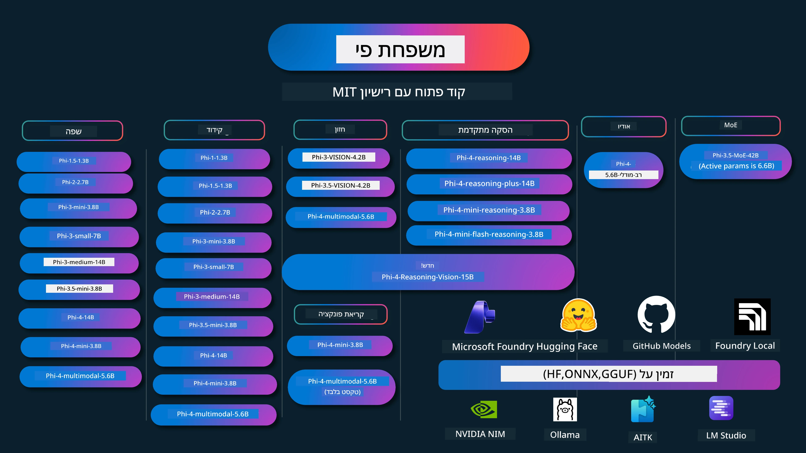

# ספר המתכונים של Phi: דוגמאות מעשיות עם דגמי Phi של מיקרוסופט

[](https://codespaces.new/microsoft/phicookbook)
[](https://vscode.dev/redirect?url=vscode://ms-vscode-remote.remote-containers/cloneInVolume?url=https://github.com/microsoft/phicookbook)

[](https://GitHub.com/microsoft/phicookbook/graphs/contributors/?WT.mc_id=aiml-137032-kinfeylo)
[](https://GitHub.com/microsoft/phicookbook/issues/?WT.mc_id=aiml-137032-kinfeylo)
[](https://GitHub.com/microsoft/phicookbook/pulls/?WT.mc_id=aiml-137032-kinfeylo)
[](http://makeapullrequest.com?WT.mc_id=aiml-137032-kinfeylo)

[](https://GitHub.com/microsoft/phicookbook/watchers/?WT.mc_id=aiml-137032-kinfeylo)
[](https://GitHub.com/microsoft/phicookbook/network/?WT.mc_id=aiml-137032-kinfeylo)
[](https://GitHub.com/microsoft/phicookbook/stargazers/?WT.mc_id=aiml-137032-kinfeylo)

[](https://discord.com/invite/ByRwuEEgH4)

Phi היא סדרת דגמי בינה מלאכותית בקוד פתוח שפותחה על ידי מיקרוסופט.

Phi כיום הוא הדגם הקטן השפתי (SLM) החזק והמשתלם ביותר מבחינת עלות, עם מדדים טובים מאוד בשפות מרובות, הסקה, יצירת טקסט/שיחה, קידוד, תמונות, אודיו ותסריטים אחרים.

ניתן לפרוס את Phi בענן או במכשירי edge, וניתן לבנות בקלות יישומי בינה מלאכותית יצירתית עם כוח חישוב מוגבל.

פעל לפי הצעדים הבאים כדי להתחיל להשתמש במשאבים הללו:
1. **עשו Fork למאגר**: לחצו על [](https://GitHub.com/microsoft/phicookbook/network/?WT.mc_id=aiml-137032-kinfeylo)
2. **שכפלו את המאגר**: `git clone https://github.com/microsoft/PhiCookBook.git`
3. [**הצטרפו לקהילת Discord של Microsoft AI ומפגש עם מומחים ומפתחים אחרים**](https://discord.com/invite/ByRwuEEgH4?WT.mc_id=aiml-137032-kinfeylo)



### 🌐 תמיכה ברב-לשוניות

#### תרגומים מתוחזקים עם [Co-op Translator](https://github.com/Azure/co-op-translator)

<!-- CO-OP TRANSLATOR LANGUAGES TABLE START -->
[ערבית](../ar/README.md) | [בנגלית](../bn/README.md) | [בולגרית](../bg/README.md) | [בורמית (מיאנמר)](../my/README.md) | [סינית (מפושטת)](../zh-CN/README.md) | [סינית (מסורתית, הונג קונג)](../zh-HK/README.md) | [סינית (מסורתית, מקאו)](../zh-MO/README.md) | [סינית (מסורתית, טייוואן)](../zh-TW/README.md) | [קרואטית](../hr/README.md) | [צ'כית](../cs/README.md) | [דנית](../da/README.md) | [הולנדית](../nl/README.md) | [אסטונית](../et/README.md) | [פינית](../fi/README.md) | [צרפתית](../fr/README.md) | [גרמנית](../de/README.md) | [יוונית](../el/README.md) | [עברית](./README.md) | [הינדי](../hi/README.md) | [הונגרית](../hu/README.md) | [אינדונזית](../id/README.md) | [איטלקית](../it/README.md) | [יפנית](../ja/README.md) | [קנאדה](../kn/README.md) | [חמר](../km/README.md) | [קוריאנית](../ko/README.md) | [ליטאית](../lt/README.md) | [מלאית](../ms/README.md) | [מלאיאלאם](../ml/README.md) | [מראטי](../mr/README.md) | [נפאלית](../ne/README.md) | [פיקצת'ינית ניגרית](../pcm/README.md) | [נורווגית](../no/README.md) | [פרסית (פארסי)](../fa/README.md) | [פולנית](../pl/README.md) | [פורטוגזית (ברזיל)](../pt-BR/README.md) | [פורטוגזית (פורטוגל)](../pt-PT/README.md) | [פונג'אבית (גורמוכי)](../pa/README.md) | [רומנית](../ro/README.md) | [רוסית](../ru/README.md) | [סרבית (קירילית)](../sr/README.md) | [סלובקית](../sk/README.md) | [סלובנית](../sl/README.md) | [ספרדית](../es/README.md) | [סווהילי](../sw/README.md) | [שוודית](../sv/README.md) | [טגרוג (פיליפינית)](../tl/README.md) | [טמילית](../ta/README.md) | [טלוגו](../te/README.md) | [תאית](../th/README.md) | [טורקית](../tr/README.md) | [אוקראינית](../uk/README.md) | [אורדו](../ur/README.md) | [וייטנאמית](../vi/README.md)

> **מעדיפים לשכפל מקומית?**
>
> מאגר זה כולל מעל 50 תרגומים בשפות, מה שמעלה משמעותית את גודל ההורדה. כדי לשכפל ללא תרגומים, השתמשו ב-sparse checkout:
>
> **באש / macOS / לינוקס:**
> ```bash
> git clone --filter=blob:none --sparse https://github.com/microsoft/PhiCookBook.git
> cd PhiCookBook
> git sparse-checkout set --no-cone '/*' '!translations' '!translated_images'
> ```
>
> **CMD (חלונות):**
> ```cmd
> git clone --filter=blob:none --sparse https://github.com/microsoft/PhiCookBook.git
> cd PhiCookBook
> git sparse-checkout set --no-cone "/*" "!translations" "!translated_images"
> ```
>
> זה נותן לכם את כל מה שצריך כדי להשלים את הקורס עם הורדה מהירה יותר בהרבה.
<!-- CO-OP TRANSLATOR LANGUAGES TABLE END -->

## תוכן העניינים

- מבוא
  - [ברוכים הבאים למשפחת Phi](./md/01.Introduction/01/01.PhiFamily.md)
  - [הגדרת הסביבה שלך](./md/01.Introduction/01/01.EnvironmentSetup.md)
  - [הבנת טכנולוגיות מפתח](./md/01.Introduction/01/01.Understandingtech.md)
  - [בטיחות בינה מלאכותית לדגמי Phi](./md/01.Introduction/01/01.AISafety.md)
  - [תמיכה בחומרת Phi](./md/01.Introduction/01/01.Hardwaresupport.md)
  - [דגמי Phi וזמינות בפלטפורמות שונות](./md/01.Introduction/01/01.Edgeandcloud.md)
  - [שימוש ב-Guidance-ai ו-Phi](./md/01.Introduction/01/01.Guidance.md)
  - [דגמים בשוק GitHub](https://github.com/marketplace/models)
  - [קטלוג דגמי Azure AI](https://ai.azure.com)

- הפעלת Phi בסביבות שונות
    -  [Hugging Face](./md/01.Introduction/02/01.HF.md)
    -  [דגמי GitHub](./md/01.Introduction/02/02.GitHubModel.md)
    -  [קטלוג דגמי Microsoft Foundry](./md/01.Introduction/02/03.AzureAIFoundry.md)
    -  [Ollama](./md/01.Introduction/02/04.Ollama.md)
    -  [AI Toolkit VSCode (AITK)](./md/01.Introduction/02/05.AITK.md)
    -  [NVIDIA NIM](./md/01.Introduction/02/06.NVIDIA.md)
    -  [Foundry Local](./md/01.Introduction/02/07.FoundryLocal.md)

- משפחת הפעלת Phi
    - [הפעלת Phi ב-iOS](./md/01.Introduction/03/iOS_Inference.md)
    - [הפעלת Phi ב-Android](./md/01.Introduction/03/Android_Inference.md)
    - [הפעלת Phi ב-Jetson](./md/01.Introduction/03/Jetson_Inference.md)
    - [הפעלת Phi ב-AI PC](./md/01.Introduction/03/AIPC_Inference.md)
    - [הפעלת Phi עם Apple MLX Framework](./md/01.Introduction/03/MLX_Inference.md)
    - [הפעלת Phi בשרת מקומי](./md/01.Introduction/03/Local_Server_Inference.md)
    - [הפעלת Phi בשרת מרוחק עם AI Toolkit](./md/01.Introduction/03/Remote_Interence.md)
    - [הפעלת Phi עם Rust](./md/01.Introduction/03/Rust_Inference.md)
    - [הפעלת Phi--חזון במקומי](./md/01.Introduction/03/Vision_Inference.md)
    - [הפעלת Phi עם Kaito AKS, Azure Containers (תמיכה רשמית)](./md/01.Introduction/03/Kaito_Inference.md)
-  [כימות משפחת Phi](./md/01.Introduction/04/QuantifyingPhi.md)
    - [כימות Phi-3.5 / 4 באמצעות llama.cpp](./md/01.Introduction/04/UsingLlamacppQuantifyingPhi.md)
    - [כימות Phi-3.5 / 4 באמצעות הרחבות בינה מלאכותית יצירתית ל-onnxruntime](./md/01.Introduction/04/UsingORTGenAIQuantifyingPhi.md)
    - [כימות Phi-3.5 / 4 באמצעות Intel OpenVINO](./md/01.Introduction/04/UsingIntelOpenVINOQuantifyingPhi.md)
    - [כימות Phi-3.5 / 4 באמצעות Apple MLX Framework](./md/01.Introduction/04/UsingAppleMLXQuantifyingPhi.md)

-  הערכת Phi
    - [Response AI](./md/01.Introduction/05/ResponsibleAI.md)
    - [Microsoft Foundry להערכה](./md/01.Introduction/05/AIFoundry.md)
    - [שימוש ב-Promptflow להערכה](./md/01.Introduction/05/Promptflow.md)
 
- RAG עם Azure AI Search
    - [כיצד להשתמש ב-Phi-4-mini ו-Phi-4-multimodal (RAG) עם Azure AI Search](https://github.com/microsoft/PhiCookBook/blob/main/code/06.E2E/E2E_Phi-4-RAG-Azure-AI-Search.ipynb)
    - [RAG היברידי מקומי ללא ענן עם SQLite FTS5 ו-phi-4-mini](https://github.com/microsoft/PhiCookBook/blob/main/code/06.E2E/E2E_Phi-4-mini_Local_Hybrid_RAG_SQLite_FTS5.ipynb)

- דוגמאות לפיתוח יישומי Phi
  - יישומי טקסט ושיחה
    - דוגמאות Phi-4
      - [📓] [שיחה עם דגם Phi-4-mini ONNX](./md/02.Application/01.TextAndChat/Phi4/ChatWithPhi4ONNX/README.md)
      - [שיחה עם דגם מקומי Phi-4 ONNX ב-.NET](../../md/04.HOL/dotnet/src/LabsPhi4-Chat-01OnnxRuntime)
      - [אפליקציית שיחה ב-.NET Console עם Phi-4 ONNX באמצעות Semantic Kernel](../../md/04.HOL/dotnet/src/LabsPhi4-Chat-02SK)
    - דוגמאות Phi-3 / 3.5
      - [צ'אטבוט מקומי בדפדפן באמצעות Phi3, ONNX Runtime Web ו-WebGPU](https://github.com/microsoft/onnxruntime-inference-examples/tree/main/js/chat)
      - [OpenVino Chat](./md/02.Application/01.TextAndChat/Phi3/E2E_OpenVino_Chat.md)
      - [דגם רב לחברתי - Phi-3-mini אינטראקטיבי ו-OpenAI Whisper](./md/02.Application/01.TextAndChat/Phi3/E2E_Phi-3-mini_with_whisper.md)
      - [MLFlow - בניית עטיפה ושימוש ב-Phi-3 עם MLFlow](./md//02.Application/01.TextAndChat/Phi3/E2E_Phi-3-MLflow.md)
      - [אופטימיזציית דגם - כיצד לאופטימיזציית דגם Phi-3-mini עבור ONNX Runtime Web עם Olive](https://github.com/microsoft/Olive/tree/main/examples/phi3)
      - [אפליקציית WinUI3 עם Phi-3 mini-4k-instruct-onnx](https://github.com/microsoft/Phi3-Chat-WinUI3-Sample/)
      -[דוגמא לאפליקציית WinUI3 Multi Model AI Powered Notes](https://github.com/microsoft/ai-powered-notes-winui3-sample)
      - [כיוונון ושילוב דגמי Phi-3 מותאמים עם Prompt flow](./md/02.Application/01.TextAndChat/Phi3/E2E_Phi-3-FineTuning_PromptFlow_Integration.md)
      - [כיוונון ושילוב דגמי Phi-3 מותאמים עם Prompt flow ב-Microsoft Foundry](./md/02.Application/01.TextAndChat/Phi3/E2E_Phi-3-FineTuning_PromptFlow_Integration_AIFoundry.md)
      - [הערכת דגם Phi-3 / Phi-3.5 מכוונן ב-Microsoft Foundry תוך התמקדות בעקרונות הבינה המלאכותית האחראית של מיקרוסופט](./md/02.Application/01.TextAndChat/Phi3/E2E_Phi-3-Evaluation_AIFoundry.md)
      - [📓] [דוגמת שפת תחזית של Phi-3.5-mini-instruct (סינית/אנגלית)](./md/02.Application/01.TextAndChat/Phi3/phi3-instruct-demo.ipynb)
      - [צ'אטבוט RAG WebGPU של Phi-3.5-Instruct](./md/02.Application/01.TextAndChat/Phi3/WebGPUWithPhi35Readme.md)
      - [שימוש ב-GPU של Windows ליצירת פתרון Prompt flow עם Phi-3.5-Instruct ONNX](./md/02.Application/01.TextAndChat/Phi3/UsingPromptFlowWithONNX.md)
      - [שימוש ב-Microsoft Phi-3.5 tflite ליצירת אפליקציית Android](./md/02.Application/01.TextAndChat/Phi3/UsingPhi35TFLiteCreateAndroidApp.md)
      - [דוגמת שאלות ותשובות ב-.NET עם דגם Phi-3 ONNX מקומי באמצעות Microsoft.ML.OnnxRuntime](../../md/04.HOL/dotnet/src/LabsPhi301)
      - [אפליקציית שיחה בקונסול .NET עם Semantic Kernel ו-Phi-3](../../md/04.HOL/dotnet/src/LabsPhi302)

  - דוגמאות קוד מבוססות SDK של Azure AI Inference
    - דוגמאות Phi-4
      - [📓] [יצירת קוד פרויקט באמצעות Phi-4-multimodal](./md/02.Application/02.Code/Phi4/GenProjectCode/README.md)
    - דוגמאות Phi-3 / 3.5
      - [בנה את Visual Studio Code GitHub Copilot Chat האישי שלך עם משפחת Microsoft Phi-3](./md/02.Application/02.Code/Phi3/VSCodeExt/README.md)
      - [צור סוכן שיחה של Visual Studio Code Chat Copilot עם Phi-3.5 בעזרת דגמי GitHub](/md/02.Application/02.Code/Phi3/CreateVSCodeChatAgentWithGitHubModels.md)

  - דוגמאות הסקה מתקדמות
    - דגימות Phi-4
      - [📓] [דוגמאות ל-Phi-4-mini-reasoning או Phi-4-reasoning](./md/02.Application/03.AdvancedReasoning/Phi4/AdvancedResoningPhi4mini/README.md)
      - [📓] [כיול עדין של Phi-4-mini-reasoning עם Microsoft Olive](./md/02.Application/03.AdvancedReasoning/Phi4/AdvancedResoningPhi4mini/olive_ft_phi_4_reasoning_with_medicaldata.ipynb)
      - [📓] [כיול עדין של Phi-4-mini-reasoning עם Apple MLX](./md/02.Application/03.AdvancedReasoning/Phi4/AdvancedResoningPhi4mini/mlx_ft_phi_4_reasoning_with_medicaldata.ipynb)
      - [📓] [Phi-4-mini-reasoning עם דגמי GitHub](./md/02.Application/02.Code/Phi4r/github_models_inference.ipynb)
      - [📓] [Phi-4-mini-reasoning עם דגמי Microsoft Foundry](./md/02.Application/02.Code/Phi4r/azure_models_inference.ipynb)
  - הדגמות
      - [הדגמות Phi-4-mini באירוח ב-Hugging Face Spaces](https://huggingface.co/spaces/microsoft/phi-4-mini?WT.mc_id=aiml-137032-kinfeylo)
      - [הדגמות Phi-4-multimodal באירוח ב-Hugginge Face Spaces](https://huggingface.co/spaces/microsoft/phi-4-multimodal?WT.mc_id=aiml-137032-kinfeylo)
  - דוגמאות בראייה ממוחשבת
    - דוגמאות Phi-4 
      - [📓] [שימוש ב-Phi-4-multimodal לקריאת תמונות ויצירת קוד](./md/02.Application/04.Vision/Phi4/CreateFrontend/README.md) 
    - דוגמאות Phi-3 / 3.5
      -  [📓][Phi-3-vision-Image טקסט לטקסט](./md/02.Application/04.Vision/Phi3/E2E_Phi-3-vision-image-text-to-text-online-endpoint.ipynb)
      - [Phi-3-vision-ONNX](https://onnxruntime.ai/docs/genai/tutorials/phi3-v.html)
      - [📓][Phi-3-vision CLIP Embedding](./md/02.Application/04.Vision/Phi3/E2E_Phi-3-vision-image-text-to-text-online-endpoint.ipynb)
      - [הדגמה: מיחזור Phi-3](https://github.com/jennifermarsman/PhiRecycling/)
      - [Phi-3-vision - עוזר שפה חזותית - עם Phi3-Vision ו-OpenVINO](https://docs.openvino.ai/nightly/notebooks/phi-3-vision-with-output.html)
      - [Phi-3 Vision Nvidia NIM](./md/02.Application/04.Vision/Phi3/E2E_Nvidia_NIM_Vision.md)
      - [Phi-3 Vision OpenVino](./md/02.Application/04.Vision/Phi3/E2E_OpenVino_Phi3Vision.md)
      - [📓][דוגמה מרובת פריימים או מרובת תמונות של Phi-3.5 Vision](./md/02.Application/04.Vision/Phi3/phi3-vision-demo.ipynb)
      - [מודל ONNX מקומי של Phi-3 Vision באמצעות Microsoft.ML.OnnxRuntime .NET](../../md/04.HOL/dotnet/src/LabsPhi303)
      - [תפריט מבוסס עבור מודל ONNX מקומי של Phi-3 Vision באמצעות Microsoft.ML.OnnxRuntime .NET](../../md/04.HOL/dotnet/src/LabsPhi304)

  - דוגמאות Reasoning-Vision
    - Phi-4-Reasoning-Vision-15B 
      - [📓] [שימוש ב-Phi-4-Reasoning-Vision-15B לזיהוי הליכה במקום לא חוקי](./md/02.Application/10.ReasoningVision/Phi_4_reasoning_vision_15b_Jaywalking.ipynb)
      - [📓] [שימוש ב-Phi-4-Reasoning-Vision-15B למתמטיקה](./md/02.Application/10.ReasoningVision/Phi_4_reasoning_vision_15b_Math.ipynb)
      - [📓] [שימוש ב-Phi-4-Reasoning-Vision-15B לזיהוי ממשק משתמש](./md/02.Application/10.ReasoningVision/Phi_4_reasoning_vision_15b_ui.ipynb)

  - דוגמאות מתמטיקה
    -  דוגמאות Phi-4-Mini-Flash-Reasoning-Instruct  [הדגמת מתמטיקה עם Phi-4-Mini-Flash-Reasoning-Instruct](./md/02.Application/09.Math/MathDemo.ipynb)

  - דוגמאות שמע
    - דוגמאות Phi-4 
      - [📓] [חילוץ תמלולים של שמע באמצעות Phi-4-multimodal](./md/02.Application/05.Audio/Phi4/Transciption/README.md)
      - [📓] [דגימת שמע של Phi-4-multimodal](./md/02.Application/05.Audio/Phi4/Siri/demo.ipynb)
      - [📓] [דגימת תרגום דיבור של Phi-4-multimodal](./md/02.Application/05.Audio/Phi4/Translate/demo.ipynb)
      - [יישום קונסולה .NET המשתמש ב-Phi-4-multimodal שמע לניתוח קובץ שמע ויצירת תמלול](../../md/04.HOL/dotnet/src/LabsPhi4-MultiModal-02Audio)

  - דוגמאות MOE
    - דוגמאות Phi-3 / 3.5
      - [📓] [דוגמה של Phi-3.5 Mixture of Experts Models (MoEs) ברשתות חברתיות](./md/02.Application/06.MoE/Phi3/phi3_moe_demo.ipynb)
      - [📓] [בנייה של קו צינור Retrieval-Augmented Generation (RAG) עם NVIDIA NIM Phi-3 MOE, Azure AI Search ו-LlamaIndex](./md/02.Application/06.MoE/Phi3/azure-ai-search-nvidia-rag.ipynb)
      - 
  - דוגמאות קריאת פונקציות
    - דוגמאות Phi-4 🆕
      -  [📓] [שימוש בקריאת פונקציה עם Phi-4-mini](./md/02.Application/07.FunctionCalling/Phi4/FunctionCallingBasic/README.md)
      -  [📓] [שימוש בקריאת פונקציה ליצירת סוכנים מרובים עם Phi-4-mini](./md/02.Application/07.FunctionCalling/Phi4/Multiagents/Phi_4_mini_multiagent.ipynb)
      -  [📓] [שימוש בקריאת פונקציה עם Ollama](./md/02.Application/07.FunctionCalling/Phi4/Ollama/ollama_functioncalling.ipynb)
      -  [📓] [שימוש בקריאת פונקציה עם ONNX](./md/02.Application/07.FunctionCalling/Phi4/ONNX/onnx_parallel_functioncalling.ipynb)
  - דוגמאות מיקס מולטימודלי
    - דוגמאות Phi-4 🆕
      -  [📓] [שימוש ב-Phi-4-multimodal כעיתונאי טכנולוגיה](./md/02.Application/08.Multimodel/Phi4/TechJournalist/phi_4_mm_audio_text_publish_news.ipynb)
      - [יישום קונסולה .NET המשתמש ב-Phi-4-multimodal לניתוח תמונות](../../md/04.HOL/dotnet/src/LabsPhi4-MultiModal-01Images)

- כיול עדין של דגמי Phi
  - [תסריטי כיול עדין](./md/03.FineTuning/FineTuning_Scenarios.md)
  - [כיול עדין מול RAG](./md/03.FineTuning/FineTuning_vs_RAG.md)
  - [כיול עדין: הפוך את Phi-3 למומחה תעשייתי](./md/03.FineTuning/LetPhi3gotoIndustriy.md)
  - [כיול עדין של Phi-3 עם ערכת AI ל-VS Code](./md/03.FineTuning/Finetuning_VSCodeaitoolkit.md)
  - [כיול עדין של Phi-3 עם Azure Machine Learning Service](./md/03.FineTuning/Introduce_AzureML.md)
  - [כיול עדין של Phi-3 עם Lora](./md/03.FineTuning/FineTuning_Lora.md)
  - [כיול עדין של Phi-3 עם QLora](./md/03.FineTuning/FineTuning_Qlora.md)
  - [כיול עדין של Phi-3 עם Microsoft Foundry](./md/03.FineTuning/FineTuning_AIFoundry.md)
  - [כיול עדין של Phi-3 עם Azure ML CLI/SDK](./md/03.FineTuning/FineTuning_MLSDK.md)
  - [כיול עדין עם Microsoft Olive](./md/03.FineTuning/FineTuning_MicrosoftOlive.md)
  - [מעבדה מעשית של כיול עדין עם Microsoft Olive](./md/03.FineTuning/olive-lab/readme.md)
  - [כיול עדין של Phi-3-vision עם Weights and Bias](./md/03.FineTuning/FineTuning_Phi-3-visionWandB.md)
  - [כיול עדין של Phi-3 עם Apple MLX Framework](./md/03.FineTuning/FineTuning_MLX.md)
  - [כיול עדין של Phi-3-vision (תמיכה רשמית)](./md/03.FineTuning/FineTuning_Vision.md)
  - [כיול עדין של Phi-3 עם Kaito AKS, מכולות Azure (תמיכה רשמית)](./md/03.FineTuning/FineTuning_Kaito.md)
  - [כיול עדין של Phi-3 ו-3.5 Vision](https://github.com/2U1/Phi3-Vision-Finetune)

- מעבדה מעשית
  - [חקירת דגמים מתקדמים: LLMs, SLMs, פיתוח מקומי ועוד](https://github.com/microsoft/aitour-exploring-cutting-edge-models)
  - [שחרור הפוטנציאל של NLP: כיול עדין עם Microsoft Olive](https://github.com/azure/Ignite_FineTuning_workshop)

- מאמרים ופרסומים מחקריים
  - [ספרי לימוד הם כל מה שצריך II: דוח טכני phi-1.5](https://arxiv.org/abs/2309.05463)
  - [דוח טכני Phi-3: מודל שפה חזק מאוד במכשיר הנייד שלכם](https://arxiv.org/abs/2404.14219)
  - [דוח טכני Phi-4](https://arxiv.org/abs/2412.08905)
  - [דוח טכני Phi-4-Mini: דגמי שפה מולטימודל קומפקטיים אך רבי עוצמה באמצעות תערובת של LoRA](https://arxiv.org/abs/2503.01743)
  - [אופטימיזציה של דגמי שפה קטנים לקריאת פונקציות ברכבים](https://arxiv.org/abs/2501.02342)
  - [(WhyPHI) כיול עדין של PHI-3 למענה על שאלות בחירה מרובה: שיטה, תוצאות ואתגרים](https://arxiv.org/abs/2501.01588)
  - [דוח טכני Phi-4-reasoning](https://www.microsoft.com/en-us/research/wp-content/uploads/2025/04/phi_4_reasoning.pdf)
  - [דוח טכני Phi-4-mini-reasoning](https://huggingface.co/microsoft/Phi-4-mini-reasoning/blob/main/Phi-4-Mini-Reasoning.pdf)

## שימוש בדגמי Phi

### Phi על Microsoft Foundry

תוכלו ללמוד כיצד להשתמש ב-Microsoft Phi וכיצד לבנות פתרונות מקצה לקצה במכשירים החומרה השונים שלכם. כדי לחוות את Phi בעצמכם, התחילו לשחק עם הדגמים ולהתאים את Phi לתסריטים שלכם באמצעות [קטלוג דגמי Azure AI של Microsoft Foundry](https://aka.ms/phi3-azure-ai) ניתן ללמוד עוד ב-Start Getting עם [Microsoft Foundry](/md/02.QuickStart/AzureAIFoundry_QuickStart.md)

**מרחב משחק**
לכל דגם יש מרחב משחק ייעודי לבחינת הדגם [Azure AI Playground](https://aka.ms/try-phi3).

### Phi על דגמי GitHub

תוכלו ללמוד כיצד להשתמש ב-Microsoft Phi וכיצד לבנות פתרונות מקצה לקצה במכשירים החומרה השונים שלכם. כדי לחוות את Phi בעצמכם, התחילו לשחק עם הדגם ולהתאים את Phi לתסריטים שלכם באמצעות [קטלוג דגמי GitHub](https://github.com/marketplace/models?WT.mc_id=aiml-137032-kinfeylo) ניתן ללמוד עוד ב-Start Getting עם [קטלוג דגמי GitHub](/md/02.QuickStart/GitHubModel_QuickStart.md)

**מרחב משחק**
לכל דגם יש [מרחב משחק ייעודי לבחינת הדגם](/md/02.QuickStart/GitHubModel_QuickStart.md).

### Phi ב-Hugging Face

תוכלו גם למצוא את הדגם ב-[Hugging Face](https://huggingface.co/microsoft)

**מרחב משחק**
 [מרחב המשחק Hugging Chat](https://huggingface.co/chat/models/microsoft/Phi-3-mini-4k-instruct)

 ## 🎒 קורסים נוספים

הצוות שלנו מייצר קורסים נוספים! בדקו:

<!-- CO-OP TRANSLATOR OTHER COURSES START -->
### LangChain
[](https://aka.ms/langchain4j-for-beginners)
[](https://aka.ms/langchainjs-for-beginners?WT.mc_id=m365-94501-dwahlin)
[](https://github.com/microsoft/langchain-for-beginners?WT.mc_id=m365-94501-dwahlin)
---

### Azure / Edge / MCP / סוכנים
[](https://github.com/microsoft/AZD-for-beginners?WT.mc_id=academic-105485-koreyst)
[](https://github.com/microsoft/edgeai-for-beginners?WT.mc_id=academic-105485-koreyst)
[](https://github.com/microsoft/mcp-for-beginners?WT.mc_id=academic-105485-koreyst)
[](https://github.com/microsoft/ai-agents-for-beginners?WT.mc_id=academic-105485-koreyst)

---
 
### סדרת AI גנרטיבי
[](https://github.com/microsoft/generative-ai-for-beginners?WT.mc_id=academic-105485-koreyst)
[-9333EA?style=for-the-badge&labelColor=E5E7EB&color=9333EA)](https://github.com/microsoft/Generative-AI-for-beginners-dotnet?WT.mc_id=academic-105485-koreyst)
[-C084FC?style=for-the-badge&labelColor=E5E7EB&color=C084FC)](https://github.com/microsoft/generative-ai-for-beginners-java?WT.mc_id=academic-105485-koreyst)
[-E879F9?style=for-the-badge&labelColor=E5E7EB&color=E879F9)](https://github.com/microsoft/generative-ai-with-javascript?WT.mc_id=academic-105485-koreyst)

---
 
### למידה בסיסית
[](https://aka.ms/ml-beginners?WT.mc_id=academic-105485-koreyst)
[](https://aka.ms/datascience-beginners?WT.mc_id=academic-105485-koreyst)
[](https://aka.ms/ai-beginners?WT.mc_id=academic-105485-koreyst)
[](https://github.com/microsoft/Security-101?WT.mc_id=academic-96948-sayoung)
[](https://aka.ms/webdev-beginners?WT.mc_id=academic-105485-koreyst)
[](https://aka.ms/iot-beginners?WT.mc_id=academic-105485-koreyst)
[](https://github.com/microsoft/xr-development-for-beginners?WT.mc_id=academic-105485-koreyst)

---
 
### סדרת Copilot
[](https://aka.ms/GitHubCopilotAI?WT.mc_id=academic-105485-koreyst)
[](https://github.com/microsoft/mastering-github-copilot-for-dotnet-csharp-developers?WT.mc_id=academic-105485-koreyst)
[](https://github.com/microsoft/CopilotAdventures?WT.mc_id=academic-105485-koreyst)
<!-- CO-OP TRANSLATOR OTHER COURSES END -->

## AI אחראי 

מייקרוסופט מחויבת לסייע ללקוחותינו להשתמש במוצרי ה-AI שלנו בצורה אחראית, לשתף את הנלמד, ולבנות שותפויות מבוססות אמון באמצעות כלים כמו מדדי שקיפות והערכות השפעה. משאבים רבים אלה נמצאים ב-[https://aka.ms/RAI](https://aka.ms/RAI).
הגישה של מייקרוסופט ל-AI אחראי מבוססת על עקרונות ה-AI שלנו של הגינות, אמינות ובטיחות, פרטיות ואבטחה, הכללה, שקיפות ואחריות.

דגמים גדולים של שפה טבעית, תמונה ודיבור - כמו אלו שבדוגמה זו - עלולים להתנהג בדרכים שאינן הוגנות, לא אמינות, או פוגעניות, ועל כן לגרום לנזקים. אנא קראו את [הערת שקיפות של שירות Azure OpenAI](https://learn.microsoft.com/legal/cognitive-services/openai/transparency-note?tabs=text) כדי להתעדכן בסיכונים ומגבלות.

הגישה המומלצת למזער סיכונים אלה היא לכלול מערכת בטיחות במבנה שלך שיכולה לזהות ולמנוע התנהגות מזיקה. [Azure AI Content Safety](https://learn.microsoft.com/azure/ai-services/content-safety/overview) מספק שכבת הגנה עצמאית, היכולה לזהות תוכן מזיק שנוצר על ידי משתמשים או על ידי בינה מלאכותית באפליקציות ושירותים. Azure AI Content Safety כוללת ממשקי API לטקסט ותמונה שמאפשרים לך לזהות חומר מזיק. בתוך Microsoft Foundry, שירות Content Safety מאפשר לך לצפות, לחקור ולנסות דוגמאות קוד לזיהוי תוכן מזיק במגוון מודאליות. [התיעוד המהיר הבא](https://learn.microsoft.com/azure/ai-services/content-safety/quickstart-text?tabs=visual-studio%2Clinux&pivots=programming-language-rest) מדריך אותך ביצירת בקשות לשירות.

אספקט נוסף שצריך לקחת בחשבון הוא הביצועים הכוללים של האפליקציה. עם אפליקציות רב-מודאליות ורב-מודליות, אנו מחשיבים ביצועים בכך שהמערכת פועלת כפי שאתה והמשתמשים שלך מצפים, כולל אי-יצירת פלטים מזיקים. חשוב להעריך את ביצועי האפליקציה הכוללת שלך באמצעות [כלי הערכה לביצועים, איכות, סיכון ובטיחות](https://learn.microsoft.com/azure/ai-studio/concepts/evaluation-metrics-built-in). יש לך גם אפשרות ליצור ולהעריך עם [כלי הערכה מותאמים אישית](https://learn.microsoft.com/azure/ai-studio/how-to/develop/evaluate-sdk#custom-evaluators).

ניתן להעריך את אפליקציית ה-AI שלך בסביבת הפיתוח שלך באמצעות [ערכת הפיתוח Azure AI Evaluation SDK](https://microsoft.github.io/promptflow/index.html). כאשר ניתנים מערכי נתונים לבחינה או מטרה, הדורות של אפליקציית ה-AI הגנרטיבית שלך נמדדים כמותית עם כלי הערכה מובנים או כלי הערכה מותאמים אישית לפי בחירתך. כדי להתחיל להשתמש ב-azure ai evaluation sdk להערכת המערכת שלך, תוכל לעקוב אחר [מדריך ההתחלה המהירה](https://learn.microsoft.com/azure/ai-studio/how-to/develop/flow-evaluate-sdk). לאחר שתבצע ריצת הערכה, תוכל [להציג את התוצאות ב-Microsoft Foundry](https://learn.microsoft.com/azure/ai-studio/how-to/evaluate-flow-results).

## סימני מסחר

ייתכן שהפרויקט כולל סימני מסחר או לוגואים לפרויקטים, מוצרים או שירותים. שימוש מורשה בסימני מסחר או לוגואים של מיקרוסופט כפוף וצריך לעמוד ב-[הנחיות הסימנים המסחריים והמותג של Microsoft](https://www.microsoft.com/legal/intellectualproperty/trademarks/usage/general).
שימוש בסימני מסחר או לוגואים של Microsoft בגרסאות שעברו שינוי של פרויקט זה לא יגרום לבלבול ולא ישדר תמיכה של Microsoft. כל שימוש בסימני מסחר או לוגואים של צדדים שלישיים כפוף למדיניות של אותם צדדים שלישיים.

## קבלת עזרה

אם נתקעת או יש לך שאלות לגבי בניית אפליקציות AI, הצטרף ל:

[](https://aka.ms/foundry/discord)

אם יש לך משוב על המוצר או שגיאות בזמן הבנייה בקר באתר הבא:

[](https://aka.ms/foundry/forum)

---

<!-- CO-OP TRANSLATOR DISCLAIMER START -->
**כתב ויתור**:
מסמך זה תורגם באמצעות שירות תרגום אוטומטי [Co-op Translator](https://github.com/Azure/co-op-translator). למרות שאנו שואפים לדיוק, יש לקחת בחשבון שתרגומים אוטומטיים עלולים להכיל שגיאות או אי-דיוקים. יש להחשיב את המסמך המקורי בשפתו הטבעית כמקור הסמכות. למידע קריטי מומלץ להשתמש בתרגום מקצועי על ידי מתרגם אדם. אנו לא אחראים לכל אי-הבנה או פירוש שגוי הנובע מהשימוש בתרגום זה.
<!-- CO-OP TRANSLATOR DISCLAIMER END -->