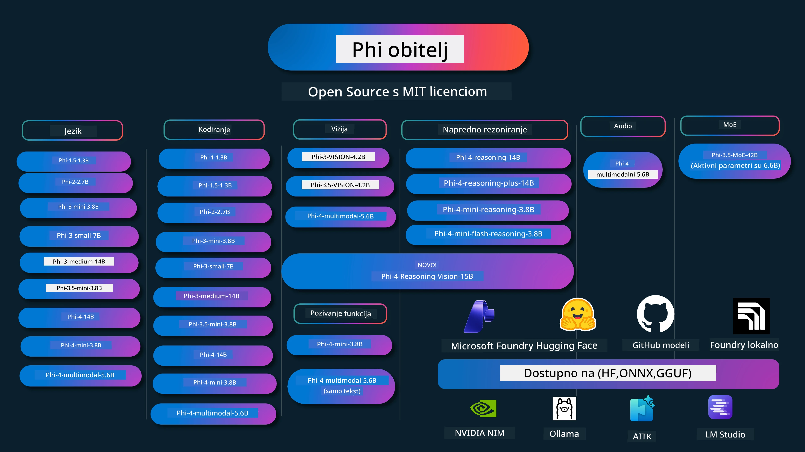

# Phi Kuharica: Praktični Primjeri s Microsoftovim Phi Modelima

[](https://codespaces.new/microsoft/phicookbook)
[](https://vscode.dev/redirect?url=vscode://ms-vscode-remote.remote-containers/cloneInVolume?url=https://github.com/microsoft/phicookbook)

[](https://GitHub.com/microsoft/phicookbook/graphs/contributors/?WT.mc_id=aiml-137032-kinfeylo)
[](https://GitHub.com/microsoft/phicookbook/issues/?WT.mc_id=aiml-137032-kinfeylo)
[](https://GitHub.com/microsoft/phicookbook/pulls/?WT.mc_id=aiml-137032-kinfeylo)
[](http://makeapullrequest.com?WT.mc_id=aiml-137032-kinfeylo)

[](https://GitHub.com/microsoft/phicookbook/watchers/?WT.mc_id=aiml-137032-kinfeylo)
[](https://GitHub.com/microsoft/phicookbook/network/?WT.mc_id=aiml-137032-kinfeylo)
[](https://GitHub.com/microsoft/phicookbook/stargazers/?WT.mc_id=aiml-137032-kinfeylo)

[](https://discord.com/invite/ByRwuEEgH4)

Phi je niz otvorenih AI modela koje je razvila tvrtka Microsoft.

Phi je trenutačno najsnažniji i najisplativiji mali jezični model (SLM), s vrlo dobrim rezultatima u mnogim jezicima, rezoniranju, generiranju teksta/razgovora, kodiranju, slikama, zvuku i drugim scenarijima.

Phi možete implementirati u oblaku ili na rubnim uređajima, a lako možete izgraditi generativne AI aplikacije s ograničenom računalnom snagom.

Slijedite ove korake za početak rada s ovim resursima:
1. **Napravite fork spremišta**: Kliknite [](https://GitHub.com/microsoft/phicookbook/network/?WT.mc_id=aiml-137032-kinfeylo)
2. **Klonirajte spremište**: `git clone https://github.com/microsoft/PhiCookBook.git`
3. [**Pridružite se Microsoft AI Discord zajednici i upoznajte stručnjake i druge programere**](https://discord.com/invite/ByRwuEEgH4?WT.mc_id=aiml-137032-kinfeylo)



### 🌐 Podrška za više jezika

#### Podržano putem GitHub Akcije (Automatski i uvijek ažurno)

<!-- CO-OP TRANSLATOR LANGUAGES TABLE START -->
[Arapski](../ar/README.md) | [Bengalski](../bn/README.md) | [Bugarski](../bg/README.md) | [Burmanski (Myanmar)](../my/README.md) | [Kineski (Pojednostavljeni)](../zh-CN/README.md) | [Kineski (Tradicionalni, Hong Kong)](../zh-HK/README.md) | [Kineski (Tradicionalni, Macau)](../zh-MO/README.md) | [Kineski (Tradicionalni, Tajvan)](../zh-TW/README.md) | [Hrvatski](./README.md) | [Češki](../cs/README.md) | [Danski](../da/README.md) | [Nizozemski](../nl/README.md) | [Estonski](../et/README.md) | [Finski](../fi/README.md) | [Francuski](../fr/README.md) | [Njemački](../de/README.md) | [Grčki](../el/README.md) | [Hebrejski](../he/README.md) | [Hindi](../hi/README.md) | [Mađarski](../hu/README.md) | [Indonezijski](../id/README.md) | [Talijanski](../it/README.md) | [Japanski](../ja/README.md) | [Kannada](../kn/README.md) | [Khmer](../km/README.md) | [Korejski](../ko/README.md) | [Litavski](../lt/README.md) | [Malajski](../ms/README.md) | [Malayalam](../ml/README.md) | [Manipuri (Meitei Mayek)](../mni/README.md) | [Marathi](../mr/README.md) | [Nepalski](../ne/README.md) | [Nigerijski Pidgin](../pcm/README.md) | [Norveški](../no/README.md) | [Perzijski (Farsi)](../fa/README.md) | [Poljski](../pl/README.md) | [Portugalski (Brazil)](../pt-BR/README.md) | [Portugalski (Portugal)](../pt-PT/README.md) | [Punjabi (Gurmukhi)](../pa/README.md) | [Rumunjski](../ro/README.md) | [Ruski](../ru/README.md) | [Srpski (ćirilica)](../sr/README.md) | [Slovački](../sk/README.md) | [Slovenski](../sl/README.md) | [Španjolski](../es/README.md) | [Svahili](../sw/README.md) | [Švedski](../sv/README.md) | [Tagalog (Filipinski)](../tl/README.md) | [Tamilski](../ta/README.md) | [Telugu](../te/README.md) | [Tajlandski](../th/README.md) | [Turski](../tr/README.md) | [Ukrajinski](../uk/README.md) | [Urdu](../ur/README.md) | [Vijetnamski](../vi/README.md)

> **Radije lokalno klonirati?**
>
> Ovo spremište uključuje preko 50 jezičnih prijevoda što znatno povećava veličinu preuzimanja. Za kloniranje bez prijevoda, koristite sparse checkout:
>
> **Bash / macOS / Linux:**
> ```bash
> git clone --filter=blob:none --sparse https://github.com/microsoft/PhiCookBook.git
> cd PhiCookBook
> git sparse-checkout set --no-cone '/*' '!translations' '!translated_images'
> ```
>
> **CMD (Windows):**
> ```cmd
> git clone --filter=blob:none --sparse https://github.com/microsoft/PhiCookBook.git
> cd PhiCookBook
> git sparse-checkout set --no-cone "/*" "!translations" "!translated_images"
> ```
>
> Ovo vam daje sve što vam treba za završetak tečaja uz znatno brže preuzimanje.
<!-- CO-OP TRANSLATOR LANGUAGES TABLE END -->

## Sadržaj

- Uvod
  - [Dobrodošli u Phi obitelj](./md/01.Introduction/01/01.PhiFamily.md)
  - [Postavljanje vašeg okruženja](./md/01.Introduction/01/01.EnvironmentSetup.md)
  - [Razumijevanje ključnih tehnologija](./md/01.Introduction/01/01.Understandingtech.md)
  - [Sigurnost umjetne inteligencije za Phi modele](./md/01.Introduction/01/01.AISafety.md)
  - [Hardverska podrška za Phi](./md/01.Introduction/01/01.Hardwaresupport.md)
  - [Phi modeli i dostupnost na platformama](./md/01.Introduction/01/01.Edgeandcloud.md)
  - [Korištenje Guidance-ai i Phi](./md/01.Introduction/01/01.Guidance.md)
  - [Modeli na GitHub Marketplaceu](https://github.com/marketplace/models)
  - [Azure AI katalog modela](https://ai.azure.com)

- Izvođenje Phi u različitim okruženjima
    -  [Hugging face](./md/01.Introduction/02/01.HF.md)
    -  [GitHub modeli](./md/01.Introduction/02/02.GitHubModel.md)
    -  [Microsoft Foundry katalog modela](./md/01.Introduction/02/03.AzureAIFoundry.md)
    -  [Ollama](./md/01.Introduction/02/04.Ollama.md)
    -  [AI Toolkit VSCode (AITK)](./md/01.Introduction/02/05.AITK.md)
    -  [NVIDIA NIM](./md/01.Introduction/02/06.NVIDIA.md)
    -  [Foundry lokalno](./md/01.Introduction/02/07.FoundryLocal.md)

- Izvođenje Phi obitelji
    - [Izvođenje Phi na iOS-u](./md/01.Introduction/03/iOS_Inference.md)
    - [Izvođenje Phi na Androidu](./md/01.Introduction/03/Android_Inference.md)
    - [Izvođenje Phi na Jetsonu](./md/01.Introduction/03/Jetson_Inference.md)
    - [Izvođenje Phi na AI PC-u](./md/01.Introduction/03/AIPC_Inference.md)
    - [Izvođenje Phi s Apple MLX okvirom](./md/01.Introduction/03/MLX_Inference.md)
    - [Izvođenje Phi na lokalnom serveru](./md/01.Introduction/03/Local_Server_Inference.md)
    - [Izvođenje Phi na udaljenom serveru koristeći AI Toolkit](./md/01.Introduction/03/Remote_Interence.md)
    - [Izvođenje Phi s Rustom](./md/01.Introduction/03/Rust_Inference.md)
    - [Izvođenje Phi--Vision lokalno](./md/01.Introduction/03/Vision_Inference.md)
    - [Izvođenje Phi s Kaito AKS-om, Azure kontejnerima (službena podrška)](./md/01.Introduction/03/Kaito_Inference.md)
-  [Kvantifikacija Phi obitelji](./md/01.Introduction/04/QuantifyingPhi.md)
    - [Kvantizacija Phi-3.5 / 4 koristeći llama.cpp](./md/01.Introduction/04/UsingLlamacppQuantifyingPhi.md)
    - [Kvantizacija Phi-3.5 / 4 koristeći generativne AI ekstenzije za onnxruntime](./md/01.Introduction/04/UsingORTGenAIQuantifyingPhi.md)
    - [Kvantizacija Phi-3.5 / 4 koristeći Intel OpenVINO](./md/01.Introduction/04/UsingIntelOpenVINOQuantifyingPhi.md)
    - [Kvantizacija Phi-3.5 / 4 koristeći Apple MLX okvir](./md/01.Introduction/04/UsingAppleMLXQuantifyingPhi.md)

-  Evaluacija Phi
    - [Response AI](./md/01.Introduction/05/ResponsibleAI.md)
    - [Microsoft Foundry za evaluaciju](./md/01.Introduction/05/AIFoundry.md)
    - [Korištenje Promptflow za evaluaciju](./md/01.Introduction/05/Promptflow.md)
 
- RAG s Azure AI Search
    - [Kako koristiti Phi-4-mini i Phi-4-multimodal (RAG) s Azure AI Search](https://github.com/microsoft/PhiCookBook/blob/main/code/06.E2E/E2E_Phi-4-RAG-Azure-AI-Search.ipynb)
    - [Zero-Cloud lokalni hibridni RAG sa SQLite FTS5 i phi-4-mini](https://github.com/microsoft/PhiCookBook/blob/main/code/06.E2E/E2E_Phi-4-mini_Local_Hybrid_RAG_SQLite_FTS5.ipynb)

- Primjeri razvoja Phi aplikacija
  - Tekstualne i chat aplikacije
    - Phi-4 primjeri
      - [📓] [Razgovarajte s Phi-4-mini ONNX modelom](./md/02.Application/01.TextAndChat/Phi4/ChatWithPhi4ONNX/README.md)
      - [Razgovor s Phi-4 lokalnim ONNX modelom .NET](../../md/04.HOL/dotnet/src/LabsPhi4-Chat-01OnnxRuntime)
      - [Razgovor .NET konzolna aplikacija s Phi-4 ONNX koristeći Semantic Kernel](../../md/04.HOL/dotnet/src/LabsPhi4-Chat-02SK)
    - Phi-3 / 3.5 primjeri
      - [Lokalni chatbot u pregledniku koristeći Phi3, ONNX Runtime Web i WebGPU](https://github.com/microsoft/onnxruntime-inference-examples/tree/main/js/chat)
      - [OpenVino Chat](./md/02.Application/01.TextAndChat/Phi3/E2E_OpenVino_Chat.md)
      - [Multi Model - interaktivni Phi-3-mini i OpenAI Whisper](./md/02.Application/01.TextAndChat/Phi3/E2E_Phi-3-mini_with_whisper.md)
      - [MLFlow - Izrada omotača i korištenje Phi-3 s MLFlow](./md//02.Application/01.TextAndChat/Phi3/E2E_Phi-3-MLflow.md)
      - [Optimizacija modela - Kako optimizirati Phi-3-mini model za ONNX Runtime Web s Olive](https://github.com/microsoft/Olive/tree/main/examples/phi3)
      - [WinUI3 aplikacija s Phi-3 mini-4k-instruct-onnx](https://github.com/microsoft/Phi3-Chat-WinUI3-Sample/)
      -[WinUI3 Multi Model aplikacija za bilješke s AI podrškom](https://github.com/microsoft/ai-powered-notes-winui3-sample)
      - [Fino podešavanje i integracija prilagođenih Phi-3 modela s Prompt flow](./md/02.Application/01.TextAndChat/Phi3/E2E_Phi-3-FineTuning_PromptFlow_Integration.md)
      - [Fino podešavanje i integracija prilagođenih Phi-3 modela s Prompt flow u Microsoft Foundry](./md/02.Application/01.TextAndChat/Phi3/E2E_Phi-3-FineTuning_PromptFlow_Integration_AIFoundry.md)
      - [Evaluacija fino podešenog Phi-3 / Phi-3.5 modela u Microsoft Foundry s fokusom na Microsoftova načela odgovorne AI](./md/02.Application/01.TextAndChat/Phi3/E2E_Phi-3-Evaluation_AIFoundry.md)
      - [📓] [Phi-3.5-mini-instruct primjer jezične predikcije (kineski/engleski)](./md/02.Application/01.TextAndChat/Phi3/phi3-instruct-demo.ipynb)
      - [Phi-3.5-Instruct WebGPU RAG chatbot](./md/02.Application/01.TextAndChat/Phi3/WebGPUWithPhi35Readme.md)
      - [Korištenje Windows GPU za stvaranje Prompt flow rješenja s Phi-3.5-Instruct ONNX](./md/02.Application/01.TextAndChat/Phi3/UsingPromptFlowWithONNX.md)
      - [Korištenje Microsoft Phi-3.5 tflite za izradu Android aplikacije](./md/02.Application/01.TextAndChat/Phi3/UsingPhi35TFLiteCreateAndroidApp.md)
      - [Q&A .NET primjer koristeći lokalni ONNX Phi-3 model koristeći Microsoft.ML.OnnxRuntime](../../md/04.HOL/dotnet/src/LabsPhi301)
      - [Konzolna chat .NET aplikacija s Semantic Kernel i Phi-3](../../md/04.HOL/dotnet/src/LabsPhi302)

  - Azure AI Inference SDK primjeri bazirani na kodu
    - Phi-4 primjeri
      - [📓] [Generiranje koda projekta koristeći Phi-4-multimodal](./md/02.Application/02.Code/Phi4/GenProjectCode/README.md)
    - Phi-3 / 3.5 primjeri
      - [Izgradite vlastiti Visual Studio Code GitHub Copilot Chat s Microsoft Phi-3 obitelji](./md/02.Application/02.Code/Phi3/VSCodeExt/README.md)
      - [Stvorite vlastitog Visual Studio Code Chat Copilot agenta s Phi-3.5 pomoću GitHub modela](/md/02.Application/02.Code/Phi3/CreateVSCodeChatAgentWithGitHubModels.md)

  - Primjeri naprednog rezoniranja
    - Phi-4 primjeri
      - [📓] [Phi-4-mini-razmišljanje ili Phi-4-primjeri razmišljanja](./md/02.Application/03.AdvancedReasoning/Phi4/AdvancedResoningPhi4mini/README.md)
      - [📓] [Doterivanje Phi-4-mini-razmišljanja s Microsoft Olive](./md/02.Application/03.AdvancedReasoning/Phi4/AdvancedResoningPhi4mini/olive_ft_phi_4_reasoning_with_medicaldata.ipynb)
      - [📓] [Doterivanje Phi-4-mini-razmišljanja s Apple MLX](./md/02.Application/03.AdvancedReasoning/Phi4/AdvancedResoningPhi4mini/mlx_ft_phi_4_reasoning_with_medicaldata.ipynb)
      - [📓] [Phi-4-mini-razmišljanje s GitHub modelima](./md/02.Application/02.Code/Phi4r/github_models_inference.ipynb)
      - [📓] [Phi-4-mini-razmišljanje s Microsoft Foundry modelima](./md/02.Application/02.Code/Phi4r/azure_models_inference.ipynb)
  - Demo
      - [Phi-4-mini demo aplikacije hostane na Hugging Face Spaces](https://huggingface.co/spaces/microsoft/phi-4-mini?WT.mc_id=aiml-137032-kinfeylo)
      - [Phi-4-multimodalni demo aplikacije hostane na Hugginge Face Spaces](https://huggingface.co/spaces/microsoft/phi-4-multimodal?WT.mc_id=aiml-137032-kinfeylo)
  - Primjeri za Vid
    - Phi-4 Primjeri 
      - [📓] [Korištenje Phi-4-multimodalnog za čitanje slika i generiranje koda](./md/02.Application/04.Vision/Phi4/CreateFrontend/README.md) 
    - Phi-3 / 3.5 Primjeri
      -  [📓][Phi-3-vision-Slika tekst u tekst](./md/02.Application/04.Vision/Phi3/E2E_Phi-3-vision-image-text-to-text-online-endpoint.ipynb)
      - [Phi-3-vision-ONNX](https://onnxruntime.ai/docs/genai/tutorials/phi3-v.html)
      - [📓][Phi-3-vision CLIP ugrađivanje](./md/02.Application/04.Vision/Phi3/E2E_Phi-3-vision-image-text-to-text-online-endpoint.ipynb)
      - [DEMO: Phi-3 recikliranje](https://github.com/jennifermarsman/PhiRecycling/)
      - [Phi-3-vision - vizualni jezični pomoćnik - s Phi3-Vision i OpenVINO](https://docs.openvino.ai/nightly/notebooks/phi-3-vision-with-output.html)
      - [Phi-3 Vid Nvidia NIM](./md/02.Application/04.Vision/Phi3/E2E_Nvidia_NIM_Vision.md)
      - [Phi-3 Vid OpenVino](./md/02.Application/04.Vision/Phi3/E2E_OpenVino_Phi3Vision.md)
      - [📓][Phi-3.5 Vid višekadarski ili višeslikovni primjer](./md/02.Application/04.Vision/Phi3/phi3-vision-demo.ipynb)
      - [Phi-3 Vid lokalni ONNX model koristeći Microsoft.ML.OnnxRuntime .NET](../../md/04.HOL/dotnet/src/LabsPhi303)
      - [Izbornik baziran Phi-3 Vid lokalni ONNX model koristeći Microsoft.ML.OnnxRuntime .NET](../../md/04.HOL/dotnet/src/LabsPhi304)

  - Primjeri za Razmišljanje-Vid
    - Phi-4-Razmišljanje-Vid-15B 
      - [📓] [Korištenje Phi-4-Razmišljanje-Vid-15B za detektiranje prelaska ceste na nedozvoljenom mjestu](./md/02.Application/10.ReasoningVision/Phi_4_reasoning_vision_15b_Jaywalking.ipynb)
      - [📓] [Korištenje Phi-4-Razmišljanje-Vid-15B za matematiku](./md/02.Application/10.ReasoningVision/Phi_4_reasoning_vision_15b_Math.ipynb)
      - [📓] [Korištenje Phi-4-Razmišljanje-Vid-15B za detekciju korisničkog sučelja](./md/02.Application/10.ReasoningVision/Phi_4_reasoning_vision_15b_ui.ipynb)

  - Matematički primjeri
    -  Phi-4-Mini-Flash-Razmišljanje-Uputstvo Primjeri  [Math Demo s Phi-4-Mini-Flash-Razmišljanje-Uputstvo](./md/02.Application/09.Math/MathDemo.ipynb)

  - Audio primjeri
    - Phi-4 Primjeri 
      - [📓] [Izvlačenje audio prepiski koristeći Phi-4-multimodalni](./md/02.Application/05.Audio/Phi4/Transciption/README.md)
      - [📓] [Phi-4-multimodalni audio primjer](./md/02.Application/05.Audio/Phi4/Siri/demo.ipynb)
      - [📓] [Phi-4-multimodalni primjer govornog prijevoda](./md/02.Application/05.Audio/Phi4/Translate/demo.ipynb)
      - [.NET konzolna aplikacija koristeći Phi-4-multimodalni audio za analizu audio datoteke i generiranje prepisa](../../md/04.HOL/dotnet/src/LabsPhi4-MultiModal-02Audio)

  - MOE primjeri
    - Phi-3 / 3.5 Primjeri
      - [📓] [Phi-3.5 Modeli mješavine stručnjaka (MoEs) primjeri na društvenim mrežama](./md/02.Application/06.MoE/Phi3/phi3_moe_demo.ipynb)
      - [📓] [Izgradnja Retrieval-Augmented Generation (RAG) pipeline s NVIDIA NIM Phi-3 MOE, Azure AI Search i LlamaIndex](./md/02.Application/06.MoE/Phi3/azure-ai-search-nvidia-rag.ipynb)
      - 
  - Primjeri pozivanja funkcija
    - Phi-4 Primjeri 🆕
      -  [📓] [Korištenje pozivanja funkcija s Phi-4-mini](./md/02.Application/07.FunctionCalling/Phi4/FunctionCallingBasic/README.md)
      -  [📓] [Korištenje pozivanja funkcija za kreiranje multi-agenta s Phi-4-mini](./md/02.Application/07.FunctionCalling/Phi4/Multiagents/Phi_4_mini_multiagent.ipynb)
      -  [📓] [Korištenje pozivanja funkcija s Ollama](./md/02.Application/07.FunctionCalling/Phi4/Ollama/ollama_functioncalling.ipynb)
      -  [📓] [Korištenje pozivanja funkcija s ONNX](./md/02.Application/07.FunctionCalling/Phi4/ONNX/onnx_parallel_functioncalling.ipynb)
  - Primjeri miješanja multimodala
    - Phi-4 Primjeri 🆕
      -  [📓] [Korištenje Phi-4-multimodalnog kao tehnološki novinar](./md/02.Application/08.Multimodel/Phi4/TechJournalist/phi_4_mm_audio_text_publish_news.ipynb)
      - [.NET konzolna aplikacija koristeći Phi-4-multimodalni za analizu slika](../../md/04.HOL/dotnet/src/LabsPhi4-MultiModal-01Images)

- Doterivanje Phi primjera
  - [Scenariji doterivanja](./md/03.FineTuning/FineTuning_Scenarios.md)
  - [Doterivanje prema RAG-u](./md/03.FineTuning/FineTuning_vs_RAG.md)
  - [Doterivanje neka Phi-3 postane industrijski stručnjak](./md/03.FineTuning/LetPhi3gotoIndustriy.md)
  - [Doterivanje Phi-3 uz AI Toolkit za VS Code](./md/03.FineTuning/Finetuning_VSCodeaitoolkit.md)
  - [Doterivanje Phi-3 uz Azure Machine Learning uslugu](./md/03.FineTuning/Introduce_AzureML.md)
  - [Doterivanje Phi-3 s Lora](./md/03.FineTuning/FineTuning_Lora.md)
  - [Doterivanje Phi-3 s QLora](./md/03.FineTuning/FineTuning_Qlora.md)
  - [Doterivanje Phi-3 s Microsoft Foundry](./md/03.FineTuning/FineTuning_AIFoundry.md)
  - [Doterivanje Phi-3 s Azure ML CLI/SDK](./md/03.FineTuning/FineTuning_MLSDK.md)
  - [Doterivanje s Microsoft Olive](./md/03.FineTuning/FineTuning_MicrosoftOlive.md)
  - [Doterivanje s Microsoft Olive Hands-On laboratorij](./md/03.FineTuning/olive-lab/readme.md)
  - [Doterivanje Phi-3-vision s Weights and Bias](./md/03.FineTuning/FineTuning_Phi-3-visionWandB.md)
  - [Doterivanje Phi-3 s Apple MLX Framework](./md/03.FineTuning/FineTuning_MLX.md)
  - [Doterivanje Phi-3-vision (službena podrška)](./md/03.FineTuning/FineTuning_Vision.md)
  - [Doterivanje Phi-3 s Kaito AKS, Azure kontejneri (službena podrška)](./md/03.FineTuning/FineTuning_Kaito.md)
  - [Doterivanje Phi-3 i 3.5 Vision](https://github.com/2U1/Phi3-Vision-Finetune)

- Praktični laboratorij
  - [Istraživanje vrhunskih modela: LLMs, SLMs, lokalni razvoj i još mnogo toga](https://github.com/microsoft/aitour-exploring-cutting-edge-models)
  - [Otključavanje NLP potencijala: Doterivanje s Microsoft Olive](https://github.com/azure/Ignite_FineTuning_workshop)

- Akademski istraživački radovi i publikacije
  - [Udžbenici su sve što vam treba II: phi-1.5 tehnički izvještaj](https://arxiv.org/abs/2309.05463)
  - [Phi-3 tehnički izvještaj: Visoko sposoban jezični model lokalno na vašem telefonu](https://arxiv.org/abs/2404.14219)
  - [Phi-4 tehnički izvještaj](https://arxiv.org/abs/2412.08905)
  - [Phi-4-mini tehnički izvještaj: Kompaktni ali snažni multimodalni jezični modeli putem Mixture-of-LoRAs](https://arxiv.org/abs/2503.01743)
  - [Optimizacija malih jezičnih modela za pozivanje funkcija u vozilu](https://arxiv.org/abs/2501.02342)
  - [(WhyPHI) Doterivanje PHI-3 za odgovaranje na pitanja s višestrukim izborom: metodologija, rezultati i izazovi](https://arxiv.org/abs/2501.01588)
  - [Phi-4-razmišljanje tehnički izvještaj](https://www.microsoft.com/en-us/research/wp-content/uploads/2025/04/phi_4_reasoning.pdf)
  - [Phi-4-mini-razmišljanje tehnički izvještaj](https://huggingface.co/microsoft/Phi-4-mini-reasoning/blob/main/Phi-4-Mini-Reasoning.pdf)

## Korištenje Phi modela

### Phi na Microsoft Foundry

Možete naučiti kako koristiti Microsoft Phi i kako izgraditi E2E rješenja na vašim različitim hardverskim uređajima. Za vlastito iskustvo Phi-4, započnite isprobavanjem modela i prilagođavanjem Phija za vaše scenarije koristeći [Microsoft Foundry Azure AI Katalog Modela](https://aka.ms/phi3-azure-ai). Više informacija potražite u vodiču Za početak s [Microsoft Foundry](/md/02.QuickStart/AzureAIFoundry_QuickStart.md)

**Igralište**
Svaki model ima posvećeno igralište za testiranje modela [Azure AI Playground](https://aka.ms/try-phi3).

### Phi na GitHub modelima

Možete naučiti kako koristiti Microsoft Phi i kako izgraditi E2E rješenja na vašim različitim hardverskim uređajima. Za vlastito iskustvo Phi, započnite isprobavanjem modela i prilagođavanjem Phi za vaše scenarije koristeći [GitHub katalog modela](https://github.com/marketplace/models?WT.mc_id=aiml-137032-kinfeylo). Više informacija potražite u vodiču Za početak s [GitHub katalog modela](/md/02.QuickStart/GitHubModel_QuickStart.md)

**Igralište**
Svaki model ima posvećeno [igralište za testiranje modela](/md/02.QuickStart/GitHubModel_QuickStart.md).

### Phi na Hugging Face

Također možete pronaći model na [Hugging Face](https://huggingface.co/microsoft)

**Igralište**
 [Hugging Chat igralište](https://huggingface.co/chat/models/microsoft/Phi-3-mini-4k-instruct)

 ## 🎒 Ostali tečajevi

Naš tim proizvodi i druge tečajeve! Pogledajte:

<!-- CO-OP TRANSLATOR OTHER COURSES START -->
### LangChain
[](https://aka.ms/langchain4j-for-beginners)
[](https://aka.ms/langchainjs-for-beginners?WT.mc_id=m365-94501-dwahlin)
[](https://github.com/microsoft/langchain-for-beginners?WT.mc_id=m365-94501-dwahlin)
---

### Azure / Edge / MCP / Agent
[](https://github.com/microsoft/AZD-for-beginners?WT.mc_id=academic-105485-koreyst)
[](https://github.com/microsoft/edgeai-for-beginners?WT.mc_id=academic-105485-koreyst)
[](https://github.com/microsoft/mcp-for-beginners?WT.mc_id=academic-105485-koreyst)
[](https://github.com/microsoft/ai-agents-for-beginners?WT.mc_id=academic-105485-koreyst)

---
 
### Serija Generativne AI
[](https://github.com/microsoft/generative-ai-for-beginners?WT.mc_id=academic-105485-koreyst)
[-9333EA?style=for-the-badge&labelColor=E5E7EB&color=9333EA)](https://github.com/microsoft/Generative-AI-for-beginners-dotnet?WT.mc_id=academic-105485-koreyst)
[-C084FC?style=for-the-badge&labelColor=E5E7EB&color=C084FC)](https://github.com/microsoft/generative-ai-for-beginners-java?WT.mc_id=academic-105485-koreyst)
[-E879F9?style=for-the-badge&labelColor=E5E7EB&color=E879F9)](https://github.com/microsoft/generative-ai-with-javascript?WT.mc_id=academic-105485-koreyst)

---
 
### Temeljno učenje
[](https://aka.ms/ml-beginners?WT.mc_id=academic-105485-koreyst)
[](https://aka.ms/datascience-beginners?WT.mc_id=academic-105485-koreyst)
[](https://aka.ms/ai-beginners?WT.mc_id=academic-105485-koreyst)
[](https://github.com/microsoft/Security-101?WT.mc_id=academic-96948-sayoung)
[](https://aka.ms/webdev-beginners?WT.mc_id=academic-105485-koreyst)
[](https://aka.ms/iot-beginners?WT.mc_id=academic-105485-koreyst)
[](https://github.com/microsoft/xr-development-for-beginners?WT.mc_id=academic-105485-koreyst)

---
 
### Serija Copilot
[](https://aka.ms/GitHubCopilotAI?WT.mc_id=academic-105485-koreyst)
[](https://github.com/microsoft/mastering-github-copilot-for-dotnet-csharp-developers?WT.mc_id=academic-105485-koreyst)
[](https://github.com/microsoft/CopilotAdventures?WT.mc_id=academic-105485-koreyst)
<!-- CO-OP TRANSLATOR OTHER COURSES END -->

## Odgovorna AI 

Microsoft je predan pomaganju našim korisnicima u odgovornom korištenju naših AI proizvoda, dijeljenju naših spoznaja i izgradnji partnerstava temeljenih na povjerenju putem alata poput Bilješki o transparentnosti i Procjena utjecaja. Mnogi od ovih resursa mogu se pronaći na [https://aka.ms/RAI](https://aka.ms/RAI).
Microsoftov pristup odgovornoj AI temelji se na našim AI principima pravednosti, pouzdanosti i sigurnosti, privatnosti i sigurnosti, uključivosti, transparentnosti i odgovornosti.

Veliki modeli za prirodni jezik, slike i govor - poput onih koji se koriste u ovom primjeru - potencijalno se mogu ponašati na načine koji su nepravedni, nepouzdani ili uvredljivi, što može uzrokovati štete. Molimo konzultirajte [Azure OpenAI službena bilješka o transparentnosti](https://learn.microsoft.com/legal/cognitive-services/openai/transparency-note?tabs=text) kako biste bili informirani o rizicima i ograničenjima.

Preporučeni pristup za ublažavanje ovih rizika je uključivanje sustava sigurnosti u vašu arhitekturu koji može otkriti i spriječiti štetno ponašanje. [Azure AI Content Safety](https://learn.microsoft.com/azure/ai-services/content-safety/overview) pruža neovisni sloj zaštite, sposoban otkriti štetni sadržaj generiran od korisnika i AI u aplikacijama i uslugama. Azure AI Content Safety uključuje API-je za tekst i slike koji vam omogućuju otkrivanje štetnog materijala. Unutar Microsoft Foundry, usluga Content Safety omogućuje vam pregled, istraživanje i isprobavanje primjera koda za otkrivanje štetnog sadržaja u različitim modalitetima. Sljedeća [quickstart dokumentacija](https://learn.microsoft.com/azure/ai-services/content-safety/quickstart-text?tabs=visual-studio%2Clinux&pivots=programming-language-rest) vodi vas kroz pravljenje zahtjeva prema usluzi.

Drugi aspekt koji treba uzeti u obzir je ukupna izvedba aplikacije. Kod višemodalnih i višemodelskih aplikacija, izvedba se smatra takvom da sustav radi kako vi i vaši korisnici očekuju, uključujući i to da ne generira štetne izlaze. Važno je procijeniti izvedbu vaše ukupne aplikacije koristeći [Performance and Quality and Risk and Safety evaluators](https://learn.microsoft.com/azure/ai-studio/concepts/evaluation-metrics-built-in). Također imate mogućnost stvaranja i procjene pomoću [prilagođenih evaluatora](https://learn.microsoft.com/azure/ai-studio/how-to/develop/evaluate-sdk#custom-evaluators).

Možete procijeniti vašu AI aplikaciju u vašem razvojnom okruženju koristeći [Azure AI Evaluation SDK](https://microsoft.github.io/promptflow/index.html). Dajući testni skup podataka ili cilj, generacije vaše generativne AI aplikacije se kvantitativno mjere ugrađenim evaluatorima ili prilagođenim evaluatorima po vašem izboru. Za početak rada s Azure AI Evaluation SDK za procjenu vašeg sustava, možete slijediti [quickstart vodič](https://learn.microsoft.com/azure/ai-studio/how-to/develop/flow-evaluate-sdk). Nakon što izvršite evaluacijski pokret, možete [vizualizirati rezultate u Microsoft Foundry](https://learn.microsoft.com/azure/ai-studio/how-to/evaluate-flow-results).

## Zaštićeni žigovi

Ovaj projekt može sadržavati zaštićene žigove ili logotipe za projekte, proizvode ili usluge. Ovlaštena uporaba Microsoftovih zaštićenih žigova ili logotipa podliježe i mora se pridržavati [Microsoftovih smjernica za zaštitu žigova i brenda](https://www.microsoft.com/legal/intellectualproperty/trademarks/usage/general).
Upotreba Microsoftovih zaštićenih žigova ili logotipa u izmijenjenim verzijama ovog projekta ne smije uzrokovati zabunu niti sugerirati sponzorstvo Microsofta. Svaka uporaba zaštićenih žigova ili logotipa trećih strana podliježe pravilima tih trećih strana.

## Pomoć

Ako zapnete ili imate bilo kakvih pitanja o izradi AI aplikacija, pridružite se:

[](https://aka.ms/foundry/discord)

Ako imate povratne informacije o proizvodu ili naiđete na greške tijekom izrade, posjetite:

[](https://aka.ms/foundry/forum)

---

<!-- CO-OP TRANSLATOR DISCLAIMER START -->
**Napomena**:
Ovaj dokument je preveden korištenjem AI prevoditeljskog servisa [Co-op Translator](https://github.com/Azure/co-op-translator). Iako težimo točnosti, imajte na umu da automatski prijevodi mogu sadržavati greške ili netočnosti. Izvorni dokument na izvornom jeziku treba smatrati autoritativnim izvorom. Za važne informacije preporuča se profesionalni ljudski prijevod. Nismo odgovorni za bilo kakva nesporazumevanja ili pogrešne interpretacije koje proizlaze iz korištenja ovog prijevoda.
<!-- CO-OP TRANSLATOR DISCLAIMER END -->