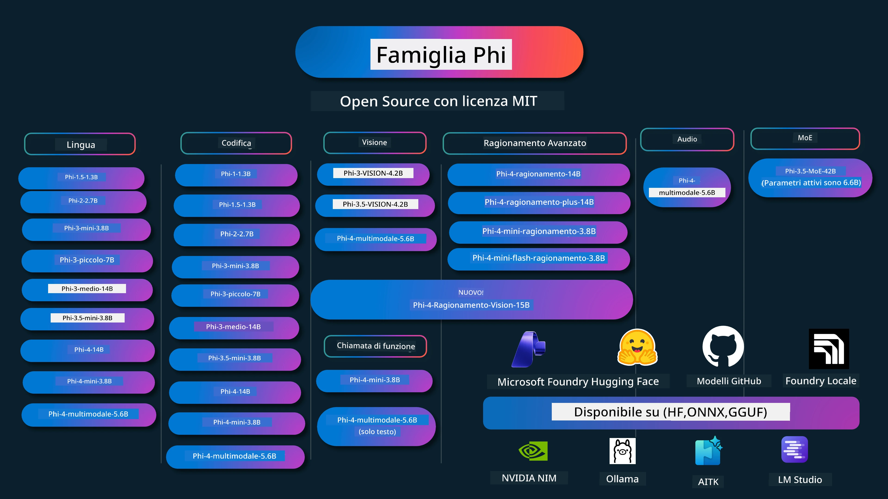

# Phi Cookbook: Esempi Pratici con i Modelli Phi di Microsoft

[](https://codespaces.new/microsoft/phicookbook)
[](https://vscode.dev/redirect?url=vscode://ms-vscode-remote.remote-containers/cloneInVolume?url=https://github.com/microsoft/phicookbook)

[](https://GitHub.com/microsoft/phicookbook/graphs/contributors/?WT.mc_id=aiml-137032-kinfeylo)
[](https://GitHub.com/microsoft/phicookbook/issues/?WT.mc_id=aiml-137032-kinfeylo)
[](https://GitHub.com/microsoft/phicookbook/pulls/?WT.mc_id=aiml-137032-kinfeylo)
[](http://makeapullrequest.com?WT.mc_id=aiml-137032-kinfeylo)

[](https://GitHub.com/microsoft/phicookbook/watchers/?WT.mc_id=aiml-137032-kinfeylo)
[](https://GitHub.com/microsoft/phicookbook/network/?WT.mc_id=aiml-137032-kinfeylo)
[](https://GitHub.com/microsoft/phicookbook/stargazers/?WT.mc_id=aiml-137032-kinfeylo)

[](https://discord.com/invite/ByRwuEEgH4)

Phi è una serie di modelli AI open source sviluppati da Microsoft.

Phi è attualmente il modello di linguaggio piccolo (SLM) più potente ed economico, con ottime prestazioni in contesti multilingue, ragionamento, generazione di testo/chat, codifica, immagini, audio e altri scenari.

Puoi distribuire Phi nel cloud o su dispositivi edge e puoi facilmente costruire applicazioni di AI generativa con potenza di calcolo limitata.

Segui questi passaggi per iniziare a utilizzare queste risorse:
1. **Fork del Repository**: Clicca [](https://GitHub.com/microsoft/phicookbook/network/?WT.mc_id=aiml-137032-kinfeylo)
2. **Clona il Repository**: `git clone https://github.com/microsoft/PhiCookBook.git`
3. [**Unisciti alla community Discord Microsoft AI e incontra esperti e altri sviluppatori**](https://discord.com/invite/ByRwuEEgH4?WT.mc_id=aiml-137032-kinfeylo)



### 🌐 Supporto Multilingue

#### Traduzioni mantenute con [Co-op Translator](https://github.com/Azure/co-op-translator)

<!-- CO-OP TRANSLATOR LANGUAGES TABLE START -->
[Arabic](../ar/README.md) | [Bengali](../bn/README.md) | [Bulgarian](../bg/README.md) | [Burmese (Myanmar)](../my/README.md) | [Chinese (Simplified)](../zh-CN/README.md) | [Chinese (Traditional, Hong Kong)](../zh-HK/README.md) | [Chinese (Traditional, Macau)](../zh-MO/README.md) | [Chinese (Traditional, Taiwan)](../zh-TW/README.md) | [Croatian](../hr/README.md) | [Czech](../cs/README.md) | [Danish](../da/README.md) | [Dutch](../nl/README.md) | [Estonian](../et/README.md) | [Finnish](../fi/README.md) | [French](../fr/README.md) | [German](../de/README.md) | [Greek](../el/README.md) | [Hebrew](../he/README.md) | [Hindi](../hi/README.md) | [Hungarian](../hu/README.md) | [Indonesian](../id/README.md) | [Italian](./README.md) | [Japanese](../ja/README.md) | [Kannada](../kn/README.md) | [Khmer](../km/README.md) | [Korean](../ko/README.md) | [Lithuanian](../lt/README.md) | [Malay](../ms/README.md) | [Malayalam](../ml/README.md) | [Marathi](../mr/README.md) | [Nepali](../ne/README.md) | [Nigerian Pidgin](../pcm/README.md) | [Norwegian](../no/README.md) | [Persian (Farsi)](../fa/README.md) | [Polish](../pl/README.md) | [Portuguese (Brazil)](../pt-BR/README.md) | [Portuguese (Portugal)](../pt-PT/README.md) | [Punjabi (Gurmukhi)](../pa/README.md) | [Romanian](../ro/README.md) | [Russian](../ru/README.md) | [Serbian (Cyrillic)](../sr/README.md) | [Slovak](../sk/README.md) | [Slovenian](../sl/README.md) | [Spanish](../es/README.md) | [Swahili](../sw/README.md) | [Swedish](../sv/README.md) | [Tagalog (Filipino)](../tl/README.md) | [Tamil](../ta/README.md) | [Telugu](../te/README.md) | [Thai](../th/README.md) | [Turkish](../tr/README.md) | [Ukrainian](../uk/README.md) | [Urdu](../ur/README.md) | [Vietnamese](../vi/README.md)

> **Preferisci clonare localmente?**
>
> Questo repository include oltre 50 traduzioni linguistiche che aumentano significativamente la dimensione del download. Per clonare senza le traduzioni, usa sparse checkout:
>
> **Bash / macOS / Linux:**
> ```bash
> git clone --filter=blob:none --sparse https://github.com/microsoft/PhiCookBook.git
> cd PhiCookBook
> git sparse-checkout set --no-cone '/*' '!translations' '!translated_images'
> ```
>
> **CMD (Windows):**
> ```cmd
> git clone --filter=blob:none --sparse https://github.com/microsoft/PhiCookBook.git
> cd PhiCookBook
> git sparse-checkout set --no-cone "/*" "!translations" "!translated_images"
> ```
>
> Questo ti offre tutto il necessario per completare il corso con un download molto più veloce.
<!-- CO-OP TRANSLATOR LANGUAGES TABLE END -->

## Indice

- Introduzione
  - [Benvenuto nella Famiglia Phi](./md/01.Introduction/01/01.PhiFamily.md)
  - [Configurazione del tuo ambiente](./md/01.Introduction/01/01.EnvironmentSetup.md)
  - [Comprendere le Tecnologie Chiave](./md/01.Introduction/01/01.Understandingtech.md)
  - [Sicurezza AI per modelli Phi](./md/01.Introduction/01/01.AISafety.md)
  - [Supporto Hardware Phi](./md/01.Introduction/01/01.Hardwaresupport.md)
  - [Modelli Phi & Disponibilità sulle piattaforme](./md/01.Introduction/01/01.Edgeandcloud.md)
  - [Usare Guidance-ai e Phi](./md/01.Introduction/01/01.Guidance.md)
  - [Modelli del Marketplace GitHub](https://github.com/marketplace/models)
  - [Catalogo Modelli AI Azure](https://ai.azure.com)

- Inferenza Phi in ambienti diversi
    -  [Hugging face](./md/01.Introduction/02/01.HF.md)
    -  [Modelli GitHub](./md/01.Introduction/02/02.GitHubModel.md)
    -  [Catalogo Modelli Microsoft Foundry](./md/01.Introduction/02/03.AzureAIFoundry.md)
    -  [Ollama](./md/01.Introduction/02/04.Ollama.md)
    -  [AI Toolkit VSCode (AITK)](./md/01.Introduction/02/05.AITK.md)
    -  [NVIDIA NIM](./md/01.Introduction/02/06.NVIDIA.md)
    -  [Foundry Locale](./md/01.Introduction/02/07.FoundryLocal.md)

- Inferenza Famiglia Phi
    - [Inferenza Phi in iOS](./md/01.Introduction/03/iOS_Inference.md)
    - [Inferenza Phi in Android](./md/01.Introduction/03/Android_Inference.md)
    - [Inferenza Phi in Jetson](./md/01.Introduction/03/Jetson_Inference.md)
    - [Inferenza Phi in AI PC](./md/01.Introduction/03/AIPC_Inference.md)
    - [Inferenza Phi con Apple MLX Framework](./md/01.Introduction/03/MLX_Inference.md)
    - [Inferenza Phi in Server Locale](./md/01.Introduction/03/Local_Server_Inference.md)
    - [Inferenza Phi in Server Remoto usando AI Toolkit](./md/01.Introduction/03/Remote_Interence.md)
    - [Inferenza Phi con Rust](./md/01.Introduction/03/Rust_Inference.md)
    - [Inferenza Phi--Vision in locale](./md/01.Introduction/03/Vision_Inference.md)
    - [Inferenza Phi con Kaito AKS, Azure Containers (supporto ufficiale)](./md/01.Introduction/03/Kaito_Inference.md)
-  [Quantizzazione Famiglia Phi](./md/01.Introduction/04/QuantifyingPhi.md)
    - [Quantizzazione Phi-3.5 / 4 usando llama.cpp](./md/01.Introduction/04/UsingLlamacppQuantifyingPhi.md)
    - [Quantizzazione Phi-3.5 / 4 usando estensioni Generative AI per onnxruntime](./md/01.Introduction/04/UsingORTGenAIQuantifyingPhi.md)
    - [Quantizzazione Phi-3.5 / 4 usando Intel OpenVINO](./md/01.Introduction/04/UsingIntelOpenVINOQuantifyingPhi.md)
    - [Quantizzazione Phi-3.5 / 4 usando Apple MLX Framework](./md/01.Introduction/04/UsingAppleMLXQuantifyingPhi.md)

-  Valutazione Phi
    - [Response AI](./md/01.Introduction/05/ResponsibleAI.md)
    - [Microsoft Foundry per Valutazione](./md/01.Introduction/05/AIFoundry.md)
    - [Usare Promptflow per Valutazione](./md/01.Introduction/05/Promptflow.md)
 
- RAG con Azure AI Search
    - [Come usare Phi-4-mini e Phi-4-multimodal (RAG) con Azure AI Search](https://github.com/microsoft/PhiCookBook/blob/main/code/06.E2E/E2E_Phi-4-RAG-Azure-AI-Search.ipynb)
    - [RAG Locale Zero-Cloud ibrido con SQLite FTS5 e phi-4-mini](https://github.com/microsoft/PhiCookBook/blob/main/code/06.E2E/E2E_Phi-4-mini_Local_Hybrid_RAG_SQLite_FTS5.ipynb)

- Campioni di sviluppo applicazioni Phi
  - Applicazioni di Testo e Chat
    - Esempi Phi-4 
      - [📓] [Chat con modello Phi-4-mini ONNX](./md/02.Application/01.TextAndChat/Phi4/ChatWithPhi4ONNX/README.md)
      - [Chat con modello ONNX Phi-4 locale .NET](../../md/04.HOL/dotnet/src/LabsPhi4-Chat-01OnnxRuntime)
      - [App Console Chat .NET con Phi-4 ONNX usando Semantic Kernel](../../md/04.HOL/dotnet/src/LabsPhi4-Chat-02SK)
    - Esempi Phi-3 / 3.5
      - [Chatbot Locale nel browser usando Phi3, ONNX Runtime Web e WebGPU](https://github.com/microsoft/onnxruntime-inference-examples/tree/main/js/chat)
      - [Chat OpenVino](./md/02.Application/01.TextAndChat/Phi3/E2E_OpenVino_Chat.md)
      - [Multi Modello - Phi-3-mini interattivo e OpenAI Whisper](./md/02.Application/01.TextAndChat/Phi3/E2E_Phi-3-mini_with_whisper.md)
      - [MLFlow - Costruire un wrapper e usare Phi-3 con MLFlow](./md//02.Application/01.TextAndChat/Phi3/E2E_Phi-3-MLflow.md)
      - [Ottimizzazione Modello - Come ottimizzare il modello Phi-3-min per ONNX Runtime Web con Olive](https://github.com/microsoft/Olive/tree/main/examples/phi3)
      - [App WinUI3 con Phi-3 mini-4k-instruct-onnx](https://github.com/microsoft/Phi3-Chat-WinUI3-Sample/)
      -[Esempio App Note multilingue AI WinUI3 powered](https://github.com/microsoft/ai-powered-notes-winui3-sample)
      - [Fine-tune e integrazione modelli Phi-3 personalizzati con Prompt flow](./md/02.Application/01.TextAndChat/Phi3/E2E_Phi-3-FineTuning_PromptFlow_Integration.md)
      - [Fine-tune e integrazione modelli Phi-3 personalizzati con Prompt flow in Microsoft Foundry](./md/02.Application/01.TextAndChat/Phi3/E2E_Phi-3-FineTuning_PromptFlow_Integration_AIFoundry.md)
      - [Valutare il modello Phi-3 / Phi-3.5 Fine-tuned in Microsoft Foundry focalizzandosi sui principi di AI responsabile di Microsoft](./md/02.Application/01.TextAndChat/Phi3/E2E_Phi-3-Evaluation_AIFoundry.md)
      - [📓] [Esempio di previsione linguistica Phi-3.5-mini-instruct (Cinese/Inglese)](./md/02.Application/01.TextAndChat/Phi3/phi3-instruct-demo.ipynb)
      - [Chatbot WebGPU Phi-3.5-Instruct RAG](./md/02.Application/01.TextAndChat/Phi3/WebGPUWithPhi35Readme.md)
      - [Usare GPU Windows per creare soluzioni Prompt flow con Phi-3.5-Instruct ONNX](./md/02.Application/01.TextAndChat/Phi3/UsingPromptFlowWithONNX.md)
      - [Usare Microsoft Phi-3.5 tflite per creare app Android](./md/02.Application/01.TextAndChat/Phi3/UsingPhi35TFLiteCreateAndroidApp.md)
      - [Esempio Q&A .NET usando modello Phi-3 ONNX locale e Microsoft.ML.OnnxRuntime](../../md/04.HOL/dotnet/src/LabsPhi301)
      - [App console chat .NET con Semantic Kernel e Phi-3](../../md/04.HOL/dotnet/src/LabsPhi302)

  - Esempi basati su SDK di inferenza Azure AI
    - Esempi Phi-4 
      - [📓] [Genera codice progetto usando Phi-4-multimodal](./md/02.Application/02.Code/Phi4/GenProjectCode/README.md)
    - Esempi Phi-3 / 3.5
      - [Costruisci il tuo GitHub Copilot Chat in Visual Studio Code con la Famiglia Microsoft Phi-3](./md/02.Application/02.Code/Phi3/VSCodeExt/README.md)
      - [Crea il tuo agente chat Visual Studio Code Copilot con Phi-3.5 usando modelli GitHub](/md/02.Application/02.Code/Phi3/CreateVSCodeChatAgentWithGitHubModels.md)

  - Esempi di ragionamento avanzato
    - Esempi Phi-4 
      - [📓] [Esempi di Phi-4-mini-reasoning o Phi-4-reasoning](./md/02.Application/03.AdvancedReasoning/Phi4/AdvancedResoningPhi4mini/README.md)
      - [📓] [Fine-tuning di Phi-4-mini-reasoning con Microsoft Olive](./md/02.Application/03.AdvancedReasoning/Phi4/AdvancedResoningPhi4mini/olive_ft_phi_4_reasoning_with_medicaldata.ipynb)
      - [📓] [Fine-tuning di Phi-4-mini-reasoning con Apple MLX](./md/02.Application/03.AdvancedReasoning/Phi4/AdvancedResoningPhi4mini/mlx_ft_phi_4_reasoning_with_medicaldata.ipynb)
      - [📓] [Phi-4-mini-reasoning con modelli GitHub](./md/02.Application/02.Code/Phi4r/github_models_inference.ipynb)
      - [📓] [Phi-4-mini-reasoning con modelli Microsoft Foundry](./md/02.Application/02.Code/Phi4r/azure_models_inference.ipynb)
  - Demo
      - [Demo Phi-4-mini ospitati su Hugging Face Spaces](https://huggingface.co/spaces/microsoft/phi-4-mini?WT.mc_id=aiml-137032-kinfeylo)
      - [Demo Phi-4-multimodale ospitati su Hugging Face Spaces](https://huggingface.co/spaces/microsoft/phi-4-multimodal?WT.mc_id=aiml-137032-kinfeylo)
  - Esempi Vision
    - Esempi Phi-4
      - [📓] [Usa Phi-4-multimodale per leggere immagini e generare codice](./md/02.Application/04.Vision/Phi4/CreateFrontend/README.md) 
    - Esempi Phi-3 / 3.5
      -  [📓][Phi-3-vision-Image testo a testo](./md/02.Application/04.Vision/Phi3/E2E_Phi-3-vision-image-text-to-text-online-endpoint.ipynb)
      - [Phi-3-vision-ONNX](https://onnxruntime.ai/docs/genai/tutorials/phi3-v.html)
      - [📓][Phi-3-vision CLIP Embedding](./md/02.Application/04.Vision/Phi3/E2E_Phi-3-vision-image-text-to-text-online-endpoint.ipynb)
      - [DEMO: Riciclaggio Phi-3](https://github.com/jennifermarsman/PhiRecycling/)
      - [Phi-3-vision - Assistente linguaggio visivo - con Phi3-Vision e OpenVINO](https://docs.openvino.ai/nightly/notebooks/phi-3-vision-with-output.html)
      - [Phi-3 Vision Nvidia NIM](./md/02.Application/04.Vision/Phi3/E2E_Nvidia_NIM_Vision.md)
      - [Phi-3 Vision OpenVino](./md/02.Application/04.Vision/Phi3/E2E_OpenVino_Phi3Vision.md)
      - [📓][Esempio Phi-3.5 Vision multi-frame o multi-immagine](./md/02.Application/04.Vision/Phi3/phi3-vision-demo.ipynb)
      - [Phi-3 Vision Modello ONNX locale usando Microsoft.ML.OnnxRuntime .NET](../../md/04.HOL/dotnet/src/LabsPhi303)
      - [Modello ONNX locale Phi-3 Vision basato su menu usando Microsoft.ML.OnnxRuntime .NET](../../md/04.HOL/dotnet/src/LabsPhi304)

  - Esempi Reasoning-Vision
    - Phi-4-Reasoning-Vision-15B 
      - [📓] [Usare Phi-4-Reasoning-Vision-15B per rilevare l'attraversamento pedonale non autorizzato](./md/02.Application/10.ReasoningVision/Phi_4_reasoning_vision_15b_Jaywalking.ipynb)
      - [📓] [Usare Phi-4-Reasoning-Vision-15B per la matematica](./md/02.Application/10.ReasoningVision/Phi_4_reasoning_vision_15b_Math.ipynb)
      - [📓] [Usare Phi-4-Reasoning-Vision-15B per rilevare UI](./md/02.Application/10.ReasoningVision/Phi_4_reasoning_vision_15b_ui.ipynb)

  - Esempi Math
    - Esempi Phi-4-Mini-Flash-Reasoning-Instruct  [Demo matematica con Phi-4-Mini-Flash-Reasoning-Instruct](./md/02.Application/09.Math/MathDemo.ipynb)

  - Esempi Audio
    - Esempi Phi-4 
      - [📓] [Estrazione di trascrizioni audio usando Phi-4-multimodale](./md/02.Application/05.Audio/Phi4/Transciption/README.md)
      - [📓] [Esempio Audio Phi-4-multimodale](./md/02.Application/05.Audio/Phi4/Siri/demo.ipynb)
      - [📓] [Esempio traduzione vocale Phi-4-multimodale](./md/02.Application/05.Audio/Phi4/Translate/demo.ipynb)
      - [Applicazione console .NET che utilizza Phi-4-multimodale Audio per analizzare un file audio e generare trascrizione](../../md/04.HOL/dotnet/src/LabsPhi4-MultiModal-02Audio)

  - Esempi MOE
    - Esempi Phi-3 / 3.5
      - [📓] [Esempio Modelli Mixture of Experts (MoEs) Phi-3.5 su Social Media](./md/02.Application/06.MoE/Phi3/phi3_moe_demo.ipynb)
      - [📓] [Costruire una pipeline Retrieval-Augmented Generation (RAG) con NVIDIA NIM Phi-3 MOE, Azure AI Search e LlamaIndex](./md/02.Application/06.MoE/Phi3/azure-ai-search-nvidia-rag.ipynb)
      - 
  - Esempi Function Calling
    - Esempi Phi-4 🆕
      -  [📓] [Usare Function Calling con Phi-4-mini](./md/02.Application/07.FunctionCalling/Phi4/FunctionCallingBasic/README.md)
      -  [📓] [Usare Function Calling per creare multi-agenti con Phi-4-mini](./md/02.Application/07.FunctionCalling/Phi4/Multiagents/Phi_4_mini_multiagent.ipynb)
      -  [📓] [Usare Function Calling con Ollama](./md/02.Application/07.FunctionCalling/Phi4/Ollama/ollama_functioncalling.ipynb)
      -  [📓] [Usare Function Calling con ONNX](./md/02.Application/07.FunctionCalling/Phi4/ONNX/onnx_parallel_functioncalling.ipynb)
  - Esempi Multimodal Mixing
    - Esempi Phi-4 🆕
      -  [📓] [Usare Phi-4-multimodale come giornalista tecnologico](./md/02.Application/08.Multimodel/Phi4/TechJournalist/phi_4_mm_audio_text_publish_news.ipynb)
      - [Applicazione console .NET che usa Phi-4-multimodale per analizzare immagini](../../md/04.HOL/dotnet/src/LabsPhi4-MultiModal-01Images)

- Fine-tuning Phi Esempi
  - [Scenari di fine-tuning](./md/03.FineTuning/FineTuning_Scenarios.md)
  - [Fine-tuning vs RAG](./md/03.FineTuning/FineTuning_vs_RAG.md)
  - [Fine-tuning per far diventare Phi-3 un esperto industriale](./md/03.FineTuning/LetPhi3gotoIndustriy.md)
  - [Fine-tuning Phi-3 con AI Toolkit per VS Code](./md/03.FineTuning/Finetuning_VSCodeaitoolkit.md)
  - [Fine-tuning Phi-3 con Azure Machine Learning Service](./md/03.FineTuning/Introduce_AzureML.md)
  - [Fine-tuning Phi-3 con Lora](./md/03.FineTuning/FineTuning_Lora.md)
  - [Fine-tuning Phi-3 con QLora](./md/03.FineTuning/FineTuning_Qlora.md)
  - [Fine-tuning Phi-3 con Microsoft Foundry](./md/03.FineTuning/FineTuning_AIFoundry.md)
  - [Fine-tuning Phi-3 con Azure ML CLI/SDK](./md/03.FineTuning/FineTuning_MLSDK.md)
  - [Fine-tuning con Microsoft Olive](./md/03.FineTuning/FineTuning_MicrosoftOlive.md)
  - [Laboratorio pratico di fine-tuning con Microsoft Olive](./md/03.FineTuning/olive-lab/readme.md)
  - [Fine-tuning Phi-3-vision con Weights and Bias](./md/03.FineTuning/FineTuning_Phi-3-visionWandB.md)
  - [Fine-tuning Phi-3 con Apple MLX Framework](./md/03.FineTuning/FineTuning_MLX.md)
  - [Fine-tuning Phi-3-vision (supporto ufficiale)](./md/03.FineTuning/FineTuning_Vision.md)
  - [Fine-Tuning Phi-3 con Kaito AKS, Azure Containers (supporto ufficiale)](./md/03.FineTuning/FineTuning_Kaito.md)
  - [Fine-Tuning Phi-3 e 3.5 Vision](https://github.com/2U1/Phi3-Vision-Finetune)

- Laboratorio pratico
  - [Esplorare modelli all'avanguardia: LLM, SLM, sviluppo locale e altro](https://github.com/microsoft/aitour-exploring-cutting-edge-models)
  - [Sbloccare il potenziale NLP: fine-tuning con Microsoft Olive](https://github.com/azure/Ignite_FineTuning_workshop)

- Articoli di ricerca accademica e pubblicazioni
  - [Textbooks Are All You Need II: rapporto tecnico phi-1.5](https://arxiv.org/abs/2309.05463)
  - [Rapporto tecnico Phi-3: Un modello linguistico altamente capace localmente sul tuo telefono](https://arxiv.org/abs/2404.14219)
  - [Rapporto tecnico Phi-4](https://arxiv.org/abs/2412.08905)
  - [Rapporto tecnico Phi-4-Mini: modelli linguistici multimodali compatti ma potenti tramite Mixture-of-LoRAs](https://arxiv.org/abs/2503.01743)
  - [Ottimizzare piccoli modelli linguistici per il Function-Calling in veicoli](https://arxiv.org/abs/2501.02342)
  - [(WhyPHI) Fine-tuning PHI-3 per risposte a domande a scelta multipla: metodologia, risultati e sfide](https://arxiv.org/abs/2501.01588)
  - [Rapporto tecnico Phi-4-reasoning](https://www.microsoft.com/en-us/research/wp-content/uploads/2025/04/phi_4_reasoning.pdf)
  - [Rapporto tecnico Phi-4-mini-reasoning](https://huggingface.co/microsoft/Phi-4-mini-reasoning/blob/main/Phi-4-Mini-Reasoning.pdf)

## Usare i modelli Phi

### Phi su Microsoft Foundry

Puoi imparare come usare Microsoft Phi e come costruire soluzioni end-to-end nei tuoi diversi dispositivi hardware. Per provare Phi di persona, inizia a sperimentare con i modelli e a personalizzare Phi per i tuoi scenari usando il [Catalogo modelli Azure AI Microsoft Foundry](https://aka.ms/phi3-azure-ai); puoi saperne di più su Come iniziare con [Microsoft Foundry](/md/02.QuickStart/AzureAIFoundry_QuickStart.md)

**Playground**
Ogni modello ha uno spazio dedicato per testarlo nel [Azure AI Playground](https://aka.ms/try-phi3).

### Phi su modelli GitHub

Puoi imparare come usare Microsoft Phi e come costruire soluzioni end-to-end nei tuoi diversi dispositivi hardware. Per provare Phi di persona, inizia a sperimentare con il modello e a personalizzare Phi per i tuoi scenari usando il [Catalogo modelli GitHub](https://github.com/marketplace/models?WT.mc_id=aiml-137032-kinfeylo); puoi saperne di più su Come iniziare con [Catalogo modelli GitHub](/md/02.QuickStart/GitHubModel_QuickStart.md)

**Playground**
Ogni modello ha un [playground dedicato per testarlo](/md/02.QuickStart/GitHubModel_QuickStart.md).

### Phi su Hugging Face

Puoi anche trovare il modello su [Hugging Face](https://huggingface.co/microsoft)

**Playground**
 [Hugging Chat playground](https://huggingface.co/chat/models/microsoft/Phi-3-mini-4k-instruct)

 ## 🎒 Altri corsi

Il nostro team produce altri corsi! Dai un'occhiata a:

<!-- CO-OP TRANSLATOR OTHER COURSES START -->
### LangChain
[](https://aka.ms/langchain4j-for-beginners)
[](https://aka.ms/langchainjs-for-beginners?WT.mc_id=m365-94501-dwahlin)
[](https://github.com/microsoft/langchain-for-beginners?WT.mc_id=m365-94501-dwahlin)
---

### Azure / Edge / MCP / Agenti
[](https://github.com/microsoft/AZD-for-beginners?WT.mc_id=academic-105485-koreyst)
[](https://github.com/microsoft/edgeai-for-beginners?WT.mc_id=academic-105485-koreyst)
[](https://github.com/microsoft/mcp-for-beginners?WT.mc_id=academic-105485-koreyst)
[](https://github.com/microsoft/ai-agents-for-beginners?WT.mc_id=academic-105485-koreyst)

---
 
### Serie AI generativa
[](https://github.com/microsoft/generative-ai-for-beginners?WT.mc_id=academic-105485-koreyst)
[-9333EA?style=for-the-badge&labelColor=E5E7EB&color=9333EA)](https://github.com/microsoft/Generative-AI-for-beginners-dotnet?WT.mc_id=academic-105485-koreyst)
[-C084FC?style=for-the-badge&labelColor=E5E7EB&color=C084FC)](https://github.com/microsoft/generative-ai-for-beginners-java?WT.mc_id=academic-105485-koreyst)
[-E879F9?style=for-the-badge&labelColor=E5E7EB&color=E879F9)](https://github.com/microsoft/generative-ai-with-javascript?WT.mc_id=academic-105485-koreyst)

---
 
### Apprendimento di base
[](https://aka.ms/ml-beginners?WT.mc_id=academic-105485-koreyst)
[](https://aka.ms/datascience-beginners?WT.mc_id=academic-105485-koreyst)
[](https://aka.ms/ai-beginners?WT.mc_id=academic-105485-koreyst)
[](https://github.com/microsoft/Security-101?WT.mc_id=academic-96948-sayoung)
[](https://aka.ms/webdev-beginners?WT.mc_id=academic-105485-koreyst)
[](https://aka.ms/iot-beginners?WT.mc_id=academic-105485-koreyst)
[](https://github.com/microsoft/xr-development-for-beginners?WT.mc_id=academic-105485-koreyst)

---
 
### Serie Copilot
[](https://aka.ms/GitHubCopilotAI?WT.mc_id=academic-105485-koreyst)
[](https://github.com/microsoft/mastering-github-copilot-for-dotnet-csharp-developers?WT.mc_id=academic-105485-koreyst)
[](https://github.com/microsoft/CopilotAdventures?WT.mc_id=academic-105485-koreyst)
<!-- CO-OP TRANSLATOR OTHER COURSES END -->

## AI responsabile

Microsoft si impegna ad aiutare i nostri clienti a usare i prodotti AI in modo responsabile, condividendo le nostre esperienze e costruendo partnership basate sulla fiducia tramite strumenti come Transparency Notes e Impact Assessments. Molte di queste risorse si possono trovare su [https://aka.ms/RAI](https://aka.ms/RAI).
L'approccio di Microsoft all'AI responsabile si basa sui nostri principi di equità, affidabilità e sicurezza, privacy e sicurezza, inclusività, trasparenza e responsabilità.

I modelli su larga scala per linguaggio naturale, immagini e parlato - come quelli usati in questo esempio - possono potenzialmente comportarsi in modo ingiusto, inaffidabile o offensivo, causando danni. Si prega di consultare la [nota sulla trasparenza del servizio Azure OpenAI](https://learn.microsoft.com/legal/cognitive-services/openai/transparency-note?tabs=text) per essere informati sui rischi e le limitazioni.

L'approccio consigliato per mitigare questi rischi è includere un sistema di sicurezza nella tua architettura che possa rilevare e prevenire comportamenti dannosi. [Azure AI Content Safety](https://learn.microsoft.com/azure/ai-services/content-safety/overview) fornisce un livello di protezione indipendente, in grado di rilevare contenuti dannosi generati dagli utenti e dall'IA nelle applicazioni e nei servizi. Azure AI Content Safety include API per testo e immagini che ti permettono di rilevare materiale dannoso. All'interno di Microsoft Foundry, il servizio Content Safety consente di visualizzare, esplorare e provare codice di esempio per rilevare contenuti dannosi in diverse modalità. La seguente [documentazione quickstart](https://learn.microsoft.com/azure/ai-services/content-safety/quickstart-text?tabs=visual-studio%2Clinux&pivots=programming-language-rest) ti guida attraverso le richieste al servizio.

Un altro aspetto da considerare è la performance complessiva dell'applicazione. Con applicazioni multi-modali e multi-modelli, consideriamo la performance come il fatto che il sistema si comporti come tu e i tuoi utenti vi aspettate, incluso il non generare output dannosi. È importante valutare la performance della tua applicazione complessiva utilizzando i [valutatori di Performance, Qualità, Rischio e Sicurezza](https://learn.microsoft.com/azure/ai-studio/concepts/evaluation-metrics-built-in). Hai inoltre la possibilità di creare e valutare con [valutatori personalizzati](https://learn.microsoft.com/azure/ai-studio/how-to/develop/evaluate-sdk#custom-evaluators).

Puoi valutare la tua applicazione AI nel tuo ambiente di sviluppo utilizzando l'[Azure AI Evaluation SDK](https://microsoft.github.io/promptflow/index.html). Dato un dataset di test o un obiettivo, le generazioni della tua applicazione AI generativa vengono misurate quantitativamente con valutatori integrati o valutatori personalizzati a tua scelta. Per iniziare con l'Azure AI Evaluation SDK per valutare il tuo sistema, puoi seguire la [guida quickstart](https://learn.microsoft.com/azure/ai-studio/how-to/develop/flow-evaluate-sdk). Una volta eseguita una valutazione, puoi [visualizzare i risultati in Microsoft Foundry](https://learn.microsoft.com/azure/ai-studio/how-to/evaluate-flow-results).

## Marchi

Questo progetto può contenere marchi o loghi di progetti, prodotti o servizi. L'uso autorizzato dei marchi o loghi Microsoft è soggetto e deve seguire le [Linee guida sui marchi e sul branding Microsoft](https://www.microsoft.com/legal/intellectualproperty/trademarks/usage/general).
L'uso dei marchi o loghi Microsoft in versioni modificate di questo progetto non deve causare confusione o implicare sponsorizzazione da parte di Microsoft. Qualsiasi uso di marchi o loghi di terze parti è soggetto alle politiche di tali terze parti.

## Assistenza

Se rimani bloccato o hai domande sulla costruzione di app AI, unisciti a:

[](https://aka.ms/foundry/discord)

Se hai feedback sul prodotto o errori durante lo sviluppo visita:

[](https://aka.ms/foundry/forum)

---

<!-- CO-OP TRANSLATOR DISCLAIMER START -->
**Disclaimer**:
Questo documento è stato tradotto utilizzando il servizio di traduzione AI [Co-op Translator](https://github.com/Azure/co-op-translator). Sebbene ci impegniamo per garantire la precisione, si prega di notare che le traduzioni automatizzate possono contenere errori o imprecisioni. Il documento originale nella sua lingua nativa deve essere considerato la fonte autorevole. Per informazioni critiche, si raccomanda una traduzione professionale effettuata da un essere umano. Non siamo responsabili per eventuali malintesi o interpretazioni errate derivanti dall’uso di questa traduzione.
<!-- CO-OP TRANSLATOR DISCLAIMER END -->