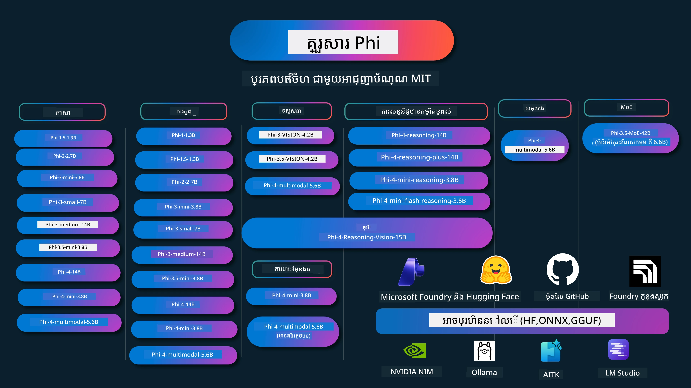

# សៀវភៅម្ហូប Phi៖ ឧទាហរណ៍ប្រាក់ដៃជាមួយម៉ូដែល Phi របស់ Microsoft

[](https://codespaces.new/microsoft/phicookbook)
[](https://vscode.dev/redirect?url=vscode://ms-vscode-remote.remote-containers/cloneInVolume?url=https://github.com/microsoft/phicookbook)

[](https://GitHub.com/microsoft/phicookbook/graphs/contributors/?WT.mc_id=aiml-137032-kinfeylo)
[](https://GitHub.com/microsoft/phicookbook/issues/?WT.mc_id=aiml-137032-kinfeylo)
[](https://GitHub.com/microsoft/phicookbook/pulls/?WT.mc_id=aiml-137032-kinfeylo)
[](http://makeapullrequest.com?WT.mc_id=aiml-137032-kinfeylo)

[](https://GitHub.com/microsoft/phicookbook/watchers/?WT.mc_id=aiml-137032-kinfeylo)
[](https://GitHub.com/microsoft/phicookbook/network/?WT.mc_id=aiml-137032-kinfeylo)
[](https://GitHub.com/microsoft/phicookbook/stargazers/?WT.mc_id=aiml-137032-kinfeylo)

[](https://discord.com/invite/ByRwuEEgH4)

Phi គឺជាស៊េរីនៃម៉ូដែល AI ប្រភពបើកដែលបានកែលម្អដោយ Microsoft។

Phi ជាឥឡូវនេះគឺជាម៉ូដែលភាសាតូច (SLM) ដែលមានថាមពលខ្ពស់បំផុត និងមានតម្លៃប្រកួតប្រជែងបានល្អជាមួយសន្ទស្សន៍ល្អក្នុងភាសាច្រើន ការគិត ធ្វើអត្ថបទ/ជជែក កូដ បទបង្ហាញរូបភាព សំឡេង និងឱកាសផ្សេងទៀត។

អ្នកអាចដាក់អនុវត្ត Phi ទៅក្នុងមេឃ ឬឧបករណ៍តែមួយ ហើយអាចបង្កើតកម្មវិធីបង្កើត AI បានយ៉ាងងាយស្រួលជាមួយថាមពលគណនានិងមានកំណត់។

សូមអនុវត្តជំហានទាំងនេះដើម្បីចាប់ផ្តើមប្រើប្រាស់ធនធានទាំងនេះ៖
1. **ចម្លងទំនាក់ទំនង Repository**: ចុច [](https://GitHub.com/microsoft/phicookbook/network/?WT.mc_id=aiml-137032-kinfeylo)
2. **ចម្លង Repository**: `git clone https://github.com/microsoft/PhiCookBook.git`
3. [**ចូលរួមសហគមន៍ Microsoft AI Discord និងជួបសំណេះសំណាល និងអ្នកកែលម្អមិត្តភក្តិ**](https://discord.com/invite/ByRwuEEgH4?WT.mc_id=aiml-137032-kinfeylo)



### 🌐 គាំទ្រភាសាច្រើន

#### ការបកប្រែបានរក្សាទុកជាមួយ [អ្នកបកប្រែ Co-op](https://github.com/Azure/co-op-translator)

<!-- CO-OP TRANSLATOR LANGUAGES TABLE START -->
[អារ៉ាប់](../ar/README.md) | [បង់ក្លា](../bn/README.md) | [បានល្គារី](../bg/README.md) | [ភាសាប៊ឺម៉ាស៍ (ម័យយ៉ាន់ម៉ា)](../my/README.md) | [ចិន (សាម៉ប្លី)](../zh-CN/README.md) | [ចិន (បុរាណ, ហុងកុង)](../zh-HK/README.md) | [ចិន (បុរាណ, ម៉ាកាវ)](../zh-MO/README.md) | [ចិន (បុរាណ, តៃវ៉ាន់)](../zh-TW/README.md) | [ក្រូអាត](../hr/README.md) | [ចេក](../cs/README.md) | [ដានម៉ាក](../da/README.md) | [ហូល្លង់](../nl/README.md) | [អេស្ទូនី](../et/README.md) | [ហ្វាំងឡង់](../fi/README.md) | [បារាំង](../fr/README.md) | [អាល្លឺម៉ង់](../de/README.md) | [ក្រិច](../el/README.md) | [ហេប្រ៊ូ](../he/README.md) | [ហិណ្ឌី](../hi/README.md) | [ហុងគ្រី](../hu/README.md) | [ឥណ្ឌូណេស៊ី](../id/README.md) | [អ៊ីតាលី](../it/README.md) | [ជប៉ុន](../ja/README.md) | [កណាដា](../kn/README.md) | [ខ្មែរ](./README.md) | [កូរ៉េ](../ko/README.md) | [លីទួយ៉ានី](../lt/README.md) | [មាឡេស៊ី](../ms/README.md) | [ម៉ាឡាឡាម](../ml/README.md) | [ម៉ារ៉ាធី](../mr/README.md) | [នេប៉ាល់](../ne/README.md) | [ភីឌហ្សីន នីហ្សេរី](../pcm/README.md) | [ន័រវេស៊ី](../no/README.md) | [ប៉ែស្ស្យ៉ាន់ (ហ្វារី)](../fa/README.md) | [ប៉ូឡូញ](../pl/README.md) | [ព័រទុយហ្គាល់ (ប្រេស៊ីល)](../pt-BR/README.md) | [ព័រទុយហ្គាល់ (ព័រទុយហ្គាល់)](../pt-PT/README.md) | [ប៉ុនជាអ៊ី (ហ្គឺម៉ុខី)](../pa/README.md) | [រុម៉ានី](../ro/README.md) | [រុស្ស៊ី](../ru/README.md) | [សើប៊ី (ស៊ីរីលិក)](../sr/README.md) | [ស្លូវ៉ាក់](../sk/README.md) | [ស្លូវេនី](../sl/README.md) | [អេស្បាញ](../es/README.md) | [ស្វាហ៊ីលី](../sw/README.md) | [ស៊ុយអែត](../sv/README.md) | [តាហ្គាឡុក (ហ្វីលីពីន)](../tl/README.md) | [តាមីល](../ta/README.md) | [តេល៊ួគ៊ូ](../te/README.md) | [ថៃ](../th/README.md) | [ទួរគុយ](../tr/README.md) | [អ៊ុយក្រែន](../uk/README.md) | [អ៊ូរឌូ](../ur/README.md) | [វៀតណាម](../vi/README.md)

> **ចូលចិត្តចម្លងក្នុងកុំព្យូទ័រឡើងវិញដោយផ្ទាល់?**
>
> ឃ្លាំងទិន្នន័យនេះមានការបកប្រែភាសាច្រើនជាង 50 ដែលបង្កើនទំហំពិន្ទុទាញយកយ៉ាងខ្លាំង។ ដើម្បីចម្លងដោយគ្មានការបកប្រែ សូមប្រើ sparse checkout៖
>
> **Bash / macOS / Linux:**
> ```bash
> git clone --filter=blob:none --sparse https://github.com/microsoft/PhiCookBook.git
> cd PhiCookBook
> git sparse-checkout set --no-cone '/*' '!translations' '!translated_images'
> ```
>
> **CMD (Windows):**
> ```cmd
> git clone --filter=blob:none --sparse https://github.com/microsoft/PhiCookBook.git
> cd PhiCookBook
> git sparse-checkout set --no-cone "/*" "!translations" "!translated_images"
> ```
>
> នេះបង្ហាញអ្វីគ្រប់យ៉ាងដែលអ្នកត្រូវការដើម្បីបញ្ចប់វគ្គនេះជាមួយការទាញយកលឿនជាងមុន។
<!-- CO-OP TRANSLATOR LANGUAGES TABLE END -->

## ថតបញ្ជីមុខ

- ការណែនាំ
  - [ស្វាគមន៍ទៅកាន់គ្រួសារ Phi](./md/01.Introduction/01/01.PhiFamily.md)
  - [ការតំឡើងបរិស្ថានរបស់អ្នក](./md/01.Introduction/01/01.EnvironmentSetup.md)
  - [ការយល់ដឹងអំពីបច្ចេកវិទ្យាគន្លងសំខាន់ៗ](./md/01.Introduction/01/01.Understandingtech.md)
  - [សុវត្ថិភាព AI សម្រាប់ម៉ូដែល Phi](./md/01.Introduction/01/01.AISafety.md)
  - [គាំទ្រឧបករណ៍រឹង Phi](./md/01.Introduction/01/01.Hardwaresupport.md)
  - [ម៉ូដែល Phi និងការតំឡើងតាមវេទិកាជាច្រើន](./md/01.Introduction/01/01.Edgeandcloud.md)
  - [ការប្រើប្រាស់ Guidance-ai និង Phi](./md/01.Introduction/01/01.Guidance.md)
  - [ម៉ូដែលទីផ្សារ GitHub](https://github.com/marketplace/models)
  - [បណ្ណាល័យម៉ូដែល Azure AI](https://ai.azure.com)

- ការជំនួញ Phi នៅបរិស្ថានផ្សេងៗ
    -  [Hugging face](./md/01.Introduction/02/01.HF.md)
    -  [ម៉ូដែល GitHub](./md/01.Introduction/02/02.GitHubModel.md)
    -  [បណ្ណាល័យម៉ូដែល Microsoft Foundry](./md/01.Introduction/02/03.AzureAIFoundry.md)
    -  [Ollama](./md/01.Introduction/02/04.Ollama.md)
    -  [ឧបករណ៍ AI Toolkit VSCode (AITK)](./md/01.Introduction/02/05.AITK.md)
    -  [NVIDIA NIM](./md/01.Introduction/02/06.NVIDIA.md)
    -  [Foundry មូលដ្ឋាន](./md/01.Introduction/02/07.FoundryLocal.md)

- ការជំនួញគ្រួសារ Phi
    - [ការជំនួញ Phi នៅ iOS](./md/01.Introduction/03/iOS_Inference.md)
    - [ការជំនួញ Phi នៅ Android](./md/01.Introduction/03/Android_Inference.md)
    - [ការជំនួញ Phi នៅ Jetson](./md/01.Introduction/03/Jetson_Inference.md)
    - [ការជំនួញ Phi នៅ PC AI](./md/01.Introduction/03/AIPC_Inference.md)
    - [ការជំនួញ Phi ជាមួយ Apple MLX Framework](./md/01.Introduction/03/MLX_Inference.md)
    - [ការជំនួញ Phi នៅម៉ាស៊ីនបម្រើក្នុងស្រុក](./md/01.Introduction/03/Local_Server_Inference.md)
    - [ការជំនួញ Phi នៅម៉ាស៊ីនបម្រើរោលឆ្ងាយដោយប្រើ AI Toolkit](./md/01.Introduction/03/Remote_Interence.md)
    - [ការជំនួញ Phi ជាមួយ Rust](./md/01.Introduction/03/Rust_Inference.md)
    - [ការជំនួញ Phi--ទស្សនវិស័យនៅក្នុងស្រុក](./md/01.Introduction/03/Vision_Inference.md)
    - [ការជំនួញ Phi ជាមួយ Kaito AKS, Azure Containers(គាំទ្រផ្លូវការនៃវេទិកា)](./md/01.Introduction/03/Kaito_Inference.md)
-  [ការវាស់វែងគ្រួសារ Phi](./md/01.Introduction/04/QuantifyingPhi.md)
    - [ការវាស់វែង Phi-3.5 / 4 ដោយប្រើ llama.cpp](./md/01.Introduction/04/UsingLlamacppQuantifyingPhi.md)
    - [ការវាស់វែង Phi-3.5 / 4 ដោយប្រើផ្នែកបន្ថែម Generative AI សម្រាប់ onnxruntime](./md/01.Introduction/04/UsingORTGenAIQuantifyingPhi.md)
    - [ការវាស់វែង Phi-3.5 / 4 ដោយប្រើ Intel OpenVINO](./md/01.Introduction/04/UsingIntelOpenVINOQuantifyingPhi.md)
    - [ការវាស់វែង Phi-3.5 / 4 ដោយប្រើ Apple MLX Framework](./md/01.Introduction/04/UsingAppleMLXQuantifyingPhi.md)

-  ការប៉ាន់ប្រមាណ Phi
    - [AI ឆ្លើយតប](./md/01.Introduction/05/ResponsibleAI.md)
    - [Microsoft Foundry សម្រាប់ការប៉ាន់ប្រមាណ](./md/01.Introduction/05/AIFoundry.md)
    - [ការប្រើប្រាស់ Promptflow សម្រាប់ការប៉ាន់ប្រមាណ](./md/01.Introduction/05/Promptflow.md)
 
- RAG ជាមួយ Azure AI Search
    - [វិធីប្រើ Phi-4-mini និង Phi-4-multimodal(RAG) ជាមួយ Azure AI Search](https://github.com/microsoft/PhiCookBook/blob/main/code/06.E2E/E2E_Phi-4-RAG-Azure-AI-Search.ipynb)
    - [Zero-Cloud Local Hybrid RAG ជាមួយ SQLite FTS5 និង phi-4-mini](https://github.com/microsoft/PhiCookBook/blob/main/code/06.E2E/E2E_Phi-4-mini_Local_Hybrid_RAG_SQLite_FTS5.ipynb)

- ឧទាហរណ៍អភិវឌ្ឍកម្មវិធី Phi
  - កម្មវិធីអត្ថបទ និងការជជែក
    - ឧទាហរណ៍ Phi-4
      - [📓] [ជជែកជាមួយម៉ូដែល Phi-4-mini ONNX](./md/02.Application/01.TextAndChat/Phi4/ChatWithPhi4ONNX/README.md)
      - [ជជែកជាមួយម៉ូដែល ONNX Phi-4 ក្នុងស្រុក .NET](../../md/04.HOL/dotnet/src/LabsPhi4-Chat-01OnnxRuntime)
      - [កម្មវិធី Console ជជែកជាមួយ Phi-4 ONNX ប្រើ Semantic Kernel](../../md/04.HOL/dotnet/src/LabsPhi4-Chat-02SK)
    - ឧទាហរណ៍ Phi-3 / 3.5
      - [Chatbot ក្នុងស្រុកនៅក្នុងកម្មវិធីរុករកប្រើ Phi3, ONNX Runtime Web និង WebGPU](https://github.com/microsoft/onnxruntime-inference-examples/tree/main/js/chat)
      - [ជជែក OpenVino](./md/02.Application/01.TextAndChat/Phi3/E2E_OpenVino_Chat.md)
      - [ម៉ូដែលច្រើន - Phi-3-mini អន្តរកម្ម និង OpenAI Whisper](./md/02.Application/01.TextAndChat/Phi3/E2E_Phi-3-mini_with_whisper.md)
      - [MLFlow - បង្កើតវ៉ារ៉ាប្រអប់ និងប្រើ Phi-3 ជាមួយ MLFlow](./md//02.Application/01.TextAndChat/Phi3/E2E_Phi-3-MLflow.md)
      - [បង្កើតម៉ូដែលឲ្យប្រសើរឡើង - របៀបបង្កើតម៉ូដែល Phi-3-min សម្រាប់ ONNX Runtime Web ជាមួយ Olive](https://github.com/microsoft/Olive/tree/main/examples/phi3)
      - [កម្មវិធី WinUI3 ជាមួយ Phi-3 mini-4k-instruct-onnx](https://github.com/microsoft/Phi3-Chat-WinUI3-Sample/)
      -[ឧទាហរណ៍កម្មវិធីកំណត់ត្រាអំពី WinUI3 Multi Model AI Powered Notes](https://github.com/microsoft/ai-powered-notes-winui3-sample)
      - [បន្ថែមបន្ថយ និងបញ្ចូលម៉ូដែល Phi-3 ផ្ទាល់ខ្លួនជាមួយ Prompt flow](./md/02.Application/01.TextAndChat/Phi3/E2E_Phi-3-FineTuning_PromptFlow_Integration.md)
      - [បន្ថែមបន្ថយ និងបញ្ចូលម៉ូដែល Phi-3 ផ្ទាល់ខ្លួនជាមួយ Prompt flow នៅ Microsoft Foundry](./md/02.Application/01.TextAndChat/Phi3/E2E_Phi-3-FineTuning_PromptFlow_Integration_AIFoundry.md)
      - [វាយតម្លៃម៉ូដែល Phi-3 / Phi-3.5 ដែលបានបន្ថែមបន្ថយក្នុង Microsoft Foundry ផ្តោតលើគោលការណ៍ AI ទើបត្រឹមត្រូវរបស់ Microsoft](./md/02.Application/01.TextAndChat/Phi3/E2E_Phi-3-Evaluation_AIFoundry.md)
      - [📓] [ឧទាហរណ៍ភាសាចម្រាស់គោលន័យ Phi-3.5-mini-instruct (ចិន/អង់គ្លេស)](./md/02.Application/01.TextAndChat/Phi3/phi3-instruct-demo.ipynb)
      - [Phi-3.5-Instruct WebGPU RAG Chatbot](./md/02.Application/01.TextAndChat/Phi3/WebGPUWithPhi35Readme.md)
      - [ប្រើបំណែក GPU របស់ Windows ដើម្បីបង្កើតដំណោះស្រាយ Prompt flow ជាមួយ Phi-3.5-Instruct ONNX](./md/02.Application/01.TextAndChat/Phi3/UsingPromptFlowWithONNX.md)
      - [ប្រើ Microsoft Phi-3.5 tflite ដើម្បីបង្កើតកម្មវិធី Android](./md/02.Application/01.TextAndChat/Phi3/UsingPhi35TFLiteCreateAndroidApp.md)
      - [ឧទាហរណ៍ Q&A .NET ប្រើម៉ូដែល ONNX Phi-3 ក្នុងស្រុកដោយប្រើ Microsoft.ML.OnnxRuntime](../../md/04.HOL/dotnet/src/LabsPhi301)
      - [កម្មវិធីជជែក Console .NET ជាមួយ Semantic Kernel និង Phi-3](../../md/04.HOL/dotnet/src/LabsPhi302)

  - ឧទាហរណ៍កូដ SDK ការជំនួញ Azure AI
    - ឧទាហរណ៍ Phi-4
      - [📓] [បង្កើតកូដគម្រោងប្រើ Phi-4-multimodal](./md/02.Application/02.Code/Phi4/GenProjectCode/README.md)
    - ឧទាហរណ៍ Phi-3 / 3.5
      - [បង្កើតមិត្តភក្តិ GitHub Copilot ចង់ផ្ទាល់ Visual Studio Code របស់អ្នកជាមួយគ្រួសារ Microsoft Phi-3](./md/02.Application/02.Code/Phi3/VSCodeExt/README.md)
      - [បង្កើតភ្នាក់ងារជជែក GitHub Copilot Visual Studio Code ជាមួយ Phi-3.5 ដោយម៉ូដែល GitHub](/md/02.Application/02.Code/Phi3/CreateVSCodeChatAgentWithGitHubModels.md)

  - ឧទាហរណ៍ការគិតដំណើរការវិជ្ជមាន
    - ឧទាហរណ៍ Phi-4 
      - [📓] [គំរូ Phi-4-mini-reasoning ឬ Phi-4-reasoning](./md/02.Application/03.AdvancedReasoning/Phi4/AdvancedResoningPhi4mini/README.md)
      - [📓] [ការតម្រង់បន្ថែម Phi-4-mini-reasoning ជាមួយ Microsoft Olive](./md/02.Application/03.AdvancedReasoning/Phi4/AdvancedResoningPhi4mini/olive_ft_phi_4_reasoning_with_medicaldata.ipynb)
      - [📓] [ការតម្រង់បន្ថែម Phi-4-mini-reasoning ជាមួយ Apple MLX](./md/02.Application/03.AdvancedReasoning/Phi4/AdvancedResoningPhi4mini/mlx_ft_phi_4_reasoning_with_medicaldata.ipynb)
      - [📓] [Phi-4-mini-reasoning ជាមួយម៉ូដែល GitHub](./md/02.Application/02.Code/Phi4r/github_models_inference.ipynb)
      - [📓] [Phi-4-mini-reasoning ជាមួយម៉ូដែល Microsoft Foundry](./md/02.Application/02.Code/Phi4r/azure_models_inference.ipynb)
  - ការបង្ហាញ
      - [ការបង្ហាញ Phi-4-mini ដែលផ្ទុកលើ Hugging Face Spaces](https://huggingface.co/spaces/microsoft/phi-4-mini?WT.mc_id=aiml-137032-kinfeylo)
      - [ការបង្ហាញ Phi-4-multimodal ដែលផ្ទុកលើ Hugginge Face Spaces](https://huggingface.co/spaces/microsoft/phi-4-multimodal?WT.mc_id=aiml-137032-kinfeylo)
  - គំរូទស្សនាវដ្តី
    - គំរូ Phi-4 
      - [📓] [ប្រើ Phi-4-multimodal ដើម្បីអានរូបភាព និងបង្កើតកូដ](./md/02.Application/04.Vision/Phi4/CreateFrontend/README.md) 
    - គំរូ Phi-3 / 3.5
      -  [📓][Phi-3-vision-អត្ថបទរូបភាពទៅអត្ថបទ](./md/02.Application/04.Vision/Phi3/E2E_Phi-3-vision-image-text-to-text-online-endpoint.ipynb)
      - [Phi-3-vision-ONNX](https://onnxruntime.ai/docs/genai/tutorials/phi3-v.html)
      - [📓][Phi-3-vision CLIP Embedding](./md/02.Application/04.Vision/Phi3/E2E_Phi-3-vision-image-text-to-text-online-endpoint.ipynb)
      - [DEMO: Phi-3 ការប្រើប្រាស់ឡើងវិញ](https://github.com/jennifermarsman/PhiRecycling/)
      - [Phi-3-vision - ជំនួយភាសាទស្សនាវដ្តី - ជាមួយ Phi3-Vision និង OpenVINO](https://docs.openvino.ai/nightly/notebooks/phi-3-vision-with-output.html)
      - [Phi-3 Vision Nvidia NIM](./md/02.Application/04.Vision/Phi3/E2E_Nvidia_NIM_Vision.md)
      - [Phi-3 Vision OpenVino](./md/02.Application/04.Vision/Phi3/E2E_OpenVino_Phi3Vision.md)
      - [📓][Phi-3.5 Vision គំរូច្រើនស្ថាប័នរូបភាព ឬច្រើនរូបភាព](./md/02.Application/04.Vision/Phi3/phi3-vision-demo.ipynb)
      - [Phi-3 Vision ម៉ូដែល ONNX ដំណើរការពី Microsoft.ML.OnnxRuntime .NET](../../md/04.HOL/dotnet/src/LabsPhi303)
      - [ម៉ឺនុយម៉ូដែល Phi-3 Vision ONNX ដំណើរការពី Microsoft.ML.OnnxRuntime .NET](../../md/04.HOL/dotnet/src/LabsPhi304)

  - គំរូករណីគិត-ទស្សនាវដ្តី
    - Phi-4-Reasoning-Vision-15B 
      - [📓] [ប្រើ Phi-4-Reasoning-Vision-15B ដើម្បីរកឃើញការរំញោចចរាចរណ៍](./md/02.Application/10.ReasoningVision/Phi_4_reasoning_vision_15b_Jaywalking.ipynb)
      - [📓] [ប្រើ Phi-4-Reasoning-Vision-15B ដើម្បីគណិតវិទ្យា](./md/02.Application/10.ReasoningVision/Phi_4_reasoning_vision_15b_Math.ipynb)
      - [📓] [ប្រើ Phi-4-Reasoning-Vision-15B ដើម្បីរកឃើញ UI](./md/02.Application/10.ReasoningVision/Phi_4_reasoning_vision_15b_ui.ipynb)

  - គំរូគណិតវិទ្យា
    -  គំរូ Phi-4-Mini-Flash-Reasoning-Instruct [ការបង្ហាញគណិតវិទ្យាជាមួយ Phi-4-Mini-Flash-Reasoning-Instruct](./md/02.Application/09.Math/MathDemo.ipynb)

  - គំរូសំឡេង
    - គំរូ Phi-4 
      - [📓] [ដកស្រង់អត្ថបទសំឡេងដោយប្រើ Phi-4-multimodal](./md/02.Application/05.Audio/Phi4/Transciption/README.md)
      - [📓] [គំរូសំឡេង Phi-4-multimodal](./md/02.Application/05.Audio/Phi4/Siri/demo.ipynb)
      - [📓] [គំរូបកស្រាយសំឡេង Phi-4-multimodal](./md/02.Application/05.Audio/Phi4/Translate/demo.ipynb)
      - [កម្មវិធី .NET console ដំណើរការ Phi-4-multimodal សំឡេង ដើម្បីវិភាគឯកសារសម្លេង និងបង្កើតអត្ថបទ](../../md/04.HOL/dotnet/src/LabsPhi4-MultiModal-02Audio)

  - គំរូ MOE
    - គំរូ Phi-3 / 3.5
      - [📓] [គំរូម៉ូដែល Phi-3.5 Mixture of Experts Models (MoEs) សម្រាប់បណ្តាញសង្គម](./md/02.Application/06.MoE/Phi3/phi3_moe_demo.ipynb)
      - [📓] [ការសាងសង់ប្រព័ន្ធបង្កើតនិងទាញយក (RAG) ជាមួយ NVIDIA NIM Phi-3 MOE, Azure AI Search, និង LlamaIndex](./md/02.Application/06.MoE/Phi3/azure-ai-search-nvidia-rag.ipynb)
      - 
  - គំរូហៅមុខងារ Function Calling
    - គំរូ Phi-4 🆕
      -  [📓] [ប្រើ Function Calling ជាមួយ Phi-4-mini](./md/02.Application/07.FunctionCalling/Phi4/FunctionCallingBasic/README.md)
      -  [📓] [ប្រើ Function Calling ដើម្បីបង្កើត multi-agents ជាមួយ Phi-4-mini](./md/02.Application/07.FunctionCalling/Phi4/Multiagents/Phi_4_mini_multiagent.ipynb)
      -  [📓] [ប្រើ Function Calling ជាមួយ Ollama](./md/02.Application/07.FunctionCalling/Phi4/Ollama/ollama_functioncalling.ipynb)
      -  [📓] [ប្រើ Function Calling ជាមួយ ONNX](./md/02.Application/07.FunctionCalling/Phi4/ONNX/onnx_parallel_functioncalling.ipynb)
  - គំរូលាយបញ្ចូល Multimodal Mixing
    - គំរូ Phi-4 🆕
      -  [📓] [ប្រើ Phi-4-multimodal ជាអ្នកប្រើប្រាស់បច្ចេកវិទ្យា](./md/02.Application/08.Multimodel/Phi4/TechJournalist/phi_4_mm_audio_text_publish_news.ipynb)
      - [កម្មវិធី .NET console ដំណើរការ Phi-4-multimodal ដើម្បីវិភាគរូបភាព](../../md/04.HOL/dotnet/src/LabsPhi4-MultiModal-01Images)

- ការតម្រង់បន្ថែមគំរូ Phi
  - [សេណារីយ៉ូបង្កើតថ្មី](./md/03.FineTuning/FineTuning_Scenarios.md)
  - [ការតម្រង់បន្ថែម ប្រៀបធៀបជាមួយ RAG](./md/03.FineTuning/FineTuning_vs_RAG.md)
  - [ការតម្រង់បន្ថែម បើទាល់តែPhi-3 ក្លាយជาย្នកជំនាញឧស្សាហកម្ម](./md/03.FineTuning/LetPhi3gotoIndustriy.md)
  - [ការតម្រង់បន្ថែម Phi-3 ជាមួយ AI Toolkit សម្រាប់ VS Code](./md/03.FineTuning/Finetuning_VSCodeaitoolkit.md)
  - [ការតម្រង់បន្ថែម Phi-3 ជាមួយ Azure Machine Learning Service](./md/03.FineTuning/Introduce_AzureML.md)
  - [ការតម្រង់បន្ថែម Phi-3 ជាមួយ Lora](./md/03.FineTuning/FineTuning_Lora.md)
  - [ការតម្រង់បន្ថែម Phi-3 ជាមួយ QLora](./md/03.FineTuning/FineTuning_Qlora.md)
  - [ការតម្រង់បន្ថែម Phi-3 ជាមួយ Microsoft Foundry](./md/03.FineTuning/FineTuning_AIFoundry.md)
  - [ការតម្រង់បន្ថែម Phi-3 ជាមួយ Azure ML CLI/SDK](./md/03.FineTuning/FineTuning_MLSDK.md)
  - [ការតម្រង់បន្ថែម ជាមួយ Microsoft Olive](./md/03.FineTuning/FineTuning_MicrosoftOlive.md)
  - [ការតម្រង់បន្ថែម ជាមួយ Microsoft Olive Hands-On Lab](./md/03.FineTuning/olive-lab/readme.md)
  - [ការតម្រង់បន្ថែម Phi-3-vision ជាមួយ Weights and Bias](./md/03.FineTuning/FineTuning_Phi-3-visionWandB.md)
  - [ការតម្រង់បន្ថែម Phi-3 ជាមួយ Apple MLX Framework](./md/03.FineTuning/FineTuning_MLX.md)
  - [ការតម្រង់បន្ថែម Phi-3-vision (ការគាំទ្រផ្លូវការផ្លូវការ)](./md/03.FineTuning/FineTuning_Vision.md)
  - [ការតម្រង់បន្ថែម Phi-3 ជាមួយ Kaito AKS , Azure Containers (ការគាំទ្រផ្លូវការ)](./md/03.FineTuning/FineTuning_Kaito.md)
  - [ការតម្រង់បន្ថែម Phi-3 និង 3.5 Vision](https://github.com/2U1/Phi3-Vision-Finetune)

- កម្មវិធីហាត់ប្រាណ Hands on Lab
  - [ស្វែងយល់ម៉ូដែលកម្រិតខ្ពស់: LLMs, SLMs ការអភិវឌ្ឍន៍ក្នុងតំបន់ និងផ្សេងៗទៀត](https://github.com/microsoft/aitour-exploring-cutting-edge-models)
  - [ដោះស្រាយសក្តានុពល NLP: ការតម្រង់បន្ថែមជាមួយ Microsoft Olive](https://github.com/azure/Ignite_FineTuning_workshop)

- អត្ថបទស្រាវជ្រាវឯកទេស និងការផ្សព្វផ្សាយ
  - [សៀវភៅសរសេរគឺប៉ុណ្ណោះដែលអ្នកត្រូវការតែម្ដង៖ phi-1.5 របាយការណ៍បច្ចេកទេស](https://arxiv.org/abs/2309.05463)
  - [របាយការណ៍បច្ចេកទេស Phi-3៖ ម៉ូដែលភាសាដ៏មានសមត្ថភាពខ្ពស់នៅលើទូរស័ព្ទរបស់អ្នក](https://arxiv.org/abs/2404.14219)
  - [របាយការណ៍បច្ចេកទេស Phi-4](https://arxiv.org/abs/2412.08905)
  - [របាយការណ៍បច្ចេកទេស Phi-4-Mini៖ ម៉ូដែលភាសាម្លេចមានសមត្ថភាពតូចតែមានឥទ្ធិពលធំ តាមរយៈ Mixture-of-LoRAs](https://arxiv.org/abs/2503.01743)
  - [បង្កើនប្រសិទ្ធភាពម៉ូដែលភាសាតូចសម្រាប់ហៅមុខងារក្នុងរថយន្ត](https://arxiv.org/abs/2501.02342)
  - [(WhyPHI) ការតម្រង់បន្ថែម PHI-3 សម្រាប់ចម្លើយសំណួរជាជម្រើសច្រើន៖ វិធីសាស្រ្ត លទ្ធផល និងបញ្ហា](https://arxiv.org/abs/2501.01588)
  - [របាយការណ៍បច្ចេកទេស Phi-4-reasoning](https://www.microsoft.com/en-us/research/wp-content/uploads/2025/04/phi_4_reasoning.pdf)
  - [របាយការណ៍បច្ចេកទេស Phi-4-mini-reasoning](https://huggingface.co/microsoft/Phi-4-mini-reasoning/blob/main/Phi-4-Mini-Reasoning.pdf)

## ការប្រើម៉ូដែល Phi

### Phi លើ Microsoft Foundry

អ្នកអាចរៀនពីរបៀបប្រើ Microsoft Phi និងរបៀបសាងសង់ដំណោះស្រាយ E2E លើឧបករណ៍របស់អ្នក។ ដើម្បីអស់រយៈពេលជាមួយ Phi សម្រាប់ខ្លួនអ្នក ផ្តើមលេងជាមួយម៉ូដែល និងប្តូរតាមសេណារីយ៉ូវដោយប្រើ [Microsoft Foundry Azure AI Model Catalog](https://aka.ms/phi3-azure-ai) អ្នកអាចរៀនបន្ថែមនៅក្នុង Getting Started ជាមួយ [Microsoft Foundry](/md/02.QuickStart/AzureAIFoundry_QuickStart.md)

**ទីលានលេង**
ម៉ូដែលនីមួយៗមានទីលានលេងផ្ទាល់ខ្លួនសម្រាប់សាកល្បងម៉ូដែល [Azure AI Playground](https://aka.ms/try-phi3)។

### Phi លើម៉ូដែល GitHub

អ្នកអាចរៀនពីរបៀបប្រើ Microsoft Phi និងរបៀបសាងសង់ដំណោះស្រាយ E2E លើឧបករណ៍របស់អ្នក។ ដើម្បីអស់គ្រាន់ជាមួយ Phi ខ្លួនអ្នក ផ្តើមលេងជាមួយម៉ូដែល និងប្តូរតាមសេណារីយ៉ូវដោយប្រើ [GitHub Model Catalog](https://github.com/marketplace/models?WT.mc_id=aiml-137032-kinfeylo) អ្នកអាចរៀនបន្ថែមនៅក្នុង Getting Started ជាមួយ [GitHub Model Catalog](/md/02.QuickStart/GitHubModel_QuickStart.md)

**ទីលានលេង**
ម៉ូដែលនីមួយៗមាន [ទីលានលេងផ្ទាល់ខ្លួនសម្រាប់សាកល្បងម៉ូដែល](/md/02.QuickStart/GitHubModel_QuickStart.md)។

### Phi លើ Hugging Face

អ្នកក៏អាចស្វែងរកម៉ូដែលនៅលើ [Hugging Face](https://huggingface.co/microsoft)

**ទីលានលេង**
 [Hugging Chat playground](https://huggingface.co/chat/models/microsoft/Phi-3-mini-4k-instruct)

## 🎒 មុខវិជ្ជាផ្សេងទៀត

ក្រុមការងាររបស់យើងបង្កើតមុខវិជ្ជាផ្សេងទៀត! សូមពិនិត្យមើល៖

<!-- CO-OP TRANSLATOR OTHER COURSES START -->
### LangChain
[](https://aka.ms/langchain4j-for-beginners)
[](https://aka.ms/langchainjs-for-beginners?WT.mc_id=m365-94501-dwahlin)
[](https://github.com/microsoft/langchain-for-beginners?WT.mc_id=m365-94501-dwahlin)
---

### Azure / Edge / MCP / Agents
[](https://github.com/microsoft/AZD-for-beginners?WT.mc_id=academic-105485-koreyst)
[](https://github.com/microsoft/edgeai-for-beginners?WT.mc_id=academic-105485-koreyst)
[](https://github.com/microsoft/mcp-for-beginners?WT.mc_id=academic-105485-koreyst)
[](https://github.com/microsoft/ai-agents-for-beginners?WT.mc_id=academic-105485-koreyst)

---
 
### Generative AI Series
[](https://github.com/microsoft/generative-ai-for-beginners?WT.mc_id=academic-105485-koreyst)
[-9333EA?style=for-the-badge&labelColor=E5E7EB&color=9333EA)](https://github.com/microsoft/Generative-AI-for-beginners-dotnet?WT.mc_id=academic-105485-koreyst)
[-C084FC?style=for-the-badge&labelColor=E5E7EB&color=C084FC)](https://github.com/microsoft/generative-ai-for-beginners-java?WT.mc_id=academic-105485-koreyst)
[-E879F9?style=for-the-badge&labelColor=E5E7EB&color=E879F9)](https://github.com/microsoft/generative-ai-with-javascript?WT.mc_id=academic-105485-koreyst)

---
 
### Core Learning
[](https://aka.ms/ml-beginners?WT.mc_id=academic-105485-koreyst)
[](https://aka.ms/datascience-beginners?WT.mc_id=academic-105485-koreyst)
[](https://aka.ms/ai-beginners?WT.mc_id=academic-105485-koreyst)
[](https://github.com/microsoft/Security-101?WT.mc_id=academic-96948-sayoung)
[](https://aka.ms/webdev-beginners?WT.mc_id=academic-105485-koreyst)
[](https://aka.ms/iot-beginners?WT.mc_id=academic-105485-koreyst)
[](https://github.com/microsoft/xr-development-for-beginners?WT.mc_id=academic-105485-koreyst)

---
 
### Copilot Series
[](https://aka.ms/GitHubCopilotAI?WT.mc_id=academic-105485-koreyst)
[](https://github.com/microsoft/mastering-github-copilot-for-dotnet-csharp-developers?WT.mc_id=academic-105485-koreyst)
[](https://github.com/microsoft/CopilotAdventures?WT.mc_id=academic-105485-koreyst)
<!-- CO-OP TRANSLATOR OTHER COURSES END -->

## ការទទួលខុសត្រូវ AI

Microsoft បានខិតខំជួយអតិថិជនរបស់យើងប្រើផលិតផល AI របស់យើងដោយមានការទទួលខុសត្រូវ ចែករំលែកចំណេះដឹង និងបង្កើតកិច្ចសហប្រតិបត្តិការដែលមានមូលដ្ឋានលើទំនុកចិត្ត តាមរយៈឧបករណ៍ដូចជា Transparency Notes និង Impact Assessments។ ប្រភពធនធានជាច្រើនអាចរកឃើញនៅ [https://aka.ms/RAI](https://aka.ms/RAI).
វិធានការរបស់ Microsoft សម្រាប់ AI ទទួលខុសត្រូវមានមូលដ្ឋានលើគោលការណ៍ AI របស់យើង ដែលរួមមានភាពស្មើភាគភាព លំនាំល្អប្រសើរ មានសុវត្ថិភាព ជាប្រជាសម្បទា ការបង្ហាញច្បាស់លាស់ និងការទទួលខុសត្រូវ។

ម៉ូដែលភាសាជាធំ អក្សរូបភាព និងសំឡេង - ដូចជាម៉ូដែលដែលបានប្រើនៅក្នុងគំរូនេះ - អាចមានអាកប្បកម្មដែលមិនល្មម មិនគួរឱ្យទុកចិត្ត ឬបង្កការរអាក់រអល់ ដែលអាចបង្កហានិភ័យ។ សូមពិនិត្យមើល [Azure OpenAI service Transparency note](https://learn.microsoft.com/legal/cognitive-services/openai/transparency-note?tabs=text) ដើម្បីទទួលបានព័ត៌មានពីហានិភ័យ និងកំណត់ដែនកំណត់។

វិធីសាស្ត្រដែលបានផ្តល់អនុសាសន៍សម្រាប់ការកាត់បន្ថយហានិភ័យទាំងនេះគឺការរួមបញ្ចូលប្រព័ន្ធសុវត្ថិភាពនៅក្នុងស្ថាបត្យកម្មរបស់អ្នកដែលអាចស្គាល់និងទប់ស្កាត់ចម្លើយអាក្រក់បាន។ [Azure AI Content Safety](https://learn.microsoft.com/azure/ai-services/content-safety/overview) ផ្តល់ជាស្រទាប់ការពារឯករាជ្យ ដែលអាចស្គាល់មាតិកាដែលមានគ្រោះថ្នាក់ដែលបានបង្កើតដោយអ្នកប្រើនិង AI នៅក្នុងកម្មវិធីនិងសេវាកម្ម។ Azure AI Content Safety រួមមាន API អក្សរ និងរូបភាពដែលអនុញ្ញាតឲ្យអ្នកស្គាល់វត្ថុដែលគ្រោះថ្នាក់។ នៅក្នុង Microsoft Foundry សេវាកម្ម Content Safety អនុញ្ញាតឲ្យអ្នកមើល ស្វែងយល់ និងសាកល្បងកូដគំរូសម្រាប់ស្គាល់មាតិកាដែលគ្រោះថ្នាក់នៅលើច្រើនប្រភេទ។ ឯកសារ [quickstart documentation](https://learn.microsoft.com/azure/ai-services/content-safety/quickstart-text?tabs=visual-studio%2Clinux&pivots=programming-language-rest) ខាងក្រោមនេះនាំអ្នកឆ្ពោះទៅកាន់ការធ្វើសំណើទៅសេវាកម្ម។

មួយឯកតានៃចំណុចដែលត្រូវផ្តល់ចំណាំគឺសមត្ថភាពសរុបនៃកម្មវិធី។ ជាមួយកម្មវិធីពហុមុខងារនិងពហុគំរូ យើងពិចារណាសមត្ថភាពមានន័យថាប្រព័ន្ធដំណើរការដូចដែលអ្នកនិងអ្នកប្រើរបស់អ្នករំពឹងទុក រួមបញ្ចូលការមិនបង្កើតចម្លើយដែលគ្រោះថ្នាក់។ វាសំខាន់ក្នុងការវាស់វែងសមត្ថភាពរបស់កម្មវិធីសរុបរបស់អ្នក ដោយប្រើ [Performance and Quality and Risk and Safety evaluators](https://learn.microsoft.com/azure/ai-studio/concepts/evaluation-metrics-built-in)។ អ្នកក៏អាចបង្កើតនិងវាស់វែងជាមួយ [custom evaluators](https://learn.microsoft.com/azure/ai-studio/how-to/develop/evaluate-sdk#custom-evaluators) បានផងដែរ។

អ្នកអាចវាស់វែងកម្មវិធី AI របស់អ្នកនៅក្នុងបរិយាកាសអភិវឌ្ឍន៍ដោយប្រើ [Azure AI Evaluation SDK](https://microsoft.github.io/promptflow/index.html)។ ដោយផ្តល់ពីដាតាសែតសាកល្បង ឬ គោលដៅ ការបង្កើតរបស់កម្មវិធី AI របស់អ្នកត្រូវបានវាស់វែងដោយលេខគណនាបរិមាណជាមួយ evaluator ដែលមានរួចហើយ ឬ evaluator កំណត់ផ្ទាល់ខ្លួនដែលអ្នកជ្រើសរើស។ ដើម្បីចាប់ផ្តើមជាមួយ azure ai evaluation sdk សម្រាប់វាស់វែងប្រព័ន្ធរបស់អ្នក អ្នកអាចអនុវត្តតាម [quickstart guide](https://learn.microsoft.com/azure/ai-studio/how-to/develop/flow-evaluate-sdk)។ ក្រោយពេលអនុវត្តន៍កាលវិភាគវាស់វែង អ្នកអាច [មើលលទ្ធផលនៅក្នុង Microsoft Foundry](https://learn.microsoft.com/azure/ai-studio/how-to/evaluate-flow-results)។

## សញ្ញាធាតុពាណិជ្ជកម្ម

គម្រោងនេះអាចមានសញ្ញាធាតុពាណិជ្ជកម្ម ឬ ឡូហ្គូសម្រាប់គម្រោង ផលិតផល ឬសេវាកម្ម។ ការប្រើប្រាស់សញ្ញាធាតុពាណិជ្ជកម្ម ឬ ឡូហ្គូ Microsoft ត្រូវតែបានអនុញ្ញាត និងគោរពតាម [Microsoft's Trademark & Brand Guidelines](https://www.microsoft.com/legal/intellectualproperty/trademarks/usage/general)។
ការប្រើប្រាស់សញ្ញាធាតុពាណិជ្ជកម្ម ឬ ឡូហ្គូ Microsoft ក្នុងការកែប្រែគម្រោងនេះមិនគួរធ្វើឲ្យមានការប្រកួតប្រជែង ឬ implying ថា Microsoft ជាអ្នកឧបត្ថម្ភទេ។ ការប្រើប្រាស់សញ្ញាធាតុពាណិជ្ជកម្ម ឬ ឡូហ្គូរបស់ភាគីទីបី គឺគោរពតាមគោលការណ៍របស់ភាគីទាំងនោះ។

## ទទួលបានជំនួយ

ប្រសិនបើអ្នកត្រូវប្រឈមមុខ ឬមានសំនួរអំពីការរចនាកម្មវិធី AI សូមចូលរួម៖

[](https://aka.ms/foundry/discord)

ប្រសិនបើអ្នកមានមតិយ៉ាងណា ឬកំហុសក្នុងការអភិវឌ្ឍ សូមចូលមកពិភាក្សា៖

[](https://aka.ms/foundry/forum)

---

<!-- CO-OP TRANSLATOR DISCLAIMER START -->
**ការបដិសេធ**:
ឯកសារនេះត្រូវបានបម្លែងភាសា ដោយប្រើសេវាបម្លែងភាសា AI [Co-op Translator](https://github.com/Azure/co-op-translator)។ ទោះយើងខ្ញុំមានក្តីប្រាថ្នាឱ្យបានច្បាស់លាស់ តែសូមយល់ដឹងថាការបម្លែងដោយស្វ័យប្រវត្តិក៏អាចមានកំហុសឬភាពមិនត្រឹមត្រូវ។ ឯកសារដើមជាភាសាទីតាំងគួរត្រូវបានគេប្រើជាប្រភពច្បាស់លាស់។ សម្រាប់ព័ត៌មានសំខាន់ៗ សូមណែនាំឱ្យប្រើប្រាស់ការប្រែដោយមនុស្សជំនាញ។ យើងខ្ញុំមិនទទួលខុសត្រូវចំពោះការយល់ច្រឡំ ឬការបកស្រាយខុសបន្ទាប់ពីការប្រើប្រាស់ការបម្លែងនេះនោះទេ។
<!-- CO-OP TRANSLATOR DISCLAIMER END -->