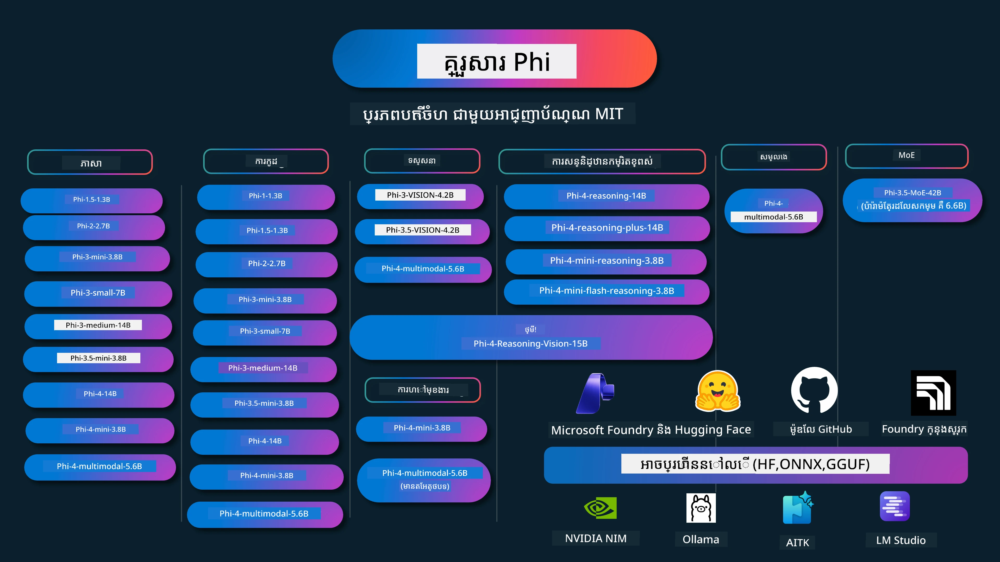

# សៀវភៅច្នៃម៉ាស៊ីន Phi: ឧទាហរណ៍អនុវត្តន៍ជាក់ស្តែងជាមួយគំរូ Phi របស់ Microsoft

[](https://codespaces.new/microsoft/phicookbook)
[](https://vscode.dev/redirect?url=vscode://ms-vscode-remote.remote-containers/cloneInVolume?url=https://github.com/microsoft/phicookbook)

[](https://GitHub.com/microsoft/phicookbook/graphs/contributors/?WT.mc_id=aiml-137032-kinfeylo)
[](https://GitHub.com/microsoft/phicookbook/issues/?WT.mc_id=aiml-137032-kinfeylo)
[](https://GitHub.com/microsoft/phicookbook/pulls/?WT.mc_id=aiml-137032-kinfeylo)
[](http://makeapullrequest.com?WT.mc_id=aiml-137032-kinfeylo)

[](https://GitHub.com/microsoft/phicookbook/watchers/?WT.mc_id=aiml-137032-kinfeylo)
[](https://GitHub.com/microsoft/phicookbook/network/?WT.mc_id=aiml-137032-kinfeylo)
[](https://GitHub.com/microsoft/phicookbook/stargazers/?WT.mc_id=aiml-137032-kinfeylo)

[](https://discord.com/invite/ByRwuEEgH4)

Phi គឺជាប្រភេទគំរូ AI សូរ៉សូបើកចំហដែលបង្កើតឡើងដោយ Microsoft។

Phi សព្វថ្ងៃគឺជាគំរូភាសាទំហំតូច (SLM) ដែលមានកម្លាំងខ្លាំង និងថ្លៃសមរម្យបំផុត បង្ហាញលទ្ធផលល្អនៅក្នុងភាសាច្រើន ការជ្រះចិត្ត ការបង្កើតអត្ថបទ/ជជែក កូដ មុខងារ រូបភាព សំឡេង និងស្ថានភាពផ្សេងទៀត។

អ្នកអាចដាក់ Phi នៅលើពពក ឬឧបករណ៍ផ្នែកជើងដែក ហើយអាចបង្កើតកម្មវិធី AI ប្រភេទបង្កើតដោយមានថាមពលគណនា обំនួរប្រញាប់។

អនុវត្តតាមជំហានខាងក្រោមដើម្បីចាប់ផ្ដើមប្រើប្រាស់ធនធានទាំងនេះ៖
1. **ចម្លង Repository**: ចុច [](https://GitHub.com/microsoft/phicookbook/network/?WT.mc_id=aiml-137032-kinfeylo)
2. **ចម្លង Repository**: `git clone https://github.com/microsoft/PhiCookBook.git`
3. [**ចូលរួមសហគមន៍ Microsoft AI Discord ហើយជួបជុំអ្នកជំនាញ និងអ្នកអភិវឌ្ឍន៍ផងដែរ**](https://discord.com/invite/ByRwuEEgH4?WT.mc_id=aiml-137032-kinfeylo)



### 🌐 គាំទ្រភាសាច្រើន

#### គាំទ្រដោយ GitHub Action (ស្វ័យប្រវត្តិ & តែងតែទាន់សម័យ)

<!-- CO-OP TRANSLATOR LANGUAGES TABLE START -->
[អារ៉ាប់](../ar/README.md) | [បង់គ្លា](../bn/README.md) | [ប៊ុលហ្គារី](../bg/README.md) | [ភាសាប៊ឺម៉ា (မြန်မာ)](../my/README.md) | [ចិន (សម្រួល)](../zh-CN/README.md) | [ចិន (ប្រពៃណី, ហុងកុង)](../zh-HK/README.md) | [ចិន (ប្រពៃណី, ម៉ាកាវ)](../zh-MO/README.md) | [ចិន (ប្រពៃណី, តៃវ៉ាន់)](../zh-TW/README.md) | [ក្រូអាស៊ី](../hr/README.md) | [ឆេក](../cs/README.md) | [ដាណាំង](../da/README.md) | [ដាច់](../nl/README.md) | [អេស្ទូនី](../et/README.md) | [ហ្វាំងឡាញ](../fi/README.md) | [បារាំង](../fr/README.md) | [អាល្លឺម៉ង់](../de/README.md) | [ហ៊ឺក្រេ](../el/README.md) | [ហេប្រ៊៊វ](../he/README.md) | [ហ៊ីន្ទី](../hi/README.md) | [ហុងគ្រី](../hu/README.md) | [អឹនឌូណេស៊ី](../id/README.md) | [អ៊ីតាលី](../it/README.md) | [ជប៉ុន](../ja/README.md) | [កណ្ណាដា](../kn/README.md) | [ខ្មែរ](./README.md) | [កូរ៉េ](../ko/README.md) | [លីទុយអានី](../lt/README.md) | [ម៉ាឡៃ](../ms/README.md) | [ម៉ាឡាឡាំ](../ml/README.md) | [ម៉ានីបូរី (មេទីម៉ាយអែក)](../mni/README.md) | [ម៉ារាត៊ី](../mr/README.md) | [អ្នកណេប៉ាល](../ne/README.md) | [ផ្សេងៗពីប្រទេសនីហ្សេរី](../pcm/README.md) | [ន័រវ៉េ](../no/README.md) | [ប៉ែរីស៊ី (ហ្វារស៊ី)](../fa/README.md) | [ប៉ូឡូញ](../pl/README.md) | [ប៉ួយតុហ្គាល (ប្រាដីល)](../pt-BR/README.md) | [ប៉ួយតុហ្គាល (ប្រទេសប៉្រូតុកាល់)](../pt-PT/README.md) | [បង់ជប៉ាន (កឺម៊ុខី)](../pa/README.md) | [រូម៉ានី](../ro/README.md) | [រុស្ស៊ី](../ru/README.md) | [សេរប៊ី (ស៊ីរីលិក)](../sr/README.md) | [ស្ឡូវ៉ាក់](../sk/README.md) | [ស្ឡូវេនី](../sl/README.md) | [អេស្ប៉ាញ](../es/README.md) | [ស្វាហ៊ីលី](../sw/README.md) | [ស៊ុយអែដ](../sv/README.md) | [តាហ្គាឡុក (ហ្វីឡីពីន)](../tl/README.md) | [តាមីល](../ta/README.md) | [តេឡូកុ](../te/README.md) | [ថៃ](../th/README.md) | [តួកគី](../tr/README.md) | [អ៊ុយក្រែន](../uk/README.md) | [អ៊ូរឌូ](../ur/README.md) | [វៀតណាម](../vi/README.md)

> **ចង់ចម្លងក្នុងកុំព្យូទ័រផ្ទាល់?**
>
> Repository នេះមានការប្រែសម្រួលភាសា 50+ ដែលបង្កើនទំហំទាញយកយ៉ាងខ្លាំង។ ដើម្បីចម្លងដោយមិនមានការប្រែសម្រួលភាសា សូមប្រើ sparse checkout៖
>
> **Bash / macOS / Linux:**
> ```bash
> git clone --filter=blob:none --sparse https://github.com/microsoft/PhiCookBook.git
> cd PhiCookBook
> git sparse-checkout set --no-cone '/*' '!translations' '!translated_images'
> ```
>
> **CMD (Windows):**
> ```cmd
> git clone --filter=blob:none --sparse https://github.com/microsoft/PhiCookBook.git
> cd PhiCookBook
> git sparse-checkout set --no-cone "/*" "!translations" "!translated_images"
> ```
>
> នេះនឹងផ្តល់អ្វីៗដែលអ្នកត្រូវការ ដើម្បីបញ្ចប់វគ្គសិក្សានេះដោយការទាញយករហ័សជាងមុន។
<!-- CO-OP TRANSLATOR LANGUAGES TABLE END -->

## តារាងមាតិកា

- អានក្នុងផ្លូវ
  - [ស្វាគមន៍មកកាន់គ្រួសារភី](./md/01.Introduction/01/01.PhiFamily.md)
  - [ការតំឡើងបរិវេណរបស់អ្នក](./md/01.Introduction/01/01.EnvironmentSetup.md)
  - [ការយល់ដឹងអំពីបច្ចេកវិទ្យាសំខាន់ៗ](./md/01.Introduction/01/01.Understandingtech.md)
  - [សុវត្ថិភាព AI សម្រាប់គំរូ Phi](./md/01.Introduction/01/01.AISafety.md)
  - [គាំទ្រផ្នែករឹង Phi](./md/01.Introduction/01/01.Hardwaresupport.md)
  - [គំរូ Phi និងការស្រេចបំណងនៅលើវេទិកានានា](./md/01.Introduction/01/01.Edgeandcloud.md)
  - [ការប្រើប្រាស់ Guidance-ai និង Phi](./md/01.Introduction/01/01.Guidance.md)
  - [គំរូផ្សារទំនិញ GitHub](https://github.com/marketplace/models)
  - [កាតាឡុកគំរូ Azure AI](https://ai.azure.com)

- ការបញ្ចូល Phi នៅបរិវេណផ្សេងៗ
    -  [Hugging face](./md/01.Introduction/02/01.HF.md)
    -  [គំរូ GitHub](./md/01.Introduction/02/02.GitHubModel.md)
    -  [កាតាឡុកគំរូ Microsoft Foundry](./md/01.Introduction/02/03.AzureAIFoundry.md)
    -  [Ollama](./md/01.Introduction/02/04.Ollama.md)
    -  [ឧបករណ៍ AI Toolkit VSCode (AITK)](./md/01.Introduction/02/05.AITK.md)
    -  [NVIDIA NIM](./md/01.Introduction/02/06.NVIDIA.md)
    -  [Foundry Local](./md/01.Introduction/02/07.FoundryLocal.md)

- ក្រុមគ្រួសារបញ្ចូល Phi
    - [បញ្ចូល Phi នៅ iOS](./md/01.Introduction/03/iOS_Inference.md)
    - [បញ្ចូល Phi នៅ Android](./md/01.Introduction/03/Android_Inference.md)
    - [បញ្ចូល Phi នៅ Jetson](./md/01.Introduction/03/Jetson_Inference.md)
    - [បញ្ចូល Phi នៅ AI PC](./md/01.Introduction/03/AIPC_Inference.md)
    - [បញ្ចូល Phi ជាមួយ Apple MLX Framework](./md/01.Introduction/03/MLX_Inference.md)
    - [បញ្ចូល Phi នៅម៉ាស៊ីនបម្រើមូលដ្ឋាន](./md/01.Introduction/03/Local_Server_Inference.md)
    - [បញ្ចូល Phi នៅម៉ាស៊ីនបម្រើពីចម្ងាយជាមួយ AI Toolkit](./md/01.Introduction/03/Remote_Interence.md)
    - [បញ្ចូល Phi ជាមួយ Rust](./md/01.Introduction/03/Rust_Inference.md)
    - [បញ្ចូល Phi--Vision នៅលើមូលដ្ឋាន](./md/01.Introduction/03/Vision_Inference.md)
    - [បញ្ចូល Phi ជាមួយ Kaito AKS, Azure Containers(គាំទ្រផ្លូវការជាផ្លូវការ)](./md/01.Introduction/03/Kaito_Inference.md)
-  [កំណត់តម្លៃក្រុមគ្រួសារភី](./md/01.Introduction/04/QuantifyingPhi.md)
    - [កំណត់តម្លៃ Phi-3.5 / 4 ដោយប្រើ llama.cpp](./md/01.Introduction/04/UsingLlamacppQuantifyingPhi.md)
    - [កំណត់តម្លើង Phi-3.5 / 4 ដោយប្រើបន្ថែម Generative AI សម្រាប់ onnxruntime](./md/01.Introduction/04/UsingORTGenAIQuantifyingPhi.md)
    - [កំណត់តម្លៃ Phi-3.5 / 4 ដោយប្រើ Intel OpenVINO](./md/01.Introduction/04/UsingIntelOpenVINOQuantifyingPhi.md)
    - [កំណត់តម្លៃ Phi-3.5 / 4 ដោយប្រើ Apple MLX Framework](./md/01.Introduction/04/UsingAppleMLXQuantifyingPhi.md)

-  ការប تقييم Phi
    - [ការឆ្លើយតប AI](./md/01.Introduction/05/ResponsibleAI.md)
    - [Microsoft Foundry សម្រាប់ការវាយតម្លៃ](./md/01.Introduction/05/AIFoundry.md)
    - [ប្រើ Promptflow សម្រាប់ការវាយតម្លៃ](./md/01.Introduction/05/Promptflow.md)
 
- RAG ជាមួយ Azure AI Search
    - [វិធីប្រើ Phi-4-mini និង Phi-4-multimodal(RAG) ជាមួយ Azure AI Search](https://github.com/microsoft/PhiCookBook/blob/main/code/06.E2E/E2E_Phi-4-RAG-Azure-AI-Search.ipynb)
    - [Zero-Cloud Hybrid RAG នៅមូលដ្ឋានជាមួយ SQLite FTS5 និង phi-4-mini](https://github.com/microsoft/PhiCookBook/blob/main/code/06.E2E/E2E_Phi-4-mini_Local_Hybrid_RAG_SQLite_FTS5.ipynb)

- គំរូការអភិវឌ្ឍកម្មវិធី Phi
  - កម្មវិធីអត្ថបទ & ជជែក
    - គំរូ Phi-4 
      - [📓] [ជជែកជាមួយគំរូ Phi-4-mini ONNX](./md/02.Application/01.TextAndChat/Phi4/ChatWithPhi4ONNX/README.md)
      - [ជជែកជាមួយគំរូ Phi-4 ONNX នៅទីតាំងមូលដ្ឋាន .NET](../../md/04.HOL/dotnet/src/LabsPhi4-Chat-01OnnxRuntime)
      - [កម្មវិធី .NET Console ជជែកជាមួយ Phi-4 ONNX ប្រែប្រួលដោយ Sementic Kernel](../../md/04.HOL/dotnet/src/LabsPhi4-Chat-02SK)
    - គំរូ Phi-3 / 3.5 
      - [Chatbot មូលដ្ឋាននៅក្នុងកម្មវិធីអេក្រង់ដោយប្រើ Phi3, ONNX Runtime Web និង WebGPU](https://github.com/microsoft/onnxruntime-inference-examples/tree/main/js/chat)
      - [ជជែក OpenVino](./md/02.Application/01.TextAndChat/Phi3/E2E_OpenVino_Chat.md)
      - [គំរូច្រើន - Phi-3-mini និង OpenAI Whisper បែបអន្តរាគមន៍](./md/02.Application/01.TextAndChat/Phi3/E2E_Phi-3-mini_with_whisper.md)
      - [MLFlow - កសាងកម្មវិធីរុំ និងប្រើ Phi-3 ជាមួយ MLFlow](./md//02.Application/01.TextAndChat/Phi3/E2E_Phi-3-MLflow.md)
      - [អុបទីម៉ាយរបស់គំរូ - របៀបឆ្គងគំរូ Phi-3-min សម្រាប់ ONNX Runtime Web ជាមួយ Olive](https://github.com/microsoft/Olive/tree/main/examples/phi3)
      - [កម្មវិធី WinUI3 ជាមួយ Phi-3 mini-4k-instruct-onnx](https://github.com/microsoft/Phi3-Chat-WinUI3-Sample/)
      -[គំរូកម្មវិធី Note AI មានកម្លាំង WinUI3 Multi Model](https://github.com/microsoft/ai-powered-notes-winui3-sample)
      - [លៃតម្រូវ និងបញ្ចូលគំរូ Phi-3 ឯកជនជាមួយ Prompt flow](./md/02.Application/01.TextAndChat/Phi3/E2E_Phi-3-FineTuning_PromptFlow_Integration.md)
      - [លៃតម្រូវ និងបញ្ចូលគំរូ Phi-3 ឯកជនជាមួយ Prompt flow នៅ Microsoft Foundry](./md/02.Application/01.TextAndChat/Phi3/E2E_Phi-3-FineTuning_PromptFlow_Integration_AIFoundry.md)
      - [វាយតម្លៃគំរូ Phi-3 / Phi-3.5 លៃតម្រូវនៅ Microsoft Foundry ផ្តោតលើគោលការណ៍ AI ទទួលខុសត្រូវរបស់ Microsoft](./md/02.Application/01.TextAndChat/Phi3/E2E_Phi-3-Evaluation_AIFoundry.md)
      - [📓] [គំរូព្យាករណ៍ភាសា Phi-3.5-mini-instruct (ចិន/អង់គ្លេស)](./md/02.Application/01.TextAndChat/Phi3/phi3-instruct-demo.ipynb)
      - [Phi-3.5-Instruct WebGPU RAG Chatbot](./md/02.Application/01.TextAndChat/Phi3/WebGPUWithPhi35Readme.md)
      - [ប្រើប្រាស់ Windows GPU ដើម្បីបង្កើតដំណោះស្រាយ Prompt flow ជាមួយ Phi-3.5-Instruct ONNX](./md/02.Application/01.TextAndChat/Phi3/UsingPromptFlowWithONNX.md)
      - [ប្រើ Microsoft Phi-3.5 tflite ដើម្បីបង្កើតកម្មវិធី Android](./md/02.Application/01.TextAndChat/Phi3/UsingPhi35TFLiteCreateAndroidApp.md)
      - [ឧទាហរណ៍ Q&A .NET ប្រើគំរូ Phi-3 ONNX នៅក្នុងទីតាំងមូលដ្ឋាន ពី Microsoft.ML.OnnxRuntime](../../md/04.HOL/dotnet/src/LabsPhi301)
      - [កម្មវិធី .NET console chat ជាមួយ Semantic Kernel និង Phi-3](../../md/04.HOL/dotnet/src/LabsPhi302)

  - អំពី៧ចុង​ក្របខណ្ឌ Azure AI Inference SDK 
    - គំរូ Phi-4 
      - [📓] [បង្កើតកូដគម្រោងដោយប្រើ Phi-4-multimodal](./md/02.Application/02.Code/Phi4/GenProjectCode/README.md)
    - គំរូ Phi-3 / 3.5 
      - [បង្កើត Visual Studio Code GitHub Copilot Chat របស់អ្នក ដោយ Microsoft Phi-3 Family](./md/02.Application/02.Code/Phi3/VSCodeExt/README.md)
      - [បង្កើត Visual Studio Code Chat Copilot Agent របស់អ្នក ដោយ Phi-3.5 របស់ GitHub Models](/md/02.Application/02.Code/Phi3/CreateVSCodeChatAgentWithGitHubModels.md)

  - ឧទាហរណ៍ការជ្រះចិត្តកម្រិតខ្ពស់
    - គំរូ Phi-4 
      - [📓] [គំរូ Phi-4-mini-reasoning ឬ Phi-4-reasoning](./md/02.Application/03.AdvancedReasoning/Phi4/AdvancedResoningPhi4mini/README.md)
      - [📓] [កែសម្រួល Phi-4-mini-reasoning ជាមួយ Microsoft Olive](./md/02.Application/03.AdvancedReasoning/Phi4/AdvancedResoningPhi4mini/olive_ft_phi_4_reasoning_with_medicaldata.ipynb)
      - [📓] [កែសម្រួល Phi-4-mini-reasoning ជាមួយ Apple MLX](./md/02.Application/03.AdvancedReasoning/Phi4/AdvancedResoningPhi4mini/mlx_ft_phi_4_reasoning_with_medicaldata.ipynb)
      - [📓] [Phi-4-mini-reasoning ជាមួយម៉ូដែល GitHub](./md/02.Application/02.Code/Phi4r/github_models_inference.ipynb)
      - [📓] [Phi-4-mini-reasoning ជាមួយម៉ូដែល Microsoft Foundry](./md/02.Application/02.Code/Phi4r/azure_models_inference.ipynb)
  - ដេម៉ូ
      - [ដេម៉ូ Phi-4-mini ដែលផ្សព្វផ្សាយនៅលើ Hugging Face Spaces](https://huggingface.co/spaces/microsoft/phi-4-mini?WT.mc_id=aiml-137032-kinfeylo)
      - [ដេម៉ូ Phi-4-multimodal ដែលផ្សព្វផ្សាយនៅលើ Hugginge Face Spaces](https://huggingface.co/spaces/microsoft/phi-4-multimodal?WT.mc_id=aiml-137032-kinfeylo)
  - គំរូទស្សនវិស័យ
    - គំរូ Phi-4 
      - [📓] [ប្រើ Phi-4-multimodal ដើម្បីអានរូបភាព និងបង្កើតកូដ](./md/02.Application/04.Vision/Phi4/CreateFrontend/README.md) 
    - គំរូ Phi-3 / 3.5
      -  [📓][Phi-3-vision-ប្រើអត្ថបទក្នុងរូបភាពទៅអត្ថបទ](./md/02.Application/04.Vision/Phi3/E2E_Phi-3-vision-image-text-to-text-online-endpoint.ipynb)
      - [Phi-3-vision-ONNX](https://onnxruntime.ai/docs/genai/tutorials/phi3-v.html)
      - [📓][Phi-3-vision CLIP Embedding](./md/02.Application/04.Vision/Phi3/E2E_Phi-3-vision-image-text-to-text-online-endpoint.ipynb)
      - [ដេម៉ូ: Phi-3 Recycling](https://github.com/jennifermarsman/PhiRecycling/)
      - [Phi-3-vision - ជំនួយភាសា Visual - ជាមួយ Phi3-Vision និង OpenVINO](https://docs.openvino.ai/nightly/notebooks/phi-3-vision-with-output.html)
      - [Phi-3 Vision Nvidia NIM](./md/02.Application/04.Vision/Phi3/E2E_Nvidia_NIM_Vision.md)
      - [Phi-3 Vision OpenVino](./md/02.Application/04.Vision/Phi3/E2E_OpenVino_Phi3Vision.md)
      - [📓][Phi-3.5 Vision ឧទាហរណ៍ម៉ូលទ្រីហ្វ្រេម ឬ ម៉ូលទ្រីរូបភាព](./md/02.Application/04.Vision/Phi3/phi3-vision-demo.ipynb)
      - [Phi-3 Vision ម៉ូដែល ONNX ក្នុងប្រព័ន្ធ Microsoft.ML.OnnxRuntime .NET](../../md/04.HOL/dotnet/src/LabsPhi303)
      - [ម៉ឺនុយផ្អែក Phi-3 Vision ម៉ូដែល ONNX ក្នុងប្រព័ន្ធ Microsoft.ML.OnnxRuntime .NET](../../md/04.HOL/dotnet/src/LabsPhi304)

  - គំរូ Reasoning-Vision
    - Phi-4-Reasoning-Vision-15B 
      - [📓] [ប្រើ Phi-4-Reasoning-Vision-15B ដើម្បីចាប់ភ្លើងចរាចរណ៍ jaywalking](./md/02.Application/10.ReasoningVision/Phi_4_reasoning_vision_15b_Jaywalking.ipynb)
      - [📓] [ប្រើ Phi-4-Reasoning-Vision-15B ដើម្បីគណិតវិទ្យា](./md/02.Application/10.ReasoningVision/Phi_4_reasoning_vision_15b_Math.ipynb)
      - [📓] [ប្រើ Phi-4-Reasoning-Vision-15B ដើម្បីចាប់ UI](./md/02.Application/10.ReasoningVision/Phi_4_reasoning_vision_15b_ui.ipynb)

  - គំរូ គណិតវិទ្យា
    -  គំរូ Phi-4-Mini-Flash-Reasoning-Instruct  [ដេម៉ូ គណិតវិទ្យាជាមួយ Phi-4-Mini-Flash-Reasoning-Instruct](./md/02.Application/09.Math/MathDemo.ipynb)

  - គំរូ សំលេង
    - គំរូ Phi-4 
      - [📓] [ដកស្រង់អត្ថបទសំឡេងដោយប្រើ Phi-4-multimodal](./md/02.Application/05.Audio/Phi4/Transciption/README.md)
      - [📓] [គំរូសំឡេង Phi-4-multimodal](./md/02.Application/05.Audio/Phi4/Siri/demo.ipynb)
      - [📓] [គំរូបកប្រែសំឡេង Phi-4-multimodal Speech](./md/02.Application/05.Audio/Phi4/Translate/demo.ipynb)
      - [.NET console application ប្រើ Phi-4-multimodal សំឡេង ដើម្បីវិភាគឯកសារសំឡេង និងបង្កើតអត្ថបទ](../../md/04.HOL/dotnet/src/LabsPhi4-MultiModal-02Audio)

  - គំរូ MOE
    - គំរូ Phi-3 / 3.5
      - [📓] [ម៉ូដែល Phi-3.5 Mixture of Experts (MoEs) គំរូបណ្តាញសង្គម](./md/02.Application/06.MoE/Phi3/phi3_moe_demo.ipynb)
      - [📓] [កសាងផាណិលការផលិត-តាមការស្វែងរក (RAG) ជាមួយ NVIDIA NIM Phi-3 MOE, Azure AI Search, និង LlamaIndex](./md/02.Application/06.MoE/Phi3/azure-ai-search-nvidia-rag.ipynb)
      - 
  - គំរូ Function Calling
    - គំរូ Phi-4 🆕
      -  [📓] [ប្រើ Function Calling ជាមួយ Phi-4-mini](./md/02.Application/07.FunctionCalling/Phi4/FunctionCallingBasic/README.md)
      -  [📓] [ប្រើ Function Calling ដើម្បីបង្កើត multi-agents ជាមួយ Phi-4-mini](./md/02.Application/07.FunctionCalling/Phi4/Multiagents/Phi_4_mini_multiagent.ipynb)
      -  [📓] [ប្រើ Function Calling ជាមួយ Ollama](./md/02.Application/07.FunctionCalling/Phi4/Ollama/ollama_functioncalling.ipynb)
      -  [📓] [ប្រើ Function Calling ជាមួយ ONNX](./md/02.Application/07.FunctionCalling/Phi4/ONNX/onnx_parallel_functioncalling.ipynb)
  - គំរូ វិសមាត្រមូលផ្សំ
    - គំរូ Phi-4 🆕
      -  [📓] [ប្រើ Phi-4-multimodal ជាព័ត៌មានកសាងបេសកកម្មអ្នកសារព័ត៌មានបច្ចេកវិទ្យា](./md/02.Application/08.Multimodel/Phi4/TechJournalist/phi_4_mm_audio_text_publish_news.ipynb)
      - [.NET console application ប្រើ Phi-4-multimodal ដើម្បីវិភាគរូបភាព](../../md/04.HOL/dotnet/src/LabsPhi4-MultiModal-01Images)

- កែសម្រួល Phi គំរូ
  - [សេណារីយ៉ូកែសម្រួល](./md/03.FineTuning/FineTuning_Scenarios.md)
  - [កែសម្រួល ប្រៀបធៀប RAG](./md/03.FineTuning/FineTuning_vs_RAG.md)
  - [អនុញ្ញាតឱ្យ Phi-3 ក្លាយជាអ្នកជំនាញឧស្សាហកម្ម](./md/03.FineTuning/LetPhi3gotoIndustriy.md)
  - [កែសម្រួល Phi-3 ជាមួយ AI Toolkit សម្រាប់ VS Code](./md/03.FineTuning/Finetuning_VSCodeaitoolkit.md)
  - [កែសម្រួល Phi-3 ជាមួយ Azure Machine Learning Service](./md/03.FineTuning/Introduce_AzureML.md)
  - [កែសម្រួល Phi-3 ជាមួយ Lora](./md/03.FineTuning/FineTuning_Lora.md)
  - [កែសម្រួល Phi-3 ជាមួយ QLora](./md/03.FineTuning/FineTuning_Qlora.md)
  - [កែសម្រួល Phi-3 ជាមួយ Microsoft Foundry](./md/03.FineTuning/FineTuning_AIFoundry.md)
  - [កែសម្រួល Phi-3 ជាមួយ Azure ML CLI/SDK](./md/03.FineTuning/FineTuning_MLSDK.md)
  - [កែសម្រួល ជាមួយ Microsoft Olive](./md/03.FineTuning/FineTuning_MicrosoftOlive.md)
  - [កែសម្រួល ជាមួយ Microsoft Olive Hands-On Lab](./md/03.FineTuning/olive-lab/readme.md)
  - [កែសម្រួល Phi-3-vision ជាមួយ Weights and Bias](./md/03.FineTuning/FineTuning_Phi-3-visionWandB.md)
  - [កែសម្រួល Phi-3 ជាមួយ Apple MLX Framework](./md/03.FineTuning/FineTuning_MLX.md)
  - [កែសម្រួល Phi-3-vision (គាំទ្រផ្លូវការ)](./md/03.FineTuning/FineTuning_Vision.md)
  - [កែសម្រួល Phi-3 ជាមួយ Kaito AKS , Azure Containers(គាំទ្រផ្លូវការ)](./md/03.FineTuning/FineTuning_Kaito.md)
  - [កែសម្រួល Phi-3 និង 3.5 Vision](https://github.com/2U1/Phi3-Vision-Finetune)

- វិទ្យាស្ថានដៃលើ
  - [ស្វែងយល់ម៉ូដែលកាត់ខ្នើយ: LLMs, SLMs, ការអភិវឌ្ឍន៍ក្នុងតំបន់ និងបន្ថែមទៀត](https://github.com/microsoft/aitour-exploring-cutting-edge-models)
  - [បើកការពន្លឿន NLP: កែសម្រួលជាមួយ Microsoft Olive](https://github.com/azure/Ignite_FineTuning_workshop)

- គ្រឿងសន្លឹកស្រាវជ្រាវ និងការបោះពុម្ពផ្សាយ
  - [សៀវភៅសិក្សា គឺគ្រប់គ្រាន់ II: របាយការណ៍បច្ចេកទេស phi-1.5](https://arxiv.org/abs/2309.05463)
  - [របាយការណ៍បច្ចេកទេស Phi-3: ម៉ូដែលភាសាមានសមត្ថភាពខ្ពស់នៅលើទូរសព្ទដៃរបស់អ្នក](https://arxiv.org/abs/2404.14219)
  - [របាយការណ៍បច្ចេកទេស Phi-4](https://arxiv.org/abs/2412.08905)
  - [របាយការណ៍បច្ចេកទេស Phi-4-Mini: ម៉ូដែលភាសាមូលផ្ទៃតូច ប៉ុន្តែមានអំណាច តាមរយៈការភ្ជាប់ Mixture-of-LoRAs](https://arxiv.org/abs/2503.01743)
  - [បង្កើតម៉ូដែលភាសាតូចសម្រាប់ការហៅមុខងារ In-Vehicle](https://arxiv.org/abs/2501.02342)
  - [(WhyPHI) កែសម្រួល PHI-3 សម្រាប់ចម្លើយសំណួរជម្រើសច្រើន: វិធីសាស្រ្ត, លទ្ធផល និងវិបត្តិ](https://arxiv.org/abs/2501.01588)
  - [របាយការណ៍បច្ចេកទេស Phi-4-reasoning](https://www.microsoft.com/en-us/research/wp-content/uploads/2025/04/phi_4_reasoning.pdf)
  - [របាយការណ៍បច្ចេកទេស Phi-4-mini-reasoning](https://huggingface.co/microsoft/Phi-4-mini-reasoning/blob/main/Phi-4-Mini-Reasoning.pdf)

## ការប្រើម៉ូដែល Phi

### Phi លើ Microsoft Foundry

អ្នកអាចស្វែងយល់ពីវិធីប្រើ Microsoft Phi និងវិធីកសាងដំណោះស្រាយ E2E នៅលើឧបករណ៍ផ្ទាល់ខ្លួនផ្សេងៗរបស់អ្នក។ ដើម្បីមានបទពិសោធន៍ Phi សម្រាប់ខ្លួនឯង ចាប់ផ្តើមលេងជាមួយម៉ូដែល និងប្តូរតាមសេនា រ៉ូរបស់អ្នកប្រើប្រាស់ដោយប្រើ [Microsoft Foundry Azure AI Model Catalog](https://aka.ms/phi3-azure-ai) អ្នកអាចស្វែងយល់បន្ថែមនៅ Getting Started with [Microsoft Foundry](/md/02.QuickStart/AzureAIFoundry_QuickStart.md)

**លេងល្បែង**
ម៉ូដែលនីមួយៗមានលំហដែលផ្តល់ឱ្យធ្វើតេស្តម៉ូដែល [Azure AI Playground](https://aka.ms/try-phi3)។

### Phi លើម៉ូដែល GitHub

អ្នកអាចស្វែងយល់ពីវិធីប្រើ Microsoft Phi និងវិធីកសាងដំណោះស្រាយ E2E នៅលើឧបករណ៍ផ្ទាល់ខ្លួនរបស់អ្នក។ ដើម្បីមានបទពិសោធន៍ Phi សម្រាប់ខ្លួនឯង ចាប់ផ្តើមលេងជាមួយម៉ូដែល និងប្តូរតាមសេណារីយ៉ូវ្វើការរបស់អ្នកប្រើប្រាស់ដោយប្រើ [GitHub Model Catalog](https://github.com/marketplace/models?WT.mc_id=aiml-137032-kinfeylo) អ្នកអាចស្វែងយល់បន្ថែមនៅ Getting Started with [GitHub Model Catalog](/md/02.QuickStart/GitHubModel_QuickStart.md)

**លេងល្បែង**
ម៉ូដែលនីមួយៗមាន [លំហលេងសម្រាប់ធ្វើតេស្តម៉ូដែល](/md/02.QuickStart/GitHubModel_QuickStart.md)។

### Phi លើ Hugging Face

អ្នកក៏អាចស្វែងរកម៉ូដែលនេះនៅលើ [Hugging Face](https://huggingface.co/microsoft)

**លេងល្បែង**
 [លំហ Hugging Chat](https://huggingface.co/chat/models/microsoft/Phi-3-mini-4k-instruct)

 ## 🎒 코스ផ្សេងទៀត

ក្រុមការងាររបស់យើងផលិតសិក្សាផ្សេងទៀត! សូមពិនិត្យមើល៖

<!-- CO-OP TRANSLATOR OTHER COURSES START -->
### LangChain
[](https://aka.ms/langchain4j-for-beginners)
[](https://aka.ms/langchainjs-for-beginners?WT.mc_id=m365-94501-dwahlin)
[](https://github.com/microsoft/langchain-for-beginners?WT.mc_id=m365-94501-dwahlin)
---

### Azure / Edge / MCP / Agents
[](https://github.com/microsoft/AZD-for-beginners?WT.mc_id=academic-105485-koreyst)
[](https://github.com/microsoft/edgeai-for-beginners?WT.mc_id=academic-105485-koreyst)
[](https://github.com/microsoft/mcp-for-beginners?WT.mc_id=academic-105485-koreyst)
[](https://github.com/microsoft/ai-agents-for-beginners?WT.mc_id=academic-105485-koreyst)

---
 
### ស៊េរី Generative AI
[](https://github.com/microsoft/generative-ai-for-beginners?WT.mc_id=academic-105485-koreyst)
[-9333EA?style=for-the-badge&labelColor=E5E7EB&color=9333EA)](https://github.com/microsoft/Generative-AI-for-beginners-dotnet?WT.mc_id=academic-105485-koreyst)
[-C084FC?style=for-the-badge&labelColor=E5E7EB&color=C084FC)](https://github.com/microsoft/generative-ai-for-beginners-java?WT.mc_id=academic-105485-koreyst)
[-E879F9?style=for-the-badge&labelColor=E5E7EB&color=E879F9)](https://github.com/microsoft/generative-ai-with-javascript?WT.mc_id=academic-105485-koreyst)

---
 
### Core Learning
[](https://aka.ms/ml-beginners?WT.mc_id=academic-105485-koreyst)
[](https://aka.ms/datascience-beginners?WT.mc_id=academic-105485-koreyst)
[](https://aka.ms/ai-beginners?WT.mc_id=academic-105485-koreyst)
[](https://github.com/microsoft/Security-101?WT.mc_id=academic-96948-sayoung)
[](https://aka.ms/webdev-beginners?WT.mc_id=academic-105485-koreyst)
[](https://aka.ms/iot-beginners?WT.mc_id=academic-105485-koreyst)
[](https://github.com/microsoft/xr-development-for-beginners?WT.mc_id=academic-105485-koreyst)

---
 
### ស៊េរី Copilot
[](https://aka.ms/GitHubCopilotAI?WT.mc_id=academic-105485-koreyst)
[](https://github.com/microsoft/mastering-github-copilot-for-dotnet-csharp-developers?WT.mc_id=academic-105485-koreyst)
[](https://github.com/microsoft/CopilotAdventures?WT.mc_id=academic-105485-koreyst)
<!-- CO-OP TRANSLATOR OTHER COURSES END -->

## ទំនួលខុសត្រូវ AI 

Microsoft មានសមាសភាពក្នុងការជួយអតិថិជនប្រើប្រាស់ផលិតផល AI របស់យើងដោយទំនួលខុសត្រូវ, ចែករំលែកកម្រិតចំណេះដឹង និងបង្កើតភាពជឿជាក់តាមឧបករណ៍ដូចជាកំណត់ត្រា Transparency Notes និងការវាយតម្លៃផលប៉ះពាល់។ ប្រភពទាំងនេះជាច្រើនអាចរកឃើញនៅ [https://aka.ms/RAI](https://aka.ms/RAI).
វិធានការរបស់ Microsoft សម្រាប់សមត្ថភាពទទួលខុសត្រូវនៃ AI គឺផ្អែកលើគោលការណ៍ AI របស់យើងដែលមានតុល្យភាព, ភាពជឿធន់ និងសុវត្ថិភាព, សិទ្ធិឯកជន និងសុវត្ថិភាព, ភាពរួមចំណែក, ភាពត្រាំងត្រៃ និងភាពទទួលខុសត្រូវ។

ម៉ូដែលភាសា ឯកសាររូបភាព និងសំឡេងថ្នាក់ធំ - ដូចម៉ូដែលដែលប្រើនៅក្នុងគំរូនេះ - អាចមានប្រសិទ្ធភាពដើម្បីធ្វើអោយមានប្រព្រឹត្តិការណ៍មិនតុល្យភាព, មិនជឿជាក់ ឬរំលោភ, ដែលអាចបង្កការខូចខាតបាន។ សូមពិនិត្យ [សៀវភៅ Transparency note សេវាកម្ម Azure OpenAI](https://learn.microsoft.com/legal/cognitive-services/openai/transparency-note?tabs=text) ដើម្បីទទួលបានព័ត៌មានអំពីហានិភ័យ និងកំណត់អត្រា។

វិធីសាស្រ្តដែលបានណែនាំសម្រាប់បន្ថយហានិភ័យទាំងនេះគឺការរួមបញ្ចូលប្រព័ន្ធសុវត្ថិភាពនៅក្នុងស្ថាបត្យកម្មរបស់អ្នកដែលអាចរកឃើញ និងទប់ស្កាត់ប្រតិបត្តិការដែលផ្តល់អំពើអាក្រក់បាន។ [Azure AI Content Safety](https://learn.microsoft.com/azure/ai-services/content-safety/overview) ផ្ដល់ជាថ្នាក់ការពារឯករាជ្យ ដែលអាចរកឃើញខ្លឹមសារដែលបង្កជាគ្រោះថ្នាក់ដោយអ្នកប្រើប្រាស់ និង AI ក្នុងកម្មវិធីនិងសេវាកម្ម។ Azure AI Content Safety រួមមាន API សម្រាប់អត្ថបទ និងរូបភាព ដែលអនុញ្ញាតឱ្យអ្នករកឃើញគ្រឿងផ្សំដែលគ្រោះថ្នាក់។ នៅក្នុង Microsoft Foundry សេវាកម្ម Content Safety អនុញ្ញាតឱ្យអ្នកមើល ស្វែងយល់ និងសាកល្បងកូដគំរូសម្រាប់រកឃើញខ្លឹមសារដែលគ្រោះថ្នាក់តាមរយៈរបៀបផ្សេងៗគ្នា។ ឯកសារ [quickstart documentation](https://learn.microsoft.com/azure/ai-services/content-safety/quickstart-text?tabs=visual-studio%2Clinux&pivots=programming-language-rest) ខាងក្រោម នឹងណែនាំអ្នកដើម្បីធ្វើការស្នើសុំទៅកាន់សេវាកម្ម។

បំណែកផ្សេងទៀតដែលត្រូវយកចិត្តទុកដាក់គឺសមត្ថភាពសរុបនៃកម្មវិធី។ ជាមួយកម្មវិធីមានមុខងារច្រើនរួម និងម៉ូដែលច្រើនយើងពិចារណាសមត្ថភាពមានន័យថាប្រព័ន្ធអនុវត្តតាមការរំពឹងទុករបស់អ្នក និងអ្នកប្រើរបស់អ្នក រួមបញ្ចូលការមិនបង្កើតលទ្ធផលគ្រោះថ្នាក់។ សំខាន់ក្នុងការវាយតម្លៃសមត្ថភាពសរុបនៃកម្មវិធីរបស់អ្នកដោយប្រើ [Performance and Quality and Risk and Safety evaluators](https://learn.microsoft.com/azure/ai-studio/concepts/evaluation-metrics-built-in)។ អ្នកក៏អាចបង្កើត និងវាយតម្លៃជាមួយ [custom evaluators](https://learn.microsoft.com/azure/ai-studio/how-to/develop/evaluate-sdk#custom-evaluators) ផងដែរ។

អ្នកអាចវាយតម្លៃកម្មវិធី AI របស់អ្នកនៅបរិបទអភិវឌ្ឍន៍របស់អ្នកដោយប្រើ [Azure AI Evaluation SDK](https://microsoft.github.io/promptflow/index.html)។ ពីបញ្ជីទិន្នន័យសាកល្បង ឬគោលបំណង អ្នកបង្កើត AI generative នឹងត្រូវវាយតម្លៃយ៉ាងច្បាស់លាស់ជាមួយអ្នកវាយតម្លៃដែលបានបញ្ចូល ឬអ្នកវាយតម្លៃផ្ទាល់ខ្លួនដែលអ្នកជ្រើសរើស។ ដើម្បីចាប់ផ្តើមជាមួយ azure ai evaluation sdk ដើម្បីវាយតម្លៃប្រព័ន្ធរបស់អ្នក អ្នកអាចអនុវត្តតាម [quickstart guide](https://learn.microsoft.com/azure/ai-studio/how-to/develop/flow-evaluate-sdk)។ ពេលអ្នកអនុវត្តការរត់វាយតម្លៃ អ្នកអាច [មើលលទ្ធផលក្នុង Microsoft Foundry](https://learn.microsoft.com/azure/ai-studio/how-to/evaluate-flow-results)។

## សញ្ញាផលិតផល

គម្រោងនេះអាចមានសញ្ញាផលិតផល ឬរូបសញ្ញាសម្រាប់គម្រោង ផលិតផល ឬសេវាកម្ម។ ការប្រើប្រាស់សញ្ញាផលិតផល ឬរូបសញ្ញា Microsoft ត្រូវស្របទៅនឹងនីតិវិធី និងតម្រូវការរបស់ [Microsoft's Trademark & Brand Guidelines](https://www.microsoft.com/legal/intellectualproperty/trademarks/usage/general)។
ការប្រើប្រាស់សញ្ញាផលិតផល ឬរូបសញ្ញា Microsoft ក្នុងកំណែបានកែប្រែនេះមិនត្រូវធ្វើឲ្យមានការជ្រុលជ្រែក ឬសន្មតថា Microsoft គាំទ្រឡើយ។ ការប្រើប្រាស់សញ្ញាផលិតផល ឬរូបសញ្ញារបស់ភាគីទីបី គឺត្រូវស្របទៅនឹងគោលការណ៍របស់ភាគីនោះ។

## ជំនួយ

ប្រសិនបើអ្នករង់ចាំ ឬមានសំណួរអំពីការគ្រប់គ្រងកម្មវិធី AI សូមចូលរួម:

[](https://aka.ms/foundry/discord)

ប្រសិនបើអ្នកមានមតិយោបល់ផលិតផល ឬមានកំហុសពេលកសាង សូមចូលទៅកាន់:

[](https://aka.ms/foundry/forum)

---

<!-- CO-OP TRANSLATOR DISCLAIMER START -->
**ការបដិសេធ**:
ឯកសារនេះត្រូវបានបម្លែងភាសា ដោយប្រើសេវាបម្លែងភាសា AI [Co-op Translator](https://github.com/Azure/co-op-translator)។ ទោះយើងខ្ញុំមានក្តីប្រាថ្នាឱ្យបានច្បាស់លាស់ តែសូមយល់ដឹងថាការបម្លែងដោយស្វ័យប្រវត្តិក៏អាចមានកំហុសឬភាពមិនត្រឹមត្រូវ។ ឯកសារដើមជាភាសាទីតាំងគួរត្រូវបានគេប្រើជាប្រភពច្បាស់លាស់។ សម្រាប់ព័ត៌មានសំខាន់ៗ សូមណែនាំឱ្យប្រើប្រាស់ការប្រែដោយមនុស្សជំនាញ។ យើងខ្ញុំមិនទទួលខុសត្រូវចំពោះការយល់ច្រឡំ ឬការបកស្រាយខុសបន្ទាប់ពីការប្រើប្រាស់ការបម្លែងនេះនោះទេ។
<!-- CO-OP TRANSLATOR DISCLAIMER END -->