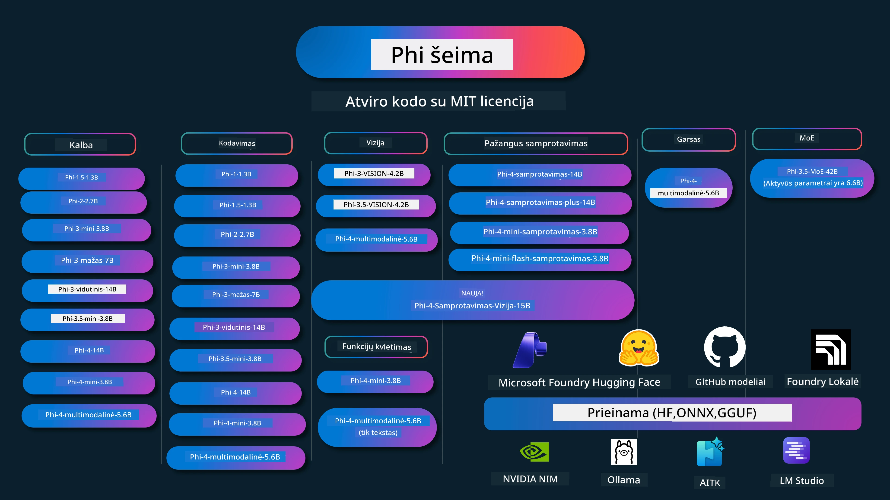

# Phi receptų knyga: Praktiniai pavyzdžiai su „Microsoft“ Phi modeliais

[](https://codespaces.new/microsoft/phicookbook)
[](https://vscode.dev/redirect?url=vscode://ms-vscode-remote.remote-containers/cloneInVolume?url=https://github.com/microsoft/phicookbook)

[](https://GitHub.com/microsoft/phicookbook/graphs/contributors/?WT.mc_id=aiml-137032-kinfeylo)
[](https://GitHub.com/microsoft/phicookbook/issues/?WT.mc_id=aiml-137032-kinfeylo)
[](https://GitHub.com/microsoft/phicookbook/pulls/?WT.mc_id=aiml-137032-kinfeylo)
[](http://makeapullrequest.com?WT.mc_id=aiml-137032-kinfeylo)

[](https://GitHub.com/microsoft/phicookbook/watchers/?WT.mc_id=aiml-137032-kinfeylo)
[](https://GitHub.com/microsoft/phicookbook/network/?WT.mc_id=aiml-137032-kinfeylo)
[](https://GitHub.com/microsoft/phicookbook/stargazers/?WT.mc_id=aiml-137032-kinfeylo)

[](https://discord.com/invite/ByRwuEEgH4)

Phi yra atviro kodo dirbtinio intelekto modelių serija, sukurta „Microsoft“.

Phi šiuo metu yra galingiausias ir ekonomiškiausias mažas kalbos modelis (SLM), pasižymintis labai gerais rezultatais daugakalbiuose, loginio mąstymo, teksto/pokalbio generavimo, programavimo, vaizdų, garso ir kitose srityse.

Phi galite diegti debesyje arba „edge“ įrenginiuose ir lengvai kurti kūrybinius DI sprendimus naudojant ribotus skaičiavimo išteklius.

Norėdami pradėti naudoti šiuos išteklius, atlikite šiuos veiksmus:
1. **Fork‘inkite saugyklą**: Spustelėkite [](https://GitHub.com/microsoft/phicookbook/network/?WT.mc_id=aiml-137032-kinfeylo)
2. **Klonuokite saugyklą**: `git clone https://github.com/microsoft/PhiCookBook.git`
3. [**Prisijunkite prie „Microsoft AI Discord“ bendruomenės ir susipažinkite su ekspertais bei kitais kūrėjais**](https://discord.com/invite/ByRwuEEgH4?WT.mc_id=aiml-137032-kinfeylo)



### 🌐 Daugakalbė palaikymas

#### Palaikoma per „GitHub Action“ (automatizuota ir visada atnaujinta)

<!-- CO-OP TRANSLATOR LANGUAGES TABLE START -->
[Arabų](../ar/README.md) | [Bengalų](../bn/README.md) | [Bulgarų](../bg/README.md) | [Birmos (Mianmaro)](../my/README.md) | [Kinų (supaprastinta)](../zh-CN/README.md) | [Kinų (tradicinė, Honkongas)](../zh-HK/README.md) | [Kinų (tradicinė, Makao)](../zh-MO/README.md) | [Kinų (tradicinė, Taivanas)](../zh-TW/README.md) | [Kroatų](../hr/README.md) | [Čekų](../cs/README.md) | [Danų](../da/README.md) | [Olandų](../nl/README.md) | [Estų](../et/README.md) | [Suomių](../fi/README.md) | [Prancūzų](../fr/README.md) | [Vokiečių](../de/README.md) | [Graikų](../el/README.md) | [Hebrajų](../he/README.md) | [Hindi](../hi/README.md) | [Vengrų](../hu/README.md) | [Indoneziečių](../id/README.md) | [Italų](../it/README.md) | [Japonų](../ja/README.md) | [Kannados](../kn/README.md) | [Chmerų](../km/README.md) | [Korėjiečių](../ko/README.md) | [Lietuvių](./README.md) | [Malajų](../ms/README.md) | [Malajalų](../ml/README.md) | [Manipurio (Meitei Mayek)](../mni/README.md) | [Maratių](../mr/README.md) | [Nepalų](../ne/README.md) | [Nigerijos pidžino](../pcm/README.md) | [Norvegų](../no/README.md) | [Persų (Farsi)](../fa/README.md) | [Lenkų](../pl/README.md) | [Portugalų (Brazilija)](../pt-BR/README.md) | [Portugalų (Portugalija)](../pt-PT/README.md) | [Pandžabių (Gurmukhi)](../pa/README.md) | [Rumunų](../ro/README.md) | [Rusų](../ru/README.md) | [Serbų (kirilica)](../sr/README.md) | [Slovakų](../sk/README.md) | [Slovėnų](../sl/README.md) | [Ispanų](../es/README.md) | [Suahelio](../sw/README.md) | [Švedų](../sv/README.md) | [Tagalogų (Filipinų)](../tl/README.md) | [Tamilų](../ta/README.md) | [Telugų](../te/README.md) | [Tailando](../th/README.md) | [Turkų](../tr/README.md) | [Ukrainiečių](../uk/README.md) | [Urdu](../ur/README.md) | [Vietnamių](../vi/README.md)

> **Verčiau klonuoti vietoje?**
>
> Ši saugykla apima daugiau nei 50 kalbų vertimų, dėl ko ženkliai padidėja atsisiuntimo dydis. Norėdami klonuoti be vertimų, naudokite ribotą checkout:
>
> **Bash / macOS / Linux:**
> ```bash
> git clone --filter=blob:none --sparse https://github.com/microsoft/PhiCookBook.git
> cd PhiCookBook
> git sparse-checkout set --no-cone '/*' '!translations' '!translated_images'
> ```
>
> **CMD (Windows):**
> ```cmd
> git clone --filter=blob:none --sparse https://github.com/microsoft/PhiCookBook.git
> cd PhiCookBook
> git sparse-checkout set --no-cone "/*" "!translations" "!translated_images"
> ```
>
> Tai suteiks jums viską, ko reikia kurso įvykdymui, žymiai greičiau atsisiunčiant.
<!-- CO-OP TRANSLATOR LANGUAGES TABLE END -->

## Turinys

- Įvadas
  - [Sveiki atvykę į Phi šeimą](./md/01.Introduction/01/01.PhiFamily.md)
  - [Aplinkos paruošimas](./md/01.Introduction/01/01.EnvironmentSetup.md)
  - [Pagrindinių technologijų supratimas](./md/01.Introduction/01/01.Understandingtech.md)
  - [DI saugumas Phi modeliams](./md/01.Introduction/01/01.AISafety.md)
  - [Phi aparatinės įrangos palaikymas](./md/01.Introduction/01/01.Hardwaresupport.md)
  - [Phi modeliai ir jų prieinamumas per platformas](./md/01.Introduction/01/01.Edgeandcloud.md)
  - [Kaip naudoti Guidance-ai ir Phi](./md/01.Introduction/01/01.Guidance.md)
  - [GitHub Marketplace modeliai](https://github.com/marketplace/models)
  - [„Azure AI“ modelių katalogas](https://ai.azure.com)

- Phi vykdymas skirtingose aplinkose
    -  [Hugging face](./md/01.Introduction/02/01.HF.md)
    -  [GitHub modeliai](./md/01.Introduction/02/02.GitHubModel.md)
    -  [Microsoft Foundry modelių katalogas](./md/01.Introduction/02/03.AzureAIFoundry.md)
    -  [Ollama](./md/01.Introduction/02/04.Ollama.md)
    -  [AI Toolkit VSCode (AITK)](./md/01.Introduction/02/05.AITK.md)
    -  [NVIDIA NIM](./md/01.Introduction/02/06.NVIDIA.md)
    -  [Foundry vietinis](./md/01.Introduction/02/07.FoundryLocal.md)

- Phi šeimos vykdymas
    - [Phi vykdymas iOS](./md/01.Introduction/03/iOS_Inference.md)
    - [Phi vykdymas Android](./md/01.Introduction/03/Android_Inference.md)
    - [Phi vykdymas Jetson](./md/01.Introduction/03/Jetson_Inference.md)
    - [Phi vykdymas AI kompiuteryje](./md/01.Introduction/03/AIPC_Inference.md)
    - [Phi vykdymas su Apple MLX sistema](./md/01.Introduction/03/MLX_Inference.md)
    - [Phi vykdymas vietiniame serveryje](./md/01.Introduction/03/Local_Server_Inference.md)
    - [Phi vykdymas nuotoliniame serveryje naudojant AI Toolkit](./md/01.Introduction/03/Remote_Interence.md)
    - [Phi vykdymas su Rust](./md/01.Introduction/03/Rust_Inference.md)
    - [Phi – Vaizdo vykdymas vietoje](./md/01.Introduction/03/Vision_Inference.md)
    - [Phi vykdymas su Kaito AKS, Azure konteineriais (oficialus palaikymas)](./md/01.Introduction/03/Kaito_Inference.md)
-  [Phi šeimos kiekybinimas](./md/01.Introduction/04/QuantifyingPhi.md)
    - [Phi-3.5 / 4 kiekybinimas naudojant llama.cpp](./md/01.Introduction/04/UsingLlamacppQuantifyingPhi.md)
    - [Phi-3.5 / 4 kiekybinimas naudojant kūrybines DI „onnxruntime“ plėtinius](./md/01.Introduction/04/UsingORTGenAIQuantifyingPhi.md)
    - [Phi-3.5 / 4 kiekybinimas naudojant Intel OpenVINO](./md/01.Introduction/04/UsingIntelOpenVINOQuantifyingPhi.md)
    - [Phi-3.5 / 4 kiekybinimas naudojant Apple MLX sistemą](./md/01.Introduction/04/UsingAppleMLXQuantifyingPhi.md)

- Phi įvertinimas
    - [Atsakas DI](./md/01.Introduction/05/ResponsibleAI.md)
    - [„Microsoft Foundry“ įvertinimui](./md/01.Introduction/05/AIFoundry.md)
    - [Promptflow panaudojimas įvertinimui](./md/01.Introduction/05/Promptflow.md)
 
- RAG su Azure AI Paieška
    - [Kaip naudoti Phi-4-mini ir Phi-4-multimodalų (RAG) su Azure AI Paieška](https://github.com/microsoft/PhiCookBook/blob/main/code/06.E2E/E2E_Phi-4-RAG-Azure-AI-Search.ipynb)
    - [Nulinis debesies vietinis hibridinis RAG su SQLite FTS5 ir phi-4-mini](https://github.com/microsoft/PhiCookBook/blob/main/code/06.E2E/E2E_Phi-4-mini_Local_Hybrid_RAG_SQLite_FTS5.ipynb)

- Phi taikomųjų programų kūrimo pavyzdžiai
  - Teksto ir pokalbių taikomosios programos
    - Phi-4 pavyzdžiai
      - [📓] [Pokalbiai su Phi-4-mini ONNX modeliu](./md/02.Application/01.TextAndChat/Phi4/ChatWithPhi4ONNX/README.md)
      - [Pokalbiai su vietiniu Phi-4 ONNX modeliu .NET](../../md/04.HOL/dotnet/src/LabsPhi4-Chat-01OnnxRuntime)
      - [Pokalbių .NET konsolės programa su Phi-4 ONNX naudojant Semantinį branduolį](../../md/04.HOL/dotnet/src/LabsPhi4-Chat-02SK)
    - Phi-3 / 3.5 pavyzdžiai
      - [Vietinis pokalbių robotas naršyklėje naudojant Phi3, ONNX Runtime Web ir WebGPU](https://github.com/microsoft/onnxruntime-inference-examples/tree/main/js/chat)
      - [OpenVino pokalbiai](./md/02.Application/01.TextAndChat/Phi3/E2E_OpenVino_Chat.md)
      - [Daugybiniai modeliai – interaktyvus Phi-3-mini ir OpenAI Whisper](./md/02.Application/01.TextAndChat/Phi3/E2E_Phi-3-mini_with_whisper.md)
      - [MLFlow – API kūrimas ir Phi-3 naudojimas su MLFlow](./md//02.Application/01.TextAndChat/Phi3/E2E_Phi-3-MLflow.md)
      - [Modelių optimizavimas – kaip optimizuoti Phi-3-mini modelį ONNX Runtime Web su Olive](https://github.com/microsoft/Olive/tree/main/examples/phi3)
      - [WinUI3 programa su Phi-3 mini-4k-instruct-onnx](https://github.com/microsoft/Phi3-Chat-WinUI3-Sample/)
      -[WinUI3 daugybinis modeliavimo DI fokusuotas užrašų programos pavyzdys](https://github.com/microsoft/ai-powered-notes-winui3-sample)
      - [Individualizuoti Phi-3 modeliai su Promptflow integravimas ir apmokymas](./md/02.Application/01.TextAndChat/Phi3/E2E_Phi-3-FineTuning_PromptFlow_Integration.md)
      - [Individualizuoti Phi-3 modeliai su Promptflow integravimas ir apmokymas „Microsoft Foundry“](./md/02.Application/01.TextAndChat/Phi3/E2E_Phi-3-FineTuning_PromptFlow_Integration_AIFoundry.md)
      - [Individualizuoto Phi-3 / Phi-3.5 modelio įvertinimas „Microsoft Foundry“ atsižvelgiant į „Microsoft“ atsakingo DI principus](./md/02.Application/01.TextAndChat/Phi3/E2E_Phi-3-Evaluation_AIFoundry.md)
      - [📓] [Phi-3.5-mini-instruct kalbos prognozavimo pavyzdys (Kinų/anglų)](./md/02.Application/01.TextAndChat/Phi3/phi3-instruct-demo.ipynb)
      - [Phi-3.5-Instruct WebGPU RAG pokalbių robotas](./md/02.Application/01.TextAndChat/Phi3/WebGPUWithPhi35Readme.md)
      - [Naudojant Windows GPU kuriama Promptflow sprendimas su Phi-3.5-Instruct ONNX](./md/02.Application/01.TextAndChat/Phi3/UsingPromptFlowWithONNX.md)
      - [Naudojant Microsoft Phi-3.5 tflite, skirta Android programėlei kurti](./md/02.Application/01.TextAndChat/Phi3/UsingPhi35TFLiteCreateAndroidApp.md)
      - [QR .NET pavyzdys su vietiniu ONNX Phi-3 modeliu naudojant Microsoft.ML.OnnxRuntime](../../md/04.HOL/dotnet/src/LabsPhi301)
      - [Konsolės pokalbių .NET programa su Semantiniu branduoliu ir Phi-3](../../md/04.HOL/dotnet/src/LabsPhi302)

  - Azure AI vykdymo SDK kodo pavyzdžiai
    - Phi-4 pavyzdžiai
      - [📓] [Projekto kodo generavimas su Phi-4-multimodal](./md/02.Application/02.Code/Phi4/GenProjectCode/README.md)
    - Phi-3 / 3.5 pavyzdžiai
      - [Sukurkite savo „Visual Studio Code GitHub Copilot Chat“ su „Microsoft Phi-3“ šeima](./md/02.Application/02.Code/Phi3/VSCodeExt/README.md)
      - [Sukurkite savo „Visual Studio Code“ pokalbių Copilot agentą su Phi-3.5 pagal GitHub modelius](/md/02.Application/02.Code/Phi3/CreateVSCodeChatAgentWithGitHubModels.md)

  - Pažangiojo mąstymo pavyzdžiai
    - Phi-4 Pavyzdžiai 
      - [📓] [Phi-4-mini-samprotavimai arba Phi-4-samprotavimo pavyzdžiai](./md/02.Application/03.AdvancedReasoning/Phi4/AdvancedResoningPhi4mini/README.md)
      - [📓] [Phi-4-mini-samprotavimo modelio tikslinimas su Microsoft Olive](./md/02.Application/03.AdvancedReasoning/Phi4/AdvancedResoningPhi4mini/olive_ft_phi_4_reasoning_with_medicaldata.ipynb)
      - [📓] [Phi-4-mini-samprotavimo modelio tikslinimas su Apple MLX](./md/02.Application/03.AdvancedReasoning/Phi4/AdvancedResoningPhi4mini/mlx_ft_phi_4_reasoning_with_medicaldata.ipynb)
      - [📓] [Phi-4-mini-samprotavimas su GitHub modeliais](./md/02.Application/02.Code/Phi4r/github_models_inference.ipynb)
      - [📓] [Phi-4-mini-samprotavimas su Microsoft Foundry modeliais](./md/02.Application/02.Code/Phi4r/azure_models_inference.ipynb)
  - Demonstracijos
      - [Phi-4-mini demonstracijos talpinamos Hugging Face Spaces](https://huggingface.co/spaces/microsoft/phi-4-mini?WT.mc_id=aiml-137032-kinfeylo)
      - [Phi-4-multimodalinės demonstracijos talpinamos Hugginge Face Spaces](https://huggingface.co/spaces/microsoft/phi-4-multimodal?WT.mc_id=aiml-137032-kinfeylo)
  - Vaizdo pavyzdžiai
    - Phi-4 pavyzdžiai 
      - [📓] [Naudojant Phi-4-multimodalinius modelius skaityti vaizdus ir kurti kodą](./md/02.Application/04.Vision/Phi4/CreateFrontend/README.md) 
    - Phi-3 / 3.5 pavyzdžiai
      -  [📓][Phi-3-vaizdas - teksto iš vaizdo pavyzdys](./md/02.Application/04.Vision/Phi3/E2E_Phi-3-vision-image-text-to-text-online-endpoint.ipynb)
      - [Phi-3-vaizdas-ONNX](https://onnxruntime.ai/docs/genai/tutorials/phi3-v.html)
      - [📓][Phi-3-vaizdas CLIP įdėjimas](./md/02.Application/04.Vision/Phi3/E2E_Phi-3-vision-image-text-to-text-online-endpoint.ipynb)
      - [DEMO: Phi-3 perdirbimas](https://github.com/jennifermarsman/PhiRecycling/)
      - [Phi-3-vaizdas - vizualaus kalbos asistento pavyzdys su Phi3-Vision ir OpenVINO](https://docs.openvino.ai/nightly/notebooks/phi-3-vision-with-output.html)
      - [Phi-3 vaizdas Nvidia NIM](./md/02.Application/04.Vision/Phi3/E2E_Nvidia_NIM_Vision.md)
      - [Phi-3 vaizdas OpenVino](./md/02.Application/04.Vision/Phi3/E2E_OpenVino_Phi3Vision.md)
      - [📓][Phi-3.5 vaizdas, daugiakadris arba daugiavaizdis pavyzdys](./md/02.Application/04.Vision/Phi3/phi3-vision-demo.ipynb)
      - [Phi-3 vaizdas vietinis ONNX modelis naudojant Microsoft.ML.OnnxRuntime .NET](../../md/04.HOL/dotnet/src/LabsPhi303)
      - [Meniu pagrindu Phi-3 vaizdas vietinis ONNX modelis naudojant Microsoft.ML.OnnxRuntime .NET](../../md/04.HOL/dotnet/src/LabsPhi304)

  - Samprotavimo-vaizdo pavyzdžiai
    - Phi-4-Samprotavimo-Vaizdas-15B 
      - [📓] [Naudojant Phi-4-Samprotavimo-Vaizdas-15B pėsčiųjų perėjų pažeidimų aptikimui](./md/02.Application/10.ReasoningVision/Phi_4_reasoning_vision_15b_Jaywalking.ipynb)
      - [📓] [Naudojant Phi-4-Samprotavimo-Vaizdas-15B matematikai](./md/02.Application/10.ReasoningVision/Phi_4_reasoning_vision_15b_Math.ipynb)
      - [📓] [Naudojant Phi-4-Samprotavimo-Vaizdas-15B UI aptikimui](./md/02.Application/10.ReasoningVision/Phi_4_reasoning_vision_15b_ui.ipynb)

  - Matematikos pavyzdžiai
    -  Phi-4-Mini-Flash-Samprotavimo-Instrukcijų pavyzdžiai  [Matematikos demonstracija su Phi-4-Mini-Flash-Samprotavimo-Instrukcijų](./md/02.Application/09.Math/MathDemo.ipynb)

  - Garso pavyzdžiai
    - Phi-4 pavyzdžiai 
      - [📓] [Išskiriant garso transkripcijas naudojant Phi-4-multimodalinius modelius](./md/02.Application/05.Audio/Phi4/Transciption/README.md)
      - [📓] [Phi-4-multimodalinis garso pavyzdys](./md/02.Application/05.Audio/Phi4/Siri/demo.ipynb)
      - [📓] [Phi-4-multimodalinis kalbos vertimo pavyzdys](./md/02.Application/05.Audio/Phi4/Translate/demo.ipynb)
      - [.NET konsolės programa naudojanti Phi-4-multimodalinį garsą garso failo analizei ir transkripcijai generuoti](../../md/04.HOL/dotnet/src/LabsPhi4-MultiModal-02Audio)

  - MOE pavyzdžiai
    - Phi-3 / 3.5 pavyzdžiai
      - [📓] [Phi-3.5 Mixture of Experts modelių (MoEs) socialinės žiniasklaidos pavyzdys](./md/02.Application/06.MoE/Phi3/phi3_moe_demo.ipynb)
      - [📓] [Retrieval-Augmented Generation (RAG) grandinės kūrimas su NVIDIA NIM Phi-3 MOE, Azure AI Search ir LlamaIndex](./md/02.Application/06.MoE/Phi3/azure-ai-search-nvidia-rag.ipynb)
      - 
  - Funkcijų kvietimų pavyzdžiai
    - Phi-4 pavyzdžiai 🆕
      -  [📓] [Funkcijų kvietimo naudojimas su Phi-4-mini](./md/02.Application/07.FunctionCalling/Phi4/FunctionCallingBasic/README.md)
      -  [📓] [Funkcijų kvietimo naudojimas kuriant daugialypius agentus su Phi-4-mini](./md/02.Application/07.FunctionCalling/Phi4/Multiagents/Phi_4_mini_multiagent.ipynb)
      -  [📓] [Funkcijų kvietimo naudojimas su Ollama](./md/02.Application/07.FunctionCalling/Phi4/Ollama/ollama_functioncalling.ipynb)
      -  [📓] [Funkcijų kvietimo naudojimas su ONNX](./md/02.Application/07.FunctionCalling/Phi4/ONNX/onnx_parallel_functioncalling.ipynb)
  - Multimodalinio maišymo pavyzdžiai
    - Phi-4 pavyzdžiai 🆕
      -  [📓] [Phi-4-multimodalinio modelio naudojimas kaip technologijų žurnalistui](./md/02.Application/08.Multimodel/Phi4/TechJournalist/phi_4_mm_audio_text_publish_news.ipynb)
      - [.NET konsolės programa naudojanti Phi-4-multimodalinius modelius vaizdų analizei](../../md/04.HOL/dotnet/src/LabsPhi4-MultiModal-01Images)

- Phi modelių tikslinimas
  - [Tikslinimo scenarijai](./md/03.FineTuning/FineTuning_Scenarios.md)
  - [Tikslinimas ir RAG palyginimas](./md/03.FineTuning/FineTuning_vs_RAG.md)
  - [Tikslinimas: leiskite Phi-3 tapti pramonės ekspertu](./md/03.FineTuning/LetPhi3gotoIndustriy.md)
  - [Phi-3 tikslinimas su AI rinkiniu VS Code](./md/03.FineTuning/Finetuning_VSCodeaitoolkit.md)
  - [Phi-3 tikslinimas su Azure Machine Learning Service](./md/03.FineTuning/Introduce_AzureML.md)
  - [Phi-3 tikslinimas su Lora](./md/03.FineTuning/FineTuning_Lora.md)
  - [Phi-3 tikslinimas su QLora](./md/03.FineTuning/FineTuning_Qlora.md)
  - [Phi-3 tikslinimas su Microsoft Foundry](./md/03.FineTuning/FineTuning_AIFoundry.md)
  - [Phi-3 tikslinimas su Azure ML CLI/SDK](./md/03.FineTuning/FineTuning_MLSDK.md)
  - [Tikslinimas su Microsoft Olive](./md/03.FineTuning/FineTuning_MicrosoftOlive.md)
  - [Microsoft Olive praktinis tikslinimo laboratorinis darbas](./md/03.FineTuning/olive-lab/readme.md)
  - [Phi-3-vaizdo tikslinimas su Weights and Biases](./md/03.FineTuning/FineTuning_Phi-3-visionWandB.md)
  - [Phi-3 tikslinimas su Apple MLX Framework](./md/03.FineTuning/FineTuning_MLX.md)
  - [Phi-3-vaizdų tikslinimas (oficiali parama)](./md/03.FineTuning/FineTuning_Vision.md)
  - [Phi-3 tikslinimas su Kaito AKS, Azure Containers (oficiali parama)](./md/03.FineTuning/FineTuning_Kaito.md)
  - [Phi-3 ir 3.5 vaizdų tikslinimas](https://github.com/2U1/Phi3-Vision-Finetune)

- Praktinis laboratorinis darbas
  - [Naujoviškų modelių tyrinėjimas: LLMs, SLMs, vietinis vystymas ir daugiau](https://github.com/microsoft/aitour-exploring-cutting-edge-models)
  - [Atveriant NLP potencialą: tikslinimas su Microsoft Olive](https://github.com/azure/Ignite_FineTuning_workshop)

- Akademiniai tyrimai ir publikacijos
  - [Tekstbookai yra viskas, ko reikia II: phi-1.5 techninė ataskaita](https://arxiv.org/abs/2309.05463)
  - [Phi-3 techninė ataskaita: labai pajėgus kalbos modelis vietoje jūsų telefone](https://arxiv.org/abs/2404.14219)
  - [Phi-4 techninė ataskaita](https://arxiv.org/abs/2412.08905)
  - [Phi-4-Mini techninė ataskaita: kompaktiški, bet galingi multimodaliniai kalbos modeliai per mišinius LoRAs](https://arxiv.org/abs/2503.01743)
  - [Mažų kalbos modelių optimizavimas automobilinėse funkcijų kvietimo sistemose](https://arxiv.org/abs/2501.02342)
  - [(WhyPHI) PHI-3 tikslinimas daugiapapildžio klausimų atsakymams: metodika, rezultatai ir iššūkiai](https://arxiv.org/abs/2501.01588)
  - [Phi-4-samprotavimo techninė ataskaita](https://www.microsoft.com/en-us/research/wp-content/uploads/2025/04/phi_4_reasoning.pdf)
  - [Phi-4-mini-samprotavimo techninė ataskaita](https://huggingface.co/microsoft/Phi-4-mini-reasoning/blob/main/Phi-4-Mini-Reasoning.pdf)

## Phi modelių naudojimas

### Phi Microsoft Foundry platformoje

Jūs galite išmokti, kaip naudoti Microsoft Phi ir kaip kurti pilnus E2E sprendimus įvairiuose jūsų įrenginiuose. Norėdami patirti Phi patys, pradėkite žaisti su modeliais ir pritaikyti Phi savo scenarijams naudodami [Microsoft Foundry Azure AI Model Catalog](https://aka.ms/phi3-azure-ai), daugiau sužinosite pradėję su [Microsoft Foundry](/md/02.QuickStart/AzureAIFoundry_QuickStart.md)

**Žaidimų aikštelė**
Kiekvienam modeliui yra skirta žaidimų aikštelė modelio testavimui [Azure AI Playground](https://aka.ms/try-phi3).

### Phi GitHub modeliuose

Jūs galite išmokti, kaip naudoti Microsoft Phi ir kaip kurti pilnus E2E sprendimus įvairiuose jūsų įrenginiuose. Norėdami patirti Phi patys, pradėkite žaisti su modeliu ir pritaikyti Phi savo scenarijams naudodami [GitHub Model Catalog](https://github.com/marketplace/models?WT.mc_id=aiml-137032-kinfeylo), daugiau sužinosite pradėję su [GitHub Model Catalog](/md/02.QuickStart/GitHubModel_QuickStart.md)

**Žaidimų aikštelė**
Kiekvienam modeliui skirta [žaidimų aikštelė testuoti modelį](/md/02.QuickStart/GitHubModel_QuickStart.md).

### Phi Hugging Face platformoje

Modelį galite rasti ir [Hugging Face](https://huggingface.co/microsoft)

**Žaidimų aikštelė**
 [Hugging Chat žaidimų aikštelė](https://huggingface.co/chat/models/microsoft/Phi-3-mini-4k-instruct)

 ## 🎒 Kiti kursai

Mūsų komanda kuria ir kitus kursus! Pažiūrėkite:

<!-- CO-OP TRANSLATOR OTHER COURSES START -->
### LangChain
[](https://aka.ms/langchain4j-for-beginners)
[](https://aka.ms/langchainjs-for-beginners?WT.mc_id=m365-94501-dwahlin)
[](https://github.com/microsoft/langchain-for-beginners?WT.mc_id=m365-94501-dwahlin)
---

### Azure / Edge / MCP / Agentai
[](https://github.com/microsoft/AZD-for-beginners?WT.mc_id=academic-105485-koreyst)
[](https://github.com/microsoft/edgeai-for-beginners?WT.mc_id=academic-105485-koreyst)
[](https://github.com/microsoft/mcp-for-beginners?WT.mc_id=academic-105485-koreyst)
[](https://github.com/microsoft/ai-agents-for-beginners?WT.mc_id=academic-105485-koreyst)

---
 
### Generatyviniai AI kursai
[](https://github.com/microsoft/generative-ai-for-beginners?WT.mc_id=academic-105485-koreyst)
[-9333EA?style=for-the-badge&labelColor=E5E7EB&color=9333EA)](https://github.com/microsoft/Generative-AI-for-beginners-dotnet?WT.mc_id=academic-105485-koreyst)
[-C084FC?style=for-the-badge&labelColor=E5E7EB&color=C084FC)](https://github.com/microsoft/generative-ai-for-beginners-java?WT.mc_id=academic-105485-koreyst)
[-E879F9?style=for-the-badge&labelColor=E5E7EB&color=E879F9)](https://github.com/microsoft/generative-ai-with-javascript?WT.mc_id=academic-105485-koreyst)

---
 
### Pagrindinis mokymasis
[](https://aka.ms/ml-beginners?WT.mc_id=academic-105485-koreyst)
[](https://aka.ms/datascience-beginners?WT.mc_id=academic-105485-koreyst)
[](https://aka.ms/ai-beginners?WT.mc_id=academic-105485-koreyst)
[](https://github.com/microsoft/Security-101?WT.mc_id=academic-96948-sayoung)
[](https://aka.ms/webdev-beginners?WT.mc_id=academic-105485-koreyst)
[](https://aka.ms/iot-beginners?WT.mc_id=academic-105485-koreyst)
[](https://github.com/microsoft/xr-development-for-beginners?WT.mc_id=academic-105485-koreyst)

---
 
### Copilot serija
[](https://aka.ms/GitHubCopilotAI?WT.mc_id=academic-105485-koreyst)
[](https://github.com/microsoft/mastering-github-copilot-for-dotnet-csharp-developers?WT.mc_id=academic-105485-koreyst)
[](https://github.com/microsoft/CopilotAdventures?WT.mc_id=academic-105485-koreyst)
<!-- CO-OP TRANSLATOR OTHER COURSES END -->

## Atsakingas AI 

Microsoft siekia padėti savo klientams atsakingai naudoti mūsų AI produktus, dalijantis patirtimi ir kuriant pasitikėjimu grįstas partnerystes per priemones kaip Skaidrumo pastabos ir poveikio vertinimai. Daugelį šių išteklių rasite [https://aka.ms/RAI](https://aka.ms/RAI).
Microsoft požiūris į atsakingą AI grindžiamas mūsų AI principais: teisingumu, patikimumu ir saugumu, privatumu ir saugumu, įtrauktimi, skaidrumu ir atsakingumu.

Didelio masto natūralios kalbos, vaizdo ir kalbos modeliai – kaip šio pavyzdžio – gali elgtis neteisingai, nepatikimai ar įžeidžiančiai, sukeldami žalą. Prašome pasitikrinti [Azure OpenAI paslaugos skaidrumo pastabą](https://learn.microsoft.com/legal/cognitive-services/openai/transparency-note?tabs=text) apie rizikas ir apribojimus.

Rekomenduojamas būdas sumažinti šias rizikas yra įtraukti saugumo sistemą į savo architektūrą, kuri galėtų aptikti ir užkirsti kelią žalingam elgesiui. [Azure AI Content Safety](https://learn.microsoft.com/azure/ai-services/content-safety/overview) suteikia nepriklausomą apsaugos sluoksnį, gebantį aptikti kenksmingą naudotojų sukurtą ir DI sugeneruotą turinį programose ir paslaugose. Azure AI Content Safety apima teksto ir vaizdo API, kurios leidžia aptikti žalingą medžiagą. Microsoft Foundry platformoje Content Safety paslauga leidžia peržiūrėti, tyrinėti ir išbandyti pavyzdinį kodą, skirtą aptikti žalingą turinį skirtingose modalitetų srityse. Ši [greito pradžios dokumentacija](https://learn.microsoft.com/azure/ai-services/content-safety/quickstart-text?tabs=visual-studio%2Clinux&pivots=programming-language-rest) padės jums išmokti pateikti užklausas šiai paslaugai.

Kitas svarbus aspektas yra bendras programos našumas. Naudojant daugialypes ir daugybę modelių programas, našumas reiškia, kad sistema veikia taip, kaip tikitės jūs ir jūsų naudotojai, įskaitant tai, kad nebus generuojami žalingi rezultatai. Svarbu įvertinti bendrą programos našumą naudojant [Veiklos, kokybės, rizikos ir saugumo vertintojus](https://learn.microsoft.com/azure/ai-studio/concepts/evaluation-metrics-built-in). Taip pat galite sukurti ir įvertinti naudodami [vartotojo sukurtus vertintojus](https://learn.microsoft.com/azure/ai-studio/how-to/develop/evaluate-sdk#custom-evaluators).

Galite įvertinti savo DI programą savo kūrimo aplinkoje naudodami [Azure AI Evaluation SDK](https://microsoft.github.io/promptflow/index.html). Turint arba testinį duomenų rinkinį, arba tikslą, jūsų generatyvios DI programos generacijos yra kiekybiškai matuojamos naudojant įdiegtus arba parinktus vartotojo sukurtus vertintojus. Norėdami pradėti naudoti Azure AI Evaluation SDK savo sistemos įvertinimui, galite pasinaudoti [greito starto vadovu](https://learn.microsoft.com/azure/ai-studio/how-to/develop/flow-evaluate-sdk). Įvertinimo paleidimo metu galite [vizualizuoti rezultatus Microsoft Foundry](https://learn.microsoft.com/azure/ai-studio/how-to/evaluate-flow-results).

## Prekių ženklai

Šiame projekte gali būti prekių ženklų arba logotipų, skirtų projektams, produktams ar paslaugoms. Leidžiamas Microsoft prekių ženklų ar logotipų naudojimas yra sąlygojamas ir turi atitikti [Microsoft prekių ženklų ir prekinių ženklų gairių](https://www.microsoft.com/legal/intellectualproperty/trademarks/usage/general).
Modifikuotose šio projekto versijose Microsoft prekių ženklų ar logotipų naudojimas neturi sukelti painiavos ar reikšti Microsoft rėmimą. Bet koks trečiųjų šalių prekių ženklų ar logotipų naudojimas yra reglamentuojamas tų trečiųjų šalių politikos.

## Pagalbos gavimas

Jei susiduriate su sunkumais arba turite klausimų apie DI programų kūrimą, prisijunkite prie:

[](https://aka.ms/foundry/discord)

Jei turite atsiliepimų apie produktą ar susiduriate su klaidomis kūrimo metu, apsilankykite:

[](https://aka.ms/foundry/forum)

---

<!-- CO-OP TRANSLATOR DISCLAIMER START -->
**Atsakomybės apribojimas**:
Šis dokumentas buvo išverstas naudojant dirbtinio intelekto vertimo paslaugą [Co-op Translator](https://github.com/Azure/co-op-translator). Nors siekiame tikslumo, prašome atkreipti dėmesį, kad automatiniai vertimai gali turėti klaidų ar netikslumų. Originalus dokumentas jo gimtąja kalba laikomas autoritetingu šaltiniu. Svarbiai informacijai rekomenduojama naudoti profesionalų žmogiškąjį vertimą. Mes neatsakome už jokius nesusipratimus ar neteisingą interpretaciją, kilusią naudojantis šiuo vertimu.
<!-- CO-OP TRANSLATOR DISCLAIMER END -->