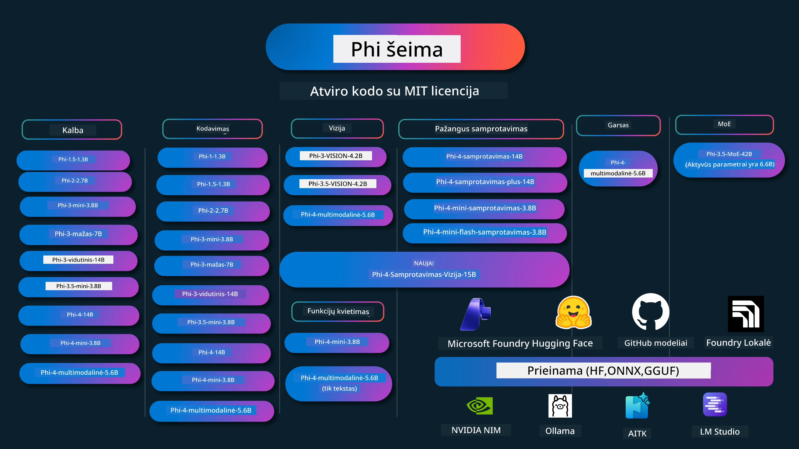

# Phi receptų knyga: Praktiniai pavyzdžiai su „Microsoft“ Phi modeliais

[](https://codespaces.new/microsoft/phicookbook)
[](https://vscode.dev/redirect?url=vscode://ms-vscode-remote.remote-containers/cloneInVolume?url=https://github.com/microsoft/phicookbook)

[](https://GitHub.com/microsoft/phicookbook/graphs/contributors/?WT.mc_id=aiml-137032-kinfeylo)
[](https://GitHub.com/microsoft/phicookbook/issues/?WT.mc_id=aiml-137032-kinfeylo)
[](https://GitHub.com/microsoft/phicookbook/pulls/?WT.mc_id=aiml-137032-kinfeylo)
[](http://makeapullrequest.com?WT.mc_id=aiml-137032-kinfeylo)

[](https://GitHub.com/microsoft/phicookbook/watchers/?WT.mc_id=aiml-137032-kinfeylo)
[](https://GitHub.com/microsoft/phicookbook/network/?WT.mc_id=aiml-137032-kinfeylo)
[](https://GitHub.com/microsoft/phicookbook/stargazers/?WT.mc_id=aiml-137032-kinfeylo)

[](https://discord.com/invite/ByRwuEEgH4)

Phi yra atviro kodo dirbtinio intelekto modelių serija, sukurta „Microsoft“. 

Phi šiuo metu yra galingiausias ir ekonomiškiausias mažas kalbos modelis (SLM), turintis labai gerus rezultatus daugiakalbystės, loginio mąstymo, teksto/ pokalbio generavimo, programavimo, vaizdų, garso ir kitose srityse. 

Galite diegti Phi debesyje arba edge įrenginiuose, ir lengvai kurti generatyvias DI programas su ribotomis kompiuterinėmis galimybėmis.

Laikykitės šių žingsnių, kad pradėtumėte naudoti šiuos išteklius:
1. **Šakoti saugyklą**: spustelėkite [](https://GitHub.com/microsoft/phicookbook/network/?WT.mc_id=aiml-137032-kinfeylo)
2. **Klonuoti saugyklą**: `git clone https://github.com/microsoft/PhiCookBook.git`
3. [**Prisijunkite prie Microsoft AI Discord bendruomenės ir susipažinkite su ekspertais bei kolegomis programuotojais**](https://discord.com/invite/ByRwuEEgH4?WT.mc_id=aiml-137032-kinfeylo)



### 🌐 Daugialypė kalbų palaikymas

#### Vertimus palaiko [Co-op Translator](https://github.com/Azure/co-op-translator)

<!-- CO-OP TRANSLATOR LANGUAGES TABLE START -->
[arabų](../ar/README.md) | [bengalų](../bn/README.md) | [bulgarų](../bg/README.md) | [birmos (Mjanmaras)](../my/README.md) | [kinų (supaprastinta)](../zh-CN/README.md) | [kinų (tradicinė, Honkongas)](../zh-HK/README.md) | [kinų (tradicinė, Makao)](../zh-MO/README.md) | [kinų (tradicinė, Taivanas)](../zh-TW/README.md) | [kroatų](../hr/README.md) | [čekų](../cs/README.md) | [danų](../da/README.md) | [olandų](../nl/README.md) | [estų](../et/README.md) | [suomių](../fi/README.md) | [prancūzų](../fr/README.md) | [vokiečių](../de/README.md) | [graikų](../el/README.md) | [hebrajų](../he/README.md) | [hindi](../hi/README.md) | [vengrų](../hu/README.md) | [indoneziečių](../id/README.md) | [italų](../it/README.md) | [japonų](../ja/README.md) | [kannadų](../kn/README.md) | [khmerų](../km/README.md) | [korėjiečių](../ko/README.md) | [lietuvių](./README.md) | [malajų](../ms/README.md) | [malajalų](../ml/README.md) | [maratų](../mr/README.md) | [nepalų](../ne/README.md) | [Nigerijos pidžino](../pcm/README.md) | [norvegų](../no/README.md) | [persų (farsi)](../fa/README.md) | [lenkų](../pl/README.md) | [portugalų (Brazilija)](../pt-BR/README.md) | [portugalų (Portugalija)](../pt-PT/README.md) | [pandžabų (Gurmukhi)](../pa/README.md) | [rumunų](../ro/README.md) | [rusų](../ru/README.md) | [serbų (kirilica)](../sr/README.md) | [slovakų](../sk/README.md) | [slovėnų](../sl/README.md) | [ispanų](../es/README.md) | [svahili](../sw/README.md) | [švedų](../sv/README.md) | [tagalogų (filipiniečių)](../tl/README.md) | [tamilų](../ta/README.md) | [telugų](../te/README.md) | [tailandų](../th/README.md) | [turkų](../tr/README.md) | [ukrainiečių](../uk/README.md) | [urdu](../ur/README.md) | [vietnamiečių](../vi/README.md)

> **Teikiate pirmenybę klonavimui vietoje?**
>
> Ši saugykla apima daugiau nei 50 kalbų vertimų, kurie ženkliai padidina atsisiuntimo dydį. Norėdami klonuoti be vertimų, naudokite ribotą atsisiuntimą:
>
> **Bash / macOS / Linux:**
> ```bash
> git clone --filter=blob:none --sparse https://github.com/microsoft/PhiCookBook.git
> cd PhiCookBook
> git sparse-checkout set --no-cone '/*' '!translations' '!translated_images'
> ```
>
> **CMD (Windows):**
> ```cmd
> git clone --filter=blob:none --sparse https://github.com/microsoft/PhiCookBook.git
> cd PhiCookBook
> git sparse-checkout set --no-cone "/*" "!translations" "!translated_images"
> ```
>
> Tai suteikia viską, ko reikia kursui užbaigti, žymiai greičiau atsisiunčiant.
<!-- CO-OP TRANSLATOR LANGUAGES TABLE END -->

## Turinys

- Įvadas
  - [Sveiki atvykę į Phi šeimą](./md/01.Introduction/01/01.PhiFamily.md)
  - [Aplinkos nustatymas](./md/01.Introduction/01/01.EnvironmentSetup.md)
  - [Pagrindinių technologijų supratimas](./md/01.Introduction/01/01.Understandingtech.md)
  - [AI saugumas Phi modeliams](./md/01.Introduction/01/01.AISafety.md)
  - [Phi aparatinės įrangos palaikymas](./md/01.Introduction/01/01.Hardwaresupport.md)
  - [Phi modeliai ir prieinamumas įvairiose platformose](./md/01.Introduction/01/01.Edgeandcloud.md)
  - [Guidance-ai ir Phi naudojimas](./md/01.Introduction/01/01.Guidance.md)
  - [GitHub Marketplace modeliai](https://github.com/marketplace/models)
  - [Azure AI modelių katalogas](https://ai.azure.com)

- Phi inferencija skirtingose aplinkose
    -  [Hugging face](./md/01.Introduction/02/01.HF.md)
    -  [GitHub modeliai](./md/01.Introduction/02/02.GitHubModel.md)
    -  [Microsoft Foundry modelių katalogas](./md/01.Introduction/02/03.AzureAIFoundry.md)
    -  [Ollama](./md/01.Introduction/02/04.Ollama.md)
    -  [AI Toolkit VSCode (AITK)](./md/01.Introduction/02/05.AITK.md)
    -  [NVIDIA NIM](./md/01.Introduction/02/06.NVIDIA.md)
    -  [Foundry Local](./md/01.Introduction/02/07.FoundryLocal.md)

- Phi šeimos inferencija
    - [Phi inferencija iOS](./md/01.Introduction/03/iOS_Inference.md)
    - [Phi inferencija Android](./md/01.Introduction/03/Android_Inference.md)
    - [Phi inferencija Jetson](./md/01.Introduction/03/Jetson_Inference.md)
    - [Phi inferencija AI PC](./md/01.Introduction/03/AIPC_Inference.md)
    - [Phi inferencija su Apple MLX sistema](./md/01.Introduction/03/MLX_Inference.md)
    - [Phi inferencija vietiniame serveryje](./md/01.Introduction/03/Local_Server_Inference.md)
    - [Phi inferencija nuotoliniame serveryje naudojant AI Toolbox](./md/01.Introduction/03/Remote_Interence.md)
    - [Phi inferencija su Rust](./md/01.Introduction/03/Rust_Inference.md)
    - [Phi inferencija–Vision vietoje](./md/01.Introduction/03/Vision_Inference.md)
    - [Phi inferencija su Kaito AKS, Azure konteineriais (oficialus palaikymas)](./md/01.Introduction/03/Kaito_Inference.md)
-  [Phi šeimos kiekybinimas](./md/01.Introduction/04/QuantifyingPhi.md)
    - [Phi-3.5 / 4 kiekybinimas naudojant llama.cpp](./md/01.Introduction/04/UsingLlamacppQuantifyingPhi.md)
    - [Phi-3.5 / 4 kiekybinimas naudojant generacines AI praplėtimo onnxruntime](./md/01.Introduction/04/UsingORTGenAIQuantifyingPhi.md)
    - [Phi-3.5 / 4 kiekybinimas naudojant Intel OpenVINO](./md/01.Introduction/04/UsingIntelOpenVINOQuantifyingPhi.md)
    - [Phi-3.5 / 4 kiekybinimas naudojant Apple MLX sistemą](./md/01.Introduction/04/UsingAppleMLXQuantifyingPhi.md)

- Phi vertinimas
    - [Response AI](./md/01.Introduction/05/ResponsibleAI.md)
    - [Microsoft Foundry vertinimui](./md/01.Introduction/05/AIFoundry.md)
    - [Promptflow naudojimas vertinimui](./md/01.Introduction/05/Promptflow.md)
 
- RAG su Azure AI paieška
    - [Kaip naudoti Phi-4-mini ir Phi-4-multimodal (RAG) su Azure AI paieška](https://github.com/microsoft/PhiCookBook/blob/main/code/06.E2E/E2E_Phi-4-RAG-Azure-AI-Search.ipynb)
    - [Zero-Cloud vietinis hibridinis RAG su SQLite FTS5 ir phi-4-mini](https://github.com/microsoft/PhiCookBook/blob/main/code/06.E2E/E2E_Phi-4-mini_Local_Hybrid_RAG_SQLite_FTS5.ipynb)

- Phi programėlių kūrimo pavyzdžiai
  - Teksto ir pokalbių programos
    - Phi-4 pavyzdžiai 
      - [📓] [Pokalbis su Phi-4-mini ONNX modeliu](./md/02.Application/01.TextAndChat/Phi4/ChatWithPhi4ONNX/README.md)
      - [Pokalbis su Phi-4 vietiniu ONNX modeliu .NET](../../md/04.HOL/dotnet/src/LabsPhi4-Chat-01OnnxRuntime)
      - [Pokalbių .NET konsolės programa su Phi-4 ONNX naudojant Semantikos variklį](../../md/04.HOL/dotnet/src/LabsPhi4-Chat-02SK)
    - Phi-3 / 3.5 pavyzdžiai
      - [Vietinis pokalbių robotas naršyklėje naudojant Phi3, ONNX Runtime Web ir WebGPU](https://github.com/microsoft/onnxruntime-inference-examples/tree/main/js/chat)
      - [OpenVino pokalbis](./md/02.Application/01.TextAndChat/Phi3/E2E_OpenVino_Chat.md)
      - [Daugiafunkcis modelis - interaktyvus Phi-3-mini ir OpenAI Whisper](./md/02.Application/01.TextAndChat/Phi3/E2E_Phi-3-mini_with_whisper.md)
      - [MLFlow - Apvyniojimo kūrimas ir Phi-3 naudojimas su MLFlow](./md//02.Application/01.TextAndChat/Phi3/E2E_Phi-3-MLflow.md)
      - [Modelio optimizavimas - kaip optimizuoti Phi-3-mini modelį ONNX Runtime Web naudojimui su Olive](https://github.com/microsoft/Olive/tree/main/examples/phi3)
      - [WinUI3 programa su Phi-3 mini-4k-instruct-onnx](https://github.com/microsoft/Phi3-Chat-WinUI3-Sample/)
      -[WinUI3 daugiamodelio AI palaikoma užrašų programos pavyzdys](https://github.com/microsoft/ai-powered-notes-winui3-sample)
      - [Individualizuotų Phi-3 modelių tobulinimas ir integravimas su Prompt flow](./md/02.Application/01.TextAndChat/Phi3/E2E_Phi-3-FineTuning_PromptFlow_Integration.md)
      - [Individualizuotų Phi-3 modelių tobulinimas ir integravimas su Prompt flow Microsoft Foundry aplinkoje](./md/02.Application/01.TextAndChat/Phi3/E2E_Phi-3-FineTuning_PromptFlow_Integration_AIFoundry.md)
      - [Tobulinto Phi-3 / Phi-3.5 modelio vertinimas Microsoft Foundry, atsižvelgiant į Microsoft atsakingos AI principus](./md/02.Application/01.TextAndChat/Phi3/E2E_Phi-3-Evaluation_AIFoundry.md)
      - [📓] [Phi-3.5-mini-instruct kalbos numatymo pavyzdys (kinų/anglų)](./md/02.Application/01.TextAndChat/Phi3/phi3-instruct-demo.ipynb)
      - [Phi-3.5-Instruct WebGPU RAG pokalbių robotas](./md/02.Application/01.TextAndChat/Phi3/WebGPUWithPhi35Readme.md)
      - [Windows GPU naudojimas kuriant Prompt flow sprendimą su Phi-3.5-Instruct ONNX](./md/02.Application/01.TextAndChat/Phi3/UsingPromptFlowWithONNX.md)
      - [Microsoft Phi-3.5 tflite naudojimas Android programos kūrimui](./md/02.Application/01.TextAndChat/Phi3/UsingPhi35TFLiteCreateAndroidApp.md)
      - [Klausimų-atsakymų .NET pavyzdys naudojant vietinį ONNX Phi-3 modelį su Microsoft.ML.OnnxRuntime](../../md/04.HOL/dotnet/src/LabsPhi301)
      - [Konsolės pokalbių .NET programa su Semantikos varikliu ir Phi-3](../../md/04.HOL/dotnet/src/LabsPhi302)

  - Azure AI Inferencijos SDK kodo pagrindu sukurti pavyzdžiai 
    - Phi-4 pavyzdžiai 
      - [📓] [Projekto kodo generavimas naudojant Phi-4-multimodal](./md/02.Application/02.Code/Phi4/GenProjectCode/README.md)
    - Phi-3 / 3.5 pavyzdžiai
      - [Sukurti savo Visual Studio Code GitHub Copilot pokalbių agentą su Microsoft Phi-3 šeima](./md/02.Application/02.Code/Phi3/VSCodeExt/README.md)
      - [Sukurti savo Visual Studio Code pokalbių Copilot agentą su Phi-3.5 pagal GitHub modelius](/md/02.Application/02.Code/Phi3/CreateVSCodeChatAgentWithGitHubModels.md)

  - Pažangaus apmąstymo pavyzdžiai
    - Phi-4 pavyzdžiai 
      - [📓] [Phi-4-mini-argumentacija arba Phi-4-argumentacijos pavyzdžiai](./md/02.Application/03.AdvancedReasoning/Phi4/AdvancedResoningPhi4mini/README.md)
      - [📓] [Phi-4-mini-argumentacijos tikslinimas su Microsoft Olive](./md/02.Application/03.AdvancedReasoning/Phi4/AdvancedResoningPhi4mini/olive_ft_phi_4_reasoning_with_medicaldata.ipynb)
      - [📓] [Phi-4-mini-argumentacijos tikslinimas su Apple MLX](./md/02.Application/03.AdvancedReasoning/Phi4/AdvancedResoningPhi4mini/mlx_ft_phi_4_reasoning_with_medicaldata.ipynb)
      - [📓] [Phi-4-mini-argumentacija su GitHub modeliais](./md/02.Application/02.Code/Phi4r/github_models_inference.ipynb)
      - [📓] [Phi-4-mini-argumentacija su Microsoft Foundry modeliais](./md/02.Application/02.Code/Phi4r/azure_models_inference.ipynb)
  - Demonstracijos
      - [Phi-4-mini demonstracijos talpinamos Hugging Face Spaces](https://huggingface.co/spaces/microsoft/phi-4-mini?WT.mc_id=aiml-137032-kinfeylo)
      - [Phi-4-multimodalinės demonstracijos talpinamos Hugging Face Spaces](https://huggingface.co/spaces/microsoft/phi-4-multimodal?WT.mc_id=aiml-137032-kinfeylo)
  - Vaizdų pavyzdžiai
    - Phi-4 Pavyzdžiai 
      - [📓] [Naudokite Phi-4-multimodalines galimybes skaityti paveikslėlius ir generuoti kodą](./md/02.Application/04.Vision/Phi4/CreateFrontend/README.md) 
    - Phi-3 / 3.5 Pavyzdžiai
      -  [📓][Phi-3-vision-Paveikslėlio tekstas į tekstą](./md/02.Application/04.Vision/Phi3/E2E_Phi-3-vision-image-text-to-text-online-endpoint.ipynb)
      - [Phi-3-vision-ONNX](https://onnxruntime.ai/docs/genai/tutorials/phi3-v.html)
      - [📓][Phi-3-vision CLIP įdėjiniai](./md/02.Application/04.Vision/Phi3/E2E_Phi-3-vision-image-text-to-text-online-endpoint.ipynb)
      - [DEMONSTRACIJA: Phi-3 perdirbimas](https://github.com/jennifermarsman/PhiRecycling/)
      - [Phi-3-vision - Vaizdinio kalbos asistento - naudojant Phi3-Vision ir OpenVINO](https://docs.openvino.ai/nightly/notebooks/phi-3-vision-with-output.html)
      - [Phi-3 Vision Nvidia NIM](./md/02.Application/04.Vision/Phi3/E2E_Nvidia_NIM_Vision.md)
      - [Phi-3 Vision OpenVino](./md/02.Application/04.Vision/Phi3/E2E_OpenVino_Phi3Vision.md)
      - [📓][Phi-3.5 Vision daugiaframe arba daugia paveikslėlio pavyzdys](./md/02.Application/04.Vision/Phi3/phi3-vision-demo.ipynb)
      - [Phi-3 Vision vietinis ONNX modelis naudojantis Microsoft.ML.OnnxRuntime .NET](../../md/04.HOL/dotnet/src/LabsPhi303)
      - [Meniu pagrindu veikiantis Phi-3 Vision vietinis ONNX modelis naudojantis Microsoft.ML.OnnxRuntime .NET](../../md/04.HOL/dotnet/src/LabsPhi304)

  - Argumentavimo ir vaizdų pavyzdžiai
    - Phi-4-Argumentavimo-Vaizdų-15B 
      - [📓] [Naudojant Phi-4-Argumentavimo-Vaizdų-15B pėsčiųjų perėjos pažeidimų nustatymui](./md/02.Application/10.ReasoningVision/Phi_4_reasoning_vision_15b_Jaywalking.ipynb)
      - [📓] [Naudojant Phi-4-Argumentavimo-Vaizdų-15B matematikai](./md/02.Application/10.ReasoningVision/Phi_4_reasoning_vision_15b_Math.ipynb)
      - [📓] [Naudojant Phi-4-Argumentavimo-Vaizdų-15B naudotojo sąsajos nustatymui](./md/02.Application/10.ReasoningVision/Phi_4_reasoning_vision_15b_ui.ipynb)

  - Matematikos pavyzdžiai
    -  Phi-4-Mini-Flash-Argumentavimo-Instrukcijų pavyzdžiai  [Matematikos demonstracija su Phi-4-Mini-Flash-Argumentavimo-Instrukcijomis](./md/02.Application/09.Math/MathDemo.ipynb)

  - Garso pavyzdžiai
    - Phi-4 Pavyzdžiai 
      - [📓] [Garso transkriptų išgavimas naudojantis Phi-4-multimodal](./md/02.Application/05.Audio/Phi4/Transciption/README.md)
      - [📓] [Phi-4-multimodal Garso pavyzdys](./md/02.Application/05.Audio/Phi4/Siri/demo.ipynb)
      - [📓] [Phi-4-multimodal kalbos vertimo pavyzdys](./md/02.Application/05.Audio/Phi4/Translate/demo.ipynb)
      - [.NET konsolinė programa naudojanti Phi-4-multimodal garso analizavimui ir transkripto generavimui](../../md/04.HOL/dotnet/src/LabsPhi4-MultiModal-02Audio)

  - MOE Pavyzdžiai
    - Phi-3 / 3.5 Pavyzdžiai
      - [📓] [Phi-3.5 Ekspertų mišinio modelių (MoEs) socialinės medijos pavyzdys](./md/02.Application/06.MoE/Phi3/phi3_moe_demo.ipynb)
      - [📓] [Retrieval-Augmented Generation (RAG) sistemos kūrimas su NVIDIA NIM Phi-3 MOE, Azure AI Search ir LlamaIndex](./md/02.Application/06.MoE/Phi3/azure-ai-search-nvidia-rag.ipynb)
      - 
  - Funkcijų kvietimų pavyzdžiai
    - Phi-4 Pavyzdžiai 🆕
      -  [📓] [Funkcijų kvietimo naudojimas su Phi-4-mini](./md/02.Application/07.FunctionCalling/Phi4/FunctionCallingBasic/README.md)
      -  [📓] [Funkcijų kvietimo naudojimas kuriant multi-agentus su Phi-4-mini](./md/02.Application/07.FunctionCalling/Phi4/Multiagents/Phi_4_mini_multiagent.ipynb)
      -  [📓] [Funkcijų kvietimo naudojimas su Ollama](./md/02.Application/07.FunctionCalling/Phi4/Ollama/ollama_functioncalling.ipynb)
      -  [📓] [Funkcijų kvietimo naudojimas su ONNX](./md/02.Application/07.FunctionCalling/Phi4/ONNX/onnx_parallel_functioncalling.ipynb)
  - Multimodalių mišinių pavyzdžiai
    - Phi-4 Pavyzdžiai 🆕
      -  [📓] [Phi-4-multimodalinės galimybės kaip technologijų žurnalistas](./md/02.Application/08.Multimodel/Phi4/TechJournalist/phi_4_mm_audio_text_publish_news.ipynb)
      - [.NET konsolinė programa naudojanti Phi-4-multimodalines galimybes vaizdų analizei](../../md/04.HOL/dotnet/src/LabsPhi4-MultiModal-01Images)

- Phi modelių tikslinimas
  - [Tikslinimo scenarijai](./md/03.FineTuning/FineTuning_Scenarios.md)
  - [Tikslinimas vs RAG](./md/03.FineTuning/FineTuning_vs_RAG.md)
  - [Tikslinimas, kad Phi-3 taptų pramonės ekspertu](./md/03.FineTuning/LetPhi3gotoIndustriy.md)
  - [Tikslinimas Phi-3 su AI Toolkit for VS Code](./md/03.FineTuning/Finetuning_VSCodeaitoolkit.md)
  - [Tikslinimas Phi-3 su Azure Machine Learning Service](./md/03.FineTuning/Introduce_AzureML.md)
  - [Tikslinimas Phi-3 su Lora](./md/03.FineTuning/FineTuning_Lora.md)
  - [Tikslinimas Phi-3 su QLora](./md/03.FineTuning/FineTuning_Qlora.md)
  - [Tikslinimas Phi-3 su Microsoft Foundry](./md/03.FineTuning/FineTuning_AIFoundry.md)
  - [Tikslinimas Phi-3 su Azure ML CLI/SDK](./md/03.FineTuning/FineTuning_MLSDK.md)
  - [Tikslinimas su Microsoft Olive](./md/03.FineTuning/FineTuning_MicrosoftOlive.md)
  - [Tikslinimas su Microsoft Olive praktinis seminaras](./md/03.FineTuning/olive-lab/readme.md)
  - [Tikslinimas Phi-3-vision su Weights and Bias](./md/03.FineTuning/FineTuning_Phi-3-visionWandB.md)
  - [Tikslinimas Phi-3 su Apple MLX Framework](./md/03.FineTuning/FineTuning_MLX.md)
  - [Tikslinimas Phi-3-vision (oficiali pagalba)](./md/03.FineTuning/FineTuning_Vision.md)
  - [Tikslinimas Phi-3 su Kaito AKS, Azure konteineriais (oficiali pagalba)](./md/03.FineTuning/FineTuning_Kaito.md)
  - [Tikslinimas Phi-3 ir 3.5 Vision](https://github.com/2U1/Phi3-Vision-Finetune)

- Praktiniai seminarai
  - [Naujausių modelių tyrinėjimas: LLM, SLM, vietinė plėtra ir daugiau](https://github.com/microsoft/aitour-exploring-cutting-edge-models)
  - [NLP potencialo atskleidimas: tikslinimas su Microsoft Olive](https://github.com/azure/Ignite_FineTuning_workshop)

- Akademiniai moksliniai darbai ir publikacijos
  - [Vadovėliai Yra Viskas, ko reikia II: phi-1.5 techninė ataskaita](https://arxiv.org/abs/2309.05463)
  - [Phi-3 techninė ataskaita: itin pajėgus kalbos modelis jūsų telefone](https://arxiv.org/abs/2404.14219)
  - [Phi-4 techninė ataskaita](https://arxiv.org/abs/2412.08905)
  - [Phi-4-Mini techninė ataskaita: kompaktiški, bet galingi multimodaliniai kalbos modeliai per Mixture-of-LoRAs](https://arxiv.org/abs/2503.01743)
  - [Mažų kalbos modelių optimizavimas automobilinėms funkcijoms kvietimui](https://arxiv.org/abs/2501.02342)
  - [(WhyPHI) PHI-3 tikslinimas kelių pasirinkimų klausimams atsakyti: metodika, rezultatai ir iššūkiai](https://arxiv.org/abs/2501.01588)
  - [Phi-4-argumentacijos techninė ataskaita](https://www.microsoft.com/en-us/research/wp-content/uploads/2025/04/phi_4_reasoning.pdf)
  - [Phi-4-mini-argumentacijos techninė ataskaita](https://huggingface.co/microsoft/Phi-4-mini-reasoning/blob/main/Phi-4-Mini-Reasoning.pdf)

## Phi modelių naudojimas

### Phi Microsoft Foundry platformoje

Jūs galite sužinoti, kaip naudoti Microsoft Phi ir kaip kurti end-to-end sprendimus įvairiuose aparatūros įrenginiuose. Norėdami patys išbandyti Phi, pradėkite žaisdami su modeliais ir pritaikydami Phi savo scenarijams naudodamiesi [Microsoft Foundry Azure AI modelių katalogu](https://aka.ms/phi3-azure-ai). Daugiau informacijos rasite pradedant su [Microsoft Foundry](/md/02.QuickStart/AzureAIFoundry_QuickStart.md)

**Žaidimų aikštelė**
Kiekvienas modelis turi skirtą žaidimų aikštelę modeliui išbandyti [Azure AI žaidimų aikštelė](https://aka.ms/try-phi3).

### Phi GitHub modeliuose

Jūs galite sužinoti, kaip naudoti Microsoft Phi ir kaip kurti end-to-end sprendimus įvairiuose aparatūros įrenginiuose. Norėdami patys išbandyti Phi, pradėkite žaisdami su modeliu ir pritaikydami Phi savo scenarijams naudodamiesi [GitHub modelių katalogu](https://github.com/marketplace/models?WT.mc_id=aiml-137032-kinfeylo). Daugiau informacijos rasite pradedant su [GitHub modelių katalogu](/md/02.QuickStart/GitHubModel_QuickStart.md)

**Žaidimų aikštelė**
Kiekvienas modelis turi skirtą [žaidimų aikštelę modeliui išbandyti](/md/02.QuickStart/GitHubModel_QuickStart.md).

### Phi Hugging Face platformoje

Modelį taip pat galite rasti [Hugging Face](https://huggingface.co/microsoft)

**Žaidimų aikštelė**
 [Hugging Chat žaidimų aikštelė](https://huggingface.co/chat/models/microsoft/Phi-3-mini-4k-instruct)

 ## 🎒 Kiti kursai

Mūsų komanda kuria ir kitus kursus! Peržiūrėkite:

<!-- CO-OP TRANSLATOR OTHER COURSES START -->
### LangChain
[](https://aka.ms/langchain4j-for-beginners)
[](https://aka.ms/langchainjs-for-beginners?WT.mc_id=m365-94501-dwahlin)
[](https://github.com/microsoft/langchain-for-beginners?WT.mc_id=m365-94501-dwahlin)
---

### Azure / Edge / MCP / Agentai
[](https://github.com/microsoft/AZD-for-beginners?WT.mc_id=academic-105485-koreyst)
[](https://github.com/microsoft/edgeai-for-beginners?WT.mc_id=academic-105485-koreyst)
[](https://github.com/microsoft/mcp-for-beginners?WT.mc_id=academic-105485-koreyst)
[](https://github.com/microsoft/ai-agents-for-beginners?WT.mc_id=academic-105485-koreyst)

---
 
### Generatyvinis AI serija
[](https://github.com/microsoft/generative-ai-for-beginners?WT.mc_id=academic-105485-koreyst)
[-9333EA?style=for-the-badge&labelColor=E5E7EB&color=9333EA)](https://github.com/microsoft/Generative-AI-for-beginners-dotnet?WT.mc_id=academic-105485-koreyst)
[-C084FC?style=for-the-badge&labelColor=E5E7EB&color=C084FC)](https://github.com/microsoft/generative-ai-for-beginners-java?WT.mc_id=academic-105485-koreyst)
[-E879F9?style=for-the-badge&labelColor=E5E7EB&color=E879F9)](https://github.com/microsoft/generative-ai-with-javascript?WT.mc_id=academic-105485-koreyst)

---
 
### Pagrindinės žinios
[](https://aka.ms/ml-beginners?WT.mc_id=academic-105485-koreyst)
[](https://aka.ms/datascience-beginners?WT.mc_id=academic-105485-koreyst)
[](https://aka.ms/ai-beginners?WT.mc_id=academic-105485-koreyst)
[](https://github.com/microsoft/Security-101?WT.mc_id=academic-96948-sayoung)
[](https://aka.ms/webdev-beginners?WT.mc_id=academic-105485-koreyst)
[](https://aka.ms/iot-beginners?WT.mc_id=academic-105485-koreyst)
[](https://github.com/microsoft/xr-development-for-beginners?WT.mc_id=academic-105485-koreyst)

---
 
### Copilot serija
[](https://aka.ms/GitHubCopilotAI?WT.mc_id=academic-105485-koreyst)
[](https://github.com/microsoft/mastering-github-copilot-for-dotnet-csharp-developers?WT.mc_id=academic-105485-koreyst)
[](https://github.com/microsoft/CopilotAdventures?WT.mc_id=academic-105485-koreyst)
<!-- CO-OP TRANSLATOR OTHER COURSES END -->

## Atsakingas AI 

Microsoft yra pasiryžęs padėti klientams atsakingai naudoti mūsų AI produktus, dalintis mūsų patirtimi ir kurti pasitikėjimu grįstus partnerystės santykius per tokias priemones kaip Skaidrumo pastabos ir poveikio vertinimai. Daugelį šių išteklių galite rasti [https://aka.ms/RAI](https://aka.ms/RAI).
Microsoft požiūris į atsakingą AI remiasi mūsų AI principais: teisingumo, patikimumo ir saugumo, privatumo ir saugumo, įtraukties, skaidrumo ir atskaitomybės.

Didelio masto natūralios kalbos, vaizdų ir kalbos modeliai – tokie, kaip šio pavyzdžio – gali elgtis neteisingai, nepatikimai arba įžeidžiančiai, kas gali sukelti žalą. Prašome pasitikrinti [Azure OpenAI paslaugos Skaidrumo pastabą](https://learn.microsoft.com/legal/cognitive-services/openai/transparency-note?tabs=text), kad būtumėte informuoti apie rizikas ir apribojimus.

Rekomenduojamas būdas sumažinti šias rizikas – į savo architektūrą įtraukti saugumo sistemą, galinčią aptikti ir užkirsti kelią žalingam elgesiui. [Azure AI Content Safety](https://learn.microsoft.com/azure/ai-services/content-safety/overview) suteikia nepriklausomą apsaugos sluoksnį, galintį aptikti kenksmingą vartotojų ir AI sugeneruotą turinį programose ir paslaugose. Azure AI Content Safety apima teksto ir vaizdų API, leidžiančias aptikti žalingą medžiagą. Microsoft Foundry platformoje Content Safety paslauga leidžia peržiūrėti, tyrinėti ir išbandyti pavyzdinį kodą, skirtą žalingo turinio aptikimui įvairiose modalitetuose. Ši [greito pradėjimo dokumentacija](https://learn.microsoft.com/azure/ai-services/content-safety/quickstart-text?tabs=visual-studio%2Clinux&pivots=programming-language-rest) padės jums atlikti užklausas šiai paslaugai.

Dar vienas svarbus aspektas yra bendra programos veikimo kokybė. Darant daugiamodalių ir daugiamodelių programų, veikimo kokybę suprantame kaip sistemos veikimą taip, kaip tikitės jūs ir jūsų vartotojai, įskaitant žalingos išvesties nesukūrimą. Svarbu įvertinti bendrą programos veikimą naudojant [veikimo, kokybės, rizikos ir saugumo vertintojus](https://learn.microsoft.com/azure/ai-studio/concepts/evaluation-metrics-built-in). Taip pat turite galimybę kurti ir vertinti su [individualiais vertintojais](https://learn.microsoft.com/azure/ai-studio/how-to/develop/evaluate-sdk#custom-evaluators).

Galite įvertinti savo AI programą kūrimo aplinkoje naudodami [Azure AI Evaluation SDK](https://microsoft.github.io/promptflow/index.html). Turint testinių duomenų rinkinį arba tikslą, jūsų generatyvios AI programos generavimai kiekybiškai įvertinami naudojant įmontuotus vertintojus arba jūsų pasirinktus individualius vertintojus. Norėdami pradėti naudoti azure ai evaluation sdk savo sistemos vertinimui, galite sekti [greito pradėjimo vadovą](https://learn.microsoft.com/azure/ai-studio/how-to/develop/flow-evaluate-sdk). Atlikę vertinimą, galite [vizualizuoti rezultatus Microsoft Foundry platformoje](https://learn.microsoft.com/azure/ai-studio/how-to/evaluate-flow-results).

## Prekės ženklai

Šis projektas gali turėti projektų, produktų ar paslaugų prekės ženklus ar logotipus. Leidžiama naudoti Microsoft prekės ženklus ar logotipus tik laikantis ir laikantis [Microsoft prekės ženklo ir prekės ženklo gairių](https://www.microsoft.com/legal/intellectualproperty/trademarks/usage/general).
Modifikuotose šio projekto versijose draudžiama naudoti Microsoft prekės ženklus ar logotipus taip, kad sukeltų painiavą ar kiltų įspūdis, jog Microsoft remia. Trečiųjų šalių prekės ženklų ar logotipų naudojimas yra taikomas atitinkamų trečiųjų šalių politikoms.

## Pagalba

Jei susiduriate su sunkumais arba turite klausimų apie AI programų kūrimą, prisijunkite prie:

[](https://aka.ms/foundry/discord)

Jei turite atsiliepimų apie produktą arba randate klaidų kūrimo metu, apsilankykite:

[](https://aka.ms/foundry/forum)

---

<!-- CO-OP TRANSLATOR DISCLAIMER START -->
**Atsakomybės apribojimas**:
Šis dokumentas buvo išverstas naudojant dirbtinio intelekto vertimo paslaugą [Co-op Translator](https://github.com/Azure/co-op-translator). Nors siekiame tikslumo, prašome atkreipti dėmesį, kad automatiniai vertimai gali turėti klaidų ar netikslumų. Originalus dokumentas jo gimtąja kalba laikomas autoritetingu šaltiniu. Svarbiai informacijai rekomenduojama naudoti profesionalų žmogiškąjį vertimą. Mes neatsakome už jokius nesusipratimus ar neteisingą interpretaciją, kilusią naudojantis šiuo vertimu.
<!-- CO-OP TRANSLATOR DISCLAIMER END -->