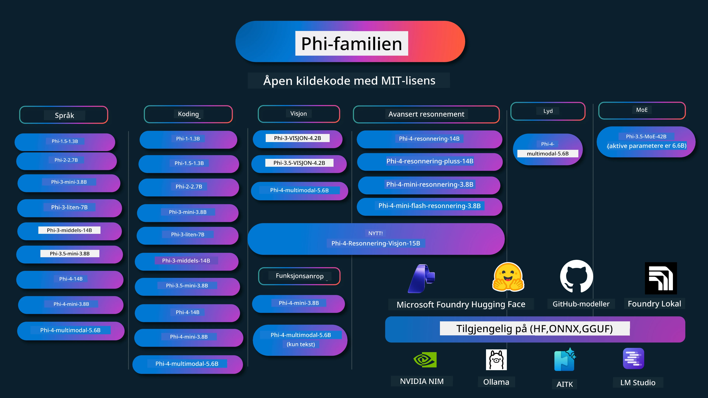

# Phi Kokebok: Praktiske Eksempler med Microsofts Phi-Modeller

[](https://codespaces.new/microsoft/phicookbook)
[](https://vscode.dev/redirect?url=vscode://ms-vscode-remote.remote-containers/cloneInVolume?url=https://github.com/microsoft/phicookbook)

[](https://GitHub.com/microsoft/phicookbook/graphs/contributors/?WT.mc_id=aiml-137032-kinfeylo)
[](https://GitHub.com/microsoft/phicookbook/issues/?WT.mc_id=aiml-137032-kinfeylo)
[](https://GitHub.com/microsoft/phicookbook/pulls/?WT.mc_id=aiml-137032-kinfeylo)
[](http://makeapullrequest.com?WT.mc_id=aiml-137032-kinfeylo)

[](https://GitHub.com/microsoft/phicookbook/watchers/?WT.mc_id=aiml-137032-kinfeylo)
[](https://GitHub.com/microsoft/phicookbook/network/?WT.mc_id=aiml-137032-kinfeylo)
[](https://GitHub.com/microsoft/phicookbook/stargazers/?WT.mc_id=aiml-137032-kinfeylo)

[](https://discord.com/invite/ByRwuEEgH4)

Phi er en serie med åpen kildekode AI-modeller utviklet av Microsoft.

Phi er for øyeblikket den mest kraftfulle og kostnadseffektive småspråkmodellen (SLM), med svært gode benchmark-resultater innen flerspråklighet, resonnering, tekst-/chatgenerering, koding, bilder, lyd og andre scenarier.

Du kan distribuere Phi til skyen eller til kant-enheter, og du kan enkelt bygge generative AI-applikasjoner med begrenset datakraft.

Følg disse stegene for å komme i gang med disse ressursene:
1. **Forke Repositoryet**: Klikk [](https://GitHub.com/microsoft/phicookbook/network/?WT.mc_id=aiml-137032-kinfeylo)
2. **Klon Repositoryet**: `git clone https://github.com/microsoft/PhiCookBook.git`
3. [**Bli med i Microsoft AI Discord Community og møt eksperter og andre utviklere**](https://discord.com/invite/ByRwuEEgH4?WT.mc_id=aiml-137032-kinfeylo)



### 🌐 Flerspråklig Støtte

#### Oversettelser vedlikeholdes med [Co-op Translator](https://github.com/Azure/co-op-translator)

<!-- CO-OP TRANSLATOR LANGUAGES TABLE START -->
[Arabisk](../ar/README.md) | [Bengali](../bn/README.md) | [Bulgarsk](../bg/README.md) | [Burmese (Myanmar)](../my/README.md) | [Kinesisk (forenklet)](../zh-CN/README.md) | [Kinesisk (tradisjonell, Hong Kong)](../zh-HK/README.md) | [Kinesisk (tradisjonell, Macau)](../zh-MO/README.md) | [Kinesisk (tradisjonell, Taiwan)](../zh-TW/README.md) | [Kroatisk](../hr/README.md) | [Tsjekkisk](../cs/README.md) | [Dansk](../da/README.md) | [Nederlandsk](../nl/README.md) | [Estisk](../et/README.md) | [Finsk](../fi/README.md) | [Fransk](../fr/README.md) | [Tysk](../de/README.md) | [Gresk](../el/README.md) | [Hebraisk](../he/README.md) | [Hindi](../hi/README.md) | [Ungarsk](../hu/README.md) | [Indonesisk](../id/README.md) | [Italiensk](../it/README.md) | [Japansk](../ja/README.md) | [Kannada](../kn/README.md) | [Khmer](../km/README.md) | [Koreansk](../ko/README.md) | [Litauisk](../lt/README.md) | [Malayisk](../ms/README.md) | [Malayalam](../ml/README.md) | [Manipuri (Meitei Mayek)](../mni/README.md) | [Marathi](../mr/README.md) | [Nepali](../ne/README.md) | [Nigeriansk Pidgin](../pcm/README.md) | [Norsk](./README.md) | [Persisk (Farsi)](../fa/README.md) | [Polsk](../pl/README.md) | [Portugisisk (Brasil)](../pt-BR/README.md) | [Portugisisk (Portugal)](../pt-PT/README.md) | [Punjabi (Gurmukhi)](../pa/README.md) | [Rumensk](../ro/README.md) | [Russisk](../ru/README.md) | [Serbisk (kyrillisk)](../sr/README.md) | [Slovakisk](../sk/README.md) | [Slovensk](../sl/README.md) | [Spansk](../es/README.md) | [Swahili](../sw/README.md) | [Svensk](../sv/README.md) | [Tagalog (Filippinsk)](../tl/README.md) | [Tamil](../ta/README.md) | [Telugu](../te/README.md) | [Thai](../th/README.md) | [Tyrkisk](../tr/README.md) | [Ukrainsk](../uk/README.md) | [Urdu](../ur/README.md) | [Vietnamesisk](../vi/README.md)

> **Foretrekker du å klone lokalt?**
>
> Dette repositoryet inkluderer 50+ språkoversettelser som vesentlig øker nedlastingsstørrelsen. For å klone uten oversettelser, bruk sparse checkout:
>
> **Bash / macOS / Linux:**
> ```bash
> git clone --filter=blob:none --sparse https://github.com/microsoft/PhiCookBook.git
> cd PhiCookBook
> git sparse-checkout set --no-cone '/*' '!translations' '!translated_images'
> ```
>
> **CMD (Windows):**
> ```cmd
> git clone --filter=blob:none --sparse https://github.com/microsoft/PhiCookBook.git
> cd PhiCookBook
> git sparse-checkout set --no-cone "/*" "!translations" "!translated_images"
> ```
>
> Dette gir deg alt du trenger for å fullføre kurset med en mye raskere nedlasting.
<!-- CO-OP TRANSLATOR LANGUAGES TABLE END -->

## Innholdsfortegnelse

- Introduksjon
  - [Velkommen til Phi-familien](./md/01.Introduction/01/01.PhiFamily.md)
  - [Sette opp miljøet ditt](./md/01.Introduction/01/01.EnvironmentSetup.md)
  - [Forstå nøkkelteknologier](./md/01.Introduction/01/01.Understandingtech.md)
  - [AI-sikkerhet for Phi-modeller](./md/01.Introduction/01/01.AISafety.md)
  - [Phi maskinvarestøtte](./md/01.Introduction/01/01.Hardwaresupport.md)
  - [Phi-modeller & tilgjengelighet på tvers av plattformer](./md/01.Introduction/01/01.Edgeandcloud.md)
  - [Bruke Guidance-ai og Phi](./md/01.Introduction/01/01.Guidance.md)
  - [GitHub Marketplace-modeller](https://github.com/marketplace/models)
  - [Azure AI Modellkatalog](https://ai.azure.com)

- Inferens Phi i forskjellige miljøer
    -  [Hugging face](./md/01.Introduction/02/01.HF.md)
    -  [GitHub modeller](./md/01.Introduction/02/02.GitHubModel.md)
    -  [Microsoft Foundry Modellkatalog](./md/01.Introduction/02/03.AzureAIFoundry.md)
    -  [Ollama](./md/01.Introduction/02/04.Ollama.md)
    -  [AI Toolkit VSCode (AITK)](./md/01.Introduction/02/05.AITK.md)
    -  [NVIDIA NIM](./md/01.Introduction/02/06.NVIDIA.md)
    -  [Foundry Lokalt](./md/01.Introduction/02/07.FoundryLocal.md)

- Inferens Phi-familien
    - [Inferens Phi i iOS](./md/01.Introduction/03/iOS_Inference.md)
    - [Inferens Phi i Android](./md/01.Introduction/03/Android_Inference.md)
    - [Inferens Phi i Jetson](./md/01.Introduction/03/Jetson_Inference.md)
    - [Inferens Phi i AI PC](./md/01.Introduction/03/AIPC_Inference.md)
    - [Inferens Phi med Apple MLX Framework](./md/01.Introduction/03/MLX_Inference.md)
    - [Inferens Phi i Lokal Server](./md/01.Introduction/03/Local_Server_Inference.md)
    - [Inferens Phi i Fjernserver ved bruk av AI Toolkit](./md/01.Introduction/03/Remote_Interence.md)
    - [Inferens Phi med Rust](./md/01.Introduction/03/Rust_Inference.md)
    - [Inferens Phi--Vision lokalt](./md/01.Introduction/03/Vision_Inference.md)
    - [Inferens Phi med Kaito AKS, Azure Containers (offisiell støtte)](./md/01.Introduction/03/Kaito_Inference.md)
-  [Kvantifisering av Phi-familien](./md/01.Introduction/04/QuantifyingPhi.md)
    - [Kvantifisere Phi-3.5 / 4 ved bruk av llama.cpp](./md/01.Introduction/04/UsingLlamacppQuantifyingPhi.md)
    - [Kvantifisere Phi-3.5 / 4 ved bruk av Generative AI-utvidelser for onnxruntime](./md/01.Introduction/04/UsingORTGenAIQuantifyingPhi.md)
    - [Kvantifisere Phi-3.5 / 4 ved bruk av Intel OpenVINO](./md/01.Introduction/04/UsingIntelOpenVINOQuantifyingPhi.md)
    - [Kvantifisere Phi-3.5 / 4 ved bruk av Apple MLX Framework](./md/01.Introduction/04/UsingAppleMLXQuantifyingPhi.md)

-  Evaluering av Phi
    - [Respons AI](./md/01.Introduction/05/ResponsibleAI.md)
    - [Microsoft Foundry for Evaluering](./md/01.Introduction/05/AIFoundry.md)
    - [Bruke Promptflow for Evaluering](./md/01.Introduction/05/Promptflow.md)
 
- RAG med Azure AI Search
    - [Hvordan bruke Phi-4-mini og Phi-4-multimodal (RAG) med Azure AI Search](https://github.com/microsoft/PhiCookBook/blob/main/code/06.E2E/E2E_Phi-4-RAG-Azure-AI-Search.ipynb)
    - [Zero-Cloud Lokalt Hybrid RAG med SQLite FTS5 og phi-4-mini](https://github.com/microsoft/PhiCookBook/blob/main/code/06.E2E/E2E_Phi-4-mini_Local_Hybrid_RAG_SQLite_FTS5.ipynb)

- Eksempler på Phi applikasjonsutvikling
  - Tekst- og chatapplikasjoner
    - Phi-4 Eksempler
      - [📓] [Chat med Phi-4-mini ONNX modell](./md/02.Application/01.TextAndChat/Phi4/ChatWithPhi4ONNX/README.md)
      - [Chat med Phi-4 lokal ONNX modell .NET](../../md/04.HOL/dotnet/src/LabsPhi4-Chat-01OnnxRuntime)
      - [Chat .NET konsollapp med Phi-4 ONNX ved bruk av Semantic Kernel](../../md/04.HOL/dotnet/src/LabsPhi4-Chat-02SK)
    - Phi-3 / 3.5 Eksempler
      - [Lokal chatbot i nettleseren ved bruk av Phi3, ONNX Runtime Web og WebGPU](https://github.com/microsoft/onnxruntime-inference-examples/tree/main/js/chat)
      - [OpenVino Chat](./md/02.Application/01.TextAndChat/Phi3/E2E_OpenVino_Chat.md)
      - [Multi Model - Interaktiv Phi-3-mini og OpenAI Whisper](./md/02.Application/01.TextAndChat/Phi3/E2E_Phi-3-mini_with_whisper.md)
      - [MLFlow - Bygge en wrapper og bruke Phi-3 med MLFlow](./md//02.Application/01.TextAndChat/Phi3/E2E_Phi-3-MLflow.md)
      - [Modelloptimalisering - Hvordan optimalisere Phi-3-min modellen for ONNX Runtime Web med Olive](https://github.com/microsoft/Olive/tree/main/examples/phi3)
      - [WinUI3 App med Phi-3 mini-4k-instruct-onnx](https://github.com/microsoft/Phi3-Chat-WinUI3-Sample/)
      -[WinUI3 Multi Model AI-drevet Notater App Eksempel](https://github.com/microsoft/ai-powered-notes-winui3-sample)
      - [Fininnstilling og integrering av tilpassede Phi-3 modeller med Prompt flow](./md/02.Application/01.TextAndChat/Phi3/E2E_Phi-3-FineTuning_PromptFlow_Integration.md)
      - [Fininnstilling og integrering av tilpassede Phi-3 modeller med Prompt flow i Microsoft Foundry](./md/02.Application/01.TextAndChat/Phi3/E2E_Phi-3-FineTuning_PromptFlow_Integration_AIFoundry.md)
      - [Evaluer fininnstilt Phi-3 / Phi-3.5 modell i Microsoft Foundry med fokus på Microsofts ansvarlige AI-prinsipper](./md/02.Application/01.TextAndChat/Phi3/E2E_Phi-3-Evaluation_AIFoundry.md)
      - [📓] [Phi-3.5-mini-instruct språkprediksjons-eksempel (kinesisk/engelsk)](./md/02.Application/01.TextAndChat/Phi3/phi3-instruct-demo.ipynb)
      - [Phi-3.5-Instruct WebGPU RAG Chatbot](./md/02.Application/01.TextAndChat/Phi3/WebGPUWithPhi35Readme.md)
      - [Bruke Windows GPU til å lage Prompt flow-løsning med Phi-3.5-Instruct ONNX](./md/02.Application/01.TextAndChat/Phi3/UsingPromptFlowWithONNX.md)
      - [Bruke Microsoft Phi-3.5 tflite til å lage Android-app](./md/02.Application/01.TextAndChat/Phi3/UsingPhi35TFLiteCreateAndroidApp.md)
      - [Q&A .NET-eksempel ved bruk av lokal ONNX Phi-3 modell med Microsoft.ML.OnnxRuntime](../../md/04.HOL/dotnet/src/LabsPhi301)
      - [Konsoll chat .NET-app med Semantic Kernel og Phi-3](../../md/04.HOL/dotnet/src/LabsPhi302)

  - Azure AI Inferens SDK kodebaserte eksempler
    - Phi-4 Eksempler
      - [📓] [Generer prosjektkode ved bruk av Phi-4-multimodal](./md/02.Application/02.Code/Phi4/GenProjectCode/README.md)
    - Phi-3 / 3.5 Eksempler
      - [Bygg din egen Visual Studio Code GitHub Copilot Chat med Microsoft Phi-3-familien](./md/02.Application/02.Code/Phi3/VSCodeExt/README.md)
      - [Lag din egen Visual Studio Code Chat Copilot-agent med Phi-3.5 via GitHub-modeller](/md/02.Application/02.Code/Phi3/CreateVSCodeChatAgentWithGitHubModels.md)

  - Avanserte resonneringseksempler
    - Phi-4 Prøver 
      - [📓] [Phi-4-mini-reasoning eller Phi-4-reasoning Prøver](./md/02.Application/03.AdvancedReasoning/Phi4/AdvancedResoningPhi4mini/README.md)
      - [📓] [Finjustering av Phi-4-mini-reasoning med Microsoft Olive](./md/02.Application/03.AdvancedReasoning/Phi4/AdvancedResoningPhi4mini/olive_ft_phi_4_reasoning_with_medicaldata.ipynb)
      - [📓] [Finjustering av Phi-4-mini-reasoning med Apple MLX](./md/02.Application/03.AdvancedReasoning/Phi4/AdvancedResoningPhi4mini/mlx_ft_phi_4_reasoning_with_medicaldata.ipynb)
      - [📓] [Phi-4-mini-reasoning med GitHub-modeller](./md/02.Application/02.Code/Phi4r/github_models_inference.ipynb)
      - [📓] [Phi-4-mini-reasoning med Microsoft Foundry-modeller](./md/02.Application/02.Code/Phi4r/azure_models_inference.ipynb)
  - Demoer
      - [Phi-4-mini-demoer hostet på Hugging Face Spaces](https://huggingface.co/spaces/microsoft/phi-4-mini?WT.mc_id=aiml-137032-kinfeylo)
      - [Phi-4-multimodal demoer hostet på Hugging Face Spaces](https://huggingface.co/spaces/microsoft/phi-4-multimodal?WT.mc_id=aiml-137032-kinfeylo)
  - Visuelle prøver
    - Phi-4 Prøver 
      - [📓] [Bruke Phi-4-multimodal til å lese bilder og generere kode](./md/02.Application/04.Vision/Phi4/CreateFrontend/README.md) 
    - Phi-3 / 3.5 Prøver
      -  [📓][Phi-3-vision-Bilde tekst til tekst](./md/02.Application/04.Vision/Phi3/E2E_Phi-3-vision-image-text-to-text-online-endpoint.ipynb)
      - [Phi-3-vision-ONNX](https://onnxruntime.ai/docs/genai/tutorials/phi3-v.html)
      - [📓][Phi-3-vision CLIP-innbygging](./md/02.Application/04.Vision/Phi3/E2E_Phi-3-vision-image-text-to-text-online-endpoint.ipynb)
      - [DEMO: Phi-3 Resirkulering](https://github.com/jennifermarsman/PhiRecycling/)
      - [Phi-3-vision - Visuell språkassistent - med Phi3-Vision og OpenVINO](https://docs.openvino.ai/nightly/notebooks/phi-3-vision-with-output.html)
      - [Phi-3 Vision Nvidia NIM](./md/02.Application/04.Vision/Phi3/E2E_Nvidia_NIM_Vision.md)
      - [Phi-3 Vision OpenVino](./md/02.Application/04.Vision/Phi3/E2E_OpenVino_Phi3Vision.md)
      - [📓][Phi-3.5 Vision multi-frame eller multi-bilde prøve](./md/02.Application/04.Vision/Phi3/phi3-vision-demo.ipynb)
      - [Phi-3 Vision Lokal ONNX-modell med Microsoft.ML.OnnxRuntime .NET](../../md/04.HOL/dotnet/src/LabsPhi303)
      - [Menystyrt Phi-3 Vision Lokal ONNX-modell med Microsoft.ML.OnnxRuntime .NET](../../md/04.HOL/dotnet/src/LabsPhi304)

  - Resonnering-Visuelle prøver
    - Phi-4-Resonnering-Visjon-15B 
      - [📓] [Bruke Phi-4-Resonnering-Visjon-15B til å oppdage fotgjengerovertredelse](./md/02.Application/10.ReasoningVision/Phi_4_reasoning_vision_15b_Jaywalking.ipynb)
      - [📓] [Bruke Phi-4-Resonnering-Visjon-15B til matematikk](./md/02.Application/10.ReasoningVision/Phi_4_reasoning_vision_15b_Math.ipynb)
      - [📓] [Bruke Phi-4-Resonnering-Visjon-15B til å oppdage brukergrensesnitt](./md/02.Application/10.ReasoningVision/Phi_4_reasoning_vision_15b_ui.ipynb)

  - Matematikk Prøver
    -  Phi-4-Mini-Flash-Reasoning-Instruct Prøver  [Matematikk-demo med Phi-4-Mini-Flash-Reasoning-Instruct](./md/02.Application/09.Math/MathDemo.ipynb)

  - Lyd Prøver
    - Phi-4 Prøver 
      - [📓] [Utdrag av lydtranskripter ved bruk av Phi-4-multimodal](./md/02.Application/05.Audio/Phi4/Transciption/README.md)
      - [📓] [Phi-4-multimodal Lydprøve](./md/02.Application/05.Audio/Phi4/Siri/demo.ipynb)
      - [📓] [Phi-4-multimodal Taleoversettelseprøve](./md/02.Application/05.Audio/Phi4/Translate/demo.ipynb)
      - [.NET konsollapplikasjon som bruker Phi-4-multimodal lyd til å analysere en lydfil og generere transkript](../../md/04.HOL/dotnet/src/LabsPhi4-MultiModal-02Audio)

  - MOE Prøver
    - Phi-3 / 3.5 Prøver
      - [📓] [Phi-3.5 Mixture of Experts-modeller (MoEs) Sosiale medier-prøve](./md/02.Application/06.MoE/Phi3/phi3_moe_demo.ipynb)
      - [📓] [Bygge en Retrieval-Augmented Generation (RAG) pipeline med NVIDIA NIM Phi-3 MOE, Azure AI Search og LlamaIndex](./md/02.Application/06.MoE/Phi3/azure-ai-search-nvidia-rag.ipynb)
      - 
  - Funksjonskallingsprøver
    - Phi-4 Prøver 🆕
      -  [📓] [Bruke Funksjonskalling med Phi-4-mini](./md/02.Application/07.FunctionCalling/Phi4/FunctionCallingBasic/README.md)
      -  [📓] [Bruke Funksjonskalling til å lage multi-agenter med Phi-4-mini](./md/02.Application/07.FunctionCalling/Phi4/Multiagents/Phi_4_mini_multiagent.ipynb)
      -  [📓] [Bruke Funksjonskalling med Ollama](./md/02.Application/07.FunctionCalling/Phi4/Ollama/ollama_functioncalling.ipynb)
      -  [📓] [Bruke Funksjonskalling med ONNX](./md/02.Application/07.FunctionCalling/Phi4/ONNX/onnx_parallel_functioncalling.ipynb)
  - Multimodal Blandingsprøver
    - Phi-4 Prøver 🆕
      -  [📓] [Bruke Phi-4-multimodal som Teknologijournalist](./md/02.Application/08.Multimodel/Phi4/TechJournalist/phi_4_mm_audio_text_publish_news.ipynb)
      - [.NET konsollapplikasjon som bruker Phi-4-multimodal til å analysere bilder](../../md/04.HOL/dotnet/src/LabsPhi4-MultiModal-01Images)

- Finjustering av Phi-prøver
  - [Finjusteringsscenarier](./md/03.FineTuning/FineTuning_Scenarios.md)
  - [Finjustering vs RAG](./md/03.FineTuning/FineTuning_vs_RAG.md)
  - [Finjustering La Phi-3 bli en bransjeekspert](./md/03.FineTuning/LetPhi3gotoIndustriy.md)
  - [Finjustering av Phi-3 med AI Toolkit for VS Code](./md/03.FineTuning/Finetuning_VSCodeaitoolkit.md)
  - [Finjustering av Phi-3 med Azure Machine Learning Service](./md/03.FineTuning/Introduce_AzureML.md)
  - [Finjustering av Phi-3 med Lora](./md/03.FineTuning/FineTuning_Lora.md)
  - [Finjustering av Phi-3 med QLora](./md/03.FineTuning/FineTuning_Qlora.md)
  - [Finjustering av Phi-3 med Microsoft Foundry](./md/03.FineTuning/FineTuning_AIFoundry.md)
  - [Finjustering av Phi-3 med Azure ML CLI/SDK](./md/03.FineTuning/FineTuning_MLSDK.md)
  - [Finjustering med Microsoft Olive](./md/03.FineTuning/FineTuning_MicrosoftOlive.md)
  - [Finjustering med Microsoft Olive Hands-On Lab](./md/03.FineTuning/olive-lab/readme.md)
  - [Finjustering av Phi-3-vision med Weights and Bias](./md/03.FineTuning/FineTuning_Phi-3-visionWandB.md)
  - [Finjustering av Phi-3 med Apple MLX Framework](./md/03.FineTuning/FineTuning_MLX.md)
  - [Finjustering av Phi-3-vision (offisiell støtte)](./md/03.FineTuning/FineTuning_Vision.md)
  - [Finjustering av Phi-3 med Kaito AKS, Azure Containers (offisiell støtte)](./md/03.FineTuning/FineTuning_Kaito.md)
  - [Finjustering av Phi-3 og 3.5 Visjon](https://github.com/2U1/Phi3-Vision-Finetune)

- Hands on Lab
  - [Utforske banebrytende modeller: LLMs, SLMs, lokal utvikling og mer](https://github.com/microsoft/aitour-exploring-cutting-edge-models)
  - [Låse opp NLP-potensial: Finjustering med Microsoft Olive](https://github.com/azure/Ignite_FineTuning_workshop)

- Akademiske forskningsartikler og publikasjoner
  - [Tekstbøker er alt du trenger II: phi-1.5 teknisk rapport](https://arxiv.org/abs/2309.05463)
  - [Phi-3 teknisk rapport: En svært kapabel språkmodell lokalt på telefonen din](https://arxiv.org/abs/2404.14219)
  - [Phi-4 teknisk rapport](https://arxiv.org/abs/2412.08905)
  - [Phi-4-Mini teknisk rapport: Kompakte, men kraftige multimodale språkmodeller via Mixture-of-LoRAs](https://arxiv.org/abs/2503.01743)
  - [Optimalisering av små språkmodeller for funksjonskalling i kjøretøy](https://arxiv.org/abs/2501.02342)
  - [(WhyPHI) Finjustering av PHI-3 for flervalgsoppgavesvar: Metodikk, resultater og utfordringer](https://arxiv.org/abs/2501.01588)
  - [Phi-4-reasoning teknisk rapport](https://www.microsoft.com/en-us/research/wp-content/uploads/2025/04/phi_4_reasoning.pdf)
  - [Phi-4-mini-reasoning teknisk rapport](https://huggingface.co/microsoft/Phi-4-mini-reasoning/blob/main/Phi-4-Mini-Reasoning.pdf)

## Bruke Phi-modeller

### Phi på Microsoft Foundry

Du kan lære hvordan du bruker Microsoft Phi og hvordan bygge ende-til-ende-løsninger i dine ulike maskinvareenheter. For å oppleve Phi selv, begynn med å leke med modellene og tilpasse Phi til dine scenarier ved bruk av [Microsoft Foundry Azure AI Model Catalog](https://aka.ms/phi3-azure-ai) du kan lære mer i Komme i gang med [Microsoft Foundry](/md/02.QuickStart/AzureAIFoundry_QuickStart.md)

**Lekemiljø**
Hver modell har et dedikert lekemiljø for å teste modellen [Azure AI Playground](https://aka.ms/try-phi3).

### Phi på GitHub-modeller

Du kan lære hvordan du bruker Microsoft Phi og hvordan bygge ende-til-ende-løsninger i dine ulike maskinvareenheter. For å oppleve Phi selv, begynner du med å leke med modellen og tilpasse Phi til dine scenarier ved bruk av [GitHub Model Catalog](https://github.com/marketplace/models?WT.mc_id=aiml-137032-kinfeylo) du kan lære mer i Komme i gang med [GitHub Model Catalog](/md/02.QuickStart/GitHubModel_QuickStart.md)

**Lekemiljø**
Hver modell har et dedikert [lekemiljø for å teste modellen](/md/02.QuickStart/GitHubModel_QuickStart.md).

### Phi på Hugging Face

Du kan også finne modellen på [Hugging Face](https://huggingface.co/microsoft)

**Lekemiljø**
 [Hugging Chat lekeplass](https://huggingface.co/chat/models/microsoft/Phi-3-mini-4k-instruct)

 ## 🎒 Andre kurs

Teamet vårt produserer andre kurs! Sjekk ut:

<!-- CO-OP TRANSLATOR OTHER COURSES START -->
### LangChain
[](https://aka.ms/langchain4j-for-beginners)
[](https://aka.ms/langchainjs-for-beginners?WT.mc_id=m365-94501-dwahlin)
[](https://github.com/microsoft/langchain-for-beginners?WT.mc_id=m365-94501-dwahlin)
---

### Azure / Edge / MCP / Agenter
[](https://github.com/microsoft/AZD-for-beginners?WT.mc_id=academic-105485-koreyst)
[](https://github.com/microsoft/edgeai-for-beginners?WT.mc_id=academic-105485-koreyst)
[](https://github.com/microsoft/mcp-for-beginners?WT.mc_id=academic-105485-koreyst)
[](https://github.com/microsoft/ai-agents-for-beginners?WT.mc_id=academic-105485-koreyst)

---
 
### Generativ AI-serie
[](https://github.com/microsoft/generative-ai-for-beginners?WT.mc_id=academic-105485-koreyst)
[-9333EA?style=for-the-badge&labelColor=E5E7EB&color=9333EA)](https://github.com/microsoft/Generative-AI-for-beginners-dotnet?WT.mc_id=academic-105485-koreyst)
[-C084FC?style=for-the-badge&labelColor=E5E7EB&color=C084FC)](https://github.com/microsoft/generative-ai-for-beginners-java?WT.mc_id=academic-105485-koreyst)
[-E879F9?style=for-the-badge&labelColor=E5E7EB&color=E879F9)](https://github.com/microsoft/generative-ai-with-javascript?WT.mc_id=academic-105485-koreyst)

---
 
### Kjerneopplæring
[](https://aka.ms/ml-beginners?WT.mc_id=academic-105485-koreyst)
[](https://aka.ms/datascience-beginners?WT.mc_id=academic-105485-koreyst)
[](https://aka.ms/ai-beginners?WT.mc_id=academic-105485-koreyst)
[](https://github.com/microsoft/Security-101?WT.mc_id=academic-96948-sayoung)
[](https://aka.ms/webdev-beginners?WT.mc_id=academic-105485-koreyst)
[](https://aka.ms/iot-beginners?WT.mc_id=academic-105485-koreyst)
[](https://github.com/microsoft/xr-development-for-beginners?WT.mc_id=academic-105485-koreyst)

---
 
### Copilot-serie
[](https://aka.ms/GitHubCopilotAI?WT.mc_id=academic-105485-koreyst)
[](https://github.com/microsoft/mastering-github-copilot-for-dotnet-csharp-developers?WT.mc_id=academic-105485-koreyst)
[](https://github.com/microsoft/CopilotAdventures?WT.mc_id=academic-105485-koreyst)
<!-- CO-OP TRANSLATOR OTHER COURSES END -->

## Ansvarlig AI 

Microsoft er forpliktet til å hjelpe våre kunder med å bruke våre AI-produkter på en ansvarlig måte, dele våre erfaringer og bygge tillitsbaserte partnerskap gjennom verktøy som Transparensnotater og konsekvensanalyser. Mange av disse ressursene finnes på [https://aka.ms/RAI](https://aka.ms/RAI).
Microsofts tilnærming til ansvarlig AI er forankret i våre AI-prinsipper om rettferdighet, pålitelighet og sikkerhet, personvern og sikkerhet, inkludering, åpenhet og ansvarlighet.

Storskala natur-språk, bilde- og tale-modeller - som de som brukes i dette eksempelet - kan potensielt oppføre seg på måter som er urettferdige, upålitelige eller støtende, og forårsake skade. Vennligst se [Azure OpenAI-tjenestens Transparensnotat](https://learn.microsoft.com/legal/cognitive-services/openai/transparency-note?tabs=text) for å bli informert om risikoer og begrensninger.

Den anbefalte tilnærmingen for å redusere disse risikoene er å inkludere et sikkerhetssystem i arkitekturen din som kan oppdage og forhindre skadelig atferd. [Azure AI Content Safety](https://learn.microsoft.com/azure/ai-services/content-safety/overview) gir et uavhengig lag av beskyttelse, i stand til å oppdage skadelig bruker- og AI-generert innhold i applikasjoner og tjenester. Azure AI Content Safety inkluderer tekst- og bilde-APIer som lar deg oppdage materiale som er skadelig. Innen Microsoft Foundry lar Content Safety-tjenesten deg se, utforske og prøve ut eksempel-kode for å oppdage skadelig innhold på tvers av forskjellige modaliteter. Følgende [quickstart-dokumentasjon](https://learn.microsoft.com/azure/ai-services/content-safety/quickstart-text?tabs=visual-studio%2Clinux&pivots=programming-language-rest) guider deg gjennom hvordan du sender forespørsler til tjenesten.

En annen aspekt å ta hensyn til er den totale applikasjonsytelsen. Med multimodale og multimodell-applikasjoner anser vi ytelse som at systemet fungerer slik du og brukerne dine forventer, inkludert at det ikke genererer skadelige resultater. Det er viktig å evaluere ytelsen til hele applikasjonen din ved å bruke [Performance and Quality and Risk and Safety evaluators](https://learn.microsoft.com/azure/ai-studio/concepts/evaluation-metrics-built-in). Du har også muligheten til å lage og evaluere med [egendefinerte evaluatorer](https://learn.microsoft.com/azure/ai-studio/how-to/develop/evaluate-sdk#custom-evaluators).

Du kan evaluere AI-applikasjonen din i utviklingsmiljøet ditt ved hjelp av [Azure AI Evaluation SDK](https://microsoft.github.io/promptflow/index.html). Gitt enten et testdatasett eller et mål, blir genereringene i den generative AI-applikasjonen din kvantitativt målt med innebygde evaluatorer eller egendefinerte evaluatorer etter eget valg. For å komme i gang med azure ai evaluation sdk for å evaluere systemet ditt, kan du følge [quickstart-guiden](https://learn.microsoft.com/azure/ai-studio/how-to/develop/flow-evaluate-sdk). Når du kjører en evaluering, kan du [visualisere resultatene i Microsoft Foundry](https://learn.microsoft.com/azure/ai-studio/how-to/evaluate-flow-results).

## Varemerker

Dette prosjektet kan inneholde varemerker eller logoer for prosjekter, produkter eller tjenester. Autorisert bruk av Microsoft-varemerker eller logoer er underlagt og må følge [Microsofts retningslinjer for varemerker og merkevarer](https://www.microsoft.com/legal/intellectualproperty/trademarks/usage/general).
Bruk av Microsoft-varemerker eller logoer i endrede versjoner av dette prosjektet må ikke føre til forvirring eller antyde Microsoft-sponsing. All bruk av tredjeparts varemerker eller logoer er underlagt tredjepartens retningslinjer.

## Få hjelp

Hvis du står fast eller har spørsmål om å bygge AI-apper, bli med i:

[](https://aka.ms/foundry/discord)

Hvis du har produktinnspill eller finner feil under byggingen, besøk:

[](https://aka.ms/foundry/forum)

---

<!-- CO-OP TRANSLATOR DISCLAIMER START -->
**Ansvarsfraskrivelse**:
Dette dokumentet er oversatt ved hjelp av AI-oversettelsestjenesten [Co-op Translator](https://github.com/Azure/co-op-translator). Selv om vi streber etter nøyaktighet, vær oppmerksom på at automatiske oversettelser kan inneholde feil eller unøyaktigheter. Det opprinnelige dokumentet på originalspråket skal betraktes som den autoritative kilden. For kritisk informasjon anbefales profesjonell menneskelig oversettelse. Vi er ikke ansvarlige for eventuelle misforståelser eller feiltolkninger som oppstår ved bruk av denne oversettelsen.
<!-- CO-OP TRANSLATOR DISCLAIMER END -->