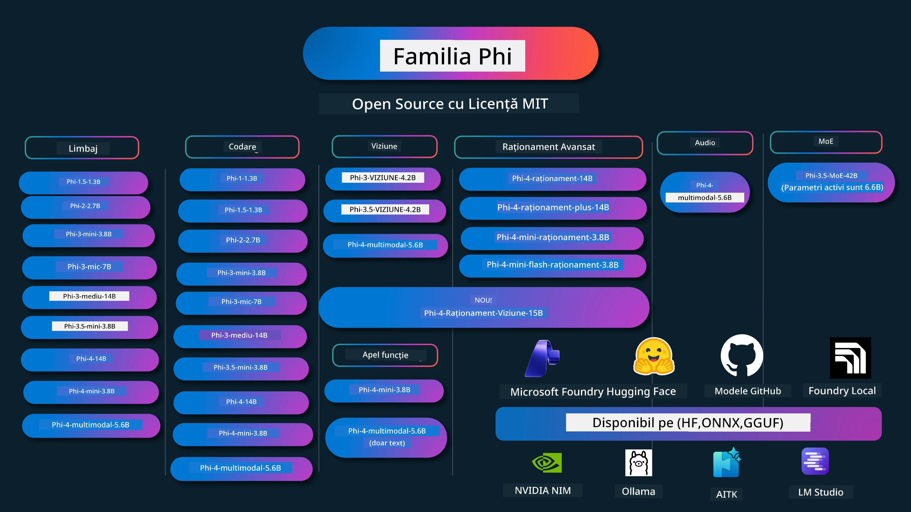

# Phi Cookbook: Exemple practice cu modelele Phi de la Microsoft

[](https://codespaces.new/microsoft/phicookbook)
[](https://vscode.dev/redirect?url=vscode://ms-vscode-remote.remote-containers/cloneInVolume?url=https://github.com/microsoft/phicookbook)

[](https://GitHub.com/microsoft/phicookbook/graphs/contributors/?WT.mc_id=aiml-137032-kinfeylo)
[](https://GitHub.com/microsoft/phicookbook/issues/?WT.mc_id=aiml-137032-kinfeylo)
[](https://GitHub.com/microsoft/phicookbook/pulls/?WT.mc_id=aiml-137032-kinfeylo)
[](http://makeapullrequest.com?WT.mc_id=aiml-137032-kinfeylo)

[](https://GitHub.com/microsoft/phicookbook/watchers/?WT.mc_id=aiml-137032-kinfeylo)
[](https://GitHub.com/microsoft/phicookbook/network/?WT.mc_id=aiml-137032-kinfeylo)
[](https://GitHub.com/microsoft/phicookbook/stargazers/?WT.mc_id=aiml-137032-kinfeylo)

[](https://discord.com/invite/ByRwuEEgH4)

Phi este o serie de modele AI open source dezvoltate de Microsoft.

Phi este în prezent cel mai puternic și eficient ca preț model mic de limbaj (SLM), cu benchmark-uri foarte bune în multi-limbaj, raționament, generare text/chat, codare, imagini, audio și alte scenarii.

Poți implementa Phi în cloud sau pe dispozitive edge și poți crea ușor aplicații AI generative cu resurse limitate de calcul.

Urmează acești pași pentru a începe să folosești aceste resurse:
1. **Fă fork la repository**: Click [](https://GitHub.com/microsoft/phicookbook/network/?WT.mc_id=aiml-137032-kinfeylo)
2. **Clonează repository-ul**: `git clone https://github.com/microsoft/PhiCookBook.git`
3. [**Alătură-te comunității Microsoft AI Discord și întâlnește experți și alți dezvoltatori**](https://discord.com/invite/ByRwuEEgH4?WT.mc_id=aiml-137032-kinfeylo)



### 🌐 Suport multi-limbaj

#### Traduceri întreținute cu [Co-op Translator](https://github.com/Azure/co-op-translator)

<!-- CO-OP TRANSLATOR LANGUAGES TABLE START -->
[Arabă](../ar/README.md) | [Bengaleză](../bn/README.md) | [Bulgară](../bg/README.md) | [Burmese (Myanmar)](../my/README.md) | [Chineză (Simplificată)](../zh-CN/README.md) | [Chineză (Tradițională, Hong Kong)](../zh-HK/README.md) | [Chineză (Tradițională, Macau)](../zh-MO/README.md) | [Chineză (Tradițională, Taiwan)](../zh-TW/README.md) | [Croată](../hr/README.md) | [Cehă](../cs/README.md) | [Daneză](../da/README.md) | [Olandeză](../nl/README.md) | [Estoniană](../et/README.md) | [Finlandeză](../fi/README.md) | [Franceză](../fr/README.md) | [Germană](../de/README.md) | [Greacă](../el/README.md) | [Ebraică](../he/README.md) | [Hindi](../hi/README.md) | [Maghiară](../hu/README.md) | [Indoneziană](../id/README.md) | [Italiană](../it/README.md) | [Japoneză](../ja/README.md) | [Kannada](../kn/README.md) | [Khmer](../km/README.md) | [Coreeană](../ko/README.md) | [Lituaniană](../lt/README.md) | [Malay](../ms/README.md) | [Malayalam](../ml/README.md) | [Manipuri (Meitei Mayek)](../mni/README.md) | [Marathi](../mr/README.md) | [Nepaleză](../ne/README.md) | [Pidgin Nigerian](../pcm/README.md) | [Norvegiană](../no/README.md) | [Persană (Farsi)](../fa/README.md) | [Poloneză](../pl/README.md) | [Portugheză (Brazilia)](../pt-BR/README.md) | [Portugheză (Portugalia)](../pt-PT/README.md) | [Punjabi (Gurmukhi)](../pa/README.md) | [Română](./README.md) | [Rusă](../ru/README.md) | [Sârbă (Chirilică)](../sr/README.md) | [Slovacă](../sk/README.md) | [Slovenă](../sl/README.md) | [Spaniolă](../es/README.md) | [Swahili](../sw/README.md) | [Suedeză](../sv/README.md) | [Tagalog (Filipineză)](../tl/README.md) | [Tamil](../ta/README.md) | [Telugu](../te/README.md) | [Thailandeză](../th/README.md) | [Turcă](../tr/README.md) | [Ucraineană](../uk/README.md) | [Urdu](../ur/README.md) | [Vietnameză](../vi/README.md)

> **Preferi să clonezi local?**
>
> Acest repository include traduceri în peste 50 de limbi, ceea ce mărește semnificativ dimensiunea descărcării. Pentru a clona fără traduceri, folosește sparse checkout:
>
> **Bash / macOS / Linux:**
> ```bash
> git clone --filter=blob:none --sparse https://github.com/microsoft/PhiCookBook.git
> cd PhiCookBook
> git sparse-checkout set --no-cone '/*' '!translations' '!translated_images'
> ```
>
> **CMD (Windows):**
> ```cmd
> git clone --filter=blob:none --sparse https://github.com/microsoft/PhiCookBook.git
> cd PhiCookBook
> git sparse-checkout set --no-cone "/*" "!translations" "!translated_images"
> ```
>
> Aceasta îți oferă tot ce ai nevoie pentru a finaliza cursul cu o descărcare mult mai rapidă.
<!-- CO-OP TRANSLATOR LANGUAGES TABLE END -->

## Cuprins

- Introducere
  - [Bun venit în familia Phi](./md/01.Introduction/01/01.PhiFamily.md)
  - [Configurarea mediului tău](./md/01.Introduction/01/01.EnvironmentSetup.md)
  - [Înțelegerea tehnologiilor cheie](./md/01.Introduction/01/01.Understandingtech.md)
  - [Siguranța AI pentru modelele Phi](./md/01.Introduction/01/01.AISafety.md)
  - [Suport hardware Phi](./md/01.Introduction/01/01.Hardwaresupport.md)
  - [Modelele Phi și disponibilitatea pe platforme](./md/01.Introduction/01/01.Edgeandcloud.md)
  - [Utilizarea Guidance-ai și Phi](./md/01.Introduction/01/01.Guidance.md)
  - [Modele din GitHub Marketplace](https://github.com/marketplace/models)
  - [Catalog AI Azure](https://ai.azure.com)

- Inferență Phi în medii diferite
    -  [Hugging face](./md/01.Introduction/02/01.HF.md)
    -  [Modele GitHub](./md/01.Introduction/02/02.GitHubModel.md)
    -  [Catalogul modelelor Microsoft Foundry](./md/01.Introduction/02/03.AzureAIFoundry.md)
    -  [Ollama](./md/01.Introduction/02/04.Ollama.md)
    -  [AI Toolkit VSCode (AITK)](./md/01.Introduction/02/05.AITK.md)
    -  [NVIDIA NIM](./md/01.Introduction/02/06.NVIDIA.md)
    -  [Foundry Local](./md/01.Introduction/02/07.FoundryLocal.md)

- Inferență Familia Phi
    - [Inferență Phi pe iOS](./md/01.Introduction/03/iOS_Inference.md)
    - [Inferență Phi pe Android](./md/01.Introduction/03/Android_Inference.md)
    - [Inferență Phi pe Jetson](./md/01.Introduction/03/Jetson_Inference.md)
    - [Inferență Phi pe AI PC](./md/01.Introduction/03/AIPC_Inference.md)
    - [Inferență Phi cu Apple MLX Framework](./md/01.Introduction/03/MLX_Inference.md)
    - [Inferență Phi pe server local](./md/01.Introduction/03/Local_Server_Inference.md)
    - [Inferență Phi pe server la distanță folosind AI Toolkit](./md/01.Introduction/03/Remote_Interence.md)
    - [Inferență Phi cu Rust](./md/01.Introduction/03/Rust_Inference.md)
    - [Inferență Phi—Viziune în local](./md/01.Introduction/03/Vision_Inference.md)
    - [Inferență Phi cu Kaito AKS, Azure Containers (suport oficial)](./md/01.Introduction/03/Kaito_Inference.md)
-  [Cuantificare Familia Phi](./md/01.Introduction/04/QuantifyingPhi.md)
    - [Cuantificare Phi-3.5 / 4 folosind llama.cpp](./md/01.Introduction/04/UsingLlamacppQuantifyingPhi.md)
    - [Cuantificare Phi-3.5 / 4 folosind extensii Generative AI pentru onnxruntime](./md/01.Introduction/04/UsingORTGenAIQuantifyingPhi.md)
    - [Cuantificare Phi-3.5 / 4 folosind Intel OpenVINO](./md/01.Introduction/04/UsingIntelOpenVINOQuantifyingPhi.md)
    - [Cuantificare Phi-3.5 / 4 folosind Apple MLX Framework](./md/01.Introduction/04/UsingAppleMLXQuantifyingPhi.md)

- Evaluare Phi
    - [Response AI](./md/01.Introduction/05/ResponsibleAI.md)
    - [Microsoft Foundry pentru evaluare](./md/01.Introduction/05/AIFoundry.md)
    - [Utilizarea Promptflow pentru evaluare](./md/01.Introduction/05/Promptflow.md)
 
- RAG cu Azure AI Search
    - [Cum să folosești Phi-4-mini și Phi-4-multimodal (RAG) cu Azure AI Search](https://github.com/microsoft/PhiCookBook/blob/main/code/06.E2E/E2E_Phi-4-RAG-Azure-AI-Search.ipynb)
    - [RAG hibrid local zero-cloud cu SQLite FTS5 și phi-4-mini](https://github.com/microsoft/PhiCookBook/blob/main/code/06.E2E/E2E_Phi-4-mini_Local_Hybrid_RAG_SQLite_FTS5.ipynb)

- Exemple de dezvoltare aplicații Phi
  - Aplicații de text și chat
    - Exemple Phi-4
      - [📓] [Chat cu modelul Phi-4-mini ONNX](./md/02.Application/01.TextAndChat/Phi4/ChatWithPhi4ONNX/README.md)
      - [Chat cu modelul local Phi-4 ONNX .NET](../../md/04.HOL/dotnet/src/LabsPhi4-Chat-01OnnxRuntime)
      - [Aplicație console chat .NET cu Phi-4 ONNX folosind Semantic Kernel](../../md/04.HOL/dotnet/src/LabsPhi4-Chat-02SK)
    - Exemple Phi-3 / 3.5
      - [Chatbot local în browser folosind Phi3, ONNX Runtime Web și WebGPU](https://github.com/microsoft/onnxruntime-inference-examples/tree/main/js/chat)
      - [Chat OpenVino](./md/02.Application/01.TextAndChat/Phi3/E2E_OpenVino_Chat.md)
      - [Multi Model - Phi-3-mini interactiv și OpenAI Whisper](./md/02.Application/01.TextAndChat/Phi3/E2E_Phi-3-mini_with_whisper.md)
      - [MLFlow - Construirea unui wrapper și folosirea Phi-3 cu MLFlow](./md//02.Application/01.TextAndChat/Phi3/E2E_Phi-3-MLflow.md)
      - [Optimizare Model - Cum să optimizezi modelul Phi-3-mini pentru ONNX Runtime Web cu Olive](https://github.com/microsoft/Olive/tree/main/examples/phi3)
      - [Aplicație WinUI3 cu Phi-3 mini-4k-instruct-onnx](https://github.com/microsoft/Phi3-Chat-WinUI3-Sample/)
      -[Exemplu aplicație note AI multmodel WinUI3](https://github.com/microsoft/ai-powered-notes-winui3-sample)
      - [Fine-tune și integrează modele Phi-3 personalizate cu Prompt flow](./md/02.Application/01.TextAndChat/Phi3/E2E_Phi-3-FineTuning_PromptFlow_Integration.md)
      - [Fine-tune și integrează modele Phi-3 personalizate cu Prompt flow în Microsoft Foundry](./md/02.Application/01.TextAndChat/Phi3/E2E_Phi-3-FineTuning_PromptFlow_Integration_AIFoundry.md)
      - [Evaluează modelul Phi-3 / Phi-3.5 fine-tuned în Microsoft Foundry, concentrându-se pe principiile responsabilității AI ale Microsoft](./md/02.Application/01.TextAndChat/Phi3/E2E_Phi-3-Evaluation_AIFoundry.md)
      - [📓] [Exemplu predicție limbaj Phi-3.5-mini-instruct (chineză/engleză)](./md/02.Application/01.TextAndChat/Phi3/phi3-instruct-demo.ipynb)
      - [Chatbot Phi-3.5-Instruct WebGPU RAG](./md/02.Application/01.TextAndChat/Phi3/WebGPUWithPhi35Readme.md)
      - [Folosind GPU Windows pentru a crea o soluție Prompt flow cu Phi-3.5-Instruct ONNX](./md/02.Application/01.TextAndChat/Phi3/UsingPromptFlowWithONNX.md)
      - [Folosind Microsoft Phi-3.5 tflite pentru a crea o aplicație Android](./md/02.Application/01.TextAndChat/Phi3/UsingPhi35TFLiteCreateAndroidApp.md)
      - [Exemplu Q&A .NET folosind modelul Phi-3 ONNX local cu Microsoft.ML.OnnxRuntime](../../md/04.HOL/dotnet/src/LabsPhi301)
      - [Aplicație console chat .NET cu Semantic Kernel și Phi-3](../../md/04.HOL/dotnet/src/LabsPhi302)

  - Exemple bazate pe cod SDK Azure AI Inference
    - Exemple Phi-4
      - [📓] [Generează cod proiect folosind Phi-4-multimodal](./md/02.Application/02.Code/Phi4/GenProjectCode/README.md)
    - Exemple Phi-3 / 3.5
      - [Construiește propriul tău chat GitHub Copilot în Visual Studio Code cu familia Microsoft Phi-3](./md/02.Application/02.Code/Phi3/VSCodeExt/README.md)
      - [Creează propriul tău agent chat Copilot în Visual Studio Code cu Phi-3.5 de la modelele GitHub](/md/02.Application/02.Code/Phi3/CreateVSCodeChatAgentWithGitHubModels.md)

  - Exemple de raționament avansat
    - Mostre Phi-4 
      - [📓] [Mostre Phi-4-mini-raisoning sau Phi-4-raisoning](./md/02.Application/03.AdvancedReasoning/Phi4/AdvancedResoningPhi4mini/README.md)
      - [📓] [Finisare Phi-4-mini-raisoning cu Microsoft Olive](./md/02.Application/03.AdvancedReasoning/Phi4/AdvancedResoningPhi4mini/olive_ft_phi_4_reasoning_with_medicaldata.ipynb)
      - [📓] [Finisare Phi-4-mini-raisoning cu Apple MLX](./md/02.Application/03.AdvancedReasoning/Phi4/AdvancedResoningPhi4mini/mlx_ft_phi_4_reasoning_with_medicaldata.ipynb)
      - [📓] [Phi-4-mini-raisoning cu modelele GitHub](./md/02.Application/02.Code/Phi4r/github_models_inference.ipynb)
      - [📓] [Phi-4-mini-raisoning cu modelele Microsoft Foundry](./md/02.Application/02.Code/Phi4r/azure_models_inference.ipynb)
  - Demonstrații
      - [Demonstrații Phi-4-mini găzduite pe Hugging Face Spaces](https://huggingface.co/spaces/microsoft/phi-4-mini?WT.mc_id=aiml-137032-kinfeylo)
      - [Demonstrații Phi-4-multimodal găzduite pe Hugginge Face Spaces](https://huggingface.co/spaces/microsoft/phi-4-multimodal?WT.mc_id=aiml-137032-kinfeylo)
  - Mostre Vision
    - Mostre Phi-4 
      - [📓] [Folosește Phi-4-multimodal pentru a citi imagini și a genera cod](./md/02.Application/04.Vision/Phi4/CreateFrontend/README.md) 
    - Mostre Phi-3 / 3.5
      -  [📓][Phi-3-vision-Imagine text la text](./md/02.Application/04.Vision/Phi3/E2E_Phi-3-vision-image-text-to-text-online-endpoint.ipynb)
      - [Phi-3-vision-ONNX](https://onnxruntime.ai/docs/genai/tutorials/phi3-v.html)
      - [📓][Phi-3-vision CLIP Embedding](./md/02.Application/04.Vision/Phi3/E2E_Phi-3-vision-image-text-to-text-online-endpoint.ipynb)
      - [DEMO: Phi-3 Reciclare](https://github.com/jennifermarsman/PhiRecycling/)
      - [Phi-3-vision - Asistent vizual de limbaj - cu Phi3-Vision și OpenVINO](https://docs.openvino.ai/nightly/notebooks/phi-3-vision-with-output.html)
      - [Phi-3 Vision Nvidia NIM](./md/02.Application/04.Vision/Phi3/E2E_Nvidia_NIM_Vision.md)
      - [Phi-3 Vision OpenVino](./md/02.Application/04.Vision/Phi3/E2E_OpenVino_Phi3Vision.md)
      - [📓][Phi-3.5 Vision mostre multi-cadru sau multi-imagine](./md/02.Application/04.Vision/Phi3/phi3-vision-demo.ipynb)
      - [Model ONNX local Phi-3 Vision folosind Microsoft.ML.OnnxRuntime .NET](../../md/04.HOL/dotnet/src/LabsPhi303)
      - [Model ONNX local Phi-3 Vision bazat pe meniu folosind Microsoft.ML.OnnxRuntime .NET](../../md/04.HOL/dotnet/src/LabsPhi304)

  - Mostre Raisonare-Vision
    - Phi-4-Raisonare-Vision-15B 
      - [📓] [Folosirea Phi-4-Raisonare-Vision-15B pentru detectarea traversării neregulamentare](./md/02.Application/10.ReasoningVision/Phi_4_reasoning_vision_15b_Jaywalking.ipynb)
      - [📓] [Folosirea Phi-4-Raisonare-Vision-15B pentru matematică](./md/02.Application/10.ReasoningVision/Phi_4_reasoning_vision_15b_Math.ipynb)
      - [📓] [Folosirea Phi-4-Raisonare-Vision-15B pentru detectarea UI](./md/02.Application/10.ReasoningVision/Phi_4_reasoning_vision_15b_ui.ipynb)

  - Mostre Matematică
    -  Mostre Phi-4-Mini-Flash-Raisonare-Instruct  [Demo matematică cu Phi-4-Mini-Flash-Raisonare-Instruct](./md/02.Application/09.Math/MathDemo.ipynb)

  - Mostre Audio
    - Mostre Phi-4 
      - [📓] [Extrage transcrieri audio folosind Phi-4-multimodal](./md/02.Application/05.Audio/Phi4/Transciption/README.md)
      - [📓] [Mostră audio Phi-4-multimodal](./md/02.Application/05.Audio/Phi4/Siri/demo.ipynb)
      - [📓] [Mostră traducere vorbire Phi-4-multimodal](./md/02.Application/05.Audio/Phi4/Translate/demo.ipynb)
      - [Aplicație consolă .NET folosind Phi-4-multimodal Audio pentru a analiza un fișier audio și a genera transcript](../../md/04.HOL/dotnet/src/LabsPhi4-MultiModal-02Audio)

  - Mostre MOE
    - Mostre Phi-3 / 3.5
      - [📓] [Mostră modele Mixtură de Experți (MoEs) Phi-3.5 pentru Social Media](./md/02.Application/06.MoE/Phi3/phi3_moe_demo.ipynb)
      - [📓] [Construirea unui pipeline Retrieval-Augmented Generation (RAG) cu NVIDIA NIM Phi-3 MOE, Azure AI Search și LlamaIndex](./md/02.Application/06.MoE/Phi3/azure-ai-search-nvidia-rag.ipynb)
      - 
  - Mostre apelare funcții
    - Mostre Phi-4 🆕
      -  [📓] [Folosirea apelării funcțiilor cu Phi-4-mini](./md/02.Application/07.FunctionCalling/Phi4/FunctionCallingBasic/README.md)
      -  [📓] [Folosirea apelării funcțiilor pentru a crea multi-agenti cu Phi-4-mini](./md/02.Application/07.FunctionCalling/Phi4/Multiagents/Phi_4_mini_multiagent.ipynb)
      -  [📓] [Folosirea apelării funcțiilor cu Ollama](./md/02.Application/07.FunctionCalling/Phi4/Ollama/ollama_functioncalling.ipynb)
      -  [📓] [Folosirea apelării funcțiilor cu ONNX](./md/02.Application/07.FunctionCalling/Phi4/ONNX/onnx_parallel_functioncalling.ipynb)
  - Mostre mixare multimodală
    - Mostre Phi-4 🆕
      -  [📓] [Folosirea Phi-4-multimodal ca jurnalist de tehnologie](./md/02.Application/08.Multimodel/Phi4/TechJournalist/phi_4_mm_audio_text_publish_news.ipynb)
      - [Aplicație consolă .NET folosind Phi-4-multimodal pentru a analiza imagini](../../md/04.HOL/dotnet/src/LabsPhi4-MultiModal-01Images)

- Finisare modele Phi
  - [Scenarii de finisare](./md/03.FineTuning/FineTuning_Scenarios.md)
  - [Finisare vs RAG](./md/03.FineTuning/FineTuning_vs_RAG.md)
  - [Permite Phi-3 să devină expert în industrie](./md/03.FineTuning/LetPhi3gotoIndustriy.md)
  - [Finisarea Phi-3 cu AI Toolkit pentru VS Code](./md/03.FineTuning/Finetuning_VSCodeaitoolkit.md)
  - [Finisarea Phi-3 cu Azure Machine Learning Service](./md/03.FineTuning/Introduce_AzureML.md)
  - [Finisarea Phi-3 cu Lora](./md/03.FineTuning/FineTuning_Lora.md)
  - [Finisarea Phi-3 cu QLora](./md/03.FineTuning/FineTuning_Qlora.md)
  - [Finisarea Phi-3 cu Microsoft Foundry](./md/03.FineTuning/FineTuning_AIFoundry.md)
  - [Finisarea Phi-3 cu Azure ML CLI/SDK](./md/03.FineTuning/FineTuning_MLSDK.md)
  - [Finisarea cu Microsoft Olive](./md/03.FineTuning/FineTuning_MicrosoftOlive.md)
  - [Finisarea cu laboratoare practice Microsoft Olive](./md/03.FineTuning/olive-lab/readme.md)
  - [Finisarea Phi-3-vision cu Weights and Bias](./md/03.FineTuning/FineTuning_Phi-3-visionWandB.md)
  - [Finisarea Phi-3 cu Apple MLX Framework](./md/03.FineTuning/FineTuning_MLX.md)
  - [Finisarea Phi-3-vision (suport oficial)](./md/03.FineTuning/FineTuning_Vision.md)
  - [Finisarea Phi-3 cu Kaito AKS, containere Azure (suport oficial)](./md/03.FineTuning/FineTuning_Kaito.md)
  - [Finisarea Phi-3 și 3.5 Vision](https://github.com/2U1/Phi3-Vision-Finetune)

- Laborator practic
  - [Explorarea modelelor de ultimă oră: LLM, SLM, dezvoltare locală și altele](https://github.com/microsoft/aitour-exploring-cutting-edge-models)
  - [Dezvăluirea potențialului NLP: finisare cu Microsoft Olive](https://github.com/azure/Ignite_FineTuning_workshop)

- Articole academice și publicații
  - [Textbooks Are All You Need II: raport tehnic phi-1.5](https://arxiv.org/abs/2309.05463)
  - [Raport tehnic Phi-3: un model de limbaj foarte capabil local pe telefonul tău](https://arxiv.org/abs/2404.14219)
  - [Raport tehnic Phi-4](https://arxiv.org/abs/2412.08905)
  - [Raport tehnic Phi-4-Mini: modele compacte dar puternice multimodale prin Mixture-of-LoRAs](https://arxiv.org/abs/2503.01743)
  - [Optimizarea modelelor mici de limbaj pentru apelarea funcțiilor în autoturisme](https://arxiv.org/abs/2501.02342)
  - [(WhyPHI) Finisarea PHI-3 pentru răspunsuri la întrebări cu răspuns multiplu: metodologie, rezultate și provocări](https://arxiv.org/abs/2501.01588)
  - [Raport tehnic Phi-4-raisoning](https://www.microsoft.com/en-us/research/wp-content/uploads/2025/04/phi_4_reasoning.pdf)
  - [Raport tehnic Phi-4-mini-raisoning](https://huggingface.co/microsoft/Phi-4-mini-reasoning/blob/main/Phi-4-Mini-Reasoning.pdf)

## Utilizarea modelelor Phi

### Phi pe Microsoft Foundry

Poți învăța cum să folosești Microsoft Phi și cum să construiești soluții E2E pe diferite dispozitive hardware. Pentru a experimenta Phi, începe să te joci cu modelele și să personalizezi Phi pentru scenariile tale folosind [Catalogul de modele Microsoft Foundry Azure AI](https://aka.ms/phi3-azure-ai) și poți afla mai multe la Începerea cu [Microsoft Foundry](/md/02.QuickStart/AzureAIFoundry_QuickStart.md)

**Zona de joacă**
Fiecare model are o zonă de joacă dedicată pentru testarea modelului [Azure AI Playground](https://aka.ms/try-phi3).

### Phi pe modelele GitHub

Poți învăța cum să folosești Microsoft Phi și cum să construiești soluții E2E pe diferite dispozitive hardware. Pentru a experimenta Phi, începe să te joci cu modelul și să personalizezi Phi pentru scenariile tale folosind [Catalogul modelelor GitHub](https://github.com/marketplace/models?WT.mc_id=aiml-137032-kinfeylo) și poți afla mai multe la Începerea cu [Catalogul modelelor GitHub](/md/02.QuickStart/GitHubModel_QuickStart.md)

**Zona de joacă**
Fiecare model are o [zonă de joacă dedicată pentru testarea modelului](/md/02.QuickStart/GitHubModel_QuickStart.md).

### Phi pe Hugging Face

Poți găsi modelul și pe [Hugging Face](https://huggingface.co/microsoft)

**Zona de joacă**
 [Zona de joacă Hugging Chat](https://huggingface.co/chat/models/microsoft/Phi-3-mini-4k-instruct)

 ## 🎒 Alte cursuri

Echipa noastră produce și alte cursuri! Vezi:

<!-- CO-OP TRANSLATOR OTHER COURSES START -->
### LangChain
[](https://aka.ms/langchain4j-for-beginners)
[](https://aka.ms/langchainjs-for-beginners?WT.mc_id=m365-94501-dwahlin)
[](https://github.com/microsoft/langchain-for-beginners?WT.mc_id=m365-94501-dwahlin)
---

### Azure / Edge / MCP / Agenți
[](https://github.com/microsoft/AZD-for-beginners?WT.mc_id=academic-105485-koreyst)
[](https://github.com/microsoft/edgeai-for-beginners?WT.mc_id=academic-105485-koreyst)
[](https://github.com/microsoft/mcp-for-beginners?WT.mc_id=academic-105485-koreyst)
[](https://github.com/microsoft/ai-agents-for-beginners?WT.mc_id=academic-105485-koreyst)

---
 
### Seria Generative AI
[](https://github.com/microsoft/generative-ai-for-beginners?WT.mc_id=academic-105485-koreyst)
[-9333EA?style=for-the-badge&labelColor=E5E7EB&color=9333EA)](https://github.com/microsoft/Generative-AI-for-beginners-dotnet?WT.mc_id=academic-105485-koreyst)
[-C084FC?style=for-the-badge&labelColor=E5E7EB&color=C084FC)](https://github.com/microsoft/generative-ai-for-beginners-java?WT.mc_id=academic-105485-koreyst)
[-E879F9?style=for-the-badge&labelColor=E5E7EB&color=E879F9)](https://github.com/microsoft/generative-ai-with-javascript?WT.mc_id=academic-105485-koreyst)

---
 
### Învățare de bază
[](https://aka.ms/ml-beginners?WT.mc_id=academic-105485-koreyst)
[](https://aka.ms/datascience-beginners?WT.mc_id=academic-105485-koreyst)
[](https://aka.ms/ai-beginners?WT.mc_id=academic-105485-koreyst)
[](https://github.com/microsoft/Security-101?WT.mc_id=academic-96948-sayoung)
[](https://aka.ms/webdev-beginners?WT.mc_id=academic-105485-koreyst)
[](https://aka.ms/iot-beginners?WT.mc_id=academic-105485-koreyst)
[](https://github.com/microsoft/xr-development-for-beginners?WT.mc_id=academic-105485-koreyst)

---
 
### Seria Copilot
[](https://aka.ms/GitHubCopilotAI?WT.mc_id=academic-105485-koreyst)
[](https://github.com/microsoft/mastering-github-copilot-for-dotnet-csharp-developers?WT.mc_id=academic-105485-koreyst)
[](https://github.com/microsoft/CopilotAdventures?WT.mc_id=academic-105485-koreyst)
<!-- CO-OP TRANSLATOR OTHER COURSES END -->

## AI Responsabil 

Microsoft este angajat să ajute clienții să folosească produsele noastre AI responsabil, împărtășind învățăturile noastre și construind parteneriate bazate pe încredere prin instrumente precum Notele de transparență și Evaluările impactului. Multe dintre aceste resurse pot fi găsite la [https://aka.ms/RAI](https://aka.ms/RAI).
Abordarea Microsoft privind AI responsabil se bazează pe principiile noastre AI de corectitudine, fiabilitate și siguranță, confidențialitate și securitate, incluziune, transparență și responsabilitate.

Modelele la scară largă de limbaj natural, imagine și vorbire - ca cele folosite în această mostră - pot avea comportamente care pot fi nedrepte, nesigure sau ofensatoare, ceea ce poate cauza daune. Vă rugăm să consultați [nota de transparență a serviciului Azure OpenAI](https://learn.microsoft.com/legal/cognitive-services/openai/transparency-note?tabs=text) pentru a fi informat despre riscuri și limitări.

Abordarea recomandată pentru atenuarea acestor riscuri este includerea unui sistem de siguranță în arhitectura dvs. care poate detecta și preveni comportamentul dăunător. [Azure AI Content Safety](https://learn.microsoft.com/azure/ai-services/content-safety/overview) oferă un strat independent de protecție, capabil să detecteze conținutul dăunător generat de utilizatori și de AI în aplicații și servicii. Azure AI Content Safety include API-uri pentru text și imagini care vă permit să detectați materiale dăunătoare. În Microsoft Foundry, serviciul Content Safety vă permite să vizualizați, să explorați și să încercați cod de exemplu pentru detectarea conținutului dăunător în diferite moduri. Următoarea [documentație de pornire rapidă](https://learn.microsoft.com/azure/ai-services/content-safety/quickstart-text?tabs=visual-studio%2Clinux&pivots=programming-language-rest) vă ghidează prin efectuarea solicitărilor către serviciu.

Un alt aspect de luat în considerare este performanța generală a aplicației. Pentru aplicațiile multimodale și multi-modele, considerăm performanța ca fiind faptul că sistemul funcționează conform așteptărilor dvs. și ale utilizatorilor, inclusiv faptul că nu generează rezultate dăunătoare. Este important să evaluați performanța aplicației dvs. generale folosind [evaluatori de performanță, calitate, risc și siguranță](https://learn.microsoft.com/azure/ai-studio/concepts/evaluation-metrics-built-in). De asemenea, aveți posibilitatea să creați și să evaluați cu [evaluatori personalizați](https://learn.microsoft.com/azure/ai-studio/how-to/develop/evaluate-sdk#custom-evaluators).

Puteți evalua aplicația dvs. AI în mediul de dezvoltare folosind [Azure AI Evaluation SDK](https://microsoft.github.io/promptflow/index.html). Având un set de date de test sau un obiectiv, generările aplicației dvs. de AI generativă sunt măsurate cantitativ cu evaluatori integrați sau evaluatori personalizați la alegere. Pentru a începe să utilizați Azure AI Evaluation SDK pentru a vă evalua sistemul, puteți urma [ghidul de pornire rapidă](https://learn.microsoft.com/azure/ai-studio/how-to/develop/flow-evaluate-sdk). După ce executați o rulare de evaluare, puteți [vizualiza rezultatele în Microsoft Foundry](https://learn.microsoft.com/azure/ai-studio/how-to/evaluate-flow-results). 

## Mărci comerciale

Acest proiect poate conține mărci comerciale sau logo-uri pentru proiecte, produse sau servicii. Utilizarea autorizată a mărcilor comerciale sau a logo-urilor Microsoft este supusă și trebuie să urmeze [Ghidurile Microsoft privind mărci comerciale și branduri](https://www.microsoft.com/legal/intellectualproperty/trademarks/usage/general).
Utilizarea mărcilor comerciale sau a logo-urilor Microsoft în versiuni modificate ale acestui proiect nu trebuie să creeze confuzie sau să implice sponsorizarea Microsoft. Orice utilizare a mărcilor comerciale sau logo-urilor terților este supusă politicilor acelora terțe părți.

## Obținerea de ajutor

Dacă întâmpinați dificultăți sau aveți întrebări despre construirea aplicațiilor AI, alăturați-vă:

[](https://aka.ms/foundry/discord)

Dacă aveți feedback despre produs sau erori în timpul dezvoltării, vizitați:

[](https://aka.ms/foundry/forum)

---

<!-- CO-OP TRANSLATOR DISCLAIMER START -->
**Declinare a responsabilității**:
Acest document a fost tradus folosind serviciul de traducere AI [Co-op Translator](https://github.com/Azure/co-op-translator). În timp ce ne străduim pentru acuratețe, vă rugăm să rețineți că traducerile automate pot conține erori sau inexactități. Documentul original în limba sa nativă trebuie considerat sursa autorizată. Pentru informații critice, se recomandă traducerea profesională realizată de un om. Nu ne asumăm responsabilitatea pentru eventualele neînțelegeri sau interpretări greșite care decurg din utilizarea acestei traduceri.
<!-- CO-OP TRANSLATOR DISCLAIMER END -->