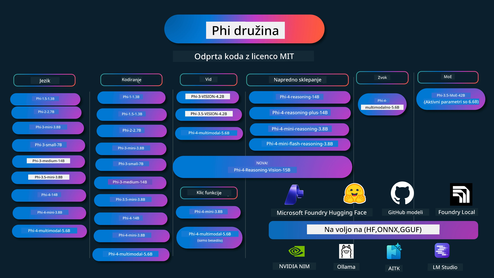

# Phi Kuharica: Praktični primeri z Microsoftovimi Phi modeli

[](https://codespaces.new/microsoft/phicookbook)
[](https://vscode.dev/redirect?url=vscode://ms-vscode-remote.remote-containers/cloneInVolume?url=https://github.com/microsoft/phicookbook)

[](https://GitHub.com/microsoft/phicookbook/graphs/contributors/?WT.mc_id=aiml-137032-kinfeylo)
[](https://GitHub.com/microsoft/phicookbook/issues/?WT.mc_id=aiml-137032-kinfeylo)
[](https://GitHub.com/microsoft/phicookbook/pulls/?WT.mc_id=aiml-137032-kinfeylo)
[](http://makeapullrequest.com?WT.mc_id=aiml-137032-kinfeylo)

[](https://GitHub.com/microsoft/phicookbook/watchers/?WT.mc_id=aiml-137032-kinfeylo)
[](https://GitHub.com/microsoft/phicookbook/network/?WT.mc_id=aiml-137032-kinfeylo)
[](https://GitHub.com/microsoft/phicookbook/stargazers/?WT.mc_id=aiml-137032-kinfeylo)

[](https://discord.com/invite/ByRwuEEgH4)

Phi je serija odprtokodnih AI modelov, ki jih je razvil Microsoft.

Phi je trenutno najmočnejši in stroškovno najučinkovitejši majhen jezikovni model (SLM), z zelo dobrimi merili učinkovitosti v večjezičnih, sklepnih, besedilnih/chat generacijskih, kodirnih, slikovnih, zvočnih in drugih scenarijih.

Phi lahko namestite v oblak ali na robne naprave, in lahko enostavno gradite generativne AI aplikacije z omejeno računalniško močjo.

Sledite tem korakom za začetek uporabe teh virov:
1. **Razvezi repozitorij**: Kliknite [](https://GitHub.com/microsoft/phicookbook/network/?WT.mc_id=aiml-137032-kinfeylo)
2. **Kloni repozitorij**: `git clone https://github.com/microsoft/PhiCookBook.git`
3. [**Pridružite se Microsoft AI Discord skupnosti in spoznajte strokovnjake ter ostale razvijalce**](https://discord.com/invite/ByRwuEEgH4?WT.mc_id=aiml-137032-kinfeylo)



### 🌐 Večjezična podpora

#### Prevodi vzdrževani z [Co-op Translator](https://github.com/Azure/co-op-translator)

<!-- CO-OP TRANSLATOR LANGUAGES TABLE START -->
[Arabščina](../ar/README.md) | [Bengalski](../bn/README.md) | [Bolgarščina](../bg/README.md) | [Burmanski (Mjanmar)](../my/README.md) | [Kitajščina (poenostavljena)](../zh-CN/README.md) | [Kitajščina (tradicionalna, Hong Kong)](../zh-HK/README.md) | [Kitajščina (tradicionalna, Macau)](../zh-MO/README.md) | [Kitajščina (tradicionalna, Tajvan)](../zh-TW/README.md) | [Hrvaščina](../hr/README.md) | [Češčina](../cs/README.md) | [Danščina](../da/README.md) | [Nizozemščina](../nl/README.md) | [Estonščina](../et/README.md) | [Finščina](../fi/README.md) | [Francoščina](../fr/README.md) | [Nemščina](../de/README.md) | [Grščina](../el/README.md) | [Hebrejščina](../he/README.md) | [Hindijščina](../hi/README.md) | [Madžarščina](../hu/README.md) | [Indonezijščina](../id/README.md) | [Italijanščina](../it/README.md) | [Japonščina](../ja/README.md) | [Kannada](../kn/README.md) | [Khmerščina](../km/README.md) | [Korejščina](../ko/README.md) | [Litovščina](../lt/README.md) | [Malezijščina](../ms/README.md) | [Malajalščina](../ml/README.md) | [Manipuri (Meitei Mayek)](../mni/README.md) | [Maratščina](../mr/README.md) | [Nepalščina](../ne/README.md) | [Nigerijski pidžin](../pcm/README.md) | [Norveščina](../no/README.md) | [Perzijščina (Farsi)](../fa/README.md) | [Poljščina](../pl/README.md) | [Portugalski (Brazilija)](../pt-BR/README.md) | [Portugalski (Portugalska)](../pt-PT/README.md) | [Pandžabščina (Gurmukhi)](../pa/README.md) | [Romunščina](../ro/README.md) | [Ruščina](../ru/README.md) | [Srbščina (cirilica)](../sr/README.md) | [Slovaščina](../sk/README.md) | [Slovenščina](./README.md) | [Španščina](../es/README.md) | [Svahilijščina](../sw/README.md) | [Švedščina](../sv/README.md) | [Tagalog (Filipino)](../tl/README.md) | [Tamilščina](../ta/README.md) | [Telugu](../te/README.md) | [Tajščina](../th/README.md) | [Turščina](../tr/README.md) | [Ukrajinščina](../uk/README.md) | [Urdu](../ur/README.md) | [Vietnamščina](../vi/README.md)

> **Raje lokalno klonirati?**
>
> Ta repozitorij vključuje več kot 50 jezikovnih prevodov, kar znatno poveča velikost prenosa. Za kloniranje brez prevodov uporabite sparse checkout:
>
> **Bash / macOS / Linux:**
> ```bash
> git clone --filter=blob:none --sparse https://github.com/microsoft/PhiCookBook.git
> cd PhiCookBook
> git sparse-checkout set --no-cone '/*' '!translations' '!translated_images'
> ```
>
> **CMD (Windows):**
> ```cmd
> git clone --filter=blob:none --sparse https://github.com/microsoft/PhiCookBook.git
> cd PhiCookBook
> git sparse-checkout set --no-cone "/*" "!translations" "!translated_images"
> ```
>
> To vam zagotovi vse, kar potrebujete za dokončanje tečaja, s precej hitrejšim prenosom.
<!-- CO-OP TRANSLATOR LANGUAGES TABLE END -->

## Kazalo vsebine

- Uvod
  - [Dobrodošli v Phi družino](./md/01.Introduction/01/01.PhiFamily.md)
  - [Nastavitev vašega okolja](./md/01.Introduction/01/01.EnvironmentSetup.md)
  - [Razumevanje ključnih tehnologij](./md/01.Introduction/01/01.Understandingtech.md)
  - [Varnost umetne inteligence za Phi modele](./md/01.Introduction/01/01.AISafety.md)
  - [Podpora za Phi strojno opremo](./md/01.Introduction/01/01.Hardwaresupport.md)
  - [Phi modeli in razpoložljivost na platformah](./md/01.Introduction/01/01.Edgeandcloud.md)
  - [Uporaba Guidance-ai in Phi](./md/01.Introduction/01/01.Guidance.md)
  - [Modeli GitHub Marketplace](https://github.com/marketplace/models)
  - [Katalog Azure AI modelov](https://ai.azure.com)

- Inferenca Phi v različnih okoljih
    -  [Hugging face](./md/01.Introduction/02/01.HF.md)
    -  [GitHub modeli](./md/01.Introduction/02/02.GitHubModel.md)
    -  [Microsoft Foundry katalog modelov](./md/01.Introduction/02/03.AzureAIFoundry.md)
    -  [Ollama](./md/01.Introduction/02/04.Ollama.md)
    -  [AI Toolkit VSCode (AITK)](./md/01.Introduction/02/05.AITK.md)
    -  [NVIDIA NIM](./md/01.Introduction/02/06.NVIDIA.md)
    -  [Foundry lokalno](./md/01.Introduction/02/07.FoundryLocal.md)

- Inferenca Phi družine
    - [Inferenca Phi v iOS](./md/01.Introduction/03/iOS_Inference.md)
    - [Inferenca Phi v Android](./md/01.Introduction/03/Android_Inference.md)
    - [Inferenca Phi v Jetson](./md/01.Introduction/03/Jetson_Inference.md)
    - [Inferenca Phi v AI PC](./md/01.Introduction/03/AIPC_Inference.md)
    - [Inferenca Phi z Apple MLX ogrodjem](./md/01.Introduction/03/MLX_Inference.md)
    - [Inferenca Phi na lokalnem strežniku](./md/01.Introduction/03/Local_Server_Inference.md)
    - [Inferenca Phi na oddaljenem strežniku z uporabo AI Toolkit](./md/01.Introduction/03/Remote_Interence.md)
    - [Inferenca Phi z Rust](./md/01.Introduction/03/Rust_Inference.md)
    - [Inferenca Phi--Vision lokalno](./md/01.Introduction/03/Vision_Inference.md)
    - [Inferenca Phi z Kaito AKS, Azure Containers (uradna podpora)](./md/01.Introduction/03/Kaito_Inference.md)
-  [Kvantilizacija Phi družine](./md/01.Introduction/04/QuantifyingPhi.md)
    - [Kvantilizacija Phi-3.5 / 4 z llama.cpp](./md/01.Introduction/04/UsingLlamacppQuantifyingPhi.md)
    - [Kvantilizacija Phi-3.5 / 4 z razširitvami generativne AI za onnxruntime](./md/01.Introduction/04/UsingORTGenAIQuantifyingPhi.md)
    - [Kvantilizacija Phi-3.5 / 4 z Intel OpenVINO](./md/01.Introduction/04/UsingIntelOpenVINOQuantifyingPhi.md)
    - [Kvantilizacija Phi-3.5 / 4 z Apple MLX ogrodjem](./md/01.Introduction/04/UsingAppleMLXQuantifyingPhi.md)

-  Evalvacija Phi
    - [Response AI](./md/01.Introduction/05/ResponsibleAI.md)
    - [Microsoft Foundry za evalvacijo](./md/01.Introduction/05/AIFoundry.md)
    - [Uporaba Promptflow za evalvacijo](./md/01.Introduction/05/Promptflow.md)
 
- RAG z Azure AI Search
    - [Kako uporabljati Phi-4-mini in Phi-4-multimodal(RAG) z Azure AI Search](https://github.com/microsoft/PhiCookBook/blob/main/code/06.E2E/E2E_Phi-4-RAG-Azure-AI-Search.ipynb)
    - [Zero-Cloud lokalni hibridni RAG z SQLite FTS5 in phi-4-mini](https://github.com/microsoft/PhiCookBook/blob/main/code/06.E2E/E2E_Phi-4-mini_Local_Hybrid_RAG_SQLite_FTS5.ipynb)

- Primeri razvoja aplikacij Phi
  - Besedilne in klepetalne aplikacije
    - Phi-4 primeri
      - [📓] [Klepet z Phi-4-mini ONNX modelom](./md/02.Application/01.TextAndChat/Phi4/ChatWithPhi4ONNX/README.md)
      - [Klepet z Phi-4 lokalnim ONNX modelom .NET](../../md/04.HOL/dotnet/src/LabsPhi4-Chat-01OnnxRuntime)
      - [Klepetalna .NET konzolna aplikacija s Phi-4 ONNX, ki uporablja Semantic Kernel](../../md/04.HOL/dotnet/src/LabsPhi4-Chat-02SK)
    - Phi-3 / 3.5 primeri
      - [Lokalni klepetalnik v brskalniku z uporabo Phi3, ONNX Runtime Web in WebGPU](https://github.com/microsoft/onnxruntime-inference-examples/tree/main/js/chat)
      - [OpenVino klepet](./md/02.Application/01.TextAndChat/Phi3/E2E_OpenVino_Chat.md)
      - [Multi Model - Interaktiven Phi-3-mini in OpenAI Whisper](./md/02.Application/01.TextAndChat/Phi3/E2E_Phi-3-mini_with_whisper.md)
      - [MLFlow - Gradnja vmesnika in uporaba Phi-3 z MLFlow](./md//02.Application/01.TextAndChat/Phi3/E2E_Phi-3-MLflow.md)
      - [Optimizacija modela - Kako optimizirati Phi-3-min model za ONNX Runtime Web z Olive](https://github.com/microsoft/Olive/tree/main/examples/phi3)
      - [WinUI3 aplikacija s Phi-3 mini-4k-instruct-onnx](https://github.com/microsoft/Phi3-Chat-WinUI3-Sample/)
      -[WinUI3 Multi Model AI Powered Notes App primer](https://github.com/microsoft/ai-powered-notes-winui3-sample)
      - [Fino nastavljanje in integracija prilagojenih Phi-3 modelov s Prompt flow](./md/02.Application/01.TextAndChat/Phi3/E2E_Phi-3-FineTuning_PromptFlow_Integration.md)
      - [Fino nastavljanje in integracija prilagojenih Phi-3 modelov s Prompt flow v Microsoft Foundry](./md/02.Application/01.TextAndChat/Phi3/E2E_Phi-3-FineTuning_PromptFlow_Integration_AIFoundry.md)
      - [Evalvacija fino nastavljenega Phi-3 / Phi-3.5 modela v Microsoft Foundry z osredotočenostjo na Microsoftova načela odgovorne AI](./md/02.Application/01.TextAndChat/Phi3/E2E_Phi-3-Evaluation_AIFoundry.md)
      - [📓] [Phi-3.5-mini-instruct jezikovni primer napovedovanja (kitajščina/angleščina)](./md/02.Application/01.TextAndChat/Phi3/phi3-instruct-demo.ipynb)
      - [Phi-3.5-Instruct WebGPU RAG chatbot](./md/02.Application/01.TextAndChat/Phi3/WebGPUWithPhi35Readme.md)
      - [Uporaba Windows GPU za ustvarjanje rešitve Prompt flow s Phi-3.5-Instruct ONNX](./md/02.Application/01.TextAndChat/Phi3/UsingPromptFlowWithONNX.md)
      - [Uporaba Microsoft Phi-3.5 tflite za ustvarjanje Android aplikacije](./md/02.Application/01.TextAndChat/Phi3/UsingPhi35TFLiteCreateAndroidApp.md)
      - [Q&A .NET primer z uporabo lokalnega ONNX Phi-3 modela z Microsoft.ML.OnnxRuntime](../../md/04.HOL/dotnet/src/LabsPhi301)
      - [Konzolna klepetalna .NET aplikacija s Semantic Kernel in Phi-3](../../md/04.HOL/dotnet/src/LabsPhi302)

  - Primeri kode za Azure AI Inference SDK
    - Phi-4 primeri
      - [📓] [Generiraj kodo projekta z uporabo Phi-4-multimodal](./md/02.Application/02.Code/Phi4/GenProjectCode/README.md)
    - Phi-3 / 3.5 primeri
      - [Zgradi svoj Visual Studio Code GitHub Copilot klepet z Microsoft Phi-3 družino](./md/02.Application/02.Code/Phi3/VSCodeExt/README.md)
      - [Ustvari svoj Visual Studio Code Chat Copilot agent s Phi-3.5 po GitHub modelih](/md/02.Application/02.Code/Phi3/CreateVSCodeChatAgentWithGitHubModels.md)

  - Napredni primeri sklepnega razmišljanja
    - Vzorce Phi-4
      - [📓] [Vzorce Phi-4-mini-razmišljanja ali Phi-4-razmišljanja](./md/02.Application/03.AdvancedReasoning/Phi4/AdvancedResoningPhi4mini/README.md)
      - [📓] [Natančno nastavljanje Phi-4-mini-razmišljanja z Microsoft Olive](./md/02.Application/03.AdvancedReasoning/Phi4/AdvancedResoningPhi4mini/olive_ft_phi_4_reasoning_with_medicaldata.ipynb)
      - [📓] [Natančno nastavljanje Phi-4-mini-razmišljanja z Apple MLX](./md/02.Application/03.AdvancedReasoning/Phi4/AdvancedResoningPhi4mini/mlx_ft_phi_4_reasoning_with_medicaldata.ipynb)
      - [📓] [Phi-4-mini-razmišljanje z GitHub modeli](./md/02.Application/02.Code/Phi4r/github_models_inference.ipynb)
      - [📓] [Phi-4-mini-razmišljanje z Microsoft Foundry modeli](./md/02.Application/02.Code/Phi4r/azure_models_inference.ipynb)
  - Demonstracije
      - [Phi-4-mini demonstracije na Hugging Face Spaces](https://huggingface.co/spaces/microsoft/phi-4-mini?WT.mc_id=aiml-137032-kinfeylo)
      - [Phi-4-multimodalne demonstracije na Hugginge Face Spaces](https://huggingface.co/spaces/microsoft/phi-4-multimodal?WT.mc_id=aiml-137032-kinfeylo)
  - Vzorce Vida
    - Vzorce Phi-4
      - [📓] [Uporaba Phi-4-multimodal za branje slik in generiranje kode](./md/02.Application/04.Vision/Phi4/CreateFrontend/README.md)
    - Vzorce Phi-3 / 3.5
      -  [📓][Phi-3-vision-pretvorba besedila slike v besedilo](./md/02.Application/04.Vision/Phi3/E2E_Phi-3-vision-image-text-to-text-online-endpoint.ipynb)
      - [Phi-3-vision-ONNX](https://onnxruntime.ai/docs/genai/tutorials/phi3-v.html)
      - [📓][Phi-3-vision CLIP embedding](./md/02.Application/04.Vision/Phi3/E2E_Phi-3-vision-image-text-to-text-online-endpoint.ipynb)
      - [DEMO: Phi-3 recikliranje](https://github.com/jennifermarsman/PhiRecycling/)
      - [Phi-3-vision - vizualni jezikovni pomočnik - z Phi3-Vision in OpenVINO](https://docs.openvino.ai/nightly/notebooks/phi-3-vision-with-output.html)
      - [Phi-3 Vision Nvidia NIM](./md/02.Application/04.Vision/Phi3/E2E_Nvidia_NIM_Vision.md)
      - [Phi-3 Vision OpenVino](./md/02.Application/04.Vision/Phi3/E2E_OpenVino_Phi3Vision.md)
      - [📓][Vzorec Phi-3.5 Vision z več sličicami ali več slikami](./md/02.Application/04.Vision/Phi3/phi3-vision-demo.ipynb)
      - [Phi-3 Vision lokalni ONNX model z uporabo Microsoft.ML.OnnxRuntime .NET](../../md/04.HOL/dotnet/src/LabsPhi303)
      - [Meni na osnovi lokalnega ONNX modela Phi-3 Vision z uporabo Microsoft.ML.OnnxRuntime .NET](../../md/04.HOL/dotnet/src/LabsPhi304)

  - Vzorce Reasoning-Vision
    - Phi-4-Reasoning-Vision-15B
      - [📓] [Uporaba Phi-4-Reasoning-Vision-15B za zaznavanje prehodov mimo rdeče luči](./md/02.Application/10.ReasoningVision/Phi_4_reasoning_vision_15b_Jaywalking.ipynb)
      - [📓] [Uporaba Phi-4-Reasoning-Vision-15B za matematiko](./md/02.Application/10.ReasoningVision/Phi_4_reasoning_vision_15b_Math.ipynb)
      - [📓] [Uporaba Phi-4-Reasoning-Vision-15B za zaznavanje uporabniškega vmesnika](./md/02.Application/10.ReasoningVision/Phi_4_reasoning_vision_15b_ui.ipynb)

  - Vzorce matematike
    -  Vzorce Phi-4-Mini-Flash-Reasoning-Instruct  [Matematična demonstracija s Phi-4-Mini-Flash-Reasoning-Instruct](./md/02.Application/09.Math/MathDemo.ipynb)

  - Vzorce zvoka
    - Vzorce Phi-4
      - [📓] [Izvlečenje avdio prepisov z uporabo Phi-4-multimodal](./md/02.Application/05.Audio/Phi4/Transciption/README.md)
      - [📓] [Vzorec Phi-4-multimodal zvoka](./md/02.Application/05.Audio/Phi4/Siri/demo.ipynb)
      - [📓] [Vzorec prevoda govora Phi-4-multimodal](./md/02.Application/05.Audio/Phi4/Translate/demo.ipynb)
      - [.NET konzolna aplikacija, ki uporablja Phi-4-multimodal Audio za analizo zvočne datoteke in ustvarjanje prepisa](../../md/04.HOL/dotnet/src/LabsPhi4-MultiModal-02Audio)

  - Vzorce MOE
    - Vzorce Phi-3 / 3.5
      - [📓] [Phi-3.5 Mešanica strokovnjakov (MoEs) vzorec socialnih medijev](./md/02.Application/06.MoE/Phi3/phi3_moe_demo.ipynb)
      - [📓] [Izgradnja Retrieval-Augmented Generation (RAG) cevovoda z NVIDIA NIM Phi-3 MOE, Azure AI Search in LlamaIndex](./md/02.Application/06.MoE/Phi3/azure-ai-search-nvidia-rag.ipynb)
      - 
  - Vzorce klicanja funkcij
    - Vzorce Phi-4 🆕
      -  [📓] [Uporaba klicanja funkcij s Phi-4-mini](./md/02.Application/07.FunctionCalling/Phi4/FunctionCallingBasic/README.md)
      -  [📓] [Uporaba klicanja funkcij za ustvarjanje več agentov s Phi-4-mini](./md/02.Application/07.FunctionCalling/Phi4/Multiagents/Phi_4_mini_multiagent.ipynb)
      -  [📓] [Uporaba klicanja funkcij z Ollama](./md/02.Application/07.FunctionCalling/Phi4/Ollama/ollama_functioncalling.ipynb)
      -  [📓] [Uporaba klicanja funkcij z ONNX](./md/02.Application/07.FunctionCalling/Phi4/ONNX/onnx_parallel_functioncalling.ipynb)
  - Vzorce mešanja multimodalnosti
    - Vzorce Phi-4 🆕
      -  [📓] [Uporaba Phi-4-multimodal kot tehnološki novinar](./md/02.Application/08.Multimodel/Phi4/TechJournalist/phi_4_mm_audio_text_publish_news.ipynb)
      - [.NET konzolna aplikacija, ki uporablja Phi-4-multimodal za analizo slik](../../md/04.HOL/dotnet/src/LabsPhi4-MultiModal-01Images)

- Natančno nastavljanje vzorcev Phi
  - [Scenariji natančnega nastavljanja](./md/03.FineTuning/FineTuning_Scenarios.md)
  - [Natančno nastavljanje proti RAG](./md/03.FineTuning/FineTuning_vs_RAG.md)
  - [Naj Phi-3 postane strokovnjak v industriji](./md/03.FineTuning/LetPhi3gotoIndustriy.md)
  - [Natančno nastavljanje Phi-3 z AI orodjem za VS Code](./md/03.FineTuning/Finetuning_VSCodeaitoolkit.md)
  - [Natančno nastavljanje Phi-3 z Azure Machine Learning Service](./md/03.FineTuning/Introduce_AzureML.md)
  - [Natančno nastavljanje Phi-3 z Lora](./md/03.FineTuning/FineTuning_Lora.md)
  - [Natančno nastavljanje Phi-3 z QLora](./md/03.FineTuning/FineTuning_Qlora.md)
  - [Natančno nastavljanje Phi-3 z Microsoft Foundry](./md/03.FineTuning/FineTuning_AIFoundry.md)
  - [Natančno nastavljanje Phi-3 z Azure ML CLI/SDK](./md/03.FineTuning/FineTuning_MLSDK.md)
  - [Natančno nastavljanje z Microsoft Olive](./md/03.FineTuning/FineTuning_MicrosoftOlive.md)
  - [Natančno nastavljanje z Microsoft Olive Hands-On Lab](./md/03.FineTuning/olive-lab/readme.md)
  - [Natančno nastavljanje Phi-3-vision z Weight and Bias](./md/03.FineTuning/FineTuning_Phi-3-visionWandB.md)
  - [Natančno nastavljanje Phi-3 z Apple MLX okvirom](./md/03.FineTuning/FineTuning_MLX.md)
  - [Natančno nastavljanje Phi-3-vision (uradna podpora)](./md/03.FineTuning/FineTuning_Vision.md)
  - [Natančno nastavljanje Phi-3 z Kaito AKS, Azure Containers (uradna podpora)](./md/03.FineTuning/FineTuning_Kaito.md)
  - [Natančno nastavljanje Phi-3 in 3.5 Vision](https://github.com/2U1/Phi3-Vision-Finetune)

- Praktični laboratorij
  - [Raziskovanje najnovejših modelov: LLM, SLM, lokalni razvoj in še več](https://github.com/microsoft/aitour-exploring-cutting-edge-models)
  - [Odklepanje potenciala NLP: natančno nastavljanje z Microsoft Olive](https://github.com/azure/Ignite_FineTuning_workshop)

- Akademski raziskovalni papirji in publikacije
  - [Učbeniki so vse, kar potrebujete II: tehnično poročilo phi-1.5](https://arxiv.org/abs/2309.05463)
  - [Phi-3 tehnično poročilo: zelo zmogljiv jezikovni model lokalno na vašem telefonu](https://arxiv.org/abs/2404.14219)
  - [Phi-4 tehnično poročilo](https://arxiv.org/abs/2412.08905)
  - [Phi-4-Mini tehnično poročilo: kompaktni a močni multimodalni jezikovni modeli preko mešanice LoRa](https://arxiv.org/abs/2503.01743)
  - [Optimizacija majhnih jezikovnih modelov za funkcijsko klicanje v vozilu](https://arxiv.org/abs/2501.02342)
  - [(WhyPHI) Natančno nastavljanje PHI-3 za odgovarjanje na vprašanja z več izbirami: metodologija, rezultati in izzivi](https://arxiv.org/abs/2501.01588)
  - [Phi-4-razmišljanje tehnično poročilo](https://www.microsoft.com/en-us/research/wp-content/uploads/2025/04/phi_4_reasoning.pdf)
  - [Phi-4-mini-razmišljanje tehnično poročilo](https://huggingface.co/microsoft/Phi-4-mini-reasoning/blob/main/Phi-4-Mini-Reasoning.pdf)

## Uporaba Phi modelov

### Phi na Microsoft Foundry

Naučite se, kako uporabljati Microsoft Phi in kako graditi E2E rešitve na različnih strojnih napravah. Za lastno izkušnjo Pho začnite z igranjem z modeli in prilagajanjem Phi za vaše scenarije z uporabo [Microsoft Foundry Azure AI Model Catalog](https://aka.ms/phi3-azure-ai). Več lahko izveste pri Začetku dela z [Microsoft Foundry](/md/02.QuickStart/AzureAIFoundry_QuickStart.md)

**Igralnica**
Vsak model ima namensko igralnico za testiranje modela [Azure AI Playground](https://aka.ms/try-phi3).

### Phi na GitHub modelih

Naučite se, kako uporabljati Microsoft Phi in kako graditi E2E rešitve na različnih strojnih napravah. Za lastno izkušnjo Phi začnite z igranjem z modelom in prilagajanjem Phi za vaše scenarije z uporabo [GitHub Model Catalog](https://github.com/marketplace/models?WT.mc_id=aiml-137032-kinfeylo). Več lahko izveste pri Začetku dela z [GitHub Model Catalog](/md/02.QuickStart/GitHubModel_QuickStart.md)

**Igralnica**
Vsak model ima namensko [igralnico za testiranje modela](/md/02.QuickStart/GitHubModel_QuickStart.md).

### Phi na Hugging Face

Model lahko najdete tudi na [Hugging Face](https://huggingface.co/microsoft)

**Igralnica**
 [Hugging Chat igralnica](https://huggingface.co/chat/models/microsoft/Phi-3-mini-4k-instruct)

 ## 🎒 Drugi tečaji

Naša ekipa proizvaja tudi druge tečaje! Oglejte si:

<!-- CO-OP TRANSLATOR OTHER COURSES START -->
### LangChain
[](https://aka.ms/langchain4j-for-beginners)
[](https://aka.ms/langchainjs-for-beginners?WT.mc_id=m365-94501-dwahlin)
[](https://github.com/microsoft/langchain-for-beginners?WT.mc_id=m365-94501-dwahlin)
---

### Azure / Edge / MCP / Agenti
[](https://github.com/microsoft/AZD-for-beginners?WT.mc_id=academic-105485-koreyst)
[](https://github.com/microsoft/edgeai-for-beginners?WT.mc_id=academic-105485-koreyst)
[](https://github.com/microsoft/mcp-for-beginners?WT.mc_id=academic-105485-koreyst)
[](https://github.com/microsoft/ai-agents-for-beginners?WT.mc_id=academic-105485-koreyst)

---
 
### Serija Generativne AI
[](https://github.com/microsoft/generative-ai-for-beginners?WT.mc_id=academic-105485-koreyst)
[-9333EA?style=for-the-badge&labelColor=E5E7EB&color=9333EA)](https://github.com/microsoft/Generative-AI-for-beginners-dotnet?WT.mc_id=academic-105485-koreyst)
[-C084FC?style=for-the-badge&labelColor=E5E7EB&color=C084FC)](https://github.com/microsoft/generative-ai-for-beginners-java?WT.mc_id=academic-105485-koreyst)
[-E879F9?style=for-the-badge&labelColor=E5E7EB&color=E879F9)](https://github.com/microsoft/generative-ai-with-javascript?WT.mc_id=academic-105485-koreyst)

---
 
### Osnovno učenje
[](https://aka.ms/ml-beginners?WT.mc_id=academic-105485-koreyst)
[](https://aka.ms/datascience-beginners?WT.mc_id=academic-105485-koreyst)
[](https://aka.ms/ai-beginners?WT.mc_id=academic-105485-koreyst)
[](https://github.com/microsoft/Security-101?WT.mc_id=academic-96948-sayoung)
[](https://aka.ms/webdev-beginners?WT.mc_id=academic-105485-koreyst)
[](https://aka.ms/iot-beginners?WT.mc_id=academic-105485-koreyst)
[](https://github.com/microsoft/xr-development-for-beginners?WT.mc_id=academic-105485-koreyst)

---
 
### Serija Copilot
[](https://aka.ms/GitHubCopilotAI?WT.mc_id=academic-105485-koreyst)
[](https://github.com/microsoft/mastering-github-copilot-for-dotnet-csharp-developers?WT.mc_id=academic-105485-koreyst)
[](https://github.com/microsoft/CopilotAdventures?WT.mc_id=academic-105485-koreyst)
<!-- CO-OP TRANSLATOR OTHER COURSES END -->

## Odgovorna AI

Microsoft si prizadeva pomagati našim strankam, da odgovorno uporabljajo naše AI izdelke, deliti naše ugotovitve in graditi partnerske odnose, ki temeljijo na zaupanju, prek orodij, kot so Notes o preglednosti in Vrednostne ocene vpliva. Mnogi ti viri so na voljo na [https://aka.ms/RAI](https://aka.ms/RAI).
Pristop Microsofta k odgovorni AI temelji na naših AI načelih pravičnosti, zanesljivosti in varnosti, zasebnosti in varstvu, vključenosti, preglednosti in odgovornosti.

Veliki jezikovni, slikovni in govorjeni modeli - kot tisti v tem vzorcu - se potencialno lahko obnašajo na načine, ki niso pošteni, niso zanesljivi ali so žaljivi, kar lahko privede do škode. Prosimo, preglejte [Azure OpenAI storitev Notes o preglednosti](https://learn.microsoft.com/legal/cognitive-services/openai/transparency-note?tabs=text), da boste seznanjeni z tveganji in omejitvami.

Priporočeni pristop za ublažitev teh tveganj je vključenje varnostnega sistema v vašo arhitekturo, ki lahko zazna in prepreči škodljivo vedenje. [Azure AI Content Safety](https://learn.microsoft.com/azure/ai-services/content-safety/overview) zagotavlja neodvisno zaščitno plast, ki lahko zazna škodljivo vsebino, ustvarjeno s strani uporabnikov in AI, v aplikacijah in storitvah. Azure AI Content Safety vključuje tekstovne in slikovne API-je, ki omogočajo zaznavanje škodljivega materiala. Znotraj Microsoft Foundry storitev Content Safety omogoča ogled, raziskovanje in preizkušanje vzorčne kode za zaznavanje škodljive vsebine v različnih modalitetah. Naslednja [dokumentacija za hiter začetek](https://learn.microsoft.com/azure/ai-services/content-safety/quickstart-text?tabs=visual-studio%2Clinux&pivots=programming-language-rest) vas vodi skozi zahteve storitvi.

Drugi vidik, ki ga je treba upoštevati, je splošna zmogljivost aplikacije. Pri večmodalitetnih in večmodelnih aplikacijah zmogljivost razumemo kot delovanje sistema, kot ga pričakujete vi in vaši uporabniki, vključno s tem, da ne generira škodljivih izhodov. Pomembno je oceniti zmogljivost celotne aplikacije z uporabo [ocenjevalcev zmogljivosti, kakovosti ter tveganja in varnosti](https://learn.microsoft.com/azure/ai-studio/concepts/evaluation-metrics-built-in). Prav tako imate možnost ustvarjanja in ocenjevanja z [lastnimi ocenvalci](https://learn.microsoft.com/azure/ai-studio/how-to/develop/evaluate-sdk#custom-evaluators).

Svojo AI aplikacijo lahko ocenite v razvojni okolju z uporabo [Azure AI Evaluation SDK](https://microsoft.github.io/promptflow/index.html). Na podlagi testnega nabora podatkov ali cilja so generacije vaše generativne AI aplikacije kvantitativno merjene z vgrajenimi ocenvalci ali ocenvalci po vaši izbiri. Za začetek z Azure AI Evaluation SDK za ocenjevanje vašega sistema lahko sledite [vodniku za hiter začetek](https://learn.microsoft.com/azure/ai-studio/how-to/develop/flow-evaluate-sdk). Ko izvedete ocenjevalno izvajanje, lahko [vizualizirate rezultate v Microsoft Foundry](https://learn.microsoft.com/azure/ai-studio/how-to/evaluate-flow-results).

## Znamke

Ta projekt lahko vsebuje znamke ali logotipe za projekte, izdelke ali storitve. Pooblaščena uporaba Microsoftovih znamk ali logotipov je predmet in mora slediti [Microsoftovim smernicam za znamke in blagovne znamke](https://www.microsoft.com/legal/intellectualproperty/trademarks/usage/general).
Uporaba Microsoftovih znamk ali logotipov v spremenjenih različicah tega projekta ne sme povzročiti zmede ali nakazovati na Microsoftovo sponzorstvo. Vsaka uporaba znamk ali logotipov tretjih oseb je predmet pravil teh tretjih oseb.

## Pomoč

Če naletite na težave ali imate kakršnakoli vprašanja o gradnji AI aplikacij, se pridružite:

[](https://aka.ms/foundry/discord)

Če imate povratne informacije o izdelku ali napake pri razvoju, obiščite:

[](https://aka.ms/foundry/forum)

---

<!-- CO-OP TRANSLATOR DISCLAIMER START -->
**Omejitev odgovornosti**:
Ta dokument je bil preveden z uporabo AI prevajalske storitve [Co-op Translator](https://github.com/Azure/co-op-translator). Čeprav si prizadevamo za natančnost, vas prosimo, da upoštevate, da avtomatizirani prevodi lahko vsebujejo napake ali netočnosti. Izvirni dokument v njegovem izvirnem jeziku je treba obravnavati kot avtoritativni vir. Za kritične informacije je priporočljiv strokovni človeški prevod. Ne odgovarjamo za morebitna nesporazume ali napačne interpretacije, ki izhajajo iz uporabe tega prevoda.
<!-- CO-OP TRANSLATOR DISCLAIMER END -->