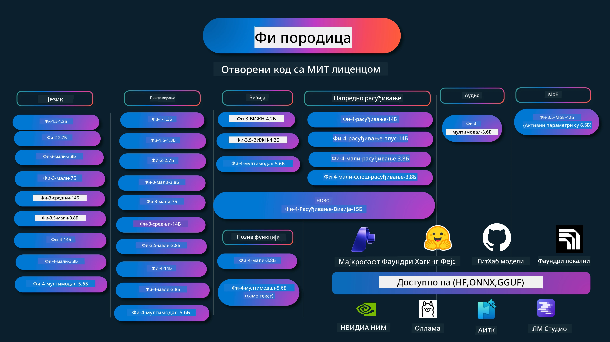

# Phi CookBook: Практични Примери са Microsoft Phi Моделима

[](https://codespaces.new/microsoft/phicookbook)
[](https://vscode.dev/redirect?url=vscode://ms-vscode-remote.remote-containers/cloneInVolume?url=https://github.com/microsoft/phicookbook)

[](https://GitHub.com/microsoft/phicookbook/graphs/contributors/?WT.mc_id=aiml-137032-kinfeylo)
[](https://GitHub.com/microsoft/phicookbook/issues/?WT.mc_id=aiml-137032-kinfeylo)
[](https://GitHub.com/microsoft/phicookbook/pulls/?WT.mc_id=aiml-137032-kinfeylo)
[](http://makeapullrequest.com?WT.mc_id=aiml-137032-kinfeylo)

[](https://GitHub.com/microsoft/phicookbook/watchers/?WT.mc_id=aiml-137032-kinfeylo)
[](https://GitHub.com/microsoft/phicookbook/network/?WT.mc_id=aiml-137032-kinfeylo)
[](https://GitHub.com/microsoft/phicookbook/stargazers/?WT.mc_id=aiml-137032-kinfeylo)

[](https://discord.com/invite/ByRwuEEgH4)

Phi је серија open source AI модела развијених од стране Microsoft-а.

Phi је тренутно најмоћнији и најисплативији мали језички модел (SLM), са врло добрим резултатима у мултијезичким задатцима, резоновању, генерисању текста/чата, кодирању, сликама, аудио и другим сценаријима.

Можете применити Phi у облаку или на уређајима на ивици и лако градити генеративне AI апликације са ограниченим рачунарским ресурсима.

Пратите ове кораке да бисте започели коришћење ових ресурса:
1. **Форкујте Репозиторијум**: Кликните [](https://GitHub.com/microsoft/phicookbook/network/?WT.mc_id=aiml-137032-kinfeylo)
2. **Клонирајте Репозиторијум**: `git clone https://github.com/microsoft/PhiCookBook.git`
3. [**Придружите се Microsoft AI Discord Заједници и упознајте стручњаке и друге програмере**](https://discord.com/invite/ByRwuEEgH4?WT.mc_id=aiml-137032-kinfeylo)



### 🌐 Подршка за више језика

#### Преводи одржавани уз [Co-op Translator](https://github.com/Azure/co-op-translator)

<!-- CO-OP TRANSLATOR LANGUAGES TABLE START -->
[Arabic](../ar/README.md) | [Bengali](../bn/README.md) | [Bulgarian](../bg/README.md) | [Burmese (Myanmar)](../my/README.md) | [Chinese (Simplified)](../zh-CN/README.md) | [Chinese (Traditional, Hong Kong)](../zh-HK/README.md) | [Chinese (Traditional, Macau)](../zh-MO/README.md) | [Chinese (Traditional, Taiwan)](../zh-TW/README.md) | [Croatian](../hr/README.md) | [Czech](../cs/README.md) | [Danish](../da/README.md) | [Dutch](../nl/README.md) | [Estonian](../et/README.md) | [Finnish](../fi/README.md) | [French](../fr/README.md) | [German](../de/README.md) | [Greek](../el/README.md) | [Hebrew](../he/README.md) | [Hindi](../hi/README.md) | [Hungarian](../hu/README.md) | [Indonesian](../id/README.md) | [Italian](../it/README.md) | [Japanese](../ja/README.md) | [Kannada](../kn/README.md) | [Khmer](../km/README.md) | [Korean](../ko/README.md) | [Lithuanian](../lt/README.md) | [Malay](../ms/README.md) | [Malayalam](../ml/README.md) | [Marathi](../mr/README.md) | [Nepali](../ne/README.md) | [Nigerian Pidgin](../pcm/README.md) | [Norwegian](../no/README.md) | [Persian (Farsi)](../fa/README.md) | [Polish](../pl/README.md) | [Portuguese (Brazil)](../pt-BR/README.md) | [Portuguese (Portugal)](../pt-PT/README.md) | [Punjabi (Gurmukhi)](../pa/README.md) | [Romanian](../ro/README.md) | [Russian](../ru/README.md) | [Serbian (Cyrillic)](./README.md) | [Slovak](../sk/README.md) | [Slovenian](../sl/README.md) | [Spanish](../es/README.md) | [Swahili](../sw/README.md) | [Swedish](../sv/README.md) | [Tagalog (Filipino)](../tl/README.md) | [Tamil](../ta/README.md) | [Telugu](../te/README.md) | [Thai](../th/README.md) | [Turkish](../tr/README.md) | [Ukrainian](../uk/README.md) | [Urdu](../ur/README.md) | [Vietnamese](../vi/README.md)

> **Волите да клонирате локално?**
>
> Овај репозиторијум укључује преводе на преко 50 језика што значајно повећава величину преузимања. Да бисте клонирали без превода, користите sparse checkout:
>
> **Bash / macOS / Linux:**
> ```bash
> git clone --filter=blob:none --sparse https://github.com/microsoft/PhiCookBook.git
> cd PhiCookBook
> git sparse-checkout set --no-cone '/*' '!translations' '!translated_images'
> ```
>
> **CMD (Windows):**
> ```cmd
> git clone --filter=blob:none --sparse https://github.com/microsoft/PhiCookBook.git
> cd PhiCookBook
> git sparse-checkout set --no-cone "/*" "!translations" "!translated_images"
> ```
>
> Ово вам даје све што вам је потребно за завршетак курса уз пуно брже преузимање.
<!-- CO-OP TRANSLATOR LANGUAGES TABLE END -->

## Садржај

- Увод
  - [Добродошли у Phi породицу](./md/01.Introduction/01/01.PhiFamily.md)
  - [Подешавање вашег окружења](./md/01.Introduction/01/01.EnvironmentSetup.md)
  - [Разумевање кључних технологија](./md/01.Introduction/01/01.Understandingtech.md)
  - [AI Безбедност за Phi моделе](./md/01.Introduction/01/01.AISafety.md)
  - [Подршка за Phi хардвер](./md/01.Introduction/01/01.Hardwaresupport.md)
  - [Phi модели и доступност на платформама](./md/01.Introduction/01/01.Edgeandcloud.md)
  - [Коришћење Guidance-ai и Phi](./md/01.Introduction/01/01.Guidance.md)
  - [GitHub Marketplace модели](https://github.com/marketplace/models)
  - [Azure AI каталог модела](https://ai.azure.com)

- Инференција Phi у различитим окружењима
    -  [Hugging face](./md/01.Introduction/02/01.HF.md)
    -  [GitHub модели](./md/01.Introduction/02/02.GitHubModel.md)
    -  [Microsoft Foundry каталог модела](./md/01.Introduction/02/03.AzureAIFoundry.md)
    -  [Ollama](./md/01.Introduction/02/04.Ollama.md)
    -  [AI Toolkit VSCode (AITK)](./md/01.Introduction/02/05.AITK.md)
    -  [NVIDIA NIM](./md/01.Introduction/02/06.NVIDIA.md)
    -  [Foundry локално](./md/01.Introduction/02/07.FoundryLocal.md)

- Инференција Phi породице
    - [Инференција Phi на iOS](./md/01.Introduction/03/iOS_Inference.md)
    - [Инференција Phi на Android](./md/01.Introduction/03/Android_Inference.md)
    - [Инференција Phi на Jetson](./md/01.Introduction/03/Jetson_Inference.md)
    - [Инференција Phi на AI PC](./md/01.Introduction/03/AIPC_Inference.md)
    - [Инференција Phi уз Apple MLX Framework](./md/01.Introduction/03/MLX_Inference.md)
    - [Инференција Phi на локалном серверу](./md/01.Introduction/03/Local_Server_Inference.md)
    - [Инференција Phi на удаљеном серверу користећи AI Toolkit](./md/01.Introduction/03/Remote_Interence.md)
    - [Инференција Phi са Rust-ом](./md/01.Introduction/03/Rust_Inference.md)
    - [Инференција Phi - Vision локално](./md/01.Introduction/03/Vision_Inference.md)
    - [Инференција Phi са Kaito AKS, Azure контејнери (званична подршка)](./md/01.Introduction/03/Kaito_Inference.md)
-  [Квантификовање Phi породице](./md/01.Introduction/04/QuantifyingPhi.md)
    - [Квантизација Phi-3.5 / 4 користећи llama.cpp](./md/01.Introduction/04/UsingLlamacppQuantifyingPhi.md)
    - [Квантизација Phi-3.5 / 4 користећи Generative AI екстензије за onnxruntime](./md/01.Introduction/04/UsingORTGenAIQuantifyingPhi.md)
    - [Квантизација Phi-3.5 / 4 користећи Intel OpenVINO](./md/01.Introduction/04/UsingIntelOpenVINOQuantifyingPhi.md)
    - [Квантизација Phi-3.5 / 4 користећи Apple MLX Framework](./md/01.Introduction/04/UsingAppleMLXQuantifyingPhi.md)

-  Евалуација Phi
    - [Response AI](./md/01.Introduction/05/ResponsibleAI.md)
    - [Microsoft Foundry за евалуацију](./md/01.Introduction/05/AIFoundry.md)
    - [Коришћење Promptflow за евалуацију](./md/01.Introduction/05/Promptflow.md)
 
- RAG са Azure AI Search
    - [Како користити Phi-4-mini и Phi-4-мултимодал (RAG) са Azure AI Search](https://github.com/microsoft/PhiCookBook/blob/main/code/06.E2E/E2E_Phi-4-RAG-Azure-AI-Search.ipynb)
    - [Нула-облак локални хибридни RAG са SQLite FTS5 и phi-4-mini](https://github.com/microsoft/PhiCookBook/blob/main/code/06.E2E/E2E_Phi-4-mini_Local_Hybrid_RAG_SQLite_FTS5.ipynb)

- Примери развоја Phi апликација
  - Апликације за текст и чет
    - Phi-4 Примерци
      - [📓] [Ћаскање са Phi-4-mini ONNX моделом](./md/02.Application/01.TextAndChat/Phi4/ChatWithPhi4ONNX/README.md)
      - [Ћаскање са Phi-4 локалним ONNX моделом .NET](../../md/04.HOL/dotnet/src/LabsPhi4-Chat-01OnnxRuntime)
      - [Чет .NET конзолна апликација са Phi-4 ONNX користећи Семантички Језгро](../../md/04.HOL/dotnet/src/LabsPhi4-Chat-02SK)
    - Phi-3 / 3.5 Примерци
      - [Локални четбот у прегледачу користећи Phi3, ONNX Runtime Web и WebGPU](https://github.com/microsoft/onnxruntime-inference-examples/tree/main/js/chat)
      - [OpenVino Чет](./md/02.Application/01.TextAndChat/Phi3/E2E_OpenVino_Chat.md)
      - [Више модела - Интерактивни Phi-3-mini и OpenAI Whisper](./md/02.Application/01.TextAndChat/Phi3/E2E_Phi-3-mini_with_whisper.md)
      - [MLFlow - Креење обмотача и коришћење Phi-3 са MLFlow](./md//02.Application/01.TextAndChat/Phi3/E2E_Phi-3-MLflow.md)
      - [Оптимизација модела - Како оптимизовати Phi-3-min модел за ONNX Runtime Web са Olive](https://github.com/microsoft/Olive/tree/main/examples/phi3)
      - [WinUI3 апликација са Phi-3 mini-4k-instruct-onnx](https://github.com/microsoft/Phi3-Chat-WinUI3-Sample/)
      -[Узорна апликација за WinUI3 са више модела и AI напајањем за белешке](https://github.com/microsoft/ai-powered-notes-winui3-sample)
      - [Фино подешавање и интеграција прилагођених Phi-3 модела са Prompt flow](./md/02.Application/01.TextAndChat/Phi3/E2E_Phi-3-FineTuning_PromptFlow_Integration.md)
      - [Фино подешавање и интеграција прилагођених Phi-3 модела са Prompt flow у Microsoft Foundry](./md/02.Application/01.TextAndChat/Phi3/E2E_Phi-3-FineTuning_PromptFlow_Integration_AIFoundry.md)
      - [Евалуација фино подешеног Phi-3 / Phi-3.5 модела у Microsoft Foundry са фокусом на Microsoft-ове принципе одговорног AI](./md/02.Application/01.TextAndChat/Phi3/E2E_Phi-3-Evaluation_AIFoundry.md)
      - [📓] [Phi-3.5-mini-instruct пример језичке предикције (кинески/енглески)](./md/02.Application/01.TextAndChat/Phi3/phi3-instruct-demo.ipynb)
      - [Phi-3.5-Instruct WebGPU RAG Четбот](./md/02.Application/01.TextAndChat/Phi3/WebGPUWithPhi35Readme.md)
      - [Коришћење Windows GPU за креирање Prompt flow решења са Phi-3.5-Instruct ONNX](./md/02.Application/01.TextAndChat/Phi3/UsingPromptFlowWithONNX.md)
      - [Коришћење Microsoft Phi-3.5 tflite за креирање Android апликације](./md/02.Application/01.TextAndChat/Phi3/UsingPhi35TFLiteCreateAndroidApp.md)
      - [Q&A .NET пример користећи локални ONNX Phi-3 модел са Microsoft.ML.OnnxRuntime](../../md/04.HOL/dotnet/src/LabsPhi301)
      - [Конзолна чет .NET апликација са Semantic Kernel и Phi-3](../../md/04.HOL/dotnet/src/LabsPhi302)

  - Примери кода засновани на Azure AI Inference SDK
    - Phi-4 Примерци
      - [📓] [Генеришите код пројекта користећи Phi-4-мултимодал](./md/02.Application/02.Code/Phi4/GenProjectCode/README.md)
    - Phi-3 / 3.5 Примерци
      - [Направите свој Visual Studio Code GitHub Copilot Чет са Microsoft Phi-3 породицом](./md/02.Application/02.Code/Phi3/VSCodeExt/README.md)
      - [Направите свог Visual Studio Code Chat Copilot агента са Phi-3.5 коришћењем GitHub модела](/md/02.Application/02.Code/Phi3/CreateVSCodeChatAgentWithGitHubModels.md)

  - Напредни примери резоновања
    - Phi-4 Примерци 
      - [📓] [Phi-4-mini-rasuđivanje ili Phi-4-rasuđivanje Primeri](./md/02.Application/03.AdvancedReasoning/Phi4/AdvancedResoningPhi4mini/README.md)
      - [📓] [Fino podešavanje Phi-4-mini-rasuđivanja sa Microsoft Olive](./md/02.Application/03.AdvancedReasoning/Phi4/AdvancedResoningPhi4mini/olive_ft_phi_4_reasoning_with_medicaldata.ipynb)
      - [📓] [Fino podešavanje Phi-4-mini-rasuđivanja sa Apple MLX](./md/02.Application/03.AdvancedReasoning/Phi4/AdvancedResoningPhi4mini/mlx_ft_phi_4_reasoning_with_medicaldata.ipynb)
      - [📓] [Phi-4-mini-rasuđivanje sa GitHub Modelima](./md/02.Application/02.Code/Phi4r/github_models_inference.ipynb)
      - [📓] [Phi-4-mini-rasuđivanje sa Microsoft Foundry Modelima](./md/02.Application/02.Code/Phi4r/azure_models_inference.ipynb)
  - Demonstracije
      - [Phi-4-mini demonstracije na Hugging Face Spaces](https://huggingface.co/spaces/microsoft/phi-4-mini?WT.mc_id=aiml-137032-kinfeylo)
      - [Phi-4-multimodalne demonstracije na Hugging Face Spaces](https://huggingface.co/spaces/microsoft/phi-4-multimodal?WT.mc_id=aiml-137032-kinfeylo)
  - Primeri Viđenja
    - Phi-4 Primeri 
      - [📓] [Koristite Phi-4-multimodal da čitate slike i generišete kod](./md/02.Application/04.Vision/Phi4/CreateFrontend/README.md) 
    - Phi-3 / 3.5 Primeri
      -  [📓][Phi-3-vision-Slika tekst u tekst](./md/02.Application/04.Vision/Phi3/E2E_Phi-3-vision-image-text-to-text-online-endpoint.ipynb)
      - [Phi-3-vision-ONNX](https://onnxruntime.ai/docs/genai/tutorials/phi3-v.html)
      - [📓][Phi-3-vision CLIP Ugradnja](./md/02.Application/04.Vision/Phi3/E2E_Phi-3-vision-image-text-to-text-online-endpoint.ipynb)
      - [DEMO: Phi-3 Reciklaža](https://github.com/jennifermarsman/PhiRecycling/)
      - [Phi-3-vision - Vizuelni jezički asistent - sa Phi3-Vision i OpenVINO](https://docs.openvino.ai/nightly/notebooks/phi-3-vision-with-output.html)
      - [Phi-3 Vision Nvidia NIM](./md/02.Application/04.Vision/Phi3/E2E_Nvidia_NIM_Vision.md)
      - [Phi-3 Vision OpenVino](./md/02.Application/04.Vision/Phi3/E2E_OpenVino_Phi3Vision.md)
      - [📓][Phi-3.5 Vision više-frejmova ili više-slika primer](./md/02.Application/04.Vision/Phi3/phi3-vision-demo.ipynb)
      - [Phi-3 Vision Lokalni ONNX Model koristeći Microsoft.ML.OnnxRuntime .NET](../../md/04.HOL/dotnet/src/LabsPhi303)
      - [Meni zasnovan Phi-3 Vision Lokalni ONNX Model koristeći Microsoft.ML.OnnxRuntime .NET](../../md/04.HOL/dotnet/src/LabsPhi304)

  - Primeri Rasuđivanja-Viđenja
    - Phi-4-Rasuđivanje-Viđenje-15B 
      - [📓] [Korišćenje Phi-4-Rasuđivanje-Viđenje-15B za otkrivanje pešačkog prelaza](./md/02.Application/10.ReasoningVision/Phi_4_reasoning_vision_15b_Jaywalking.ipynb)
      - [📓] [Korišćenje Phi-4-Rasuđivanje-Viđenje-15B za matematiku](./md/02.Application/10.ReasoningVision/Phi_4_reasoning_vision_15b_Math.ipynb)
      - [📓] [Korišćenje Phi-4-Rasuđivanje-Viđenje-15B za detekciju korisničkog interfejsa](./md/02.Application/10.ReasoningVision/Phi_4_reasoning_vision_15b_ui.ipynb)

  - Matematički Primeri
    -  Phi-4-Mini-Brzo-Rasuđivanje-Uputstva Primeri  [Matematička Demonstracija sa Phi-4-Mini-Brzo-Rasuđivanje-Uputstva](./md/02.Application/09.Math/MathDemo.ipynb)

  - Audio Primeri
    - Phi-4 Primeri 
      - [📓] [Ekstraktovanje audio transkripata koristeći Phi-4-multimodal](./md/02.Application/05.Audio/Phi4/Transciption/README.md)
      - [📓] [Phi-4-multimodal Audio Primer](./md/02.Application/05.Audio/Phi4/Siri/demo.ipynb)
      - [📓] [Phi-4-multimodal Primer Prevođenja Govora](./md/02.Application/05.Audio/Phi4/Translate/demo.ipynb)
      - [.NET konzolna aplikacija koristeći Phi-4-multimodal Audio za analizu audio fajla i generisanje transkripta](../../md/04.HOL/dotnet/src/LabsPhi4-MultiModal-02Audio)

  - MOE Primeri
    - Phi-3 / 3.5 Primeri
      - [📓] [Phi-3.5 Mešavina Eksperata Modeli (MoEs) Primer za Društvene Mreže](./md/02.Application/06.MoE/Phi3/phi3_moe_demo.ipynb)
      - [📓] [Izgradnja Retrieval-Augmented Generation (RAG) Pipelina sa NVIDIA NIM Phi-3 MOE, Azure AI Search i LlamaIndex](./md/02.Application/06.MoE/Phi3/azure-ai-search-nvidia-rag.ipynb)
      - 
  - Primeri Poziva Funkcija
    - Phi-4 Primeri 🆕
      -  [📓] [Korišćenje Poziva Funkcija sa Phi-4-mini](./md/02.Application/07.FunctionCalling/Phi4/FunctionCallingBasic/README.md)
      -  [📓] [Korišćenje Poziva Funkcija za kreiranje multi-agenta sa Phi-4-mini](./md/02.Application/07.FunctionCalling/Phi4/Multiagents/Phi_4_mini_multiagent.ipynb)
      -  [📓] [Korišćenje Poziva Funkcija sa Ollama](./md/02.Application/07.FunctionCalling/Phi4/Ollama/ollama_functioncalling.ipynb)
      -  [📓] [Korišćenje Poziva Funkcija sa ONNX](./md/02.Application/07.FunctionCalling/Phi4/ONNX/onnx_parallel_functioncalling.ipynb)
  - Primeri Multimodalnog Mešanja
    - Phi-4 Primeri 🆕
      -  [📓] [Korišćenje Phi-4-multimodal kao Tehnološkog novinara](./md/02.Application/08.Multimodel/Phi4/TechJournalist/phi_4_mm_audio_text_publish_news.ipynb)
      - [.NET konzolna aplikacija koristeći Phi-4-multimodal za analizu slika](../../md/04.HOL/dotnet/src/LabsPhi4-MultiModal-01Images)

- Fino podešavanje Phi Primera
  - [Scenariji fino podešavanja](./md/03.FineTuning/FineTuning_Scenarios.md)
  - [Fino podešavanje vs RAG](./md/03.FineTuning/FineTuning_vs_RAG.md)
  - [Fino podešavanje Neka Phi-3 postane industrijski stručnjak](./md/03.FineTuning/LetPhi3gotoIndustriy.md)
  - [Fino podešavanje Phi-3 sa AI Toolkit za VS Code](./md/03.FineTuning/Finetuning_VSCodeaitoolkit.md)
  - [Fino podešavanje Phi-3 sa Azure Machine Learning Service](./md/03.FineTuning/Introduce_AzureML.md)
  - [Fino podešavanje Phi-3 sa Lora](./md/03.FineTuning/FineTuning_Lora.md)
  - [Fino podešavanje Phi-3 sa QLora](./md/03.FineTuning/FineTuning_Qlora.md)
  - [Fino podešavanje Phi-3 sa Microsoft Foundry](./md/03.FineTuning/FineTuning_AIFoundry.md)
  - [Fino podešavanje Phi-3 sa Azure ML CLI/SDK](./md/03.FineTuning/FineTuning_MLSDK.md)
  - [Fino podešavanje sa Microsoft Olive](./md/03.FineTuning/FineTuning_MicrosoftOlive.md)
  - [Fino podešavanje sa Microsoft Olive Hands-On Lab](./md/03.FineTuning/olive-lab/readme.md)
  - [Fino podešavanje Phi-3-vision sa Weights and Bias](./md/03.FineTuning/FineTuning_Phi-3-visionWandB.md)
  - [Fino podešavanje Phi-3 sa Apple MLX Framework](./md/03.FineTuning/FineTuning_MLX.md)
  - [Fino podešavanje Phi-3-vision (službena podrška)](./md/03.FineTuning/FineTuning_Vision.md)
  - [Fino Podešavanje Phi-3 sa Kaito AKS, Azure Containers (službena Podrška)](./md/03.FineTuning/FineTuning_Kaito.md)
  - [Fino Podešavanje Phi-3 i 3.5 Vision](https://github.com/2U1/Phi3-Vision-Finetune)

- Radionice uživo
  - [Istraživanje najnovijih modela: LLMs, SLMs, lokalni razvoj i više](https://github.com/microsoft/aitour-exploring-cutting-edge-models)
  - [Otkrovanje NLP potencijala: Fino podešavanje sa Microsoft Olive](https://github.com/azure/Ignite_FineTuning_workshop)

- Akademski naučni radovi i publikacije
  - [Udžbenici su sve što vam treba II: phi-1.5 tehnički izveštaj](https://arxiv.org/abs/2309.05463)
  - [Phi-3 Tehnički Izveštaj: Vrlo sposoban jezički model lokalno na vašem telefonu](https://arxiv.org/abs/2404.14219)
  - [Phi-4 Tehnički Izveštaj](https://arxiv.org/abs/2412.08905)
  - [Phi-4-Mini Tehnički Izveštaj: Kompaktni ali moćni multimodalni jezički modeli preko Mešavine LoRA](https://arxiv.org/abs/2503.01743)
  - [Optimizacija malih jezičkih modela za funkciju poziva u vozilu](https://arxiv.org/abs/2501.02342)
  - [(WhyPHI) Fino podešavanje PHI-3 za višestruke izbore odgovora: Metodologija, rezultati i izazovi](https://arxiv.org/abs/2501.01588)
  - [Phi-4-rasuđivanje Tehnički Izveštaj](https://www.microsoft.com/en-us/research/wp-content/uploads/2025/04/phi_4_reasoning.pdf)
  - [Phi-4-mini-rasuđivanje Tehnički Izveštaj](https://huggingface.co/microsoft/Phi-4-mini-reasoning/blob/main/Phi-4-Mini-Reasoning.pdf)

## Korišćenje Phi Modela

### Phi na Microsoft Foundry

Možete naučiti kako da koristite Microsoft Phi i kako da gradite E2E rešenja na različitim hardverskim uređajima. Da biste iskusili Phi sami, započnite igranje sa modelima i prilagođavanje Phi za vaše scenarije koristeći [Microsoft Foundry Azure AI Model Catalog](https://aka.ms/phi3-azure-ai), više možete naučiti na Početak sa [Microsoft Foundry](/md/02.QuickStart/AzureAIFoundry_QuickStart.md)

**Igralište**
Svaki model ima posvećeno igralište za testiranje modela [Azure AI Playground](https://aka.ms/try-phi3).

### Phi na GitHub Modelima

Možete naučiti kako da koristite Microsoft Phi i kako da gradite E2E rešenja na različitim hardverskim uređajima. Da biste iskusili Phi sami, započnite igranje sa modelom i prilagođavanje Phi za vaše scenarije koristeći [GitHub Model Catalog](https://github.com/marketplace/models?WT.mc_id=aiml-137032-kinfeylo), više možete naučiti na Početak sa [GitHub Model Catalog](/md/02.QuickStart/GitHubModel_QuickStart.md)

**Igralište**
Svaki model ima posvećeno [igralište za testiranje modela](/md/02.QuickStart/GitHubModel_QuickStart.md).

### Phi na Hugging Face

Možete takođe pronaći model na [Hugging Face](https://huggingface.co/microsoft)

**Igralište**
 [Hugging Chat igralište](https://huggingface.co/chat/models/microsoft/Phi-3-mini-4k-instruct)

 ## 🎒 Ostali Kursevi

Naš tim proizvodi i druge kurseve! Pogledajte:

<!-- CO-OP TRANSLATOR OTHER COURSES START -->
### LangChain
[](https://aka.ms/langchain4j-for-beginners)
[](https://aka.ms/langchainjs-for-beginners?WT.mc_id=m365-94501-dwahlin)
[](https://github.com/microsoft/langchain-for-beginners?WT.mc_id=m365-94501-dwahlin)
---

### Azure / Edge / MCP / Agent
[](https://github.com/microsoft/AZD-for-beginners?WT.mc_id=academic-105485-koreyst)
[](https://github.com/microsoft/edgeai-for-beginners?WT.mc_id=academic-105485-koreyst)
[](https://github.com/microsoft/mcp-for-beginners?WT.mc_id=academic-105485-koreyst)
[](https://github.com/microsoft/ai-agents-for-beginners?WT.mc_id=academic-105485-koreyst)

---
 
### Generativna AI Serija
[](https://github.com/microsoft/generative-ai-for-beginners?WT.mc_id=academic-105485-koreyst)
[-9333EA?style=for-the-badge&labelColor=E5E7EB&color=9333EA)](https://github.com/microsoft/Generative-AI-for-beginners-dotnet?WT.mc_id=academic-105485-koreyst)
[-C084FC?style=for-the-badge&labelColor=E5E7EB&color=C084FC)](https://github.com/microsoft/generative-ai-for-beginners-java?WT.mc_id=academic-105485-koreyst)
[-E879F9?style=for-the-badge&labelColor=E5E7EB&color=E879F9)](https://github.com/microsoft/generative-ai-with-javascript?WT.mc_id=academic-105485-koreyst)

---
 
### Osnovno Učenje
[](https://aka.ms/ml-beginners?WT.mc_id=academic-105485-koreyst)
[](https://aka.ms/datascience-beginners?WT.mc_id=academic-105485-koreyst)
[](https://aka.ms/ai-beginners?WT.mc_id=academic-105485-koreyst)
[](https://github.com/microsoft/Security-101?WT.mc_id=academic-96948-sayoung)
[](https://aka.ms/webdev-beginners?WT.mc_id=academic-105485-koreyst)
[](https://aka.ms/iot-beginners?WT.mc_id=academic-105485-koreyst)
[](https://github.com/microsoft/xr-development-for-beginners?WT.mc_id=academic-105485-koreyst)

---
 
### Copilot Serija
[](https://aka.ms/GitHubCopilotAI?WT.mc_id=academic-105485-koreyst)
[](https://github.com/microsoft/mastering-github-copilot-for-dotnet-csharp-developers?WT.mc_id=academic-105485-koreyst)
[](https://github.com/microsoft/CopilotAdventures?WT.mc_id=academic-105485-koreyst)
<!-- CO-OP TRANSLATOR OTHER COURSES END -->

## Odgovorni AI 

Microsoft je posvećen pomaganju našim korisnicima da koriste naše AI proizvode odgovorno, deleći naša saznanja i gradeći partnerske odnose zasnovane na poverenju kroz alate poput Transparency Notes i Impact Assessments. Mnogo ovih resursa može se pronaći na [https://aka.ms/RAI](https://aka.ms/RAI).
Pristup Microsoft-a odgovornom AI-u zasniva se na našim AI principima pravičnosti, pouzdanosti i bezbednosti, privatnosti i sigurnosti, inkluzivnosti, transparentnosti i odgovornosti.

Veliki modeli za prirodni jezik, slike i govor - kao oni korišćeni u ovom primeru - mogu potencijalno imati ponašanja koja nisu pravična, pouzdana ili su uvredljiva, što može dovesti do štete. Molimo konsultujte [Azure OpenAI service Transparency note](https://learn.microsoft.com/legal/cognitive-services/openai/transparency-note?tabs=text) da se informišete o rizicima i ograničenjima.

Препоручени приступ за смањење ових ризика је да укључите систем безбедности у вашу архитектуру који може да детектује и спречи штетно понашање. [Azure AI Content Safety](https://learn.microsoft.com/azure/ai-services/content-safety/overview) пружа независни слој заштите, способан да детектује штетни садржај који стварају корисници и вештачка интелигенција у апликацијама и услугама. Azure AI Content Safety укључује текстуалне и сликовне API-је који вам омогућавају да детектујете материјал који је штетан. У оквиру Microsoft Foundry-а, услуга Content Safety вам омогућава да прегледате, истражујете и испробате пример кода за детекцију штетног садржаја у различитим модалитетима. Следећа [quickstart документација](https://learn.microsoft.com/azure/ai-services/content-safety/quickstart-text?tabs=visual-studio%2Clinux&pivots=programming-language-rest) вас води кроз прављење захтева према услузи.

Још један аспект који треба узети у обзир је укупне перформансе апликације. Са мултимодалним и мултимоделским апликацијама, перформансе подразумевају да систем ради онако како ви и ваши корисници очекујете, укључујући и то да не генерише штетне излазе. Важно је проценити перформансе целокупне апликације користећи [Performance and Quality and Risk and Safety evaluators](https://learn.microsoft.com/azure/ai-studio/concepts/evaluation-metrics-built-in). Такође имате могућност креирања и процене уз помоћ [custom evaluators](https://learn.microsoft.com/azure/ai-studio/how-to/develop/evaluate-sdk#custom-evaluators).

Можете проценити вашу AI апликацију у вашем развојном окружењу користећи [Azure AI Evaluation SDK](https://microsoft.github.io/promptflow/index.html). Уз пружени тестни скуп података или циљ, генерисане резултате ваше генеративне AI апликације квантитативно мере уграђени евалуатори или евалуатори по вашем избору. Да бисте започели са azure ai evaluation sdk за процену вашег система, можете пратити [quickstart guide](https://learn.microsoft.com/azure/ai-studio/how-to/develop/flow-evaluate-sdk). Када извршите евалуацију, можете [визуализовати резултате у Microsoft Foundry](https://learn.microsoft.com/azure/ai-studio/how-to/evaluate-flow-results).

## Трговачке марке

Овај пројекат може да садржи трговачке марке или логотипе пројеката, производа или услуга. Овлашћена употреба Microsoft трговачких марки или логотипа подлеже и мора пратити [Правила за трговачке марке и бренд Microsoft-а](https://www.microsoft.com/legal/intellectualproperty/trademarks/usage/general).
Употреба Microsoft трговачких марки или логотипа у модификованим верзијама овог пројекта не сме да доведе до забуне нити да имплицира спонзорство од Microsoft-а. Свака употреба трговачких марки или логотипа трећих страна подлеже правилима тих трећих страна.

## Тражење помоћи

Ако запнете или имате било каквих питања у вези са прављењем AI апликација, придружите се:

[](https://aka.ms/foundry/discord)

Ако имате повратне информације о производу или се суочите са грешкама током развоја, посетите:

[](https://aka.ms/foundry/forum)

---

<!-- CO-OP TRANSLATOR DISCLAIMER START -->
**Изјава о одрицању одговорности**:
Овај документ је преведен коришћењем услуге за аутоматски превод [Co-op Translator](https://github.com/Azure/co-op-translator). Иако тежимо тачности, имајте у виду да аутоматски преводи могу садржати грешке или нетачности. Оригинални документ на његовом изворном језику треба сматрати ауторитативним извором. За критичне информације препоручује се професионални људски превод. Нисмо одговорни за било каква неспоразума или погрешна тумачења која произилазе из коришћења овог превода.
<!-- CO-OP TRANSLATOR DISCLAIMER END -->