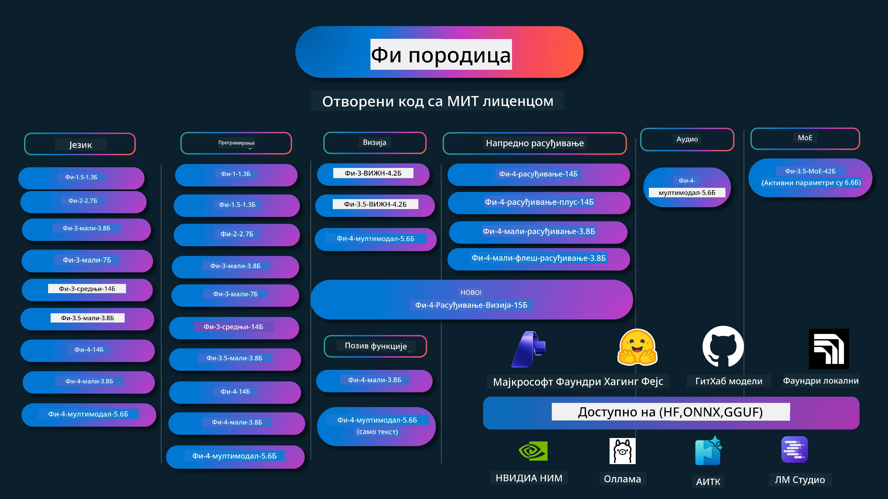

# Phi Cookbook: Практични примери са Microsoft-овим Phi моделима

[](https://codespaces.new/microsoft/phicookbook)
[](https://vscode.dev/redirect?url=vscode://ms-vscode-remote.remote-containers/cloneInVolume?url=https://github.com/microsoft/phicookbook)

[](https://GitHub.com/microsoft/phicookbook/graphs/contributors/?WT.mc_id=aiml-137032-kinfeylo)
[](https://GitHub.com/microsoft/phicookbook/issues/?WT.mc_id=aiml-137032-kinfeylo)
[](https://GitHub.com/microsoft/phicookbook/pulls/?WT.mc_id=aiml-137032-kinfeylo)
[](http://makeapullrequest.com?WT.mc_id=aiml-137032-kinfeylo)

[](https://GitHub.com/microsoft/phicookbook/watchers/?WT.mc_id=aiml-137032-kinfeylo)
[](https://GitHub.com/microsoft/phicookbook/network/?WT.mc_id=aiml-137032-kinfeylo)
[](https://GitHub.com/microsoft/phicookbook/stargazers/?WT.mc_id=aiml-137032-kinfeylo)

[](https://discord.com/invite/ByRwuEEgH4)

Phi је серија open source AI модела које је развио Microsoft.

Phi је тренутно најмоћнији и најисплативији мали језички модел (SLM), са врло добрим резултатима у вишезначном језику, резоновању, генерисању текста/чету, програмирању, сликама, аудију и другим сценаријима.

Можете распоредити Phi у облаку или на ивици уређаја, и лако градити генеративне AI апликације са ограниченом рачунарском снагом.

Пратите ове кораке да бисте почели да користите ове ресурсе:
1. **Форкујте репозиторијум**: Кликните на [](https://GitHub.com/microsoft/phicookbook/network/?WT.mc_id=aiml-137032-kinfeylo)
2. **Клонирајте репозиторијум**: `git clone https://github.com/microsoft/PhiCookBook.git`
3. [**Придружите се Microsoft AI Discord заједници и упознајте стручњаке и друге програмере**](https://discord.com/invite/ByRwuEEgH4?WT.mc_id=aiml-137032-kinfeylo)



### 🌐 Подршка за више језика

#### Преводи одржавани уз помоћ [Co-op Translator](https://github.com/Azure/co-op-translator)

<!-- CO-OP TRANSLATOR LANGUAGES TABLE START -->
[Arabic](../ar/README.md) | [Bengali](../bn/README.md) | [Bulgarian](../bg/README.md) | [Burmese (Myanmar)](../my/README.md) | [Chinese (Simplified)](../zh-CN/README.md) | [Chinese (Traditional, Hong Kong)](../zh-HK/README.md) | [Chinese (Traditional, Macau)](../zh-MO/README.md) | [Chinese (Traditional, Taiwan)](../zh-TW/README.md) | [Croatian](../hr/README.md) | [Czech](../cs/README.md) | [Danish](../da/README.md) | [Dutch](../nl/README.md) | [Estonian](../et/README.md) | [Finnish](../fi/README.md) | [French](../fr/README.md) | [German](../de/README.md) | [Greek](../el/README.md) | [Hebrew](../he/README.md) | [Hindi](../hi/README.md) | [Hungarian](../hu/README.md) | [Indonesian](../id/README.md) | [Italian](../it/README.md) | [Japanese](../ja/README.md) | [Kannada](../kn/README.md) | [Khmer](../km/README.md) | [Korean](../ko/README.md) | [Lithuanian](../lt/README.md) | [Malay](../ms/README.md) | [Malayalam](../ml/README.md) | [Manipuri (Meitei Mayek)](../mni/README.md) | [Marathi](../mr/README.md) | [Nepali](../ne/README.md) | [Nigerian Pidgin](../pcm/README.md) | [Norwegian](../no/README.md) | [Persian (Farsi)](../fa/README.md) | [Polish](../pl/README.md) | [Portuguese (Brazil)](../pt-BR/README.md) | [Portuguese (Portugal)](../pt-PT/README.md) | [Punjabi (Gurmukhi)](../pa/README.md) | [Romanian](../ro/README.md) | [Russian](../ru/README.md) | [Serbian (Cyrillic)](./README.md) | [Slovak](../sk/README.md) | [Slovenian](../sl/README.md) | [Spanish](../es/README.md) | [Swahili](../sw/README.md) | [Swedish](../sv/README.md) | [Tagalog (Filipino)](../tl/README.md) | [Tamil](../ta/README.md) | [Telugu](../te/README.md) | [Thai](../th/README.md) | [Turkish](../tr/README.md) | [Ukrainian](../uk/README.md) | [Urdu](../ur/README.md) | [Vietnamese](../vi/README.md)

> **Више волите локално клонирање?**
>
> Овај репозиторијум укључује преко 50 превода на различите језике што знатно повећава величину за преузимање. Да бисте клонирали без превода, користите sparse checkout:
>
> **Bash / macOS / Linux:**
> ```bash
> git clone --filter=blob:none --sparse https://github.com/microsoft/PhiCookBook.git
> cd PhiCookBook
> git sparse-checkout set --no-cone '/*' '!translations' '!translated_images'
> ```
>
> **CMD (Windows):**
> ```cmd
> git clone --filter=blob:none --sparse https://github.com/microsoft/PhiCookBook.git
> cd PhiCookBook
> git sparse-checkout set --no-cone "/*" "!translations" "!translated_images"
> ```
>
> Ово вам даје све што вам је потребно да завршите курс са много бржим преузимањем.
<!-- CO-OP TRANSLATOR LANGUAGES TABLE END -->

## Садржај

- Увод
  - [Добродошли у Phi породицу](./md/01.Introduction/01/01.PhiFamily.md)
  - [Подешавање вашег окружења](./md/01.Introduction/01/01.EnvironmentSetup.md)
  - [Разумевање кључних технологија](./md/01.Introduction/01/01.Understandingtech.md)
  - [Безбедност AI за Phi моделе](./md/01.Introduction/01/01.AISafety.md)
  - [Подршка за Phi хардвер](./md/01.Introduction/01/01.Hardwaresupport.md)
  - [Phi модели и доступност на различитим платформама](./md/01.Introduction/01/01.Edgeandcloud.md)
  - [Коришћење Guidance-ai и Phi](./md/01.Introduction/01/01.Guidance.md)
  - [GitHub Marketplace модели](https://github.com/marketplace/models)
  - [Azure AI каталог модела](https://ai.azure.com)

- Инференца Phi у различитим окружењима
    -  [Hugging face](./md/01.Introduction/02/01.HF.md)
    -  [GitHub модели](./md/01.Introduction/02/02.GitHubModel.md)
    -  [Microsoft Foundry модел каталог](./md/01.Introduction/02/03.AzureAIFoundry.md)
    -  [Ollama](./md/01.Introduction/02/04.Ollama.md)
    -  [AI Toolkit VSCode (AITK)](./md/01.Introduction/02/05.AITK.md)
    -  [NVIDIA NIM](./md/01.Introduction/02/06.NVIDIA.md)
    -  [Foundry локално](./md/01.Introduction/02/07.FoundryLocal.md)

- Phi породична инференца
    - [Phi инференца на iOS-у](./md/01.Introduction/03/iOS_Inference.md)
    - [Phi инференца на Android-у](./md/01.Introduction/03/Android_Inference.md)
    - [Phi инференца на Jetson-у](./md/01.Introduction/03/Jetson_Inference.md)
    - [Phi инференца на AI ПК-у](./md/01.Introduction/03/AIPC_Inference.md)
    - [Phi инференца са Apple MLX Framework](./md/01.Introduction/03/MLX_Inference.md)
    - [Phi инференца на локалном серверу](./md/01.Introduction/03/Local_Server_Inference.md)
    - [Phi инференца на удаљеном серверу користећи AI Toolkit](./md/01.Introduction/03/Remote_Interence.md)
    - [Phi инференца са Rust-ом](./md/01.Introduction/03/Rust_Inference.md)
    - [Phi-Визијa инференца локално](./md/01.Introduction/03/Vision_Inference.md)
    - [Phi инференца са Kaito AKS, Azure Containers (званична подршка)](./md/01.Introduction/03/Kaito_Inference.md)
-  [Квантификација Phi породице](./md/01.Introduction/04/QuantifyingPhi.md)
    - [Квантизација Phi-3.5 / 4 коришћењем llama.cpp](./md/01.Introduction/04/UsingLlamacppQuantifyingPhi.md)
    - [Квантизација Phi-3.5 / 4 коришћењем Generative AI екстензија за onnxruntime](./md/01.Introduction/04/UsingORTGenAIQuantifyingPhi.md)
    - [Квантизација Phi-3.5 / 4 коришћењем Intel OpenVINO](./md/01.Introduction/04/UsingIntelOpenVINOQuantifyingPhi.md)
    - [Квантизација Phi-3.5 / 4 коришћењем Apple MLX Framework](./md/01.Introduction/04/UsingAppleMLXQuantifyingPhi.md)

-  Евалуација Phi
    - [Response AI](./md/01.Introduction/05/ResponsibleAI.md)
    - [Microsoft Foundry за евалуацију](./md/01.Introduction/05/AIFoundry.md)
    - [Коришћење Promptflow за евалуацију](./md/01.Introduction/05/Promptflow.md)
 
- RAG са Azure AI Search
    - [Како користити Phi-4-mini и Phi-4-multimodal (RAG) са Azure AI Search](https://github.com/microsoft/PhiCookBook/blob/main/code/06.E2E/E2E_Phi-4-RAG-Azure-AI-Search.ipynb)
    - [Zero-Cloud локална хибридна RAG са SQLite FTS5 и phi-4-mini](https://github.com/microsoft/PhiCookBook/blob/main/code/06.E2E/E2E_Phi-4-mini_Local_Hybrid_RAG_SQLite_FTS5.ipynb)

- Примери развоја Phi апликација
  - Текст и чет апликације
    - Phi-4 примери
      - [📓] [Чет са Phi-4-mini ONNX моделом](./md/02.Application/01.TextAndChat/Phi4/ChatWithPhi4ONNX/README.md)
      - [Чет са Phi-4 локалним ONNX моделом у .NET](../../md/04.HOL/dotnet/src/LabsPhi4-Chat-01OnnxRuntime)
      - [Чет .NET конзолна апликација са Phi-4 ONNX користећи Semantic Kernel](../../md/04.HOL/dotnet/src/LabsPhi4-Chat-02SK)
    - Phi-3 / 3.5 примери
      - [Локални chatbot у прегледачу користећи Phi3, ONNX Runtime Web и WebGPU](https://github.com/microsoft/onnxruntime-inference-examples/tree/main/js/chat)
      - [OpenVino чет](./md/02.Application/01.TextAndChat/Phi3/E2E_OpenVino_Chat.md)
      - [Више модела - интерактивни Phi-3-mini и OpenAI Whisper](./md/02.Application/01.TextAndChat/Phi3/E2E_Phi-3-mini_with_whisper.md)
      - [MLFlow - Креирање wrapper-а и коришћење Phi-3 са MLFlow](./md//02.Application/01.TextAndChat/Phi3/E2E_Phi-3-MLflow.md)
      - [Оптимизација модела - Како оптимизовати Phi-3-min модел за ONNX Runtime Web са Olive](https://github.com/microsoft/Olive/tree/main/examples/phi3)
      - [WinUI3 апликација са Phi-3 mini-4k-instruct-onnx](https://github.com/microsoft/Phi3-Chat-WinUI3-Sample/)
      -[WinUI3 Multi Model AI Powered Notes апликација пример](https://github.com/microsoft/ai-powered-notes-winui3-sample)
      - [Фино подешавање и интеграција прилагођених Phi-3 модела са Prompt flow](./md/02.Application/01.TextAndChat/Phi3/E2E_Phi-3-FineTuning_PromptFlow_Integration.md)
      - [Фино подешавање и интеграција прилагођених Phi-3 модела са Prompt flow у Microsoft Foundry](./md/02.Application/01.TextAndChat/Phi3/E2E_Phi-3-FineTuning_PromptFlow_Integration_AIFoundry.md)
      - [Евалуирајте фино подешени Phi-3 / Phi-3.5 модел у Microsoft Foundry фокусирајући се на Microsoft-ове принципе одговорног AI](./md/02.Application/01.TextAndChat/Phi3/E2E_Phi-3-Evaluation_AIFoundry.md)
      - [📓] [Phi-3.5-mini-instruct пример језичке предикције (кинески/енглески)](./md/02.Application/01.TextAndChat/Phi3/phi3-instruct-demo.ipynb)
      - [Phi-3.5-Instruct WebGPU RAG chatbot](./md/02.Application/01.TextAndChat/Phi3/WebGPUWithPhi35Readme.md)
      - [Коришћење Windows GPU за креирање Prompt flow решења са Phi-3.5-Instruct ONNX](./md/02.Application/01.TextAndChat/Phi3/UsingPromptFlowWithONNX.md)
      - [Коришћење Microsoft Phi-3.5 tflite за креирање Android апликације](./md/02.Application/01.TextAndChat/Phi3/UsingPhi35TFLiteCreateAndroidApp.md)
      - [Q&A .NET пример користећи локални ONNX Phi-3 модел са Microsoft.ML.OnnxRuntime](../../md/04.HOL/dotnet/src/LabsPhi301)
      - [Конзолна чет .NET апликација са Semantic Kernel и Phi-3](../../md/04.HOL/dotnet/src/LabsPhi302)

  - Azure AI Inference SDK пример кода
    - Phi-4 примери
      - [📓] [Генеришите код пројекта користећи Phi-4-multimodal](./md/02.Application/02.Code/Phi4/GenProjectCode/README.md)
    - Phi-3 / 3.5 примери
      - [Направите свој Visual Studio Code GitHub Copilot чет са Microsoft Phi-3 породицом](./md/02.Application/02.Code/Phi3/VSCodeExt/README.md)
      - [Направите свог Visual Studio Code Chat Copilot агента са Phi-3.5 коришћењем GitHub модела](/md/02.Application/02.Code/Phi3/CreateVSCodeChatAgentWithGitHubModels.md)

  - Напредни примери резоновања
    - Phi-4 Примерци 
      - [📓] [Phi-4-mini-размишљања или Phi-4-размишљања Примерци](./md/02.Application/03.AdvancedReasoning/Phi4/AdvancedResoningPhi4mini/README.md)
      - [📓] [Фино подешавање Phi-4-mini-размишљања са Microsoft Olive](./md/02.Application/03.AdvancedReasoning/Phi4/AdvancedResoningPhi4mini/olive_ft_phi_4_reasoning_with_medicaldata.ipynb)
      - [📓] [Фино подешавање Phi-4-mini-размишљања са Apple MLX](./md/02.Application/03.AdvancedReasoning/Phi4/AdvancedResoningPhi4mini/mlx_ft_phi_4_reasoning_with_medicaldata.ipynb)
      - [📓] [Phi-4-mini-размишљања са GitHub моделима](./md/02.Application/02.Code/Phi4r/github_models_inference.ipynb)
      - [📓] [Phi-4-mini-размишљања са Microsoft Foundry моделима](./md/02.Application/02.Code/Phi4r/azure_models_inference.ipynb)
  - Демонстрације
      - [Phi-4-mini демонстрације хостоване на Hugging Face Spaces](https://huggingface.co/spaces/microsoft/phi-4-mini?WT.mc_id=aiml-137032-kinfeylo)
      - [Phi-4-мултимодалне демонстрације хостоване на Hugging Face Spaces](https://huggingface.co/spaces/microsoft/phi-4-multimodal?WT.mc_id=aiml-137032-kinfeylo)
  - Визуелни примерци
    - Phi-4 Примерци 
      - [📓] [Користите Phi-4-мултимодалне за читање слика и генерисање кода](./md/02.Application/04.Vision/Phi4/CreateFrontend/README.md) 
    - Phi-3 / 3.5 Примерци
      -  [📓][Phi-3-визија-Прекод текст у текст](./md/02.Application/04.Vision/Phi3/E2E_Phi-3-vision-image-text-to-text-online-endpoint.ipynb)
      - [Phi-3-визија-ONNX](https://onnxruntime.ai/docs/genai/tutorials/phi3-v.html)
      - [📓][Phi-3-визија CLIP уграђивање](./md/02.Application/04.Vision/Phi3/E2E_Phi-3-vision-image-text-to-text-online-endpoint.ipynb)
      - [ДЕМO: Phi-3 Ресикејклинг](https://github.com/jennifermarsman/PhiRecycling/)
      - [Phi-3-визија - Визуелни језички асистент - са Phi3-Визија и OpenVINO](https://docs.openvino.ai/nightly/notebooks/phi-3-vision-with-output.html)
      - [Phi-3 Визија Nvidia NIM](./md/02.Application/04.Vision/Phi3/E2E_Nvidia_NIM_Vision.md)
      - [Phi-3 Визија OpenVino](./md/02.Application/04.Vision/Phi3/E2E_OpenVino_Phi3Vision.md)
      - [📓][Phi-3.5 Визија мулти-оквир или мулти-слика пример](./md/02.Application/04.Vision/Phi3/phi3-vision-demo.ipynb)
      - [Phi-3 Визија локални ONNX модел користећи Microsoft.ML.OnnxRuntime .NET](../../md/04.HOL/dotnet/src/LabsPhi303)
      - [Мени базиран Phi-3 Визија локални ONNX модел користећи Microsoft.ML.OnnxRuntime .NET](../../md/04.HOL/dotnet/src/LabsPhi304)

  - Размишљање-Визија Примерци
    - Phi-4-Размишљање-Визија-15B 
      - [📓] [Коришћење Phi-4-Размишљање-Визија-15B за детекцију небезбедног преласка улице](./md/02.Application/10.ReasoningVision/Phi_4_reasoning_vision_15b_Jaywalking.ipynb)
      - [📓] [Коришћење Phi-4-Размишљање-Визија-15B за математику](./md/02.Application/10.ReasoningVision/Phi_4_reasoning_vision_15b_Math.ipynb)
      - [📓] [Коришћење Phi-4-Размишљање-Визија-15B за детекцију корисничког интерфејса](./md/02.Application/10.ReasoningVision/Phi_4_reasoning_vision_15b_ui.ipynb)

  - Математички примерци
    -  Phi-4-Мини-Флаш-Размишљање-Инструкт примерци  [Математички Демонтаж са Phi-4-Мини-Флаш-Размишљање-Инструкт](./md/02.Application/09.Math/MathDemo.ipynb)

  - Аудио примерци
    - Phi-4 Примерци 
      - [📓] [Извлачење аудио транскрипата користећи Phi-4-мултимодалне](./md/02.Application/05.Audio/Phi4/Transciption/README.md)
      - [📓] [Phi-4-мултимодални аудио пример](./md/02.Application/05.Audio/Phi4/Siri/demo.ipynb)
      - [📓] [Phi-4-мултимодални пример превођења говора](./md/02.Application/05.Audio/Phi4/Translate/demo.ipynb)
      - [.NET конзолна апликација користећи Phi-4-мултимодални аудио за анализу аудио фајла и генерисање транскрипта](../../md/04.HOL/dotnet/src/LabsPhi4-MultiModal-02Audio)

  - МОЕ примерци
    - Phi-3 / 3.5 Примерци
      - [📓] [Phi-3.5 Мешавина експерата модели (MoEs) пример друштвених медија](./md/02.Application/06.MoE/Phi3/phi3_moe_demo.ipynb)
      - [📓] [Прављење Retrieval-Augmented Generation (RAG) Пипелине са NVIDIA NIM Phi-3 MOE, Azure AI Search и LlamaIndex](./md/02.Application/06.MoE/Phi3/azure-ai-search-nvidia-rag.ipynb)
      - 
  - Примерци позива функција
    - Phi-4 Примерци 🆕
      -  [📓] [Коришћење позива функције са Phi-4-mini](./md/02.Application/07.FunctionCalling/Phi4/FunctionCallingBasic/README.md)
      -  [📓] [Коришћење позива функције за креирање више агената са Phi-4-mini](./md/02.Application/07.FunctionCalling/Phi4/Multiagents/Phi_4_mini_multiagent.ipynb)
      -  [📓] [Коришћење позива функције са Оллама](./md/02.Application/07.FunctionCalling/Phi4/Ollama/ollama_functioncalling.ipynb)
      -  [📓] [Коришћење позива функције са ONNX](./md/02.Application/07.FunctionCalling/Phi4/ONNX/onnx_parallel_functioncalling.ipynb)
  - Примерци мешања мултимодала
    - Phi-4 Примерци 🆕
      -  [📓] [Коришћење Phi-4-мултимодала као технолошки новинар](./md/02.Application/08.Multimodel/Phi4/TechJournalist/phi_4_mm_audio_text_publish_news.ipynb)
      - [.NET конзолна апликација користећи Phi-4-мултимодал за анализу слика](../../md/04.HOL/dotnet/src/LabsPhi4-MultiModal-01Images)

- Фино подешавање Phi примерка
  - [Сценарији фино подешавања](./md/03.FineTuning/FineTuning_Scenarios.md)
  - [Фино подешавање против RAG](./md/03.FineTuning/FineTuning_vs_RAG.md)
  - [Фино подешавање - Нека Phi-3 постане индустријски експерт](./md/03.FineTuning/LetPhi3gotoIndustriy.md)
  - [Фино подешавање Phi-3 са AI алатком за VS Code](./md/03.FineTuning/Finetuning_VSCodeaitoolkit.md)
  - [Фино подешавање Phi-3 са Azure Machine Learning Service](./md/03.FineTuning/Introduce_AzureML.md)
  - [Фино подешавање Phi-3 са Лора](./md/03.FineTuning/FineTuning_Lora.md)
  - [Фино подешавање Phi-3 са QLora](./md/03.FineTuning/FineTuning_Qlora.md)
  - [Фино подешавање Phi-3 са Microsoft Foundry](./md/03.FineTuning/FineTuning_AIFoundry.md)
  - [Фино подешавање Phi-3 са Azure ML CLI/SDK](./md/03.FineTuning/FineTuning_MLSDK.md)
  - [Фино подешавање са Microsoft Olive](./md/03.FineTuning/FineTuning_MicrosoftOlive.md)
  - [Фино подешавање са Microsoft Olive Hands-On Lab](./md/03.FineTuning/olive-lab/readme.md)
  - [Фино подешавање Phi-3-визија са Weights and Bias](./md/03.FineTuning/FineTuning_Phi-3-visionWandB.md)
  - [Фино подешавање Phi-3 са Apple MLX фрејмворком](./md/03.FineTuning/FineTuning_MLX.md)
  - [Фино подешавање Phi-3-визија (званична подршка)](./md/03.FineTuning/FineTuning_Vision.md)
  - [Фино подешавање Phi-3 са Kaito AKS , Azure Containers (званична подршка)](./md/03.FineTuning/FineTuning_Kaito.md)
  - [Фино подешавање Phi-3 и 3.5 Визија](https://github.com/2U1/Phi3-Vision-Finetune)

- Практична радионица
  - [Истраживање најсавременијих модела: LLMs, SLMs, локални развој и више](https://github.com/microsoft/aitour-exploring-cutting-edge-models)
  - [Откључавање потенцијала NLP-а: Фино подешавање са Microsoft Olive](https://github.com/azure/Ignite_FineTuning_workshop)

- Академски истраживачки радови и публикације
  - [Уџбеници су све што вам треба II: phi-1.5 технички извештај](https://arxiv.org/abs/2309.05463)
  - [Phi-3 технички извештај: веома способан језички модел локално на вашем телефону](https://arxiv.org/abs/2404.14219)
  - [Phi-4 технички извештај](https://arxiv.org/abs/2412.08905)
  - [Phi-4-Мини технички извештај: Компактни али моћни мултимодални језички модели преко Мешавине LoRA](https://arxiv.org/abs/2503.01743)
  - [Оптимизација малих језичких модела за позивање функција у возилу](https://arxiv.org/abs/2501.02342)
  - [(WhyPHI) Фино подешавање PHI-3 за Одговарање на питања са више избора: Методологија, резултати и изазови](https://arxiv.org/abs/2501.01588)
  - [Phi-4-размишљања технички извештај](https://www.microsoft.com/en-us/research/wp-content/uploads/2025/04/phi_4_reasoning.pdf)
  - [Phi-4-mini-размишљања технички извештај](https://huggingface.co/microsoft/Phi-4-mini-reasoning/blob/main/Phi-4-Mini-Reasoning.pdf)

## Коришћење Phi модела

### Phi на Microsoft Foundry

Можете научити како да користите Microsoft Phi и како да градите E2E решења на вашим различитим хардверским уређајима. Да бисте искусили Phi лично, почните да се играте са моделима и прилагођавате Phi вашим сценаријима користећи [Microsoft Foundry Azure AI Model Catalog](https://aka.ms/phi3-azure-ai) више можете сазнати у Водичу за почетак са [Microsoft Foundry](/md/02.QuickStart/AzureAIFoundry_QuickStart.md)

**Игралиште**
Сваки модел има посебно игралиште за тестирање модела [Azure AI Playground](https://aka.ms/try-phi3).

### Phi на GitHub моделима

Можете научити како да користите Microsoft Phi и како да градите E2E решења на вашим различитим хардверским уређајима. Да бисте искусили Phi лично, почните од игре са моделом и прилагођавањем Phi вашим сценаријима користећи [GitHub Model Catalog](https://github.com/marketplace/models?WT.mc_id=aiml-137032-kinfeylo) више можете сазнати у Водичу за почетак са [GitHub Model Catalog](/md/02.QuickStart/GitHubModel_QuickStart.md)

**Игралиште**
Сваки модел има посебно [игралиште за тестирање модела](/md/02.QuickStart/GitHubModel_QuickStart.md).

### Phi на Hugging Face

Можете такође пронаћи модел на [Hugging Face](https://huggingface.co/microsoft)

**Игралиште**
 [Hugging Chat игралиште](https://huggingface.co/chat/models/microsoft/Phi-3-mini-4k-instruct)

 ## 🎒 Други курсеви

Наш тим производи и друге курсеве! Погледајте:

<!-- CO-OP TRANSLATOR OTHER COURSES START -->
### LangChain
[](https://aka.ms/langchain4j-for-beginners)
[](https://aka.ms/langchainjs-for-beginners?WT.mc_id=m365-94501-dwahlin)
[](https://github.com/microsoft/langchain-for-beginners?WT.mc_id=m365-94501-dwahlin)
---

### Azure / Edge / MCP / Агенти
[](https://github.com/microsoft/AZD-for-beginners?WT.mc_id=academic-105485-koreyst)
[](https://github.com/microsoft/edgeai-for-beginners?WT.mc_id=academic-105485-koreyst)
[](https://github.com/microsoft/mcp-for-beginners?WT.mc_id=academic-105485-koreyst)
[](https://github.com/microsoft/ai-agents-for-beginners?WT.mc_id=academic-105485-koreyst)

---
 
### Серия генеративне вештачке интелигенције
[](https://github.com/microsoft/generative-ai-for-beginners?WT.mc_id=academic-105485-koreyst)
[-9333EA?style=for-the-badge&labelColor=E5E7EB&color=9333EA)](https://github.com/microsoft/Generative-AI-for-beginners-dotnet?WT.mc_id=academic-105485-koreyst)
[-C084FC?style=for-the-badge&labelColor=E5E7EB&color=C084FC)](https://github.com/microsoft/generative-ai-for-beginners-java?WT.mc_id=academic-105485-koreyst)
[-E879F9?style=for-the-badge&labelColor=E5E7EB&color=E879F9)](https://github.com/microsoft/generative-ai-with-javascript?WT.mc_id=academic-105485-koreyst)

---
 
### Основно учење
[](https://aka.ms/ml-beginners?WT.mc_id=academic-105485-koreyst)
[](https://aka.ms/datascience-beginners?WT.mc_id=academic-105485-koreyst)
[](https://aka.ms/ai-beginners?WT.mc_id=academic-105485-koreyst)
[](https://github.com/microsoft/Security-101?WT.mc_id=academic-96948-sayoung)
[](https://aka.ms/webdev-beginners?WT.mc_id=academic-105485-koreyst)
[](https://aka.ms/iot-beginners?WT.mc_id=academic-105485-koreyst)
[](https://github.com/microsoft/xr-development-for-beginners?WT.mc_id=academic-105485-koreyst)

---
 
### Серия Copilot
[](https://aka.ms/GitHubCopilotAI?WT.mc_id=academic-105485-koreyst)
[](https://github.com/microsoft/mastering-github-copilot-for-dotnet-csharp-developers?WT.mc_id=academic-105485-koreyst)
[](https://github.com/microsoft/CopilotAdventures?WT.mc_id=academic-105485-koreyst)
<!-- CO-OP TRANSLATOR OTHER COURSES END -->

## Одговорна вештачка интелигенција

Microsoft је посвећен помагању нашим корисницима да одговорно користе наше АИ производе, делећи наша сазнања и градећи партнерства заснована на поверењу кроз алате као што су Transparency Notes и Impact Assessments. Многи од ових ресурса могу се наћи на [https://aka.ms/RAI](https://aka.ms/RAI).
Приступ Microsoft-а одговорној АИ основан је на нашим АИ принципима правичности, поузданости и безбедности, приватности и сигурности, инклузивности, транспарентности и одговорности.

Велики модели природног језика, слика и говора - као они коришћени у овом примеру - потенцијално могу да се понашају на начине који су неправедни, непоуздани или увредљиви, што може изазвати штету. Молимо вас да консултујете [Azure OpenAI service Transparency note](https://learn.microsoft.com/legal/cognitive-services/openai/transparency-note?tabs=text) да бисте били информисани о ризицима и ограничењима.

Препоручени приступ за ублажавање ових ризика је да укључите безбедносни систем у вашу архитектуру који може да открије и спречи штетно понашање. [Azure AI Content Safety](https://learn.microsoft.com/azure/ai-services/content-safety/overview) пружа независни слој заштите, способан да открије штетни садржај креиран од стране корисника и АИ у апликацијама и сервисима. Azure AI Content Safety укључује текстуалне и сликовне API-је који вам омогућавају да откријете штетан материјал. У оквиру Microsoft Foundry, сервис Content Safety вам омогућава да прегледате, истражујете и испробате пример кода за откривање штетног садржаја у различитим модалитетима. Следећа [quickstart документација](https://learn.microsoft.com/azure/ai-services/content-safety/quickstart-text?tabs=visual-studio%2Clinux&pivots=programming-language-rest) вас води кроз прављење захтева сервису.

Још један аспект који треба узети у обзир је укупна перформанса апликације. Код мулти-модалних и мулти-модел апликација, под перформансама сматрамо да систем функционише онако како ви и ваши корисници очекујете, укључујући да не производи штетне излазе. Важно је проценити перформансе ваше укупне апликације користећи [Performance and Quality and Risk and Safety evaluators](https://learn.microsoft.com/azure/ai-studio/concepts/evaluation-metrics-built-in). Такође имате могућност да креирате и оцените са [custom evaluators](https://learn.microsoft.com/azure/ai-studio/how-to/develop/evaluate-sdk#custom-evaluators).

Можете оценити вашу АИ апликацију у вашем развојном окружењу користећи [Azure AI Evaluation SDK](https://microsoft.github.io/promptflow/index.html). Уз дату тестну датотеку или циљ, ваши генеративни АИ излази се квантитативно мере уграђеним или прилагођеним процењивачима по вашем избору. Да бисте почели са azure ai evaluation sdk за процену вашег система, можете пратити [quickstart водич](https://learn.microsoft.com/azure/ai-studio/how-to/develop/flow-evaluate-sdk). Када извршите оцену, можете [визуализовати резултате у Microsoft Foundry](https://learn.microsoft.com/azure/ai-studio/how-to/evaluate-flow-results).

## Трговачки знакови

Овај пројекат може садржати трговачке знакове или логое за пројекте, производе или услуге. Ауторизована употреба Microsoft трговачких знакова или логоа мора бити у складу и пратити [Microsoft-ова правила за трговачке знакове и бренд](https://www.microsoft.com/legal/intellectualproperty/trademarks/usage/general).
Употреба Microsoft трговачких знакова или логотипа у измењеним верзијама овог пројекта не сме изазивати забуну нити имплицирати Microsoft спонзорство. Било која употреба трговачких знакова или логотипа трећих страна подлеже политикама тих трећих страна.

## Добијање помоћи

Ако заглавите или имате питања о креирању АИ апликација, придружите се:

[](https://aka.ms/foundry/discord)

Ако имате повратне информације о производу или грешке током креирања посетите:

[](https://aka.ms/foundry/forum)

---

<!-- CO-OP TRANSLATOR DISCLAIMER START -->
**Изјава о одрицању одговорности**:
Овај документ је преведен коришћењем услуге за аутоматски превод [Co-op Translator](https://github.com/Azure/co-op-translator). Иако тежимо тачности, имајте у виду да аутоматски преводи могу садржати грешке или нетачности. Оригинални документ на његовом изворном језику треба сматрати ауторитативним извором. За критичне информације препоручује се професионални људски превод. Нисмо одговорни за било каква неспоразума или погрешна тумачења која произилазе из коришћења овог превода.
<!-- CO-OP TRANSLATOR DISCLAIMER END -->