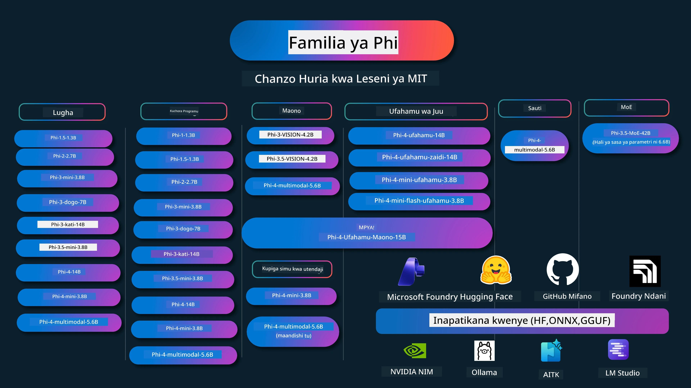

# Phi Cookbook: Mifano ya Vitendo na Modeli za Phi za Microsoft

[](https://codespaces.new/microsoft/phicookbook)
[](https://vscode.dev/redirect?url=vscode://ms-vscode-remote.remote-containers/cloneInVolume?url=https://github.com/microsoft/phicookbook)

[](https://GitHub.com/microsoft/phicookbook/graphs/contributors/?WT.mc_id=aiml-137032-kinfeylo)
[](https://GitHub.com/microsoft/phicookbook/issues/?WT.mc_id=aiml-137032-kinfeylo)
[](https://GitHub.com/microsoft/phicookbook/pulls/?WT.mc_id=aiml-137032-kinfeylo)
[](http://makeapullrequest.com?WT.mc_id=aiml-137032-kinfeylo)

[](https://GitHub.com/microsoft/phicookbook/watchers/?WT.mc_id=aiml-137032-kinfeylo)
[](https://GitHub.com/microsoft/phicookbook/network/?WT.mc_id=aiml-137032-kinfeylo)
[](https://GitHub.com/microsoft/phicookbook/stargazers/?WT.mc_id=aiml-137032-kinfeylo)

[](https://discord.com/invite/ByRwuEEgH4)

Phi ni mfululizo wa modeli za AI zilizo wazi zilizotengenezwa na Microsoft.

Phi kwa sasa ndiyo modeli ndogo ya lugha (SLM) yenye nguvu zaidi na gharama nafuu, ikiwa na viashiria vizuri sana katika lugha nyingi, uwezo wa kufikiri, uzalishaji wa maandishi/mazungumzo, uandishi wa msimbo, picha, sauti na matukio mengine.

Unaweza kupeleka Phi kwenye wingu au kwenye vifaa vya edge, na unaweza kwa urahisi kujenga programu za AI zinazozalisha zenye nguvu za kompyuta ndogo.

Fuata hatua hizi kuanza kutumia rasilimali hizi:
1. **Fanya Fork ya Hifadhi**: Bonyeza [](https://GitHub.com/microsoft/phicookbook/network/?WT.mc_id=aiml-137032-kinfeylo)
2. **Nakili Hifadhi**: `git clone https://github.com/microsoft/PhiCookBook.git`
3. [**Jiunge na Jamii ya Microsoft AI Discord na ukutane na wataalamu na watengenezaji wenzako**](https://discord.com/invite/ByRwuEEgH4?WT.mc_id=aiml-137032-kinfeylo)



### 🌐 Msaada wa Lugha Nyingi

#### Tafsiri zinahifadhiwa na [Mtafsiri wa Jumuiya](https://github.com/Azure/co-op-translator)

<!-- CO-OP TRANSLATOR LANGUAGES TABLE START -->
[Kiarabu](../ar/README.md) | [Kibengali](../bn/README.md) | [Kibulgaria](../bg/README.md) | [Kiburma (Myanma)](../my/README.md) | [Kichina (Rahisi)](../zh-CN/README.md) | [Kichina (Kiasili, Hong Kong)](../zh-HK/README.md) | [Kichina (Kiasili, Macau)](../zh-MO/README.md) | [Kichina (Kiasili, Taiwan)](../zh-TW/README.md) | [Kroatia](../hr/README.md) | [Kicheki](../cs/README.md) | [Kidenmaki](../da/README.md) | [Kiholanzi](../nl/README.md) | [Kiestoniani](../et/README.md) | [Kifini](../fi/README.md) | [Kifaransa](../fr/README.md) | [Kijerumani](../de/README.md) | [Kigreki](../el/README.md) | [Kiebrania](../he/README.md) | [Kihindi](../hi/README.md) | [Kihungari](../hu/README.md) | [Kiindonesian](../id/README.md) | [Kiitaliano](../it/README.md) | [Kijapani](../ja/README.md) | [Kikannada](../kn/README.md) | [Kikhemeri](../km/README.md) | [Kikorea](../ko/README.md) | [Kilitwania](../lt/README.md) | [Kimelayu](../ms/README.md) | [Kimalayalam](../ml/README.md) | [Kimarathi](../mr/README.md) | [Kinepali](../ne/README.md) | [Pijini la Nijeria](../pcm/README.md) | [Kinorwe](../no/README.md) | [Kiajemi (Farsi)](../fa/README.md) | [Kipolandi](../pl/README.md) | [Kireno (Brazil)](../pt-BR/README.md) | [Kireno (Ureno)](../pt-PT/README.md) | [Kipunja (Gurmukhi)](../pa/README.md) | [Kiromania](../ro/README.md) | [Kirusi](../ru/README.md) | [Kiserbienia (Cyrillic)](../sr/README.md) | [Kislovakia](../sk/README.md) | [Kislovenia](../sl/README.md) | [Kihispania](../es/README.md) | [Kiswahili](./README.md) | [Kiswidi](../sv/README.md) | [Kitagalogi (Kifilipino)](../tl/README.md) | [Kitamili](../ta/README.md) | [Kitelugu](../te/README.md) | [Kithai](../th/README.md) | [Kituruki](../tr/README.md) | [Kiukraini](../uk/README.md) | [Kiurdu](../ur/README.md) | [Kivietinamu](../vi/README.md)

> **Unapendelea Kutafuta Moja kwa Moja Mitaa?**
>
> Hifadhi hii ina tafsiri za lugha 50+ ambazo huongeza kiasi cha kupakua kwa kiasi kikubwa. Kuwa nakili bila tafsiri, tumia sparse checkout:
>
> **Bash / macOS / Linux:**
> ```bash
> git clone --filter=blob:none --sparse https://github.com/microsoft/PhiCookBook.git
> cd PhiCookBook
> git sparse-checkout set --no-cone '/*' '!translations' '!translated_images'
> ```
>
> **CMD (Windows):**
> ```cmd
> git clone --filter=blob:none --sparse https://github.com/microsoft/PhiCookBook.git
> cd PhiCookBook
> git sparse-checkout set --no-cone "/*" "!translations" "!translated_images"
> ```
>
> Hii inakupa kila kitu unachohitaji kukamilisha kozi kwa upakuaji wa haraka zaidi.
<!-- CO-OP TRANSLATOR LANGUAGES TABLE END -->

## Jedwali la Yaliyomo

- Utangulizi
  - [Karibu katika Familia ya Phi](./md/01.Introduction/01/01.PhiFamily.md)
  - [Kuweka mazingira yako](./md/01.Introduction/01/01.EnvironmentSetup.md)
  - [Kuelewa Teknolojia Muhimu](./md/01.Introduction/01/01.Understandingtech.md)
  - [Usalama wa AI kwa Modeli za Phi](./md/01.Introduction/01/01.AISafety.md)
  - [Msaada wa Vifaa vya Phi](./md/01.Introduction/01/01.Hardwaresupport.md)
  - [Modeli za Phi & Upatikanaji katika majukwaa](./md/01.Introduction/01/01.Edgeandcloud.md)
  - [Kutumia Guidance-ai na Phi](./md/01.Introduction/01/01.Guidance.md)
  - [Modeli za Soko la GitHub](https://github.com/marketplace/models)
  - [Katalogi ya Azure AI Model](https://ai.azure.com)

- Kutumia Phi kwa mazingira tofauti
    -  [Hugging face](./md/01.Introduction/02/01.HF.md)
    -  [Modeli za GitHub](./md/01.Introduction/02/02.GitHubModel.md)
    -  [Katalogi ya Modeli ya Microsoft Foundry](./md/01.Introduction/02/03.AzureAIFoundry.md)
    -  [Ollama](./md/01.Introduction/02/04.Ollama.md)
    -  [AI Toolkit VSCode (AITK)](./md/01.Introduction/02/05.AITK.md)
    -  [NVIDIA NIM](./md/01.Introduction/02/06.NVIDIA.md)
    -  [Foundry Local](./md/01.Introduction/02/07.FoundryLocal.md)

- Familia ya Kutumia Phi
    - [Kutumia Phi kwenye iOS](./md/01.Introduction/03/iOS_Inference.md)
    - [Kutumia Phi kwenye Android](./md/01.Introduction/03/Android_Inference.md)
    - [Kutumia Phi kwenye Jetson](./md/01.Introduction/03/Jetson_Inference.md)
    - [Kutumia Phi kwenye AI PC](./md/01.Introduction/03/AIPC_Inference.md)
    - [Kutumia Phi na Mfumo wa Apple MLX](./md/01.Introduction/03/MLX_Inference.md)
    - [Kutumia Phi kwenye Server ya Ndani](./md/01.Introduction/03/Local_Server_Inference.md)
    - [Kutumia Phi kwenye Server ya Mbali kwa kutumia AI Toolkit](./md/01.Introduction/03/Remote_Interence.md)
    - [Kutumia Phi na Rust](./md/01.Introduction/03/Rust_Inference.md)
    - [Kutumia Phi -- Maono ndani ya Ndani](./md/01.Introduction/03/Vision_Inference.md)
    - [Kutumia Phi na Kaito AKS, Azure Containers (msaada rasmi)](./md/01.Introduction/03/Kaito_Inference.md)
-  [Kuakisi Familia ya Phi](./md/01.Introduction/04/QuantifyingPhi.md)
    - [Kukokotoa Phi-3.5 / 4 kwa kutumia llama.cpp](./md/01.Introduction/04/UsingLlamacppQuantifyingPhi.md)
    - [Kukokotoa Phi-3.5 / 4 kwa kutumia nyongeza za Generative AI kwa onnxruntime](./md/01.Introduction/04/UsingORTGenAIQuantifyingPhi.md)
    - [Kukokotoa Phi-3.5 / 4 kwa kutumia Intel OpenVINO](./md/01.Introduction/04/UsingIntelOpenVINOQuantifyingPhi.md)
    - [Kukokotoa Phi-3.5 / 4 kwa kutumia Mfumo wa Apple MLX](./md/01.Introduction/04/UsingAppleMLXQuantifyingPhi.md)

-  Tathmini ya Phi
    - [Jibu la AI](./md/01.Introduction/05/ResponsibleAI.md)
    - [Microsoft Foundry kwa Tathmini](./md/01.Introduction/05/AIFoundry.md)
    - [Kutumia Promptflow kwa Tathmini](./md/01.Introduction/05/Promptflow.md)
 
- RAG na Azure AI Search
    - [Jinsi ya kutumia Phi-4-mini na Phi-4-multimodal (RAG) na Azure AI Search](https://github.com/microsoft/PhiCookBook/blob/main/code/06.E2E/E2E_Phi-4-RAG-Azure-AI-Search.ipynb)
    - [Zero-Cloud Local Hybrid RAG na SQLite FTS5 na phi-4-mini](https://github.com/microsoft/PhiCookBook/blob/main/code/06.E2E/E2E_Phi-4-mini_Local_Hybrid_RAG_SQLite_FTS5.ipynb)

- Mifano ya maendeleo ya programu za Phi
  - Programu za Maandishi & Mizungumzo
    - Mifano ya Phi-4 
      - [📓] [Mazungumzo na Mfano wa Phi-4-mini ONNX](./md/02.Application/01.TextAndChat/Phi4/ChatWithPhi4ONNX/README.md)
      - [Mazungumzo na Mfano wa Phi-4 lokal ONNX .NET](../../md/04.HOL/dotnet/src/LabsPhi4-Chat-01OnnxRuntime)
      - [Programu ya Console ya Mazungumzo .NET na Phi-4 ONNX kutumia Kaminifu wa Sementic](../../md/04.HOL/dotnet/src/LabsPhi4-Chat-02SK)
    - Mifano ya Phi-3 / 3.5
      - [Chatbot wa Ndani kwenye kivinjari kutumia Phi3, ONNX Runtime Web na WebGPU](https://github.com/microsoft/onnxruntime-inference-examples/tree/main/js/chat)
      - [Chat OpenVino](./md/02.Application/01.TextAndChat/Phi3/E2E_OpenVino_Chat.md)
      - [Mfano wa Modeli Nyingi - Phi-3-mini na OpenAI Whisper yenye Mwingiliano](./md/02.Application/01.TextAndChat/Phi3/E2E_Phi-3-mini_with_whisper.md)
      - [MLFlow - Kujenga kiambatisho na kutumia Phi-3 na MLFlow](./md//02.Application/01.TextAndChat/Phi3/E2E_Phi-3-MLflow.md)
      - [Uboreshaji wa Moduli - Jinsi ya kuboresha mfano wa Phi-3-min kwa ONNX Runtime Web kwa Olive](https://github.com/microsoft/Olive/tree/main/examples/phi3)
      - [App ya WinUI3 na Phi-3 mini-4k-instruct-onnx](https://github.com/microsoft/Phi3-Chat-WinUI3-Sample/)
      -[Mfano wa App ya WinUI3 Multi Model Ai Powered Notes](https://github.com/microsoft/ai-powered-notes-winui3-sample)
      - [Boresha na Unganisha modeli za Phi-3 maalum na Prompt flow](./md/02.Application/01.TextAndChat/Phi3/E2E_Phi-3-FineTuning_PromptFlow_Integration.md)
      - [Boresha na Unganisha modeli za Phi-3 maalum na Prompt flow katika Microsoft Foundry](./md/02.Application/01.TextAndChat/Phi3/E2E_Phi-3-FineTuning_PromptFlow_Integration_AIFoundry.md)
      - [Tathmini ya Mfano wa Phi-3 / Phi-3.5 ulioboreshwa katika Microsoft Foundry ukizingatia kanuni za AI za kuwajibika za Microsoft](./md/02.Application/01.TextAndChat/Phi3/E2E_Phi-3-Evaluation_AIFoundry.md)
      - [📓] [Mfano wa utabiri wa lugha wa Phi-3.5-mini-instruct (Kichina/ Kiingereza)](./md/02.Application/01.TextAndChat/Phi3/phi3-instruct-demo.ipynb)
      - [Chatbot wa WebGPU RAG wa Phi-3.5-Instruct](./md/02.Application/01.TextAndChat/Phi3/WebGPUWithPhi35Readme.md)
      - [Kutumia GPU ya Windows kuunda suluhisho la Prompt flow na Phi-3.5-Instruct ONNX](./md/02.Application/01.TextAndChat/Phi3/UsingPromptFlowWithONNX.md)
      - [Kutumia Phi-3.5 tflite ya Microsoft kuunda app ya Android](./md/02.Application/01.TextAndChat/Phi3/UsingPhi35TFLiteCreateAndroidApp.md)
      - [Mfano wa Maswali na Majibu .NET ukitumia mfano wa ONNX wa Phi-3 lokal kwa kutumia Microsoft.ML.OnnxRuntime](../../md/04.HOL/dotnet/src/LabsPhi301)
      - [Programu ya Mazungumzo ya Console .NET na Semantic Kernel na Phi-3](../../md/04.HOL/dotnet/src/LabsPhi302)

  - Mifano ya Msimbo wa Azure AI Inference SDK
    - Mifano ya Phi-4 
      - [📓] [Tengeneza msimbo wa mradi ukitumia Phi-4-multimodal](./md/02.Application/02.Code/Phi4/GenProjectCode/README.md)
    - Mifano ya Phi-3 / 3.5
      - [Jenga Visual Studio Code GitHub Copilot Chat yako mwenyewe na Familia ya Microsoft Phi-3](./md/02.Application/02.Code/Phi3/VSCodeExt/README.md)
      - [Tengeneza Wakili wa Mazungumzo wa Visual Studio Code kupitia GitHub Models na Phi-3.5](/md/02.Application/02.Code/Phi3/CreateVSCodeChatAgentWithGitHubModels.md)

  - Mifano ya Ufikiri wa Juu
    - Mifano ya Phi-4 
      - [📓] [Mfano za Phi-4-mini-kuhisi au Phi-4-kuhisi](./md/02.Application/03.AdvancedReasoning/Phi4/AdvancedResoningPhi4mini/README.md)
      - [📓] [Kurekebisha Phi-4-mini-kuhisi na Microsoft Olive](./md/02.Application/03.AdvancedReasoning/Phi4/AdvancedResoningPhi4mini/olive_ft_phi_4_reasoning_with_medicaldata.ipynb)
      - [📓] [Kurekebisha Phi-4-mini-kuhisi na Apple MLX](./md/02.Application/03.AdvancedReasoning/Phi4/AdvancedResoningPhi4mini/mlx_ft_phi_4_reasoning_with_medicaldata.ipynb)
      - [📓] [Phi-4-mini-kuhisi na Modeli za GitHub](./md/02.Application/02.Code/Phi4r/github_models_inference.ipynb)
      - [📓] [Phi-4-mini-kuhisi na Modeli za Microsoft Foundry](./md/02.Application/02.Code/Phi4r/azure_models_inference.ipynb)
  - Maonyesho
      - [Maonyesho ya Phi-4-mini yaliyohudumiwa kwenye Hugging Face Spaces](https://huggingface.co/spaces/microsoft/phi-4-mini?WT.mc_id=aiml-137032-kinfeylo)
      - [Maonyesho ya Phi-4-multimodal yaliyohudumiwa kwenye Hugginge Face Spaces](https://huggingface.co/spaces/microsoft/phi-4-multimodal?WT.mc_id=aiml-137032-kinfeylo)
  - Sampuli za Maono
    - Sampuli za Phi-4 
      - [📓] [Tumia Phi-4-multimodal kusoma picha na kuunda msimbo](./md/02.Application/04.Vision/Phi4/CreateFrontend/README.md) 
    - Sampuli za Phi-3 / 3.5
      -  [📓][Phi-3-maono-Picha maandishi kwa maandishi](./md/02.Application/04.Vision/Phi3/E2E_Phi-3-vision-image-text-to-text-online-endpoint.ipynb)
      - [Phi-3-maono-ONNX](https://onnxruntime.ai/docs/genai/tutorials/phi3-v.html)
      - [📓][Phi-3-maono CLIP Embedding](./md/02.Application/04.Vision/Phi3/E2E_Phi-3-vision-image-text-to-text-online-endpoint.ipynb)
      - [DEMO: Urejeleaji wa Phi-3](https://github.com/jennifermarsman/PhiRecycling/)
      - [Phi-3-maono - Msaidizi wa lugha wa kuona - na Phi3-Maono na OpenVINO](https://docs.openvino.ai/nightly/notebooks/phi-3-vision-with-output.html)
      - [Phi-3 Maono Nvidia NIM](./md/02.Application/04.Vision/Phi3/E2E_Nvidia_NIM_Vision.md)
      - [Phi-3 Maono OpenVino](./md/02.Application/04.Vision/Phi3/E2E_OpenVino_Phi3Vision.md)
      - [📓][Phi-3.5 Maono sampuli ya fremu nyingi au picha nyingi](./md/02.Application/04.Vision/Phi3/phi3-vision-demo.ipynb)
      - [Phi-3 Maono Modeli ya ndani ya ONNX ikitumia Microsoft.ML.OnnxRuntime .NET](../../md/04.HOL/dotnet/src/LabsPhi303)
      - [Menu inayotegemea Phi-3 Maono Modeli ya ndani ya ONNX ikitumia Microsoft.ML.OnnxRuntime .NET](../../md/04.HOL/dotnet/src/LabsPhi304)

  - Sampuli za Kuhisi-Maono
    - Phi-4-Kuhisi-Maono-15B 
      - [📓] [Kutumia Phi-4-Kuhisi-Maono-15B kugundua kupita barabarani pasipo sheria](./md/02.Application/10.ReasoningVision/Phi_4_reasoning_vision_15b_Jaywalking.ipynb)
      - [📓] [Kutumia Phi-4-Kuhisi-Maono-15B kwa hisabati](./md/02.Application/10.ReasoningVision/Phi_4_reasoning_vision_15b_Math.ipynb)
      - [📓] [Kutumia Phi-4-Kuhisi-Maono-15B kugundua UI](./md/02.Application/10.ReasoningVision/Phi_4_reasoning_vision_15b_ui.ipynb)

  - Sampuli za Hisabati
    -  Sampuli za Phi-4-Mini-Flash-Kuhisi-Instruct  [Onyesho la Hisabati na Phi-4-Mini-Flash-Kuhisi-Instruct](./md/02.Application/09.Math/MathDemo.ipynb)

  - Sampuli za Sauti
    - Sampuli za Phi-4 
      - [📓] [Kuchambua methali za sauti kwa kutumia Phi-4-multimodal](./md/02.Application/05.Audio/Phi4/Transciption/README.md)
      - [📓] [Sampuli za Sauti za Phi-4-multimodal](./md/02.Application/05.Audio/Phi4/Siri/demo.ipynb)
      - [📓] [Sampuli ya Tafsiri ya Hotuba ya Phi-4-multimodal](./md/02.Application/05.Audio/Phi4/Translate/demo.ipynb)
      - [Programu ya koni ya .NET ikitumia Phi-4-multimodal Sauti kuchambua faili ya sauti na kuunda nakala](../../md/04.HOL/dotnet/src/LabsPhi4-MultiModal-02Audio)

  - Sampuli za MOE
    - Sampuli za Phi-3 / 3.5
      - [📓] [Modeli za Mchanganyiko wa Wataalamu wa Phi-3.5 (MoEs) Sampuli ya Mitandao ya Kijamii](./md/02.Application/06.MoE/Phi3/phi3_moe_demo.ipynb)
      - [📓] [Kujenga Mchakato wa Uzalishaji wa Urejeshaji (RAG) na NVIDIA NIM Phi-3 MOE, Utafutaji wa AI wa Azure, na LlamaIndex](./md/02.Application/06.MoE/Phi3/azure-ai-search-nvidia-rag.ipynb)
      - 
  - Sampuli za Kupiga Simu za Kazi
    - Sampuli za Phi-4 🆕
      -  [📓] [Kutumia Kupiga Simu za Kazi na Phi-4-mini](./md/02.Application/07.FunctionCalling/Phi4/FunctionCallingBasic/README.md)
      -  [📓] [Kutumia Kupiga Simu za Kazi kuunda wawakilishi wengi na Phi-4-mini](./md/02.Application/07.FunctionCalling/Phi4/Multiagents/Phi_4_mini_multiagent.ipynb)
      -  [📓] [Kutumia Kupiga Simu za Kazi na Ollama](./md/02.Application/07.FunctionCalling/Phi4/Ollama/ollama_functioncalling.ipynb)
      -  [📓] [Kutumia Kupiga Simu za Kazi na ONNX](./md/02.Application/07.FunctionCalling/Phi4/ONNX/onnx_parallel_functioncalling.ipynb)
  - Sampuli za Mchanganyiko wa Multimodal
    - Sampuli za Phi-4 🆕
      -  [📓] [Kutumia Phi-4-multimodal kama mwanahabari wa Teknolojia](./md/02.Application/08.Multimodel/Phi4/TechJournalist/phi_4_mm_audio_text_publish_news.ipynb)
      - [Programu ya koni ya .NET ikitumia Phi-4-multimodal kuchambua picha](../../md/04.HOL/dotnet/src/LabsPhi4-MultiModal-01Images)

- Kurekebisha Sampuli za Phi
  - [Mazingira ya Kurekebisha](./md/03.FineTuning/FineTuning_Scenarios.md)
  - [Kurekebisha dhidi ya RAG](./md/03.FineTuning/FineTuning_vs_RAG.md)
  - [Kurekebisha Acha Phi-3 awe mtaalamu wa tasnia](./md/03.FineTuning/LetPhi3gotoIndustriy.md)
  - [Kurekebisha Phi-3 na Seti ya Zana za AI kwa VS Code](./md/03.FineTuning/Finetuning_VSCodeaitoolkit.md)
  - [Kurekebisha Phi-3 na Huduma ya Azure Machine Learning](./md/03.FineTuning/Introduce_AzureML.md)
  - [Kurekebisha Phi-3 na Lora](./md/03.FineTuning/FineTuning_Lora.md)
  - [Kurekebisha Phi-3 na QLora](./md/03.FineTuning/FineTuning_Qlora.md)
  - [Kurekebisha Phi-3 na Microsoft Foundry](./md/03.FineTuning/FineTuning_AIFoundry.md)
  - [Kurekebisha Phi-3 na Azure ML CLI/SDK](./md/03.FineTuning/FineTuning_MLSDK.md)
  - [Kurekebisha na Microsoft Olive](./md/03.FineTuning/FineTuning_MicrosoftOlive.md)
  - [Kurekebisha na Microsoft Olive Hands-On Lab](./md/03.FineTuning/olive-lab/readme.md)
  - [Kurekebisha Phi-3-maono na Weights and Bias](./md/03.FineTuning/FineTuning_Phi-3-visionWandB.md)
  - [Kurekebisha Phi-3 na Mfumo wa Apple MLX](./md/03.FineTuning/FineTuning_MLX.md)
  - [Kurekebisha Phi-3-maono (msaada rasmi)](./md/03.FineTuning/FineTuning_Vision.md)
  - [Kurekebisha Phi-3 na Kaito AKS, Kontena za Azure (Msaada rasmi)](./md/03.FineTuning/FineTuning_Kaito.md)
  - [Kurekebisha Phi-3 na 3.5 Maono](https://github.com/2U1/Phi3-Vision-Finetune)

- Maabara ya Vitendo
  - [Kuchunguza modeli za hali ya juu: LLMs, SLMs, ukuzaji wa ndani na zaidi](https://github.com/microsoft/aitour-exploring-cutting-edge-models)
  - [Kufungua Uwezo wa NLP: Kurekebisha kwa Microsoft Olive](https://github.com/azure/Ignite_FineTuning_workshop)

- Nyaraka za Utafiti na Machapisho ya Kielimu
  - [Vitabu vya Kusoma Pekee Ni Vyongezi II: ripoti ya kiufundi ya phi-1.5](https://arxiv.org/abs/2309.05463)
  - [Ripoti ya Kiufundi ya Phi-3: Mfano wa Lugha Yenye Uwezo Mkubwa Ndani ya Simu Yako](https://arxiv.org/abs/2404.14219)
  - [Ripoti ya Kiufundi ya Phi-4](https://arxiv.org/abs/2412.08905)
  - [Ripoti ya Kiufundi ya Phi-4-Mini: Modeli ndogo za Lugha ya Nguvu ya Multimodal kupitia Mchanganyiko wa LoRAs](https://arxiv.org/abs/2503.01743)
  - [Kuboresha Modeli Ndogo za Lugha kwa Kupiga Simu Kazi ndani ya Gari](https://arxiv.org/abs/2501.02342)
  - [(WhyPHI) Kurekebisha PHI-3 kwa Majibu ya Maswali ya Chaguo Nyingi: Mbinu, Matokeo, na Changamoto](https://arxiv.org/abs/2501.01588)
  - [Ripoti ya Kiufundi ya Phi-4-kuhisi](https://www.microsoft.com/en-us/research/wp-content/uploads/2025/04/phi_4_reasoning.pdf)
  - [Ripoti ya Kiufundi ya Phi-4-mini-kuhisi](https://huggingface.co/microsoft/Phi-4-mini-reasoning/blob/main/Phi-4-Mini-Reasoning.pdf)

## Kutumia Modeli za Phi

### Phi kwenye Microsoft Foundry

Unaweza kujifunza jinsi ya kutumia Microsoft Phi na jinsi ya kujenga suluhisho za E2E katika vifaa vyako tofauti vya vifaa. Ili kupata uzoefu wa Phi kwa ajili yako mwenyewe, anza kwa kucheza na modeli na kufanyia marekebisho Phi kwa mazingira yako ukitumia [Microsoft Foundry Azure AI Model Catalog](https://aka.ms/phi3-azure-ai) unaweza kujifunza zaidi kwenye Kujifunza Mwanzo na [Microsoft Foundry](/md/02.QuickStart/AzureAIFoundry_QuickStart.md)

**Uwanja wa Mchezo**
Kila mfano una uwanja uliotengwa wa kujaribu mfano [Azure AI Playground](https://aka.ms/try-phi3).

### Phi kwenye Modeli za GitHub

Unaweza kujifunza jinsi ya kutumia Microsoft Phi na jinsi ya kujenga suluhisho za E2E katika vifaa vyako tofauti vya vifaa. Ili kupata uzoefu wa Phi kwa ajili yako mwenyewe, anza kwa kucheza na mfano na kufanyia marekebisho Phi kwa mazingira yako ukitumia [GitHub Model Catalog](https://github.com/marketplace/models?WT.mc_id=aiml-137032-kinfeylo) unaweza kujifunza zaidi katika Kujifunza Mwanzo na [GitHub Model Catalog](/md/02.QuickStart/GitHubModel_QuickStart.md)

**Uwanja wa Mchezo**
Kila mfano una [uwanja wa kujaribu mfano](/md/02.QuickStart/GitHubModel_QuickStart.md) uliotengwa.

### Phi kwenye Hugging Face

Pia unaweza kupata mfano kwenye [Hugging Face](https://huggingface.co/microsoft)

**Uwanja wa Mchezo**
 [Uwanja wa mchezo wa Hugging Chat](https://huggingface.co/chat/models/microsoft/Phi-3-mini-4k-instruct)

 ## 🎒 Kozi Nyingine

Timu yetu hutengeneza kozi zingine! Angalia:

<!-- CO-OP TRANSLATOR OTHER COURSES START -->
### LangChain
[](https://aka.ms/langchain4j-for-beginners)
[](https://aka.ms/langchainjs-for-beginners?WT.mc_id=m365-94501-dwahlin)
[](https://github.com/microsoft/langchain-for-beginners?WT.mc_id=m365-94501-dwahlin)
---

### Azure / Edge / MCP / Wawakilishi
[](https://github.com/microsoft/AZD-for-beginners?WT.mc_id=academic-105485-koreyst)
[](https://github.com/microsoft/edgeai-for-beginners?WT.mc_id=academic-105485-koreyst)
[](https://github.com/microsoft/mcp-for-beginners?WT.mc_id=academic-105485-koreyst)
[](https://github.com/microsoft/ai-agents-for-beginners?WT.mc_id=academic-105485-koreyst)

---
 
### Mfululizo wa AI ya Kizazi
[](https://github.com/microsoft/generative-ai-for-beginners?WT.mc_id=academic-105485-koreyst)
[-9333EA?style=for-the-badge&labelColor=E5E7EB&color=9333EA)](https://github.com/microsoft/Generative-AI-for-beginners-dotnet?WT.mc_id=academic-105485-koreyst)
[-C084FC?style=for-the-badge&labelColor=E5E7EB&color=C084FC)](https://github.com/microsoft/generative-ai-for-beginners-java?WT.mc_id=academic-105485-koreyst)
[-E879F9?style=for-the-badge&labelColor=E5E7EB&color=E879F9)](https://github.com/microsoft/generative-ai-with-javascript?WT.mc_id=academic-105485-koreyst)

---
 
### Kujifunza Msingi
[](https://aka.ms/ml-beginners?WT.mc_id=academic-105485-koreyst)
[](https://aka.ms/datascience-beginners?WT.mc_id=academic-105485-koreyst)
[](https://aka.ms/ai-beginners?WT.mc_id=academic-105485-koreyst)
[](https://github.com/microsoft/Security-101?WT.mc_id=academic-96948-sayoung)
[](https://aka.ms/webdev-beginners?WT.mc_id=academic-105485-koreyst)
[](https://aka.ms/iot-beginners?WT.mc_id=academic-105485-koreyst)
[](https://github.com/microsoft/xr-development-for-beginners?WT.mc_id=academic-105485-koreyst)

---
 
### Mfululizo wa Copilot
[](https://aka.ms/GitHubCopilotAI?WT.mc_id=academic-105485-koreyst)
[](https://github.com/microsoft/mastering-github-copilot-for-dotnet-csharp-developers?WT.mc_id=academic-105485-koreyst)
[](https://github.com/microsoft/CopilotAdventures?WT.mc_id=academic-105485-koreyst)
<!-- CO-OP TRANSLATOR OTHER COURSES END -->

## AI Inayowajibika 

Microsoft imejizatiti kusaidia wateja wetu kutumia bidhaa zetu za AI kwa uwajibikaji, kushiriki mafunzo yetu, na kujenga ushirikiano unaotegemea uaminifu kupitia zana kama vile Vidokezo vya Uwajibikaji na Tathmini za Athari. Rasilimali nyingi kati ya hizi zinaweza kupatikana kwenye [https://aka.ms/RAI](https://aka.ms/RAI).
Mbinu ya Microsoft kwa AI inayowajibika inatokana na misingi yetu ya AI ya haki, kuaminika na usalama, faragha na usalama, ujumuishaji, uwazi, na uwajibikaji.

Modeli kubwa za lugha, picha, na hotuba - kama zile zinazotumika katika sampuli hii - zinaweza kuonyesha tabia zisizo za haki, zisizo za kuaminika, au zinazoweza kusababisha msongo, na hivyo kusababisha madhara. Tafadhali rejelea [Noti ya Uwajibikaji ya Huduma ya Azure OpenAI](https://learn.microsoft.com/legal/cognitive-services/openai/transparency-note?tabs=text) ili uwe na taarifa kuhusu hatari na vikwazo.

Njia inayopendekezwa ya kupunguza hatari hizi ni kujumuisha mfumo wa usalama katika usanifu wako ambao unaweza kugundua na kuzuia tabia hatari. [Azure AI Content Safety](https://learn.microsoft.com/azure/ai-services/content-safety/overview) hutoa tabaka huru la ulinzi, linaloweza kugundua maudhui hatari yaliyotengenezwa na watumiaji na AI katika programu na huduma. Azure AI Content Safety inajumuisha API za maandishi na picha zinazokuwezesha kugundua nyenzo hatari. Ndani ya Microsoft Foundry, huduma ya Usalama wa Maudhui inakuwezesha kuona, kuchunguza na kujaribu msimbo wa mfano wa kugundua maudhui hatari katika modaliti tofauti. Hati ifuatayo ya [mwongozo wa haraka](https://learn.microsoft.com/azure/ai-services/content-safety/quickstart-text?tabs=visual-studio%2Clinux&pivots=programming-language-rest) inakuongoza katika kutuma maombi kwa huduma hiyo.

Jambo lingine la kuzingatia ni utendaji wa jumla wa programu. Kwa programu za modaliti nyingi na modeli nyingi, tunazingatia utendaji kama mfumo unavyofanya kazi kama unavyotarajia wewe na watumiaji wako, ikiwa ni pamoja na kutotengeneza matokeo hatari. Ni muhimu kutathmini utendaji wa programu yako kwa ujumla kwa kutumia [Washauri wa Utendaji, Ubora, Hatari na Usalama](https://learn.microsoft.com/azure/ai-studio/concepts/evaluation-metrics-built-in). Pia una uwezo wa kuunda na kutathmini kwa kutumia [washauri maalum](https://learn.microsoft.com/azure/ai-studio/how-to/develop/evaluate-sdk#custom-evaluators).

Unaweza kutathmini programu yako ya AI katika mazingira yako ya maendeleo kwa kutumia [Azure AI Evaluation SDK](https://microsoft.github.io/promptflow/index.html). Kwa kutumia seti ya data ya mtihani au lengo, vizazi vya programu yako ya AI vinapimwa kwa kiasi kwa washauri waliotumika ndani au washauri maalum unayochagua. Ili kuanza na azure ai evaluation sdk kutathmini mfumo wako, unaweza kufuata [mwongozo wa haraka](https://learn.microsoft.com/azure/ai-studio/how-to/develop/flow-evaluate-sdk). Mara unapoendesha tathmini, unaweza [kuonyesha matokeo katika Microsoft Foundry](https://learn.microsoft.com/azure/ai-studio/how-to/evaluate-flow-results).

## Viwango vya Biashara

Mradi huu unaweza kuwa na viwango vya biashara au nembo za miradi, bidhaa, au huduma. Matumizi yaliyothibitishwa ya viwango vya biashara au nembo za Microsoft yanakamiliana na lazima yafuatilie [Miongozo ya Viwango vya Biashara na Brand ya Microsoft](https://www.microsoft.com/legal/intellectualproperty/trademarks/usage/general).
Matumizi ya viwango vya biashara au nembo za Microsoft katika toleo zilizobadilishwa za mradi huu hayapaswi kusababisha mkanganyiko au kufikiri kuwa Microsoft inadhamini. Matumizi yoyote ya viwango vya biashara au nembo za wengine yanafuata sera za pande hizo.

## Kupata Msaada

Ikiwa utakosa au una maswali kuhusu kujenga programu za AI, jiunge:

[](https://aka.ms/foundry/discord)

Ikiwa una maoni kuhusu bidhaa au hitilafu wakati wa kujenga tembelea:

[](https://aka.ms/foundry/forum)

---

<!-- CO-OP TRANSLATOR DISCLAIMER START -->
**Kionyozo**:
Hati hii imetafsiriwa kwa kutumia huduma ya tafsiri ya AI [Co-op Translator](https://github.com/Azure/co-op-translator). Ingawa tunajitahidi kupata usahihi, tafadhali fahamu kwamba tafsiri za kiotomatiki zinaweza kuwa na makosa au upungufu wa usahihi. Hati ya asili katika lugha yake halisi inapaswa kuchukuliwa kama chanzo cha mamlaka. Kwa taarifa muhimu, tafsiri ya kitaalamu inayofanywa na binadamu inapendekezwa. Hatutojibu kwa kuelewa vibaya au tafsiri potofu zinazotokea kutokana na matumizi ya tafsiri hii.
<!-- CO-OP TRANSLATOR DISCLAIMER END -->