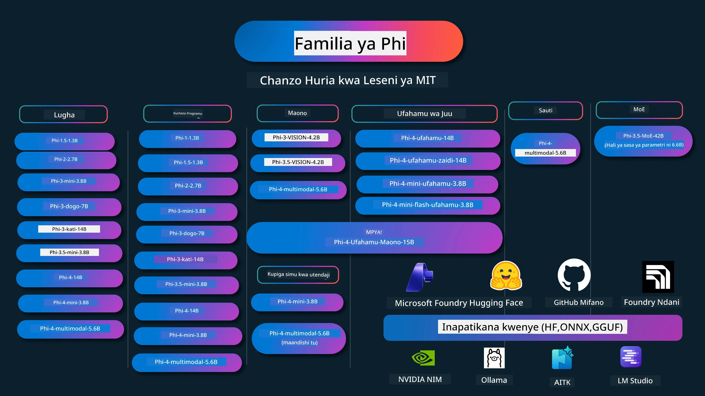

# Kitabu cha Mapishi cha Phi: Mifano ya Vitendo na Modeli za Phi za Microsoft

[](https://codespaces.new/microsoft/phicookbook)
[](https://vscode.dev/redirect?url=vscode://ms-vscode-remote.remote-containers/cloneInVolume?url=https://github.com/microsoft/phicookbook)

[](https://GitHub.com/microsoft/phicookbook/graphs/contributors/?WT.mc_id=aiml-137032-kinfeylo)
[](https://GitHub.com/microsoft/phicookbook/issues/?WT.mc_id=aiml-137032-kinfeylo)
[](https://GitHub.com/microsoft/phicookbook/pulls/?WT.mc_id=aiml-137032-kinfeylo)
[](http://makeapullrequest.com?WT.mc_id=aiml-137032-kinfeylo)

[](https://GitHub.com/microsoft/phicookbook/watchers/?WT.mc_id=aiml-137032-kinfeylo)
[](https://GitHub.com/microsoft/phicookbook/network/?WT.mc_id=aiml-137032-kinfeylo)
[](https://GitHub.com/microsoft/phicookbook/stargazers/?WT.mc_id=aiml-137032-kinfeylo)

[](https://discord.com/invite/ByRwuEEgH4)

Phi ni mfululizo wa modeli za AI zilizo wazi zilizotengenezwa na Microsoft.

Phi kwa sasa ni mfano mdogo wa lugha (SLM) yenye nguvu zaidi na yenye gharama nafuu kabisa, na viwango bora sana katika lugha nyingi, usemi wa mantiki, uzalishaji wa maandishi/mazungumzo, uandishi wa nambari, picha, sauti na hali nyinginezo.

Unaweza kupeleka Phi katika wingu au kwenye vifaa vya ukingo, na unaweza kwa urahisi kuunda programu za AI za kizazi chenye nguvu kidogo cha kompyuta.

Fuata hatua hizi kuanza kutumia rasilimali hizi:
1. **Fanya Fork ya Hifadhi**: Bonyeza [](https://GitHub.com/microsoft/phicookbook/network/?WT.mc_id=aiml-137032-kinfeylo)
2. **Nakili Hifadhi**: `git clone https://github.com/microsoft/PhiCookBook.git`
3. [**Jiunge na Jumuiya ya Microsoft AI Discord na kutana na wataalamu na waendelezaji wenzako**](https://discord.com/invite/ByRwuEEgH4?WT.mc_id=aiml-137032-kinfeylo)



### 🌐 Msaada wa Lugha Nyingi

#### Unaungwa mkono kupitia Kitendo cha GitHub (Kiotomatiki & Kila Wakati Kinachosasishwa)

<!-- CO-OP TRANSLATOR LANGUAGES TABLE START -->
[Kiarabu](../ar/README.md) | [Bengali](../bn/README.md) | [Kibulgaria](../bg/README.md) | [Kiburma (Myanmar)](../my/README.md) | [Kichina (Rahisi)](../zh-CN/README.md) | [Kichina (Mila, Hong Kong)](../zh-HK/README.md) | [Kichina (Mila, Macau)](../zh-MO/README.md) | [Kichina (Mila, Taiwan)](../zh-TW/README.md) | [Kroatia](../hr/README.md) | [Cheki](../cs/README.md) | [Kidenmaki](../da/README.md) | [Kiholanzi](../nl/README.md) | [Kiestonia](../et/README.md) | [Kifini](../fi/README.md) | [Kifaransa](../fr/README.md) | [Kijerumani](../de/README.md) | [Kigiriki](../el/README.md) | [Kiebrania](../he/README.md) | [Kihindi](../hi/README.md) | [Kihungari](../hu/README.md) | [Kiindonesia](../id/README.md) | [Kiitaliano](../it/README.md) | [Kijapani](../ja/README.md) | [Kikannada](../kn/README.md) | [Kikmeru](../km/README.md) | [Kikorea](../ko/README.md) | [Kilithuania](../lt/README.md) | [Kimalay](../ms/README.md) | [Kimalayalam](../ml/README.md) | [Manipuri (Meitei Mayek)](../mni/README.md) | [Kimarathi](../mr/README.md) | [Kinepali](../ne/README.md) | [Pidgin ya Nigeria](../pcm/README.md) | [Kinorwe](../no/README.md) | [Kiajemi (Farsi)](../fa/README.md) | [Kipolandi](../pl/README.md) | [Kireno (Brazil)](../pt-BR/README.md) | [Kireno (Ureno)](../pt-PT/README.md) | [Kipunjabi (Gurmukhi)](../pa/README.md) | [Kiromania](../ro/README.md) | [Kirusi](../ru/README.md) | [Kiserbia (Cyrillic)](../sr/README.md) | [Kislovakia](../sk/README.md) | [Kislovenia](../sl/README.md) | [Kihispania](../es/README.md) | [Kiswahili](./README.md) | [Kiswidi](../sv/README.md) | [Tagalog (Kifilipino)](../tl/README.md) | [Kitamili](../ta/README.md) | [Kitelugu](../te/README.md) | [Kithai](../th/README.md) | [Kituruki](../tr/README.md) | [Kiukraine](../uk/README.md) | [Kiurdu](../ur/README.md) | [Kivietinamu](../vi/README.md)

> **Ungependa Nakili Kwenye Kifaa Chako Mlolongo?**
>
> Hifadhi hii ina tafsiri za lugha zaidi ya 50 ambazo huongeza kwa kiasi kikubwa ukubwa wa kupakua. Ili kunakili bila tafsiri, tumia sparse checkout:
>
> **Bash / macOS / Linux:**
> ```bash
> git clone --filter=blob:none --sparse https://github.com/microsoft/PhiCookBook.git
> cd PhiCookBook
> git sparse-checkout set --no-cone '/*' '!translations' '!translated_images'
> ```
>
> **CMD (Windows):**
> ```cmd
> git clone --filter=blob:none --sparse https://github.com/microsoft/PhiCookBook.git
> cd PhiCookBook
> git sparse-checkout set --no-cone "/*" "!translations" "!translated_images"
> ```
>
> Hii inakupa kila kitu unachohitaji kukamilisha kozi kwa upakuaji wa kasi zaidi.
<!-- CO-OP TRANSLATOR LANGUAGES TABLE END -->

## Jedwali la Yaliyomo

- Utangulizi
  - [Karibu katika Familia ya Phi](./md/01.Introduction/01/01.PhiFamily.md)
  - [Kuweka mazingira yako](./md/01.Introduction/01/01.EnvironmentSetup.md)
  - [Kuelewa Teknolojia Muhimu](./md/01.Introduction/01/01.Understandingtech.md)
  - [Usalama wa AI kwa Modeli za Phi](./md/01.Introduction/01/01.AISafety.md)
  - [Msaada wa Vifaa vya Phi](./md/01.Introduction/01/01.Hardwaresupport.md)
  - [Modeli za Phi & Upatikanaji katika majukwaa tofauti](./md/01.Introduction/01/01.Edgeandcloud.md)
  - [Kutumia Guidance-ai na Phi](./md/01.Introduction/01/01.Guidance.md)
  - [Modeli za Soko la GitHub](https://github.com/marketplace/models)
  - [Katalogi ya Modeli za Azure AI](https://ai.azure.com)

- Kutathmini Phi katika mazingira tofauti
    -  [Hugging face](./md/01.Introduction/02/01.HF.md)
    -  [Modeli za GitHub](./md/01.Introduction/02/02.GitHubModel.md)
    -  [Katalogi ya Modeli ya Microsoft Foundry](./md/01.Introduction/02/03.AzureAIFoundry.md)
    -  [Ollama](./md/01.Introduction/02/04.Ollama.md)
    -  [AI Toolkit VSCode (AITK)](./md/01.Introduction/02/05.AITK.md)
    -  [NVIDIA NIM](./md/01.Introduction/02/06.NVIDIA.md)
    -  [Foundry Local](./md/01.Introduction/02/07.FoundryLocal.md)

- Familia ya Kutathmini Phi
    - [Kutathmini Phi katika iOS](./md/01.Introduction/03/iOS_Inference.md)
    - [Kutathmini Phi katika Android](./md/01.Introduction/03/Android_Inference.md)
    - [Kutathmini Phi katika Jetson](./md/01.Introduction/03/Jetson_Inference.md)
    - [Kutathmini Phi katika PC ya AI](./md/01.Introduction/03/AIPC_Inference.md)
    - [Kutathmini Phi na Mfumo wa Apple MLX](./md/01.Introduction/03/MLX_Inference.md)
    - [Kutathmini Phi katika Seva ya Ndani](./md/01.Introduction/03/Local_Server_Inference.md)
    - [Kutathmini Phi katika Seva ya Mbali kwa kutumia AI Toolkit](./md/01.Introduction/03/Remote_Interence.md)
    - [Kutathmini Phi kwa Rust](./md/01.Introduction/03/Rust_Inference.md)
    - [Kutathmini Phi--Maono ndani ya Ndani](./md/01.Introduction/03/Vision_Inference.md)
    - [Kutathmini Phi na Kaito AKS, Azure Containers (msaada rasmi)](./md/01.Introduction/03/Kaito_Inference.md)
-  [Kupima Familia ya Phi](./md/01.Introduction/04/QuantifyingPhi.md)
    - [Kupima Phi-3.5 / 4 kwa kutumia llama.cpp](./md/01.Introduction/04/UsingLlamacppQuantifyingPhi.md)
    - [Kupima Phi-3.5 / 4 kwa kutumia nyongeza za AI za kizazi kwa onnxruntime](./md/01.Introduction/04/UsingORTGenAIQuantifyingPhi.md)
    - [Kupima Phi-3.5 / 4 kwa kutumia Intel OpenVINO](./md/01.Introduction/04/UsingIntelOpenVINOQuantifyingPhi.md)
    - [Kupima Phi-3.5 / 4 kwa kutumia Mfumo wa Apple MLX](./md/01.Introduction/04/UsingAppleMLXQuantifyingPhi.md)

-  Tathmini ya Phi
    - [AI ya Majibu](./md/01.Introduction/05/ResponsibleAI.md)
    - [Microsoft Foundry kwa Tathmini](./md/01.Introduction/05/AIFoundry.md)
    - [Kutumia Promptflow kwa Tathmini](./md/01.Introduction/05/Promptflow.md)
 
- RAG na Azure AI Search
    - [Jinsi ya kutumia Phi-4-mini na Phi-4-multimodal (RAG) na Azure AI Search](https://github.com/microsoft/PhiCookBook/blob/main/code/06.E2E/E2E_Phi-4-RAG-Azure-AI-Search.ipynb)
    - [Zero-Cloud Local Hybrid RAG na SQLite FTS5 na phi-4-mini](https://github.com/microsoft/PhiCookBook/blob/main/code/06.E2E/E2E_Phi-4-mini_Local_Hybrid_RAG_SQLite_FTS5.ipynb)

- Sampuli za maendeleo ya programu za Phi
  - Programu za Maandishi & Mazungumzo
    - Sampuli za Phi-4
      - [📓] [Mazungumzo Na Phi-4-mini ONNX Model](./md/02.Application/01.TextAndChat/Phi4/ChatWithPhi4ONNX/README.md)
      - [Mazungumzo na Phi-4 local ONNX Model .NET](../../md/04.HOL/dotnet/src/LabsPhi4-Chat-01OnnxRuntime)
      - [Programu ya Mazungumzo .NET Console na Phi-4 ONNX ukitumia Semantic Kernel](../../md/04.HOL/dotnet/src/LabsPhi4-Chat-02SK)
    - Sampuli za Phi-3 / 3.5
      - [Chatbot ya Ndani katika kivinjari ukitumia Phi3, ONNX Runtime Web na WebGPU](https://github.com/microsoft/onnxruntime-inference-examples/tree/main/js/chat)
      - [OnOpenVino Chat](./md/02.Application/01.TextAndChat/Phi3/E2E_OpenVino_Chat.md)
      - [Mfano wa Multi Model - Phi-3-mini na OpenAI Whisper](./md/02.Application/01.TextAndChat/Phi3/E2E_Phi-3-mini_with_whisper.md)
      - [MLFlow - Kujenga kifuniko na kutumia Phi-3 na MLFlow](./md//02.Application/01.TextAndChat/Phi3/E2E_Phi-3-MLflow.md)
      - [Uboreshaji wa Modeli - Jinsi ya kuboresha mfano wa Phi-3-min kwa ONNX Runtime Web na Olive](https://github.com/microsoft/Olive/tree/main/examples/phi3)
      - [Programu ya WinUI3 na Phi-3 mini-4k-instruct-onnx](https://github.com/microsoft/Phi3-Chat-WinUI3-Sample/)
      - [Mfano wa App ya WinUI3 Multi Model AI Powered Notes](https://github.com/microsoft/ai-powered-notes-winui3-sample)
      - [Boresha na Unganisha modeli za kawaida za Phi-3 na Prompt flow](./md/02.Application/01.TextAndChat/Phi3/E2E_Phi-3-FineTuning_PromptFlow_Integration.md)
      - [Boresha na Unganisha modeli za kawaida za Phi-3 na Prompt flow katika Microsoft Foundry](./md/02.Application/01.TextAndChat/Phi3/E2E_Phi-3-FineTuning_PromptFlow_Integration_AIFoundry.md)
      - [Tathmini mfano ulioboreshwa wa Phi-3 / Phi-3.5 katika Microsoft Foundry ukiangazia Kanuni za AI Zinazoaminika za Microsoft](./md/02.Application/01.TextAndChat/Phi3/E2E_Phi-3-Evaluation_AIFoundry.md)
      - [📓] [Mfano wa utabiri wa lugha wa Phi-3.5-mini-instruct (Kichina/Kiingereza)](./md/02.Application/01.TextAndChat/Phi3/phi3-instruct-demo.ipynb)
      - [Phi-3.5-Instruct WebGPU RAG Chatbot](./md/02.Application/01.TextAndChat/Phi3/WebGPUWithPhi35Readme.md)
      - [Kutumia Windows GPU kutengeneza suluhisho la Prompt flow na Phi-3.5-Instruct ONNX](./md/02.Application/01.TextAndChat/Phi3/UsingPromptFlowWithONNX.md)
      - [Kutumia Microsoft Phi-3.5 tflite kutengeneza app ya Android](./md/02.Application/01.TextAndChat/Phi3/UsingPhi35TFLiteCreateAndroidApp.md)
      - [Mfano wa Maswali na Majibu .NET ukitumia mfano wa ndani wa ONNX Phi-3 kwa Microsoft.ML.OnnxRuntime](../../md/04.HOL/dotnet/src/LabsPhi301)
      - [Programu ya mazungumzo ya Console .NET na Semantic Kernel na Phi-3](../../md/04.HOL/dotnet/src/LabsPhi302)

  - Sampuli za Msimbo wa SDK wa Azure AI Inference
    - Sampuli za Phi-4
      - [📓] [Tengeneza msimbo wa mradi ukitumia Phi-4-multimodal](./md/02.Application/02.Code/Phi4/GenProjectCode/README.md)
    - Sampuli za Phi-3 / 3.5
      - [Jenga Chat yako mwenyewe ya Visual Studio Code GitHub Copilot pamoja na Familia ya Microsoft Phi-3](./md/02.Application/02.Code/Phi3/VSCodeExt/README.md)
      - [Tengeneza Agent ya Chat Copilot ya Visual Studio Code na Phi-3.5 kwa kutumia Modeli za GitHub](/md/02.Application/02.Code/Phi3/CreateVSCodeChatAgentWithGitHubModels.md)

  - Sampuli za Uelewa wa Juu
    - Sampuli za Phi-4
      - [📓] [Mfano za Phi-4-mini-reasoning au Phi-4-reasoning](./md/02.Application/03.AdvancedReasoning/Phi4/AdvancedResoningPhi4mini/README.md)
      - [📓] [Kurekebisha Phi-4-mini-reasoning kwa Microsoft Olive](./md/02.Application/03.AdvancedReasoning/Phi4/AdvancedResoningPhi4mini/olive_ft_phi_4_reasoning_with_medicaldata.ipynb)
      - [📓] [Kurekebisha Phi-4-mini-reasoning kwa Apple MLX](./md/02.Application/03.AdvancedReasoning/Phi4/AdvancedResoningPhi4mini/mlx_ft_phi_4_reasoning_with_medicaldata.ipynb)
      - [📓] [Phi-4-mini-reasoning na Mifano ya GitHub](./md/02.Application/02.Code/Phi4r/github_models_inference.ipynb)
      - [📓] [Phi-4-mini-reasoning na Mifano ya Microsoft Foundry](./md/02.Application/02.Code/Phi4r/azure_models_inference.ipynb)
  - Maonyesho
      - [Maonyesho ya Phi-4-mini yaliyoandaliwa kwenye Hugging Face Spaces](https://huggingface.co/spaces/microsoft/phi-4-mini?WT.mc_id=aiml-137032-kinfeylo)
      - [Maonyesho ya Phi-4-multimodal yaliyoandaliwa kwenye Hugginge Face Spaces](https://huggingface.co/spaces/microsoft/phi-4-multimodal?WT.mc_id=aiml-137032-kinfeylo)
  - Sampuli za Maono
    - Sampuli za Phi-4 
      - [📓] [Tumia Phi-4-multimodal kusoma picha na kutengeneza msimbo](./md/02.Application/04.Vision/Phi4/CreateFrontend/README.md) 
    - Sampuli za Phi-3 / 3.5
      -  [📓][Phi-3-vision-Maandishi ya Picha hadi Maandishi](./md/02.Application/04.Vision/Phi3/E2E_Phi-3-vision-image-text-to-text-online-endpoint.ipynb)
      - [Phi-3-vision-ONNX](https://onnxruntime.ai/docs/genai/tutorials/phi3-v.html)
      - [📓][Phi-3-vision CLIP Embedding](./md/02.Application/04.Vision/Phi3/E2E_Phi-3-vision-image-text-to-text-online-endpoint.ipynb)
      - [DEMO: Urejelezaji wa Phi-3](https://github.com/jennifermarsman/PhiRecycling/)
      - [Phi-3-vision - Msaidizi wa lugha ya kuona - na Phi3-Vision na OpenVINO](https://docs.openvino.ai/nightly/notebooks/phi-3-vision-with-output.html)
      - [Phi-3 Vision Nvidia NIM](./md/02.Application/04.Vision/Phi3/E2E_Nvidia_NIM_Vision.md)
      - [Phi-3 Vision OpenVino](./md/02.Application/04.Vision/Phi3/E2E_OpenVino_Phi3Vision.md)
      - [📓][Mfano wa Phi-3.5 Vision yenye fremu nyingi au picha nyingi](./md/02.Application/04.Vision/Phi3/phi3-vision-demo.ipynb)
      - [Phi-3 Vision Modeli ya Ndani ya ONNX ikitumia Microsoft.ML.OnnxRuntime .NET](../../md/04.HOL/dotnet/src/LabsPhi303)
      - [Menyu ya Phi-3 Vision Modeli ya Ndani ya ONNX ikitumia Microsoft.ML.OnnxRuntime .NET](../../md/04.HOL/dotnet/src/LabsPhi304)

  - Sampuli za Reasoning-Vision
    - Phi-4-Reasoning-Vision-15B 
      - [📓] [Kutumia Phi-4-Reasoning-Vision-15B kugundua jaywalking](./md/02.Application/10.ReasoningVision/Phi_4_reasoning_vision_15b_Jaywalking.ipynb)
      - [📓] [Kutumia Phi-4-Reasoning-Vision-15B kwa Hisabati](./md/02.Application/10.ReasoningVision/Phi_4_reasoning_vision_15b_Math.ipynb)
      - [📓] [Kutumia Phi-4-Reasoning-Vision-15B kugundua UI](./md/02.Application/10.ReasoningVision/Phi_4_reasoning_vision_15b_ui.ipynb)

  - Sampuli za Hisabati
    -  Sampuli za Phi-4-Mini-Flash-Reasoning-Instruct  [Demo ya Hisabati na Phi-4-Mini-Flash-Reasoning-Instruct](./md/02.Application/09.Math/MathDemo.ipynb)

  - Sampuli za Sauti
    - Sampuli za Phi-4 
      - [📓] [Kutoa maandishi ya sauti kwa kutumia Phi-4-multimodal](./md/02.Application/05.Audio/Phi4/Transciption/README.md)
      - [📓] [Mfano wa Sauti wa Phi-4-multimodal](./md/02.Application/05.Audio/Phi4/Siri/demo.ipynb)
      - [📓] [Mfano wa Tafsiri ya Hotuba wa Phi-4-multimodal](./md/02.Application/05.Audio/Phi4/Translate/demo.ipynb)
      - [Programu ya console ya .NET ikitumia Phi-4-multimodal Sauti kuchambua faili ya sauti na kutengeneza maandishi](../../md/04.HOL/dotnet/src/LabsPhi4-MultiModal-02Audio)

  - Sampuli za MOE
    - Sampuli za Phi-3 / 3.5
      - [📓] [Mfano wa Mixture of Experts Models (MoEs) wa Phi-3.5 kwenye Mitandao ya Kijamii](./md/02.Application/06.MoE/Phi3/phi3_moe_demo.ipynb)
      - [📓] [Ujenzi wa Mstari wa Uundaji ulioimarishwa kwa Upataji (RAG) na NVIDIA NIM Phi-3 MOE, Azure AI Search, na LlamaIndex](./md/02.Application/06.MoE/Phi3/azure-ai-search-nvidia-rag.ipynb)
      - 
  - Sampuli za Kuitisha Kazi
    - Sampuli za Phi-4 🆕
      -  [📓] [Kutumia Kuitisha Kazi na Phi-4-mini](./md/02.Application/07.FunctionCalling/Phi4/FunctionCallingBasic/README.md)
      -  [📓] [Kutumia Kuitisha Kazi kuunda mawakala wengi na Phi-4-mini](./md/02.Application/07.FunctionCalling/Phi4/Multiagents/Phi_4_mini_multiagent.ipynb)
      -  [📓] [Kutumia Kuitisha Kazi na Ollama](./md/02.Application/07.FunctionCalling/Phi4/Ollama/ollama_functioncalling.ipynb)
      -  [📓] [Kutumia Kuitisha Kazi na ONNX](./md/02.Application/07.FunctionCalling/Phi4/ONNX/onnx_parallel_functioncalling.ipynb)
  - Sampuli za Mchanganyiko wa Multimodal
    - Sampuli za Phi-4 🆕
      -  [📓] [Kutumia Phi-4-multimodal kama mwandishi wa teknolojia](./md/02.Application/08.Multimodel/Phi4/TechJournalist/phi_4_mm_audio_text_publish_news.ipynb)
      - [Programu ya console ya .NET ikitumia Phi-4-multimodal kuchambua picha](../../md/04.HOL/dotnet/src/LabsPhi4-MultiModal-01Images)

- Kurekebisha Sampuli za Phi
  - [Hali za Kurekebisha](./md/03.FineTuning/FineTuning_Scenarios.md)
  - [Kurekebisha dhidi ya RAG](./md/03.FineTuning/FineTuning_vs_RAG.md)
  - [Kurekebisha Acha Phi-3 aendelee kuwa mtaalamu wa sekta fulani](./md/03.FineTuning/LetPhi3gotoIndustriy.md)
  - [Kurekebisha Phi-3 na AI Toolkit kwa VS Code](./md/03.FineTuning/Finetuning_VSCodeaitoolkit.md)
  - [Kurekebisha Phi-3 na Huduma ya Azure Machine Learning](./md/03.FineTuning/Introduce_AzureML.md)
  - [Kurekebisha Phi-3 na Lora](./md/03.FineTuning/FineTuning_Lora.md)
  - [Kurekebisha Phi-3 na QLora](./md/03.FineTuning/FineTuning_Qlora.md)
  - [Kurekebisha Phi-3 na Microsoft Foundry](./md/03.FineTuning/FineTuning_AIFoundry.md)
  - [Kurekebisha Phi-3 na Azure ML CLI/SDK](./md/03.FineTuning/FineTuning_MLSDK.md)
  - [Kurekebisha na Microsoft Olive](./md/03.FineTuning/FineTuning_MicrosoftOlive.md)
  - [Kurekebisha na maabara ya mikono ya Microsoft Olive](./md/03.FineTuning/olive-lab/readme.md)
  - [Kurekebisha Phi-3-vision na Weights and Bias](./md/03.FineTuning/FineTuning_Phi-3-visionWandB.md)
  - [Kurekebisha Phi-3 na Mfumo wa Apple MLX](./md/03.FineTuning/FineTuning_MLX.md)
  - [Kurekebisha Phi-3-vision (msaada rasmi)](./md/03.FineTuning/FineTuning_Vision.md)
  - [Kurekebisha Phi-3 na Kaito AKS, Kontena za Azure (Msaada Rasmi)](./md/03.FineTuning/FineTuning_Kaito.md)
  - [Kurekebisha Phi-3 na 3.5 Vision](https://github.com/2U1/Phi3-Vision-Finetune)

- Maabara ya Mikono
  - [Kuchunguza mifano ya kisasa: LLMs, SLMs, maendeleo ya ndani na zaidi](https://github.com/microsoft/aitour-exploring-cutting-edge-models)
  - [Kufungua Uwezo wa NLP: Kurekebisha na Microsoft Olive](https://github.com/azure/Ignite_FineTuning_workshop)

- Makala za Utafiti wa Akademia na Machapisho
  - [Vitabu vya Masomo Ndio Tu Unavyohitaji II: ripoti ya kiufundi ya phi-1.5](https://arxiv.org/abs/2309.05463)
  - [Ripoti ya Kiufundi ya Phi-3: Mfano wa Lugha unaoweza Kwenda Kwenye Simu Yako](https://arxiv.org/abs/2404.14219)
  - [Ripoti ya Kiufundi ya Phi-4](https://arxiv.org/abs/2412.08905)
  - [Ripoti ya Kiufundi ya Phi-4-Mini: Mifano ya Lugha Multimodal Ndogo lakini yenye Nguvu kupitia Mchanganyiko wa LoRAs](https://arxiv.org/abs/2503.01743)
  - [Kuboresha Mifano Midogo ya Lugha kwa Kuitisha Kazi Gari](https://arxiv.org/abs/2501.02342)
  - [(WhyPHI) Kurekebisha PHI-3 kwa Majibu ya Maswali ya Chaguo Nyingi: Mbinu, Matokeo, na Changamoto](https://arxiv.org/abs/2501.01588)
  - [Ripoti ya Kiufundi ya Phi-4-reasoning](https://www.microsoft.com/en-us/research/wp-content/uploads/2025/04/phi_4_reasoning.pdf)
  - [Ripoti ya Kiufundi ya Phi-4-mini-reasoning](https://huggingface.co/microsoft/Phi-4-mini-reasoning/blob/main/Phi-4-Mini-Reasoning.pdf)

## Kutumia Mifano ya Phi

### Phi kwenye Microsoft Foundry

Unaweza kujifunza jinsi ya kutumia Microsoft Phi na jinsi ya kujenga suluhisho za E2E katika vifaa vyako mbalimbali vya vifaa. Ili kujionea Phi kwa mwenyewe, anza kwa kucheza na mifano na kubinafsisha Phi kwa hali zako kwa kutumia [Microsoft Foundry Azure AI Model Catalog](https://aka.ms/phi3-azure-ai) unaweza kujifunza zaidi katika Kuanzia na [Microsoft Foundry](/md/02.QuickStart/AzureAIFoundry_QuickStart.md)

**Uwanja wa Mchezo**
Kila mfano una uwanja wake wa majaribio wa kujaribu mfano [Azure AI Playground](https://aka.ms/try-phi3).

### Phi kwenye Mifano ya GitHub

Unaweza kujifunza jinsi ya kutumia Microsoft Phi na jinsi ya kujenga suluhisho za E2E katika vifaa vyako mbalimbali vya vifaa. Ili kujionea Phi kwa mwenyewe, anza kwa kucheza na mfano na kubinafsisha Phi kwa hali zako kwa kutumia [GitHub Model Catalog](https://github.com/marketplace/models?WT.mc_id=aiml-137032-kinfeylo) unaweza kujifunza zaidi katika Kuanzia na [GitHub Model Catalog](/md/02.QuickStart/GitHubModel_QuickStart.md)

**Uwanja wa Mchezo**
Kila mfano una [uwanja wa majaribio wa kujaribu mfano](/md/02.QuickStart/GitHubModel_QuickStart.md).

### Phi kwenye Hugging Face

Pia unaweza kupata mfano kwenye [Hugging Face](https://huggingface.co/microsoft)

**Uwanja wa Mchezo**
 [Uwanja wa mazungumzo wa Hugging](https://huggingface.co/chat/models/microsoft/Phi-3-mini-4k-instruct)

 ## 🎒 Kozi Nyingine

Timu yetu hutengeneza kozi nyingine! Angalia:

<!-- CO-OP TRANSLATOR OTHER COURSES START -->
### LangChain
[](https://aka.ms/langchain4j-for-beginners)
[](https://aka.ms/langchainjs-for-beginners?WT.mc_id=m365-94501-dwahlin)
[](https://github.com/microsoft/langchain-for-beginners?WT.mc_id=m365-94501-dwahlin)
---

### Azure / Edge / MCP / Mawakala
[](https://github.com/microsoft/AZD-for-beginners?WT.mc_id=academic-105485-koreyst)
[](https://github.com/microsoft/edgeai-for-beginners?WT.mc_id=academic-105485-koreyst)
[](https://github.com/microsoft/mcp-for-beginners?WT.mc_id=academic-105485-koreyst)
[](https://github.com/microsoft/ai-agents-for-beginners?WT.mc_id=academic-105485-koreyst)

---
 
### Mfululizo wa AI za Kizazi
[](https://github.com/microsoft/generative-ai-for-beginners?WT.mc_id=academic-105485-koreyst)
[-9333EA?style=for-the-badge&labelColor=E5E7EB&color=9333EA)](https://github.com/microsoft/Generative-AI-for-beginners-dotnet?WT.mc_id=academic-105485-koreyst)
[-C084FC?style=for-the-badge&labelColor=E5E7EB&color=C084FC)](https://github.com/microsoft/generative-ai-for-beginners-java?WT.mc_id=academic-105485-koreyst)
[-E879F9?style=for-the-badge&labelColor=E5E7EB&color=E879F9)](https://github.com/microsoft/generative-ai-with-javascript?WT.mc_id=academic-105485-koreyst)

---
 
### Kujifunza Msingi
[](https://aka.ms/ml-beginners?WT.mc_id=academic-105485-koreyst)
[](https://aka.ms/datascience-beginners?WT.mc_id=academic-105485-koreyst)
[](https://aka.ms/ai-beginners?WT.mc_id=academic-105485-koreyst)
[](https://github.com/microsoft/Security-101?WT.mc_id=academic-96948-sayoung)
[](https://aka.ms/webdev-beginners?WT.mc_id=academic-105485-koreyst)
[](https://aka.ms/iot-beginners?WT.mc_id=academic-105485-koreyst)
[](https://github.com/microsoft/xr-development-for-beginners?WT.mc_id=academic-105485-koreyst)

---
 
### Mfululizo wa Copilot
[](https://aka.ms/GitHubCopilotAI?WT.mc_id=academic-105485-koreyst)
[](https://github.com/microsoft/mastering-github-copilot-for-dotnet-csharp-developers?WT.mc_id=academic-105485-koreyst)
[](https://github.com/microsoft/CopilotAdventures?WT.mc_id=academic-105485-koreyst)
<!-- CO-OP TRANSLATOR OTHER COURSES END -->

## AI ya Kuwajibika 

Microsoft imejizatiti kusaidia wateja wetu kutumia bidhaa zetu za AI kwa uwajibikaji, kushiriki mafunzo yetu, na kujenga ushirikiano unaotegemea imani kupitia zana kama vile Viambatanisho vya Uwazi na Tathmini za Athari. Rasilimali nyingi kati ya hizi zinaweza kupatikana kwa [https://aka.ms/RAI](https://aka.ms/RAI).
Njia ya Microsoft kwa AI ya kuwajibika inatokana na misingi yetu ya AI ya haki, uaminifu na usalama, faragha na usalama, ujumuishaji, uwazi, na uwajibikaji.

Mifano ya lugha kubwa, picha, na hotuba - kama zile zinazotumika katika mfano huu - inaweza kuonesha tabia zisizo za haki, zisizoaminika, au za kuchukiza, na kusababisha madhara. Tafadhali rejea [Azure OpenAI service Transparency note](https://learn.microsoft.com/legal/cognitive-services/openai/transparency-note?tabs=text) ili kupata taarifa kuhusu hatari na vikwazo.

Njia inayopendekezwa ya kupunguza hatari hizi ni pamoja na kuingiza mfumo wa usalama katika usanifu wako ambao unaweza kugundua na kuzuia tabia zenye madhara. [Azure AI Content Safety](https://learn.microsoft.com/azure/ai-services/content-safety/overview) hutoa safu huru ya ulinzi, inayoweza kugundua maudhui hatarishi yanayotengenezwa na watumiaji na AI katika programu na huduma. Azure AI Content Safety inajumuisha APIs za maandishi na picha zinazokuwezesha kugundua nyenzo hatarishi. Ndani ya Microsoft Foundry, huduma ya Usalama wa Maudhui inakuwezesha kuona, kuchunguza na kujaribu sampuli za msimbo wa kugundua maudhui hatarishi katika aina tofauti. Hati ifuatayo ya [quickstart](https://learn.microsoft.com/azure/ai-services/content-safety/quickstart-text?tabs=visual-studio%2Clinux&pivots=programming-language-rest) inakuongoza kupitia kufanya maombi kwa huduma hii.

Jambo lingine la kuzingatia ni utendaji wa jumla wa programu. Kwa programu za modal na modeli nyingi, tunachukulia utendaji kuwa mfumo unafanya kazi kama unavyotarajia wewe na watumiaji wako, ikiwa ni pamoja na kutotengeneza matokeo hatarishi. Ni muhimu kutathmini utendaji wa programu yako kwa ujumla ukitumia [Wachambuzi wa Utendaji na Ubora na Hatari na Usalama](https://learn.microsoft.com/azure/ai-studio/concepts/evaluation-metrics-built-in). Pia una uwezo wa kuunda na kutathmini kwa [wachambuzi maalum](https://learn.microsoft.com/azure/ai-studio/how-to/develop/evaluate-sdk#custom-evaluators).

Unaweza kutathmini programu yako ya AI katika mazingira yako ya maendeleo kwa kutumia [Azure AI Evaluation SDK](https://microsoft.github.io/promptflow/index.html). Kwa kutumia seti ya data ya mtihani au lengo, vizazi vya programu yako ya AI vinapimwa kwa kiasi kwa kutumia wachambuzi waliopo au wachambuzi maalum wa chaguo lako. Ili kuanza kutumia azure ai evaluation sdk kutathmini mfumo wako, unaweza kufuata [mwongozo wa quickstart](https://learn.microsoft.com/azure/ai-studio/how-to/develop/flow-evaluate-sdk). Mara tu utakapoendesha tathmini, unaweza [kuonyesha matokeo katika Microsoft Foundry](https://learn.microsoft.com/azure/ai-studio/how-to/evaluate-flow-results). 

## Hali za Biashara

Mradi huu unaweza kuwa na nembo au alama za bidhaa za miradi, bidhaa, au huduma. Matumizi ya ruhusiwa ya nembo au alama za Microsoft yanahusiana na na lazima yafuatilie [Miongozo ya Nembo na Alama ya Microsoft](https://www.microsoft.com/legal/intellectualproperty/trademarks/usage/general).
Matumizi ya nembo au alama za Microsoft katika toleo lililobadilishwa la mradi huu yasipaswi kusababisha mkanganyiko au kuashiria udhamini wa Microsoft. Matumizi yoyote ya nembo au alama za mtu wa tatu yanahusiana na sera za huyo mtu wa tatu.

## Kupata Msaada

Ikiwa utakumbwa na shida au una maswali yoyote kuhusu kujenga programu za AI, jiunge na:

[](https://aka.ms/foundry/discord)

Ikiwa una maoni ya bidhaa au hitilafu wakati wa kujenga tembelea:

[](https://aka.ms/foundry/forum)

---

<!-- CO-OP TRANSLATOR DISCLAIMER START -->
**Kionyozo**:
Hati hii imetafsiriwa kwa kutumia huduma ya tafsiri ya AI [Co-op Translator](https://github.com/Azure/co-op-translator). Ingawa tunajitahidi kupata usahihi, tafadhali fahamu kwamba tafsiri za kiotomatiki zinaweza kuwa na makosa au upungufu wa usahihi. Hati ya asili katika lugha yake halisi inapaswa kuchukuliwa kama chanzo cha mamlaka. Kwa taarifa muhimu, tafsiri ya kitaalamu inayofanywa na binadamu inapendekezwa. Hatutojibu kwa kuelewa vibaya au tafsiri potofu zinazotokea kutokana na matumizi ya tafsiri hii.
<!-- CO-OP TRANSLATOR DISCLAIMER END -->