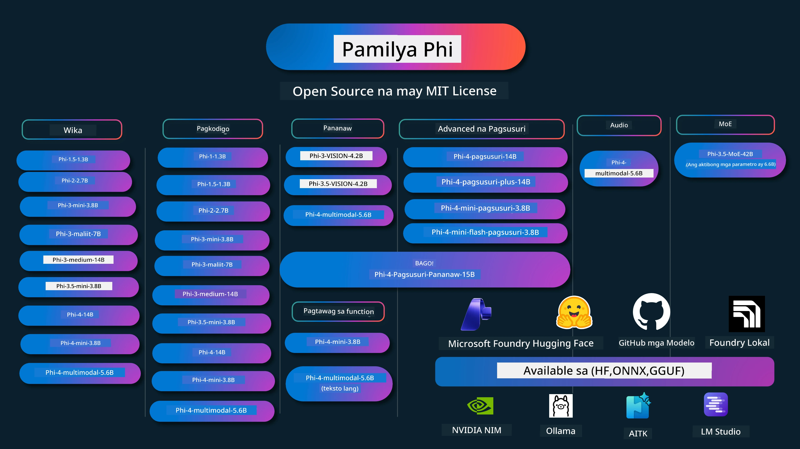

# Phi Cookbook: Mga Praktikal na Halimbawa gamit ang Phi Models ng Microsoft

[](https://codespaces.new/microsoft/phicookbook)
[](https://vscode.dev/redirect?url=vscode://ms-vscode-remote.remote-containers/cloneInVolume?url=https://github.com/microsoft/phicookbook)

[](https://GitHub.com/microsoft/phicookbook/graphs/contributors/?WT.mc_id=aiml-137032-kinfeylo)
[](https://GitHub.com/microsoft/phicookbook/issues/?WT.mc_id=aiml-137032-kinfeylo)
[](https://GitHub.com/microsoft/phicookbook/pulls/?WT.mc_id=aiml-137032-kinfeylo)
[](http://makeapullrequest.com?WT.mc_id=aiml-137032-kinfeylo)

[](https://GitHub.com/microsoft/phicookbook/watchers/?WT.mc_id=aiml-137032-kinfeylo)
[](https://GitHub.com/microsoft/phicookbook/network/?WT.mc_id=aiml-137032-kinfeylo)
[](https://GitHub.com/microsoft/phicookbook/stargazers/?WT.mc_id=aiml-137032-kinfeylo)

[](https://discord.com/invite/ByRwuEEgH4)

Ang Phi ay isang serye ng mga bukas na pinagmulan ng mga modelo ng AI na binuo ng Microsoft.

Sa kasalukuyan, ang Phi ang pinaka-makapangyarihan at murang maliit na modelo ng wika (SLM), na may napakagandang benchmark sa multi-wika, pangangatwiran, paglikha ng teksto/chat, pag-coding, mga imahe, audio at iba pang mga sitwasyon.

Maaari mong i-deploy ang Phi sa cloud o sa mga edge device, at madali kang makakagawa ng mga generative AI application gamit ang limitadong kapangyarihan sa kompyutasyon.

Sundin ang mga hakbang na ito upang makapagsimula sa paggamit ng mga mapagkukunang ito:
1. **I-fork ang Repositoryo**: I-click ang [](https://GitHub.com/microsoft/phicookbook/network/?WT.mc_id=aiml-137032-kinfeylo)
2. **I-clone ang Repositoryo**: `git clone https://github.com/microsoft/PhiCookBook.git`
3. [**Sumali sa Microsoft AI Discord Community at makipagkilala sa mga eksperto at kapwa developer**](https://discord.com/invite/ByRwuEEgH4?WT.mc_id=aiml-137032-kinfeylo)



### 🌐 Suporta sa Maraming Wika

#### Mga pagsasalin na pinananatili gamit ang [Co-op Translator](https://github.com/Azure/co-op-translator)

<!-- CO-OP TRANSLATOR LANGUAGES TABLE START -->
[Arabic](../ar/README.md) | [Bengali](../bn/README.md) | [Bulgarian](../bg/README.md) | [Burmese (Myanmar)](../my/README.md) | [Chinese (Simplified)](../zh-CN/README.md) | [Chinese (Traditional, Hong Kong)](../zh-HK/README.md) | [Chinese (Traditional, Macau)](../zh-MO/README.md) | [Chinese (Traditional, Taiwan)](../zh-TW/README.md) | [Croatian](../hr/README.md) | [Czech](../cs/README.md) | [Danish](../da/README.md) | [Dutch](../nl/README.md) | [Estonian](../et/README.md) | [Finnish](../fi/README.md) | [French](../fr/README.md) | [German](../de/README.md) | [Greek](../el/README.md) | [Hebrew](../he/README.md) | [Hindi](../hi/README.md) | [Hungarian](../hu/README.md) | [Indonesian](../id/README.md) | [Italian](../it/README.md) | [Japanese](../ja/README.md) | [Kannada](../kn/README.md) | [Khmer](../km/README.md) | [Korean](../ko/README.md) | [Lithuanian](../lt/README.md) | [Malay](../ms/README.md) | [Malayalam](../ml/README.md) | [Marathi](../mr/README.md) | [Nepali](../ne/README.md) | [Nigerian Pidgin](../pcm/README.md) | [Norwegian](../no/README.md) | [Persian (Farsi)](../fa/README.md) | [Polish](../pl/README.md) | [Portuguese (Brazil)](../pt-BR/README.md) | [Portuguese (Portugal)](../pt-PT/README.md) | [Punjabi (Gurmukhi)](../pa/README.md) | [Romanian](../ro/README.md) | [Russian](../ru/README.md) | [Serbian (Cyrillic)](../sr/README.md) | [Slovak](../sk/README.md) | [Slovenian](../sl/README.md) | [Spanish](../es/README.md) | [Swahili](../sw/README.md) | [Swedish](../sv/README.md) | [Tagalog (Filipino)](./README.md) | [Tamil](../ta/README.md) | [Telugu](../te/README.md) | [Thai](../th/README.md) | [Turkish](../tr/README.md) | [Ukrainian](../uk/README.md) | [Urdu](../ur/README.md) | [Vietnamese](../vi/README.md)

> **Mas gusto mo bang I-clone nang Lokal?**
>
> Ang repositoryong ito ay mayroong 50+ na pagsasalin ng wika na lubos na nagpapalaki ng laki ng pag-download. Para mag-clone nang walang mga pagsasalin, gamitin ang sparse checkout:
>
> **Bash / macOS / Linux:**
> ```bash
> git clone --filter=blob:none --sparse https://github.com/microsoft/PhiCookBook.git
> cd PhiCookBook
> git sparse-checkout set --no-cone '/*' '!translations' '!translated_images'
> ```
>
> **CMD (Windows):**
> ```cmd
> git clone --filter=blob:none --sparse https://github.com/microsoft/PhiCookBook.git
> cd PhiCookBook
> git sparse-checkout set --no-cone "/*" "!translations" "!translated_images"
> ```
>
> Ito ay nagbibigay sa iyo ng lahat ng kailangan mo upang matapos ang kurso nang mas mabilis ang pag-download.
<!-- CO-OP TRANSLATOR LANGUAGES TABLE END -->

## Talaan ng mga Nilalaman

- Panimula
  - [Maligayang pagdating sa Pamilya Phi](./md/01.Introduction/01/01.PhiFamily.md)
  - [Pag-set up ng iyong kapaligiran](./md/01.Introduction/01/01.EnvironmentSetup.md)
  - [Pag-unawa sa mga Pangunahing Teknolohiya](./md/01.Introduction/01/01.Understandingtech.md)
  - [AI Safety para sa mga Phi Models](./md/01.Introduction/01/01.AISafety.md)
  - [Suporta sa Hardware ng Phi](./md/01.Introduction/01/01.Hardwaresupport.md)
  - [Mga Phi Models & Availability sa iba't ibang platform](./md/01.Introduction/01/01.Edgeandcloud.md)
  - [Paggamit ng Guidance-ai at Phi](./md/01.Introduction/01/01.Guidance.md)
  - [Mga Modelo sa GitHub Marketplace](https://github.com/marketplace/models)
  - [Azure AI Model Catalog](https://ai.azure.com)

- Pag-infer ng Phi sa iba't ibang kapaligiran
    -  [Hugging face](./md/01.Introduction/02/01.HF.md)
    -  [GitHub Models](./md/01.Introduction/02/02.GitHubModel.md)
    -  [Microsoft Foundry Model Catalog](./md/01.Introduction/02/03.AzureAIFoundry.md)
    -  [Ollama](./md/01.Introduction/02/04.Ollama.md)
    -  [AI Toolkit VSCode (AITK)](./md/01.Introduction/02/05.AITK.md)
    -  [NVIDIA NIM](./md/01.Introduction/02/06.NVIDIA.md)
    -  [Foundry Local](./md/01.Introduction/02/07.FoundryLocal.md)

- Pag-infer sa Pamilya Phi
    - [Pag-infer ng Phi sa iOS](./md/01.Introduction/03/iOS_Inference.md)
    - [Pag-infer ng Phi sa Android](./md/01.Introduction/03/Android_Inference.md)
    - [Pag-infer ng Phi sa Jetson](./md/01.Introduction/03/Jetson_Inference.md)
    - [Pag-infer ng Phi sa AI PC](./md/01.Introduction/03/AIPC_Inference.md)
    - [Pag-infer ng Phi gamit ang Apple MLX Framework](./md/01.Introduction/03/MLX_Inference.md)
    - [Pag-infer ng Phi sa Local Server](./md/01.Introduction/03/Local_Server_Inference.md)
    - [Pag-infer ng Phi sa Remote Server gamit ang AI Toolkit](./md/01.Introduction/03/Remote_Interence.md)
    - [Pag-infer ng Phi gamit ang Rust](./md/01.Introduction/03/Rust_Inference.md)
    - [Pag-infer ng Phi--Vision sa Lokal](./md/01.Introduction/03/Vision_Inference.md)
    - [Pag-infer ng Phi gamit ang Kaito AKS, Azure Containers (opisyal na suporta)](./md/01.Introduction/03/Kaito_Inference.md)
-  [Pag-quantify ng Pamilya Phi](./md/01.Introduction/04/QuantifyingPhi.md)
    - [Pag-quantize ng Phi-3.5 / 4 gamit ang llama.cpp](./md/01.Introduction/04/UsingLlamacppQuantifyingPhi.md)
    - [Pag-quantize ng Phi-3.5 / 4 gamit ang Generative AI extensions para sa onnxruntime](./md/01.Introduction/04/UsingORTGenAIQuantifyingPhi.md)
    - [Pag-quantize ng Phi-3.5 / 4 gamit ang Intel OpenVINO](./md/01.Introduction/04/UsingIntelOpenVINOQuantifyingPhi.md)
    - [Pag-quantize ng Phi-3.5 / 4 gamit ang Apple MLX Framework](./md/01.Introduction/04/UsingAppleMLXQuantifyingPhi.md)

-  Pagsusuri sa Phi
    - [Response AI](./md/01.Introduction/05/ResponsibleAI.md)
    - [Microsoft Foundry para sa Pagsusuri](./md/01.Introduction/05/AIFoundry.md)
    - [Paggamit ng Promptflow para sa Pagsusuri](./md/01.Introduction/05/Promptflow.md)
 
- RAG gamit ang Azure AI Search
    - [Paano gamitin ang Phi-4-mini at Phi-4-multimodal (RAG) gamit ang Azure AI Search](https://github.com/microsoft/PhiCookBook/blob/main/code/06.E2E/E2E_Phi-4-RAG-Azure-AI-Search.ipynb)
    - [Zero-Cloud Local Hybrid RAG gamit ang SQLite FTS5 at phi-4-mini](https://github.com/microsoft/PhiCookBook/blob/main/code/06.E2E/E2E_Phi-4-mini_Local_Hybrid_RAG_SQLite_FTS5.ipynb)

- Mga sample ng pag-develop ng aplikasyon sa Phi
  - Mga Aplikasyong Teksto at Chat
    - Mga Phi-4 na Sample
      - [📓] [Makipag-chat gamit ang Phi-4-mini ONNX Model](./md/02.Application/01.TextAndChat/Phi4/ChatWithPhi4ONNX/README.md)
      - [Makipag-chat gamit ang Phi-4 lokal na ONNX Model .NET](../../md/04.HOL/dotnet/src/LabsPhi4-Chat-01OnnxRuntime)
      - [Chat .NET Console App gamit ang Phi-4 ONNX gamit ang Semantic Kernel](../../md/04.HOL/dotnet/src/LabsPhi4-Chat-02SK)
    - Mga Phi-3 / 3.5 na Sample
      - [Lokal na Chatbot sa browser gamit ang Phi3, ONNX Runtime Web at WebGPU](https://github.com/microsoft/onnxruntime-inference-examples/tree/main/js/chat)
      - [OpenVino Chat](./md/02.Application/01.TextAndChat/Phi3/E2E_OpenVino_Chat.md)
      - [Multi Model - Interactive Phi-3-mini at OpenAI Whisper](./md/02.Application/01.TextAndChat/Phi3/E2E_Phi-3-mini_with_whisper.md)
      - [MLFlow - Pagbuo ng wrapper at paggamit ng Phi-3 gamit ang MLFlow](./md//02.Application/01.TextAndChat/Phi3/E2E_Phi-3-MLflow.md)
      - [Optimization ng Modelo - Paano i-optimize ang Phi-3-min model para sa ONNX Runtime Web gamit ang Olive](https://github.com/microsoft/Olive/tree/main/examples/phi3)
      - [WinUI3 App gamit ang Phi-3 mini-4k-instruct-onnx](https://github.com/microsoft/Phi3-Chat-WinUI3-Sample/)
      -[WinUI3 Multi Model AI Powered Notes App Sample](https://github.com/microsoft/ai-powered-notes-winui3-sample)
      - [Fine-tune at Integrate ng custom Phi-3 models gamit ang Prompt flow](./md/02.Application/01.TextAndChat/Phi3/E2E_Phi-3-FineTuning_PromptFlow_Integration.md)
      - [Fine-tune at Integrate ng custom Phi-3 models gamit ang Prompt flow sa Microsoft Foundry](./md/02.Application/01.TextAndChat/Phi3/E2E_Phi-3-FineTuning_PromptFlow_Integration_AIFoundry.md)
      - [Pagsusuri sa Fine-tuned Phi-3 / Phi-3.5 Model sa Microsoft Foundry na nakatuon sa Mga Prinsipyo ng Responsible AI ng Microsoft](./md/02.Application/01.TextAndChat/Phi3/E2E_Phi-3-Evaluation_AIFoundry.md)
      - [📓] [Phi-3.5-mini-instruct sample sa prediksyon ng wika (Chinese/English)](./md/02.Application/01.TextAndChat/Phi3/phi3-instruct-demo.ipynb)
      - [Phi-3.5-Instruct WebGPU RAG Chatbot](./md/02.Application/01.TextAndChat/Phi3/WebGPUWithPhi35Readme.md)
      - [Paggamit ng Windows GPU upang lumikha ng Prompt flow solution gamit ang Phi-3.5-Instruct ONNX](./md/02.Application/01.TextAndChat/Phi3/UsingPromptFlowWithONNX.md)
      - [Paggamit ng Microsoft Phi-3.5 tflite upang gumawa ng Android app](./md/02.Application/01.TextAndChat/Phi3/UsingPhi35TFLiteCreateAndroidApp.md)
      - [Halimbawa ng Q&A .NET gamit ang lokal na ONNX Phi-3 model gamit ang Microsoft.ML.OnnxRuntime](../../md/04.HOL/dotnet/src/LabsPhi301)
      - [Console chat .NET app gamit ang Semantic Kernel at Phi-3](../../md/04.HOL/dotnet/src/LabsPhi302)

  - Mga Sample na Naka-base sa Azure AI Inference SDK Code
    - Mga Phi-4 Sample
      - [📓] [Gumawa ng project code gamit ang Phi-4-multimodal](./md/02.Application/02.Code/Phi4/GenProjectCode/README.md)
    - Mga Phi-3 / 3.5 Sample
      - [Bumuo ng sarili mong Visual Studio Code GitHub Copilot Chat gamit ang Microsoft Phi-3 Family](./md/02.Application/02.Code/Phi3/VSCodeExt/README.md)
      - [Gumawa ng sarili mong Visual Studio Code Chat Copilot Agent gamit ang Phi-3.5 mula sa GitHub Models](/md/02.Application/02.Code/Phi3/CreateVSCodeChatAgentWithGitHubModels.md)

  - Mga Advanced na Sample ng Pangangatwiran
    - Mga Sample ng Phi-4
      - [📓] [Mga Sample ng Phi-4-mini-reasoning o Phi-4-reasoning](./md/02.Application/03.AdvancedReasoning/Phi4/AdvancedResoningPhi4mini/README.md)
      - [📓] [Fine-tuning ng Phi-4-mini-reasoning gamit ang Microsoft Olive](./md/02.Application/03.AdvancedReasoning/Phi4/AdvancedResoningPhi4mini/olive_ft_phi_4_reasoning_with_medicaldata.ipynb)
      - [📓] [Fine-tuning ng Phi-4-mini-reasoning gamit ang Apple MLX](./md/02.Application/03.AdvancedReasoning/Phi4/AdvancedResoningPhi4mini/mlx_ft_phi_4_reasoning_with_medicaldata.ipynb)
      - [📓] [Phi-4-mini-reasoning gamit ang GitHub Models](./md/02.Application/02.Code/Phi4r/github_models_inference.ipynb)
      - [📓] [Phi-4-mini-reasoning gamit ang Microsoft Foundry Models](./md/02.Application/02.Code/Phi4r/azure_models_inference.ipynb)
  - Mga Demo
      - [Phi-4-mini demos na naka-host sa Hugging Face Spaces](https://huggingface.co/spaces/microsoft/phi-4-mini?WT.mc_id=aiml-137032-kinfeylo)
      - [Phi-4-multimodal demos na naka-host sa Hugginge Face Spaces](https://huggingface.co/spaces/microsoft/phi-4-multimodal?WT.mc_id=aiml-137032-kinfeylo)
  - Mga Sample sa Vision
    - Mga Sample ng Phi-4 
      - [📓] [Gamitin ang Phi-4-multimodal upang magbasa ng mga larawan at gumawa ng code](./md/02.Application/04.Vision/Phi4/CreateFrontend/README.md) 
    - Mga Sample ng Phi-3 / 3.5
      -  [📓][Phi-3-vision-Image na teksto sa teksto](./md/02.Application/04.Vision/Phi3/E2E_Phi-3-vision-image-text-to-text-online-endpoint.ipynb)
      - [Phi-3-vision-ONNX](https://onnxruntime.ai/docs/genai/tutorials/phi3-v.html)
      - [📓][Phi-3-vision CLIP Embedding](./md/02.Application/04.Vision/Phi3/E2E_Phi-3-vision-image-text-to-text-online-endpoint.ipynb)
      - [DEMO: Phi-3 Recycling](https://github.com/jennifermarsman/PhiRecycling/)
      - [Phi-3-vision - Visual language assistant - gamit ang Phi3-Vision at OpenVINO](https://docs.openvino.ai/nightly/notebooks/phi-3-vision-with-output.html)
      - [Phi-3 Vision Nvidia NIM](./md/02.Application/04.Vision/Phi3/E2E_Nvidia_NIM_Vision.md)
      - [Phi-3 Vision OpenVino](./md/02.Application/04.Vision/Phi3/E2E_OpenVino_Phi3Vision.md)
      - [📓][Phi-3.5 Vision multi-frame o multi-image sample](./md/02.Application/04.Vision/Phi3/phi3-vision-demo.ipynb)
      - [Phi-3 Vision Local ONNX Model gamit ang Microsoft.ML.OnnxRuntime .NET](../../md/04.HOL/dotnet/src/LabsPhi303)
      - [Menu based Phi-3 Vision Local ONNX Model gamit ang Microsoft.ML.OnnxRuntime .NET](../../md/04.HOL/dotnet/src/LabsPhi304)

  - Mga Sample sa Reasoning-Vision
    - Phi-4-Reasoning-Vision-15B 
      - [📓] [Paggamit ng Phi-4-Reasoning-Vision-15B para tuklasin ang jaywalking](./md/02.Application/10.ReasoningVision/Phi_4_reasoning_vision_15b_Jaywalking.ipynb)
      - [📓] [Paggamit ng Phi-4-Reasoning-Vision-15B para sa matematika](./md/02.Application/10.ReasoningVision/Phi_4_reasoning_vision_15b_Math.ipynb)
      - [📓] [Paggamit ng Phi-4-Reasoning-Vision-15B para tuklasin ang UI](./md/02.Application/10.ReasoningVision/Phi_4_reasoning_vision_15b_ui.ipynb)

  - Mga Sample sa Matematika
    -  Mga Sample ng Phi-4-Mini-Flash-Reasoning-Instruct  [Math Demo gamit ang Phi-4-Mini-Flash-Reasoning-Instruct](./md/02.Application/09.Math/MathDemo.ipynb)

  - Mga Sample sa Audio
    - Mga Sample ng Phi-4 
      - [📓] [Pagkuha ng mga transcript ng audio gamit ang Phi-4-multimodal](./md/02.Application/05.Audio/Phi4/Transciption/README.md)
      - [📓] [Phi-4-multimodal Audio Sample](./md/02.Application/05.Audio/Phi4/Siri/demo.ipynb)
      - [📓] [Phi-4-multimodal Speech Translation Sample](./md/02.Application/05.Audio/Phi4/Translate/demo.ipynb)
      - [.NET console application gamit ang Phi-4-multimodal Audio upang suriin ang isang audio file at gumawa ng transcript](../../md/04.HOL/dotnet/src/LabsPhi4-MultiModal-02Audio)

  - Mga Sample ng MOE
    - Mga Sample ng Phi-3 / 3.5
      - [📓] [Phi-3.5 Mixture of Experts Models (MoEs) Social Media Sample](./md/02.Application/06.MoE/Phi3/phi3_moe_demo.ipynb)
      - [📓] [Pagtatayo ng Retrieval-Augmented Generation (RAG) Pipeline gamit ang NVIDIA NIM Phi-3 MOE, Azure AI Search, at LlamaIndex](./md/02.Application/06.MoE/Phi3/azure-ai-search-nvidia-rag.ipynb)
      - 
  - Mga Sample ng Function Calling
    - Mga Sample ng Phi-4 🆕
      -  [📓] [Paggamit ng Function Calling Gamit ang Phi-4-mini](./md/02.Application/07.FunctionCalling/Phi4/FunctionCallingBasic/README.md)
      -  [📓] [Paggamit ng Function Calling upang lumikha ng mga multi-agents Gamit ang Phi-4-mini](./md/02.Application/07.FunctionCalling/Phi4/Multiagents/Phi_4_mini_multiagent.ipynb)
      -  [📓] [Paggamit ng Function Calling kasama ang Ollama](./md/02.Application/07.FunctionCalling/Phi4/Ollama/ollama_functioncalling.ipynb)
      -  [📓] [Paggamit ng Function Calling kasama ang ONNX](./md/02.Application/07.FunctionCalling/Phi4/ONNX/onnx_parallel_functioncalling.ipynb)
  - Mga Sample ng Multimodal Mixing
    - Mga Sample ng Phi-4 🆕
      -  [📓] [Paggamit ng Phi-4-multimodal bilang isang Technology journalist](./md/02.Application/08.Multimodel/Phi4/TechJournalist/phi_4_mm_audio_text_publish_news.ipynb)
      - [.NET console application gamit ang Phi-4-multimodal upang suriin ang mga larawan](../../md/04.HOL/dotnet/src/LabsPhi4-MultiModal-01Images)

- Fine-tuning ng Mga Sample ng Phi
  - [Mga Senaryo sa Fine-tuning](./md/03.FineTuning/FineTuning_Scenarios.md)
  - [Fine-tuning laban sa RAG](./md/03.FineTuning/FineTuning_vs_RAG.md)
  - [Fine-tuning Hayaan ang Phi-3 maging isang eksperto sa industriya](./md/03.FineTuning/LetPhi3gotoIndustriy.md)
  - [Fine-tuning ng Phi-3 gamit ang AI Toolkit para sa VS Code](./md/03.FineTuning/Finetuning_VSCodeaitoolkit.md)
  - [Fine-tuning ng Phi-3 gamit ang Azure Machine Learning Service](./md/03.FineTuning/Introduce_AzureML.md)
  - [Fine-tuning ng Phi-3 gamit ang Lora](./md/03.FineTuning/FineTuning_Lora.md)
  - [Fine-tuning ng Phi-3 gamit ang QLora](./md/03.FineTuning/FineTuning_Qlora.md)
  - [Fine-tuning ng Phi-3 gamit ang Microsoft Foundry](./md/03.FineTuning/FineTuning_AIFoundry.md)
  - [Fine-tuning ng Phi-3 gamit ang Azure ML CLI/SDK](./md/03.FineTuning/FineTuning_MLSDK.md)
  - [Fine-tuning gamit ang Microsoft Olive](./md/03.FineTuning/FineTuning_MicrosoftOlive.md)
  - [Fine-tuning gamit ang Microsoft Olive Hands-On Lab](./md/03.FineTuning/olive-lab/readme.md)
  - [Fine-tuning ng Phi-3-vision gamit ang Weights and Bias](./md/03.FineTuning/FineTuning_Phi-3-visionWandB.md)
  - [Fine-tuning ng Phi-3 gamit ang Apple MLX Framework](./md/03.FineTuning/FineTuning_MLX.md)
  - [Fine-tuning ng Phi-3-vision (opisyal na suporta)](./md/03.FineTuning/FineTuning_Vision.md)
  - [Fine-Tuning ng Phi-3 gamit ang Kaito AKS , Azure Containers(opisyal na Suporta)](./md/03.FineTuning/FineTuning_Kaito.md)
  - [Fine-Tuning ng Phi-3 at 3.5 Vision](https://github.com/2U1/Phi3-Vision-Finetune)

- Hands on Lab
  - [Pagsusuri ng mga makabagong modelo: LLMs, SLMs, lokal na pag-develop at iba pa](https://github.com/microsoft/aitour-exploring-cutting-edge-models)
  - [Pagbubukas ng Potensyal ng NLP: Fine-Tuning kasama ang Microsoft Olive](https://github.com/azure/Ignite_FineTuning_workshop)

- Academic Research Papers and Publications
  - [Textbooks Are All You Need II: phi-1.5 technical report](https://arxiv.org/abs/2309.05463)
  - [Phi-3 Technical Report: Isang Napakalakas na Modelong Wika Lokal sa Iyong Telepono](https://arxiv.org/abs/2404.14219)
  - [Phi-4 Technical Report](https://arxiv.org/abs/2412.08905)
  - [Phi-4-Mini Technical Report: Maliit ngunit Malakas na Multimodal Language Models sa pamamagitan ng Mixture-of-LoRAs](https://arxiv.org/abs/2503.01743)
  - [Pag-optimize ng Maliit na Modelong Wika para sa In-Vehicle Function-Calling](https://arxiv.org/abs/2501.02342)
  - [(WhyPHI) Fine-Tuning PHI-3 para sa Multiple-Choice Question Answering: Metodolohiya, Resulta, at Mga Hamon](https://arxiv.org/abs/2501.01588)
  - [Phi-4-reasoning Technical Report](https://www.microsoft.com/en-us/research/wp-content/uploads/2025/04/phi_4_reasoning.pdf)
  - [Phi-4-mini-reasoning Technical Report](https://huggingface.co/microsoft/Phi-4-mini-reasoning/blob/main/Phi-4-Mini-Reasoning.pdf)

## Paggamit ng Mga Modelo ng Phi

### Phi sa Microsoft Foundry

Maaari mong matutunan kung paano gamitin ang Microsoft Phi at kung paano bumuo ng E2E solutions sa iyong iba't ibang hardware devices. Upang maranasan ang Phi para sa iyong sarili, simulan sa paglalaro ng mga modelo at pag-customize ng Phi para sa iyong mga senaryo gamit ang [Microsoft Foundry Azure AI Model Catalog](https://aka.ms/phi3-azure-ai) maaari kang matuto pa sa Getting Started with [Microsoft Foundry](/md/02.QuickStart/AzureAIFoundry_QuickStart.md)

**Playground**
Bawat modelo ay may dedikadong playground upang subukan ang modelo [Azure AI Playground](https://aka.ms/try-phi3).

### Phi sa GitHub Models

Maaari mong matutunan kung paano gamitin ang Microsoft Phi at kung paano bumuo ng E2E solutions sa iyong iba't ibang hardware devices. Upang maranasan ang Phi para sa iyong sarili, simulan sa paglalaro ng modelo at pag-customize ng Phi para sa iyong mga senaryo gamit ang [GitHub Model Catalog](https://github.com/marketplace/models?WT.mc_id=aiml-137032-kinfeylo) maaari kang matuto pa sa Getting Started with [GitHub Model Catalog](/md/02.QuickStart/GitHubModel_QuickStart.md)

**Playground**
Bawat modelo ay may dedikadong [playground upang subukan ang modelo](/md/02.QuickStart/GitHubModel_QuickStart.md).

### Phi sa Hugging Face

Maaari mo ring makita ang modelo sa [Hugging Face](https://huggingface.co/microsoft)

**Playground**
 [Hugging Chat playground](https://huggingface.co/chat/models/microsoft/Phi-3-mini-4k-instruct)

 ## 🎒 Iba Pang Kurso

Gumagawa ang aming koponan ng iba pang mga kurso! Suriin:

<!-- CO-OP TRANSLATOR OTHER COURSES START -->
### LangChain
[](https://aka.ms/langchain4j-for-beginners)
[](https://aka.ms/langchainjs-for-beginners?WT.mc_id=m365-94501-dwahlin)
[](https://github.com/microsoft/langchain-for-beginners?WT.mc_id=m365-94501-dwahlin)
---

### Azure / Edge / MCP / Agents
[](https://github.com/microsoft/AZD-for-beginners?WT.mc_id=academic-105485-koreyst)
[](https://github.com/microsoft/edgeai-for-beginners?WT.mc_id=academic-105485-koreyst)
[](https://github.com/microsoft/mcp-for-beginners?WT.mc_id=academic-105485-koreyst)
[](https://github.com/microsoft/ai-agents-for-beginners?WT.mc_id=academic-105485-koreyst)

---
 
### Generative AI Series
[](https://github.com/microsoft/generative-ai-for-beginners?WT.mc_id=academic-105485-koreyst)
[-9333EA?style=for-the-badge&labelColor=E5E7EB&color=9333EA)](https://github.com/microsoft/Generative-AI-for-beginners-dotnet?WT.mc_id=academic-105485-koreyst)
[-C084FC?style=for-the-badge&labelColor=E5E7EB&color=C084FC)](https://github.com/microsoft/generative-ai-for-beginners-java?WT.mc_id=academic-105485-koreyst)
[-E879F9?style=for-the-badge&labelColor=E5E7EB&color=E879F9)](https://github.com/microsoft/generative-ai-with-javascript?WT.mc_id=academic-105485-koreyst)

---
 
### Pangunahing Pag-aaral
[](https://aka.ms/ml-beginners?WT.mc_id=academic-105485-koreyst)
[](https://aka.ms/datascience-beginners?WT.mc_id=academic-105485-koreyst)
[](https://aka.ms/ai-beginners?WT.mc_id=academic-105485-koreyst)
[](https://github.com/microsoft/Security-101?WT.mc_id=academic-96948-sayoung)
[](https://aka.ms/webdev-beginners?WT.mc_id=academic-105485-koreyst)
[](https://aka.ms/iot-beginners?WT.mc_id=academic-105485-koreyst)
[](https://github.com/microsoft/xr-development-for-beginners?WT.mc_id=academic-105485-koreyst)

---
 
### Copilot Series
[](https://aka.ms/GitHubCopilotAI?WT.mc_id=academic-105485-koreyst)
[](https://github.com/microsoft/mastering-github-copilot-for-dotnet-csharp-developers?WT.mc_id=academic-105485-koreyst)
[](https://github.com/microsoft/CopilotAdventures?WT.mc_id=academic-105485-koreyst)
<!-- CO-OP TRANSLATOR OTHER COURSES END -->

## Responsible AI 

Nakatuon ang Microsoft na tulungan ang aming mga kostumer na gamitin nang responsable ang aming mga produkto ng AI, ibahagi ang aming mga natutunan, at bumuo ng mga partnership na batay sa tiwala sa pamamagitan ng mga kasangkapan tulad ng Transparency Notes at Impact Assessments. Marami sa mga resources na ito ay matatagpuan sa [https://aka.ms/RAI](https://aka.ms/RAI).
Ang pamamaraan ng Microsoft sa responsable AI ay nakabase sa aming mga prinsipyo ng AI tungkol sa katarungan, pagiging maaasahan at kaligtasan, privacy at seguridad, inklusibidad, transparency, at pananagutan.

Ang malalaking modelo ng natural language, imahe, at pagsasalita - tulad ng mga ginamit sa sample na ito - ay maaaring kumilos sa mga paraan na hindi patas, hindi maaasahan, o nakakasakit, na maaaring magdulot ng pinsala. Mangyaring sumangguni sa [Azure OpenAI service Transparency note](https://learn.microsoft.com/legal/cognitive-services/openai/transparency-note?tabs=text) upang maging maalam tungkol sa mga panganib at limitasyon.

Ang inirerekomendang paraan upang mabawasan ang mga panganib na ito ay ang paglalagay ng isang systema ng kaligtasan sa iyong arkitektura na kayang tuklasin at pigilan ang mapanganib na kilos. Nagbibigay ang [Azure AI Content Safety](https://learn.microsoft.com/azure/ai-services/content-safety/overview) ng isang independiyenteng antas ng proteksyon, na kayang tuklasin ang mapanganib na nilalaman na ginawa ng mga gumagamit at AI sa mga aplikasyon at serbisyo. Kasama sa Azure AI Content Safety ang mga text at image API na nagpapahintulot sa iyo na matukoy ang mga materyal na nakasasama. Sa loob ng Microsoft Foundry, ang serbisyo ng Content Safety ay nagpapahintulot sa iyo na makita, tuklasin, at subukan ang sample code para sa pagtuklas ng mapanganib na nilalaman sa iba't ibang modalidad. Ang sumusunod na [quickstart documentation](https://learn.microsoft.com/azure/ai-services/content-safety/quickstart-text?tabs=visual-studio%2Clinux&pivots=programming-language-rest) ay gagabay sa iyo sa paggawa ng mga kahilingan sa serbisyo.

Isa pang aspeto na dapat isaalang-alang ay ang pangkalahatang performance ng aplikasyon. Sa mga multi-modal at multi-model na aplikasyon, itinuturing naming ang performance bilang ang sistema ay gumaganap ayon sa inaasahan mo at ng iyong mga gumagamit, kabilang na ang hindi paglikha ng mapanganib na outputs. Mahalaga ang pagtaya sa performance ng iyong pangkalahatang aplikasyon gamit ang [Performance and Quality and Risk and Safety evaluators](https://learn.microsoft.com/azure/ai-studio/concepts/evaluation-metrics-built-in). Mayroon ka ring kakayahang gumawa at mag-evaluate gamit ang [custom evaluators](https://learn.microsoft.com/azure/ai-studio/how-to/develop/evaluate-sdk#custom-evaluators).

Maaari mong suriin ang iyong AI na aplikasyon sa iyong development environment gamit ang [Azure AI Evaluation SDK](https://microsoft.github.io/promptflow/index.html). Sa ibinigay na test dataset o target, ang mga generative AI na output ng iyong aplikasyon ay sinusukat nang kwantitatibo gamit ang mga built-in evaluators o mga custom evaluators na iyong pipiliin. Upang magsimula gamit ang azure ai evaluation sdk para suriin ang iyong sistema, maaari mong sundan ang [quickstart guide](https://learn.microsoft.com/azure/ai-studio/how-to/develop/flow-evaluate-sdk). Kapag naisagawa mo na ang evaluation run, maaari mong [i-visualize ang mga resulta sa Microsoft Foundry](https://learn.microsoft.com/azure/ai-studio/how-to/evaluate-flow-results).

## Mga Trademark

Ang proyektong ito ay maaaring maglaman ng mga trademark o logo para sa mga proyekto, produkto, o serbisyo. Ang awtorisadong paggamit ng mga trademark o logo ng Microsoft ay nakaayon at dapat sundin ang [Microsoft's Trademark & Brand Guidelines](https://www.microsoft.com/legal/intellectualproperty/trademarks/usage/general).
Ang paggamit ng mga trademark o logo ng Microsoft sa mga binagong bersyon ng proyektong ito ay hindi dapat magdulot ng kalituhan o magpahiwatig ng sponsorship ng Microsoft. Anumang paggamit ng mga trademark o logo ng third-party ay napapailalim sa mga patakaran ng mga third-party na ito.

## Pagkuha ng Tulong

Kung ikaw ay na-stuck o may mga katanungan tungkol sa paggawa ng AI apps, sumali sa:

[](https://aka.ms/foundry/discord)

Kung mayroon kang feedback o mga error habang gumagawa, bisitahin:

[](https://aka.ms/foundry/forum)

---

<!-- CO-OP TRANSLATOR DISCLAIMER START -->
**Pagtatanggi**:
Ang dokumentong ito ay isinalin gamit ang serbisyo ng AI translation na [Co-op Translator](https://github.com/Azure/co-op-translator). Bagama't nagsusumikap kami para sa katumpakan, pakatandaan na ang awtomatikong pagsasalin ay maaaring maglaman ng mga pagkakamali o hindi pagkakatugma. Ang orihinal na dokumento sa orihinal nitong wika ang dapat ituring na pangunahing sanggunian. Para sa mahahalagang impormasyon, inirerekomenda ang propesyonal na pagsasalin ng tao. Hindi kami mananagot sa anumang maling pagkakaintindi o maling interpretasyon na nagmula sa paggamit ng pagsasaling ito.
<!-- CO-OP TRANSLATOR DISCLAIMER END -->