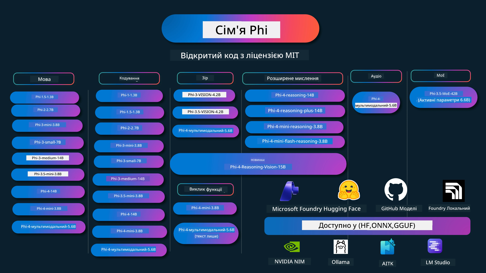

# Phi Cookbook: Практичні приклади з моделями Microsoft Phi

[](https://codespaces.new/microsoft/phicookbook)
[](https://vscode.dev/redirect?url=vscode://ms-vscode-remote.remote-containers/cloneInVolume?url=https://github.com/microsoft/phicookbook)

[](https://GitHub.com/microsoft/phicookbook/graphs/contributors/?WT.mc_id=aiml-137032-kinfeylo)
[](https://GitHub.com/microsoft/phicookbook/issues/?WT.mc_id=aiml-137032-kinfeylo)
[](https://GitHub.com/microsoft/phicookbook/pulls/?WT.mc_id=aiml-137032-kinfeylo)
[](http://makeapullrequest.com?WT.mc_id=aiml-137032-kinfeylo)

[](https://GitHub.com/microsoft/phicookbook/watchers/?WT.mc_id=aiml-137032-kinfeylo)
[](https://GitHub.com/microsoft/phicookbook/network/?WT.mc_id=aiml-137032-kinfeylo)
[](https://GitHub.com/microsoft/phicookbook/stargazers/?WT.mc_id=aiml-137032-kinfeylo)

[](https://discord.com/invite/ByRwuEEgH4)

Phi — це серія моделей штучного інтелекту з відкритим вихідним кодом, розроблених Microsoft.

Phi наразі є найпотужнішою та найбільш економічною малою мовною моделлю (SLM), з дуже хорошими показниками для багатомовності, логіки, генерації текстів/чатів, програмування, зображень, аудіо та інших сценаріїв.

Ви можете розгортати Phi в хмарі або на пристроях на краю мережі, а також легко створювати генеративні AI додатки з обмеженою обчислювальною потужністю.

Дотримуйтесь цих кроків, щоб почати користуватися цими ресурсами:
1. **Форкніть репозиторій**: Клацніть [](https://GitHub.com/microsoft/phicookbook/network/?WT.mc_id=aiml-137032-kinfeylo)
2. **Клонуйте репозиторій**: `git clone https://github.com/microsoft/PhiCookBook.git`
3. [**Приєднайтесь до спільноти Microsoft AI Discord і зустріньте експертів та колег-розробників**](https://discord.com/invite/ByRwuEEgH4?WT.mc_id=aiml-137032-kinfeylo)



### 🌐 Підтримка багатьох мов

#### Підтримується через GitHub Action (автоматично і завжди актуально)

<!-- CO-OP TRANSLATOR LANGUAGES TABLE START -->
[Арабська](../ar/README.md) | [Бенгальська](../bn/README.md) | [Болгарська](../bg/README.md) | [Бирманська (М’янма)](../my/README.md) | [Китайська (спрощена)](../zh-CN/README.md) | [Китайська (традиційна, Гонконг)](../zh-HK/README.md) | [Китайська (традиційна, Макао)](../zh-MO/README.md) | [Китайська (традиційна, Тайвань)](../zh-TW/README.md) | [Хорватська](../hr/README.md) | [Чеська](../cs/README.md) | [Данська](../da/README.md) | [Нідерландська](../nl/README.md) | [Естонська](../et/README.md) | [Фінська](../fi/README.md) | [Французька](../fr/README.md) | [Німецька](../de/README.md) | [Грецька](../el/README.md) | [Іврит](../he/README.md) | [Хінді](../hi/README.md) | [Угорська](../hu/README.md) | [Індонезійська](../id/README.md) | [Італійська](../it/README.md) | [Японська](../ja/README.md) | [Каннада](../kn/README.md) | [Кхмерська](../km/README.md) | [Корейська](../ko/README.md) | [Литовська](../lt/README.md) | [Малайська](../ms/README.md) | [Малаялам](../ml/README.md) | [Манітіпурі (Мейтей Майєк)](../mni/README.md) | [Маратхі](../mr/README.md) | [Непальська](../ne/README.md) | [Нігерійський підінг](../pcm/README.md) | [Норвезька](../no/README.md) | [Перська (фарсі)](../fa/README.md) | [Польська](../pl/README.md) | [Португальська (Бразилія)](../pt-BR/README.md) | [Португальська (Португалія)](../pt-PT/README.md) | [Пенджабі (Гурмухі)](../pa/README.md) | [Румунська](../ro/README.md) | [Російська](../ru/README.md) | [Сербська (кирилиця)](../sr/README.md) | [Словацька](../sk/README.md) | [Словенська](../sl/README.md) | [Іспанська](../es/README.md) | [Суахілі](../sw/README.md) | [Шведська](../sv/README.md) | [Тагальська (філіппінська)](../tl/README.md) | [Тамільська](../ta/README.md) | [Телугу](../te/README.md) | [Тайська](../th/README.md) | [Турецька](../tr/README.md) | [Українська](./README.md) | [Урду](../ur/README.md) | [В’єтнамська](../vi/README.md)

> **Віддаєте перевагу локальному клонуванню?**
>
> Цей репозиторій містить понад 50 мовних перекладів, що суттєво збільшує розмір завантаження. Щоб клонувати без перекладів, використовуйте sparse checkout:
>
> **Bash / macOS / Linux:**
> ```bash
> git clone --filter=blob:none --sparse https://github.com/microsoft/PhiCookBook.git
> cd PhiCookBook
> git sparse-checkout set --no-cone '/*' '!translations' '!translated_images'
> ```
>
> **CMD (Windows):**
> ```cmd
> git clone --filter=blob:none --sparse https://github.com/microsoft/PhiCookBook.git
> cd PhiCookBook
> git sparse-checkout set --no-cone "/*" "!translations" "!translated_images"
> ```
>
> Це дасть вам усе необхідне для проходження курсу з набагато швидшим завантаженням.
<!-- CO-OP TRANSLATOR LANGUAGES TABLE END -->

## Зміст

- Вступ
  - [Ласкаво просимо до сім’ї Phi](./md/01.Introduction/01/01.PhiFamily.md)
  - [Налаштування вашого середовища](./md/01.Introduction/01/01.EnvironmentSetup.md)
  - [Розуміння ключових технологій](./md/01.Introduction/01/01.Understandingtech.md)
  - [Безпека ШІ для моделей Phi](./md/01.Introduction/01/01.AISafety.md)
  - [Підтримка апаратного забезпечення Phi](./md/01.Introduction/01/01.Hardwaresupport.md)
  - [Моделі Phi та їх доступність на платформах](./md/01.Introduction/01/01.Edgeandcloud.md)
  - [Використання Guidance-ai та Phi](./md/01.Introduction/01/01.Guidance.md)
  - [Моделі на GitHub Marketplace](https://github.com/marketplace/models)
  - [Каталог моделей Azure AI](https://ai.azure.com)

- Виконання моделювання Phi у різних середовищах
    -  [Hugging face](./md/01.Introduction/02/01.HF.md)
    -  [Моделі GitHub](./md/01.Introduction/02/02.GitHubModel.md)
    -  [Каталог моделей Microsoft Foundry](./md/01.Introduction/02/03.AzureAIFoundry.md)
    -  [Ollama](./md/01.Introduction/02/04.Ollama.md)
    -  [AI Toolkit VSCode (AITK)](./md/01.Introduction/02/05.AITK.md)
    -  [NVIDIA NIM](./md/01.Introduction/02/06.NVIDIA.md)
    -  [Foundry Local](./md/01.Introduction/02/07.FoundryLocal.md)

- Виконання моделювання сім’ї Phi
    - [Виконання Phi на iOS](./md/01.Introduction/03/iOS_Inference.md)
    - [Виконання Phi на Android](./md/01.Introduction/03/Android_Inference.md)
    - [Виконання Phi на Jetson](./md/01.Introduction/03/Jetson_Inference.md)
    - [Виконання Phi на AI ПК](./md/01.Introduction/03/AIPC_Inference.md)
    - [Виконання Phi з використанням Apple MLX Framework](./md/01.Introduction/03/MLX_Inference.md)
    - [Виконання Phi на локальному сервері](./md/01.Introduction/03/Local_Server_Inference.md)
    - [Виконання Phi на віддаленому сервері з AI Toolkit](./md/01.Introduction/03/Remote_Interence.md)
    - [Виконання Phi з Rust](./md/01.Introduction/03/Rust_Inference.md)
    - [Виконання Phi–Vision локально](./md/01.Introduction/03/Vision_Inference.md)
    - [Виконання Phi з Kaito AKS, Azure Containers (офіційна підтримка)](./md/01.Introduction/03/Kaito_Inference.md)
-  [Квантифікація сім’ї Phi](./md/01.Introduction/04/QuantifyingPhi.md)
    - [Квантифікація Phi-3.5 / 4 за допомогою llama.cpp](./md/01.Introduction/04/UsingLlamacppQuantifyingPhi.md)
    - [Квантифікація Phi-3.5 / 4 за допомогою розширень Generative AI для onnxruntime](./md/01.Introduction/04/UsingORTGenAIQuantifyingPhi.md)
    - [Квантифікація Phi-3.5 / 4 за допомогою Intel OpenVINO](./md/01.Introduction/04/UsingIntelOpenVINOQuantifyingPhi.md)
    - [Квантифікація Phi-3.5 / 4 за допомогою Apple MLX Framework](./md/01.Introduction/04/UsingAppleMLXQuantifyingPhi.md)

-  Оцінка Phi
    - [Response AI](./md/01.Introduction/05/ResponsibleAI.md)
    - [Microsoft Foundry для оцінки](./md/01.Introduction/05/AIFoundry.md)
    - [Використання Promptflow для оцінки](./md/01.Introduction/05/Promptflow.md)
 
- RAG з Azure AI Search
    - [Як використовувати Phi-4-mini та Phi-4-мультимодальну (RAG) з Azure AI Search](https://github.com/microsoft/PhiCookBook/blob/main/code/06.E2E/E2E_Phi-4-RAG-Azure-AI-Search.ipynb)
    - [Zero-Cloud Local Hybrid RAG з SQLite FTS5 та phi-4-mini](https://github.com/microsoft/PhiCookBook/blob/main/code/06.E2E/E2E_Phi-4-mini_Local_Hybrid_RAG_SQLite_FTS5.ipynb)

- Приклади розробки додатків Phi
  - Текстові та чат-застосунки
    - Приклади Phi-4
      - [📓] [Спілкування з моделлю Phi-4-mini ONNX](./md/02.Application/01.TextAndChat/Phi4/ChatWithPhi4ONNX/README.md)
      - [Чат з місцевою моделлю Phi-4 ONNX .NET](../../md/04.HOL/dotnet/src/LabsPhi4-Chat-01OnnxRuntime)
      - [Консольний чат .NET з Phi-4 ONNX за допомогою Semantic Kernel](../../md/04.HOL/dotnet/src/LabsPhi4-Chat-02SK)
    - Приклади Phi-3 / 3.5
      - [Локальний чат-бот у браузері з використанням Phi3, ONNX Runtime Web та WebGPU](https://github.com/microsoft/onnxruntime-inference-examples/tree/main/js/chat)
      - [OpenVino Чат](./md/02.Application/01.TextAndChat/Phi3/E2E_OpenVino_Chat.md)
      - [Мультимодель — інтерактивний Phi-3-mini і OpenAI Whisper](./md/02.Application/01.TextAndChat/Phi3/E2E_Phi-3-mini_with_whisper.md)
      - [MLFlow — створення обгортки та використання Phi-3 з MLFlow](./md//02.Application/01.TextAndChat/Phi3/E2E_Phi-3-MLflow.md)
      - [Оптимізація моделі — як оптимізувати модель Phi-3-min для ONNX Runtime Web з Olive](https://github.com/microsoft/Olive/tree/main/examples/phi3)
      - [Додаток WinUI3 з Phi-3 mini-4k-instruct-onnx](https://github.com/microsoft/Phi3-Chat-WinUI3-Sample/)
      -[Приклад додатку WinUI3 Multi Model AI Powered Notes](https://github.com/microsoft/ai-powered-notes-winui3-sample)
      - [Тонке налаштування та інтеграція кастомних моделей Phi-3 з Prompt flow](./md/02.Application/01.TextAndChat/Phi3/E2E_Phi-3-FineTuning_PromptFlow_Integration.md)
      - [Тонке налаштування та інтеграція кастомних моделей Phi-3 з Prompt flow у Microsoft Foundry](./md/02.Application/01.TextAndChat/Phi3/E2E_Phi-3-FineTuning_PromptFlow_Integration_AIFoundry.md)
      - [Оцінка тонко налаштованих моделей Phi-3 / Phi-3.5 у Microsoft Foundry з акцентом на принципи відповідального ШІ Microsoft](./md/02.Application/01.TextAndChat/Phi3/E2E_Phi-3-Evaluation_AIFoundry.md)
      - [📓] [Приклад мовного прогнозування Phi-3.5-mini-instruct (китайська/англійська)](./md/02.Application/01.TextAndChat/Phi3/phi3-instruct-demo.ipynb)
      - [Phi-3.5-Instruct WebGPU RAG Чат-бот](./md/02.Application/01.TextAndChat/Phi3/WebGPUWithPhi35Readme.md)
      - [Використання Windows GPU для створення рішення Prompt flow з Phi-3.5-Instruct ONNX](./md/02.Application/01.TextAndChat/Phi3/UsingPromptFlowWithONNX.md)
      - [Використання Microsoft Phi-3.5 tflite для створення додатку Android](./md/02.Application/01.TextAndChat/Phi3/UsingPhi35TFLiteCreateAndroidApp.md)
      - [Приклад Q&A .NET з використанням локальної моделі ONNX Phi-3 та Microsoft.ML.OnnxRuntime](../../md/04.HOL/dotnet/src/LabsPhi301)
      - [Консольний чат .NET додаток з Semantic Kernel та Phi-3](../../md/04.HOL/dotnet/src/LabsPhi302)

  - Приклади на базі Azure AI Inference SDK
    - Приклади Phi-4
      - [📓] [Генерація коду проекту з використанням Phi-4-мультимодального](./md/02.Application/02.Code/Phi4/GenProjectCode/README.md)
    - Приклади Phi-3 / 3.5
      - [Створіть власний Visual Studio Code GitHub Copilot Chat з сім’єю Microsoft Phi-3](./md/02.Application/02.Code/Phi3/VSCodeExt/README.md)
      - [Створення власного агента чат-копілота Visual Studio Code з Phi-3.5 за допомогою моделей GitHub](/md/02.Application/02.Code/Phi3/CreateVSCodeChatAgentWithGitHubModels.md)

  - Приклади розширеного логічного мислення
    - Приклади Phi-4
      - [📓] [Приклади Phi-4-mini-reasoning або Phi-4-reasoning](./md/02.Application/03.AdvancedReasoning/Phi4/AdvancedResoningPhi4mini/README.md)
      - [📓] [Тонке налаштування Phi-4-mini-reasoning за допомогою Microsoft Olive](./md/02.Application/03.AdvancedReasoning/Phi4/AdvancedResoningPhi4mini/olive_ft_phi_4_reasoning_with_medicaldata.ipynb)
      - [📓] [Тонке налаштування Phi-4-mini-reasoning за допомогою Apple MLX](./md/02.Application/03.AdvancedReasoning/Phi4/AdvancedResoningPhi4mini/mlx_ft_phi_4_reasoning_with_medicaldata.ipynb)
      - [📓] [Phi-4-mini-reasoning з моделями GitHub](./md/02.Application/02.Code/Phi4r/github_models_inference.ipynb)
      - [📓] [Phi-4-mini-reasoning з моделями Microsoft Foundry](./md/02.Application/02.Code/Phi4r/azure_models_inference.ipynb)
  - Демонстрації
      - [Демонстрації Phi-4-mini, розміщені на Hugging Face Spaces](https://huggingface.co/spaces/microsoft/phi-4-mini?WT.mc_id=aiml-137032-kinfeylo)
      - [Демонстрації Phi-4-мультимодальні, розміщені на Hugging Face Spaces](https://huggingface.co/spaces/microsoft/phi-4-multimodal?WT.mc_id=aiml-137032-kinfeylo)
  - Приклади для комп'ютерного зору
    - Приклади Phi-4 
      - [📓] [Використання Phi-4-мультимодального для читання зображень і генерації коду](./md/02.Application/04.Vision/Phi4/CreateFrontend/README.md) 
    - Приклади Phi-3 / 3.5
      -  [📓][Phi-3-vision - текст з зображення у текст](./md/02.Application/04.Vision/Phi3/E2E_Phi-3-vision-image-text-to-text-online-endpoint.ipynb)
      - [Phi-3-vision-ONNX](https://onnxruntime.ai/docs/genai/tutorials/phi3-v.html)
      - [📓][Phi-3-vision CLIP Embedding](./md/02.Application/04.Vision/Phi3/E2E_Phi-3-vision-image-text-to-text-online-endpoint.ipynb)
      - [ДЕМОНСТРАЦІЯ: Phi-3 Recycling](https://github.com/jennifermarsman/PhiRecycling/)
      - [Phi-3-vision - Візуальний мовний асистент - з Phi3-Vision та OpenVINO](https://docs.openvino.ai/nightly/notebooks/phi-3-vision-with-output.html)
      - [Phi-3 Vision Nvidia NIM](./md/02.Application/04.Vision/Phi3/E2E_Nvidia_NIM_Vision.md)
      - [Phi-3 Vision OpenVino](./md/02.Application/04.Vision/Phi3/E2E_OpenVino_Phi3Vision.md)
      - [📓][Phi-3.5 Vision багатокадровий або багатозображувальний приклад](./md/02.Application/04.Vision/Phi3/phi3-vision-demo.ipynb)
      - [Локальна модель Phi-3 Vision ONNX з використанням Microsoft.ML.OnnxRuntime .NET](../../md/04.HOL/dotnet/src/LabsPhi303)
      - [Меню для локальної моделі Phi-3 Vision ONNX з використанням Microsoft.ML.OnnxRuntime .NET](../../md/04.HOL/dotnet/src/LabsPhi304)

  - Приклади Reasoning-Vision
    - Phi-4-Reasoning-Vision-15B 
      - [📓] [Використання Phi-4-Reasoning-Vision-15B для виявлення порушень правил пішоходів](./md/02.Application/10.ReasoningVision/Phi_4_reasoning_vision_15b_Jaywalking.ipynb)
      - [📓] [Використання Phi-4-Reasoning-Vision-15B для розв’язання завдань з математики](./md/02.Application/10.ReasoningVision/Phi_4_reasoning_vision_15b_Math.ipynb)
      - [📓] [Використання Phi-4-Reasoning-Vision-15B для визначення інтерфейсу користувача](./md/02.Application/10.ReasoningVision/Phi_4_reasoning_vision_15b_ui.ipynb)

  - Приклади з математики
    -  Приклади Phi-4-Mini-Flash-Reasoning-Instruct  [Демонстрація Математики з Phi-4-Mini-Flash-Reasoning-Instruct](./md/02.Application/09.Math/MathDemo.ipynb)

  - Приклади аудіо
    - Приклади Phi-4 
      - [📓] [Витяг аудіотранскриптів за допомогою Phi-4-мультимодального](./md/02.Application/05.Audio/Phi4/Transciption/README.md)
      - [📓] [Приклад аудіо Phi-4-мультимодального](./md/02.Application/05.Audio/Phi4/Siri/demo.ipynb)
      - [📓] [Приклад перекладу мовлення Phi-4-мультимодального](./md/02.Application/05.Audio/Phi4/Translate/demo.ipynb)
      - [.NET консольний додаток, що використовує Phi-4-мультимодальне аудіо для аналізу аудіофайлу та генерації транскрипту](../../md/04.HOL/dotnet/src/LabsPhi4-MultiModal-02Audio)

  - Приклади MOE
    - Приклади Phi-3 / 3.5
      - [📓] [Приклад Phi-3.5 Mixture of Experts Models (MoEs) для соціальних мереж](./md/02.Application/06.MoE/Phi3/phi3_moe_demo.ipynb)
      - [📓] [Створення конвеєра Retrieval-Augmented Generation (RAG) з NVIDIA NIM Phi-3 MOE, Azure AI Search та LlamaIndex](./md/02.Application/06.MoE/Phi3/azure-ai-search-nvidia-rag.ipynb)
      - 
  - Приклади з виклику функцій
    - Приклади Phi-4 🆕
      -  [📓] [Використання виклику функцій з Phi-4-mini](./md/02.Application/07.FunctionCalling/Phi4/FunctionCallingBasic/README.md)
      -  [📓] [Використання виклику функцій для створення мультиагентів з Phi-4-mini](./md/02.Application/07.FunctionCalling/Phi4/Multiagents/Phi_4_mini_multiagent.ipynb)
      -  [📓] [Використання виклику функцій з Ollama](./md/02.Application/07.FunctionCalling/Phi4/Ollama/ollama_functioncalling.ipynb)
      -  [📓] [Використання виклику функцій з ONNX](./md/02.Application/07.FunctionCalling/Phi4/ONNX/onnx_parallel_functioncalling.ipynb)
  - Приклади мультимодального змішування
    - Приклади Phi-4 🆕
      -  [📓] [Використання Phi-4-мультимодального як журналіст технологій](./md/02.Application/08.Multimodel/Phi4/TechJournalist/phi_4_mm_audio_text_publish_news.ipynb)
      - [.NET консольний додаток, що використовує Phi-4-мультимодальне для аналізу зображень](../../md/04.HOL/dotnet/src/LabsPhi4-MultiModal-01Images)

- Тонке налаштування Phi
  - [Сценарії тонкого налаштування](./md/03.FineTuning/FineTuning_Scenarios.md)
  - [Тонке налаштування проти RAG](./md/03.FineTuning/FineTuning_vs_RAG.md)
  - [Тонке налаштування: Нехай Phi-3 стане експертом індустрії](./md/03.FineTuning/LetPhi3gotoIndustriy.md)
  - [Тонке налаштування Phi-3 за допомогою AI Toolkit для VS Code](./md/03.FineTuning/Finetuning_VSCodeaitoolkit.md)
  - [Тонке налаштування Phi-3 із Azure Machine Learning Service](./md/03.FineTuning/Introduce_AzureML.md)
  - [Тонке налаштування Phi-3 за допомогою Lora](./md/03.FineTuning/FineTuning_Lora.md)
  - [Тонке налаштування Phi-3 із QLora](./md/03.FineTuning/FineTuning_Qlora.md)
  - [Тонке налаштування Phi-3 за допомогою Microsoft Foundry](./md/03.FineTuning/FineTuning_AIFoundry.md)
  - [Тонке налаштування Phi-3 через Azure ML CLI/SDK](./md/03.FineTuning/FineTuning_MLSDK.md)
  - [Тонке налаштування за допомогою Microsoft Olive](./md/03.FineTuning/FineTuning_MicrosoftOlive.md)
  - [Практична лабораторія з тонкого налаштування за допомогою Microsoft Olive](./md/03.FineTuning/olive-lab/readme.md)
  - [Тонке налаштування Phi-3-vision з Weights and Bias](./md/03.FineTuning/FineTuning_Phi-3-visionWandB.md)
  - [Тонке налаштування Phi-3 за допомогою Apple MLX Framework](./md/03.FineTuning/FineTuning_MLX.md)
  - [Тонке налаштування Phi-3-vision (офіційна підтримка)](./md/03.FineTuning/FineTuning_Vision.md)
  - [Тонке налаштування Phi-3 з Kaito AKS, Azure Containers (офіційна підтримка)](./md/03.FineTuning/FineTuning_Kaito.md)
  - [Тонке налаштування Phi-3 та 3.5 Vision](https://github.com/2U1/Phi3-Vision-Finetune)

- Практична лабораторія
  - [Вивчення передових моделей: LLMs, SLMs, локальна розробка та інше](https://github.com/microsoft/aitour-exploring-cutting-edge-models)
  - [Розкриття потенціалу NLP: Тонке налаштування з Microsoft Olive](https://github.com/azure/Ignite_FineTuning_workshop)

- Академічні дослідження та публікації
  - [Textbooks Are All You Need II: технічний звіт phi-1.5](https://arxiv.org/abs/2309.05463)
  - [Phi-3 Технічний звіт: Потужна модель мови локально на вашому телефоні](https://arxiv.org/abs/2404.14219)
  - [Phi-4 Технічний звіт](https://arxiv.org/abs/2412.08905)
  - [Phi-4-Mini Технічний звіт: Компактні, але потужні мультимодальні мовні моделі через Mixture-of-LoRAs](https://arxiv.org/abs/2503.01743)
  - [Оптимізація малих мовних моделей для виклику функцій у транспортних засобах](https://arxiv.org/abs/2501.02342)
  - [(WhyPHI) Тонке налаштування PHI-3 для відповіді на питаня з множинним вибором: методологія, результати та виклики](https://arxiv.org/abs/2501.01588)
  - [Phi-4-reasoning Технічний звіт](https://www.microsoft.com/en-us/research/wp-content/uploads/2025/04/phi_4_reasoning.pdf)
  - [Phi-4-mini-reasoning Технічний звіт](https://huggingface.co/microsoft/Phi-4-mini-reasoning/blob/main/Phi-4-Mini-Reasoning.pdf)

## Використання моделей Phi

### Phi на Microsoft Foundry

Ви можете навчитися використовувати Microsoft Phi і будувати end-to-end рішення на різних апаратних пристроях. Щоб спробувати Phi особисто, почніть з тестування моделей і налаштування Phi для своїх сценаріїв за допомогою [Microsoft Foundry Azure AI Model Catalog](https://aka.ms/phi3-azure-ai). Більше інформації можна дізнатися в розділі Перші кроки з [Microsoft Foundry](/md/02.QuickStart/AzureAIFoundry_QuickStart.md)

**Площадка для тестування**
Кожна модель має власну площадку для тестування — [Azure AI Playground](https://aka.ms/try-phi3).

### Phi на GitHub Models

Ви можете навчитися використовувати Microsoft Phi і будувати end-to-end рішення на різних апаратних пристроях. Щоб спробувати Phi особисто, почніть з тестування моделей і налаштування Phi для своїх сценаріїв за допомогою [GitHub Model Catalog](https://github.com/marketplace/models?WT.mc_id=aiml-137032-kinfeylo). Більше інформації можна дізнатися в розділі Перші кроки з [GitHub Model Catalog](/md/02.QuickStart/GitHubModel_QuickStart.md)

**Площадка для тестування**
Кожна модель має власну [площадку для тестування](/md/02.QuickStart/GitHubModel_QuickStart.md).

### Phi на Hugging Face

Ви також можете знайти модель на [Hugging Face](https://huggingface.co/microsoft)

**Площадка для тестування**
 [Hugging Chat playground](https://huggingface.co/chat/models/microsoft/Phi-3-mini-4k-instruct)

 ## 🎒 Інші курси

Наша команда виробляє інші курси! Перегляньте:

<!-- CO-OP TRANSLATOR OTHER COURSES START -->
### LangChain
[](https://aka.ms/langchain4j-for-beginners)
[](https://aka.ms/langchainjs-for-beginners?WT.mc_id=m365-94501-dwahlin)
[](https://github.com/microsoft/langchain-for-beginners?WT.mc_id=m365-94501-dwahlin)
---

### Azure / Edge / MCP / Агенти
[](https://github.com/microsoft/AZD-for-beginners?WT.mc_id=academic-105485-koreyst)
[](https://github.com/microsoft/edgeai-for-beginners?WT.mc_id=academic-105485-koreyst)
[](https://github.com/microsoft/mcp-for-beginners?WT.mc_id=academic-105485-koreyst)
[](https://github.com/microsoft/ai-agents-for-beginners?WT.mc_id=academic-105485-koreyst)

---
 
### Серія Generative AI
[](https://github.com/microsoft/generative-ai-for-beginners?WT.mc_id=academic-105485-koreyst)
[-9333EA?style=for-the-badge&labelColor=E5E7EB&color=9333EA)](https://github.com/microsoft/Generative-AI-for-beginners-dotnet?WT.mc_id=academic-105485-koreyst)
[-C084FC?style=for-the-badge&labelColor=E5E7EB&color=C084FC)](https://github.com/microsoft/generative-ai-for-beginners-java?WT.mc_id=academic-105485-koreyst)
[-E879F9?style=for-the-badge&labelColor=E5E7EB&color=E879F9)](https://github.com/microsoft/generative-ai-with-javascript?WT.mc_id=academic-105485-koreyst)

---
 
### Основи навчання
[](https://aka.ms/ml-beginners?WT.mc_id=academic-105485-koreyst)
[](https://aka.ms/datascience-beginners?WT.mc_id=academic-105485-koreyst)
[](https://aka.ms/ai-beginners?WT.mc_id=academic-105485-koreyst)
[](https://github.com/microsoft/Security-101?WT.mc_id=academic-96948-sayoung)
[](https://aka.ms/webdev-beginners?WT.mc_id=academic-105485-koreyst)
[](https://aka.ms/iot-beginners?WT.mc_id=academic-105485-koreyst)
[](https://github.com/microsoft/xr-development-for-beginners?WT.mc_id=academic-105485-koreyst)

---
 
### Серія Copilot
[](https://aka.ms/GitHubCopilotAI?WT.mc_id=academic-105485-koreyst)
[](https://github.com/microsoft/mastering-github-copilot-for-dotnet-csharp-developers?WT.mc_id=academic-105485-koreyst)
[](https://github.com/microsoft/CopilotAdventures?WT.mc_id=academic-105485-koreyst)
<!-- CO-OP TRANSLATOR OTHER COURSES END -->

## Відповідальний штучний інтелект

Microsoft прагне допомогти своїм клієнтам відповідально використовувати наші AI-продукти, ділитися нашим досвідом і будувати партнерства на основі довіри за допомогою таких інструментів, як Примітки прозорості та Оцінки впливу. Багато з цих ресурсів можна знайти за адресою [https://aka.ms/RAI](https://aka.ms/RAI).
Підхід Microsoft до відповідального штучного інтелекту базується на наших принципах ШІ: справедливість, надійність і безпека, конфіденційність і безпека, інклюзивність, прозорість і підзвітність.

Великомасштабні моделі для природної мови, зображень та мовлення — такі як ті, що використовуються в цьому прикладі — потенційно можуть проявляти несправедливу, ненадійну або образливу поведінку, що може спричинити шкоду. Будь ласка, ознайомтеся з [Приміткою прозорості сервісу Azure OpenAI](https://learn.microsoft.com/legal/cognitive-services/openai/transparency-note?tabs=text), щоб дізнатися про ризики та обмеження.

Рекомендований підхід до зменшення цих ризиків — включити в архітектуру систему безпеки, яка може виявляти та запобігати шкідливій поведінці. [Azure AI Content Safety](https://learn.microsoft.com/azure/ai-services/content-safety/overview) забезпечує незалежний рівень захисту, здатний виявляти шкідливий контент, створений користувачем і ШІ, у застосунках і службах. Azure AI Content Safety включає API для тексту та зображень, що дозволяють виявляти шкідливі матеріали. У Microsoft Foundry служба Content Safety дає змогу переглядати, досліджувати та випробовувати приклади коду для виявлення шкідливого контенту в різних модальностях. Наступна [документація швидкого старту](https://learn.microsoft.com/azure/ai-services/content-safety/quickstart-text?tabs=visual-studio%2Clinux&pivots=programming-language-rest) проведе вас через процес надсилання запитів до служби.

Іншим аспектом, який потрібно враховувати, є загальна продуктивність застосунку. У багатомодальних і багатомодельних застосунках продуктивність означає, що система працює так, як очікуєте ви та ваші користувачі, включно з тим, що вона не генерує шкідливі результати. Важливо оцінювати продуктивність вашого застосунку, використовуючи [оцінювачі продуктивності, якості, ризиків і безпеки](https://learn.microsoft.com/azure/ai-studio/concepts/evaluation-metrics-built-in). Також ви маєте можливість створювати та оцінювати за допомогою [користувацьких оцінювачів](https://learn.microsoft.com/azure/ai-studio/how-to/develop/evaluate-sdk#custom-evaluators).

Ви можете оцінювати ваш застосунок ШІ у вашому середовищі розробки за допомогою [Azure AI Evaluation SDK](https://microsoft.github.io/promptflow/index.html). Виходячи з тестового набору даних або цілі, генерації вашої генеративної ШІ оцінюються кількісно за допомогою вбудованих або вибраних вами користувацьких оцінювачів. Щоб розпочати роботу з azure ai evaluation sdk для оцінки вашої системи, ви можете слідувати [посібнику швидкого старту](https://learn.microsoft.com/azure/ai-studio/how-to/develop/flow-evaluate-sdk). Після запуску оцінювання ви можете [візуалізувати результати в Microsoft Foundry](https://learn.microsoft.com/azure/ai-studio/how-to/evaluate-flow-results).

## Товарні знаки

Цей проєкт може містити товарні знаки або логотипи проєктів, продуктів або служб. Авторизоване використання товарних знаків або логотипів Microsoft підпорядковується та має відповідати [Правилам використання товарних знаків і брендів Microsoft](https://www.microsoft.com/legal/intellectualproperty/trademarks/usage/general).
Використання товарних знаків або логотипів Microsoft у змінених версіях цього проєкту не повинно викликати плутанину або натякати на спонсорство Microsoft. Використання товарних знаків або логотипів сторонніх розробників підпорядковується політикам цих сторонніх розробників.

## Отримання допомоги

Якщо ви застрягли або у вас є питання щодо створення застосунків ШІ, приєднуйтесь:

[](https://aka.ms/foundry/discord)

Якщо у вас є відгуки про продукт або повідомлення про помилки під час розробки, відвідайте:

[](https://aka.ms/foundry/forum)

---

<!-- CO-OP TRANSLATOR DISCLAIMER START -->
**Відмова від відповідальності**:
Цей документ було перекладено за допомогою сервісу штучного інтелекту для перекладу [Co-op Translator](https://github.com/Azure/co-op-translator). Хоча ми прагнемо до точності, будь ласка, майте на увазі, що автоматичні переклади можуть містити помилки або неточності. Оригінальний документ рідною мовою слід вважати авторитетним джерелом. Для критично важливої інформації рекомендується професійний людський переклад. Ми не несемо відповідальності за будь-які непорозуміння або неправильні тлумачення, що виникли внаслідок використання цього перекладу.
<!-- CO-OP TRANSLATOR DISCLAIMER END -->