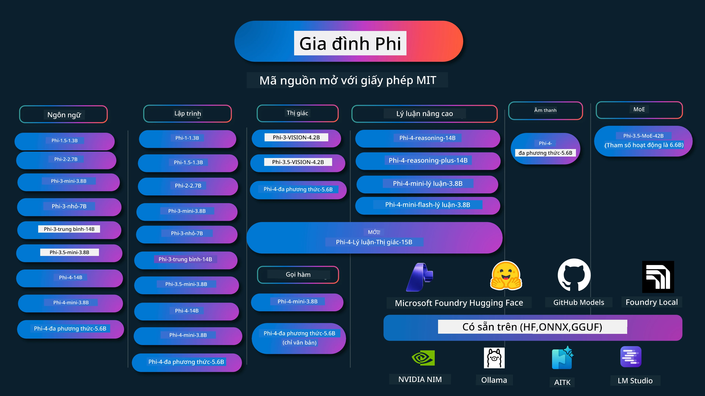

# Sổ tay Phi: Các ví dụ thực hành với các mô hình Phi của Microsoft

[](https://codespaces.new/microsoft/phicookbook)
[](https://vscode.dev/redirect?url=vscode://ms-vscode-remote.remote-containers/cloneInVolume?url=https://github.com/microsoft/phicookbook)

[](https://GitHub.com/microsoft/phicookbook/graphs/contributors/?WT.mc_id=aiml-137032-kinfeylo)
[](https://GitHub.com/microsoft/phicookbook/issues/?WT.mc_id=aiml-137032-kinfeylo)
[](https://GitHub.com/microsoft/phicookbook/pulls/?WT.mc_id=aiml-137032-kinfeylo)
[](http://makeapullrequest.com?WT.mc_id=aiml-137032-kinfeylo)

[](https://GitHub.com/microsoft/phicookbook/watchers/?WT.mc_id=aiml-137032-kinfeylo)
[](https://GitHub.com/microsoft/phicookbook/network/?WT.mc_id=aiml-137032-kinfeylo)
[](https://GitHub.com/microsoft/phicookbook/stargazers/?WT.mc_id=aiml-137032-kinfeylo)

[](https://discord.com/invite/ByRwuEEgH4)

Phi là một chuỗi các mô hình AI mã nguồn mở được phát triển bởi Microsoft.

Phi hiện là mô hình ngôn ngữ nhỏ (SLM) mạnh mẽ và tiết kiệm chi phí nhất, với các chỉ số rất tốt trong đa ngôn ngữ, suy luận, sinh văn bản/trò chuyện, lập trình, hình ảnh, âm thanh và các kịch bản khác.

Bạn có thể triển khai Phi lên đám mây hoặc các thiết bị biên, và dễ dàng xây dựng các ứng dụng AI sinh tạo với sức mạnh tính toán giới hạn.

Thực hiện các bước sau để bắt đầu sử dụng các tài nguyên này:
1. **Sao chép nhánh của Kho lưu trữ**: Nhấn vào [](https://GitHub.com/microsoft/phicookbook/network/?WT.mc_id=aiml-137032-kinfeylo)
2. **Sao chép Kho lưu trữ**: `git clone https://github.com/microsoft/PhiCookBook.git`
3. [**Tham gia Cộng đồng Microsoft AI Discord và gặp gỡ các chuyên gia và nhà phát triển**](https://discord.com/invite/ByRwuEEgH4?WT.mc_id=aiml-137032-kinfeylo)



### 🌐 Hỗ trợ Đa ngôn ngữ

#### Bản dịch được duy trì bởi [Co-op Translator](https://github.com/Azure/co-op-translator)

<!-- CO-OP TRANSLATOR LANGUAGES TABLE START -->
[Tiếng Ả Rập](../ar/README.md) | [Tiếng Bengali](../bn/README.md) | [Tiếng Bungari](../bg/README.md) | [Tiếng Miến Điện (Myanmar)](../my/README.md) | [Tiếng Trung (Giản thể)](../zh-CN/README.md) | [Tiếng Trung (Phồn thể, Hồng Kông)](../zh-HK/README.md) | [Tiếng Trung (Phồn thể, Macau)](../zh-MO/README.md) | [Tiếng Trung (Phồn thể, Đài Loan)](../zh-TW/README.md) | [Tiếng Croatia](../hr/README.md) | [Tiếng Séc](../cs/README.md) | [Tiếng Đan Mạch](../da/README.md) | [Tiếng Hà Lan](../nl/README.md) | [Tiếng Estonia](../et/README.md) | [Tiếng Phần Lan](../fi/README.md) | [Tiếng Pháp](../fr/README.md) | [Tiếng Đức](../de/README.md) | [Tiếng Hy Lạp](../el/README.md) | [Tiếng Do Thái](../he/README.md) | [Tiếng Hindi](../hi/README.md) | [Tiếng Hungary](../hu/README.md) | [Tiếng Indonesia](../id/README.md) | [Tiếng Ý](../it/README.md) | [Tiếng Nhật](../ja/README.md) | [Tiếng Kannada](../kn/README.md) | [Tiếng Khmer](../km/README.md) | [Tiếng Hàn](../ko/README.md) | [Tiếng Litva](../lt/README.md) | [Tiếng Mã Lai](../ms/README.md) | [Tiếng Malayalam](../ml/README.md) | [Tiếng Marathi](../mr/README.md) | [Tiếng Nepal](../ne/README.md) | [Tiếng Pidgin Nigeria](../pcm/README.md) | [Tiếng Na Uy](../no/README.md) | [Tiếng Ba Tư (Farsi)](../fa/README.md) | [Tiếng Ba Lan](../pl/README.md) | [Tiếng Bồ Đào Nha (Brazil)](../pt-BR/README.md) | [Tiếng Bồ Đào Nha (Bồ Đào Nha)](../pt-PT/README.md) | [Tiếng Punjabi (Gurmukhi)](../pa/README.md) | [Tiếng Romania](../ro/README.md) | [Tiếng Nga](../ru/README.md) | [Tiếng Serbia (Chữ Cyrillic)](../sr/README.md) | [Tiếng Slovakia](../sk/README.md) | [Tiếng Slovenia](../sl/README.md) | [Tiếng Tây Ban Nha](../es/README.md) | [Tiếng Swahili](../sw/README.md) | [Tiếng Thụy Điển](../sv/README.md) | [Tiếng Tagalog (Filipino)](../tl/README.md) | [Tiếng Tamil](../ta/README.md) | [Tiếng Telugu](../te/README.md) | [Tiếng Thái](../th/README.md) | [Tiếng Thổ Nhĩ Kỳ](../tr/README.md) | [Tiếng Ukraina](../uk/README.md) | [Tiếng Urdu](../ur/README.md) | [Tiếng Việt](./README.md)

> **Ưu tiên sao chép cục bộ?**
>
> Kho lưu trữ này bao gồm hơn 50 bản dịch ngôn ngữ làm tăng đáng kể kích thước tải xuống. Để sao chép mà không có bản dịch, sử dụng sparse checkout:
>
> **Bash / macOS / Linux:**
> ```bash
> git clone --filter=blob:none --sparse https://github.com/microsoft/PhiCookBook.git
> cd PhiCookBook
> git sparse-checkout set --no-cone '/*' '!translations' '!translated_images'
> ```
>
> **CMD (Windows):**
> ```cmd
> git clone --filter=blob:none --sparse https://github.com/microsoft/PhiCookBook.git
> cd PhiCookBook
> git sparse-checkout set --no-cone "/*" "!translations" "!translated_images"
> ```
>
> Điều này cung cấp cho bạn mọi thứ cần thiết để hoàn thành khoá học với tốc độ tải xuống nhanh hơn nhiều.
<!-- CO-OP TRANSLATOR LANGUAGES TABLE END -->

## Mục lục

- Giới thiệu
  - [Chào mừng đến với gia đình Phi](./md/01.Introduction/01/01.PhiFamily.md)
  - [Cài đặt môi trường của bạn](./md/01.Introduction/01/01.EnvironmentSetup.md)
  - [Hiểu biết về các công nghệ chính](./md/01.Introduction/01/01.Understandingtech.md)
  - [An toàn AI cho các mô hình Phi](./md/01.Introduction/01/01.AISafety.md)
  - [Hỗ trợ phần cứng Phi](./md/01.Introduction/01/01.Hardwaresupport.md)
  - [Các mô hình Phi & khả dụng trên các nền tảng](./md/01.Introduction/01/01.Edgeandcloud.md)
  - [Sử dụng Guidance-ai và Phi](./md/01.Introduction/01/01.Guidance.md)
  - [Mô hình trên GitHub Marketplace](https://github.com/marketplace/models)
  - [Danh mục mô hình AI Azure](https://ai.azure.com)

- Suy luận Phi trong các môi trường khác nhau
    -  [Hugging face](./md/01.Introduction/02/01.HF.md)
    -  [Mô hình GitHub](./md/01.Introduction/02/02.GitHubModel.md)
    -  [Danh mục mô hình Microsoft Foundry](./md/01.Introduction/02/03.AzureAIFoundry.md)
    -  [Ollama](./md/01.Introduction/02/04.Ollama.md)
    -  [Bộ công cụ AI VSCode (AITK)](./md/01.Introduction/02/05.AITK.md)
    -  [NVIDIA NIM](./md/01.Introduction/02/06.NVIDIA.md)
    -  [Foundry Local](./md/01.Introduction/02/07.FoundryLocal.md)

- Suy luận gia đình Phi
    - [Suy luận Phi trên iOS](./md/01.Introduction/03/iOS_Inference.md)
    - [Suy luận Phi trên Android](./md/01.Introduction/03/Android_Inference.md)
    - [Suy luận Phi trên Jetson](./md/01.Introduction/03/Jetson_Inference.md)
    - [Suy luận Phi trên máy tính AI](./md/01.Introduction/03/AIPC_Inference.md)
    - [Suy luận Phi với khung Apple MLX](./md/01.Introduction/03/MLX_Inference.md)
    - [Suy luận Phi trên máy chủ địa phương](./md/01.Introduction/03/Local_Server_Inference.md)
    - [Suy luận Phi trên máy chủ từ xa sử dụng Bộ công cụ AI](./md/01.Introduction/03/Remote_Interence.md)
    - [Suy luận Phi với Rust](./md/01.Introduction/03/Rust_Inference.md)
    - [Suy luận Phi--Thị giác ở địa phương](./md/01.Introduction/03/Vision_Inference.md)
    - [Suy luận Phi với Kaito AKS, Containers Azure (hỗ trợ chính thức)](./md/01.Introduction/03/Kaito_Inference.md)
-  [Phân loại gia đình Phi](./md/01.Introduction/04/QuantifyingPhi.md)
    - [Phân loại Phi-3.5 / 4 bằng llama.cpp](./md/01.Introduction/04/UsingLlamacppQuantifyingPhi.md)
    - [Phân loại Phi-3.5 / 4 bằng tiện ích mở rộng AI sinh tạo cho onnxruntime](./md/01.Introduction/04/UsingORTGenAIQuantifyingPhi.md)
    - [Phân loại Phi-3.5 / 4 bằng Intel OpenVINO](./md/01.Introduction/04/UsingIntelOpenVINOQuantifyingPhi.md)
    - [Phân loại Phi-3.5 / 4 bằng khung Apple MLX](./md/01.Introduction/04/UsingAppleMLXQuantifyingPhi.md)

- Đánh giá Phi
    - [AI phản hồi](./md/01.Introduction/05/ResponsibleAI.md)
    - [Microsoft Foundry cho đánh giá](./md/01.Introduction/05/AIFoundry.md)
    - [Sử dụng Promptflow để đánh giá](./md/01.Introduction/05/Promptflow.md)
 
- RAG với Azure AI Search
    - [Cách sử dụng Phi-4-mini và Phi-4-multimodal (RAG) với Azure AI Search](https://github.com/microsoft/PhiCookBook/blob/main/code/06.E2E/E2E_Phi-4-RAG-Azure-AI-Search.ipynb)
    - [Hybrid RAG địa phương Zero-Cloud với SQLite FTS5 và phi-4-mini](https://github.com/microsoft/PhiCookBook/blob/main/code/06.E2E/E2E_Phi-4-mini_Local_Hybrid_RAG_SQLite_FTS5.ipynb)

- Mẫu phát triển ứng dụng Phi
  - Ứng dụng Văn bản & Trò chuyện
    - Mẫu Phi-4
      - [📓] [Trò chuyện với mô hình Phi-4-mini ONNX](./md/02.Application/01.TextAndChat/Phi4/ChatWithPhi4ONNX/README.md)
      - [Trò chuyện với mô hình Phi-4 local ONNX .NET](../../md/04.HOL/dotnet/src/LabsPhi4-Chat-01OnnxRuntime)
      - [Ứng dụng Console Chat .NET với Phi-4 ONNX sử dụng Semantic Kernel](../../md/04.HOL/dotnet/src/LabsPhi4-Chat-02SK)
    - Mẫu Phi-3 / 3.5
      - [Chatbot cục bộ trên trình duyệt sử dụng Phi3, ONNX Runtime Web và WebGPU](https://github.com/microsoft/onnxruntime-inference-examples/tree/main/js/chat)
      - [Chat OpenVino](./md/02.Application/01.TextAndChat/Phi3/E2E_OpenVino_Chat.md)
      - [Mô hình đa nền - Tương tác Phi-3-mini và OpenAI Whisper](./md/02.Application/01.TextAndChat/Phi3/E2E_Phi-3-mini_with_whisper.md)
      - [MLFlow - Xây dựng lớp bao và sử dụng Phi-3 với MLFlow](./md//02.Application/01.TextAndChat/Phi3/E2E_Phi-3-MLflow.md)
      - [Tối ưu hóa mô hình - Cách tối ưu hóa mô hình Phi-3-min cho ONNX Runtime Web với Olive](https://github.com/microsoft/Olive/tree/main/examples/phi3)
      - [Ứng dụng WinUI3 với Phi-3 mini-4k-instruct-onnx](https://github.com/microsoft/Phi3-Chat-WinUI3-Sample/)
      -[Mẫu ứng dụng chú thích AI đa mô hình WinUI3](https://github.com/microsoft/ai-powered-notes-winui3-sample)
      - [Tinh chỉnh và tích hợp các mô hình Phi-3 tùy chỉnh với Prompt flow](./md/02.Application/01.TextAndChat/Phi3/E2E_Phi-3-FineTuning_PromptFlow_Integration.md)
      - [Tinh chỉnh và tích hợp các mô hình Phi-3 tùy chỉnh với Prompt flow trong Microsoft Foundry](./md/02.Application/01.TextAndChat/Phi3/E2E_Phi-3-FineTuning_PromptFlow_Integration_AIFoundry.md)
      - [Đánh giá mô hình Phi-3 / Phi-3.5 đã tinh chỉnh trong Microsoft Foundry tập trung vào các nguyên tắc AI có trách nhiệm của Microsoft](./md/02.Application/01.TextAndChat/Phi3/E2E_Phi-3-Evaluation_AIFoundry.md)
      - [📓] [Ví dụ dự đoán ngôn ngữ Phi-3.5-mini-instruct (Tiếng Trung/Anh)](./md/02.Application/01.TextAndChat/Phi3/phi3-instruct-demo.ipynb)
      - [Chatbot Phi-3.5-Instruct WebGPU RAG](./md/02.Application/01.TextAndChat/Phi3/WebGPUWithPhi35Readme.md)
      - [Sử dụng GPU Windows để tạo giải pháp Prompt flow với Phi-3.5-Instruct ONNX](./md/02.Application/01.TextAndChat/Phi3/UsingPromptFlowWithONNX.md)
      - [Sử dụng Microsoft Phi-3.5 tflite để tạo ứng dụng Android](./md/02.Application/01.TextAndChat/Phi3/UsingPhi35TFLiteCreateAndroidApp.md)
      - [Ví dụ Hỏi & Đáp .NET sử dụng mô hình Phi-3 ONNX cục bộ với Microsoft.ML.OnnxRuntime](../../md/04.HOL/dotnet/src/LabsPhi301)
      - [Ứng dụng chat Console .NET với Semantic Kernel và Phi-3](../../md/04.HOL/dotnet/src/LabsPhi302)

  - Mẫu mã SDK suy luận Azure AI
    - Mẫu Phi-4
      - [📓] [Tạo mã dự án sử dụng Phi-4-multimodal](./md/02.Application/02.Code/Phi4/GenProjectCode/README.md)
    - Mẫu Phi-3 / 3.5
      - [Xây dựng GitHub Copilot Chat Visual Studio Code của riêng bạn với gia đình Phi-3 Microsoft](./md/02.Application/02.Code/Phi3/VSCodeExt/README.md)
      - [Tạo Agent Chat Copilot Visual Studio Code của riêng bạn với Phi-3.5 bởi Mô hình GitHub](/md/02.Application/02.Code/Phi3/CreateVSCodeChatAgentWithGitHubModels.md)

  - Mẫu suy luận nâng cao
    - Mẫu Phi-4
      - [📓] [Mẫu Phi-4-mini-reasoning hoặc Phi-4-reasoning](./md/02.Application/03.AdvancedReasoning/Phi4/AdvancedResoningPhi4mini/README.md)
      - [📓] [Tinh chỉnh Phi-4-mini-reasoning với Microsoft Olive](./md/02.Application/03.AdvancedReasoning/Phi4/AdvancedResoningPhi4mini/olive_ft_phi_4_reasoning_with_medicaldata.ipynb)
      - [📓] [Tinh chỉnh Phi-4-mini-reasoning với Apple MLX](./md/02.Application/03.AdvancedReasoning/Phi4/AdvancedResoningPhi4mini/mlx_ft_phi_4_reasoning_with_medicaldata.ipynb)
      - [📓] [Phi-4-mini-reasoning với Mô hình GitHub](./md/02.Application/02.Code/Phi4r/github_models_inference.ipynb)
      - [📓] [Phi-4-mini-reasoning với Mô hình Microsoft Foundry](./md/02.Application/02.Code/Phi4r/azure_models_inference.ipynb)
  - Demo
      - [Demo Phi-4-mini trên không gian Hugging Face](https://huggingface.co/spaces/microsoft/phi-4-mini?WT.mc_id=aiml-137032-kinfeylo)
      - [Demo Phi-4-multimodal trên không gian Hugging Face](https://huggingface.co/spaces/microsoft/phi-4-multimodal?WT.mc_id=aiml-137032-kinfeylo)
  - Mẫu về Thị giác
    - Mẫu Phi-4 
      - [📓] [Sử dụng Phi-4-multimodal để đọc hình ảnh và tạo mã](./md/02.Application/04.Vision/Phi4/CreateFrontend/README.md) 
    - Mẫu Phi-3 / 3.5
      -  [📓][Phi-3-thị-giác-chuyển đổi văn bản từ hình ảnh](./md/02.Application/04.Vision/Phi3/E2E_Phi-3-vision-image-text-to-text-online-endpoint.ipynb)
      - [Phi-3-thị-giác-ONNX](https://onnxruntime.ai/docs/genai/tutorials/phi3-v.html)
      - [📓][Phi-3-thị-giác Nhúng CLIP](./md/02.Application/04.Vision/Phi3/E2E_Phi-3-vision-image-text-to-text-online-endpoint.ipynb)
      - [DEMO: Phi-3 Tái chế](https://github.com/jennifermarsman/PhiRecycling/)
      - [Phi-3-thị-giác – Trợ lý ngôn ngữ hình ảnh - với Phi3-Thị-giác và OpenVINO](https://docs.openvino.ai/nightly/notebooks/phi-3-vision-with-output.html)
      - [Phi-3 Thị giác Nvidia NIM](./md/02.Application/04.Vision/Phi3/E2E_Nvidia_NIM_Vision.md)
      - [Phi-3 Thị giác OpenVino](./md/02.Application/04.Vision/Phi3/E2E_OpenVino_Phi3Vision.md)
      - [📓][Mẫu Phi-3.5 Thị giác đa khung hình hoặc đa hình ảnh](./md/02.Application/04.Vision/Phi3/phi3-vision-demo.ipynb)
      - [Phi-3 Thị giác Mô hình ONNX cục bộ sử dụng Microsoft.ML.OnnxRuntime .NET](../../md/04.HOL/dotnet/src/LabsPhi303)
      - [Menu dựa trên Mô hình ONNX cục bộ Phi-3 Thị giác sử dụng Microsoft.ML.OnnxRuntime .NET](../../md/04.HOL/dotnet/src/LabsPhi304)

  - Mẫu Reasoning-Thị giác
    - Phi-4-Reasoning-Thị giác-15B 
      - [📓] [Sử dụng Phi-4-Reasoning-Thị giác-15B để phát hiện đi bộ không đúng](./md/02.Application/10.ReasoningVision/Phi_4_reasoning_vision_15b_Jaywalking.ipynb)
      - [📓] [Sử dụng Phi-4-Reasoning-Thị giác-15B để tính toán](./md/02.Application/10.ReasoningVision/Phi_4_reasoning_vision_15b_Math.ipynb)
      - [📓] [Sử dụng Phi-4-Reasoning-Thị giác-15B để phát hiện UI](./md/02.Application/10.ReasoningVision/Phi_4_reasoning_vision_15b_ui.ipynb)

  - Mẫu Toán học
    -  Mẫu Phi-4-Mini-Flash-Reasoning-Instruct  [Demo Toán với Phi-4-Mini-Flash-Reasoning-Instruct](./md/02.Application/09.Math/MathDemo.ipynb)

  - Mẫu Âm thanh
    - Mẫu Phi-4 
      - [📓] [Trích xuất bản ghi âm thanh sử dụng Phi-4-multimodal](./md/02.Application/05.Audio/Phi4/Transciption/README.md)
      - [📓] [Mẫu Âm thanh Phi-4-multimodal](./md/02.Application/05.Audio/Phi4/Siri/demo.ipynb)
      - [📓] [Mẫu Phi-4-multimodal Phiên dịch giọng nói](./md/02.Application/05.Audio/Phi4/Translate/demo.ipynb)
      - [Ứng dụng console .NET sử dụng Phi-4-multimodal Âm thanh để phân tích file âm thanh và tạo bản ghi](../../md/04.HOL/dotnet/src/LabsPhi4-MultiModal-02Audio)

  - Mẫu MOE
    - Mẫu Phi-3 / 3.5
      - [📓] [Mô hình Hỗn hợp các Chuyên gia (MoEs) Phi-3.5 Mẫu Mạng xã hội](./md/02.Application/06.MoE/Phi3/phi3_moe_demo.ipynb)
      - [📓] [Xây dựng Pipeline Tạo văn bản Tăng cường Tìm kiếm (RAG) với NVIDIA NIM Phi-3 MOE, Azure AI Search, và LlamaIndex](./md/02.Application/06.MoE/Phi3/azure-ai-search-nvidia-rag.ipynb)
      - 
  - Mẫu Gọi Hàm
    - Mẫu Phi-4 🆕
      -  [📓] [Sử dụng Gọi Hàm Với Phi-4-mini](./md/02.Application/07.FunctionCalling/Phi4/FunctionCallingBasic/README.md)
      -  [📓] [Sử dụng Gọi Hàm để tạo đa tác nhân Với Phi-4-mini](./md/02.Application/07.FunctionCalling/Phi4/Multiagents/Phi_4_mini_multiagent.ipynb)
      -  [📓] [Sử dụng Gọi Hàm với Ollama](./md/02.Application/07.FunctionCalling/Phi4/Ollama/ollama_functioncalling.ipynb)
      -  [📓] [Sử dụng Gọi Hàm với ONNX](./md/02.Application/07.FunctionCalling/Phi4/ONNX/onnx_parallel_functioncalling.ipynb)
  - Mẫu Trộn Đa phương thức
    - Mẫu Phi-4 🆕
      -  [📓] [Sử dụng Phi-4-multimodal như một nhà báo Công nghệ](./md/02.Application/08.Multimodel/Phi4/TechJournalist/phi_4_mm_audio_text_publish_news.ipynb)
      - [Ứng dụng console .NET sử dụng Phi-4-multimodal để phân tích hình ảnh](../../md/04.HOL/dotnet/src/LabsPhi4-MultiModal-01Images)

- Tinh chỉnh mẫu Phi
  - [Kịch bản Tinh chỉnh](./md/03.FineTuning/FineTuning_Scenarios.md)
  - [Tinh chỉnh so với RAG](./md/03.FineTuning/FineTuning_vs_RAG.md)
  - [Tinh chỉnh cho phép Phi-3 trở thành chuyên gia ngành](./md/03.FineTuning/LetPhi3gotoIndustriy.md)
  - [Tinh chỉnh Phi-3 với AI Toolkit cho VS Code](./md/03.FineTuning/Finetuning_VSCodeaitoolkit.md)
  - [Tinh chỉnh Phi-3 với Azure Machine Learning Service](./md/03.FineTuning/Introduce_AzureML.md)
  - [Tinh chỉnh Phi-3 với Lora](./md/03.FineTuning/FineTuning_Lora.md)
  - [Tinh chỉnh Phi-3 với QLora](./md/03.FineTuning/FineTuning_Qlora.md)
  - [Tinh chỉnh Phi-3 với Microsoft Foundry](./md/03.FineTuning/FineTuning_AIFoundry.md)
  - [Tinh chỉnh Phi-3 với Azure ML CLI/SDK](./md/03.FineTuning/FineTuning_MLSDK.md)
  - [Tinh chỉnh với Microsoft Olive](./md/03.FineTuning/FineTuning_MicrosoftOlive.md)
  - [Thực hành Tinh chỉnh với Microsoft Olive](./md/03.FineTuning/olive-lab/readme.md)
  - [Tinh chỉnh Phi-3-thị-giác với Weights and Bias](./md/03.FineTuning/FineTuning_Phi-3-visionWandB.md)
  - [Tinh chỉnh Phi-3 với Apple MLX Framework](./md/03.FineTuning/FineTuning_MLX.md)
  - [Tinh chỉnh Phi-3-thị-giác (hỗ trợ chính thức)](./md/03.FineTuning/FineTuning_Vision.md)
  - [Tinh chỉnh Phi-3 với Kaito AKS, Azure Containers (hỗ trợ chính thức)](./md/03.FineTuning/FineTuning_Kaito.md)
  - [Tinh chỉnh Phi-3 và 3.5 Thị giác](https://github.com/2U1/Phi3-Vision-Finetune)

- Phòng thực hành
  - [Khám phá các mô hình tiên tiến: LLMs, SLMs, phát triển cục bộ và hơn thế nữa](https://github.com/microsoft/aitour-exploring-cutting-edge-models)
  - [Khai mở tiềm năng NLP: Tinh chỉnh với Microsoft Olive](https://github.com/azure/Ignite_FineTuning_workshop)

- Bài báo nghiên cứu học thuật và công bố
  - [Textbooks Are All You Need II: báo cáo kỹ thuật phi-1.5](https://arxiv.org/abs/2309.05463)
  - [Báo cáo kỹ thuật Phi-3: Mô hình ngôn ngữ có năng lực cao trên điện thoại của bạn](https://arxiv.org/abs/2404.14219)
  - [Báo cáo kỹ thuật Phi-4](https://arxiv.org/abs/2412.08905)
  - [Báo cáo kỹ thuật Phi-4-Mini: Mô hình ngôn ngữ đa phương thức nhỏ gọn nhưng mạnh mẽ qua Mixture-of-LoRAs](https://arxiv.org/abs/2503.01743)
  - [Tối ưu hóa mô hình ngôn ngữ nhỏ cho Gọi chức năng trong xe](https://arxiv.org/abs/2501.02342)
  - [(WhyPHI) Tinh chỉnh PHI-3 cho Trả lời câu hỏi trắc nghiệm: Phương pháp, Kết quả, và Thách thức](https://arxiv.org/abs/2501.01588)
  - [Báo cáo kỹ thuật Phi-4-reasoning](https://www.microsoft.com/en-us/research/wp-content/uploads/2025/04/phi_4_reasoning.pdf)
  - [Báo cáo kỹ thuật Phi-4-mini-reasoning](https://huggingface.co/microsoft/Phi-4-mini-reasoning/blob/main/Phi-4-Mini-Reasoning.pdf)

## Sử dụng Mô hình Phi

### Phi trên Microsoft Foundry

Bạn có thể học cách sử dụng Microsoft Phi và cách xây dựng các giải pháp đầu-cuối trên các thiết bị phần cứng khác nhau của bạn. Để trải nghiệm Phi, hãy bắt đầu chơi với các mô hình và tùy chỉnh Phi cho các tình huống của bạn sử dụng  [Catalog mô hình Azure AI Microsoft Foundry](https://aka.ms/phi3-azure-ai) bạn có thể tìm hiểu thêm tại Bắt đầu với [Microsoft Foundry](/md/02.QuickStart/AzureAIFoundry_QuickStart.md)

**Sân chơi**
Mỗi mô hình có một sân chơi riêng để thử nghiệm mô hình [Azure AI Playground](https://aka.ms/try-phi3).

### Phi trên Mô hình GitHub

Bạn có thể học cách sử dụng Microsoft Phi và cách xây dựng các giải pháp đầu-cuối trên các thiết bị phần cứng khác nhau của bạn. Để trải nghiệm Phi, hãy bắt đầu chơi với mô hình và tùy chỉnh Phi cho các tình huống của bạn sử dụng [Catalog mô hình GitHub](https://github.com/marketplace/models?WT.mc_id=aiml-137032-kinfeylo) bạn có thể tìm hiểu thêm tại Bắt đầu với [Catalog mô hình GitHub](/md/02.QuickStart/GitHubModel_QuickStart.md)

**Sân chơi**
Mỗi mô hình có một [sân chơi để thử nghiệm mô hình](/md/02.QuickStart/GitHubModel_QuickStart.md).

### Phi trên Hugging Face

Bạn cũng có thể tìm mô hình trên [Hugging Face](https://huggingface.co/microsoft)

**Sân chơi**
 [Sân chơi Hugging Chat](https://huggingface.co/chat/models/microsoft/Phi-3-mini-4k-instruct)

 ## 🎒 Các Khóa học Khác

Nhóm của chúng tôi cũng sản xuất các khóa học khác! Hãy xem qua:

<!-- CO-OP TRANSLATOR OTHER COURSES START -->
### LangChain
[](https://aka.ms/langchain4j-for-beginners)
[](https://aka.ms/langchainjs-for-beginners?WT.mc_id=m365-94501-dwahlin)
[](https://github.com/microsoft/langchain-for-beginners?WT.mc_id=m365-94501-dwahlin)
---

### Azure / Edge / MCP / Tác nhân
[](https://github.com/microsoft/AZD-for-beginners?WT.mc_id=academic-105485-koreyst)
[](https://github.com/microsoft/edgeai-for-beginners?WT.mc_id=academic-105485-koreyst)
[](https://github.com/microsoft/mcp-for-beginners?WT.mc_id=academic-105485-koreyst)
[](https://github.com/microsoft/ai-agents-for-beginners?WT.mc_id=academic-105485-koreyst)

---
 
### Series AI Sinh tạo
[](https://github.com/microsoft/generative-ai-for-beginners?WT.mc_id=academic-105485-koreyst)
[-9333EA?style=for-the-badge&labelColor=E5E7EB&color=9333EA)](https://github.com/microsoft/Generative-AI-for-beginners-dotnet?WT.mc_id=academic-105485-koreyst)
[-C084FC?style=for-the-badge&labelColor=E5E7EB&color=C084FC)](https://github.com/microsoft/generative-ai-for-beginners-java?WT.mc_id=academic-105485-koreyst)
[-E879F9?style=for-the-badge&labelColor=E5E7EB&color=E879F9)](https://github.com/microsoft/generative-ai-with-javascript?WT.mc_id=academic-105485-koreyst)

---
 
### Học Core
[](https://aka.ms/ml-beginners?WT.mc_id=academic-105485-koreyst)
[](https://aka.ms/datascience-beginners?WT.mc_id=academic-105485-koreyst)
[](https://aka.ms/ai-beginners?WT.mc_id=academic-105485-koreyst)
[](https://github.com/microsoft/Security-101?WT.mc_id=academic-96948-sayoung)
[](https://aka.ms/webdev-beginners?WT.mc_id=academic-105485-koreyst)
[](https://aka.ms/iot-beginners?WT.mc_id=academic-105485-koreyst)
[](https://github.com/microsoft/xr-development-for-beginners?WT.mc_id=academic-105485-koreyst)

---
 
### Series Copilot
[](https://aka.ms/GitHubCopilotAI?WT.mc_id=academic-105485-koreyst)
[](https://github.com/microsoft/mastering-github-copilot-for-dotnet-csharp-developers?WT.mc_id=academic-105485-koreyst)
[](https://github.com/microsoft/CopilotAdventures?WT.mc_id=academic-105485-koreyst)
<!-- CO-OP TRANSLATOR OTHER COURSES END -->

## AI Có Trách nhiệm

Microsoft cam kết giúp khách hàng của chúng tôi sử dụng các sản phẩm AI một cách có trách nhiệm, chia sẻ kinh nghiệm, và xây dựng các quan hệ đối tác dựa trên niềm tin thông qua các công cụ như Ghi chú Minh bạch và Đánh giá Tác động. Nhiều tài nguyên này có thể được tìm thấy tại [https://aka.ms/RAI](https://aka.ms/RAI).
Phương pháp tiếp cận AI có trách nhiệm của Microsoft dựa trên các nguyên tắc AI của chúng tôi về công bằng, đáng tin cậy và an toàn, quyền riêng tư và bảo mật, bao gồm, minh bạch, và trách nhiệm giải trình.

Các mô hình ngôn ngữ, hình ảnh và giọng nói quy mô lớn - như những mẫu được sử dụng trong ví dụ này - có thể hành xử theo những cách không công bằng, không đáng tin cậy hoặc xúc phạm, dẫn đến tổn hại. Vui lòng tham khảo [Ghi chú Minh bạch dịch vụ Azure OpenAI](https://learn.microsoft.com/legal/cognitive-services/openai/transparency-note?tabs=text) để nắm rõ các rủi ro và hạn chế.

Cách tiếp cận được khuyến nghị để giảm thiểu các rủi ro này là bao gồm một hệ thống an toàn trong kiến trúc của bạn có thể phát hiện và ngăn chặn hành vi gây hại. [Azure AI Content Safety](https://learn.microsoft.com/azure/ai-services/content-safety/overview) cung cấp một lớp bảo vệ độc lập, có khả năng phát hiện nội dung do người dùng và AI tạo ra có hại trong các ứng dụng và dịch vụ. Azure AI Content Safety bao gồm các API văn bản và hình ảnh cho phép bạn phát hiện các tài liệu có hại. Trong Microsoft Foundry, dịch vụ Content Safety cho phép bạn xem, khám phá và thử nghiệm mã mẫu để phát hiện nội dung có hại trên các chế độ khác nhau. Tài liệu [bắt đầu nhanh](https://learn.microsoft.com/azure/ai-services/content-safety/quickstart-text?tabs=visual-studio%2Clinux&pivots=programming-language-rest) sau đây hướng dẫn bạn cách thực hiện các yêu cầu tới dịch vụ.

Một khía cạnh khác cần cân nhắc là hiệu suất tổng thể của ứng dụng. Với các ứng dụng đa phương thức và đa mô hình, chúng tôi xem hiệu suất là hệ thống hoạt động như bạn và người dùng mong đợi, bao gồm cả việc không tạo ra kết quả gây hại. Rất quan trọng để đánh giá hiệu suất của toàn bộ ứng dụng của bạn bằng cách sử dụng [đánh giá Hiệu suất và Chất lượng cũng như Rủi ro và An toàn](https://learn.microsoft.com/azure/ai-studio/concepts/evaluation-metrics-built-in). Bạn cũng có khả năng tạo và đánh giá với các [bộ đánh giá tùy chỉnh](https://learn.microsoft.com/azure/ai-studio/how-to/develop/evaluate-sdk#custom-evaluators).

Bạn có thể đánh giá ứng dụng AI của mình trong môi trường phát triển sử dụng [Azure AI Evaluation SDK](https://microsoft.github.io/promptflow/index.html). Với một bộ dữ liệu kiểm tra hoặc một mục tiêu, các kết quả tạo ra của ứng dụng AI sinh tạo được đo lường định lượng với các bộ đánh giá tích hợp sẵn hoặc bộ đánh giá tùy chỉnh theo lựa chọn của bạn. Để bắt đầu với azure ai evaluation sdk để đánh giá hệ thống của bạn, bạn có thể làm theo [hướng dẫn bắt đầu nhanh](https://learn.microsoft.com/azure/ai-studio/how-to/develop/flow-evaluate-sdk). Khi bạn thực hiện chạy đánh giá, bạn có thể [hiển thị kết quả trong Microsoft Foundry](https://learn.microsoft.com/azure/ai-studio/how-to/evaluate-flow-results).

## Nhãn hiệu

Dự án này có thể chứa nhãn hiệu hoặc logo cho các dự án, sản phẩm hoặc dịch vụ. Việc sử dụng nhãn hiệu hoặc logo của Microsoft được ủy quyền phải tuân theo và theo [Hướng dẫn Nhãn hiệu & Thương hiệu của Microsoft](https://www.microsoft.com/legal/intellectualproperty/trademarks/usage/general).
Việc sử dụng nhãn hiệu hoặc logo của Microsoft trong các phiên bản chỉnh sửa của dự án này không được gây nhầm lẫn hoặc ngụ ý Microsoft tài trợ. Bất kỳ việc sử dụng nhãn hiệu hoặc logo của bên thứ ba đều phải tuân theo chính sách của bên thứ ba đó.

## Nhận trợ giúp

Nếu bạn gặp khó khăn hoặc có bất kỳ câu hỏi nào về việc xây dựng ứng dụng AI, hãy tham gia:

[](https://aka.ms/foundry/discord)

Nếu bạn có phản hồi về sản phẩm hoặc lỗi khi xây dựng, hãy truy cập:

[](https://aka.ms/foundry/forum)

---

<!-- CO-OP TRANSLATOR DISCLAIMER START -->
**Tuyên bố miễn trừ trách nhiệm**:
Tài liệu này đã được dịch bằng dịch vụ dịch thuật AI [Co-op Translator](https://github.com/Azure/co-op-translator). Mặc dù chúng tôi cố gắng đảm bảo độ chính xác, xin lưu ý rằng bản dịch tự động có thể chứa lỗi hoặc sai sót. Tài liệu gốc bằng ngôn ngữ gốc nên được coi là nguồn tin chính thức. Đối với thông tin quan trọng, nên sử dụng dịch vụ dịch thuật chuyên nghiệp bởi con người. Chúng tôi không chịu trách nhiệm về bất kỳ hiểu lầm hoặc giải thích sai nào phát sinh từ việc sử dụng bản dịch này.
<!-- CO-OP TRANSLATOR DISCLAIMER END -->